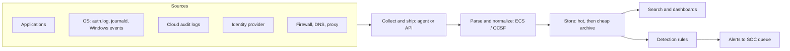

# Security Logging and SIEM

## Introduction

When something goes wrong, the first question is always "what happened?" Logs are how you answer it. Without them, a SOC cannot detect an attack, an incident responder cannot scope it, and a company cannot prove to customers or regulators what was or was not affected.

A **SIEM** (Security Information and Event Management) system collects logs from many sources into one place. It normalizes them into a common format, stores them, lets analysts search them, and runs detection rules that turn suspicious patterns into alerts.

Think of logs as security camera footage and the SIEM as the control room. Cameras that point at the wall, record at the wrong time, or get wiped every night are useless, and so is a control room nobody can search. This page covers both halves:

1. **Producing good logs**: what to record, in what format, and what to leave out.
2. **Using them in a SIEM**: shipping, normalizing, correlating, retaining and protecting them.

Missing or useless logs are a top-level risk. The OWASP Top 10 2025 lists it as **A09 Security Logging & Alerting Failures**. See the [OWASP Top 10](../3-sec-web-security/1-sec-owasp-top-10.mdx) page.

## The Logging Pipeline



Every stage can fail quietly. An agent stops shipping, a parser stops matching after a log format change, or a rule refers to a field that was renamed. Good SIEM operation includes **monitoring the pipeline itself**, for example with an alert when a critical source sends no data for an hour.

## What to Log

You cannot log everything forever; it costs too much and buries the signal. Prioritize sources by how often they help in real investigations.

| Priority | Source | Why it matters | Examples |
| --- | --- | --- | --- |
| 1 | **Identity** | Most attacks use stolen or abused accounts | IdP sign-ins, MFA events, SSO, password resets |
| 1 | **Endpoint / EDR** | Shows what ran on machines | Process creation, EDR alerts |
| 1 | **Cloud control plane** | Who changed what in your cloud | AWS CloudTrail, Azure Activity Log, GCP Cloud Audit Logs |
| 2 | **Application security events** | Only your app knows its business logic | Logins, permission changes, admin actions, exports |
| 2 | **Network edges** | Entry points and data leaving | Firewall, VPN, DNS, web proxy, load balancer |
| 2 | **Email** | Phishing is a top entry point | Mail gateway verdicts, mailbox rule changes |
| 3 | **Kubernetes and containers** | Workload changes | Kubernetes audit log, container runtime events |
| 3 | **Databases** | Sensitive data access | Login, privilege changes, bulk reads |

### Operating system events worth knowing

On **Windows**, a handful of Security log event IDs come up in almost every investigation:

| Event ID | Meaning |
| --- | --- |
| 4624 / 4625 | Successful / failed logon |
| 4688 | Process created (enable command-line logging to make it useful) |
| 4720 | User account created |
| 4732 | Member added to a security-enabled local group |
| 1102 | The audit log was cleared |

Microsoft's free **Sysmon** tool adds richer events, such as event ID 1 (process creation with hashes and parent process), 3 (network connection) and 22 (DNS query).

On **Linux**, start with authentication logs (`/var/log/auth.log` on Debian and Ubuntu, `/var/log/secure` on RHEL-family systems, or `journalctl`), plus `auditd` rules for sensitive files and commands. The [Linux Hardening](../9-sec-system-hardening/0-sec-linux-hardening.mdx) page shows how to configure auditing.

### Security events your application should log

Your application sees things no infrastructure log can, such as "user 42 exported every customer record". The OWASP Logging Cheat Sheet and ASVS recommend logging at least:

- Authentication successes and failures, MFA enrollment and challenges, password resets
- Authorization failures (access denied)
- Changes to privileges, roles, API keys and security settings
- Admin actions and impersonation ("log in as user")
- Input validation failures that suggest probing, such as many invalid IDs
- High-value business actions: payments, payouts, bulk exports, deletions

### What never to log

Logs are copied to many systems and read by many people. Never log:

- Passwords, even failed ones (users often type a password into the username field)
- Session tokens, API keys, JWTs, OAuth codes, or full credit card numbers
- More personal data than you need. Log a user ID instead of a full address or date of birth.

The [Secure Error Handling and Logging](../5-sec-secure-coding/2-sec-error-handling-and-logging.mdx) page covers redaction and log injection in detail.

## Writing Structured Security Logs

A log line like `login failed for anna` is easy for a human to read and hard for a SIEM to use. **Structured logs**, usually one JSON object per line, let the SIEM index fields directly, with no fragile parsing.

Use a standard field naming scheme so the same thing has the same name everywhere. The example below uses field names from the **Elastic Common Schema (ECS)**.

```python
import json
import logging
from datetime import datetime, timezone

class SecurityJsonFormatter(logging.Formatter):
    """Write one JSON object per line, using ECS-style field names."""
    def format(self, record):
        doc = {
            "@timestamp": datetime.fromtimestamp(record.created, timezone.utc).isoformat(timespec="milliseconds"),
            "log.level": record.levelname.lower(),
            "message": record.getMessage(),
            "service.name": "brightcart-api",
        }
        doc.update(getattr(record, "fields", {}))
        return json.dumps(doc)

handler = logging.StreamHandler()
handler.setFormatter(SecurityJsonFormatter())
security_log = logging.getLogger("security")
security_log.addHandler(handler)
security_log.setLevel(logging.INFO)

def log_login(username: str, source_ip: str, success: bool, reason: str = ""):
    security_log.info(
        "login %s", "succeeded" if success else "failed",
        extra={"fields": {
            "event.category": "authentication",
            "event.action": "user-login",
            "event.outcome": "success" if success else "failure",
            "user.name": username,          # the username, never the password
            "source.ip": source_ip,
            **({"event.reason": reason} if reason else {}),
        }},
    )

log_login("anna", "198.51.100.23", success=False, reason="bad_password")
log_login("anna", "198.51.100.23", success=True)
```

Example output (timestamps will differ):

```text
{"@timestamp": "2026-10-11T11:09:43.412+00:00", "log.level": "info", "message": "login failed", "service.name": "brightcart-api", "event.category": "authentication", "event.action": "user-login", "event.outcome": "failure", "user.name": "anna", "source.ip": "198.51.100.23", "event.reason": "bad_password"}
{"@timestamp": "2026-10-11T11:09:43.412+00:00", "log.level": "info", "message": "login succeeded", "service.name": "brightcart-api", "event.category": "authentication", "event.action": "user-login", "event.outcome": "success", "user.name": "anna", "source.ip": "198.51.100.23"}
```

Points to notice:

- **Timestamps are UTC with milliseconds.** Mixing time zones across sources is one of the most common reasons investigations go wrong. Keep all servers synchronized with NTP.
- **The outcome is a field, not just text.** A SIEM rule can count `event.outcome: failure` without parsing English.
- **Writing to standard output** suits containers and Kubernetes, where the platform collects stdout. Libraries such as `structlog` or `python-json-logger` provide the same result with less code.

:::warning Behind a proxy, check where the IP comes from
If your app runs behind a load balancer, the socket IP is the load balancer's. Use the `X-Forwarded-For` header only when the request came from a proxy you trust, or attackers can forge their logged IP.
:::

## Normalization: One Language for Many Sources

Every product names fields differently: `src_ip`, `ClientIP`, `IPAddress`, `remote_addr`. A detection rule for "many failures from one IP" would need a version for each source. **Normalization** maps every source to one schema, so one rule works everywhere.

Two open schemas are common:

| Schema | Who uses it | Style |
| --- | --- | --- |
| **ECS** (Elastic Common Schema) | Elastic and many open source shippers | Dotted field names such as `source.ip`, `user.name`, `event.outcome` |
| **OCSF** (Open Cybersecurity Schema Framework) | AWS Security Lake and a growing number of vendors | Event classes with numeric IDs, such as Authentication (3002) and Process Activity (1007) |

Splunk uses its Common Information Model (CIM), and Microsoft Sentinel uses ASIM. At the time of writing, the ECS reference documents version 9.x and OCSF publishes 1.9.0. Both evolve, so check [the ECS reference](https://www.elastic.co/docs/reference/ecs) and [schema.ocsf.io](https://schema.ocsf.io/) for the current versions.

Here is normalization in miniature. Two very different log formats, an SSH server log and an nginx access log, come out as the same kind of event:

```python
import re

SSHD = re.compile(
    r"^(?P<ts>\S+) (?P<host>\S+) sshd\[\d+\]: (?P<result>Failed|Accepted) "
    r"(?P<method>password|publickey) for (?:invalid user )?(?P<user>\S+) "
    r"from (?P<ip>[\d.]+) port \d+"
)
NGINX = re.compile(
    r'^(?P<ip>[\d.]+) - (?P<user>\S+) \[(?P<ts>[^\]]+)\] "(?P<method>\S+) (?P<path>\S+) [^"]+" '
    r'(?P<status>\d{3}) \d+'
)

def from_sshd(line):
    m = SSHD.match(line)
    if not m:
        return None
    return {
        "@timestamp": m["ts"], "host.name": m["host"],
        "event.category": "authentication", "event.action": "ssh-login",
        "event.outcome": "success" if m["result"] == "Accepted" else "failure",
        "user.name": m["user"], "source.ip": m["ip"],
    }

def from_nginx(line):
    m = NGINX.match(line)
    if not m:
        return None
    return {
        "@timestamp": m["ts"], "event.category": "web",
        "event.action": "http-request", "url.path": m["path"],
        "http.response.status_code": int(m["status"]),
        "event.outcome": "failure" if m["status"].startswith(("4", "5")) else "success",
        "user.name": None if m["user"] == "-" else m["user"], "source.ip": m["ip"],
    }

lines = [
    ("sshd", "2026-10-11T08:01:12+00:00 web-prod-02 sshd[912]: Failed password for invalid user admin from 203.0.113.66 port 52144 ssh2"),
    ("sshd", "2026-10-11T08:01:40+00:00 web-prod-02 sshd[915]: Accepted publickey for deploy from 192.0.2.10 port 40022 ssh2"),
    ("nginx", '198.51.100.23 - - [11/Oct/2026:08:02:03 +0000] "POST /api/login HTTP/1.1" 401 52 "-" "curl/8.5.0"'),
]

for source, line in lines:
    event = {"sshd": from_sshd, "nginx": from_nginx}[source](line)
    print({k: v for k, v in event.items() if k in ("event.action", "event.outcome", "user.name", "source.ip")})
```

Output:

```text
{'event.action': 'ssh-login', 'event.outcome': 'failure', 'user.name': 'admin', 'source.ip': '203.0.113.66'}
{'event.action': 'ssh-login', 'event.outcome': 'success', 'user.name': 'deploy', 'source.ip': '192.0.2.10'}
{'event.action': 'http-request', 'event.outcome': 'failure', 'user.name': None, 'source.ip': '198.51.100.23'}
```

In production you rarely write these parsers yourself. SIEM vendors and shippers include parsers for common products. You still need to **test them**: when a vendor changes its log format, a parser that silently stops matching turns into a blind spot.

## Shipping Logs

Logs should leave the machine that produced them **quickly**. If an attacker gains admin rights on a server, the local logs can be edited or deleted. ATT&CK tracks this behavior; in ATT&CK v19, "Clear Windows Event Logs" (T1685.005) sits under the new **Defense Impairment** tactic. Logs that already reached the SIEM are out of the attacker's reach.

Common collectors include vendor agents (Elastic Agent, Splunk Universal Forwarder, the Azure Monitor Agent), and open source shippers such as **Fluent Bit**, **Vector** and the **OpenTelemetry Collector**. Cloud audit logs usually arrive through an API integration instead of an agent.

A minimal Fluent Bit configuration in its YAML format looks like this. It tails JSON log files and prints them, which is a safe way to test before you point the output at a real SIEM:

```yaml
service:
  flush: 1
  log_level: info

pipeline:
  inputs:
    - name: tail
      path: /var/log/brightcart/*.json
      tag: app.security

  outputs:
    - name: stdout
      match: app.*
```

Replace the `stdout` output with the output plugin for your SIEM, and check the [Fluent Bit documentation](https://docs.fluentbit.io/) for its options, since plugins and settings change between releases.

## Correlation: Where a SIEM Earns Its Keep

Searching one log source is useful. The real power of a SIEM is **correlation**: connecting events across time, users, hosts and sources. A classic example is **password spraying followed by a success**: many failed logins across many accounts from one IP, then one success from the same IP. Any single event looks harmless. Together they suggest a compromised account.

This Python sketch implements that rule over normalized events with a sliding time window:

```python
from collections import defaultdict, deque
from datetime import datetime, timedelta

events = [  # normalized authentication events, oldest first
    {"t": "2026-10-11T08:00:00", "ip": "203.0.113.66", "user": "anna", "outcome": "failure"},
    {"t": "2026-10-11T08:00:20", "ip": "203.0.113.66", "user": "tom", "outcome": "failure"},
    {"t": "2026-10-11T08:00:41", "ip": "203.0.113.66", "user": "maria", "outcome": "failure"},
    {"t": "2026-10-11T08:01:05", "ip": "203.0.113.66", "user": "li", "outcome": "failure"},
    {"t": "2026-10-11T08:01:30", "ip": "203.0.113.66", "user": "sam", "outcome": "failure"},
    {"t": "2026-10-11T08:02:10", "ip": "203.0.113.66", "user": "maria", "outcome": "success"},
    {"t": "2026-10-11T08:05:00", "ip": "198.51.100.23", "user": "anna", "outcome": "failure"},
    {"t": "2026-10-11T08:05:30", "ip": "198.51.100.23", "user": "anna", "outcome": "success"},
]

WINDOW = timedelta(minutes=10)
MIN_FAILURES = 5

failures = defaultdict(deque)   # ip -> recent failure events
for e in events:
    t = datetime.fromisoformat(e["t"])
    recent = failures[e["ip"]]
    while recent and t - recent[0][0] > WINDOW:   # drop failures outside the window
        recent.popleft()
    if e["outcome"] == "failure":
        recent.append((t, e["user"]))
    elif len(recent) >= MIN_FAILURES:
        users = sorted({u for _, u in recent})
        print(f"ALERT {e['t']} success for '{e['user']}' from {e['ip']} after "
              f"{len(recent)} failures on {len(users)} accounts: {users}")
```

Output:

```text
ALERT 2026-10-11T08:02:10 success for 'maria' from 203.0.113.66 after 5 failures on 5 accounts: ['anna', 'li', 'maria', 'sam', 'tom']
```

Anna's single typo from `198.51.100.23` does not alert, because one failure is normal. This is the core trade-off of every detection: **thresholds that are too low drown analysts, and thresholds that are too high miss slow attacks**. An attacker who tries one password per account per hour will slip under a 10-minute window. [Detection Engineering](./2-sec-detection-engineering.mdx) covers how to test and tune rules like this.

### The same rule in real SIEM query languages

Each SIEM has its own query language. The queries below express a similar idea: count failures and successes per source IP over the last 15 minutes. They are illustrative. Field names depend on your data sources and parsers, and these simple aggregations ignore event order, unlike the Python version.

Splunk SPL:

```text
index=auth earliest=-15m
| stats count(eval(outcome="failure")) AS failures,
        count(eval(outcome="success")) AS successes,
        dc(user) AS users BY src_ip
| where failures >= 5 AND successes > 0
```

Microsoft Sentinel KQL, using the Entra ID `SigninLogs` table, where `ResultType` "0" means success:

```text
SigninLogs
| where TimeGenerated > ago(15m)
| summarize Failures = countif(ResultType != "0"),
            Successes = countif(ResultType == "0"),
            Users = dcount(UserPrincipalName) by IPAddress
| where Failures >= 5 and Successes > 0
```

Elastic ES|QL with ECS fields:

```text
FROM logs-*
| WHERE @timestamp > NOW() - 15 minutes AND event.category == "authentication"
| STATS failures = COUNT(CASE(event.outcome == "failure", 1, null)),
        successes = COUNT(CASE(event.outcome == "success", 1, null)),
        users = COUNT_DISTINCT(user.name) BY source.ip
| WHERE failures >= 5 AND successes > 0
```

Notice that the logic is the same and only the syntax changes. That is why vendor-neutral rule formats like **Sigma** exist. You write the rule once and convert it for each SIEM, as the next page shows.

## Keeping Logs Trustworthy

Logs are evidence. If an attacker can change them, or if you cannot prove they were not changed, they lose much of their value.

- **Ship off-host fast**, as described above.
- **Restrict who can delete or modify** logs in the SIEM, and alert on retention or pipeline changes.
- **Use write-once storage** for archives, such as object storage with object lock or immutability policies.
- **Make tampering detectable.** Hash chaining links each record to the previous one, so editing any record breaks the chain. Some products and append-only ledgers do this for you; here is the idea:

```python
import hashlib
import json

def chain(records):
    """Return records with a hash that covers the record and the previous hash."""
    prev = "0" * 64
    out = []
    for rec in records:
        body = json.dumps(rec, sort_keys=True)
        h = hashlib.sha256((prev + body).encode()).hexdigest()
        out.append({**rec, "prev": prev, "hash": h})
        prev = h
    return out

def verify(chained):
    prev = "0" * 64
    for i, rec in enumerate(chained):
        body = json.dumps({k: v for k, v in rec.items() if k not in ("prev", "hash")}, sort_keys=True)
        if rec["prev"] != prev or hashlib.sha256((prev + body).encode()).hexdigest() != rec["hash"]:
            return f"tampering detected at record {i}"
        prev = rec["hash"]
    return "chain intact"

log = chain([
    {"t": "08:00", "action": "user-login", "user": "maria", "outcome": "success"},
    {"t": "08:03", "action": "role-grant", "user": "maria", "role": "admin"},
    {"t": "08:04", "action": "data-export", "user": "maria", "rows": 120000},
])
print(verify(log))
log[1]["role"] = "viewer"         # an attacker edits the record to hide the admin grant
print(verify(log))
```

Output:

```text
chain intact
tampering detected at record 1
```

A hash chain only proves tampering if the attacker cannot simply recompute every hash. Store the latest hash somewhere the attacker cannot reach, or sign it periodically with a key held outside the logging system. The [Digital Signatures and MACs](../1-sec-cryptography/5-sec-digital-signatures.mdx) page explains signing.

## Retention and Cost

SIEMs usually charge by data ingested or stored, and security logs grow fast. A few practical rules:

- **Decide retention by need.** Ask how far back investigations usually reach, and what your compliance obligations require. For example, PCI DSS requires at least 12 months of audit log history, with the most recent three months immediately available for analysis. See [Compliance](../13-sec-governance/2-sec-compliance.mdx).
- **Tier your storage.** Keep recent data "hot" and searchable, and move older data to cheaper archive storage that you can restore or query more slowly. Most cloud SIEMs now offer a cheaper data lake or archive tier.
- **Filter noise at the source**, such as debug logs and health checks, but never drop security-relevant events to save money without a documented decision.
- **Watch for silent sources.** A sudden drop in volume is as suspicious as a spike.

## Real-World Scenario

**BrightCart**, a 120-person e-commerce SaaS company, has logs everywhere and nowhere: application logs in the Kubernetes cluster's default log store for 7 days, cloud audit logs in the provider's console, and identity provider logs kept for 30 days by default. During a recent customer complaint about an unauthorized admin change, the team could not reconstruct who did what, because the relevant application logs had already rotated away.

### The solution

1. **Define security events in the app.** Engineers add structured JSON security logs (login, MFA, role changes, API key creation, bulk exports) using ECS field names, with tests that assert the events are emitted.
2. **Centralize.** A collector on each node ships container stdout to the SIEM, and API connectors pull cloud audit logs and identity provider logs.
3. **Normalize and test parsers.** Each source has a sample-log test that fails CI if a parser stops producing `event.outcome`, `user.name` and `source.ip`.
4. **Start with a few correlation rules**: password spraying followed by success, admin role granted outside a change window, new cloud access key followed by unusual API calls.
5. **Retention**: 90 days hot, 13 months in archive storage with object lock, to cover investigations and customer audit needs.
6. **Pipeline health alerts**: alert if any critical source is silent for 60 minutes.

### Why this approach

The admin-change investigation failed because of **missing application context and short retention**, not because of a missing tool. Structured app events and central retention fix the root cause. Starting with three tested correlations gives quick value without the "collect everything, detect nothing" trap.

### When to use it, and when not to

- **Use a central SIEM** once you have more than a few log sources, any compliance obligation, or anyone who must investigate incidents.
- **A full SIEM may be overkill** for a tiny team with one cloud account and a managed identity provider. There, the cloud provider's native audit and alerting tools plus an MDR service may be enough at first.
- **Do not ingest everything on day one.** Start with identity, cloud control plane, endpoint and application security events, then expand based on what investigations need.

### Alternatives and trade-offs

| Approach | Pros | Cons | Best for |
| --- | --- | --- | --- |
| Commercial cloud SIEM (Sentinel, Splunk Cloud, Google SecOps, Elastic Cloud) | Managed, many built-in connectors and detections | Costs grow with data volume; some lock-in | Teams that want speed over control |
| Self-hosted open source (Wazuh, Elastic or OpenSearch stack) | No license fees; full control | You run, scale and patch it; engineering time is the real cost | Teams with strong ops skills |
| Security data lake plus detection layer (OCSF in object storage) | Cheap long-term storage; vendor-neutral data | More assembly required; query speed varies | Large volumes and long retention |
| Cloud-native tools only (provider audit logs and alerts) | Cheap and simple; already enabled | Siloed per provider; weak cross-source correlation | Very small single-cloud teams |
| MDR provider's platform | Includes 24x7 analysts | Data may be limited to what the provider supports | Small teams without night coverage |

Product features and pricing models change often. Check vendor documentation for current details before committing.

## Common Mistakes

- **Unstructured, inconsistent logs.** Free-text messages with different field names per service make every detection fragile. Use JSON and one schema.
- **Logging secrets or excessive personal data.** Logs end up in many places; treat them as sensitive data.
- **Local-only logs.** An attacker with admin rights can delete them. Ship off-host within seconds or minutes.
- **No time synchronization.** Clock drift of even a few minutes makes cross-source timelines wrong.
- **Never testing parsers.** A vendor format change silently breaks fields and every rule that uses them.
- **No alert on silent sources.** A data source that stops sending looks exactly like a quiet day.
- **Retention chosen by default settings.** Many services keep logs only for days or weeks by default. Decide deliberately.
- **Trusting client-supplied IPs.** `X-Forwarded-For` from untrusted clients lets attackers forge their logged address.

## Summary

- Logs are the evidence behind every detection and investigation; a **SIEM** centralizes, normalizes, stores, searches and correlates them.
- Prioritize **identity, endpoint, cloud control plane and application security events**.
- Write **structured JSON logs** with standard field names, UTC timestamps, and no secrets.
- **Normalize** to a schema such as ECS or OCSF so one rule works across sources, and test your parsers.
- **Correlation** across time and sources finds attacks that single events hide, but thresholds always trade noise against missed attacks.
- Keep logs **trustworthy** (off-host, restricted, immutable, tamper-evident) and **affordable** (tiered retention, filtered noise, source health monitoring).

## Exercises

1. **Add events.** Extend the structured logging example with `log_role_change(actor, target, role)` and `log_api_key_created(user, key_id)`. Make sure no secret value is ever logged.
2. **Catch a slow spray.** Modify the correlation script so it also detects an attacker who tries one account every 3 minutes for an hour. What new false positives might this cause?
3. **Break the parser.** Change the sshd log format slightly, for example by adding a field, and write a test that fails when `from_sshd` returns `None` for a line that should match.
4. **Plan retention.** For BrightCart, write a one-page retention plan covering each log source, hot and archive periods, and the reason for each.

Next, learn how to write, test and tune the rules that turn these logs into alerts in [Detection Engineering](./2-sec-detection-engineering.mdx). To practice end to end, try [Project: Detecting Attacks from Logs](../14-sec-projects/4-sec-project-log-monitoring.mdx), and for using logs during an incident see [Investigating with Logs](../12-sec-incident-response/3-sec-log-analysis.mdx).
