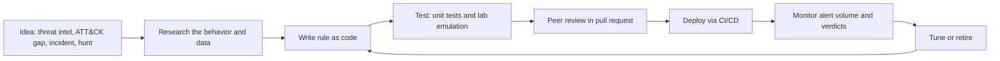

# Detection Engineering

## Introduction

A SIEM full of logs does nothing by itself. Something has to look at the data and say "this pattern is suspicious, wake someone up." That something is a **detection**: a rule, query or analytic that turns raw events into alerts.

**Detection engineering** is the practice of building detections the way good teams build software. Each detection has a clear goal, lives in version control, gets reviewed, has tests, is deployed through a pipeline, and is measured and improved over time. The alternative, rules clicked together in a SIEM console by whoever was on shift, tends to produce two failures at once: floods of useless alerts and silent gaps where real attacks go unnoticed.

A good analogy is a smoke detector. One that never goes off is useless, and one that goes off every time you make toast gets its battery pulled. Detection engineering is the work of placing detectors where fires actually start, and tuning them so that people still trust the alarm.

This page covers:

- The detection lifecycle and "detection as code"
- Writing vendor-neutral rules in **Sigma** and converting them for your SIEM
- Writing detections in Python with **unit tests**
- Measuring quality with **precision and recall**, and tuning false positives
- Documenting detections with the **ADS framework**
- Testing detections safely in a lab

It builds on [Security Logging and SIEM](./1-sec-logging-and-siem.mdx) and uses technique IDs from [MITRE ATT&CK](./3-sec-mitre-attack.mdx).

## The Detection Lifecycle



Ideas for new detections usually come from four places:

1. **Threat intelligence**: a report describes how a group targeting your industry operates. See [Threat Intelligence](./4-sec-threat-intelligence.mdx).
2. **Coverage gaps**: mapping your detections to ATT&CK shows techniques you cannot see.
3. **Incidents and near misses**: every real incident should leave behind at least one new or improved detection.
4. **Threat hunts**: a successful [hunt](./5-sec-threat-hunting.mdx) is often turned into an automated rule.

### Detection as code

"Detection as code" means treating rules exactly like application code:

| Practice | What it means for detections |
| --- | --- |
| Version control | Rules live in a Git repository, not only in the SIEM UI |
| Code review | A second engineer reviews logic, false positive risk and documentation |
| Tests | Each rule has sample events that must and must not match |
| CI/CD | A pipeline validates, tests and deploys rules automatically |
| Ownership | Each rule has an owner and a documented response |

The payoff is the same as for software: you can see who changed what and why, roll back bad changes, and avoid breaking detections silently.

## Know Your Data First

Before writing a rule, answer three questions:

1. **What exactly does the behavior look like?** For example, "PowerShell started with a base64-encoded command" rather than "malicious PowerShell".
2. **Which log source records it, and is it enabled?** On Windows, process command lines appear in Sysmon event ID 1 or Security event 4688, but only if command-line auditing is turned on.
3. **Which fields will the rule use, and are they populated consistently?** A rule on `CommandLine` is useless if your parser puts the value in `process.args`.

ATT&CK helps here. Since ATT&CK v18 (October 2025), techniques link to **Detection Strategies** and **Analytics** instead of a short free-text "detection" note. For example, the detection strategy DET0487, "Distributed Password Spraying via Authentication Failures Across Multiple Accounts", includes a Windows analytic that looks at Security events 4625, 4771 and 4648, and lists tunable values such as the time window and the number of accounts. These are good starting points, though you still have to adapt them to your own data.

## Writing a Sigma Rule

**Sigma** is an open, vendor-neutral format for detection rules, written in YAML. You write a rule once, then convert it to Splunk SPL, Elastic queries, Microsoft Sentinel KQL and other targets with the `sigma-cli` tool. The [SigmaHQ repository](https://github.com/SigmaHQ/sigma) contains thousands of community rules you can learn from.

Here is a rule for PowerShell launched with an encoded command, which attackers use to hide what a script does (ATT&CK T1059.001 PowerShell, and T1027 Obfuscated Files or Information):

```yaml
title: PowerShell Started With Encoded Command
id: 6f1d2c3a-9b8e-4f7a-a1b2-3c4d5e6f7a8b
status: experimental
description: >
  Detects PowerShell launched with an encoded command line. Attackers use
  base64-encoded commands to hide script content from casual review and logs.
references:
    - https://attack.mitre.org/techniques/T1059/001/
    - https://attack.mitre.org/techniques/T1027/
author: BrightCart Detection Team
date: 2026-10-11
tags:
    - attack.execution
    - attack.t1059.001
    - attack.stealth
    - attack.t1027
logsource:
    category: process_creation
    product: windows
detection:
    selection_img:
        Image|endswith:
            - '\powershell.exe'
            - '\pwsh.exe'
    selection_flag:
        CommandLine|contains:
            - ' -enc '
            - ' -EncodedCommand '
            - ' -ec '
    filter_sccm:
        ParentImage|endswith: '\CcmExec.exe'
    condition: all of selection_* and not filter_sccm
falsepositives:
    - Software deployment and management agents that wrap scripts in encoded commands
level: medium
```

How to read it:

- **`logsource`** says which kind of data the rule needs (Windows process creation events). Conversion pipelines use it to pick the right index or table.
- **`detection`** defines named selections. Field modifiers such as `|endswith` and `|contains` control matching, and string matches are case-insensitive by default.
- **`condition`** combines selections: both `selection_*` groups must match, and the documented exception `filter_sccm` must not.
- **`falsepositives`** and **`level`** tell the analyst what to expect and how urgent it is.
- **`tags`** map the rule to ATT&CK tactics and techniques.

:::note ATT&CK v19 changed tactic names
In ATT&CK v19 (April 2026), the old **Defense Evasion** tactic was split into **Stealth** (TA0005, the original ID) and **Defense Impairment** (TA0112). T1027 now sits under Stealth. Recent Sigma tooling validates tags against current ATT&CK data. When we tested this rule with `sigma-cli` 3.1, the old tag `attack.defense-evasion` raised an "Invalid MITRE ATT&CK tagging" issue, while `attack.stealth` passed. Expect older community rules to use the old tag names.
:::

### Validating and converting

Install the CLI and a backend, then check and convert the rule:

```bash
pip install sigma-cli pysigma-backend-splunk pysigma-backend-elasticsearch
sigma check rules/
sigma convert -t splunk --without-pipeline rules/win_powershell_encoded_command.yml
```

Output:

```text
Found 0 errors, 0 condition errors and 0 issues.
No rule errors found.
No condition errors found.
No validation issues found.
Parsing Sigma rules
Image IN ("*\\powershell.exe", "*\\pwsh.exe") CommandLine IN ("* -enc *", "* -EncodedCommand *", "* -ec *") NOT ParentImage="*\\CcmExec.exe"
```

The same rule converted to Elastic Lucene with the `ecs_windows` pipeline, which renames Sysmon-style fields to ECS fields:

```bash
sigma convert -t lucene -p ecs_windows rules/win_powershell_encoded_command.yml
```

Output:

```text
Parsing Sigma rules
((process.executable.caseless:(*\\powershell.exe OR *\\pwsh.exe)) AND (process.command_line:(*\ \-enc\ * OR *\ \-EncodedCommand\ * OR *\ \-ec\ *))) AND (NOT process.parent.executable.caseless:*\\CcmExec.exe)
```

**Processing pipelines** are the important idea here. The rule uses generic field names, and the pipeline maps them to the names your data actually uses. If your field names differ from any built-in pipeline, you write a small custom pipeline. Run `sigma list targets` and `sigma list pipelines` to see what your installed plugins support, since backends and pipelines are versioned separately and change over time.

## Detections in Python, with Tests

Sigma is great for single-event pattern matching. Some logic is easier to express in a general-purpose language, and either way you need **tests**. Look closely at the Sigma rule above and you will find a blind spot. PowerShell accepts any unambiguous prefix of `-EncodedCommand` (such as `-e` or `-en`), accepts `/` as well as `-`, and is case-insensitive. An attacker who types `-e` evades the rule.

Here is a more careful version in Python:

```python
"""Detect PowerShell launched with an encoded command (ATT&CK T1059.001, T1027)."""
import re

POWERSHELL = ("\\powershell.exe", "\\pwsh.exe")
# PowerShell accepts any unambiguous prefix of -EncodedCommand (-e, -en, -enc, ...),
# plus the alias -ec, and '/' as well as '-' as the parameter prefix.
ENCODED_FLAG = re.compile(r"(?:^|\s)[-/](?:e|ec|en|enc|enco|encod|encode|encoded|encodedc\w*)\s", re.IGNORECASE)
ALLOWED_PARENTS = ("\\ccmexec.exe",)   # documented exception: config management agent

def detect(event: dict) -> bool:
    image = event.get("Image", "").lower()
    parent = event.get("ParentImage", "").lower()
    cmd = event.get("CommandLine", "")
    if not image.endswith(POWERSHELL):
        return False
    if parent.endswith(ALLOWED_PARENTS):
        return False
    return bool(ENCODED_FLAG.search(cmd))
```

Save it as `detections/encoded_powershell.py`. Now write tests with **true positives** (events the rule must catch) and **true negatives** (events it must ignore). Every past false positive should become a negative test, so the same noise never comes back.

```python
import pytest
from detections.encoded_powershell import detect

PS = "C:\\Windows\\System32\\WindowsPowerShell\\v1.0\\powershell.exe"

@pytest.mark.parametrize("cmd", [
    "powershell.exe -NoProfile -enc SQBFAFgA",
    "powershell.exe -EncodedCommand SQBFAFgA",
    "powershell.exe -e SQBFAFgA",            # shortest prefix
    "powershell.exe /ENC SQBFAFgA",          # slash prefix, upper case
    "powershell.exe -ec SQBFAFgA",           # alias
])
def test_true_positives(cmd):
    assert detect({"Image": PS, "ParentImage": "C:\\Windows\\explorer.exe", "CommandLine": cmd})

@pytest.mark.parametrize("event", [
    {"Image": PS, "ParentImage": "C:\\Windows\\explorer.exe",
     "CommandLine": "powershell.exe -File C:\\scripts\\backup.ps1 -Environment prod"},
    {"Image": PS, "ParentImage": "C:\\Windows\\explorer.exe",
     "CommandLine": "powershell.exe -ExecutionPolicy Bypass -File C:\\scripts\\report.ps1"},
    {"Image": PS, "ParentImage": "C:\\Windows\\CCM\\CcmExec.exe",
     "CommandLine": "powershell.exe -enc SQBFAFgA"},          # documented exception
    {"Image": "C:\\Windows\\System32\\cmd.exe", "ParentImage": "C:\\Windows\\explorer.exe",
     "CommandLine": "cmd.exe /c echo -enc"},                   # not PowerShell
])
def test_true_negatives(event):
    assert not detect(event)
```

```bash
pytest -q tests/
```

Output:

```text
.........                                                                [100%]
9 passed in 0.01s
```

The `-ExecutionPolicy` test is there on purpose: it starts with `-e`, and a careless regex would flag every script launched with `-ExecutionPolicy Bypass`. Tests like this protect you from your own fixes.

:::tip Fix the Sigma rule too
Once a test reveals a blind spot, fix every implementation. For Sigma, you could add more `CommandLine|contains` values or switch to a `CommandLine|re` regular expression modifier, if your backend supports it.
:::

## Measuring Detection Quality

"Does the rule work?" has two separate answers:

- **Precision**: of the alerts it fires, how many are real? Low precision means analyst fatigue.
- **Recall**: of the real attacks, how many does it catch? Low recall means blind spots.

```text
precision = true positives / (true positives + false positives)
recall    = true positives / (true positives + false negatives)
```

Compare a first draft with the improved rule on a labelled dataset: lab attack emulation as positives, and two weeks of production events as negatives.

```python
from detections.encoded_powershell import detect as improved

def naive(event):
    """First draft: only looks for ' -enc ' (case-sensitive), no exceptions."""
    return event["Image"].lower().endswith("powershell.exe") and " -enc " in event["CommandLine"]

PS = "C:\\Windows\\System32\\WindowsPowerShell\\v1.0\\powershell.exe"
CCM = "C:\\Windows\\CCM\\CcmExec.exe"
EXP = "C:\\Windows\\explorer.exe"
# (event, is_malicious) collected from lab tests and two weeks of production data
labelled = [
    ({"Image": PS, "ParentImage": EXP, "CommandLine": "powershell -enc SQBFAFgA"}, True),
    ({"Image": PS, "ParentImage": EXP, "CommandLine": "powershell -e SQBFAFgA"}, True),
    ({"Image": PS, "ParentImage": EXP, "CommandLine": "powershell /ENC SQBFAFgA"}, True),
    ({"Image": PS, "ParentImage": EXP, "CommandLine": "powershell -EncodedCommand SQBFAFgA"}, True),
] + [
    ({"Image": PS, "ParentImage": CCM, "CommandLine": "powershell -enc UwB0AGEAcgB0AA=="}, False),
] * 40 + [
    ({"Image": PS, "ParentImage": EXP, "CommandLine": "powershell -File backup.ps1"}, False),
] * 200

def evaluate(rule):
    tp = sum(1 for e, bad in labelled if bad and rule(e))
    fp = sum(1 for e, bad in labelled if not bad and rule(e))
    fn = sum(1 for e, bad in labelled if bad and not rule(e))
    precision = tp / (tp + fp) if tp + fp else 0.0
    recall = tp / (tp + fn) if tp + fn else 0.0
    return tp, fp, fn, precision, recall

for name, rule in [("naive", naive), ("improved", improved)]:
    tp, fp, fn, p, r = evaluate(rule)
    print(f"{name:9s} TP={tp} FP={fp:2d} FN={fn}  precision={p:.2f}  recall={r:.2f}")
```

Output:

```text
naive     TP=1 FP=40 FN=3  precision=0.02  recall=0.25
improved  TP=4 FP= 0 FN=0  precision=1.00  recall=1.00
```

The naive rule fails both ways: 40 false alarms from the management agent, and three of four attack variants missed. Do not be fooled by the perfect score of the improved rule, though. The dataset is tiny and was built by the same person who wrote the rule. In production, measure precision from **analyst verdicts** on real alerts, and estimate recall with **attack emulation** and red team exercises.

### Tuning without losing the detection

When a rule is noisy, there are good and bad ways to quiet it:

| Tuning move | Effect | Risk |
| --- | --- | --- |
| Narrow exception (specific parent process, signed binary, service account) | Removes one known benign source | Low, if documented and reviewed |
| Raise a threshold | Fewer alerts | Slow attacks slip under it |
| Lower severity / send to a dashboard instead of the queue | Analysts see it in context only | Real hits may be ignored |
| Broad exclusion (a whole host, user or path) | Large drop in volume | Attackers who land on that host are invisible |
| Disable the rule | No alerts | The technique is now completely blind |

Every exception is also a potential hiding place. In the example, an attacker who can launch PowerShell from the management agent bypasses the rule. Document each exception, why it exists, and who approved it, and review exceptions regularly.

## Documenting Detections: the ADS Framework

A rule without context is hard to triage and hard to maintain. Palantir's open source **Alerting and Detection Strategy (ADS) framework** defines a template that must be filled in before a detection goes to production. Its sections are:

```markdown
# ADS: PowerShell Started With Encoded Command

## Goal
Detect attempts to hide PowerShell script content with encoded commands.

## Categorization
ATT&CK: Execution / T1059.001 PowerShell; Stealth / T1027 Obfuscated Files or Information

## Strategy Abstract
Match Windows process creation events where PowerShell runs with any prefix of -EncodedCommand.

## Technical Context
How encoded commands work, which logs record them (Sysmon 1, Security 4688 with command lines).

## Blind Spots and Assumptions
Assumes command-line logging is enabled. Misses PowerShell hosted inside other processes.

## False Positives
Configuration management agent (CcmExec.exe) - excluded by parent process.

## Validation
Lab: run an encoded command in the Windows test VM and confirm an alert within 5 minutes.

## Priority
Medium; High if the host is a server or the user is privileged.

## Response
Decode the command (base64, UTF-16LE), review it, check parent process and network activity.
```

The **Blind Spots** and **Validation** sections are the ones teams most often skip and most often need. Writing down "this does not see X" is how gaps get fixed instead of forgotten.

## A CI Pipeline for Detections

Put the pieces together in CI. This GitHub Actions workflow validates Sigma rules, runs Python tests and converts rules on every pull request:

```yaml
name: detections

on:
  pull_request:
    paths: ["rules/**", "detections/**", "tests/**"]
  push:
    branches: [main]

jobs:
  test:
    runs-on: ubuntu-latest
    steps:
      - uses: actions/checkout@v7
      - uses: actions/setup-python@v7
        with:
          python-version: "3.12"
      - name: Install tools
        run: pip install sigma-cli pysigma-backend-splunk pytest
      - name: Validate Sigma rules
        run: sigma check --fail-on-issues rules/
      - name: Unit-test Python detections
        run: pytest -q tests/
      - name: Convert rules for the SIEM
        run: |
          mkdir -p build
          for rule in rules/*.yml; do
            sigma convert -t splunk -p splunk_windows "$rule" > "build/$(basename "$rule" .yml).spl"
          done
      - uses: actions/upload-artifact@v7
        with:
          name: converted-rules
          path: build/
```

A deployment job, not shown, would push the converted rules to the SIEM through its API after merge to `main`. Action versions change; check each action's release page and consider pinning to a commit SHA, as [Securing CI/CD Pipelines](../6-sec-appsec-and-devsecops/8-sec-pipeline-security.mdx) recommends.

## Testing with Attack Emulation

Unit tests check your logic against events you wrote yourself. To know that the **whole chain** works (logging enabled, agent shipping, parser mapping, rule firing, alert reaching the queue), you need to generate real activity.

**Atomic Red Team** from Red Canary is an open source library of small, documented tests mapped to ATT&CK techniques. The companion PowerShell module **Invoke-AtomicRedTeam** can list, run and clean up tests. Other options include MITRE Caldera for automated adversary emulation and commercial breach-and-attack simulation tools.

:::warning Lab only, with permission
Attack emulation runs real attacker techniques. Run it only on systems you own or have written permission to test, ideally in an isolated lab VM with snapshots. Atomic Red Team's own documentation warns that tests can leave a system in an undesirable state. Read each test before running it, and run its cleanup step afterward. See [Building a Safe Practice Lab](../10-sec-offensive-security/1-sec-lab-setup.mdx) and [Ethics, Law and Responsible Disclosure](../0-sec-fundamentals/8-sec-ethics-and-law.mdx).
:::

A typical validation loop:

1. Snapshot the lab VM.
2. Run one atomic test for the technique your rule targets.
3. Confirm the alert appears in the SIEM within your expected delay, with the right fields.
4. Clean up and restore the snapshot.
5. Record the result in the rule's **Validation** section, and re-run it regularly. Detections break silently when logging or parsers change.

## Real-World Scenario

**BrightCart**'s two-person security team, plus their MDR provider, receives about 900 alerts a week. The MDR handles endpoint alerts, but the team owns about 60 SIEM rules that were imported from vendor content packs years ago. Analysts close most of them as false positives without much thought. During a recent red team exercise, the testers ran an encoded PowerShell command on a build server and created a new cloud access key. Neither action raised an alert anyone noticed.

### The solution

1. **Inventory and triage the rules.** For each of the 60 rules, pull 90 days of verdicts. Disable rules with zero true positives and no clear threat model, move noisy but useful ones to a dashboard, and keep the rest.
2. **Move detections into Git.** Each remaining rule becomes a Sigma file or Python detection with an ADS document and tests.
3. **Write new rules for the red team's findings**, starting with the encoded PowerShell rule above and "cloud access key created for a human user".
4. **Add CI**: `sigma check`, `pytest` and conversion on every pull request.
5. **Validate monthly** with a small set of Atomic Red Team tests on a dedicated lab VM.
6. **Track precision per rule** from analyst verdicts, and review any rule that falls below a team-chosen target.

### Why this approach

The problem was not too few rules but **untested, untrusted rules**. Detection as code makes every rule explainable, testable and reviewable, and measuring precision gives the team a data-driven way to cut noise without guessing.

### When to use it, and when not to

- **Use detection as code** once you own more than a handful of custom rules, or more than one person edits them.
- **It is overkill** if you rely entirely on an MDR or XDR vendor's built-in detections and write no custom rules. Even then, keep a list of what is covered and test it occasionally.
- **Do not write custom rules for everything.** Vendor EDR detections for endpoint malware are usually better than what a small team can build. Focus custom work on your own applications, cloud setup and business logic.

### Alternatives and trade-offs

| Approach | Pros | Cons | Best for |
| --- | --- | --- | --- |
| Vendor built-in detections (EDR, XDR, SIEM content) | Maintained by experts, broad coverage, no effort | Black box, generic, may not fit your environment | Endpoint malware and common attacks |
| Community Sigma rules | Free, peer-reviewed, portable | Need tuning; uneven quality; tags may lag ATT&CK changes | Bootstrapping coverage quickly |
| Custom rules as code (Sigma or Python) | Fit your data and business logic; testable | Engineering time; you own maintenance | App-specific, cloud and identity abuse |
| ML / UEBA anomaly detection | Finds unknown patterns, such as unusual logins | Hard to explain; needs baselines; can be noisy | Large environments with stable behavior |
| Manual hunting only | Flexible, creative | Does not scale; nothing runs at 3 a.m. | Finding ideas for new rules |

Most mature teams combine all of these: vendor detections as a base layer, tuned community rules, custom rules for their own systems, and hunting to find what is missing.

## Common Mistakes

- **Writing rules for data you do not collect.** Check that the log source is enabled and parsed before writing the rule.
- **Testing only that the rule fires.** Without negative tests, every fix risks a new flood of false positives.
- **Matching exact strings attackers control.** Command-line flags, file names and paths are easy to vary. Prefer behaviors that are harder to change.
- **Broad exclusions to silence noise.** Excluding an entire host or user creates a perfect hiding place.
- **No owner, no documentation.** A rule nobody understands gets disabled at the first false positive.
- **Never re-validating.** A parser change can break a rule that passed tests a year ago. Emulate attacks on a schedule.
- **Measuring rule count instead of quality.** 500 untested rules are worse than 50 trusted ones.

## Summary

- **Detection engineering** builds detections like software: versioned, reviewed, tested, deployed by CI and measured.
- Start from a **specific behavior** and confirm the **data** exists before writing logic.
- **Sigma** gives you vendor-neutral rules; `sigma-cli` and processing pipelines convert them for each SIEM. Keep ATT&CK tags current; v19 replaced Defense Evasion with Stealth and Defense Impairment.
- Use **unit tests** with true positives and true negatives; turn every false positive into a test.
- Measure **precision** (are alerts real?) and **recall** (are attacks caught?), and tune with narrow, documented exceptions.
- Document each rule with the **ADS** framework, especially blind spots and validation.
- Validate end to end with **attack emulation**, only in a lab you own or are authorized to test.

## Exercises

1. **Extend the tests.** Add three more evasions of the encoded-command flag, for example extra spaces or a quoted argument, and update the regex until all tests pass without breaking the negatives.
2. **Write a Sigma rule.** Write a rule for a Linux `sshd` "Accepted password" login for the `root` user. Choose the `logsource`, write `falsepositives`, and convert it with `sigma convert`.
3. **Fill in an ADS.** Write a complete ADS document for "cloud access key created for a human user", including blind spots and a lab validation plan.
4. **Precision budget.** Your team can handle 50 alerts per day. You have 20 rules. Describe how you would use per-rule precision and severity to decide which rules go to the alert queue and which go to a dashboard.

Next, learn the shared language behind rule tags and coverage maps in [MITRE ATT&CK](./3-sec-mitre-attack.mdx). For a hands-on build, try [Project: Detecting Attacks from Logs](../14-sec-projects/4-sec-project-log-monitoring.mdx).
