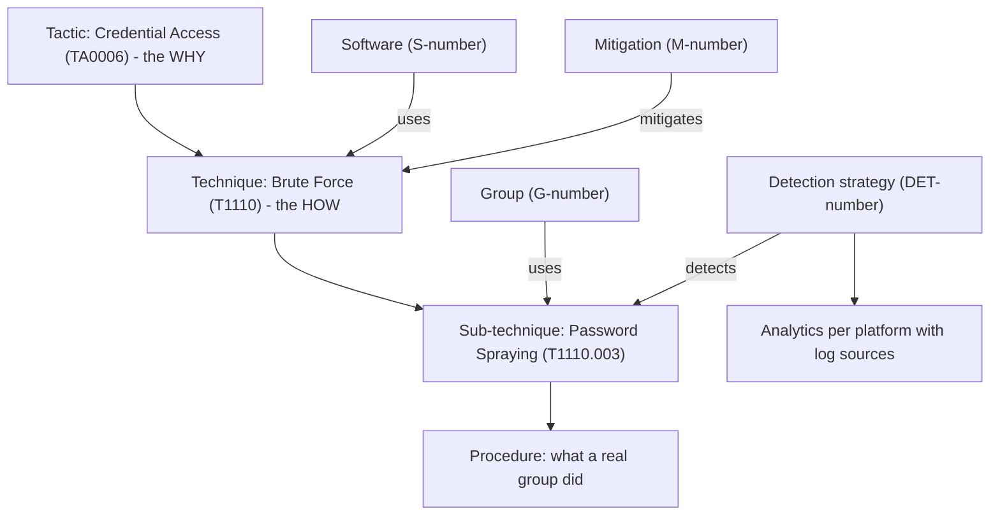
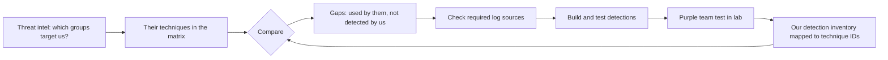

# MITRE ATT&CK

## Introduction

When a SOC analyst says "the attacker dumped credentials, then moved laterally over RDP", everyone understands roughly what happened. But "roughly" is not good enough when you want to answer questions like:

- Which attacker behaviors can we actually detect today?
- A threat report says a criminal group is targeting companies like ours. Which of its methods would we miss?
- Our new EDR vendor claims "90% coverage". Coverage of what?

**MITRE ATT&CK** (Adversarial Tactics, Techniques, and Common Knowledge) is a free, public knowledge base of real attacker behavior, built from published incident reports and threat research. It gives every behavior a name and an ID, such as **T1621 Multi-Factor Authentication Request Generation**, so defenders, red teams, vendors and threat intel analysts can all talk about the same thing.

A useful analogy is a medical diagnosis code system. Doctors in different hospitals can describe the same condition with the same code, which makes it possible to count, compare and research. ATT&CK does the same for attacker behavior. It does not stop attacks by itself, just as a diagnosis code does not cure anyone, but it makes everything you do around detection and response more precise.

This page explains how ATT&CK is structured, what changed in recent versions, and how defenders use it for coverage mapping and gap analysis, with Python code that works on the official ATT&CK data.

:::info Version used on this page
This page uses **ATT&CK v19.2**, the current version at the time of writing (October 2026). MITRE publishes major releases twice a year and, starting with v19.2, smaller "Agile" releases in between. Check the [ATT&CK versions page](https://attack.mitre.org/resources/versions/) for the latest release.
:::

## How ATT&CK Is Organized

ATT&CK has three **matrices** (also called domains):

- **Enterprise**: Windows, Linux, macOS, cloud (IaaS, SaaS, identity providers, Office suites), network devices and containers. Most defenders start here.
- **Mobile**: Android and iOS.
- **ICS**: industrial control systems.

Inside a matrix, the core building blocks are:

| Concept | Question it answers | Example |
| --- | --- | --- |
| **Tactic** | *Why* is the attacker doing this? The goal of a step | TA0006 Credential Access |
| **Technique** | *How* do they achieve that goal? | T1110 Brute Force |
| **Sub-technique** | A more specific *how* | T1110.003 Password Spraying |
| **Procedure** | How a *specific* group or tool did it in the wild | "Scattered Spider has used MFA fatigue by sending repeated MFA requests" |
| **Group** | A tracked threat actor | G1015 Scattered Spider |
| **Software** | Malware or a tool used by attackers | S-numbered entries such as Mimikatz |
| **Campaign** | A set of intrusions over a specific time period | C-numbered entries |
| **Mitigation** | Defensive controls against a technique | M-numbered entries such as MFA |
| **Detection strategy** | How to detect a technique, with platform-specific analytics | DET0160 for T1621 |



A single technique can belong to several tactics. **T1078 Valid Accounts** appears under Initial Access, Persistence, Privilege Escalation and Stealth, because logging in with a stolen password can serve any of those goals.

### The 15 Enterprise tactics

The Enterprise matrix lists tactics roughly in the order an intrusion unfolds, though real attacks jump back and forth:

| ID | Tactic | The attacker is trying to... |
| --- | --- | --- |
| TA0043 | Reconnaissance | gather information to plan the attack |
| TA0042 | Resource Development | set up infrastructure, accounts and tools |
| TA0001 | Initial Access | get into your environment |
| TA0002 | Execution | run their code |
| TA0003 | Persistence | keep their foothold |
| TA0004 | Privilege Escalation | gain higher permissions |
| TA0005 | Stealth | hide their activity so it looks normal |
| TA0112 | Defense Impairment | disable or weaken your security controls |
| TA0006 | Credential Access | steal account names and passwords |
| TA0007 | Discovery | learn about your environment |
| TA0008 | Lateral Movement | move through your environment |
| TA0009 | Collection | gather data they want |
| TA0011 | Command and Control | communicate with compromised systems |
| TA0010 | Exfiltration | steal data |
| TA0040 | Impact | disrupt, destroy or encrypt systems and data |

### What changed recently

If you learned ATT&CK a few years ago, or you are reading older blog posts and vendor material, watch for three changes:

1. **Defense Evasion was split (v19, April 2026).** The old Defense Evasion tactic became two tactics: **Stealth** (TA0005, the old ID) for hiding activity, and the new **Defense Impairment** (TA0112) for disabling or tampering with security tools. Several techniques were revoked and replaced. For example, T1562 Impair Defenses and T1562.001 Disable or Modify Tools were both revoked in favor of **T1685 Disable or Modify Tools**, and T1070.001 Clear Windows Event Logs became **T1685.005**. Older rules tagged `defense-evasion` or `T1562.001` need updating.
2. **Detection Strategies replaced the old detection text (v18, October 2025).** Each technique used to carry a short free-text "Detection" paragraph and a list of Data Sources. ATT&CK now has structured **Detection Strategies** that contain **Analytics** per platform, each pointing to **Data Components** and concrete log sources. Data Sources were deprecated.
3. **Agile releases (v19.2, August 2026).** MITRE added groups and software, such as ShinyHunters (G1057) and TeamPCP (G1056), between the twice-yearly major releases.

The v19 release notes list 15 tactics, 222 techniques and 475 sub-techniques in Enterprise ATT&CK, along with 174 groups and 821 software entries. Later Agile releases add more groups and software, so counts change. Always quote the version alongside any count.

## Working with ATT&CK Data in Python

The website is fine for reading. For real work, such as mapping detections, finding gaps and generating reports, use the machine-readable data. MITRE publishes every release as a **STIX 2.1** JSON bundle in the [mitre-attack/attack-stix-data](https://github.com/mitre-attack/attack-stix-data) repository. STIX is also the standard format for threat intelligence; see [Threat Intelligence](./4-sec-threat-intelligence.mdx).

Download the Enterprise bundle (about 50 MB):

```bash
curl -sL -o enterprise-attack.json \
  https://raw.githubusercontent.com/mitre-attack/attack-stix-data/master/enterprise-attack/enterprise-attack.json
```

MITRE also maintains the `mitreattack-python` library, which wraps this data with helper functions such as "get all techniques used by a group". The examples below use only the standard `json` module, so you can see exactly how the data fits together. The key details are:

- Each object has a STIX `type`: `attack-pattern` (technique), `x-mitre-tactic`, `intrusion-set` (group), `malware` and `tool` (software), `campaign`, `x-mitre-detection-strategy`, `x-mitre-analytic`, and `relationship`.
- The human-readable ID (`T1621`, `G1015`) is in `external_references`, where `source_name` is `mitre-attack`.
- Objects can be **revoked** (replaced by another object) or **deprecated** (removed). Filter them out unless you are migrating old mappings.

### Step 1: Load the matrix

```python
import json

def external_id(obj):
    for ref in obj.get("external_references", []):
        if ref.get("source_name") == "mitre-attack":
            return ref["external_id"]
    return None

def is_active(obj):
    return not obj.get("revoked", False) and not obj.get("x_mitre_deprecated", False)

with open("enterprise-attack.json") as f:
    objects = json.load(f)["objects"]
by_stix_id = {o["id"]: o for o in objects}

# Tactics, in matrix order
matrix = next(o for o in objects if o["type"] == "x-mitre-matrix")
tactics = [by_stix_id[ref] for ref in matrix["tactic_refs"]]
print("Tactics:", len(tactics))
for t in tactics:
    print(f"  {external_id(t)}  {t['name']:22s} ({t['x_mitre_shortname']})")

# Techniques vs sub-techniques
techniques = [o for o in objects if o["type"] == "attack-pattern" and is_active(o)]
subs = [t for t in techniques if t.get("x_mitre_is_subtechnique")]
print(f"Techniques: {len(techniques) - len(subs)}, sub-techniques: {len(subs)}")
print("Groups:", sum(1 for o in objects if o["type"] == "intrusion-set" and is_active(o)))
print("Software:", sum(1 for o in objects if o["type"] in ("malware", "tool") and is_active(o)))
print("Campaigns:", sum(1 for o in objects if o["type"] == "campaign" and is_active(o)))
```

Output (ATT&CK v19.2):

```text
Tactics: 15
  TA0043  Reconnaissance         (reconnaissance)
  TA0042  Resource Development   (resource-development)
  TA0001  Initial Access         (initial-access)
  TA0002  Execution              (execution)
  TA0003  Persistence            (persistence)
  TA0004  Privilege Escalation   (privilege-escalation)
  TA0005  Stealth                (stealth)
  TA0112  Defense Impairment     (defense-impairment)
  TA0006  Credential Access      (credential-access)
  TA0007  Discovery              (discovery)
  TA0008  Lateral Movement       (lateral-movement)
  TA0009  Collection             (collection)
  TA0011  Command and Control    (command-and-control)
  TA0010  Exfiltration           (exfiltration)
  TA0040  Impact                 (impact)
Techniques: 222, sub-techniques: 475
Groups: 176
Software: 825
Campaigns: 56
```

The group and software counts are slightly higher than the v19 release notes because the v19.2 Agile release added entries. This is exactly why you should generate numbers from the data instead of copying them from a slide.

The `x_mitre_shortname` values (`stealth`, `defense-impairment`) are what tools use as tactic tags. For example, Sigma rules use tags such as `attack.credential-access` and `attack.t1110.003`, and current Sigma validators flag the old `attack.defense-evasion` tag as invalid. See [Detection Engineering](./2-sec-detection-engineering.mdx).

### Step 2: Look up detection strategies

Since v18, you can ask the data "how would I detect this technique, and which logs do I need?"

```python
import json
import sys

def external_id(obj):
    for ref in obj.get("external_references", []):
        if ref.get("source_name") == "mitre-attack":
            return ref["external_id"]
    return None

with open("enterprise-attack.json") as f:
    objects = json.load(f)["objects"]
by_stix_id = {o["id"]: o for o in objects}

tid = sys.argv[1] if len(sys.argv) > 1 else "T1621"
technique = next(o for o in objects if o["type"] == "attack-pattern" and external_id(o) == tid)
print(f"{tid} {technique['name']}")

for r in objects:
    if (r["type"] == "relationship" and r["relationship_type"] == "detects"
            and r["target_ref"] == technique["id"]):
        strategy = by_stix_id[r["source_ref"]]
        print(f"  {external_id(strategy)} {strategy['name']}")
        for ref in strategy.get("x_mitre_analytic_refs", []):
            analytic = by_stix_id[ref]
            sources = sorted({s["name"] for s in analytic.get("x_mitre_log_source_references", [])})
            platforms = ", ".join(analytic.get("x_mitre_platforms", []))
            print(f"    {external_id(analytic)} [{platforms}] log sources: {', '.join(sources)}")
```

```bash
python3 detection_strategies.py T1621
```

Output:

```text
T1621 Multi-Factor Authentication Request Generation
  DET0160 Detection Strategy for Multi-Factor Authentication Request Generation (T1621)
    AN0449 [Identity Provider] log sources: NSM:Connections, azure:signinlogs
    AN0450 [IaaS] log sources: AWS:CloudTrail
    AN0451 [Windows] log sources: WinEventLog:Security
    AN0452 [Linux] log sources: auditd:AUTH
    AN0453 [SaaS] log sources: saas:okta
    AN0454 [macOS] log sources: macos:unifiedlog
```

This answers a practical question before you write any rule: **do we even collect the logs this detection needs?** If BrightCart uses Okta but does not send Okta logs to its SIEM, no rule for T1621 can work. Analytics also list "mutable elements", such as time windows and thresholds, that you are expected to tune for your environment. The [Security Logging and SIEM](./1-sec-logging-and-siem.mdx) page covers getting those logs in place.

## How Defenders Use ATT&CK

ATT&CK is used in many ways. These are the most common for a defensive team:

1. **Shared vocabulary.** Tag every alert, incident and detection rule with technique IDs. Reports become comparable across months and teams.
2. **Coverage mapping.** Map each detection rule to the techniques it detects, then visualize what you cover and what you miss.
3. **Threat-informed defense.** Instead of trying to cover all 697 technique and sub-technique entries, focus on the techniques used by groups that target your industry. [Threat Intelligence](./4-sec-threat-intelligence.mdx) tells you which groups those are.
4. **Hunting hypotheses.** "Would we notice T1114.003 Email Forwarding Rule?" is a ready-made [threat hunt](./5-sec-threat-hunting.mdx).
5. **Purple teaming.** A red team (or a test tool such as Atomic Red Team, run only in a lab or with written permission) performs a technique, and the blue team checks whether it was detected. The result is evidence, not assumption.
6. **Evaluating vendors.** Ask vendors which techniques they detect, on which platforms, with which data, and how they tested it. MITRE's separate ATT&CK Evaluations program publishes results from emulated attacks against security products.



## Coverage and Gap Analysis in Practice

BrightCart, our example e-commerce SaaS company, has a small set of detection rules. A threat intel briefing warned that **Scattered Spider (G1015)**, a group known for help-desk social engineering, MFA fatigue and abuse of cloud identity, targets technology companies. The team wants to know where they stand.

The script below does three things:

1. Updates stale technique IDs in BrightCart's rules by following ATT&CK's `revoked-by` relationships.
2. Collects the techniques the group is known to use.
3. Reports which are covered and which are gaps, focusing on the tactics BrightCart cares most about.

```python
import json

def external_id(obj):
    for ref in obj.get("external_references", []):
        if ref.get("source_name") == "mitre-attack":
            return ref["external_id"]
    return None

with open("enterprise-attack.json") as f:
    objects = json.load(f)["objects"]
by_stix_id = {o["id"]: o for o in objects}
techniques = {external_id(o): o for o in objects if o["type"] == "attack-pattern"}

# 1. Follow "revoked-by" so old IDs in our rules point at the current technique.
revoked_by = {
    external_id(by_stix_id[r["source_ref"]]): external_id(by_stix_id[r["target_ref"]])
    for r in objects
    if r["type"] == "relationship" and r["relationship_type"] == "revoked-by"
}

# 2. BrightCart's detection inventory: rule name -> technique IDs it was mapped to.
inventory = {
    "PowerShell encoded command": ["T1059.001"],
    "MFA push flood then success": ["T1621"],
    "New inbox forwarding rule": ["T1114.003"],
    "Admin role granted in cloud IdP": ["T1098.003"],
    "EDR agent stopped": ["T1562.001"],          # mapped years ago
    "Security event log cleared": ["T1070.001"],  # mapped years ago
}

covered = set()
for rule, ids in inventory.items():
    for tid in ids:
        if tid in revoked_by:
            print(f"UPDATE  '{rule}': {tid} was revoked, now {revoked_by[tid]} "
                  f"({techniques[revoked_by[tid]]['name']})")
            tid = revoked_by[tid]
        covered.add(tid)

# 3. Techniques used by a threat group we care about.
group = next(o for o in objects if o["type"] == "intrusion-set" and external_id(o) == "G1015")
used = set()
for r in objects:
    if (r["type"] == "relationship" and r["relationship_type"] == "uses"
            and r["source_ref"] == group["id"] and r["target_ref"].startswith("attack-pattern--")):
        t = by_stix_id[r["target_ref"]]
        if not t.get("revoked") and not t.get("x_mitre_deprecated"):
            used.add(external_id(t))

print(f"\n{group['name']} uses {len(used)} techniques; our rules map to {len(used & covered)} of them")
for tid in sorted(used & covered):
    print(f"  covered  {tid:10s} {techniques[tid]['name']}")

priority_tactics = {"initial-access", "credential-access", "persistence", "defense-impairment"}
gaps = [tid for tid in sorted(used - covered)
        if {p["phase_name"] for p in techniques[tid]["kill_chain_phases"]} & priority_tactics]
print(f"\nGaps in priority tactics ({len(gaps)}):")
for tid in gaps:
    phases = ", ".join(p["phase_name"] for p in techniques[tid]["kill_chain_phases"])
    print(f"  missing  {tid:10s} {techniques[tid]['name']:42s} [{phases}]")
```

Output (ATT&CK v19.2):

```text
UPDATE  'EDR agent stopped': T1562.001 was revoked, now T1685 (Disable or Modify Tools)
UPDATE  'Security event log cleared': T1070.001 was revoked, now T1685.005 (Clear Windows Event Logs)

Scattered Spider uses 64 techniques; our rules map to 5 of them
  covered  T1059.001  PowerShell
  covered  T1098.003  Additional Cloud Roles
  covered  T1114.003  Email Forwarding Rule
  covered  T1621      Multi-Factor Authentication Request Generation
  covered  T1685      Disable or Modify Tools

Gaps in priority tactics (16):
  missing  T1003.003  NTDS                                       [credential-access]
  missing  T1078      Valid Accounts                             [stealth, persistence, privilege-escalation, initial-access]
  missing  T1078.004  Cloud Accounts                             [stealth, persistence, privilege-escalation, initial-access]
  missing  T1098      Account Manipulation                       [persistence, privilege-escalation]
  missing  T1133      External Remote Services                   [persistence, initial-access]
  missing  T1136      Create Account                             [persistence]
  missing  T1484.002  Trust Modification                         [defense-impairment, privilege-escalation]
  missing  T1539      Steal Web Session Cookie                   [credential-access]
  missing  T1543.002  Systemd Service                            [persistence, privilege-escalation]
  missing  T1552.001  Credentials In Files                       [credential-access]
  missing  T1552.004  Private Keys                               [credential-access]
  missing  T1553.002  Code Signing                               [defense-impairment]
  missing  T1555.005  Password Managers                          [credential-access]
  missing  T1556.006  Multi-Factor Authentication                [defense-impairment, persistence, credential-access]
  missing  T1556.009  Conditional Access Policies                [defense-impairment, persistence, credential-access]
  missing  T1578.002  Create Cloud Instance                      [defense-impairment]
```

What the team learns from this:

- **Two rules had stale mappings.** Without the update step, the "EDR agent stopped" rule would never match a current group's T1685 usage, and coverage would look worse than it is. Re-run this check after each ATT&CK release.
- **"Covered" here only means "a rule claims to detect it".** It says nothing about whether the rule fires on the group's actual procedure. That needs testing.
- **The gap list is a prioritized backlog,** not a to-do list to finish this quarter. Some gaps, such as T1078.004 Cloud Accounts and T1556.006 (attackers registering their own MFA device), matter much more for a SaaS company than T1543.002 Systemd Service on a fleet that runs only containers.

## Visualizing Coverage with ATT&CK Navigator

The **ATT&CK Navigator** is MITRE's free web tool for viewing and annotating the matrix. You can use the hosted version or run it yourself. You describe what to show in a **layer file**: JSON that lists techniques with scores, colors and comments. The current layer format is version 4.5.

This script turns BrightCart's inventory into a layer: tested detections score 100 (green), mapped-but-untested 50 (yellow), and known gaps that matter 0 (red).

```python
import json

# technique ID -> how confident we are in the detection
detections = {
    "T1059.001": {"rule": "PowerShell encoded command", "tested": True},
    "T1621":     {"rule": "MFA push flood then success", "tested": True},
    "T1114.003": {"rule": "New inbox forwarding rule", "tested": True},
    "T1098.003": {"rule": "Admin role granted in cloud IdP", "tested": False},
    "T1685":     {"rule": "EDR agent stopped", "tested": False},
}
# Techniques the threat group uses that we decided to track (from coverage.py)
group_techniques = ["T1078.004", "T1539", "T1556.006", "T1133"]

entries = []
for tid, d in detections.items():
    entries.append({
        "techniqueID": tid,
        "score": 100 if d["tested"] else 50,
        "comment": f"{d['rule']} ({'tested in lab' if d['tested'] else 'mapped, not yet tested'})",
        "enabled": True,
    })
for tid in group_techniques:
    if tid not in detections:
        entries.append({"techniqueID": tid, "score": 0,
                        "comment": "Used by Scattered Spider (G1015); no detection yet",
                        "enabled": True})

layer = {
    "name": "BrightCart detection coverage",
    "versions": {"attack": "19", "navigator": "5.3.2", "layer": "4.5"},
    "domain": "enterprise-attack",
    "description": "100 = tested detection, 50 = mapped but untested, 0 = known gap",
    "gradient": {"colors": ["#ff6666", "#ffe766", "#8ec843"], "minValue": 0, "maxValue": 100},
    "techniques": entries,
}

with open("brightcart_coverage_layer.json", "w") as f:
    json.dump(layer, f, indent=2)

print(f"Wrote {len(entries)} techniques to brightcart_coverage_layer.json")
for e in entries:
    print(f"  {e['techniqueID']:10s} score={e['score']:3d}  {e['comment']}")
```

Output:

```text
Wrote 9 techniques to brightcart_coverage_layer.json
  T1059.001  score=100  PowerShell encoded command (tested in lab)
  T1621      score=100  MFA push flood then success (tested in lab)
  T1114.003  score=100  New inbox forwarding rule (tested in lab)
  T1098.003  score= 50  Admin role granted in cloud IdP (mapped, not yet tested)
  T1685      score= 50  EDR agent stopped (mapped, not yet tested)
  T1078.004  score=  0  Used by Scattered Spider (G1015); no detection yet
  T1539      score=  0  Used by Scattered Spider (G1015); no detection yet
  T1556.006  score=  0  Used by Scattered Spider (G1015); no detection yet
  T1133      score=  0  Used by Scattered Spider (G1015); no detection yet
```

Open the Navigator, choose "Open Existing Layer", and upload the file. Techniques appear colored in their tactic columns, and comments show on hover. A technique with several tactics, such as T1078.004, is highlighted in every column it belongs to unless you add a `tactic` field to the entry.

The layer file is plain JSON, so keep it in Git next to your detection rules and regenerate it in CI. Then the coverage picture is always built from the rules you actually run. The [Detection Engineering](./2-sec-detection-engineering.mdx) page shows how to keep those rules as code.

:::tip Score confidence, not just presence
A binary "covered or not" map hides the most important fact: whether anyone tested the rule. Scoring by confidence (untested, tested in lab, proven in a real incident) gives leadership an honest picture.
:::

## Related MITRE Frameworks

ATT&CK has several companion projects you will see referenced:

| Framework | What it covers | When you use it |
| --- | --- | --- |
| **D3FEND** | Defensive techniques (such as credential hardening and process analysis), linked to the ATT&CK techniques they counter | Choosing and describing defensive controls |
| **CAPEC** | Common attack patterns against software, such as SQL injection | Application security and threat modeling |
| **ATLAS** | Attacks on AI and machine learning systems | Securing ML models and LLM applications; see [Security for AI and LLM Applications](../13-sec-governance/5-sec-ai-security.mdx) |
| **CWE** | Weakness types in software, such as CWE-79 for XSS | Classifying vulnerabilities and code review findings |

For application-level design risks, [Threat Modeling with STRIDE](../6-sec-appsec-and-devsecops/1-sec-threat-modeling.mdx) is often a better starting point than ATT&CK, which focuses on what attackers do after they reach your systems and identities.

## Real-World Scenario

**BrightCart's CISO** must present a security update to the board after a peer company was breached through help-desk social engineering. The board asks: "Could this happen to us, and would we notice?" The security team has 40 detection rules, an MDR provider for endpoints, and limited engineering time for the next quarter.

### The solution

1. **Pick the threat, not the whole matrix.** Using threat intel, the team chooses the groups most relevant to BrightCart: Scattered Spider for identity attacks, and one ransomware-focused group for impact.
2. **Normalize the inventory.** Every rule gets technique IDs in its metadata. The coverage script updates revoked IDs to v19 (T1562.001 to T1685).
3. **Generate the gap list** from ATT&CK data, filtered to the platforms BrightCart actually runs: identity provider, SaaS, IaaS and macOS laptops.
4. **Check data first.** For each priority gap, the team reads the ATT&CK detection strategy and confirms the logs exist. For T1556.006 (MFA device registration), they discover identity provider audit logs are not in the SIEM, so the first task is a data fix, not a rule.
5. **Build and test five detections this quarter**, each verified by a lab purple-team exercise.
6. **Report with a Navigator layer** that shows tested, untested and gap techniques for the chosen groups only, plus a short list of preventive controls (phishing-resistant MFA, help-desk identity verification) that reduce the need for detection.

### Why this approach

- It answers the board's actual question about a specific, realistic threat, instead of quoting a misleading "percent of ATT&CK covered".
- Checking log sources first avoids writing rules that can never fire.
- Testing turns "we think we detect it" into evidence.

### When to use it, and when not to

- **Use ATT&CK coverage mapping** when you have a detection program with at least a few dozen rules and want to prioritize work or explain it.
- **Do not chase full matrix coverage.** Many techniques are hard to detect reliably, irrelevant to your platforms, or better handled by prevention. A smaller set of tested, high-value detections beats a green heat map.
- **Do not use ATT&CK alone for application design risks.** For those, use threat modeling and [secure coding](../5-sec-secure-coding/0-sec-secure-coding-introduction.mdx).

### Alternatives and trade-offs

| Approach | Pros | Cons | Best for |
| --- | --- | --- | --- |
| Threat-informed ATT&CK mapping (selected groups) | Focused, explainable, tied to real threats | Depends on intel quality; can miss novel methods | Most teams with a detection program |
| Full-matrix coverage heat map | Easy to produce, looks comprehensive | Encourages "coverage theater"; hides untested rules | Rough inventory only |
| Vendor-reported coverage | No effort for you | Hard to verify; may not match your data or config | Initial product comparison |
| Purple-team testing of specific techniques | Real evidence of detection | Takes time and skills; must be done safely and with permission | Validating the most important rules |
| Kill-chain or scenario-based review without ATT&CK | Simple story for non-specialists | Less granular; hard to compare across teams | Executive and tabletop discussions |

## Common Mistakes

- **Coverage theater.** Coloring a technique green because one rule mentions it. T1078 Valid Accounts cannot be "covered" by one rule; it covers many procedures across many platforms.
- **Mapping is not detecting.** A rule tagged with T1621 may still miss a slow, low-volume MFA flood. Test with lab simulations, and only with written permission on real systems.
- **Ignoring versions.** Mappings written for older ATT&CK versions may point at revoked IDs (`T1562.001`) or retired tactics (`defense-evasion`). Re-check after each release using `revoked-by` relationships.
- **Quoting counts without a version.** "We detect 120 of 200 techniques" is meaningless unless you say which ATT&CK version and which platforms.
- **Using ATT&CK as a checklist for prevention only.** It is a behavior catalog. Pair it with mitigations, D3FEND, and good hardening.
- **Treating group attribution as certain.** Group profiles reflect public reporting and can change. Use them to prioritize, not to make legal or geopolitical claims.
- **Trying to map everything on day one.** Start with your most important rules and one or two relevant groups.

## Summary

- **MITRE ATT&CK** is a public knowledge base of real attacker behavior organized as **tactics** (why), **techniques and sub-techniques** (how) and **procedures** (what a specific actor did), with groups, software, campaigns, mitigations and detection strategies.
- **ATT&CK v19** split Defense Evasion into **Stealth (TA0005)** and **Defense Impairment (TA0112)**, giving 15 Enterprise tactics and revoking several older technique IDs. **v18** introduced structured **Detection Strategies and Analytics**.
- The official **STIX 2.1 data** lets you script lookups, follow revocations, and find a group's techniques.
- Defenders use ATT&CK for **shared vocabulary, coverage mapping, threat-informed prioritization, hunting and purple teaming**.
- **Navigator layers** visualize coverage. Score by confidence and keep layers generated from your rule repository.
- Avoid coverage theater: **mapped is not detected**, always state the version, and focus on threats relevant to you.

## Exercises

1. **Explore a technique.** Run the detection strategy script for T1078.004 Cloud Accounts. Which log sources would BrightCart need? Which of them does your own environment (or a lab) produce?
2. **Different group, different gaps.** Change the coverage script to analyze another group relevant to your industry. Compare its gap list with Scattered Spider's. Which gaps appear in both?
3. **Tactic-aware layer.** Extend the layer generator so each entry sets a `tactic` field, and color T1078.004 only under Initial Access. Load it in the Navigator and compare.
4. **Version migration.** Write a script that reads Sigma rule files, finds `attack.tNNNN` tags that are revoked in the current ATT&CK data, and prints the replacement ID for each.

Continue with [Threat Intelligence](./4-sec-threat-intelligence.mdx) to learn how to choose which groups and techniques matter for your organization, and see [The Attacker Mindset and Kill Chains](../0-sec-fundamentals/7-sec-attacker-mindset.mdx) for how ATT&CK relates to the Cyber Kill Chain.
