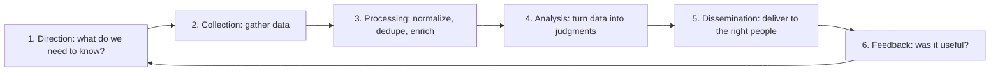
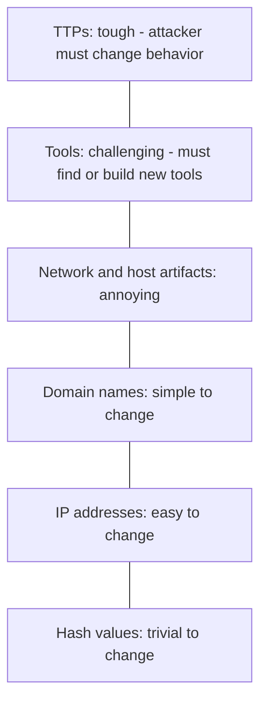
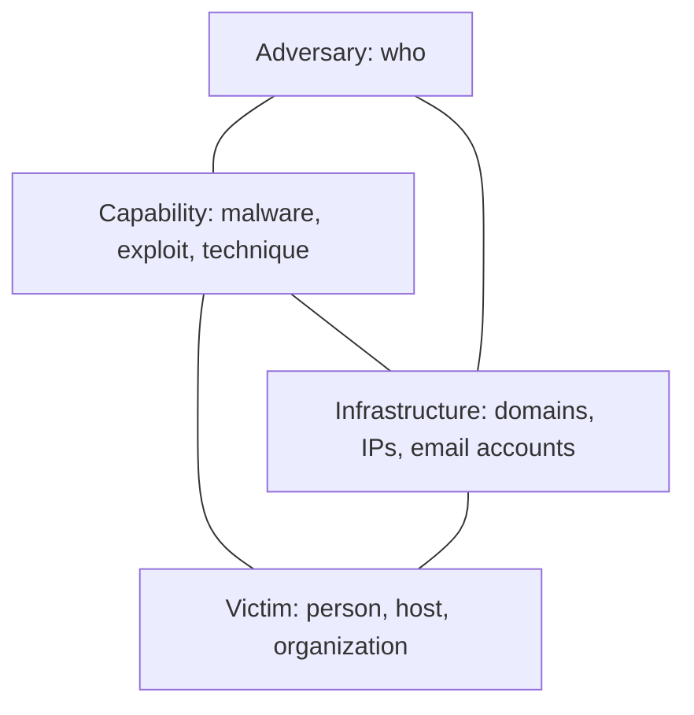
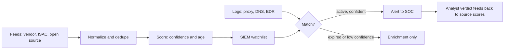

# Threat Intelligence

## Introduction

**Threat intelligence** (often shortened to **CTI**, cyber threat intelligence) is information about attackers that has been collected, checked and analyzed so that someone can make a better decision with it. The last part matters most. A list of 2 million "bad" IP addresses is *data*. Knowing that "a group targeting online retailers is sending fake invoice emails with a loader that talks to `cdn-update.example`, and three of our laptops resolved that domain this morning" is *intelligence*. It tells you what to do next.

A useful analogy is a weather service. Raw sensor readings are data. A forecast that says "storm reaching the coast tomorrow at 3 p.m., secure the boats" is intelligence: it is relevant to you, timely, and it leads to an action.

On this page you will learn:

- The **intelligence lifecycle** and the four levels of intel (strategic, operational, tactical, technical)
- Why **TTPs** beat **IOCs** in the long run, using the **Pyramid of Pain**
- Two classic analysis models: the Pyramid of Pain and the **Diamond Model**
- How to share safely with **TLP 2.0**, and how to exchange intel in **STIX 2.1** over **TAXII 2.1**
- How to match an indicator feed against your logs **without drowning in false positives**
- How to choose between commercial feeds, open-source feeds, ISAC sharing and in-house intel

Threat intelligence feeds the other defensive activities in this section. It gives [detection engineering](./2-sec-detection-engineering.mdx) ideas for rules, gives [threat hunting](./5-sec-threat-hunting.mdx) hypotheses to test, and tells [vulnerability management](./6-sec-vulnerability-management.mdx) which bugs attackers are actually using. Most intel today is described in the language of [MITRE ATT&CK](./3-sec-mitre-attack.mdx).

:::note Defensive use only
Everything on this page is for defending systems you own or are responsible for. Do not "investigate" attacker infrastructure by scanning it, logging into it, or interacting with it. That can be illegal, can tip off the attacker, and can hurt innocent third parties whose servers were hijacked. Leave takedowns and active operations to law enforcement and the providers involved. See [Ethics, Law and Responsible Disclosure](../0-sec-fundamentals/8-sec-ethics-and-law.mdx).
:::

## The Intelligence Lifecycle

Intelligence work is a loop, not a one-off download. Most CTI teams use a six-phase cycle borrowed from traditional intelligence work:



| Phase | Key question | Example at an online shop |
| --- | --- | --- |
| Direction | What decisions must intel support? | "Which threats target payment pages and customer accounts?" |
| Collection | Where do we get data? | Vendor feeds, CISA advisories, an industry ISAC, our own incidents |
| Processing | Is the data usable? | Convert to one format, remove duplicates, drop expired indicators |
| Analysis | What does it mean for us? | "This skimming campaign uses a JavaScript library we also load" |
| Dissemination | Who needs it, in what form? | A SIEM watchlist for the SOC, a one-page brief for the CTO |
| Feedback | Did it help? | "Feed B produced 400 alerts and zero true positives last month" |

The most skipped phase is **direction**. Without written intelligence requirements (often called **PIRs**, priority intelligence requirements), teams collect everything, analyze nothing, and end up with an expensive pile of indicators. A good PIR is short and tied to a decision:

```yaml
# pirs.yaml - BrightCart's priority intelligence requirements (reviewed quarterly)
- id: PIR-1
  question: "Which groups are actively targeting e-commerce checkout pages, and how?"
  consumers: [appsec, soc]
  decision: "Which detections and CSP rules to add to the storefront"
- id: PIR-2
  question: "Which vulnerabilities in our internet-facing stack are being exploited now?"
  consumers: [platform, vuln-management]
  decision: "What to patch out of the normal cycle"
- id: PIR-3
  question: "Are our customer credentials or session tokens being sold or tested?"
  consumers: [fraud, identity]
  decision: "When to force password resets or revoke sessions"
```

## Four Levels of Threat Intelligence

Different audiences need different intel. Matching the level to the reader is half of good dissemination.

| Level | Audience | Time horizon | Example |
| --- | --- | --- | --- |
| **Strategic** | Executives, board | Months to years | "Ransomware groups increasingly steal data before encrypting; budget for backups and data-loss controls." |
| **Operational** | SOC leads, IR managers | Days to weeks | "A campaign against retailers is active this month, using fake invoices and a known loader." |
| **Tactical** | Detection engineers, hunters | Weeks to months | "The group runs encoded PowerShell from Office documents and uses scheduled tasks for persistence." |
| **Technical** | SIEM, firewall, EDR | Hours to days | "Block `cdn-update.example` and SHA-256 `4f7c...4d3e`." |

Technical intel is the easiest to automate and the fastest to go stale. Strategic intel changes slowly but shapes budgets. A mature program produces all four.

## IOCs vs TTPs and the Pyramid of Pain

An **indicator of compromise (IOC)** is a concrete artifact that suggests malicious activity: an IP address, domain, URL, file hash, or email subject. **TTPs** (tactics, techniques and procedures) describe *how* the attacker behaves, such as "dumps credentials from LSASS memory" or "sends invoice-themed phishing with macro documents".

In 2013 David Bianco described the **Pyramid of Pain**: the higher up the pyramid your detection works, the more pain you cause the attacker when you detect and block it.



Why it matters:

- Changing one byte in a file changes its hash. Blocking a hash only stops that exact file.
- Attackers rent new IP addresses and register new domains cheaply and quickly.
- Changing *behavior*, like how they get persistence or steal credentials, means retooling and retraining. That costs real time and money.

So hashes and IPs still have value (they are cheap to deploy and precise), but a program that only consumes IOCs is always one step behind. Use IOCs for fast blocking and for **retro-hunting** (searching old logs for past contact), and turn TTPs into durable [behavioral detections](./2-sec-detection-engineering.mdx) mapped to [ATT&CK](./3-sec-mitre-attack.mdx).

## The Diamond Model

The **Diamond Model of Intrusion Analysis** (Caltagirone, Pendergast and Betz, 2013) says every intrusion event has four connected features:



The model is a pivoting tool. If you know one corner, you can look for the others:

- From a **victim** laptop, find the **capability** (the malware file).
- From the malware, extract the **infrastructure** (the C2 domain it contacts).
- Search your proxy logs for that infrastructure to find **other victims**.
- Compare the capability and infrastructure with public reporting to make a careful judgment about the **adversary**.

:::caution Attribution is hard and usually unnecessary
For most companies, the name of the attacker matters far less than their behavior. Defenses against "a group that uses fake invoices and scheduled tasks" are the same whoever they are. Leave formal attribution to specialist teams and governments, and be careful about naming actors in internal reports based on weak overlaps.
:::

## Sharing Safely: TLP 2.0

Intel is often shared under restrictions. The **Traffic Light Protocol (TLP)**, maintained by FIRST, is the standard way to label how far information may travel. TLP 2.0 has been the authoritative version since August 2022, replacing TLP 1.0. It renamed TLP:WHITE to TLP:CLEAR and added TLP:AMBER+STRICT.

| Label | Who may receive it |
| --- | --- |
| **TLP:RED** | Named recipients only. In a meeting, only the people present. No further sharing. |
| **TLP:AMBER+STRICT** | The recipient's organization only, on a need-to-know basis. |
| **TLP:AMBER** | The recipient's organization **and its clients**, on a need-to-know basis. |
| **TLP:GREEN** | The recipient's community (for example, an industry sharing group), but not public channels. |
| **TLP:CLEAR** | Anyone. Public disclosure is fine, subject to normal copyright rules. |

Practical rules:

- Put the label at the start of the document or email subject, for example `TLP:AMBER+STRICT`.
- If you receive intel without a label, ask the source before passing it on.
- TLP covers *sharing*, not *use*. If a partner shares a TLP:RED domain, you can usually still block it, but you cannot forward the report. When in doubt, ask.

Check [first.org/tlp](https://www.first.org/tlp/) for the official definitions.

## Exchanging Intel: STIX 2.1 and TAXII 2.1

Free-text reports are fine for people but hard for machines. Two OASIS standards solve this:

- **STIX 2.1** (Structured Threat Information Expression) is a JSON format for CTI.
- **TAXII 2.1** (Trusted Automated Exchange of Intelligence Information) is an HTTPS API for publishing and fetching STIX content in **collections**.

STIX 2.1 defines three families of objects:

| Family | Examples |
| --- | --- |
| **SDOs** (domain objects), 18 types | Attack Pattern, Campaign, Course of Action, Grouping, Identity, Indicator, Infrastructure, Intrusion Set, Location, Malware, Malware Analysis, Note, Observed Data, Opinion, Report, Threat Actor, Tool, Vulnerability |
| **SROs** (relationship objects) | Relationship (for example "indicator *indicates* malware"), Sighting ("we saw this indicator") |
| **SCOs** (cyber-observable objects) | File, domain name, IPv4 address, URL, email message, process, and more |

An **Indicator** carries a **pattern** in the STIX patterning language, such as `[domain-name:value = 'cdn-update.example']`, plus a validity window and a confidence value.

### Building a STIX bundle in Python

The official [`stix2`](https://pypi.org/project/stix2/) library (version 3.x) builds valid objects and fills in IDs and timestamps for you. Install it with `pip install stix2`.

Suppose BrightCart's SOC investigated a fake invoice email and wants to share its findings with an industry group:

```python
# stix_build.py - package BrightCart's own findings as STIX 2.1
from stix2 import Bundle, Identity, Indicator, Malware, Relationship, Sighting

brightcart = Identity(name="BrightCart Security", identity_class="organization")

loader = Malware(
    name="InvoiceLoader",
    is_family=True,
    malware_types=["trojan"],
    description="Loader delivered by fake invoice emails (fictional example).",
    created_by_ref=brightcart,
)

c2_domain = Indicator(
    name="InvoiceLoader C2 domain",
    pattern="[domain-name:value = 'cdn-update.example']",
    pattern_type="stix",
    valid_from="2026-10-01T00:00:00Z",
    valid_until="2026-11-01T00:00:00Z",
    confidence=80,
    labels=["malicious-activity"],
    created_by_ref=brightcart,
)

payload_hash = Indicator(
    name="InvoiceLoader payload SHA-256",
    pattern="[file:hashes.'SHA-256' = "
            "'4f7c1e0c2b8a3d9e6f5a4b3c2d1e0f9a8b7c6d5e4f3a2b1c0d9e8f7a6b5c4d3e']",
    pattern_type="stix",
    valid_from="2026-10-01T00:00:00Z",
    confidence=95,
    created_by_ref=brightcart,
)

objects = [brightcart, loader, c2_domain, payload_hash,
           Relationship(c2_domain, "indicates", loader, created_by_ref=brightcart),
           Relationship(payload_hash, "indicates", loader, created_by_ref=brightcart),
           Sighting(sighting_of_ref=c2_domain, count=3, created_by_ref=brightcart)]

bundle = Bundle(*objects)
with open("invoiceloader.json", "w") as f:
    f.write(bundle.serialize(pretty=True))

for obj in bundle.objects:
    label = getattr(obj, "name", None) or getattr(obj, "relationship_type", "seen")
    print(f"{obj.type:<13} {label}")
```

Output:

```text
identity      BrightCart Security
malware       InvoiceLoader
indicator     InvoiceLoader C2 domain
indicator     InvoiceLoader payload SHA-256
relationship  indicates
relationship  indicates
sighting      seen
```

One of the generated indicators looks like this (IDs and timestamps will differ on your machine):

```json
{
    "type": "indicator",
    "spec_version": "2.1",
    "id": "indicator--e6c0ba75-2895-48b8-9f5e-57a5b8729262",
    "created_by_ref": "identity--77535fa0-eff4-485a-a8db-4dfea1e29e02",
    "created": "2026-10-11T11:06:14.301635Z",
    "modified": "2026-10-11T11:06:14.301635Z",
    "name": "InvoiceLoader C2 domain",
    "pattern": "[domain-name:value = 'cdn-update.example']",
    "pattern_type": "stix",
    "pattern_version": "2.1",
    "valid_from": "2026-10-01T00:00:00Z",
    "valid_until": "2026-11-01T00:00:00Z",
    "labels": ["malicious-activity"],
    "confidence": 80
}
```

Notice `valid_until`. Building expiry into the indicator itself is the simplest defense against stale intel.

:::note TLP markings in STIX
STIX can carry TLP labels as marking definitions. The `stix2` library ships ready-made constants such as `TLP_AMBER`, but those are the older **TLP 1.0** markings. If your sharing community uses TLP 2.0 (most now do), use the TLP 2.0 marking definitions your community or platform publishes, and agree on them before you share.
:::

### Reading a bundle back

The consuming side loads the bundle, keeps only active, confident indicators, and follows relationships to see what each indicator points to:

```python
# stix_read.py - load a STIX bundle and pull out active, high-confidence indicators
import json
import re
from datetime import datetime, timezone

from stix2 import Filter, MemoryStore

with open("invoiceloader.json") as f:
    store = MemoryStore(stix_data=json.load(f))

now = datetime(2026, 10, 11, tzinfo=timezone.utc)
simple = re.compile(r"^\[(?P<path>[\w:.'-]+) = '(?P<value>[^']+)'\]$")

for ind in store.query([Filter("type", "=", "indicator")]):
    expired = "valid_until" in ind and ind.valid_until < now
    m = simple.match(ind.pattern)
    if expired or ind.get("confidence", 0) < 60 or not m:
        continue
    family = [store.get(r.target_ref).name for r in store.relationships(ind, "indicates")]
    print(m["path"], m["value"], "->", ", ".join(family))
```

Output:

```text
domain-name:value cdn-update.example -> InvoiceLoader
file:hashes.'SHA-256' 4f7c1e0c2b8a3d9e6f5a4b3c2d1e0f9a8b7c6d5e4f3a2b1c0d9e8f7a6b5c4d3e -> InvoiceLoader
```

The regular expression only handles simple one-comparison patterns, which covers most shared indicators. Real STIX patterns can combine conditions with `AND`, `OR` and time windows. For those, use a proper parser such as the `stix2-patterns` package, or let your threat intel platform handle them.

### Fetching from a TAXII server

TAXII 2.1 servers expose **API roots**, each with **collections** of STIX objects. The [`taxii2-client`](https://pypi.org/project/taxii2-client/) library talks to them. The URL and credentials below are placeholders for a server your sharing community gives you:

```python
# taxii_pull.py - pull new indicators from a TAXII 2.1 collection
from taxii2client.v21 import Collection, as_pages

COLLECTION_URL = "https://taxii.isac.example/api1/collections/3f1b0c2e-retail-indicators/"

collection = Collection(COLLECTION_URL, user="brightcart", password="read-from-a-secret-store")

for envelope in as_pages(collection.get_objects, per_request=100,
                         added_after="2026-10-01T00:00:00Z", type="indicator"):
    for obj in envelope.get("objects", []):
        print(obj["id"], obj.get("pattern"))
```

Example output:

```text
indicator--9a1e... [domain-name:value = 'cdn-update.example']
indicator--c47b... [ipv4-addr:value = '198.51.100.23']
```

Use `added_after` so each run only fetches what is new since the last pull, and keep the credentials in a secret store, as described in [Secrets Management in Code](../5-sec-secure-coding/3-sec-secrets-in-code.mdx).

## Threat Intelligence Platforms and Sources

You can start with scripts, but once you have more than a few sources you want a **threat intelligence platform (TIP)** to collect, deduplicate, score, and push indicators to your tools.

| Platform | Type | Notes |
| --- | --- | --- |
| **MISP** | Open source | Widely used by CERTs and ISACs for sharing events, attributes and galaxies; can import and export STIX. |
| **OpenCTI** | Open source (by Filigran), with commercial editions | Built around the STIX 2.1 data model; good for linking reports, actors, TTPs and indicators in a graph. |
| Commercial TIPs | Paid | Curated feeds, analyst reports and integrations, often bundled with a SIEM or EDR. |

Useful free or low-cost sources include:

- **CISA advisories** and the **Known Exploited Vulnerabilities (KEV)** catalog (`https://www.cisa.gov/known-exploited-vulnerabilities-catalog`), which lists vulnerabilities exploited in the wild.
- **abuse.ch** projects such as URLhaus, ThreatFox, MalwareBazaar and Feodo Tracker. Since mid-2025, abuse.ch requires a free authentication key for API access. Check each project's current terms before automating.
- **MITRE ATT&CK** groups and software pages for TTP-level reporting.
- **Industry ISACs/ISAOs** (Information Sharing and Analysis Centers), such as those for retail, finance or health.
- **Vendor research blogs** and incident reports, which are good for tactical TTPs.
- **Your own incidents**, which are the most relevant intel you will ever get.

Sources, terms and pricing change often, so confirm current access rules on each provider's site.

### Example: tactical intel from the KEV catalog

KEV is a simple, high-signal feed: every entry has been exploited in the wild. This script answers PIR-2, "which exploited vulnerabilities touch products we run?":

```python
# kev_watch.py - which newly exploited vulnerabilities touch products we run?
import json
import urllib.request
from datetime import date, timedelta

KEV_URL = ("https://www.cisa.gov/sites/default/files/feeds/"
           "known_exploited_vulnerabilities.json")
OUR_STACK = {"nginx", "postgresql", "openssh", "bind", "chrome", "windows"}

req = urllib.request.Request(KEV_URL, headers={"User-Agent": "brightcart-cti/1.0"})
with urllib.request.urlopen(req, timeout=30) as resp:
    kev = json.load(resp)

since = date.today() - timedelta(days=30)
print(f"KEV catalog {kev['catalogVersion']}, {kev['count']} entries")
for v in kev["vulnerabilities"]:
    if date.fromisoformat(v["dateAdded"]) < since:
        continue
    if v["product"].lower() in OUR_STACK or v["vendorProject"].lower() in OUR_STACK:
        print(f"{v['dateAdded']}  {v['cveID']:<16} {v['vendorProject']} {v['product']}"
              f"  ransomware={v['knownRansomwareCampaignUse']}")
```

Example output (your results depend on the date you run it):

```text
KEV catalog 2026.10.08, 1739 entries
2026-10-08  CVE-2015-5477    ISC BIND  ransomware=Unknown
```

Product names in KEV are free text, so matching on names is rough. A real version would match against your asset inventory with CPE identifiers or SBOM data. [Vulnerability Management and CVSS](./6-sec-vulnerability-management.mdx) shows how to combine KEV with CVSS and EPSS for prioritization.

## Matching Indicators Against Your Logs

The most common technical use of intel is matching indicators against logs: proxy, DNS, firewall, EDR and email. Done naively it produces floods of false positives. Three controls keep it useful:

1. **Aging (expiry).** Indicators lose value over time. An IP address may be reassigned to an innocent cloud customer within days. A file hash keeps its meaning much longer.
2. **Confidence.** Not every source is equally reliable. Only alert above a threshold, and let lower-confidence matches enrich investigations instead of paging anyone.
3. **Allowlisting.** Feeds sometimes include shared infrastructure, such as CDNs, popular cloud IPs, or even your own addresses. Keep an allowlist and review it.



Here is a small, self-contained matcher you can run as-is:

```python
# ioc_match.py - match an indicator feed against proxy logs, with aging and confidence
import csv
import io
from dataclasses import dataclass
from datetime import datetime, timedelta, timezone

# TTL by indicator type: IPs churn fast, file hashes almost never change meaning
TTL = {"ipv4": timedelta(days=14), "domain": timedelta(days=45), "sha256": timedelta(days=365)}
MIN_CONFIDENCE = 60
ALLOWLIST = {"203.0.113.10"}  # BrightCart's own CDN edge, listed by mistake in a feed once


@dataclass
class Ioc:
    value: str
    kind: str
    source: str
    confidence: int
    last_seen: datetime

    def is_active(self, now: datetime) -> bool:
        return now - self.last_seen <= TTL[self.kind]


FEED_CSV = """value,kind,source,confidence,last_seen
198.51.100.23,ipv4,open-feed-a,70,2026-10-08
198.51.100.99,ipv4,open-feed-a,70,2026-08-01
cdn-update.example,domain,isac-retail,90,2026-10-05
pastebin-mirror.example,domain,open-feed-b,30,2026-10-09
203.0.113.10,ipv4,open-feed-b,65,2026-10-09
"""

LOGS_CSV = """time,src_host,dest
2026-10-11T08:01:12Z,pos-07,198.51.100.23
2026-10-11T08:03:40Z,laptop-ana,cdn-update.example
2026-10-11T08:05:02Z,laptop-raj,198.51.100.99
2026-10-11T08:06:55Z,build-01,pastebin-mirror.example
2026-10-11T08:07:30Z,web-02,203.0.113.10
"""


def load_iocs(text: str) -> dict[str, Ioc]:
    iocs = {}
    for row in csv.DictReader(io.StringIO(text)):
        ioc = Ioc(row["value"].lower(), row["kind"], row["source"], int(row["confidence"]),
                  datetime.fromisoformat(row["last_seen"]).replace(tzinfo=timezone.utc))
        iocs[ioc.value] = ioc
    return iocs


def match(logs: str, iocs: dict[str, Ioc], now: datetime):
    for event in csv.DictReader(io.StringIO(logs)):
        dest = event["dest"].lower()
        ioc = iocs.get(dest)
        if ioc is None:
            continue
        if dest in ALLOWLIST:
            reason = "skipped: allowlisted"
        elif not ioc.is_active(now):
            reason = "skipped: expired"
        elif ioc.confidence < MIN_CONFIDENCE:
            reason = "skipped: low confidence"
        else:
            reason = "ALERT"
        yield event["time"], event["src_host"], dest, ioc.source, ioc.confidence, reason


now = datetime(2026, 10, 11, 9, 0, tzinfo=timezone.utc)
for row in match(LOGS_CSV, load_iocs(FEED_CSV), now):
    print("{:<21} {:<11} {:<24} {:<12} {:>3}  {}".format(*row))
```

Output:

```text
2026-10-11T08:01:12Z  pos-07      198.51.100.23            open-feed-a   70  ALERT
2026-10-11T08:03:40Z  laptop-ana  cdn-update.example       isac-retail   90  ALERT
2026-10-11T08:05:02Z  laptop-raj  198.51.100.99            open-feed-a   70  skipped: expired
2026-10-11T08:06:55Z  build-01    pastebin-mirror.example  open-feed-b   30  skipped: low confidence
2026-10-11T08:07:30Z  web-02      203.0.113.10             open-feed-b   65  skipped: allowlisted
```

Five matches, but only two alerts reach an analyst. The skipped ones are not thrown away: an expired match is still worth seeing when an analyst is already investigating `laptop-raj` for another reason. In a real SIEM you would load the same logic as a watchlist or lookup table. [Security Logging and SIEM](./1-sec-logging-and-siem.mdx) covers that side.

:::tip Retro-hunt when new intel arrives
When an ISAC shares a new domain today, also search the **last 30 to 90 days** of DNS and proxy logs. Attackers are often inside before the intel is published. This is one of the highest-value, lowest-effort uses of IOCs.
:::

## Real-World Scenario

**BrightCart** is a 120-person e-commerce SaaS company. It has a three-person SOC, a SIEM, and EDR on all laptops and servers. The CISO has a budget question: "A vendor is offering a commercial threat intel feed. Should we buy it, and what else should we do?"

### Step 1: Start from requirements, not feeds

The team writes the three PIRs shown earlier: checkout page attacks, exploited vulnerabilities in their stack, and customer credential abuse. For each PIR they list which source could answer it.

### Step 2: Map sources to requirements

| PIR | Best source | Why |
| --- | --- | --- |
| PIR-1 checkout attacks | Retail ISAC, vendor research blogs | Peers see the same skimming campaigns first |
| PIR-2 exploited vulnerabilities | CISA KEV, vendor advisories, EPSS | Free, high-signal, easy to automate |
| PIR-3 credential abuse | In-house login telemetry, fraud team | Only BrightCart sees its own login failures |

### Step 3: Pilot before buying

They run the commercial feed in **enrichment-only mode** for 30 days alongside their open-source feeds and the ISAC feed. For every match they record the analyst verdict. At the end, they compare sources by the number of **true positives** and **unique** findings (ones no free source had), not by the number of indicators.

### Step 4: Decide

The pilot shows that the ISAC feed and their own incident data produced the most relevant alerts. The commercial feed added a handful of unique, high-confidence indicators and good written reporting on retail threats. BrightCart joins the ISAC, automates KEV, keeps the open-source feeds in enrichment-only mode, and buys a smaller commercial tier focused on analyst reports rather than bulk indicators.

### Why this approach

- Requirements first means every source must earn its place by answering a question.
- Measuring **unique true positives** stops the team from paying for duplicates of free data.
- Enrichment-only mode lets them test a noisy source without flooding a three-person SOC.

### When to use it, and when not to

- **Use it** when you have at least basic logging, a SIEM or log search, and someone who reads alerts. Intel without visibility is just a reading list.
- **Do not start here** if you lack the basics. If MFA, patching and logging are missing, fix those first. KEV alone plus good hygiene beats any premium feed on an unpatched network.

### Alternatives and trade-offs

| Approach | Pros | Cons | Best for |
| --- | --- | --- | --- |
| Commercial feed / TIP | Curated, scored, good reports and support | Cost; overlap with free data; can be noisy if bought by volume | Teams with analysts to act on it, regulated sectors |
| Open-source feeds (abuse.ch, CISA, etc.) | Free, fast, transparent | Variable quality; you do the processing and aging; terms vary | Small teams, enrichment, retro-hunting |
| ISAC / community sharing | Highly relevant peer intel, trusted context | Membership fees for some; you are expected to share back; TLP rules | Sector-specific threats |
| In-house intel from your own incidents | Most relevant, zero cost of acquisition | Requires mature IR and documentation; limited view | Everyone, as the foundation |

## Privacy and Legal Considerations When Sharing

Sharing intel helps everyone, but think before you send:

- **Strip personal data.** Phishing emails contain recipient names and addresses. Logs contain customer IPs and user IDs. Share the attacker's artifacts, not your customers' data. Privacy laws such as GDPR still apply. See [Privacy Engineering](../13-sec-governance/4-sec-privacy-engineering.mdx).
- **Respect TLP and contracts.** Do not forward a partner's TLP:AMBER report to a public mailing list. Check vendor licenses before redistributing commercial feed content.
- **Get approval.** Many companies require legal or communications sign-off before sharing incident details externally, especially during an active incident.
- **Be careful with victim names.** Never publish the names of other organizations you believe are compromised. Notify them privately or through the ISAC or a national CERT.
- **Never interact with attacker infrastructure** beyond passive lookups that do not touch it (such as querying reputation services or your own logs).

## Common Mistakes

- **Collecting everything.** Subscribing to dozens of feeds with no PIRs creates noise. Start from questions, then choose sources.
- **No expiry on indicators.** Old IPs get reassigned. Alerting on them causes false positives and erodes trust in the SOC. Give every indicator type a TTL.
- **Blocking without allowlists.** One bad feed entry for a CDN or cloud provider can block your own customers. Keep and review an allowlist, and roll out blocking gradually.
- **Treating IOCs as the whole program.** Hashes and IPs are cheap for attackers to change. Turn TTPs from reports into behavioral detections.
- **No feedback loop.** If analysts never mark which feeds produced true positives, you cannot drop bad sources or tune confidence.
- **Ignoring your own data.** Your incidents and postmortems are the most relevant intel you have. Feed them back into detections. See [Security Postmortems](../12-sec-incident-response/4-sec-postmortems.mdx).
- **Over-attributing.** Naming a nation-state on weak evidence wastes time and can be embarrassing. Focus on behavior.

## Summary

- Threat intelligence is analyzed, relevant information that supports a **decision**. Data alone is not intelligence.
- Work in a loop: **direction, collection, processing, analysis, dissemination, feedback**, and write down your PIRs.
- Match the level (**strategic, operational, tactical, technical**) to the audience.
- The **Pyramid of Pain** shows why TTP-based detections last longer than hashes and IPs. The **Diamond Model** helps you pivot between adversary, capability, infrastructure and victim.
- Label shared intel with **TLP 2.0** (RED, AMBER+STRICT, AMBER, GREEN, CLEAR).
- Use **STIX 2.1** for machine-readable intel and **TAXII 2.1** to exchange it. MISP and OpenCTI are popular open-source platforms.
- When matching IOCs against logs, apply **expiry, confidence thresholds and allowlists**, and retro-hunt old logs.
- Choose sources by measuring unique true positives against your requirements.

## Exercises

1. **Write PIRs.** Pick a real or imaginary organization (a school, a clinic, a small online shop). Write three PIRs, each with consumers and the decision it supports.
2. **Extend the matcher.** Add a `sha256` indicator type to `ioc_match.py` and a second log source of EDR file events. Then add a "source score" that is lowered every time an analyst marks a match from that source as a false positive.
3. **Build and share a bundle.** Use `stix2` to create a Report SDO that references your Malware, Indicators and an Attack Pattern for ATT&CK technique T1566.001 (Spearphishing Attachment). Validate that the bundle loads back with `MemoryStore`.
4. **Explore a platform.** Run MISP or OpenCTI in a local Docker lab (see the [Docker tutorial](/docs/devops/docker)), import your bundle, and look at how the platform links the objects.

Related pages in this tutorial:

- [MITRE ATT&CK](./3-sec-mitre-attack.mdx) for describing TTPs in a shared language
- [Detection Engineering](./2-sec-detection-engineering.mdx) for turning intel into durable rules
- [Threat Hunting](./5-sec-threat-hunting.mdx) for using intel as hunt hypotheses
- [Vulnerability Management and CVSS](./6-sec-vulnerability-management.mdx) for KEV and EPSS in patch prioritization
- [Malware Analysis Basics](./7-sec-malware-basics.mdx) for extracting IOCs from samples safely
- [The Attacker Mindset and Kill Chains](../0-sec-fundamentals/7-sec-attacker-mindset.mdx) for the bigger picture of how intrusions unfold
