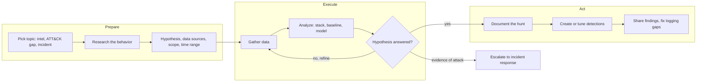

# Threat Hunting

## Introduction

Detections only catch what someone already thought to write a rule for. A careful attacker can log in with valid credentials, use built-in admin tools, and send data out through a normal cloud storage service without tripping a single alert. **Threat hunting** is the proactive search for that kind of activity: you assume something may already be wrong and go looking for evidence, instead of waiting for an alert.

Think of a store detective. The alarm gates at the door catch shoplifters who forget to remove a tag. The detective walks the aisles looking for behavior that does not fit, like someone lingering by the expensive shelf or a "customer" who keeps visiting the stockroom. Most walks find nothing, and that is fine. Each walk also teaches the detective where the gates are blind.

Hunting differs from the other SOC activities:

| Activity | Starts from | Question | Output |
| --- | --- | --- | --- |
| Detection | A rule fires | "Is this alert real?" | Triage verdict |
| Incident response | A confirmed incident | "How bad is it, and how do we stop it?" | Containment, recovery |
| **Threat hunting** | A hypothesis or a question about the data | "Is something happening that no rule caught?" | Findings, new detections, visibility fixes |

A hunt that finds an attacker becomes an incident (see the [Incident Response Lifecycle](../12-sec-incident-response/0-sec-incident-response-lifecycle.mdx)). A hunt that finds nothing still pays off when it produces a new [detection](./2-sec-detection-engineering.mdx), reveals a logging gap, or documents what "normal" looks like.

## The PEAK Framework

Many teams structure hunts with **PEAK** ("Prepare, Execute, and Act with Knowledge"), published by Splunk's SURGe team (David Bianco, with Ryan Fetterman) in 2023. David Bianco also created the Pyramid of Pain and the older Hunting Maturity Model. PEAK describes three hunt types that share the same three phases:

- **Hypothesis-driven**: test a specific suspicion, such as "an attacker is using a cloud sync tool to exfiltrate data."
- **Baseline** (exploratory data analysis): learn what normal looks like for some data, then look for deviations.
- **Model-assisted (M-ATH)**: use a machine learning model, such as a clustering or anomaly model, to surface candidates for a human to review.



The "Act with Knowledge" part matters most. A hunt that only exists in one analyst's memory is wasted. Write it down and turn the useful parts into automation.

## Writing a Good Hypothesis

A useful hypothesis is **specific, testable with data you have, and tied to a real threat**. Compare:

| Weak | Strong |
| --- | --- |
| "Look for hackers" | "An attacker with a stolen session is creating mailbox forwarding rules to external domains" |
| "Check PowerShell" | "Office documents are launching PowerShell or cmd on workstations (T1204.002, T1059.001)" |
| "Find malware" | "A workstation is beaconing to a command-and-control server over HTTPS at regular intervals (T1071.001)" |

Good sources of hypotheses:

- **Threat intelligence** about groups that target your industry ([Threat Intelligence](./4-sec-threat-intelligence.mdx)).
- **ATT&CK coverage gaps**: techniques with no detection ([MITRE ATT&CK](./3-sec-mitre-attack.mdx)). Since ATT&CK v19, techniques that hide activity sit under **Stealth** (TA0005), and techniques that switch off security tools sit under **Defense Impairment** (TA0112). Both are rich hunting ground, because they are designed to avoid alerts.
- **Recent incidents**, at your company or in the news: "Could that have happened here without us noticing?"
- **New visibility**: you just started collecting DNS logs, so what can you now see?

## Before You Hunt: Check Your Data

A hunt can only find what your logs recorded. Before analyzing anything, confirm that the data source covers the hosts and time range in your scope. Compare your asset inventory with the last event the SIEM received from each host:

```python
import pandas as pd

inventory = pd.DataFrame({"host": ["ws-01", "ws-02", "ws-03", "ws-04", "build-07", "build-08"]})
# Last event received per host, from the SIEM (synthetic)
last_seen = pd.DataFrame({
    "host": ["ws-01", "ws-02", "ws-03", "ws-04", "build-07"],
    "last_event": pd.to_datetime(["2026-10-10 23:58", "2026-10-10 23:59", "2026-10-02 08:15",
                                  "2026-10-10 23:57", "2026-10-10 23:50"]),
})
now = pd.Timestamp("2026-10-11 00:00")

cov = inventory.merge(last_seen, on="host", how="left")
cov["status"] = "ok"
cov.loc[cov["last_event"].isna(), "status"] = "never seen"
cov.loc[(now - cov["last_event"]) > pd.Timedelta(hours=24), "status"] = "silent > 24h"
print(cov[cov["status"] != "ok"].to_string(index=False))
```

Output:

```text
    host          last_event       status
   ws-03 2026-10-02 08:15:00 silent > 24h
build-08                 NaT   never seen
```

`ws-03` stopped sending data nine days ago, and `build-08` never sent any. Nothing you find (or fail to find) on those hosts means anything until that is fixed. A silent host can be a broken agent, a decommissioned machine still listed in the inventory, or an attacker who stopped the agent (T1685 Disable or Modify Tools, under Defense Impairment in ATT&CK v19). Record the gap in your hunt notes either way.

## Technique 1: Stacking (Least-Frequency Analysis)

**Stacking** means counting how often each value appears and looking at the rarest ones. Attackers are, by definition, unusual in your environment. A process that runs on thousands of machines every day is probably fine, and one that ran once on one machine deserves a look.

The example below stacks **parent-child process pairs** from a week of synthetic process-creation events on six workstations. Two odd events are hidden among 600 normal ones.

```python
import pandas as pd

# Process creation events from 6 workstations over one week (synthetic).
rows = []
normal = [("explorer.exe", "chrome.exe"), ("explorer.exe", "outlook.exe"),
          ("services.exe", "svchost.exe"), ("explorer.exe", "teams.exe"),
          ("outlook.exe", "chrome.exe")]
for host in ["ws-01", "ws-02", "ws-03", "ws-04", "ws-05", "ws-06"]:
    for parent, child in normal:
        rows += [{"host": host, "parent": parent, "process": child}] * 20
# Two odd events hidden in the noise
rows.append({"host": "ws-04", "parent": "winword.exe", "process": "powershell.exe"})
rows.append({"host": "ws-02", "parent": "explorer.exe", "process": "rclone.exe"})
events = pd.DataFrame(rows)

# Stack: count each parent -> child pair, and how many hosts it appears on
stack = (events.groupby(["parent", "process"])
               .agg(count=("host", "size"), hosts=("host", "nunique"))
               .reset_index()
               .sort_values("count"))
print(stack.to_string(index=False))
```

Output:

```text
      parent        process  count  hosts
explorer.exe     rclone.exe      1      1
 winword.exe powershell.exe      1      1
explorer.exe    outlook.exe    120      6
explorer.exe     chrome.exe    120      6
explorer.exe      teams.exe    120      6
 outlook.exe     chrome.exe    120      6
services.exe    svchost.exe    120      6
```

Both rare pairs are worth a closer look:

- **`winword.exe` starting `powershell.exe`** is a classic sign of a malicious document macro (T1204.002 Malicious File, then T1059.001 PowerShell).
- **`rclone.exe`** is a legitimate file sync tool that attackers often use to copy stolen data to cloud storage (T1567.002 Exfiltration to Cloud Storage). On a workstation where nobody installed it, it is suspicious.

Rare does not mean malicious. A developer's one-off tool will also show up at the bottom of the stack. Stacking gives you a **short list to investigate**, not a verdict. The `hosts` column helps: something on one host out of thousands is more interesting than something on one host out of six.

The same stack in common SIEM languages is shown below. These queries are illustrative; table and field names depend on your data sources.

```text
# Splunk SPL (Sysmon process creation)
index=sysmon EventCode=1 earliest=-7d
| stats count dc(host) AS hosts BY ParentImage Image
| sort count
| head 50

# Microsoft Defender / Sentinel KQL
DeviceProcessEvents
| where Timestamp > ago(7d)
| summarize Count = count(), Hosts = dcount(DeviceName) by InitiatingProcessFileName, FileName
| order by Count asc
| take 50

# Elastic ES|QL (ECS fields)
FROM logs-endpoint.events.process-*
| WHERE @timestamp > NOW() - 7 days AND event.type == "start"
| STATS count = COUNT(*), hosts = COUNT_DISTINCT(host.name) BY process.parent.name, process.name
| SORT count ASC
| LIMIT 50
```

## Technique 2: Beaconing Analysis

Malware that has infected a machine usually "phones home" to its command-and-control (C2) server to ask for instructions. Many implants do this on a timer, every few minutes, with a little random **jitter** to look less mechanical. Humans browsing the web do not behave like that: their requests come in irregular bursts.

That difference is measurable. For each host and destination pair, compute the time gaps between connections and their **coefficient of variation (CV)**, which is the standard deviation divided by the mean. A CV near 0 means very regular timing, and a CV near 1 or higher means irregular timing.

```python
import numpy as np
import pandas as pd

rng = np.random.default_rng(7)
start = pd.Timestamp("2026-10-10 00:00:00")
rows = []

# Normal browsing: bursts of requests at random times to popular sites
for host in ["ws-01", "ws-02", "ws-03"]:
    for dest in ["cdn.example", "news.example", "mail.example"]:
        times = np.sort(rng.uniform(0, 8 * 3600, size=40))
        rows += [{"host": host, "dest": dest, "ts": start + pd.Timedelta(seconds=t)} for t in times]

# A beacon: ws-02 calls one domain every ~300 s with +/-10% jitter for 8 hours
t = 0.0
while t < 8 * 3600:
    rows.append({"host": "ws-02", "dest": "update-check.example", "ts": start + pd.Timedelta(seconds=t)})
    t += 300 * rng.uniform(0.9, 1.1)

# A health check: monitoring server polls an API every 60 s exactly
for i in range(480):
    rows.append({"host": "mon-01", "dest": "api.brightcart.example", "ts": start + pd.Timedelta(seconds=60 * i)})

conns = pd.DataFrame(rows).sort_values("ts")

def interval_stats(group):
    gaps = group["ts"].diff().dt.total_seconds().dropna()
    return pd.Series({
        "connections": len(group),
        "mean_gap_s": round(gaps.mean(), 1),
        "cv": round(gaps.std() / gaps.mean(), 3),   # coefficient of variation
    })

stats = (conns.groupby(["host", "dest"])[["ts"]].apply(interval_stats)
           .reset_index().astype({"connections": int}))
candidates = stats[(stats["connections"] >= 20) & (stats["cv"] < 0.2)]
print(stats.sort_values("cv").to_string(index=False))
print("\nBeacon candidates:")
print(candidates.to_string(index=False))
```

Output:

```text
  host                   dest  connections  mean_gap_s    cv
mon-01 api.brightcart.example          480        60.0 0.000
 ws-02   update-check.example           96       302.3 0.055
 ws-01           news.example           40       679.0 0.820
 ws-02           news.example           40       695.0 0.867
 ws-01           mail.example           40       710.4 0.885
 ws-03            cdn.example           40       612.1 0.958
 ws-02            cdn.example           40       713.4 0.970
 ws-03           mail.example           40       711.0 0.994
 ws-01            cdn.example           40       732.4 1.055
 ws-03           news.example           40       711.5 1.110
 ws-02           mail.example           40       689.3 1.611

Beacon candidates:
  host                   dest  connections  mean_gap_s    cv
mon-01 api.brightcart.example          480        60.0 0.000
 ws-02   update-check.example           96       302.3 0.055
```

The analysis finds the beacon (`ws-02` to `update-check.example`, every five minutes with jitter). It also flags the monitoring server, which is perfectly regular because it is a health check. That is the typical outcome of a beaconing hunt: **regular timing is common among legitimate software** (update checkers, monitoring, telemetry, sync clients). After the first run, you investigate the candidates, then add known-good pairs to an allowlist so the next run is shorter.

Ways to strengthen the analysis:

- **Domain popularity**: a destination that only one host in the company talks to is more suspicious than one every host uses.
- **Domain age and reputation** from threat intel.
- **Data size consistency**: beacons often send similar-sized requests each time.
- **Off-hours activity**: a laptop beaconing at 3 a.m. while the user is asleep.

Open source tools such as Active Countermeasures' RITA apply similar statistics to Zeek network logs at scale.

:::caution Encrypted traffic still leaks timing
HTTPS hides the content of a beacon, but not when connections happen, how big they are, or which domain the client asked for (from DNS or the TLS server name). That metadata is often enough to hunt with. See [Packet Analysis with Wireshark and tcpdump](../2-sec-network-security/9-sec-packet-analysis.mdx) and [DNS Security](../2-sec-network-security/4-sec-dns-security.mdx).
:::

## Technique 3: Baselining Behavior

A **baseline hunt** first learns what is normal for each entity, then looks for deviations. Stolen credentials (T1078 Valid Accounts) are a good target, because the attacker's logins are technically valid and no single event looks wrong. What looks wrong is that *this* user does not normally sign in from *that* network at *that* hour.

```python
import numpy as np
import pandas as pd

rng = np.random.default_rng(42)
users = {"anna": "DE", "tom": "US", "maria": "ES", "svc-backup": "US"}

# 30 days of baseline sign-ins: office hours, home country (synthetic)
base = []
for day in pd.date_range("2026-09-01", periods=30):
    for user, country in users.items():
        hours = [2] if user == "svc-backup" else rng.integers(8, 18, size=3)
        for h in hours:
            base.append({"user": user, "country": country, "asn": "AS64500", "hour": int(h)})
baseline = pd.DataFrame(base)

# Build a per-user profile: known countries, ASNs and usual hours
profile = baseline.groupby("user").agg(
    countries=("country", set), asns=("asn", set),
    first_hour=("hour", "min"), last_hour=("hour", "max"))

today = pd.DataFrame([
    {"user": "anna", "country": "DE", "asn": "AS64500", "hour": 9},
    {"user": "tom", "country": "US", "asn": "AS64500", "hour": 14},
    {"user": "maria", "country": "ES", "asn": "AS64511", "hour": 3},
    {"user": "svc-backup", "country": "NL", "asn": "AS64499", "hour": 2},
])

def deviations(row):
    p = profile.loc[row["user"]]
    out = []
    if row["country"] not in p["countries"]:
        out.append(f"new country {row['country']}")
    if row["asn"] not in p["asns"]:
        out.append(f"new network {row['asn']}")
    if not p["first_hour"] <= row["hour"] <= p["last_hour"]:
        out.append(f"unusual hour {row['hour']:02d}:00")
    return ", ".join(out)

today["deviations"] = today.apply(deviations, axis=1)
print(today[today["deviations"] != ""][["user", "deviations"]].to_string(index=False))
```

Output:

```text
      user                              deviations
     maria new network AS64511, unusual hour 03:00
svc-backup     new country NL, new network AS64499
```

Two leads come out of this:

- **maria** signed in at 03:00 from a network she never used before. She might be traveling, or her session might be stolen. Check her MFA events and what she did after signing in.
- **svc-backup** is a service account that always runs at 02:00 from one network. It now appears from a new country. Service accounts should be extremely predictable, so any change is a strong signal.

Service accounts are some of the best baseline targets, precisely because they are so predictable. Human behavior is noisier: people travel, work late and change phones. In production you would use a longer history, weekday and weekend profiles, and peer groups such as "everyone in finance".

## Technique 4: Model-Assisted Hunting

When the data is too large or too varied for stacking and simple baselines, **model-assisted** hunts (PEAK's M-ATH) use machine learning to produce candidates. Common examples are clustering similar command lines, scoring the randomness of domain names to find algorithmically generated domains, and isolation forests over login features.

The human still makes the call. A model ranks or groups the data, and the hunter reviews the top results and gives feedback. Keep these points in mind:

- Models need **good features and clean data**, so start with the simpler techniques above.
- Models find what is **unusual, not what is malicious**. Expect many benign outliers.
- If you cannot explain why the model flagged something, an analyst cannot efficiently triage it.

## Act: Turning a Hunt into a Detection

The `winword.exe` to `powershell.exe` finding from the stacking hunt is a good example of something that should never depend on a human noticing it again. Write it as a rule, as described in [Detection Engineering](./2-sec-detection-engineering.mdx):

```yaml
title: Office Application Spawns Script Interpreter
id: 3b9c1e52-7d4a-4c8e-9f21-0a6b5d2e8c11
status: experimental
description: Detects Word, Excel or PowerPoint starting a command shell or script host, a common sign of a malicious document. Created from hunt H-2026-014.
references:
    - https://attack.mitre.org/techniques/T1204/002/
author: BrightCart Security
date: 2026-10-11
tags:
    - attack.execution
    - attack.t1204.002
    - attack.t1059.001
logsource:
    category: process_creation
    product: windows
detection:
    selection:
        ParentImage|endswith:
            - '\winword.exe'
            - '\excel.exe'
            - '\powerpnt.exe'
        Image|endswith:
            - '\powershell.exe'
            - '\pwsh.exe'
            - '\cmd.exe'
            - '\wscript.exe'
            - '\cscript.exe'
            - '\mshta.exe'
    condition: selection
falsepositives:
    - Legacy macros approved by IT (document each exception)
level: high
```

```bash
sigma check rules/
```

Output:

```text
No validation issues found.
```

Not every hunt converts cleanly into a rule. Beaconing and baseline hunts often become **scheduled analytics** that run daily and send a ranked report to an analyst, instead of real-time alerts. That is fine. The goal is to make the hunt repeatable without a person rebuilding it from memory.

### Documenting the hunt

Write a short record for every hunt, even (especially) when it finds nothing:

```yaml
hunt_id: H-2026-014
title: Office documents launching script interpreters
type: hypothesis-driven
hypothesis: >
  Phishing documents are executing PowerShell or cmd on workstations
  (T1566.001 -> T1204.002 -> T1059.001), and no current rule alerts on it.
data_sources: [sysmon_process_creation]
time_range: 2026-10-03 to 2026-10-10
scope: all 412 Windows workstations
method: stacked parent-child process pairs, reviewed pairs seen on fewer than 3 hosts
findings:
  - ws-04 winword.exe -> powershell.exe, user opened invoice attachment; escalated as INC-2291
  - ws-02 rclone.exe run by a developer; approved tool, documented
gaps:
  - 37 workstations had no Sysmon events in range (agent broken) - ticket IT-8812
outcomes:
  - new detection: win_office_spawns_shell.yml
  - allowlist entry: rclone on dev workstations with approved config
analyst: j.doe
```

The **gaps** line is often the most valuable output. Discovering that 37 machines were silent is a visibility problem that affects every detection, not just this hunt.

## Real-World Scenario

**BrightCart** has a two-person security team and an MDR provider that monitors endpoints and identity around the clock. A threat intel report describes a group that targets e-commerce companies by stealing session tokens from developers, then using legitimate cloud sync tools to exfiltrate customer data. Nothing has alerted, but the team wants to know whether it could be happening.

### The solution

1. **Prepare**: write two hypotheses. H1: "a stolen session is being used from an unfamiliar network" (baseline hunt on identity provider logs). H2: "data is being copied to cloud storage with a sync tool" (hypothesis-driven stacking of process names and destination domains on developer laptops and build servers).
2. **Execute**: run the baseline over 60 days of sign-ins, and stack process names and outbound destinations for 14 days. Review everything seen on three or fewer hosts.
3. **Act**: one developer's rclone use is legitimate, so it is documented and allowlisted with conditions. Two service accounts show new networks after a vendor changed its egress IPs, which is benign. The team adds a scheduled baseline analytic for service accounts, a detection for sync tools on build servers, and files a ticket because build servers were not sending process events.
4. **Hand off**: the MDR provider gets the new detection and the hunt write-up so its analysts know what "normal" looks like at BrightCart.

### Why this approach

Intel gave a concrete, relevant threat, which makes a sharp hypothesis possible. Baselining fits stolen sessions, because each login is technically valid. Stacking fits tool abuse, because the tools are legitimate but rare. Both techniques need only data the team already has and a notebook, not a new product.

### When to use it, and when not to

- **Hunt** once you have reliable logging and your alert queue is under control. Hunting cannot replace basic detections.
- **Do not start hunting** if critical log sources are missing or the team cannot keep up with existing alerts. Fix visibility and triage first. The first "hunts" in an immature environment mostly find logging gaps, which is still useful.
- **Prefer an MDR's hunting service** if you have no dedicated security staff. In-house hunters add the most value where business context matters, such as your own applications and cloud setup.

### Alternatives and trade-offs

| Approach | Pros | Cons | Best for |
| --- | --- | --- | --- |
| Hypothesis-driven hunt | Focused, quick, easy to document; directly tests a threat | Only finds what you thought to look for | Responding to new intel or ATT&CK gaps |
| Baseline hunt | Finds unknown deviations; produces reusable profiles | Needs history and clean data; many benign outliers | Identities, service accounts, stable servers |
| Model-assisted hunt (M-ATH) | Scales to huge datasets; finds subtle patterns | Needs data science skills; hard to explain results | Large environments with mature data pipelines |
| In-house hunting | Deep business context; results feed your own detections | Takes skilled staff time away from other work | Teams with stable operations |
| MDR / vendor hunting | Broad visibility across many customers; no hiring | Limited to vendor data sources; less context | Small teams; endpoint and identity threats |

## Common Mistakes

- **Hunting without a question.** "Let's look around the SIEM" rarely finds anything. Start with a hypothesis or a defined baseline.
- **Treating rare as malicious.** Stacking and baselines produce leads, not verdicts. Investigate before escalating.
- **Not checking data completeness.** A hunt over data with silent hosts gives false comfort. Always check coverage first.
- **Not writing it down.** Undocumented hunts cannot be repeated, reviewed or turned into detections.
- **Never acting on the results.** If a hunt finds a pattern, automate it. If it finds a gap, file a ticket.
- **Hunting on production systems in disruptive ways.** Hunting is reading data you already collect. Running scans or active tests needs the same authorization as any other testing.

## Summary

- **Threat hunting** proactively searches for attacker activity that existing detections miss, starting from a hypothesis or a question about the data.
- The **PEAK** framework (Prepare, Execute, Act with Knowledge) covers hypothesis-driven, baseline and model-assisted hunts.
- **Stacking** surfaces rare values, such as unusual parent-child process pairs.
- **Beaconing analysis** uses the regularity of connection timing (low coefficient of variation) to find possible C2. Expect legitimate regular traffic too.
- **Baselining** learns normal behavior per entity; service accounts are ideal targets.
- Every hunt should end with **documentation, new or tuned detections, and fixed visibility gaps**.

## Exercises

1. **Stack a new field.** Extend the stacking example with a `user` column and stack `(process, user)` pairs. Which new kinds of anomalies could this find, and which new false positives would it create?
2. **Defeat and fix the beacon hunt.** Change the beacon's jitter to plus or minus 50%. Does it still fall under the CV threshold? Add a second feature, such as destination popularity across hosts, that still catches it.
3. **Baseline weekends.** Modify the baseline example to build separate weekday and weekend profiles, and explain when this reduces false positives.
4. **Write a hunt plan.** Using the YAML template, write a hypothesis-driven hunt for T1685 Disable or Modify Tools (Defense Impairment): attackers stopping your EDR agent. Which data source would show it, and what happens if the attacker succeeds in stopping that data source?

Next, learn how to decide which vulnerabilities to fix first in [Vulnerability Management and CVSS](./6-sec-vulnerability-management.mdx). For practice end to end, try [Project: Detecting Attacks from Logs](../14-sec-projects/4-sec-project-log-monitoring.mdx), and see [Investigating with Logs](../12-sec-incident-response/3-sec-log-analysis.mdx) for what happens when a hunt finds something real.
