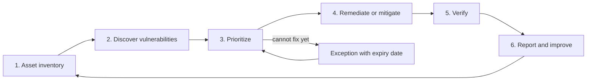

# Vulnerability Management and CVSS

## Introduction

Every week, thousands of new vulnerabilities are published, and your scanner will happily report hundreds of them on your own systems. No team can fix them all at once. **Vulnerability management** is the ongoing process of finding vulnerabilities in the things you run, deciding which ones matter most, fixing or mitigating them, and proving the fix worked.

It is like running a building's maintenance team. Inspectors produce a long list of problems: a loose handrail, a cracked window on the 20th floor, a broken lock on the front door. A good manager does not fix them in the order the inspector wrote them down. The broken front-door lock comes first, because anyone walking past can use it, even though a cracked high window might look more dramatic on paper.

The hard part of vulnerability management is almost never the scanning. It is the **prioritization**. This page covers:

- The vulnerability management lifecycle
- **CVSS v4.0**: what the score measures, and what it does not
- **EPSS** and the **CISA KEV catalog**: evidence about real-world exploitation
- **SSVC**: a decision-tree approach to prioritization
- A small Python prioritizer that combines them with asset context
- SLAs, exceptions and metrics

:::warning Scan only what you own
Vulnerability scanners send real probes. Only scan systems you own or have **written permission** to test, and coordinate with system owners first. See [Ethics, Law and Responsible Disclosure](../0-sec-fundamentals/8-sec-ethics-and-law.mdx). To practice, scan a local lab such as Metasploitable or OWASP Juice Shop, as described in [Building a Safe Practice Lab](../10-sec-offensive-security/1-sec-lab-setup.mdx).
:::

## The Vulnerability Management Lifecycle



1. **Asset inventory.** You cannot protect what you do not know you run. Track servers, containers, cloud services, laptops, network devices, SaaS apps and the software and libraries on each, plus an owner and a business criticality for each asset.
2. **Discover.** Use several sources: network and agent-based scanners (see [Vulnerability Scanning](../10-sec-offensive-security/3-sec-vulnerability-scanning.mdx)), container image scanners ([Container Image Security](../8-sec-cloud-and-container/4-sec-container-security.mdx)), dependency scanners ([Dependency Scanning and SCA](../6-sec-appsec-and-devsecops/4-sec-dependency-scanning.mdx)), cloud posture tools, vendor advisories and bug bounty reports.
3. **Prioritize.** Decide what to fix first, using severity, exploitation evidence and your own context. Most of this page is about this step.
4. **Remediate or mitigate.** Patch, upgrade, change configuration, or apply a compensating control (WAF rule, disabling a feature, network isolation) when a patch is not available. The [Patch Management](../9-sec-system-hardening/3-sec-patch-management.mdx) page covers the patching process itself.
5. **Verify.** Rescan or test to confirm the fix. "Ticket closed" is not the same as "vulnerability gone".
6. **Report and improve.** Track SLA compliance, recurring problems and root causes, such as an old base image that keeps reintroducing the same bugs.

### Key terms

| Term | Meaning |
| --- | --- |
| **CVE** | Common Vulnerabilities and Exposures: a public ID for a specific vulnerability, such as `CVE-2021-44228` (Log4Shell) |
| **CWE** | Common Weakness Enumeration: the *type* of bug, such as CWE-79 (XSS) |
| **CNA** | CVE Numbering Authority: an organization allowed to assign CVE IDs, often the vendor |
| **NVD** | NIST's National Vulnerability Database, which enriches CVEs with scores and product data |
| **Finding** | One vulnerability on one asset. One CVE on 200 servers is 200 findings |

:::note NVD enrichment delays
Since 2024, NVD has had a large backlog of CVEs waiting for enrichment (scores and product mappings). Do not rely on NVD alone. Many CNAs publish their own CVSS scores in the CVE record, CISA's Vulnrichment project adds SSVC data to many CVEs, and vendor advisories are often the fastest source. Check [nvd.nist.gov](https://nvd.nist.gov/) and [cve.org](https://www.cve.org/) for the current situation.
:::

## CVSS v4.0: Measuring Severity

The **Common Vulnerability Scoring System (CVSS)**, maintained by FIRST, turns a vulnerability's characteristics into a score from 0.0 to 10.0. Version 4.0 was published in November 2023, and many vendors and databases now publish v4.0 scores alongside or instead of v3.1.

### Metric groups

CVSS v4.0 has four metric groups:

| Group | Describes | Who fills it in |
| --- | --- | --- |
| **Base** | Intrinsic properties that do not change: how the bug is reached and what it affects | Vendor, CNA or NVD |
| **Threat** | Exploit Maturity (E): is there evidence of attacks or public exploit code? Replaces v3's "Temporal" group | You, or an intel source |
| **Environmental** | How important the affected system is to you (CR, IR, AR) and modified Base values | You |
| **Supplemental** | Extra context such as Safety, Automatable, Recovery and Provider Urgency. **Never changes the score** | Vendor or you |

FIRST defines names that say which groups went into a score:

- **CVSS-B**: Base only
- **CVSS-BT**: Base + Threat
- **CVSS-BE**: Base + Environmental
- **CVSS-BTE**: Base + Threat + Environmental

Scores from NVD and vendors are almost always **CVSS-B**.

### Base metrics

| Metric | Values | Question |
| --- | --- | --- |
| Attack Vector (AV) | Network, Adjacent, Local, Physical | From where can an attacker reach it? |
| Attack Complexity (AC) | Low, High | Must the attacker defeat a security measure such as ASLR? |
| Attack Requirements (AT) | None, Present | **New in v4.0.** Does it depend on conditions such as winning a race or a specific deployment setup? |
| Privileges Required (PR) | None, Low, High | Does the attacker need an account first? |
| User Interaction (UI) | None, Passive, Active | Must a user do something? v4.0 splits this into passive and active |
| VC, VI, VA | High, Low, None | Impact on Confidentiality, Integrity, Availability of the **vulnerable system** |
| SC, SI, SA | High, Low, None | Impact on **subsequent systems** beyond it. This replaces v3's confusing "Scope" metric |

Severity ratings use the same bands as v3.x: **None** 0.0, **Low** 0.1–3.9, **Medium** 4.0–6.9, **High** 7.0–8.9, **Critical** 9.0–10.0.

### Scoring vectors in Python

A CVSS vector string encodes every metric. The `cvss` package (maintained by Red Hat) computes v4.0 scores:

```bash
pip install cvss
```

```python
from cvss import CVSS4  # pip install cvss

vectors = {
    "Base only (CVSS-B)":
        "CVSS:4.0/AV:N/AC:L/AT:N/PR:N/UI:N/VC:H/VI:H/VA:H/SC:N/SI:N/SA:N",
    "Base + Threat, no known exploit (CVSS-BT)":
        "CVSS:4.0/AV:N/AC:L/AT:N/PR:N/UI:N/VC:H/VI:H/VA:H/SC:N/SI:N/SA:N/E:U",
    "Base + Threat + Env, low-value system (CVSS-BTE)":
        "CVSS:4.0/AV:N/AC:L/AT:N/PR:N/UI:N/VC:H/VI:H/VA:H/SC:N/SI:N/SA:N/E:A/CR:L/IR:L/AR:L",
    "Local bug needing a race and user action":
        "CVSS:4.0/AV:L/AC:L/AT:P/PR:L/UI:A/VC:H/VI:N/VA:N/SC:N/SI:N/SA:N",
}

for label, vector in vectors.items():
    c = CVSS4(vector)
    print(f"{c.base_score:4} {c.severity:8} {label}")
```

Output:

```text
 9.3 Critical Base only (CVSS-B)
 8.1 High     Base + Threat, no known exploit (CVSS-BT)
 8.9 High     Base + Threat + Env, low-value system (CVSS-BTE)
 4.1 Medium   Local bug needing a race and user action
```

The library's `base_score` attribute holds the overall score for whatever metrics you supplied, so for the second and third vectors it is really a BT or BTE score. Notice what changed:

- The same network-reachable bug drops from 9.3 to 8.1 when you record that no exploit is known (`E:U`).
- Marking the system's confidentiality, integrity and availability requirements as low (`CR:L/IR:L/AR:L`) lowers the score, even with attacks reported (`E:A`).

You can also try vectors in FIRST's official [CVSS v4.0 calculator](https://www.first.org/cvss/calculator/4.0).

:::caution CVSS measures severity, not risk
FIRST's own user guide says the Base score measures **severity** and should not be used alone to assess **risk**. A 9.8 on an isolated build server with no known exploit can be less urgent than a 7.5 on your internet-facing VPN that criminals are actively exploiting. Use Threat and Environmental metrics, or the other signals below.
:::

## EPSS: How Likely Is Exploitation?

The **Exploit Prediction Scoring System (EPSS)**, also from FIRST, estimates the **probability that a CVE will see exploitation activity in the wild in the next 30 days**. It is a data-driven model that is retrained periodically and publishes new scores **daily** for every published CVE.

Each CVE gets two numbers:

- **Probability** (0 to 1): the model's estimate. FIRST recommends this as the main value.
- **Percentile**: how that probability ranks against all other CVEs. Most CVEs have very low probabilities, so even 10% can be a high percentile.

The EPSS API is free and needs no key:

```python
import json
import urllib.request

def epss(cves):
    url = "https://api.first.org/data/v1/epss?cve=" + ",".join(cves)
    with urllib.request.urlopen(url, timeout=10) as resp:
        data = json.load(resp)
    return {row["cve"]: (float(row["epss"]), float(row["percentile"]), row["date"])
            for row in data["data"]}

for cve, (p, pct, date) in epss(["CVE-2021-44228", "CVE-2023-4863", "CVE-1999-0001"]).items():
    print(f"{cve}: EPSS {p:.5f} ({pct:.1%} percentile) (scored {date})")
```

Example output (scores change daily):

```text
CVE-2023-4863: EPSS 0.99979 (100.0% percentile) (scored 2026-10-10)
CVE-2021-44228: EPSS 0.99999 (100.0% percentile) (scored 2026-10-10)
CVE-1999-0001: EPSS 0.03351 (88.4% percentile) (scored 2026-10-10)
```

For bulk use, download the daily CSV of all scores instead of calling the API thousands of times. Its first line records the model version and score date, so you can tell when FIRST has updated the model. See [first.org/epss](https://www.first.org/epss/) for current data access options.

EPSS is a prediction, not a fact. A low EPSS score does not mean "safe", especially for vulnerabilities in your own code or niche products, which the model has little data about.

## CISA KEV: Evidence of Real Exploitation

The **CISA Known Exploited Vulnerabilities (KEV) catalog** lists CVEs that CISA has evidence are being exploited in the wild and that have clear remediation guidance. CISA describes it as an input to your prioritization. It is much smaller than the full CVE list, about 1,739 entries as of October 2026, and it grows every week.

The catalog is available as JSON and CSV feeds:

```python
import json
import urllib.request

KEV_URL = ("https://www.cisa.gov/sites/default/files/feeds/"
           "known_exploited_vulnerabilities.json")

req = urllib.request.Request(KEV_URL, headers={"User-Agent": "vuln-triage-demo"})
with urllib.request.urlopen(req, timeout=30) as resp:
    kev = json.load(resp)

print(f"KEV catalog {kev['catalogVersion']}: {kev['count']} entries")
by_id = {v["cveID"]: v for v in kev["vulnerabilities"]}

for cve in ["CVE-2021-44228", "CVE-2023-4863", "CVE-1999-0001"]:
    v = by_id.get(cve)
    if v:
        print(f"{cve}: IN KEV since {v['dateAdded']}, "
              f"ransomware use: {v['knownRansomwareCampaignUse']}")
    else:
        print(f"{cve}: not in KEV")
```

Example output:

```text
KEV catalog 2026.10.08: 1739 entries
CVE-2021-44228: IN KEV since 2021-12-10, ransomware use: Known
CVE-2023-4863: IN KEV since 2023-09-13, ransomware use: Unknown
CVE-1999-0001: not in KEV
```

Each entry also has a `dueDate` and a `requiredAction`. Those due dates are mandatory for U.S. federal civilian agencies. In June 2026, CISA issued **Binding Operational Directive (BOD) 26-04, "Prioritizing Security Updates Based on Risk"**, which supersedes BOD 22-01 (the directive that created KEV) and BOD 19-02. Under BOD 26-04, remediation timelines depend on whether an asset is **publicly exposed**, whether the CVE is in **KEV**, whether exploitation is **automatable**, and the **technical impact**. These decision points come from SSVC. Private companies are not bound by BOD 26-04, but it is a well-thought-out model to copy. Read the [directive itself](https://www.cisa.gov/news-events/directives/bod-26-04-prioritizing-security-updates-based-risk) for the exact timelines.

## SSVC: Decisions Instead of Scores

**Stakeholder-Specific Vulnerability Categorization (SSVC)**, developed by Carnegie Mellon's SEI and adopted by CISA, skips numeric scores. It walks a decision tree to one of four actions:

| Decision | Meaning |
| --- | --- |
| **Track** | No action now; remediate within normal update cycles |
| **Track\*** | Track closely; something about it warrants watching |
| **Attend** | Needs attention from people above the operator level; remediate sooner than normal |
| **Act** | Needs immediate action and senior attention; remediate as soon as possible |

CISA's tree uses these decision points: **Exploitation** (none, public PoC, active), **Automatable** (yes or no), **Technical Impact** (partial or total), **Mission Prevalence** and **Public Well-Being Impact**. Organizations adapt the tree; a company's version usually replaces public well-being with business impact and adds exposure.

Here is a simplified, SSVC-style function. It shows the idea and is **not** CISA's official tree, which you can explore with CISA's SSVC calculator:

```python
# A simplified, SSVC-style deployer decision. It is NOT the official CISA tree;
# it shows how decision points combine into Track / Track* / Attend / Act.

def ssvc_decision(exploitation: str, exposure: str, automatable: bool,
                  technical_impact: str, mission_impact: str) -> str:
    """exploitation: none | poc | active
    exposure: small | controlled | open
    technical_impact: partial | total
    mission_impact: low | medium | high"""
    if exploitation == "active":
        if exposure == "open" or automatable or mission_impact == "high":
            return "Act"
        return "Attend"
    if exploitation == "poc":
        if exposure == "open" and (automatable or technical_impact == "total"):
            return "Attend"
        return "Track*"
    # no known exploitation
    if exposure == "open" and technical_impact == "total" and mission_impact == "high":
        return "Track*"
    return "Track"

cases = [
    ("VPN gateway, exploited in the wild", "active", "open", True, "total", "high"),
    ("Admin portal, public PoC", "poc", "open", False, "total", "medium"),
    ("Laptop browser bug, exploited", "active", "controlled", False, "partial", "low"),
    ("Internal build runner, no exploit", "none", "small", False, "total", "low"),
]
for name, *points in cases:
    print(f"{ssvc_decision(*points):7} {name}")
```

Output:

```text
Act     VPN gateway, exploited in the wild
Attend  Admin portal, public PoC
Attend  Laptop browser bug, exploited
Track   Internal build runner, no exploit
```

The strength of SSVC is that every decision is **explainable**: "Act, because it is actively exploited and internet-facing." The weakness is that you need reliable answers for each decision point, especially exposure, which depends on a good asset inventory.

## Putting It Together: A Prioritizer

Real programs combine all these signals with asset context. This prioritizer uses offline sample data so you can run it anywhere. The CVE IDs are made up; in practice the fields come from your scanner, the EPSS API and the KEV feed.

```python
from dataclasses import dataclass
from datetime import date, timedelta

# Offline sample data. CVE IDs are made up for the example;
# in practice these fields come from your scanner, the EPSS API and the KEV feed.
@dataclass
class Finding:
    cve: str
    asset: str
    cvss: float          # CVSS v4.0 score from the vendor or NVD
    epss: float          # probability of exploitation activity in the next 30 days
    in_kev: bool         # listed in CISA Known Exploited Vulnerabilities
    internet_facing: bool
    asset_tier: int      # 1 = crown jewels, 2 = production, 3 = internal/dev

findings = [
    Finding("CVE-2026-10001", "checkout-api",   9.3, 0.02,  False, True,  1),
    Finding("CVE-2026-10002", "vpn-gateway",    7.7, 0.71,  True,  True,  1),
    Finding("CVE-2026-10003", "build-runner",   9.8, 0.004, False, False, 3),
    Finding("CVE-2026-10004", "admin-portal",   6.9, 0.35,  False, True,  2),
    Finding("CVE-2026-10005", "hr-laptop-0042", 8.8, 0.12,  True,  False, 3),
    Finding("CVE-2026-10006", "reporting-db",   5.3, 0.001, False, False, 2),
]

def bucket(f: Finding) -> str:
    if f.in_kev and f.internet_facing:
        return "EMERGENCY"            # known exploited and reachable by attackers
    if f.in_kev or (f.epss >= 0.10 and f.internet_facing):
        return "HIGH"
    if f.cvss >= 9.0 and f.asset_tier <= 2:
        return "MEDIUM"
    return "LOW"

SLA_DAYS = {"EMERGENCY": 2, "HIGH": 14, "MEDIUM": 30, "LOW": 90}
ORDER = list(SLA_DAYS)

today = date(2026, 10, 11)
print(f"{'bucket':10} {'due':10}  {'cve':15} {'asset':15} cvss  epss  kev  internet")
for f in sorted(findings, key=lambda f: (ORDER.index(bucket(f)), -f.epss)):
    b = bucket(f)
    due = today + timedelta(days=SLA_DAYS[b])
    print(f"{b:10} {due}  {f.cve:15} {f.asset:15} {f.cvss:4}  {f.epss:4.0%}  "
          f"{'yes' if f.in_kev else 'no ':3}  {'yes' if f.internet_facing else 'no'}")

print("\nSorted by CVSS alone:", [f.cve[-5:] for f in sorted(findings, key=lambda f: -f.cvss)])
```

Output:

```text
bucket     due         cve             asset           cvss  epss  kev  internet
EMERGENCY  2026-10-13  CVE-2026-10002  vpn-gateway      7.7   71%  yes  yes
HIGH       2026-10-25  CVE-2026-10004  admin-portal     6.9   35%  no   yes
HIGH       2026-10-25  CVE-2026-10005  hr-laptop-0042   8.8   12%  yes  no
MEDIUM     2026-11-10  CVE-2026-10001  checkout-api     9.3    2%  no   yes
LOW        2027-01-09  CVE-2026-10003  build-runner     9.8    0%  no   no
LOW        2027-01-09  CVE-2026-10006  reporting-db     5.3    0%  no   no

Sorted by CVSS alone: ['10003', '10001', '10005', '10002', '10004', '10006']
```

Compare the two orderings. Sorting by CVSS puts the 9.8 on the internal build runner first and the actively exploited VPN gateway fourth. The combined approach puts the VPN gateway first with a two-day deadline. That is the bug attackers are actually using, on a system they can actually reach.

The SLA days here are BrightCart's own choices, not a standard. Pick numbers your teams can meet, then tighten them over time.

## SLAs, Exceptions and Metrics

### Remediation SLAs

Write down a due date for each priority level, agree it with engineering leadership, and track it. A typical policy has an emergency lane (days), a high lane (a couple of weeks), and normal lanes (one to three months). Compliance frameworks such as PCI DSS have their own patching requirements, so check those if they apply (see [Compliance](../13-sec-governance/2-sec-compliance.mdx)).

### Exceptions and risk acceptance

Sometimes you cannot patch: the vendor has no fix, the upgrade breaks a critical system, or the device is end-of-life. Do not just leave the finding open. Record an **exception** with:

- The finding and why it cannot be fixed now
- The **compensating control**: WAF rule, network isolation, disabling the vulnerable feature, extra monitoring
- A named **risk owner**, a business leader who accepts the risk, not the engineer
- An **expiry date**, after which the exception is reviewed again

Exceptions without expiry dates turn into permanent, forgotten risk. The [Risk Management](../13-sec-governance/0-sec-risk-management.mdx) page explains risk acceptance in more depth.

### Metrics

Useful metrics measure outcomes, not activity:

```python
from datetime import date
from statistics import median

# closed findings: (bucket, detected, fixed, sla_days)
closed = [
    ("EMERGENCY", date(2026, 9, 1),  date(2026, 9, 2),  2),
    ("EMERGENCY", date(2026, 9, 14), date(2026, 9, 18), 2),
    ("HIGH",      date(2026, 9, 3),  date(2026, 9, 12), 14),
    ("HIGH",      date(2026, 9, 5),  date(2026, 9, 30), 14),
    ("MEDIUM",    date(2026, 8, 20), date(2026, 9, 10), 30),
    ("LOW",       date(2026, 6, 1),  date(2026, 9, 20), 90),
]

for b in ["EMERGENCY", "HIGH", "MEDIUM", "LOW"]:
    rows = [r for r in closed if r[0] == b]
    days = [(fixed - found).days for _, found, fixed, _ in rows]
    within = sum(d <= sla for d, (*_, sla) in zip(days, rows))
    print(f"{b:9}  median {median(days):5.1f} days to fix, "
          f"{within}/{len(rows)} within SLA")
```

Output:

```text
EMERGENCY  median   2.5 days to fix, 1/2 within SLA
HIGH       median  17.0 days to fix, 1/2 within SLA
MEDIUM     median  21.0 days to fix, 1/1 within SLA
LOW        median 111.0 days to fix, 0/1 within SLA
```

Other good metrics: **open KEV findings on internet-facing assets** (target: zero), **percentage of assets scanned in the last 30 days** (coverage), **findings reopened after fix** (verification quality), and **age of the oldest open exceptions**. Avoid "total open vulnerabilities" as a headline number. It goes up whenever you add a scanner, which is a good thing, and it treats a low-severity finding on a test VM the same as a critical one on the VPN.

## Real-World Scenario

**BrightCart** runs an e-commerce SaaS platform: about 300 cloud VMs and Kubernetes nodes, 150 container images, a VPN for staff, and 400 laptops. Its scanners report **14,000 open findings**. The current policy says "fix all Critical and High within 30 days", which covers about 6,000 findings. Engineering teams ignore the tickets because there are too many, and last month an actively exploited VPN vulnerability (CVSS 7.7, "only" High) sat unpatched for three weeks behind hundreds of Critical findings on internal build machines.

### The solution

1. **Fix the inventory first.** Tag every asset with an owner, an environment (prod, staging, dev) and an **internet-facing** flag taken from the load balancer, DNS and cloud security group configuration.
2. **Enrich every finding daily** with the EPSS probability (from the daily CSV) and KEV membership (from the JSON feed).
3. **Adopt the bucket rules** from the prioritizer: KEV + internet-facing is an emergency with a 48-hour target, KEV or high EPSS on exposed assets gets 14 days, and so on. The rules are written in plain language in the policy, so anyone can see why a finding got its bucket.
4. **Fix at the source.** Most container findings come from three outdated base images. Rebuilding those images closes thousands of findings at once. See [Container Image Security](../8-sec-cloud-and-container/4-sec-container-security.mdx).
5. **Route tickets to owners** with one ticket per fix (for example "upgrade OpenSSL on the web tier"), not one per finding.
6. **Report two numbers to leadership**: open KEV findings on internet-facing assets, and SLA compliance per bucket.

The emergency and high buckets now hold a few dozen items, a number teams can actually finish.

### Why this approach

- KEV and EPSS add the missing question CVSS-B cannot answer: **are attackers actually using this?**
- Exposure and asset tier add BrightCart's own context, which no external score has.
- Simple, written rules are easy to audit and explain, which matters for customer security questionnaires.

### When to use it, and when not to

- **Use it** when finding volume is far beyond team capacity, which is almost always.
- **Be careful** with your own software and niche products: they rarely appear in KEV and get little EPSS signal. Use your own threat modeling and bug bounty reports for those.
- **Do not let LOW mean never.** Low-priority findings still have SLAs; attackers chain "low" bugs together, and EPSS and KEV change daily.

### Alternatives and trade-offs

| Approach | Pros | Cons | Best for |
| --- | --- | --- | --- |
| CVSS Base score only | Simple, universal, available for most CVEs | Measures severity, not risk; floods teams with "Critical" | Very small environments; a first step |
| CVSS + EPSS + KEV + exposure | Focuses on real-world exploitation and reachability; free data | Needs a good asset inventory; EPSS weak for niche or custom software | Most organizations, like BrightCart |
| SSVC decision tree | Explainable actions; matches CISA's approach under BOD 26-04 | Needs reliable answers per decision point; some judgment calls | Organizations that want auditable, policy-driven decisions |
| Vendor risk scores (scanner or VM platform) | Built in, combines many signals, little effort | Proprietary formula, hard to explain; vendor lock-in | Teams without time to build their own logic |
| Full CVSS-BTE per finding | Precise, standard format | Labor-intensive at scale; environmental metrics often guessed | High-value systems with few findings |

## Common Mistakes

- **Sorting by CVSS alone.** It is a severity score. Add exploitation evidence and exposure.
- **No asset inventory.** Without owners and exposure flags, nobody knows who should fix what, or how urgent it is.
- **Counting findings instead of fixes.** One base-image update can close a thousand findings; track the fix.
- **Not verifying.** Rescan after patching. Patches fail, servers get rebuilt from old images, and some fixes require a restart that never happened.
- **Permanent exceptions.** Every exception needs a risk owner, a compensating control and an expiry date.
- **Ignoring things scanners cannot see.** SaaS settings, custom code and misconfigurations need other tools, such as [CSPM](../8-sec-cloud-and-container/7-sec-cspm.mdx), [SAST](../6-sec-appsec-and-devsecops/2-sec-sast.mdx) and penetration tests.
- **Trusting stale data.** EPSS changes daily and KEV grows weekly. Enrich findings on a schedule, not once.

## Summary

- Vulnerability management is a cycle: **inventory, discover, prioritize, remediate, verify, report**.
- **CVSS v4.0** scores severity using Base, Threat, Environmental and Supplemental metrics. Name what you used (CVSS-B, BT, BE, BTE). Base alone is **not** risk.
- **EPSS** gives a daily probability of exploitation activity in the next 30 days. Use the probability, and remember it is a prediction.
- **CISA KEV** lists vulnerabilities with evidence of exploitation in the wild, and is the strongest single prioritization signal. **BOD 26-04** (June 2026) bases federal timelines on exposure, KEV, automatability and impact.
- **SSVC** turns decision points into actions: Track, Track\*, Attend, Act.
- Combine external signals with **your own context** (exposure, asset tier), set **SLAs**, manage **exceptions with expiry dates**, and measure outcomes such as open KEV findings on exposed assets.

## Exercises

1. **Score it yourself.** Write a CVSS v4.0 vector for a stored XSS bug in your app's comment field that requires a logged-in user to post and another user to view the page. Compute the score with the `cvss` package and explain each metric choice.
2. **Live enrichment.** Extend the prioritizer to fetch real EPSS scores and KEV membership for a list of real CVE IDs from a scan of your lab (for example, a Metasploitable VM you own). Cache the KEV feed locally so you download it at most once a day.
3. **Write your SSVC tree.** Replace the simplified `ssvc_decision` with a tree for your organization. Decide what "exposure" means for laptops, SaaS apps and containers, and document each branch.
4. **Exception policy.** Draft a one-page exception template with the required fields, an approval flow and a maximum duration. Decide what happens automatically when an exception expires.

Related pages: [Vulnerability Scanning](../10-sec-offensive-security/3-sec-vulnerability-scanning.mdx), [Patch Management](../9-sec-system-hardening/3-sec-patch-management.mdx), [Dependency Scanning and SCA](../6-sec-appsec-and-devsecops/4-sec-dependency-scanning.mdx), [Threat Intelligence](./4-sec-threat-intelligence.mdx), which explains where exploitation evidence comes from, and [Malware Analysis Basics](./7-sec-malware-basics.mdx).
