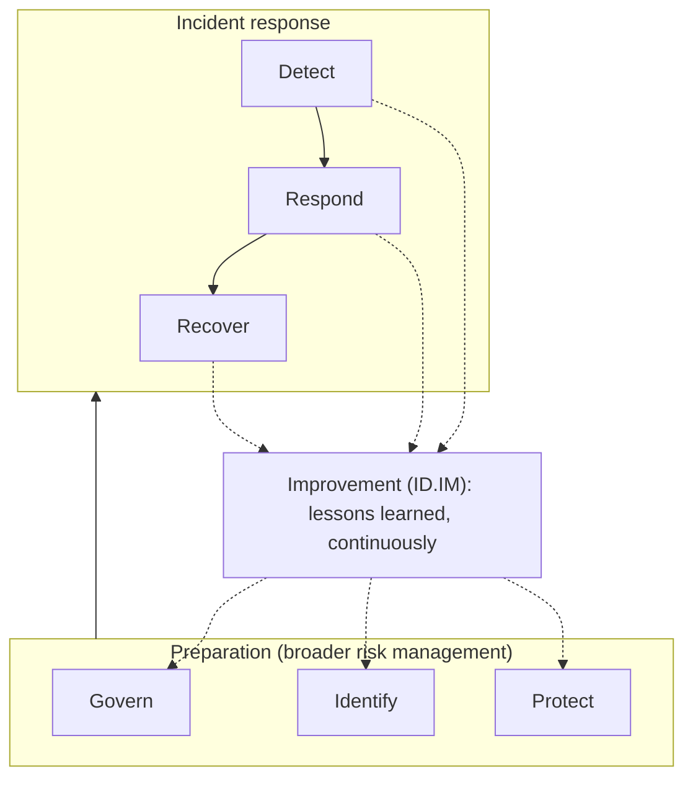
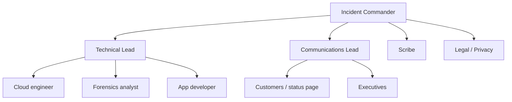

# Incident Response Lifecycle

## Introduction

Every organization will eventually have a security incident: a leaked API key, a phished employee, a compromised server, a ransomware note. The question is not *whether* but *how well* you respond. **Incident response (IR)** is the organized way you detect, contain, remove and recover from a security incident, and then learn from it.

Think of a hospital emergency room. Nobody invents triage rules while the ambulance is pulling in. Roles are known (who leads, who treats, who talks to the family), there is a severity scale, and there is a standard sequence: stabilize first, diagnose second, treat the root cause third. Security incident response works the same way. The calm comes from preparation, not heroics.

This page covers:

- The difference between an event, an alert and an incident
- The two lifecycle models you will meet: the classic four-phase NIST / six-step SANS model, and the newer CSF 2.0-based model in **NIST SP 800-61 Revision 3** (April 2025)
- Roles, severity levels and the incident log
- Containment, eradication and recovery decisions and their trade-offs
- Notification deadlines that start ticking during an incident

:::info Guidance changes over time
NIST SP 800-61r3 replaced Revision 2 (2012) in April 2025. Regulatory deadlines (GDPR, SEC, NIS2, CIRCIA) change too. Check the official sources linked on this page, and always involve legal counsel for real notification decisions.
:::

## Events, Alerts and Incidents

These words are often mixed up, and the confusion causes both panic and complacency.

| Term | Meaning | Example |
| --- | --- | --- |
| **Event** | Anything observable that happens on a system or network | A user logs in; a firewall drops a packet |
| **Adverse event** | An event with a negative consequence or potential for one | 500 failed logins in a minute against one account |
| **Alert** | A notification that a detection rule fired | SIEM rule "brute force against admin account" |
| **Incident** | An occurrence that actually or imminently jeopardizes confidentiality, integrity or availability, or violates security policy | The brute force succeeded and the attacker downloaded data |

Most alerts are *not* incidents. A Security Operations Center (see [The Security Operations Center](../11-sec-defensive-operations/0-sec-soc.mdx)) triages alerts, and only some are **declared** incidents. Declaring an incident is a deliberate act: it starts the clock, assigns a leader and opens a record.

:::tip Declare early, downgrade later
Declaring an incident that turns out to be benign costs an hour of a few people's time. Failing to declare a real one can cost weeks. Make it cheap and blame-free to declare, and easy to close as "false positive".
:::

## Lifecycle Models

### The Classic Model (NIST SP 800-61r2 and SANS PICERL)

For more than a decade, most teams learned incident response as a circle of phases. NIST SP 800-61r2 used four; the SANS Institute splits the same work into six steps, often remembered as **PICERL**:

| NIST SP 800-61r2 (2012) | SANS (PICERL) | Key question |
| --- | --- | --- |
| Preparation | Preparation | Are we ready before anything happens? |
| Detection and Analysis | Identification | Is this really an incident, and how big is it? |
| Containment, Eradication and Recovery | Containment | How do we stop the damage from spreading? |
| (same phase) | Eradication | How do we remove the attacker and the root cause? |
| (same phase) | Recovery | How do we restore normal operations safely? |
| Post-Incident Activity | Lessons Learned | What do we change so it does not happen again? |

These names are still everywhere: in job descriptions, certifications, playbooks and vendor tools. You need to know them.

### The CSF 2.0 Model (NIST SP 800-61r3)

NIST SP 800-61r3 argues that the circular model no longer matches reality. When the old guide was written, incidents were rarer, narrower and usually resolved in a day or two. Today they are frequent, recovery can take weeks or months, and lessons should be shared as soon as they are found, not only after recovery ends.

So Revision 3 maps incident response onto the six **NIST Cybersecurity Framework (CSF) 2.0 Functions**:

- **Govern, Identify, Protect**: preparation. These are broad risk-management activities that also support incident response, but are not the response itself.
- **Detect, Respond, Recover**: the incident response itself.
- **Improvement** (the `ID.IM` category inside Identify): lessons learned from *every* function feed back continuously into all of them.



The Respond function contains categories you will see in audits and contracts: **Incident Management** (`RS.MA`), **Incident Analysis** (`RS.AN`), **Incident Response Reporting and Communication** (`RS.CO`) and **Incident Mitigation** (`RS.MI`). Recover includes **Incident Recovery Plan Execution** (`RC.RP`) and **Incident Recovery Communication** (`RC.CO`).

| Old phase | CSF 2.0 Functions (per SP 800-61r3, Table 1) |
| --- | --- |
| Preparation | Govern, Identify (all categories), Protect |
| Detection and Analysis | Detect, Identify (Improvement) |
| Containment, Eradication and Recovery | Respond, Recover, Identify (Improvement) |
| Post-Incident Activity | Identify (Improvement) |

NIST itself says organizations should use the lifecycle model that suits them best. In practice, most teams keep the familiar PICERL step names for day-to-day playbooks and use the CSF 2.0 structure for governance and reporting. The rest of this page follows the practical steps.

## Preparation: Before Anything Happens

Preparation is where most of the outcome is decided. A minimum viable IR program for a small team looks like this:

- **An IR plan** (a few pages): what counts as an incident, severity levels, who is in charge, how to reach people, where to communicate, when to involve legal and leadership.
- **Contact list**, kept outside your main systems: if your identity provider or chat tool is compromised, you still need phone numbers. Include your cloud provider support, cyber insurer, outside counsel and an incident response retainer firm if you have one.
- **Logging that is already on**: you cannot investigate with logs you never collected. See [Security Logging and SIEM](../11-sec-defensive-operations/1-sec-logging-and-siem.mdx).
- **Playbooks** for the incidents you expect most (phishing, leaked credentials, compromised host). See [Incident Response Playbooks](./1-sec-incident-playbooks.mdx).
- **Access ready in advance**: break-glass accounts, read access to logs for responders, a forensic account or project in your cloud.
- **Practice**: tabletop exercises a few times a year. See [Project: Incident Response Tabletop Exercise](../14-sec-projects/6-sec-project-incident-simulation.mdx).

## Roles During an Incident

Small teams merge roles, but someone must own each responsibility. The model below is borrowed from emergency services' Incident Command System and is common in tech companies.

| Role | Responsibility | Common mistake if missing |
| --- | --- | --- |
| **Incident Commander (IC)** | Owns decisions and priorities; does *not* do hands-on work | Everyone investigates, nobody decides |
| **Technical / Ops Lead** | Directs investigation and containment work | Parallel, conflicting changes to systems |
| **Communications Lead** | Internal updates, customer status page, regulators (with legal) | Executives interrupt engineers for updates |
| **Scribe** | Keeps the timeline of actions and decisions | Nobody remembers what happened when |
| **Legal / Privacy** | Privilege, notification duties, law enforcement contact | Missed regulatory deadlines |
| **Subject matter experts** | Database, cloud, identity owners pulled in as needed | Responders guess at unfamiliar systems |



## Severity Levels

Severity decides how many people get paged, whether work continues overnight and who must be told. Keep the definitions short and based on facts you can check quickly. Here is a simple, transparent scoring helper:

```python
# triage.py: assign an incident severity from a few yes/no questions
from dataclasses import dataclass

@dataclass
class Signal:
    title: str
    confirmed_malicious: bool      # verified, not just "an alert fired"
    data_exposed: bool             # customer or regulated data possibly accessed
    production_impact: bool        # customers affected right now
    privileged_access: bool        # admin / root / cloud admin involved
    spreading: bool                # more hosts or accounts affected over time

def severity(s: Signal) -> str:
    if not s.confirmed_malicious:
        return "SEV4 (investigate as event)"
    score = sum([s.data_exposed * 3, s.production_impact * 2,
                 s.privileged_access * 2, s.spreading * 2])
    if score >= 5:
        return "SEV1 (all hands, exec + legal notified)"
    if score >= 3:
        return "SEV2 (incident commander assigned, 24/7 work)"
    return "SEV3 (business-hours response)"

signals = [
    Signal("One failed-login burst from a VPN range", False, False, False, False, False),
    Signal("Phishing email clicked, no credentials entered", True, False, False, False, False),
    Signal("AWS access key leaked on public GitHub", True, True, False, True, False),
    Signal("Ransomware note on two file servers", True, True, True, True, True),
]
for s in signals:
    print(f"{severity(s):45} <- {s.title}")
```

Output:

```text
SEV4 (investigate as event)                   <- One failed-login burst from a VPN range
SEV3 (business-hours response)                <- Phishing email clicked, no credentials entered
SEV1 (all hands, exec + legal notified)       <- AWS access key leaked on public GitHub
SEV1 (all hands, exec + legal notified)       <- Ransomware note on two file servers
```

The weights are an example, not a standard. What matters is that the rules are written down, agreed in advance, and that severity can be **raised or lowered** as facts change.

## Detection and Analysis

Incidents arrive from many directions: SIEM alerts, EDR, a customer email, a bug bounty report, a cloud provider abuse notice, a journalist, or a ransom note. Analysis answers four questions:

1. **Is it real?** Rule out false positives with a second source of evidence.
2. **What is the scope?** Which accounts, hosts, data and time range are involved?
3. **How did they get in?** The initial access vector decides what you must fix.
4. **Are they still here?** Active access changes the urgency of containment.

Map what you find to [MITRE ATT&CK](../11-sec-defensive-operations/3-sec-mitre-attack.mdx) techniques. It gives the team a shared vocabulary and reminds you what an attacker typically does next. Detailed log techniques are in [Investigating with Logs](./3-sec-log-analysis.mdx).

### Keep an Incident Log From Minute One

Write down every action and decision with a UTC timestamp. It feeds the postmortem, regulator reports and possibly court. An append-only file is enough to start:

```python
# incident_log.py: append-only, timestamped incident activity log (JSON Lines)
import json
from datetime import datetime, timezone
from pathlib import Path

LOG = Path("INC-2026-0142.jsonl")

def record(actor: str, phase: str, action: str, **details) -> None:
    entry = {
        "ts": datetime.now(timezone.utc).isoformat(timespec="seconds"),
        "actor": actor,
        "phase": phase,
        "action": action,
        **details,
    }
    with LOG.open("a", encoding="utf-8") as f:   # append only, never rewrite
        f.write(json.dumps(entry) + "\n")

LOG.unlink(missing_ok=True)   # demo only: start from an empty file
record("alice (IC)", "detect", "declared incident", severity="SEV2")
record("bob", "respond", "deactivated access key", key_id="AKIA...7QX")
record("bob", "respond", "snapshot taken", volume="vol-0abc", snapshot="snap-0def")
record("carol (comms)", "respond", "status page updated", audience="customers")

for line in LOG.read_text().splitlines():
    e = json.loads(line)
    print(e["ts"], f'{e["actor"]:14}', f'{e["phase"]:8}', e["action"])
```

Example output:

```text
2026-10-11T11:03:36+00:00 alice (IC)     detect   declared incident
2026-10-11T11:03:36+00:00 bob            respond  deactivated access key
2026-10-11T11:03:36+00:00 bob            respond  snapshot taken
2026-10-11T11:03:36+00:00 carol (comms)  respond  status page updated
```

In real incidents, teams often use a dedicated chat channel plus an incident management tool. The principle is the same: one timeline, timestamps in UTC, and nobody edits history.

## Containment, Eradication and Recovery

### Containment: Stop the Bleeding

Containment limits damage while you work out the full picture. It splits into two kinds:

- **Short-term containment**: fast, reversible actions. Isolate a host with a network policy or EDR, disable an account, revoke sessions and tokens, block an IP or domain, take a service offline.
- **Long-term containment**: temporary fixes that let the business keep running while you prepare a clean rebuild, such as a WAF rule, extra monitoring, or moving a workload to a clean network segment.

Containment has real trade-offs, and the Incident Commander must choose consciously:

| Decision | Option A | Option B |
| --- | --- | --- |
| Speed vs evidence | Wipe and rebuild now (fast, loses evidence) | Snapshot and capture memory first (slower, preserves evidence) |
| Visibility vs tipping off | Block the attacker immediately | Watch quietly to learn the full scope, then cut all access at once |
| Availability vs safety | Keep the service up with partial controls | Take it offline until it is clean |

:::warning Coordinated eviction
If an attacker has several footholds (stolen credentials, a backdoor, a persistence mechanism), removing one at a time warns them and they may dig in deeper or destroy data. For serious intrusions, teams often prepare all containment actions and execute them together. Get experienced help for this.
:::

### Eradication: Remove the Cause

Eradication removes everything the attacker left and closes the hole they used: patch the vulnerability, delete malicious accounts and keys, remove persistence (cron jobs, services, startup scripts, OAuth grants), rotate every credential that might be exposed. For compromised hosts, **rebuilding from a known-good image** is usually safer than trying to clean them.

### Recovery: Return to Normal, Carefully

Restore systems from clean backups or images, bring them back in stages, and watch them closely for signs that the attacker returns. Recovery has its own planning discipline, covered in [Business Continuity and Disaster Recovery](./5-sec-business-continuity.mdx).

## Communication and Notification Deadlines

Some legal clocks start during the incident, not after it. A few widely cited examples:

| Rule | Who it applies to | Deadline (summary) |
| --- | --- | --- |
| GDPR Article 33 | Organizations processing EU personal data | Notify the supervisory authority within 72 hours of becoming aware of a personal data breach, where feasible |
| SEC Form 8-K Item 1.05 | US public companies | Disclose a material cybersecurity incident within four business days of determining it is material |
| NIS2 Directive | Essential and important entities in the EU | Early warning within 24 hours, incident notification within 72 hours, final report within one month |
| CIRCIA (US) | Covered critical infrastructure entities | The statute sets 72 hours for covered incidents and 24 hours for ransom payments, but the final CISA rule was still pending at the time of writing |

Contracts with customers often add their own deadlines too. These summaries are simplified and may change. Check the official texts and get legal advice. More detail is in [Compliance: SOC 2, PCI DSS, HIPAA and GDPR](../13-sec-governance/2-sec-compliance.mdx).

## Real-World Scenario

Your team runs a B2B SaaS invoicing app on AWS. On Saturday at 09:12 UTC, GitHub's secret scanning partner program triggers an AWS notice: an access key belonging to the `ci-deploy` IAM user was pushed to a public repository 40 minutes ago. The key has permissions to deploy to ECS and read the S3 bucket that stores customer invoice PDFs.

**Walkthrough:**

1. **Declare (09:15).** The on-call engineer declares a SEV1: confirmed exposure, privileged access, possible customer data. She becomes Incident Commander until handing off, and opens the incident channel and log.
2. **Contain (09:20).** Deactivate the key (not delete: you want it in logs and reports). Check for other keys or new IAM users created by it. Remove the file from the repository, knowing the key is already compromised regardless.
3. **Analyze (09:30 to 12:00).** Query CloudTrail for every API call made with that access key ID since it was pushed. The team finds `ListBuckets` and `GetObject` calls from an unfamiliar IP address on 312 invoice PDFs, and an attempt to `CreateUser` that failed with `AccessDenied`.
4. **Eradicate.** Delete the key, replace long-lived CI credentials with short-lived OIDC federation from the CI system to an IAM role, add pre-commit and CI secret scanning (see [Secret Scanning](../6-sec-appsec-and-devsecops/7-sec-secret-scanning.mdx)).
5. **Notify.** Legal assesses which customers and regulators must be told about the 312 invoices. The GDPR 72-hour clock is likely running.
6. **Recover and learn.** Confirm no persistence was created, monitor for reuse attempts, and hold a [blameless postmortem](./4-sec-postmortems.mdx).

**Why this approach:** the attacker's access path was a single credential, so disabling it immediately had little downside. Watching quietly would have allowed more data to be downloaded, and there was no sign of other footholds to coordinate against. CloudTrail gave a full record of what the key did, so speed did not cost evidence.

**When to use it / when not to:** "contain immediately" fits single-credential and single-host incidents. For a hands-on-keyboard intruder with several footholds, a rushed partial containment can backfire. Prepare coordinated eviction instead, ideally with an experienced IR firm.

| Approach | Pros | Cons | Best for |
| --- | --- | --- | --- |
| Contain immediately | Limits damage fast; simple | May tip off attacker; may destroy volatile evidence | Leaked keys, single compromised account, active data theft |
| Observe, then coordinated eviction | Reveals full scope; removes all footholds at once | Damage continues while you watch; needs skill | Advanced, persistent intruders |
| Rebuild from scratch | Highest confidence the environment is clean | Expensive; downtime; needs good IaC and backups | Deep compromise, domain admin or cloud admin lost |
| Outsource to IR retainer | Expert help; often required by cyber insurance | Cost; onboarding time if no retainer exists | Ransomware, regulated data, legal exposure |

## Common Mistakes

- **No one in charge.** Ten engineers making changes in parallel destroy evidence and confuse everyone. Name an Incident Commander first.
- **Deleting instead of disabling.** Deleted accounts, keys and VMs take their evidence with them. Disable, isolate and snapshot first.
- **Communicating on compromised channels.** If email or chat might be compromised, move to an out-of-band channel.
- **Stopping at the first finding.** "We found the phishing email" is not the scope. Keep asking what else the attacker touched.
- **Restoring too early.** Bringing systems back before the entry point is closed invites re-compromise.
- **Ignoring the legal clock.** Regulatory deadlines can start when you become aware of a breach, not when you finish investigating.
- **Skipping lessons learned.** Without follow-up actions, the same incident returns.

## Summary

- Most alerts are not incidents. Declaring an incident is a deliberate, low-cost decision that starts a structured response.
- The classic model is Preparation, Detection and Analysis, Containment/Eradication/Recovery, and Post-Incident Activity (SANS: PICERL).
- NIST SP 800-61r3 (April 2025) maps IR onto CSF 2.0: Govern, Identify and Protect prepare; Detect, Respond and Recover are the response; Improvement runs continuously.
- Assign roles (especially Incident Commander and scribe), use written severity levels, and keep a timestamped log from minute one.
- Containment involves trade-offs between speed, evidence, visibility and availability.
- Regulatory notification clocks may start during the incident. Bring in legal early.

## Further Learning

**Exercises**

1. Write a one-page IR plan for a small team: definitions, three severity levels, roles, and an out-of-band contact method.
2. Extend `triage.py` so that severity can never go *down* without a recorded reason in the incident log.
3. For the leaked-key scenario, list every credential you would rotate and in what order. Which rotations could cause an outage?
4. Read the "Incident response life cycle model" section of NIST SP 800-61r3 and compare it with your own team's process.

**Related pages**

- [Incident Response Playbooks](./1-sec-incident-playbooks.mdx)
- [Digital Forensics Basics](./2-sec-digital-forensics.mdx)
- [Investigating with Logs](./3-sec-log-analysis.mdx)
- [Security Postmortems](./4-sec-postmortems.mdx)
- [The Security Operations Center](../11-sec-defensive-operations/0-sec-soc.mdx)
- [Security Frameworks: NIST CSF, ISO 27001 and CIS Controls](../13-sec-governance/1-sec-security-frameworks.mdx)

**Official sources**

- [NIST SP 800-61 Rev. 3](https://csrc.nist.gov/pubs/sp/800/61/r3/final)
- [CISA Federal Incident and Vulnerability Response Playbooks](https://www.cisa.gov/resources-tools/resources/federal-government-cybersecurity-incident-and-vulnerability-response-playbooks)
- [SEC cybersecurity disclosure rules (press release 2023-139)](https://www.sec.gov/newsroom/press-releases/2023-139)
