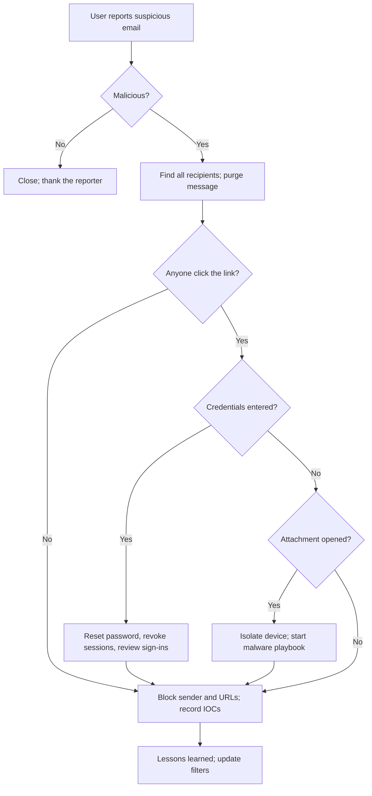
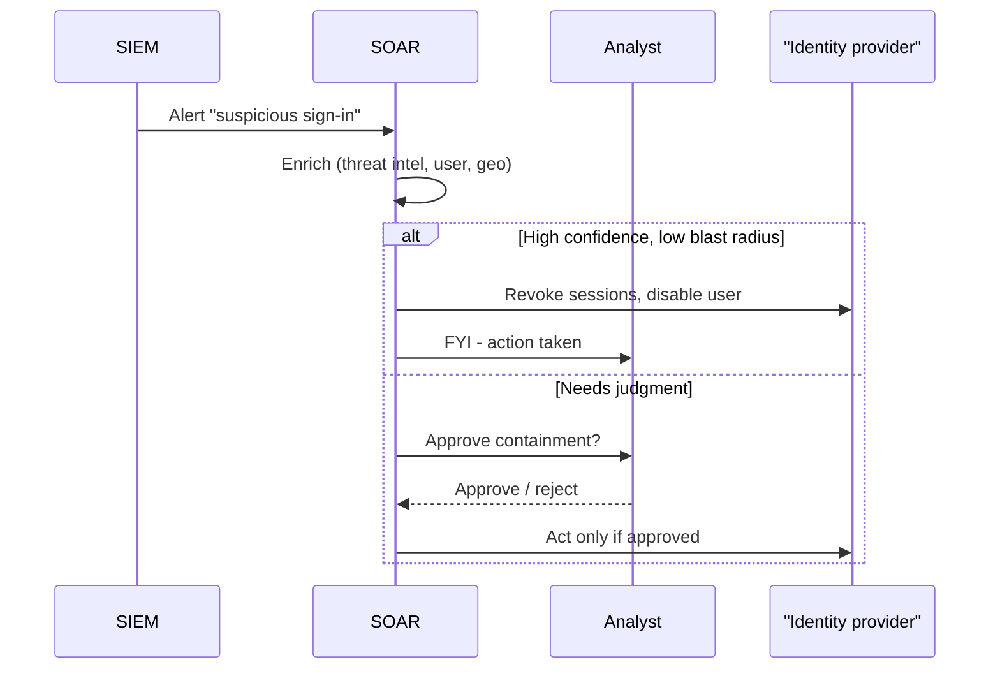

# Incident Response Playbooks

## Introduction

At 3 a.m., with an alert screaming and a manager asking for updates every ten minutes, nobody thinks clearly. A **playbook** is a written, pre-agreed set of steps for a specific type of incident. It turns "what do we do now?" into "what is the next unchecked box?".

Pilots are a good analogy. They are highly trained, yet they still use checklists for engine failures, because under stress even experts skip steps. A playbook does not replace judgment; it frees judgment for the parts of the incident that are actually new.

This page shows you how to:

- Tell playbooks, runbooks and the IR plan apart
- Structure a playbook so it is usable under pressure
- Write playbooks for common incidents (phishing, leaked secrets, compromised accounts, ransomware)
- Store playbooks as code, validate them and render them as checklists
- Automate parts of a playbook with SOAR, and decide what must stay manual
- Test playbooks with tabletop exercises

It builds on the phases from [Incident Response Lifecycle](./0-sec-incident-response-lifecycle.mdx).

## Plan, Playbook, Runbook

These three documents work at different levels:

| Document | Answers | Scope | Example |
| --- | --- | --- | --- |
| **IR plan** | Who is in charge, how we organize, when we escalate | Whole organization | "SEV1 incidents page the CISO and legal" |
| **Playbook** | What to do for *this type* of incident, phase by phase | One incident type | "Compromised user account" |
| **Runbook** | Exactly how to perform one technical task | One task | "How to revoke all Okta sessions for a user" |

Playbooks link to runbooks. The playbook says "revoke all sessions for the user"; the runbook has the console clicks or CLI commands for your specific identity provider. This separation means you can change identity providers without rewriting every playbook.

## Anatomy of a Good Playbook

A playbook that works under pressure has these parts:

1. **Trigger**: what alert or report starts it.
2. **Initial severity** and **escalation conditions**: when it becomes more serious.
3. **Roles**: who owns it, who must be consulted.
4. **Steps by phase**: identify, contain, eradicate, recover, lessons learned.
5. **Decision points**: explicit yes/no questions that change the path.
6. **Evidence to preserve** before destructive steps.
7. **Communication**: who is told, by whom, using which template.
8. **Exit criteria**: how you know the incident is over.

Decision points are the most valuable part. Here is the flow for a reported phishing email:



:::tip Thank reporters, always
Even false reports deserve a thank-you. People who feel foolish after reporting stop reporting, and user reports are one of the best phishing detectors you have. See [Social Engineering and Phishing](../10-sec-offensive-security/8-sec-social-engineering.mdx).
:::

## Playbooks as Code

Wiki pages go stale. Storing playbooks as structured files in a Git repository gives you review, history, ownership and the ability to validate and render them automatically. YAML is a common choice:

```yaml
# phishing.yaml
id: PB-001
name: Reported phishing email
version: 3
owner: security-team
triggers:
  - User reports an email with the "Report phishing" button
  - Mail gateway flags a delivered message after delivery
severity_default: SEV3
escalate_to_sev2_if:
  - Credentials were entered on the phishing page
  - A file attachment was opened on a corporate device
steps:
  - phase: identify
    action: Collect sender, subject, URLs, attachment hashes and recipient list
    evidence: original .eml file with headers
  - phase: identify
    action: Search mail logs for other recipients of the same sender or URL
  - phase: contain
    action: Purge the message from all mailboxes
    requires_approval: false
  - phase: contain
    action: Block sender domain and URLs at the mail gateway and web proxy
  - phase: contain
    action: If credentials were entered, reset password and revoke all sessions
    requires_approval: true
  - phase: eradicate
    action: If an attachment ran, isolate the device with EDR and start PB-004
    requires_approval: true
  - phase: recover
    action: Confirm MFA is enrolled for affected users and notify them
  - phase: lessons
    action: Record detection gap and add the IOCs to the threat intel platform
exit_criteria:
  - All copies purged
  - Affected credentials reset and sessions revoked
  - Incident ticket updated with IOCs and timeline
```

A small script can validate the file in CI and print it as a checklist for responders:

```python
# run_playbook.py: validate a YAML playbook and print it as a checklist
import sys
import yaml  # pip install pyyaml

REQUIRED = {"id", "name", "version", "owner", "triggers", "steps", "exit_criteria"}
PHASES = ["identify", "contain", "eradicate", "recover", "lessons"]

def validate(pb: dict) -> list[str]:
    errors = [f"missing field: {f}" for f in sorted(REQUIRED - pb.keys())]
    last = 0
    for i, step in enumerate(pb.get("steps", []), 1):
        phase = step.get("phase")
        if phase not in PHASES:
            errors.append(f"step {i}: unknown phase {phase!r}")
            continue
        if PHASES.index(phase) < last:
            errors.append(f"step {i}: phase {phase!r} appears after a later phase")
        last = max(last, PHASES.index(phase))
    return errors

def checklist(pb: dict) -> None:
    print(f"{pb['id']} {pb['name']} (v{pb['version']}, owner: {pb['owner']})")
    for i, step in enumerate(pb["steps"], 1):
        gate = "  [needs IC approval]" if step.get("requires_approval") else ""
        print(f"  [ ] {i}. {step['phase'].upper():9} {step['action']}{gate}")
    print("  Done when:")
    for c in pb["exit_criteria"]:
        print(f"    - {c}")

if __name__ == "__main__":
    with open(sys.argv[1], encoding="utf-8") as f:
        pb = yaml.safe_load(f)
    problems = validate(pb)
    if problems:
        print("INVALID PLAYBOOK:", *problems, sep="\n  ")
        sys.exit(1)
    checklist(pb)
```

```bash
pip install pyyaml
python3 run_playbook.py phishing.yaml
```

Output:

```text
PB-001 Reported phishing email (v3, owner: security-team)
  [ ] 1. IDENTIFY  Collect sender, subject, URLs, attachment hashes and recipient list
  [ ] 2. IDENTIFY  Search mail logs for other recipients of the same sender or URL
  [ ] 3. CONTAIN   Purge the message from all mailboxes
  [ ] 4. CONTAIN   Block sender domain and URLs at the mail gateway and web proxy
  [ ] 5. CONTAIN   If credentials were entered, reset password and revoke all sessions  [needs IC approval]
  [ ] 6. ERADICATE If an attachment ran, isolate the device with EDR and start PB-004  [needs IC approval]
  [ ] 7. RECOVER   Confirm MFA is enrolled for affected users and notify them
  [ ] 8. LESSONS   Record detection gap and add the IOCs to the threat intel platform
  Done when:
    - All copies purged
    - Affected credentials reset and sessions revoked
    - Incident ticket updated with IOCs and timeline
```

When someone submits a sloppy playbook, CI catches it:

```yaml
# broken.yaml
id: PB-002
name: Leaked secret
owner: platform-team
triggers: [Secret scanner alert]
steps:
  - phase: contain
    action: Revoke the secret
  - phase: identify
    action: Find where the secret was used
  - phase: cleanup
    action: Remove it from git history
exit_criteria: [Secret revoked]
```

Output:

```text
INVALID PLAYBOOK:
  missing field: version
  step 2: phase 'identify' appears after a later phase
  step 3: unknown phase 'cleanup'
```

The ordering rule is a team convention for readability. Real incidents loop back (you will identify more scope after containing), but the written playbook should read top to bottom.

## Common Playbooks Every Team Needs

Start with the incidents you are most likely to face. For most software teams, that list looks like this.

### Compromised User Account

- **Triggers:** impossible-travel sign-in, MFA fatigue reports, user says "I didn't do that", password found in a breach dump.
- **Contain:** revoke all sessions and refresh tokens, reset password, re-register MFA, remove attacker-added MFA devices, mail forwarding rules and OAuth app grants.
- **Investigate:** sign-in logs for the account, files accessed, emails sent, admin actions, new API tokens.
- **Watch for:** the attacker using the mailbox to phish colleagues or customers (business email compromise).

### Leaked Secret (API Key, Token, Password in Git)

- **Contain:** revoke or rotate the secret **first**. Removing it from Git history does not help: assume it was copied within minutes.
- **Investigate:** provider audit logs (for example CloudTrail) for every use of the secret since it leaked.
- **Eradicate:** move to a secrets manager or short-lived credentials; add secret scanning to pre-commit and CI. See [Secrets Management in Code](../5-sec-secure-coding/3-sec-secrets-in-code.mdx).

### Compromised Web Application or Server

- **Contain:** isolate the host (security group, network policy or EDR isolation), but snapshot disks and capture memory first if you need evidence. See [Digital Forensics Basics](./2-sec-digital-forensics.mdx).
- **Investigate:** web and application logs for the entry point (see [Investigating with Logs](./3-sec-log-analysis.mdx)), new files in web roots, new users, cron jobs and services.
- **Eradicate:** patch the vulnerability, rebuild from a clean image, rotate every secret the host could read.

### Ransomware

Ransomware playbooks are mostly about speed and coordination:

- **Contain:** disconnect affected systems from the network (do not power them off without guidance, since memory may hold useful evidence), disable compromised accounts, protect backups by cutting their connection to production.
- **Escalate:** leadership, legal, cyber insurer and an IR firm immediately. Report to law enforcement (in the US, the FBI via IC3 or a field office, and CISA).
- **Recover:** restore from clean, offline or immutable backups, starting with identity infrastructure. See [Backups and Ransomware Resilience](../9-sec-system-hardening/6-sec-backups-and-ransomware.mdx) and [Business Continuity and Disaster Recovery](./5-sec-business-continuity.mdx).
- **Decision:** whether to pay is a business, legal and ethical decision, not a technical one. Paying may be restricted by sanctions laws and does not guarantee recovery.

CISA's **#StopRansomware Guide** contains a detailed, free ransomware response checklist and is a good starting template.

## Automating Playbooks with SOAR

**SOAR** (Security Orchestration, Automation and Response) platforms run playbook steps automatically: enrich an alert with threat intel, look up the user, open a ticket, and sometimes take containment actions. Many SIEM and XDR products include SOAR features.

The key design question is **which steps a machine may do alone**. A useful rule:

- **Automate freely:** enrichment, data gathering, ticket creation, notifications. These are read-only and low risk.
- **Automate with guardrails:** reversible containment with a small blast radius (revoke one user's sessions, block one IP), only when confidence is high.
- **Require a human:** anything affecting executives, many users, production availability, or that destroys evidence.

Here is that rule as code, with a mock identity provider so it is safe to run:

```python
# soar_gate.py: automated enrichment, human-approved containment (mock IdP)
from dataclasses import dataclass, field

@dataclass
class MockIdP:
    """Stand-in for an identity provider API. Never point demos at production."""
    disabled: set = field(default_factory=set)
    def revoke_sessions(self, user: str) -> str:
        return f"sessions revoked for {user}"
    def disable_user(self, user: str) -> str:
        self.disabled.add(user)
        return f"{user} disabled"

KNOWN_BAD_IPS = {"203.0.113.50"}           # documentation range, demo only
VIP_USERS = {"ceo@example.com"}            # extra care: always ask a human

def enrich(alert: dict) -> dict:
    alert["ip_known_bad"] = alert["src_ip"] in KNOWN_BAD_IPS
    alert["new_country"] = alert["country"] not in alert["usual_countries"]
    alert["vip"] = alert["user"] in VIP_USERS
    return alert

def decide(alert: dict) -> str:
    if alert["ip_known_bad"] and alert["new_country"] and not alert["vip"]:
        return "auto"            # high confidence, low blast radius
    if alert["ip_known_bad"] or alert["new_country"]:
        return "ask_human"
    return "close"

def handle(alert: dict, idp: MockIdP, approve) -> list[str]:
    alert = enrich(alert)
    decision = decide(alert)
    log = [f"{alert['user']}: decision={decision}"]
    if decision == "auto" or (decision == "ask_human" and approve(alert)):
        log.append(idp.revoke_sessions(alert["user"]))
        log.append(idp.disable_user(alert["user"]))
    return log

if __name__ == "__main__":
    idp = MockIdP()
    analyst_says_yes = lambda a: a["user"] != "ceo@example.com"   # simulated analyst
    alerts = [
        {"user": "dev1@example.com", "src_ip": "203.0.113.50", "country": "XX", "usual_countries": ["US"]},
        {"user": "ceo@example.com", "src_ip": "203.0.113.50", "country": "XX", "usual_countries": ["US"]},
        {"user": "ops2@example.com", "src_ip": "198.51.100.7", "country": "US", "usual_countries": ["US"]},
    ]
    for a in alerts:
        print(*handle(a, idp, analyst_says_yes), sep="\n  ")
```

Output:

```text
dev1@example.com: decision=auto
  sessions revoked for dev1@example.com
  dev1@example.com disabled
ceo@example.com: decision=ask_human
ops2@example.com: decision=close
```

The developer account was contained automatically. The CEO's account matched the same signals, but the playbook routes VIPs to a human, who (in this simulation) decided to investigate before disabling the account. In production, `approve` would post a button to the incident chat channel and wait.



## Testing Playbooks

An untested playbook is a hypothesis. Ways to test it, from cheapest to most realistic:

| Method | What happens | Cost | Finds |
| --- | --- | --- | --- |
| Peer review | Another responder reads it | Very low | Missing steps, unclear wording |
| Tabletop exercise | Team talks through a scenario around a table or video call | Low | Role confusion, missing access, communication gaps |
| Functional drill | Run specific steps for real in a test environment | Medium | Broken runbooks, expired permissions |
| Purple team exercise | Red team simulates the attack; blue team responds with the playbook | High | Detection gaps and response timing |

CISA publishes free **Tabletop Exercise Packages (CTEPs)** with ready-made scenarios. You will run one yourself in [Project: Incident Response Tabletop Exercise](../14-sec-projects/6-sec-project-incident-simulation.mdx). After every exercise and every real incident, update the playbook and bump its version.

## Real-World Scenario

You run security for a 60-person e-commerce company. The SIEM fires 30 to 50 "suspicious sign-in" alerts a week. Two analysts handle them by hand, and on weekends some alerts wait 36 hours. Last month, one real account takeover went unnoticed over a weekend and the attacker changed a customer's payout bank details.

**Walkthrough:**

1. **Write the playbook first.** Document the manual process for "suspicious sign-in" as YAML, with decision points and exit criteria. Review it with the identity team.
2. **Automate enrichment.** SOAR looks up the user's department, usual countries, device, recent MFA changes and IP reputation, and attaches them to the ticket. Analysts' time per alert drops because they stop copy-pasting.
3. **Automate safe containment.** For high-confidence alerts (known-bad IP plus new country plus new device) on non-VIP accounts, SOAR revokes sessions and forces re-authentication with MFA. It does *not* delete anything, and it posts what it did in the channel.
4. **Keep a human gate** for VIPs, admins, service accounts and anything that would affect many users.
5. **Measure.** Track time from alert to containment and how often analysts reverse an automatic action. If reversals are frequent, tighten the rule.

**Why this approach:** revoking sessions is reversible and low-impact (the real user just signs in again), so automating it is a good trade. Disabling an admin or service account can cause an outage, so it stays manual.

**When to use it / when not to:** automate when the alert volume is high, the action is reversible and the signal quality is proven. Do not automate containment from a brand-new detection rule; run it in "recommend only" mode until you trust it.

| Approach | Pros | Cons | Best for |
| --- | --- | --- | --- |
| Manual playbook (document) | Cheap; flexible; good for rare incidents | Slow; inconsistent at 3 a.m. | Low volume, complex incidents like ransomware |
| Fully automated SOAR | Fast, consistent, works on weekends | False positives cause self-inflicted outages; needs engineering | High-volume, well-understood, reversible actions |
| Hybrid (automate enrichment, gate containment) | Most of the speed with human judgment where it matters | Approval delays if nobody is on call | Most teams |
| Outsourced MDR service | 24/7 coverage without hiring | Less context about your business; contract limits | Small teams without a 24/7 SOC |

## Best Practices

- **One playbook per incident type, short enough to use.** If it takes 20 minutes to read, it will not be read during an incident.
- **Write for the least experienced person on call.** Link runbooks for every technical step.
- **Put evidence preservation before destructive steps.** "Snapshot, then isolate, then rebuild."
- **Name an owner and review date.** Stale playbooks reference tools you no longer use.
- **Keep an offline copy.** Your wiki may be down or compromised during the incident.
- **Version and review changes** like code, ideally in the same Git workflow.
- **Log every automated action** with who or what approved it.

## Summary

- The IR plan defines the organization; playbooks define the response to one incident type; runbooks define one technical task.
- Good playbooks have triggers, severity rules, roles, phased steps, decision points, evidence steps, communication and exit criteria.
- Storing playbooks as code makes them reviewable, testable and renderable as checklists.
- SOAR can automate enrichment freely and containment carefully; keep humans in the loop for high-impact actions.
- Test playbooks with tabletop exercises and drills, and update them after every incident.

## Further Learning

**Exercises**

1. Write a YAML playbook for "leaked secret in a public repository" that passes `run_playbook.py`.
2. Add a `max_minutes` field to each step and make the checklist print a target time per phase.
3. Extend `soar_gate.py` so that service accounts (names ending in `-svc`) are never disabled automatically, and add a test for it.
4. Run a 30-minute tabletop with a friend or colleague using your phishing playbook. Write down every question the playbook did not answer.

**Related pages**

- [Incident Response Lifecycle](./0-sec-incident-response-lifecycle.mdx)
- [Investigating with Logs](./3-sec-log-analysis.mdx)
- [Detection Engineering](../11-sec-defensive-operations/2-sec-detection-engineering.mdx)
- [Threat Intelligence](../11-sec-defensive-operations/4-sec-threat-intelligence.mdx)
- [Project: Incident Response Tabletop Exercise](../14-sec-projects/6-sec-project-incident-simulation.mdx)

**Official sources**

- [CISA Federal Incident and Vulnerability Response Playbooks](https://www.cisa.gov/resources-tools/resources/federal-government-cybersecurity-incident-and-vulnerability-response-playbooks)
- [CISA #StopRansomware Guide](https://www.cisa.gov/stopransomware/ransomware-guide)
- [CISA Tabletop Exercise Packages](https://www.cisa.gov/resources-tools/services/cisa-tabletop-exercise-packages)
