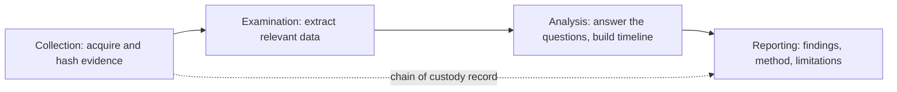

# Digital Forensics Basics

## Introduction

When a server is compromised, someone will ask: *What did the attacker do? When did it start? What data did they touch? Are they still here?* **Digital forensics** is the discipline of collecting and analyzing digital evidence in a way that answers those questions reliably, and in a way that would hold up if the evidence is later challenged by a lawyer, regulator or insurer.

The classic analogy is a crime scene. Detectives do not walk in and start tidying up. They photograph everything, collect the most perishable evidence first (footprints in the rain before fingerprints on a table), bag and label each item, and record who handled it. Digital forensics follows the same habits, because digital evidence is even more fragile: rebooting a server erases its memory, and simply browsing files changes their access timestamps.

In incident response, forensics is usually **DFIR** (Digital Forensics and Incident Response): fast, practical investigation to scope and stop an attack, not a months-long lab exercise. This page covers:

- Core principles: order of volatility, minimal change, chain of custody, integrity hashing
- Live response on a Linux host
- Memory acquisition and analysis with AVML and Volatility 3
- Disk and cloud volume imaging
- Building timelines from file system metadata
- When to do forensics at all, and when to simply rebuild

:::warning Authorization and legal care
Only collect or analyze data from systems you own or are explicitly authorized to examine, for example as part of your organization's incident response role. Evidence may include personal data, so follow your privacy policy, and involve legal counsel early if the incident could lead to litigation, law enforcement or regulatory reporting. To practice, use public training images such as NIST's [CFReDS](https://cfreds.nist.gov/) data sets, the Volatility test samples, or the forensics rooms on TryHackMe and HackTheBox.
:::

## Core Principles

### Order of Volatility

[RFC 3227](https://www.rfc-editor.org/rfc/rfc3227), "Guidelines for Evidence Collection and Archiving", gives an example order of volatility for a typical system. Collect from the top down:

| Order | Evidence | Lifetime |
| --- | --- | --- |
| 1 | Registers, cache | Nanoseconds |
| 2 | Routing table, ARP cache, process table, kernel statistics, memory | Until reboot or change |
| 3 | Temporary file systems | Until reboot or cleanup |
| 4 | Disk | Until overwritten |
| 5 | Remote logging and monitoring data | Until retention expires |
| 6 | Physical configuration, network topology | Until someone changes it |
| 7 | Archival media | Years |

In practice, responders cannot capture CPU registers, so the order usually starts with **memory**, then running state (processes, network connections), then disk, then logs.

### Other Principles from RFC 3227 and NIST SP 800-86

- **Minimize changes.** Every command you run on a live system changes it a little. Do as little as needed, and write down what you ran.
- **Do not trust the programs on the system.** An attacker may have replaced `ps` or `ls`. Run tools from trusted, read-only media where possible.
- **Collect first, analyze later.** Work on copies, never on the original evidence.
- **Keep detailed notes** with UTC timestamps, as if you will have to explain every step in court.
- **Chain of custody.** Record who collected each item, when, how it was stored and every time it changed hands.

NIST SP 800-86, "Guide to Integrating Forensic Techniques into Incident Response", describes the process as four steps: **collection, examination, analysis, reporting**.



## Evidence Integrity and Chain of Custody

A cryptographic hash (see [Hash Functions](../1-sec-cryptography/1-sec-hashing.mdx)) proves that evidence has not changed since it was collected. Hash at acquisition time, record the hash, and verify it before every analysis. This small tool does exactly that and keeps a custody log:

```python
# evidence.py: hash evidence files and keep a chain-of-custody manifest
import hashlib
import json
import sys
from datetime import datetime, timezone
from pathlib import Path

def sha256(path: Path) -> str:
    h = hashlib.sha256()
    with path.open("rb") as f:
        for chunk in iter(lambda: f.read(1024 * 1024), b""):   # stream large images
            h.update(chunk)
    return h.hexdigest()

def now() -> str:
    return datetime.now(timezone.utc).isoformat(timespec="seconds")

def acquire(manifest: Path, case: str, examiner: str, files: list[str]) -> None:
    items = []
    for name in files:
        p = Path(name)
        items.append({"file": p.name, "bytes": p.stat().st_size, "sha256": sha256(p)})
    record = {"case": case, "items": items,
              "custody": [{"ts": now(), "who": examiner, "event": "acquired"}]}
    manifest.write_text(json.dumps(record, indent=2))
    for it in items:
        print(f"acquired {it['file']:22} {it['sha256'][:16]}...")

def transfer(manifest: Path, who: str, note: str) -> None:
    record = json.loads(manifest.read_text())
    record["custody"].append({"ts": now(), "who": who, "event": note})
    manifest.write_text(json.dumps(record, indent=2))
    print(f"custody -> {who}: {note}")

def verify(manifest: Path, folder: Path) -> bool:
    record = json.loads(manifest.read_text())
    ok = True
    for it in record["items"]:
        actual = sha256(folder / it["file"])
        status = "OK " if actual == it["sha256"] else "MISMATCH"
        ok &= actual == it["sha256"]
        print(f"{status} {it['file']}")
    return ok

if __name__ == "__main__":
    cmd, manifest = sys.argv[1], Path(sys.argv[2])
    if cmd == "acquire":
        acquire(manifest, sys.argv[3], sys.argv[4], sys.argv[5:])
    elif cmd == "transfer":
        transfer(manifest, sys.argv[3], sys.argv[4])
    elif cmd == "verify":
        sys.exit(0 if verify(manifest, Path(sys.argv[3])) else 1)
```

Try it with two stand-in evidence files:

```bash
mkdir ev && cd ev
printf 'Oct 11 03:12:44 web01 sshd[812]: Accepted password for deploy from 203.0.113.50\n' > auth.log
head -c 200000 /dev/urandom > disk-web01.img        # pretend disk image

python3 ../evidence.py acquire manifest.json INC-2026-0142 "alice" auth.log disk-web01.img
python3 ../evidence.py transfer manifest.json "bob (forensics)" "handed over on encrypted USB, sealed bag #77"
python3 ../evidence.py verify manifest.json .

echo "tampered" >> auth.log                          # simulate a change
python3 ../evidence.py verify manifest.json . ; echo "exit code: $?"
```

Example output (your hashes will differ):

```text
acquired auth.log               3b6f6fc1062d3a7e...
acquired disk-web01.img         cf90e92b6a85da51...
custody -> bob (forensics): handed over on encrypted USB, sealed bag #77
OK  auth.log
OK  disk-web01.img
MISMATCH auth.log
OK  disk-web01.img
exit code: 1
```

Professional tools (forensic suites, evidence lockers, case management systems) do the same thing with more rigor, but the idea never changes: **hash at collection, verify before use, log every hand-off**.

## Live Response on Linux

Sometimes you cannot take a system offline, or you need running state that disappears on reboot. **Live response** collects volatile data from a running host. Keep it scripted so it is repeatable and quick:

```bash
#!/usr/bin/env bash
# live_triage.sh: collect volatile data from a Linux host you are authorized to examine.
# Run from trusted media; write output to external storage, not the suspect disk.
set -euo pipefail

OUT="${1:?usage: live_triage.sh /mnt/evidence-usb}/$(hostname)-$(date -u +%Y%m%dT%H%M%SZ)"
mkdir -p "$OUT"

run() {                       # run a command, save its output, log what was run
  local name="$1"; shift
  echo "[$(date -u +%FT%TZ)] $*" >> "$OUT/commands.log"
  "$@" > "$OUT/$name.txt" 2>&1 || echo "(exit $?)" >> "$OUT/$name.txt"
}

# Most volatile first (RFC 3227 order of volatility)
run date        date -u
run uptime      uptime
run who         who -a
run processes   ps auxwwf
run sockets     ss -tunap
run ip_addr     ip addr
run ip_route    ip route
run arp         ip neigh
run modules     lsmod
run open_files  lsof -nP
run logins      last -Fw
run crontabs    ls -la /etc/cron.d /var/spool/cron

# Hash everything collected so later tampering is detectable
( cd "$OUT" && sha256sum ./*.txt > SHA256SUMS )
echo "Saved to $OUT"
```

```bash
sudo bash live_triage.sh /mnt/evidence-usb
ls /mnt/evidence-usb/web01-*/
```

Example output:

```text
Saved to /mnt/evidence-usb/web01-20261011T110709Z
SHA256SUMS  arp.txt  commands.log  crontabs.txt  date.txt  ip_addr.txt  ip_route.txt
logins.txt  modules.txt  open_files.txt  processes.txt  sockets.txt  uptime.txt
```

Things to look for afterwards: processes running from `/tmp` or `/dev/shm`, processes whose binary was deleted, unexpected outbound connections, unknown kernel modules, new cron entries, and logins at odd hours.

:::note Mature tools exist
For fleets of machines, teams use purpose-built collectors such as **Velociraptor** (open source endpoint visibility and collection), EDR "live response" features, or cloud-native tools. A home-grown script is great for learning and for small environments, but a rootkit can hide from any tool that runs on the compromised kernel. That is one reason memory analysis matters.
:::

## Memory Forensics

RAM holds evidence that never touches the disk: running and hidden processes, network connections, injected code, decrypted data, command history and sometimes encryption keys. Memory forensics has two steps: **acquire** an image, then **analyze** it offline.

### Acquiring Memory on Linux with AVML

[AVML](https://github.com/microsoft/avml) (Acquire Volatile Memory for Linux) is a Microsoft open source tool that captures memory without needing a kernel module built for the target's exact kernel. Its README shows:

```bash
# Run on the target host; write to external or network storage, not the suspect disk
sudo ./avml acquire /mnt/evidence-usb/web01.lime

# Or with page-level compression to save space
sudo ./avml acquire --compress /mnt/evidence-usb/web01.lime.compressed

# Convert a compressed image back to plain LiME format for analysis tools
./avml convert ./web01.lime.compressed ./web01.lime
```

AVML cannot acquire memory if the kernel's lockdown feature is enabled. On Windows, responders commonly use tools such as WinPmem, DumpIt or their EDR's memory capture feature. In VMs, a hypervisor snapshot often includes memory, which avoids running anything inside the guest at all.

### Analyzing Memory with Volatility 3

[Volatility 3](https://github.com/volatilityfoundation/volatility3) is the standard open source memory analysis framework. Install it into a virtual environment on your **analysis workstation**, never on the compromised host:

```bash
python3 -m venv vol-env && source vol-env/bin/activate
pip install volatility3
vol -h | head -5
```

Typical Windows analysis commands look like this:

```bash
vol -f memory.vmem windows.info       # OS version, build, capture time
vol -f memory.vmem windows.pslist     # processes from the kernel's process list
vol -f memory.vmem windows.pstree     # parent/child relationships
vol -f memory.vmem windows.cmdline    # command line of each process
vol -f memory.vmem windows.netscan    # network connections and listening sockets
vol -f memory.vmem windows.malfind    # memory regions that look like injected code
```

For Linux images, plugins live under the `linux.` prefix, for example `linux.pslist`, `linux.pstree`, `linux.bash` (bash history recovered from memory) and `linux.malfind`. Linux analysis needs a **symbol table** for the exact kernel: run `vol -f web01.lime banners` to identify the kernel, then find or generate a matching symbol file as described in the Volatility 3 documentation. Plugin output varies by version, so check `vol -h` for what your installed version provides.

What analysts look for:

- A process tree where something is wrong, such as a web server process spawning a shell
- Processes whose names imitate system processes but run from unusual paths
- Network connections to unknown external addresses
- `malfind` hits in processes that should not have executable, writable memory

Deeper malware work belongs in [Malware Analysis Basics](../11-sec-defensive-operations/7-sec-malware-basics.mdx).

## Disk and Volume Imaging

A forensic image is a bit-for-bit copy of a disk, including deleted files and unallocated space. Rules: use a **write blocker** (hardware, or a read-only attachment) on the original, image to separate storage, and hash both the source and the image.

```bash
# Image a disk that is attached read-only as /dev/sdb (an evidence drive on your workstation)
sudo blockdev --setro /dev/sdb
sudo dd if=/dev/sdb of=/mnt/case/web01-sdb.img bs=4M conv=noerror,sync status=progress
sudo sha256sum /dev/sdb /mnt/case/web01-sdb.img
```

Example output:

```text
b1946ac92492d2347c6235b4d2611184...  /dev/sdb
b1946ac92492d2347c6235b4d2611184...  /mnt/case/web01-sdb.img
```

Matching hashes show the image is faithful. Specialized tools such as `dc3dd`, `ewfacquire` (Expert Witness Format, with built-in hashing and compression) and FTK Imager are preferred in professional work because they log and verify automatically. Note that `conv=noerror,sync` fills unreadable blocks with zeros so the image keeps the right offsets; record any read errors in your notes.

### Cloud Volumes

In the cloud you rarely touch a physical disk. Instead you **snapshot** the volume, which is fast and does not require logging into the suspect machine:

```bash
# AWS example: snapshot the suspect instance's volume and tag it as evidence
aws ec2 create-snapshot \
  --volume-id vol-0123456789abcdef0 \
  --description "INC-2026-0142 web01 root volume" \
  --tag-specifications 'ResourceType=snapshot,Tags=[{Key=case,Value=INC-2026-0142},{Key=legal-hold,Value=true}]'
```

Then create a volume from the snapshot in an isolated **forensics account**, attach it read-only to an analysis instance, and investigate there. Cloud providers publish incident response guides with these patterns; AWS, Azure and Google Cloud each document their recommended approach. Isolate the original instance by swapping its security group to one with no inbound or outbound rules, rather than terminating it.

## Timelines: Putting Events in Order

Investigations are ultimately about **sequence**: what happened first, what came next. File systems record timestamps for each file, often called **MAC times**:

| Timestamp | Meaning (Linux ext4) | Note |
| --- | --- | --- |
| **m**time | Content last modified | Can be faked with `touch` |
| **a**time | Last accessed | Often disabled or relaxed (`relatime`) for performance |
| **c**time | Inode metadata last changed | Not settable by `touch`, so a mismatch with mtime is a clue |
| **b**irth / crtime | File created | Supported on ext4 and visible with `stat` on recent systems |

A tiny timeline tool shows the idea. It lists files modified or changed in a time window:

```python
# mactime.py: list files modified or changed inside a time window (a tiny timeline)
import os
import sys
from datetime import datetime, timezone

def ts(epoch: float) -> str:
    return datetime.fromtimestamp(epoch, timezone.utc).strftime("%Y-%m-%d %H:%M:%S")

def timeline(root: str, start: str, finish: str):
    lo = datetime.fromisoformat(start).replace(tzinfo=timezone.utc).timestamp()
    hi = datetime.fromisoformat(finish).replace(tzinfo=timezone.utc).timestamp()
    events = []
    for dirpath, _, files in os.walk(root):
        for name in files:
            path = os.path.join(dirpath, name)
            st = os.lstat(path)                      # do not follow symlinks
            for kind, t in (("m", st.st_mtime), ("c", st.st_ctime)):
                if lo <= t <= hi:
                    events.append((t, kind, st.st_size, path))
    for t, kind, size, path in sorted(events):
        print(f"{ts(t)}  {kind}  {size:>7}  {path}")

if __name__ == "__main__":
    timeline(*sys.argv[1:4])
```

Run it against a **mounted copy** of the evidence (here, a small demo web root):

```bash
python3 mactime.py webroot 2026-10-11T00:00:00 2026-10-11T06:00:00
```

Output:

```text
2026-10-11 02:55:40  m        2  webroot/uploads/photo.jpg
2026-10-11 03:14:02  m       11  webroot/uploads/avatar.php
```

A `.php` file in an uploads folder, written 18 minutes after the last legitimate upload, is a strong lead. You would now look for web requests around 03:14 that hit the upload endpoint. That is how disk forensics and [log investigation](./3-sec-log-analysis.mdx) feed each other.

Real investigations use **super timelines** that merge file system times, logs, browser history, registry entries and more. The open source tool **plaso** does this:

```bash
log2timeline.py --storage-file timeline.plaso web01-sdb.img
psort.py -o dynamic -w timeline.csv timeline.plaso
```

The **Sleuth Kit** and its GUI **Autopsy** also build timelines and let you browse file systems, deleted files and keyword hits in an image.

## Common Tools at a Glance

| Tool | Use | Notes |
| --- | --- | --- |
| Volatility 3 | Memory analysis | Open source; Windows, Linux and macOS images |
| AVML, LiME, WinPmem | Memory acquisition | Pick by OS; test in advance |
| dd, dc3dd, ewfacquire, FTK Imager | Disk imaging | Hash and log every acquisition |
| Sleuth Kit / Autopsy | File system analysis | Open source; deleted files, timelines |
| plaso (log2timeline) | Super timelines | Many artifact parsers |
| Velociraptor | Live collection across many endpoints | Open source; query language for artifacts |
| KAPE | Fast Windows artifact collection | Free for some uses; check its license terms |

Tool features and licensing change; check each project's documentation before relying on it.

## Real-World Scenario

You run a small online learning platform. An EDR alert shows the PHP-FPM process on an EC2 web server spawning `/bin/sh`, which then downloads a file from an unknown IP. The server holds no customer data directly, but it has database credentials in its environment variables. The CTO asks: "Can't we just terminate it and redeploy? We have Terraform."

**Walkthrough:**

1. **Preserve first (10 minutes).** Snapshot the EBS volume and capture memory with AVML to an S3 bucket in the security account. Tag both with the case ID.
2. **Isolate.** Swap the instance's security group to a no-traffic group. Remove it from the load balancer, which already has healthy replacements.
3. **Rotate.** Assume the database credentials are stolen: rotate them and review database logs for connections from unexpected addresses.
4. **Analyze offline.** In the forensics account, mount the volume read-only and build a timeline. Run Volatility on the memory image to find the process tree and network connections. Together they reveal a web shell uploaded through an unpatched file upload plugin.
5. **Rebuild.** Now terminate the instance and redeploy from Terraform with the patched plugin. The evidence lives on in snapshots.

**Why this approach:** "just rebuild" would have removed the attacker from that host, but it would not have answered how they got in (so they would return through the same plugin) or what they did with the credentials. Ten minutes of preservation kept both questions answerable.

**When to use it / when not to:** preserve evidence whenever data may have been accessed, when you might need to notify anyone, or when you do not yet know the entry point. For a clearly understood, low-impact event on a stateless host (for example, a cryptominer from a known vulnerable image with no credentials on the box), rebuilding immediately may be reasonable, though a snapshot is still cheap.

| Approach | Pros | Cons | Best for |
| --- | --- | --- | --- |
| Terminate and rebuild immediately | Fastest; simple | Evidence lost; root cause unknown; may be re-infected | Stateless hosts, well-understood low-impact events |
| Snapshot disk, then rebuild | Cheap; keeps disk evidence | No memory evidence; fileless malware missed | Most cloud workloads |
| Snapshot plus memory capture, then rebuild | Full picture of disk and running state | Takes skill and prepared tooling | Suspected hands-on intruder, credential theft |
| Full forensic investigation by specialists | Defensible, thorough, court-ready | Expensive and slower | Litigation, regulators, law enforcement, insurance claims |

## Common Mistakes

- **Rebooting or powering off first.** Memory evidence is gone. Isolate the network instead, unless leaving it on causes greater harm (for example, active encryption by ransomware; follow your playbook).
- **Analyzing the original.** Mounting an evidence disk read-write or opening files on the suspect system changes timestamps. Work on hashed copies.
- **Saving output to the suspect disk.** You overwrite unallocated space that may contain deleted evidence.
- **Trusting local binaries.** A compromised host may lie. Use trusted tools and cross-check with external data such as network logs.
- **Mixing time zones.** Record everything in UTC and note each source's clock offset.
- **No notes.** If you cannot explain what you did and when, your conclusions are weak.
- **Forgetting privacy.** Evidence often contains personal data. Limit access and retention.

## Summary

- Digital forensics collects and analyzes evidence reliably enough to answer what happened, and to stand up to scrutiny.
- Collect from most to least volatile (RFC 3227): memory and running state before disk, disk before logs that are already stored remotely.
- Minimize changes, use trusted tools, work on copies, hash everything and keep a chain-of-custody record.
- Capture memory with tools like AVML and analyze it offline with Volatility 3.
- Image disks with write blocking and hashing; in the cloud, snapshot volumes and analyze them in an isolated account.
- Timelines of file times and logs turn scattered artifacts into a story.

## Further Learning

**Exercises**

1. Extend `evidence.py` with a `--note` option for acquisitions and a `report` command that prints the full custody history.
2. Run `live_triage.sh` on a VM you own, then compare `processes.txt` with `ps` output after starting a suspicious-looking process from `/tmp`.
3. Download a Volatility 3 test image, run `windows.pstree` and `windows.netscan`, and write three sentences on what the machine was doing.
4. Change `mactime.py` to flag files whose ctime is much later than their mtime. Why might that indicate timestomping, and what else could cause it?

**Related pages**

- [Investigating with Logs](./3-sec-log-analysis.mdx)
- [Incident Response Playbooks](./1-sec-incident-playbooks.mdx)
- [Malware Analysis Basics](../11-sec-defensive-operations/7-sec-malware-basics.mdx)
- [Endpoint Protection and EDR](../9-sec-system-hardening/4-sec-endpoint-protection.mdx)
- [Ethics, Law and Responsible Disclosure](../0-sec-fundamentals/8-sec-ethics-and-law.mdx)

**Official sources**

- [RFC 3227: Guidelines for Evidence Collection and Archiving](https://www.rfc-editor.org/rfc/rfc3227)
- [NIST SP 800-86: Guide to Integrating Forensic Techniques into Incident Response](https://csrc.nist.gov/pubs/sp/800/86/final)
- [Volatility 3 documentation](https://volatility3.readthedocs.io/)
- [plaso documentation](https://plaso.readthedocs.io/)
