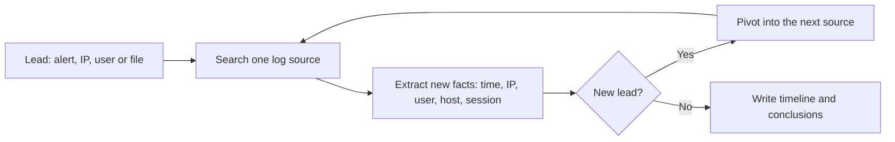

# Investigating with Logs

## Introduction

During an incident, logs are your security camera footage. They tell you who logged in, what they requested, which commands ran and which cloud APIs were called. A good log investigation turns a vague alert ("something is wrong with web01") into a precise story ("at 03:14 UTC an attacker uploaded a web shell through the avatar endpoint, read the `.env` file, and used the stolen AWS key eight minutes later").

Detectives reviewing camera footage do not watch every hour from every camera. They start with one clue (a red car), find it on one camera, note the time, then check the next camera along the road. Log investigation works the same way: **start from a lead, find it in one source, pivot on what you learned into the next source**.

This page is about *investigating* with logs during an incident. Collecting and centralizing logs, and writing detection rules, are covered in [Security Logging and SIEM](../11-sec-defensive-operations/1-sec-logging-and-siem.mdx) and [Detection Engineering](../11-sec-defensive-operations/2-sec-detection-engineering.mdx). Here you will learn to:

- Know which log sources answer which questions
- Analyze Linux authentication logs with `grep`, `awk` and `journalctl`
- Hunt through web server access logs with a small Python tool
- Read key Windows Security event IDs
- Query AWS CloudTrail for what a stolen credential did
- Pivot between sources and merge them into one timeline
- Protect log integrity, because attackers delete logs too

:::warning Work only with logs you are authorized to access
Investigate logs from systems you own or are responsible for. Logs often contain personal data such as IP addresses, user names and email addresses, so follow your organization's privacy rules. All log samples on this page are fictional and use IP addresses from documentation ranges.
:::

## Which Logs Answer Which Questions

| Question | Log sources |
| --- | --- |
| Who logged in, from where, how? | Linux `auth.log` / journal, Windows Security log, identity provider sign-in logs, VPN logs |
| What did they request from the app? | Web server access logs, load balancer logs, WAF logs, application logs |
| What ran on the host? | Process auditing (Linux `auditd`, Windows event 4688, Sysmon), EDR telemetry, shell history |
| What did they do in the cloud? | AWS CloudTrail, Azure Activity Log, Google Cloud Audit Logs |
| Where did data go? | Firewall and VPC flow logs, proxy logs, DNS logs, object storage access logs |
| What changed? | Configuration management, IaC pipelines, Git history, cloud config history |



### Get Time Right First

Before comparing sources, check time:

- **Time zone:** web servers often log local time with an offset like `+0000` or `-0700`; syslog lines often have no year and no zone. Convert everything to **UTC**.
- **Clock drift:** a host without working NTP may be minutes off. Compare an event that appears in two sources to measure the offset.
- **Retention:** check how far back each source goes before assuming "no evidence" means "nothing happened".

## Linux Authentication Logs

On Debian and Ubuntu, SSH and `sudo` events traditionally go to `/var/log/auth.log`; Red Hat-family systems use `/var/log/secure`. Some newer minimal installs do not run a syslog daemon at all, so the events live only in the systemd journal. Here is a fictional excerpt:

```text
Oct 11 02:40:01 web01 sshd[701]: Failed password for invalid user admin from 198.51.100.23 port 51122 ssh2
Oct 11 02:40:03 web01 sshd[701]: Failed password for invalid user admin from 198.51.100.23 port 51122 ssh2
Oct 11 02:40:06 web01 sshd[705]: Failed password for root from 198.51.100.23 port 51130 ssh2
Oct 11 02:41:10 web01 sshd[712]: Failed password for invalid user test from 198.51.100.23 port 51188 ssh2
Oct 11 02:50:12 web01 sshd[730]: Failed password for deploy from 203.0.113.50 port 40022 ssh2
Oct 11 02:50:15 web01 sshd[730]: Failed password for deploy from 203.0.113.50 port 40022 ssh2
Oct 11 03:12:44 web01 sshd[812]: Accepted password for deploy from 203.0.113.50 port 40100 ssh2
Oct 11 03:13:02 web01 sudo:   deploy : TTY=pts/0 ; PWD=/home/deploy ; USER=root ; COMMAND=/usr/bin/crontab -e
Oct 11 08:01:15 web01 sshd[901]: Accepted publickey for alice from 192.0.2.10 port 55012 ssh2: ED25519 SHA256:abc
```

A short script answers the first questions: who is guessing passwords, who got in, and did any guesser succeed?

```bash
#!/usr/bin/env bash
# ssh_summary.sh: quick SSH login summary from an auth log
LOG="${1:-/var/log/auth.log}"

echo "== Failed attempts by source IP =="
grep "Failed password" "$LOG" | grep -oP 'from \K[0-9a-fA-F.:]+' | sort | uniq -c | sort -rn

echo "== Successful logins =="
grep "Accepted" "$LOG" | awk '{print $1, $2, $3, "user=" $9, "ip=" $11, "method=" $7}'

echo "== IPs that failed AND later succeeded =="
comm -12 \
  <(grep "Failed password" "$LOG" | grep -oP 'from \K[0-9a-fA-F.:]+' | sort -u) \
  <(grep "Accepted"        "$LOG" | grep -oP 'from \K[0-9a-fA-F.:]+' | sort -u)
```

```bash
bash ssh_summary.sh auth.log
```

Output:

```text
== Failed attempts by source IP ==
      4 198.51.100.23
      2 203.0.113.50
== Successful logins ==
Oct 11 03:12:44 user=deploy ip=203.0.113.50 method=password
Oct 11 08:01:15 user=alice ip=192.0.2.10 method=publickey
== IPs that failed AND later succeeded ==
203.0.113.50
```

The noisy brute-forcer (`198.51.100.23`) never got in. The quiet one did: `203.0.113.50` guessed the `deploy` password, logged in at 03:12:44, and immediately used `sudo` to edit root's crontab, a classic persistence step. The lesson: **the loudest IP is rarely the most important one**. Also note that password authentication was enabled at all; see [SSH Security](../9-sec-system-hardening/2-sec-ssh-security.mdx).

### Using journalctl

On systemd hosts, query the journal directly. Filters by syslog identifier and time window are the most useful:

```bash
# SSH daemon messages in a two-hour window, with ISO timestamps
journalctl -t sshd -t sshd-session --since "2026-10-11 02:00" --until "2026-10-11 04:00" -o short-iso

# Everything sudo did today
journalctl -t sudo --since today

# JSON output for scripts (one object per line)
journalctl -t sudo --since today -o json | head -n 1
```

Recent OpenSSH releases split the daemon so per-connection messages may be logged as `sshd-session` instead of `sshd`; including both identifiers covers either case. The service unit is named `ssh` on Debian and Ubuntu and `sshd` on Red Hat-family systems, if you prefer filtering with `-u`.

## Web Server Access Logs

Web logs reveal application attacks. Nginx and Apache use the **combined log format** by default:

```text
192.0.2.44 - - [11/Oct/2026:02:55:31 +0000] "GET /account/avatar HTTP/1.1" 200 5120 "-" "Mozilla/5.0"
192.0.2.44 - - [11/Oct/2026:02:55:40 +0000] "POST /account/avatar HTTP/1.1" 200 88 "-" "Mozilla/5.0"
203.0.113.50 - - [11/Oct/2026:03:01:02 +0000] "GET /search?q=1%27%20OR%20%271%27%3D%271 HTTP/1.1" 500 312 "-" "sqlmap/1.8"
203.0.113.50 - - [11/Oct/2026:03:01:03 +0000] "GET /search?q=1%20UNION%20SELECT%20NULL-- HTTP/1.1" 500 312 "-" "sqlmap/1.8"
203.0.113.50 - - [11/Oct/2026:03:05:10 +0000] "GET /../../etc/passwd HTTP/1.1" 400 0 "-" "curl/8.5.0"
203.0.113.50 - - [11/Oct/2026:03:14:01 +0000] "POST /account/avatar HTTP/1.1" 200 88 "-" "python-requests/2.32"
203.0.113.50 - - [11/Oct/2026:03:14:30 +0000] "GET /uploads/avatar.php?c=id HTTP/1.1" 200 54 "-" "python-requests/2.32"
203.0.113.50 - - [11/Oct/2026:03:15:02 +0000] "GET /uploads/avatar.php?c=cat%20.env HTTP/1.1" 200 1290 "-" "python-requests/2.32"
198.51.100.9 - - [11/Oct/2026:03:20:00 +0000] "GET /wp-login.php HTTP/1.1" 404 0 "-" "Mozilla/5.0"
198.51.100.9 - - [11/Oct/2026:03:20:01 +0000] "GET /.git/config HTTP/1.1" 404 0 "-" "Mozilla/5.0"
```

This Python tool parses the format, URL-decodes paths and tags suspicious patterns:

```python
# web_hunt.py: parse combined-format access logs and flag suspicious requests
import re
import sys
from collections import Counter
from datetime import datetime
from urllib.parse import unquote

LINE = re.compile(
    r'(?P<ip>\S+) \S+ \S+ \[(?P<ts>[^\]]+)\] "(?P<method>\S+) (?P<path>\S+) \S+" '
    r'(?P<status>\d{3}) (?P<size>\d+|-) "[^"]*" "(?P<ua>[^"]*)"'
)
RULES = {
    "sqli":       re.compile(r"(union\s+select|'\s*or\s*'|--|sleep\()", re.I),
    "traversal":  re.compile(r"\.\./"),
    "webshell":   re.compile(r"/uploads/.*\.(php|jsp|aspx?)", re.I),
    "scanner_ua": re.compile(r"(sqlmap|nikto|nuclei|masscan)", re.I),
    "recon":      re.compile(r"(wp-login\.php|/\.git/|/\.env)", re.I),
}

def parse(path):
    with open(path, encoding="utf-8", errors="replace") as f:
        for raw in f:
            m = LINE.match(raw)
            if m:
                d = m.groupdict()
                d["path"] = unquote(d["path"])
                d["ts"] = datetime.strptime(d["ts"], "%d/%b/%Y:%H:%M:%S %z")
                yield d

def main(path):
    hits, per_ip = [], Counter()
    for r in parse(path):
        tags = [name for name, rx in RULES.items()
                if rx.search(r["path"]) or (name == "scanner_ua" and rx.search(r["ua"]))]
        if tags:
            hits.append((r, tags))
            per_ip[r["ip"]] += 1
    for r, tags in hits:
        print(f'{r["ts"]:%H:%M:%S} {r["ip"]:15} {r["status"]} {",".join(tags):18} {r["path"][:45]}')
    print("\nSuspicious requests per IP:", dict(per_ip.most_common()))

if __name__ == "__main__":
    main(sys.argv[1])
```

```bash
python3 web_hunt.py access.log
```

Output:

```text
03:01:02 203.0.113.50    500 sqli,scanner_ua    /search?q=1' OR '1'='1
03:01:03 203.0.113.50    500 sqli,scanner_ua    /search?q=1 UNION SELECT NULL--
03:05:10 203.0.113.50    400 traversal          /../../etc/passwd
03:14:30 203.0.113.50    200 webshell           /uploads/avatar.php?c=id
03:15:02 203.0.113.50    200 webshell           /uploads/avatar.php?c=cat .env
03:20:00 198.51.100.9    404 recon              /wp-login.php
03:20:01 198.51.100.9    404 recon              /.git/config
```

Read the **status codes**, not just the patterns. The SQL injection attempts got `500` errors (worth checking, but probably not successful), the traversal got `400`, and the recon got `404`. The web shell requests got **`200`** with growing response sizes: they worked. The `cat .env` response of 1290 bytes very likely contained secrets.

### Pivot on the Attacker's IP

Pattern rules missed one important line. Pivoting on the IP shows *how* the web shell arrived:

```bash
grep '^203.0.113.50 ' access.log | awk '{print $4, $6, $7, $9}' | tr -d '["'
```

Output:

```text
11/Oct/2026:03:01:02 GET /search?q=1%27%20OR%20%271%27%3D%271 500
11/Oct/2026:03:01:03 GET /search?q=1%20UNION%20SELECT%20NULL-- 500
11/Oct/2026:03:05:10 GET /../../etc/passwd 400
11/Oct/2026:03:14:01 POST /account/avatar 200
11/Oct/2026:03:14:30 GET /uploads/avatar.php?c=id 200
11/Oct/2026:03:15:02 GET /uploads/avatar.php?c=cat%20.env 200
```

The `POST /account/avatar` at 03:14:01 is a normal-looking request that uploaded `avatar.php`. That is the root cause to fix: see [Secure File Uploads](../3-sec-web-security/10-sec-file-upload-security.mdx). This also matches the file timestamp found in [Digital Forensics Basics](./2-sec-digital-forensics.mdx).

:::tip Attackers rotate IPs
Real attackers often switch IP addresses, use proxies or cloud hosts. Pivot on other identifiers too: user agent, session ID, user account, request ID, uploaded file name. An IP address is a lead, not an identity.
:::

## Windows Security Event Logs

On Windows, the Security log records authentication and account activity. A handful of event IDs cover most investigations:

| Event ID | Meaning | Why it matters |
| --- | --- | --- |
| 4624 | Successful logon | Check the logon type: 2 interactive, 3 network, 10 remote interactive (RDP) |
| 4625 | Failed logon | Password guessing and spraying |
| 4672 | Special privileges assigned to new logon | Admin-equivalent logons |
| 4688 | New process created | Command lines, if command-line auditing is enabled |
| 4720 | User account created | Attacker persistence |
| 4732 | Member added to a security-enabled local group | For example, added to Administrators |
| 1102 | Audit log was cleared | A strong sign of an attacker covering tracks |
| 7045 | New service installed (System log) | Common persistence and lateral movement artifact |

Query them with PowerShell on a machine you administer:

```powershell
# Failed logons in the last 24 hours, grouped by target account
Get-WinEvent -FilterHashtable @{ LogName = 'Security'; Id = 4625; StartTime = (Get-Date).AddDays(-1) } |
  ForEach-Object { $_.Properties[5].Value } |
  Group-Object | Sort-Object Count -Descending | Select-Object -First 10 Count, Name
```

Example output:

```text
Count Name
----- ----
   57 administrator
   12 svc-backup
    3 jsmith
```

`Properties[5]` is the `TargetUserName` field in event 4625's data. Field positions differ per event ID, so check Microsoft's documentation for each event, or use `$_.ToXml()` and parse named fields. Microsoft's **Sysmon** adds much richer process, network and file events and is widely used for investigations.

## Cloud Audit Logs: AWS CloudTrail

In the cloud, the most important question after a credential leak is: *what did this credential do?* AWS CloudTrail records API calls. **Event history** lets you search the last 90 days of management events in a Region without setting anything up:

```bash
# Every management event made with a specific access key (read-only query)
aws cloudtrail lookup-events \
  --lookup-attributes AttributeKey=AccessKeyId,AttributeValue=AKIAEXAMPLEWEB01 \
  --start-time 2026-10-11T00:00:00Z \
  --max-results 50 \
  --output json > key-activity.json
```

Event history covers management events only. Data events, such as S3 `GetObject` calls, must be enabled on a trail in advance, which is one more reason [logging is a preparation task](./0-sec-incident-response-lifecycle.mdx). For longer retention and fast queries, teams send trails to S3 and query them with Athena, CloudTrail Lake or a SIEM.

Here is a simplified CloudTrail file. Real records contain more fields, but these are the ones investigators read first:

```json
{"Records": [
 {"eventTime": "2026-10-11T03:22:10Z", "eventSource": "sts.amazonaws.com", "eventName": "GetCallerIdentity",
  "userIdentity": {"type": "IAMUser", "arn": "arn:aws:iam::111122223333:user/app-web", "accessKeyId": "AKIAEXAMPLEWEB01"},
  "sourceIPAddress": "203.0.113.50", "userAgent": "aws-cli/2.17.0"},
 {"eventTime": "2026-10-11T03:22:41Z", "eventSource": "s3.amazonaws.com", "eventName": "ListBuckets",
  "userIdentity": {"type": "IAMUser", "arn": "arn:aws:iam::111122223333:user/app-web", "accessKeyId": "AKIAEXAMPLEWEB01"},
  "sourceIPAddress": "203.0.113.50", "userAgent": "aws-cli/2.17.0"},
 {"eventTime": "2026-10-11T03:23:05Z", "eventSource": "iam.amazonaws.com", "eventName": "CreateUser",
  "userIdentity": {"type": "IAMUser", "arn": "arn:aws:iam::111122223333:user/app-web", "accessKeyId": "AKIAEXAMPLEWEB01"},
  "sourceIPAddress": "203.0.113.50", "userAgent": "aws-cli/2.17.0", "errorCode": "AccessDenied"},
 {"eventTime": "2026-10-11T03:30:00Z", "eventSource": "s3.amazonaws.com", "eventName": "PutObject",
  "userIdentity": {"type": "IAMUser", "arn": "arn:aws:iam::111122223333:user/app-web", "accessKeyId": "AKIAEXAMPLEWEB01"},
  "sourceIPAddress": "10.0.1.15", "userAgent": "aws-sdk-php/3.300.0"}
]}
```

`jq` filters it quickly:

```bash
jq -r '.Records[] | select(.sourceIPAddress=="203.0.113.50")
       | [.eventTime, .eventName, (.errorCode // "OK")] | @tsv' cloudtrail.json
```

Output:

```text
2026-10-11T03:22:10Z	GetCallerIdentity	OK
2026-10-11T03:22:41Z	ListBuckets	OK
2026-10-11T03:23:05Z	CreateUser	AccessDenied
```

The pattern is typical of a stolen key: `GetCallerIdentity` ("whose key is this?"), then discovery (`ListBuckets`), then an attempt at persistence (`CreateUser`) that least privilege blocked. The `PutObject` from `10.0.1.15` with the PHP SDK user agent is the real application, so the same key is used both legitimately and maliciously. You cannot tell them apart by identity, only by source IP and user agent. That is why you rotate the key rather than trying to "watch" it.

## Building One Timeline

Each source tells part of the story. Merging them in UTC tells all of it:

```python
# timeline.py: merge auth, web and CloudTrail events into one UTC timeline
import json
import re
from datetime import datetime, timezone

YEAR = 2026            # syslog lines omit the year; set it from the case notes

def auth_events(path):
    for line in open(path, encoding="utf-8"):
        ts = datetime.strptime(f"{YEAR} {line[:15]}", "%Y %b %d %H:%M:%S").replace(tzinfo=timezone.utc)
        ip = re.search(r"from ([0-9a-fA-F.:]+)", line)
        if "Accepted" in line or "sudo:" in line:
            yield ts, "auth", ip.group(1) if ip else "-", line[16:].strip()[:70]

def web_events(path):
    rx = re.compile(r'(\S+) \S+ \S+ \[([^\]]+)\] "(\S+ \S+)[^"]*" (\d{3})')
    for line in open(path, encoding="utf-8"):
        m = rx.match(line)
        if m:
            ts = datetime.strptime(m.group(2), "%d/%b/%Y:%H:%M:%S %z").astimezone(timezone.utc)
            yield ts, "web", m.group(1), f"{m.group(3)[:55]} -> {m.group(4)}"

def cloudtrail_events(path):
    for r in json.load(open(path, encoding="utf-8"))["Records"]:
        ts = datetime.fromisoformat(r["eventTime"].replace("Z", "+00:00"))
        who = r["userIdentity"].get("arn", "?").split("/")[-1]
        yield ts, "aws", r["sourceIPAddress"], f'{r["eventName"]} by {who} {r.get("errorCode", "")}'.strip()

def main(focus_ip=None):
    events = [*auth_events("auth.log"), *web_events("access.log"), *cloudtrail_events("cloudtrail.json")]
    for ts, src, ip, msg in sorted(events):
        if focus_ip is None or ip == focus_ip:
            print(f"{ts:%H:%M:%S}  {src:4}  {ip:14} {msg}")

if __name__ == "__main__":
    main(focus_ip="203.0.113.50")
```

Output:

```text
03:01:02  web   203.0.113.50   GET /search?q=1%27%20OR%20%271%27%3D%271 -> 500
03:01:03  web   203.0.113.50   GET /search?q=1%20UNION%20SELECT%20NULL-- -> 500
03:05:10  web   203.0.113.50   GET /../../etc/passwd -> 400
03:12:44  auth  203.0.113.50   web01 sshd[812]: Accepted password for deploy from 203.0.113.50 port 4
03:14:01  web   203.0.113.50   POST /account/avatar -> 200
03:14:30  web   203.0.113.50   GET /uploads/avatar.php?c=id -> 200
03:15:02  web   203.0.113.50   GET /uploads/avatar.php?c=cat%20.env -> 200
03:22:10  aws   203.0.113.50   GetCallerIdentity by app-web
03:22:41  aws   203.0.113.50   ListBuckets by app-web
03:23:05  aws   203.0.113.50   CreateUser by app-web AccessDenied
```

Now the story is clear: failed web attacks, a guessed SSH password, a web shell upload, theft of `.env`, and use of the AWS key from it. It also raises new questions. The `sudo` line at 03:13:02 has no IP, so the focus filter hid it; drop the filter to see it, then check root's crontab. Did the attacker use the database credentials from `.env` too? Pivot into the database logs next.

## Protecting Log Integrity

Attackers know logs exist, and many try to delete or alter them (MITRE ATT&CK technique T1070, Indicator Removal). Defenses:

- **Ship logs off the host** in near real time to a SIEM or central store the host cannot modify.
- **Alert on log clearing** (Windows event 1102, a stopped logging agent, `StopLogging` or `DeleteTrail` in CloudTrail).
- **Make storage immutable**: S3 Object Lock or similar write-once storage for audit logs, in a separate security account.
- **Verify integrity:** CloudTrail **log file integrity validation** signs digest files so you can prove logs were not modified: `aws cloudtrail validate-logs --trail-arn <trail-arn> --start-time <time>`.
- **Restrict access** to log deletion and retention settings to a small, monitored group.

## Real-World Scenario

You are the on-call engineer for a SaaS helpdesk product. A customer reports that their support agents are getting password reset emails they did not request. You have: Nginx logs on three web servers (local files, 7 days), the application's JSON logs in a managed log service (30 days), and CloudTrail in an S3 bucket (1 year). There is no SIEM yet.

**Walkthrough:**

1. **Start from the lead.** Search the application logs for `password_reset_requested` events for that customer's users. You find 400 requests in two hours from 12 IP addresses.
2. **Pivot on IPs and user agents** into the Nginx logs on all three servers (collect them first, since local logs rotate in 7 days). The same IPs also hit `/login` 9,000 times: a credential stuffing attack, with password resets as a side effect.
3. **Check for success.** Filter application logs for `login_success` from those IPs: three accounts were accessed.
4. **Pivot on accounts.** Pull everything those three sessions did: they exported ticket attachments.
5. **Contain and report.** Lock the three accounts, revoke sessions, add rate limiting, and hand the timeline to the incident commander for customer notification.

**Why this approach:** with no SIEM, command-line tools and small scripts were the fastest way to get answers from three different stores. Copying the short-retention Nginx logs first prevented evidence from rotating away mid-investigation.

**When to use it / when not to:** ad-hoc `grep`, `jq` and Python are ideal for small environments and one-off questions. At scale, or when many people investigate together, a SIEM or log analytics platform with saved queries is far better, and you should not rely on host-local files at all.

| Approach | Pros | Cons | Best for |
| --- | --- | --- | --- |
| `grep` / `awk` / `jq` on raw files | Available everywhere; fast for small data | Hard to correlate; no history of queries | Single hosts, quick triage |
| Python or notebooks (pandas) | Flexible parsing, joins and charts | Needs scripting skill; data must be copied locally | Medium datasets, one-off deep dives |
| SIEM or log platform (for example Elastic, Splunk, OpenSearch, cloud-native tools) | Central search, correlation, retention, alerting | Cost; setup; query language to learn | Teams, many sources, ongoing operations |
| Cloud-native query (Athena, CloudTrail Lake, Log Analytics) | No servers to manage; scales to large data | Per-query cost; provider-specific | Large cloud audit logs |

## Common Mistakes

- **Forgetting time zones and missing years** in syslog lines. Normalize to UTC first.
- **Trusting the loudest signal.** Noisy scanners distract from the quiet attacker who succeeded.
- **Ignoring status codes and response sizes.** A `200` with an unusual size often matters more than a dozen `404`s.
- **Searching only local logs on a compromised host.** The attacker may have edited them. Prefer central copies.
- **Letting evidence rotate away.** Copy short-retention logs at the start of an investigation.
- **Not URL-decoding.** Attack strings are often encoded; decode before matching.
- **Concluding "nothing happened" from missing logs.** Absence of evidence may mean logging was off.

## Summary

- Investigate by starting from a lead and pivoting: IP to user, user to session, session to host, host to cloud.
- Know which source answers which question: auth logs for logins, web logs for app attacks, process logs for execution, cloud audit logs for API calls.
- Command-line tools and small Python scripts are enough to triage many incidents; SIEMs scale this up.
- Windows event IDs such as 4624, 4625, 4688, 4720 and 1102 are worth memorizing.
- In CloudTrail, follow the access key: discovery calls followed by privilege or persistence attempts are a classic stolen-key pattern.
- Merge sources into one UTC timeline, and protect logs from tampering by shipping them off-host to immutable storage.

## Further Learning

**Exercises**

1. Add a rule to `web_hunt.py` that flags any IP whose `404` count exceeds 20 in one minute.
2. Extend `timeline.py` with a `--since` and `--until` filter and an option to show all IPs.
3. Write a `jq` query that lists every distinct `eventName` and `errorCode` combination for one access key, with counts.
4. In a lab VM you own, clear the Windows Security log and confirm event 1102 is generated. How would you alert on it centrally?

**Related pages**

- [Security Logging and SIEM](../11-sec-defensive-operations/1-sec-logging-and-siem.mdx)
- [Threat Hunting](../11-sec-defensive-operations/5-sec-threat-hunting.mdx)
- [Secure Error Handling and Logging](../5-sec-secure-coding/2-sec-error-handling-and-logging.mdx)
- [Digital Forensics Basics](./2-sec-digital-forensics.mdx)
- [Project: Detecting Attacks from Logs](../14-sec-projects/4-sec-project-log-monitoring.mdx)

**Official sources**

- [AWS CloudTrail: viewing event history](https://docs.aws.amazon.com/awscloudtrail/latest/userguide/view-cloudtrail-events.html)
- [AWS CloudTrail log file integrity validation](https://docs.aws.amazon.com/awscloudtrail/latest/userguide/cloudtrail-log-file-validation-intro.html)
- [Microsoft: Audit logon events (event 4624)](https://learn.microsoft.com/en-us/previous-versions/windows/it-pro/windows-10/security/threat-protection/auditing/event-4624)
