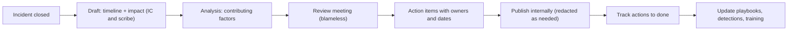
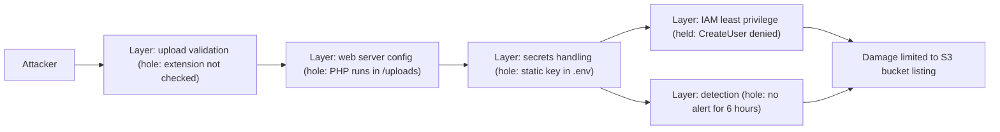

# Security Postmortems

## Introduction

The incident is over. Systems are clean, customers are notified, everyone is exhausted. This is exactly the moment many teams lose the most valuable thing an incident gives them: **lessons**. A **postmortem** (also called a post-incident review, incident retrospective or lessons-learned review) is a structured write-up and discussion of what happened, why, and what will change.

Aviation is the model here. Commercial flying became very safe partly because every accident and many near-misses are investigated, the findings are shared, and the system (aircraft design, checklists, training) is changed. Investigators focus on *why the system allowed the error*, not on punishing a pilot. Security postmortems borrow that mindset.

In NIST SP 800-61r3, lessons learned are not a final phase but a continuous **Improvement** activity (the `ID.IM` category of CSF 2.0) that feeds every other function. The postmortem is where most of those lessons get written down. This page covers:

- What blameless means, and why it produces better security
- When to hold a postmortem and who attends
- A practical security postmortem template
- Finding contributing factors, and the limits of "five whys"
- Security-specific concerns: confidentiality, legal privilege, sharing
- Measuring response with timestamps, and tracking action items to completion

## Blameless, Not Accountability-Free

Google's SRE book defines a blameless postmortem as one that focuses on identifying contributing causes **without indicting any individual or team**, and assumes everyone acted with good intentions based on the information they had. In its words: "You can't 'fix' people, but you can fix systems and processes."

Why this matters even more in security:

- **Fear hides incidents.** If clicking a phishing link gets someone disciplined, the next person who clicks will stay quiet, and you lose hours of response time.
- **Individual blame stops the analysis too early.** "Bob committed the key" ends the conversation. "Why could a key be committed, why did it have admin rights, and why did it take 6 hours to notice?" produces fixes.
- **Attackers target systems, not people's carelessness alone.** Good phishing fools careful people. The fix is phishing-resistant MFA, not "be more careful".

Blameless does not mean nobody is responsible. Action items have named owners and due dates. Deliberate malicious behavior by an insider is a different process (HR and legal), not a postmortem topic.

## When to Hold a Postmortem

Define triggers **in advance**, so nobody has to argue for one. Common security triggers:

- Any declared SEV1 or SEV2 incident
- Any confirmed unauthorized access to customer or regulated data
- Any incident requiring external notification (customers, regulators, law enforcement)
- A detection failure: the incident was found by a customer, researcher or attacker (ransom note) instead of by you
- A near-miss that *could* have been serious, such as a critical vulnerability found just before exploitation
- Anyone involved asks for one

Timing: hold the review meeting while memories are fresh, typically within one to two weeks of recovery. Start the draft during the incident; the scribe's timeline is the backbone.



## A Security Postmortem Template

Keep the template consistent so reviews are comparable over time and searchable later:

```markdown
# Postmortem: INC-2026-0142 Web shell on web01 and AWS key misuse

Status: Final | Severity: SEV1 | Incident commander: A. Rivera
Authors: A. Rivera, B. Chen | Review date: 2026-10-20
Distribution: Internal - security, engineering leads, legal

## Summary (3-5 sentences, readable by executives)
## Impact
- Customers / users affected, data types involved, duration, regulatory notifications made
## Timeline (UTC)
- Key events from first malicious activity to recovery, with sources
## Detection
- How we found out, how long it took, what should have caught it earlier
## Response
- What we did; what helped; what slowed us down
## Contributing factors
- Technical, process and organizational factors (not people)
## What went well
## What went poorly
## Where we got lucky
## Action items
| ID | Action | Type | Priority | Owner | Due | Ticket |
## Indicators of compromise (link to restricted appendix)
## MITRE ATT&CK techniques observed
```

Some sections deserve a word:

- **Where we got lucky** is the most honest section. "The attacker's `CreateUser` call failed only because the key happened to lack IAM permissions" tells you about a near-disaster you must not rely on.
- **Detection** is a separate section because detection gaps are usually the biggest improvement area. See [Detection Engineering](../11-sec-defensive-operations/2-sec-detection-engineering.mdx).
- **MITRE ATT&CK techniques** let you compare incidents and check detection coverage. See [MITRE ATT&CK](../11-sec-defensive-operations/3-sec-mitre-attack.mdx).

## Running the Review Meeting

The written draft collects facts; the meeting tests and deepens them. A 60-minute review for a serious incident often runs like this:

| Time | Activity | Tip |
| --- | --- | --- |
| 5 min | Facilitator restates the blameless ground rules | Pick a facilitator who was *not* the incident commander |
| 15 min | Walk the timeline; participants correct and add facts | Ask "what did you see at this point?" rather than "why did you do that?" |
| 20 min | Discuss contributing factors and what went well | Capture disagreements; they often point to unclear ownership |
| 15 min | Agree action items, owners and priorities | Owners must be present or explicitly accept later |
| 5 min | Decide distribution and follow-up date | Who gets the full report, who gets the redacted one |

Who attends: the incident commander, the main responders, owners of the affected systems, someone from detection or the SOC, and legal or privacy when data was involved. Leaders may attend, but they should listen more than talk, because a senior person asking "who approved this?" can quietly turn a blameless review into a blameful one.

:::tip Language matters
Replace "why didn't you..." with "what made it hard to...". Replace "human error" with the conditions that made the error likely: missing guardrails, confusing tooling, alert fatigue, time pressure. If a review concludes "human error" and nothing else, it has stopped too early.
:::

## Finding Contributing Factors

### Five Whys, and Its Limits

The "five whys" technique asks "why?" repeatedly to move from symptom to cause:

1. Why did the attacker get AWS access? *They read the `.env` file containing an access key.*
2. Why could they read it? *They ran commands through a web shell.*
3. Why could they run a web shell? *An uploaded `.php` file was executed by the server.*
4. Why was it executed? *Uploads are stored in the web root and PHP execution was not disabled there.*
5. Why? *The upload feature was built before the team had secure upload guidelines, and no review covered it.*

It is useful, but it tends to produce **one linear chain** with a single "root cause". Real incidents almost always have several independent factors that lined up. The **Swiss cheese model** describes this: each defense layer has holes, and an incident happens when holes in several layers align.



Ask about each layer: *why was there a hole here, and how do we close it?* That gives you several fixes instead of one. It also shows what worked: least privilege held, and should be recognized and kept.

### Ask Better Questions

Questions that tend to find systemic factors:

- What did the people involved know at the time, and what would they have needed to know?
- Which alerts fired? Which should have? Who saw them?
- What made this step slow? (Missing access, unclear ownership, waiting for approvals?)
- Has something similar happened before? Why did the previous fixes not prevent this?
- What would an attacker do differently next time, and would our fixes still help?

## Security-Specific Considerations

Security postmortems differ from ordinary reliability postmortems in a few ways:

| Concern | What to do |
| --- | --- |
| **Sensitive details** | Put IOCs, exploit details and unpatched weaknesses in a restricted appendix. Publish a redacted version more widely. |
| **Legal privilege** | In some jurisdictions, reports prepared at the direction of counsel may be protected. Ask legal *before* writing, not after. |
| **Personal data** | Do not paste customer data or employee names unnecessarily. Refer to roles. |
| **Regulators and customers** | External reports may be required (see [Compliance](../13-sec-governance/2-sec-compliance.mdx)). Keep internal and external versions consistent in facts. |
| **Insider cases** | If misconduct is suspected, follow HR and legal processes; do not run an open postmortem on a person. |
| **Sharing with peers** | Share IOCs through trusted channels such as an ISAC or threat intel platform. See [Threat Intelligence](../11-sec-defensive-operations/4-sec-threat-intelligence.mdx). |

Many companies also publish **public post-incident reports**. Done well, they build trust: a clear timeline, honest impact, and concrete changes. Done badly (vague, late, minimizing), they damage trust more than the incident itself.

## Measuring the Response

Timestamps from the incident log let you measure how the response went. Avoid treating these as team performance targets (that encourages gaming), but track trends across incidents:

```python
# incident_metrics.py: compute response metrics from key incident timestamps
from datetime import datetime

incident = {
    "id": "INC-2026-0142",
    "first_malicious_activity": "2026-10-11T03:01:02+00:00",   # from the timeline
    "detected":                 "2026-10-11T09:12:00+00:00",   # first alert or report
    "declared":                 "2026-10-11T09:15:00+00:00",
    "contained":                "2026-10-11T09:41:00+00:00",   # attacker access cut off
    "recovered":                "2026-10-12T16:30:00+00:00",   # normal service, clean state
}

t = {k: datetime.fromisoformat(v) for k, v in incident.items() if k != "id"}

def hours(a: str, b: str) -> str:
    return f"{(t[b] - t[a]).total_seconds() / 3600:6.1f} h"

print(incident["id"])
print("Dwell time before detection  ", hours("first_malicious_activity", "detected"))
print("Time to declare              ", hours("detected", "declared"))
print("Time to contain (from detect)", hours("detected", "contained"))
print("Time to recover (from detect)", hours("detected", "recovered"))
print("Attacker access window       ", hours("first_malicious_activity", "contained"))
```

Output:

```text
INC-2026-0142
Dwell time before detection      6.2 h
Time to declare                  0.1 h
Time to contain (from detect)    0.5 h
Time to recover (from detect)   31.3 h
Attacker access window           6.7 h
```

The numbers tell a clear story: once detected, the team responded fast (half an hour to contain), but the attacker had over six hours unnoticed first. The highest-value action items are therefore in **detection**, not in response speed. That is the kind of insight metrics are for.

Common names for these measures are MTTD (mean time to detect), MTTC (mean time to contain) and MTTR (mean time to respond or recover; definitions vary, so write down which one you mean).

## Action Items That Actually Get Done

A postmortem without completed actions is just a story. Good action items are:

- **Specific:** "Disable SSH password authentication on all servers via the baseline Ansible role", not "improve SSH security".
- **Owned** by a team or person, with a **due date** and a **ticket** in the normal backlog.
- **Balanced** across types: *prevent* (stop it happening), *detect* (catch it sooner), *mitigate* (limit damage).
- **Prioritized** honestly. Not everything is P1; if everything is, nothing is.

Keep them as data so you can check them automatically:

```yaml
# actions.yaml
incident: INC-2026-0142
actions:
  - id: A1
    title: Block executable extensions and store uploads outside the web root
    type: prevent
    priority: P1
    owner: web-team
    due: 2026-10-18
    status: done
  - id: A2
    title: Replace long-lived AWS keys on web servers with instance roles
    type: mitigate
    priority: P1
    owner: platform-team
    due: 2026-10-25
    status: in_progress
  - id: A3
    title: Alert on new .php files under /uploads
    type: detect
    priority: P2
    owner: secops
    due: 2026-10-20
    status: open
  - id: A4
    title: Disable SSH password authentication fleet-wide
    type: prevent
    priority: P1
    owner: ""
    due: 2026-10-15
    status: open
```

```python
# track_actions.py: flag postmortem action items that are overdue or unowned
import sys
from datetime import date
import yaml  # pip install pyyaml

def review(path: str, today: date) -> int:
    with open(path, encoding="utf-8") as f:
        data = yaml.safe_load(f)
    problems = 0
    print(f"Action items for {data['incident']} as of {today}:")
    for a in data["actions"]:
        flags = []
        if not a.get("owner"):
            flags.append("NO OWNER")
        if a["status"] != "done" and a["due"] < today:     # PyYAML parses dates
            flags.append(f"OVERDUE by {(today - a['due']).days}d")
        problems += bool(flags)
        print(f"  {a['id']} {a['priority']} {a['type']:8} {a['status']:11} "
              f"{a['title'][:52]:52} {' '.join(flags)}")
    by_type = {t: sum(a["type"] == t for a in data["actions"]) for t in ("prevent", "detect", "mitigate")}
    print("Coverage:", by_type)
    return problems

if __name__ == "__main__":
    sys.exit(1 if review(sys.argv[1], date.fromisoformat(sys.argv[2])) else 0)
```

```bash
python3 track_actions.py actions.yaml 2026-10-21; echo "exit code: $?"
```

Output:

```text
Action items for INC-2026-0142 as of 2026-10-21:
  A1 P1 prevent  done        Block executable extensions and store uploads outsid 
  A2 P1 mitigate in_progress Replace long-lived AWS keys on web servers with inst 
  A3 P2 detect   open        Alert on new .php files under /uploads               OVERDUE by 1d
  A4 P1 prevent  open        Disable SSH password authentication fleet-wide       NO OWNER OVERDUE by 6d
Coverage: {'prevent': 2, 'detect': 1, 'mitigate': 1}
```

Run it weekly in CI or a scheduled job and post the result to the security channel. A P1 with no owner that is six days overdue is exactly what slips through without a check. Notice also that only one action addresses detection, even though the metrics showed detection was the weakest area. That is a prompt to add more.

## Real-World Scenario

Your company (a 200-person fintech) had a SEV1: an engineer's laptop was infected through a malicious browser extension, which stole session cookies and gave an attacker access to the internal admin panel for 40 minutes. No customer funds moved, but the attacker viewed 1,100 customer profiles. The CEO asks whether the engineer should be disciplined, and the board wants a report in two weeks.

**Walkthrough:**

1. **Settle the blame question first.** The security lead explains that the extension was in the official store, had good reviews, and was allowed by policy. Disciplining the engineer would teach everyone to hide future mistakes. The CEO agrees to a blameless review.
2. **Involve legal before writing.** Counsel directs the investigation so the detailed report may be protected, and helps prepare the customer and regulator notifications separately.
3. **Hold the review** with the incident commander, responders, the IT team that manages laptops, the admin panel owners and the engineer (who volunteers the most useful details because they feel safe).
4. **Identify contributing factors** across layers: no browser extension allowlist; admin panel sessions not bound to device or protected by step-up authentication; admin panel reachable from any network; no alert on bulk profile viewing.
5. **Write two reports from one set of facts:** a detailed internal postmortem with IOCs in a restricted appendix, and a short board summary focused on impact, root causes and funded actions.
6. **Track actions** in the normal engineering backlog, with a monthly review until all P1s are done.

**Why this approach:** blamelessness got the honest details needed to find the real weaknesses. Legal involvement up front protected the company without hiding facts from the people who need them. Separate audiences got the right level of detail.

**When to use it / when not to:** use a full written postmortem for serious or externally visible incidents. For minor incidents, a short "mini-postmortem" (timeline, cause, one or two actions) is enough; a 10-page document for every phishing click wastes time and makes people avoid declaring incidents.

| Approach | Pros | Cons | Best for |
| --- | --- | --- | --- |
| Full blameless postmortem | Deep learning; finds systemic issues | Takes days of effort from several people | SEV1/SEV2, data exposure, detection failures |
| Lightweight review (one page) | Fast; keeps the habit alive | May miss deeper factors | SEV3/SEV4, near-misses |
| Formal RCA report for regulators or customers | Meets external obligations | Less candid; legal review slows it | Contractual or regulatory requirements |
| Public post-incident report | Builds trust; helps the community | Must be carefully redacted and reviewed | Customer-visible incidents |
| Third-party investigation report | Independent, expert, defensible | Expensive; less internal ownership | Major breaches, litigation, insurance |

## Common Mistakes

- **Naming and shaming.** It ends honest reporting. Write about roles and systems.
- **Stopping at one root cause.** Look for every layer that failed and every layer that held.
- **Action items without owners or dates.** They will not happen.
- **Only prevention actions.** Detection and mitigation actions often give more value, because you cannot prevent everything.
- **Publishing sensitive details widely.** Keep IOCs and unpatched weaknesses in a restricted appendix.
- **Writing it months later.** Memories fade and logs expire. Start the draft during the incident.
- **Never revisiting.** Review open actions regularly and look for patterns across postmortems.

## Summary

- A postmortem turns an incident into lasting improvements; in NIST SP 800-61r3 terms, it feeds continuous Improvement.
- Blameless means focusing on systems and processes, while still assigning owners to actions.
- Define triggers in advance, start the draft during the incident, and review within a couple of weeks.
- Use a consistent template, including "where we got lucky" and a separate detection section.
- Look beyond five whys: use the Swiss cheese view to find every layer with a hole.
- Handle security specifics: restricted appendices, legal privilege, personal data and external reporting.
- Measure dwell time and response times, and track action items until they are done.

## Further Learning

**Exercises**

1. Pick a public post-incident report from a well-known company and map it onto the template above. Which sections are missing?
2. Write a blameless postmortem for the leaked-key scenario in [Incident Response Lifecycle](./0-sec-incident-response-lifecycle.mdx), with at least one prevent, detect and mitigate action.
3. Extend `track_actions.py` to fail if there are zero `detect` actions for an incident with dwell time over 1 hour.
4. Rewrite these blameful sentences blamelessly: "Dave ignored the alert." "QA should have caught the bug."

**Related pages**

- [Incident Response Lifecycle](./0-sec-incident-response-lifecycle.mdx)
- [Investigating with Logs](./3-sec-log-analysis.mdx)
- [Risk Management](../13-sec-governance/0-sec-risk-management.mdx)
- [Project: Incident Response Tabletop Exercise](../14-sec-projects/6-sec-project-incident-simulation.mdx)

**Official sources**

- [Google SRE Book: Postmortem Culture](https://sre.google/sre-book/postmortem-culture/)
- [NIST SP 800-61 Rev. 3](https://csrc.nist.gov/pubs/sp/800/61/r3/final)
