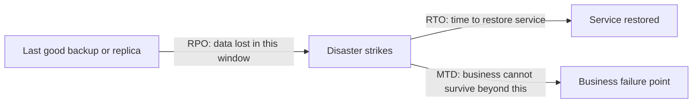
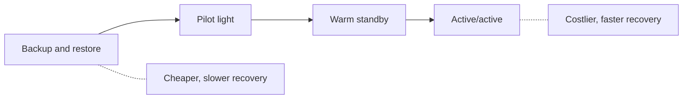
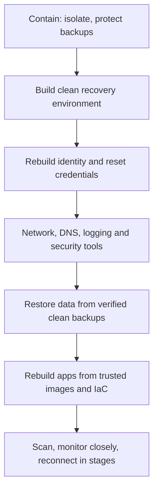

# Business Continuity and Disaster Recovery

## Introduction

Incident response asks "how do we stop the attack?". **Business continuity** asks a different question: "how does the business keep serving customers while things are broken, and how do we get everything back?". The cause might be ransomware, a cloud Region outage, a deleted production database, a fire, or a key supplier going down.

Think of a hospital during a power cut. Generators start within seconds for operating theaters and intensive care, while the cafeteria waits. Someone decided in advance which functions matter most, how long each can be down, and what the backup plan is. That decision, and the engineering that backs it, is business continuity and disaster recovery (BC/DR).

The terms:

- **Business Continuity Plan (BCP):** how the *organization* keeps critical functions running during a disruption, including people, processes, suppliers and workarounds (for example, taking orders by phone).
- **Disaster Recovery Plan (DRP):** how *IT systems and data* are restored after a disruption.
- **Incident Response Plan (IRP):** how security incidents are handled (see [Incident Response Lifecycle](./0-sec-incident-response-lifecycle.mdx)).

They overlap in a serious cyberattack: IR contains the attacker, DR restores systems, and BC keeps the business alive in between. NIST SP 800-34 Rev. 1, "Contingency Planning Guide for Federal Information Systems", describes these plan types and how they relate, and ISO 22301 is the international standard for business continuity management systems.

This page covers:

- Business impact analysis and the key objectives: RTO, RPO and MTD
- DR strategies and their cost-versus-speed trade-offs
- Backups that survive attackers
- Testing recovery, with a runnable restore test
- What makes **cyber recovery** different from recovering from a natural disaster

## Business Impact Analysis (BIA)

You cannot protect everything equally, so start by asking the business, not the engineers: **what hurts most, and how fast?** A BIA lists business processes and the systems behind them, then estimates the impact of losing each over time: lost revenue, contractual penalties, regulatory consequences, safety and reputation.

From the BIA come three numbers per system:

| Objective | Question | Example |
| --- | --- | --- |
| **RTO** (Recovery Time Objective) | How long can this be down before the impact is unacceptable? | Payments API: 1 hour |
| **RPO** (Recovery Point Objective) | How much data, measured in time, can we afford to lose? | Payments: 5 minutes of transactions |
| **MTD** (Maximum Tolerable Downtime) | After how long does the outage threaten the business itself? | Payments: 8 hours |

The RTO must be shorter than the MTD, leaving room for things to go wrong.



RPO looks *backward* from the disaster (how old is the newest good copy?). RTO looks *forward* (how long until we are running again?). Lower numbers cost more money: near-zero RPO needs continuous replication, and near-zero RTO needs a second running environment.

### A Simple BIA Helper

This script assigns recovery tiers from agreed objectives and checks whether what the systems actually do can meet them:

```python
# bia.py: turn business impact estimates into recovery tiers and check backups
from dataclasses import dataclass

@dataclass
class Service:
    name: str
    loss_per_hour: int          # estimated revenue or cost impact per hour down
    regulatory: bool            # outage or data loss triggers legal duties
    rto_hours: float            # max acceptable downtime agreed with the business
    rpo_minutes: int            # max acceptable data loss agreed with the business
    backup_every_minutes: int   # what the system actually does today
    last_restore_test_days: int

def tier(s: Service) -> str:
    if s.rto_hours <= 1 or (s.regulatory and s.rto_hours <= 4):
        return "Tier 0"
    if s.rto_hours <= 24:
        return "Tier 1"
    return "Tier 2"

def gaps(s: Service) -> list[str]:
    out = []
    if s.backup_every_minutes > s.rpo_minutes:
        out.append(f"backups every {s.backup_every_minutes}m cannot meet RPO {s.rpo_minutes}m")
    if s.last_restore_test_days > 90:
        out.append(f"restore last tested {s.last_restore_test_days}d ago")
    return out

services = [
    Service("payments-api", 20000, True, 1, 5, 5, 30),
    Service("customer-db", 15000, True, 4, 15, 1440, 200),
    Service("marketing-site", 300, False, 48, 1440, 1440, 400),
    Service("internal-wiki", 50, False, 72, 1440, 1440, 20),
]
for s in sorted(services, key=lambda s: s.rto_hours):
    issues = "; ".join(gaps(s)) or "OK"
    cost = s.loss_per_hour * s.rto_hours           # impact if recovery takes the full RTO
    print(f"{tier(s):6} {s.name:15} RTO {s.rto_hours:>3}h RPO {s.rpo_minutes:>5}m "
          f"impact@RTO ${cost:>7,.0f}  {issues}")
```

Output:

```text
Tier 0 payments-api    RTO   1h RPO     5m impact@RTO $ 20,000  OK
Tier 0 customer-db     RTO   4h RPO    15m impact@RTO $ 60,000  backups every 1440m cannot meet RPO 15m; restore last tested 200d ago
Tier 2 marketing-site  RTO  48h RPO  1440m impact@RTO $ 14,400  restore last tested 400d ago
Tier 2 internal-wiki   RTO  72h RPO  1440m impact@RTO $  3,600  OK
```

The dollar figures are made-up inputs; your finance team supplies real ones. The useful output is the gap list: `customer-db` is promised a 15-minute RPO but only gets a nightly backup, and nobody has tested restoring it for 200 days. That is a finding for the risk register (see [Risk Management](../13-sec-governance/0-sec-risk-management.mdx)).

## Disaster Recovery Strategies

The AWS whitepaper "Disaster Recovery of Workloads on AWS" describes four strategies that apply to any cloud or data center. They trade cost and complexity against recovery speed:

| Strategy | What runs in the recovery site | RPO / RTO | Cost and complexity |
| --- | --- | --- | --- |
| **Backup and restore** | Nothing; only backups (plus infrastructure as code to rebuild) | Hours | Lowest |
| **Pilot light** | Data replicated continuously; core infrastructure provisioned; app servers off | Minutes of data loss; tens of minutes to recover | Low to medium |
| **Warm standby** | Scaled-down but fully working copy, able to take traffic immediately | Minutes | Medium to high |
| **Multi-site active/active** | Full production in two or more sites, all serving traffic | Near zero for site loss | Highest |

AWS also notes the difference between pilot light and warm standby: pilot light cannot serve requests without first switching on more resources, while warm standby can handle traffic immediately at reduced capacity.



Two points from the same guidance are easy to miss:

- **Infrastructure as code is part of your backup.** Restoring data is useless if rebuilding the servers, networks and permissions around it takes days of manual clicking. See [Infrastructure as Code Security](../8-sec-cloud-and-container/6-sec-infrastructure-as-code-security.mdx).
- **Replication is not backup.** Continuous replication copies corruption and malicious deletion to the replica within seconds. Even active/active designs need point-in-time backups to recover from a *data* disaster, and in that case the recovery point is always before the corruption began.

### Deciding to Fail Over

Failing over is itself risky: it can lose the last few minutes of data, and failing back later takes work. AWS's guidance notes that automatically triggered failover should be used with caution, because a false alarm means you pay those costs for nothing; many teams therefore **automate the failover steps but keep a human decision to start them**. Write the decision rule down before you need it:

- **Who decides?** Usually the incident commander with the service owner, not whoever is awake.
- **On what evidence?** For example, "the primary Region has been unavailable for 20 minutes and the provider's status page does not give a recovery estimate."
- **What is the cost?** State the expected data loss (the replication lag at that moment) so the decision is informed.
- **How do we fail back?** Plan the return trip too, including data reconciliation.

For a cyberattack, the question changes: failing over to a replica that the attacker can also reach, or that already contains their changes, solves nothing. That is why the next sections matter.

## Backups That Survive an Attacker

Modern ransomware operators look for backups and destroy them before encrypting production. A backup design for the cyber era adds attacker-resistance to the classic rules:

- **3-2-1:** at least three copies of data, on two different types of storage, with one copy offsite. A common extension, often written **3-2-1-1-0**, adds one copy that is offline or immutable and zero errors in restore verification.
- **Immutability:** write-once storage that even an administrator cannot delete before retention expires, such as S3 Object Lock in compliance mode or equivalent features in other clouds and backup products.
- **Separate credentials and accounts:** production admins, and therefore an attacker who compromises them, should not be able to delete backups. Use a separate backup account or vault with its own access controls and MFA.
- **Backup the things you need to rebuild:** identity configuration, DNS zones, secrets and keys (securely), IaC repositories and CI/CD configuration, not just databases.
- **Monitor the backups:** alert on failed jobs, retention changes, deletion attempts and unusual data change rates.

The [Backups and Ransomware Resilience](../9-sec-system-hardening/6-sec-backups-and-ransomware.mdx) page shows these controls in configuration detail.

## Test Recovery, Do Not Assume It

A backup you have never restored is a hope, not a plan. A restore test should answer three questions: **does it restore, is the data correct, and how long did it take?** Here is a self-contained example using SQLite's online backup API, which you can run anywhere:

```python
# restore_test.py: back up a database, restore it elsewhere, and verify it
import sqlite3
import time
from datetime import datetime, timezone
from pathlib import Path

RTO_SECONDS = 5          # toy target for this demo
work = Path("drtest"); work.mkdir(exist_ok=True)
prod, backup, restored = work / "prod.db", work / "backup.db", work / "restored.db"
for p in (prod, backup, restored):
    p.unlink(missing_ok=True)

# 1. "Production" database with some orders
db = sqlite3.connect(prod)
db.execute("CREATE TABLE orders (id INTEGER PRIMARY KEY, total REAL, created TEXT)")
db.executemany("INSERT INTO orders (total, created) VALUES (?, ?)",
               [(i * 1.5, datetime.now(timezone.utc).isoformat()) for i in range(10_000)])
db.commit()

# 2. Take a consistent online backup (safe while the database is in use)
with sqlite3.connect(backup) as dst:
    db.backup(dst)
backup_time = datetime.now(timezone.utc)

# 3. Writes keep happening after the backup: these are lost if we restore now
db.executemany("INSERT INTO orders (total, created) VALUES (?, ?)", [(9.99, "late")] * 42)
db.commit()

# 4. Disaster: restore the backup to a NEW location and time it
start = time.monotonic()
with sqlite3.connect(backup) as src, sqlite3.connect(restored) as dst:
    src.backup(dst)
elapsed = time.monotonic() - start

# 5. Verify, do not assume: integrity check plus business-level checks
r = sqlite3.connect(restored)
integrity = r.execute("PRAGMA integrity_check").fetchone()[0]
restored_rows = r.execute("SELECT COUNT(*) FROM orders").fetchone()[0]
prod_rows = db.execute("SELECT COUNT(*) FROM orders").fetchone()[0]

print(f"integrity_check : {integrity}")
print(f"rows restored   : {restored_rows} (production had {prod_rows})")
print(f"data lost (RPO) : {prod_rows - restored_rows} orders written after {backup_time:%H:%M:%S} UTC")
print(f"restore time    : {elapsed:.3f}s -> {'meets' if elapsed <= RTO_SECONDS else 'MISSES'} RTO of {RTO_SECONDS}s")
```

Example output:

```text
integrity_check : ok
rows restored   : 10000 (production had 10042)
data lost (RPO) : 42 orders written after 11:13:15 UTC
restore time    : 0.000s -> meets RTO of 5s
```

The same pattern scales to real systems: restore a PostgreSQL dump or a cloud database snapshot into an isolated environment on a schedule, run integrity and business checks (row counts, latest order date, a few known records), record the elapsed time, and alert if any check fails or the time exceeds the RTO. Remember that real RTO includes more than the data copy: detecting the problem, deciding to fail over, rebuilding infrastructure, warming caches and switching DNS.

### Ways to Exercise DR Plans

| Exercise | What happens | Disruption | Confidence gained |
| --- | --- | --- | --- |
| Checklist review | Owners read the plan and update contacts and steps | None | Low |
| Tabletop | Walk through a scenario verbally | None | Medium (finds gaps in decisions and roles) |
| Restore test | Restore real backups to an isolated environment | None | High for data |
| Simulation / game day | Fail over a component or Region in a controlled way | Low to medium | High |
| Full interruption test | Shut the primary site and run on the recovery site | High | Highest, with the most risk |

Teams that practice **chaos engineering** inject failures continuously in a controlled way, which keeps recovery muscles in shape. Start small: restore tests first, game days later.

## Cyber Recovery Is Different

Recovering from a ransomware attack or a destructive intrusion is harder than recovering from a flood:

- **The backups may be compromised.** The attacker may have been inside for weeks, so recent backups may contain their backdoors. You may need to restore data from a backup but rebuild systems from known-good images.
- **Identity comes first.** If the attacker controlled Active Directory or your cloud identity provider, nothing restored is safe until identity is rebuilt and all credentials are reset.
- **You need a clean environment.** Many organizations plan a **clean room** or isolated recovery environment, a separate network or cloud account where systems are rebuilt and scanned before reconnecting.
- **Recovery order matters.** Identity, then networking and DNS, then security tooling and logging, then core data stores, then applications. Write the dependency order down in advance.
- **Investigation and recovery run in parallel.** Forensics (see [Digital Forensics Basics](./2-sec-digital-forensics.mdx)) needs evidence preserved while the business needs systems back. Plan who owns which.
- **Communication tools may be down.** Email and chat may be encrypted or untrusted. Keep an out-of-band contact list and channel.



NIST CSF 2.0's **Recover** function covers this explicitly, including verifying the integrity of backups before using them for restoration, and communicating recovery progress to stakeholders.

## What Goes in a Business Continuity Plan

Technology recovery is only part of continuity. A practical BCP for a small or medium company fits in a short document plus appendices, and covers:

| Section | Contents | Example |
| --- | --- | --- |
| Scope and activation | Which events trigger the plan, who can activate it | "Any outage of a Tier 0 service over 30 minutes, activated by the on-call IC or any director" |
| Roles and contacts | Crisis team, deputies, out-of-band phone list | Printed copy and a copy in a personal password manager |
| Critical processes | The BIA results: what must keep running, in what order | Take bookings, answer support, pay staff |
| Workarounds | Manual or degraded ways to keep working | Accept bookings by phone into a spreadsheet; reconcile later |
| Communication | Templates and channels for staff, customers, regulators, media | Status page hosted outside your main infrastructure |
| Suppliers | Critical vendors, their SLAs, alternatives | Second payment provider configured but disabled |
| People | Remote work, key-person dependencies, cross-training | Two people can run each recovery runbook |
| Recovery | Links to DR plans per system | Pilot light failover runbook for bookings |
| Return to normal | How to reconcile data and stand down | Re-enter manual bookings; postmortem within two weeks |

Two items are often forgotten. **Key-person risk**: if only one engineer knows how to restore the database, your RTO depends on their vacation schedule. **Third-party dependencies**: your SaaS identity provider, payment processor, email service or CDN can fail too, and their outages become yours. List them in the BIA and decide in advance what you do when each is down.

:::note Standards and certification
ISO 22301 specifies requirements for a business continuity management system and can be certified, much like ISO 27001 for information security. Many customer security questionnaires ask whether you have a tested BCP and DRP, and frameworks such as SOC 2 include availability criteria. Check the current editions of these standards before planning an audit, since they are periodically revised.
:::

## Real-World Scenario

You are the platform lead at an online booking SaaS running in a single AWS Region. The business says: "Bookings must not be down for more than 2 hours, and we cannot lose more than 15 minutes of bookings." Today you take nightly RDS snapshots in the same account. The CFO asks why a quote for "active/active in two Regions" doubles the infrastructure bill.

**Walkthrough:**

1. **Run the BIA.** Bookings (RTO 2h, RPO 15m) is Tier 0. Reporting (RTO 3 days) and the marketing site (RTO 2 days) are Tier 2.
2. **Close the RPO gap.** Enable point-in-time recovery for the database, which uses continuous transaction log backups and typically gives an RPO of minutes. Copy snapshots to a second Region **and** a separate backup account with immutable retention.
3. **Choose pilot light for bookings.** Replicate the database to a second Region, keep core networking and IaC ready, and scale app servers up only during failover. Practice it twice a year.
4. **Keep backup and restore for Tier 2.** Rebuild from IaC and backups within a day or two is fine.
5. **Plan for cyber, not just Region failure.** The immutable backup account and a documented clean-rebuild order are what save you from ransomware; a second Region alone would replicate the encryption.
6. **Test.** Quarterly restore tests in an isolated account measure real RTO; one game day per year fails bookings over to the second Region.

**Why this approach:** pilot light meets a 2-hour RTO and 15-minute RPO at a fraction of active/active's cost. Active/active would be justified only if the business needed near-zero downtime, which the BIA did not show.

**When to use it / when not to:** match the strategy to each system's tier. Do not buy active/active for everything because it sounds safest; do not leave a Tier 0 system on nightly same-account backups because it is cheap.

| Approach | Pros | Cons | Best for |
| --- | --- | --- | --- |
| Backup and restore (same Region, separate account) | Cheap; protects against deletion and ransomware | Slow recovery (hours to days); no Region protection | Tier 2 systems; everything as a baseline |
| Cross-Region backup copies | Survives Region loss; still cheap | Restore time still hours | Tier 1 systems |
| Pilot light | Minutes of RPO, modest cost | Failover needs practice; scale-up takes time | Tier 0 with RTO of an hour or more |
| Warm standby | Faster failover; can serve immediately | Pays for always-on capacity | Tier 0 with tight RTO |
| Multi-site active/active | Near-zero downtime for site loss | Highest cost; complex data consistency; still needs backups | Global, revenue-critical systems |
| Immutable, isolated backups | Survives attackers with admin access | Retention cost; deletion is deliberately hard | Every organization facing ransomware risk |

## Common Mistakes

- **Treating replication as backup.** Replicas copy deletions and encryption instantly.
- **Backups reachable with production credentials.** An attacker with admin access deletes them first.
- **Never testing restores.** Untested backups fail at the worst time: wrong format, missing keys, corrupted files.
- **Forgetting dependencies.** The app restores fine, but DNS, the identity provider or a secrets store it needs was not in the plan.
- **RTO set by engineers, not the business.** Objectives must come from business impact, and be funded accordingly.
- **Plans stored only on systems that fail.** Keep printed or offline copies and contact lists.
- **Ignoring people and suppliers.** BC also covers who can work, from where, and what happens if a key vendor is down.
- **Encryption keys stored only in production.** Backups encrypted with a key that lived in the destroyed environment cannot be restored. Back up keys separately and securely (see [Key Management](../1-sec-cryptography/8-sec-key-management.mdx)).
- **Restoring malware with the data.** After a cyberattack, scan restored data and rebuild systems from trusted images rather than restoring whole compromised servers.
- **Plans that drift from reality.** Architecture changes every sprint; review DR plans after major changes, not just once a year.

## Best Practices

- Tie every system to a tier from the BIA, and make the tier visible in your service catalog.
- Automate recovery steps as code, and keep a human decision to trigger failover.
- Store backups in a separate account with immutability and separate credentials.
- Schedule restore tests and record real recovery times; treat a failed test like an incident.
- Rehearse cyber recovery specifically, including rebuilding identity, not just Region failover.
- Keep plans, contacts and runbooks available offline.

## Summary

- BCP keeps the business running, DRP restores IT, and IRP handles the attack. They work together in a serious incident.
- A business impact analysis sets RTO, RPO and MTD for each system, and those objectives drive cost.
- DR strategies range from backup-and-restore to pilot light, warm standby and active/active, each trading cost for speed.
- Replication is not backup. Keep immutable, isolated backups that production credentials cannot delete.
- Test restores regularly and measure real recovery times against the RTO.
- Cyber recovery needs clean environments, identity-first rebuilding and verified backups.

## Further Learning

**Exercises**

1. Add three services from a project you know to `bia.py`. Which ones have gaps between promised and actual RPO?
2. Modify `restore_test.py` to also check that the newest restored order is not older than the RPO, and fail if it is.
3. Write the recovery order for a small company whose Microsoft 365 tenant, AWS account and laptops were all affected by ransomware. What must come first, and why?
4. Run a 30-minute tabletop: "Our primary cloud Region is unavailable for 12 hours." Who decides to fail over, and what information do they need?

**Related pages**

- [Backups and Ransomware Resilience](../9-sec-system-hardening/6-sec-backups-and-ransomware.mdx)
- [Incident Response Playbooks](./1-sec-incident-playbooks.mdx)
- [The Shared Responsibility Model](../8-sec-cloud-and-container/0-sec-cloud-shared-responsibility.mdx)
- [Security Frameworks: NIST CSF, ISO 27001 and CIS Controls](../13-sec-governance/1-sec-security-frameworks.mdx)
- [Project: Incident Response Tabletop Exercise](../14-sec-projects/6-sec-project-incident-simulation.mdx)

**Official sources**

- [NIST SP 800-34 Rev. 1: Contingency Planning Guide for Federal Information Systems](https://csrc.nist.gov/pubs/sp/800/34/r1/upd1/final)
- [AWS: Disaster Recovery of Workloads on AWS](https://docs.aws.amazon.com/whitepapers/latest/disaster-recovery-workloads-on-aws/disaster-recovery-options-in-the-cloud.html)
- [CISA #StopRansomware Guide](https://www.cisa.gov/stopransomware/ransomware-guide)
