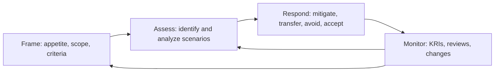
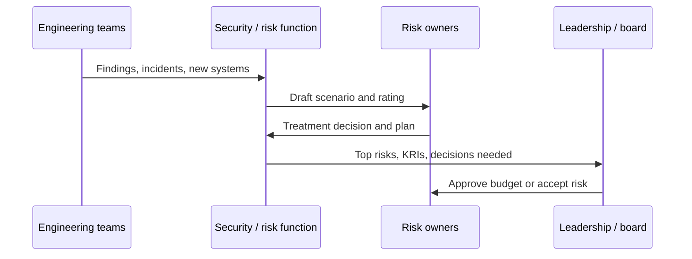

# Risk Management

## Introduction

Every security team has more work than people. There are always more findings, more vendor questionnaires, more "should we buy this tool?" questions and more requests for exceptions than anyone can handle. **Risk management** is the discipline that decides what to do first, what to do later, and what not to do at all, and makes those decisions in a way that leadership can understand and sign off on.

The page [Threats, Vulnerabilities and Risk](../0-sec-fundamentals/2-sec-threats-vulnerabilities-risk.mdx) introduced the vocabulary: likelihood, impact, a simple risk register, and the four treatment options (mitigate, transfer, avoid, accept). This page turns those building blocks into a **repeatable program**:

- How to agree on how much risk the business is willing to take (**risk appetite**).
- How to describe risks as **scenarios** that non-engineers understand.
- How to move from 1-to-5 ratings to **money estimates** when a big decision needs it.
- How to handle **risk acceptance and exceptions** so they do not quietly become permanent.
- How to **monitor** risk and report it upward.

A helpful analogy is a household budget. You cannot prevent every bad thing (a burst pipe, a car accident, a lost job), but you can decide which ones you insure against, which ones you save an emergency fund for, and which ones you simply live with. You also review the plan when your life changes. A security risk program does the same for an organization.

## The Risk Management Lifecycle

Several standards describe the same basic loop with slightly different words:

- **NIST SP 800-39** (Managing Information Security Risk) uses four steps: **frame, assess, respond, monitor**.
- **NIST SP 800-30 Rev. 1** explains how to carry out the *assess* step.
- **ISO 31000** is the general-purpose risk management standard used across all industries.
- **ISO/IEC 27005** applies ISO 31000 ideas to information security, and supports an ISO/IEC 27001 management system.
- **NIST CSF 2.0** puts risk management strategy under its **Govern** function (category `GV.RM`). See [Security Frameworks](./1-sec-security-frameworks.mdx).

This page follows the NIST four-step loop because it is short and easy to remember.



The loop never ends. New systems, new vendors, new threats and new regulations all feed back into it.

## Step 1: Frame the Risk

Before you rate a single risk, agree on the rules. Without this step, one engineer's "high" is another engineer's "medium" and every discussion turns into an argument about numbers.

### Risk appetite and tolerance

- **Risk appetite** is a broad statement of how much risk leadership is willing to pursue or keep to reach its goals. It is set by executives or the board, not by the security team.
- **Risk tolerance** turns appetite into measurable limits for specific areas.

Example statements for a small SaaS company:

| Area | Appetite statement | Tolerance (measurable) |
| --- | --- | --- |
| Customer data | Very low appetite for loss of customer data | No known high risk to customer data stays open more than 30 days |
| Availability | Moderate appetite; brief outages are acceptable | Unplanned downtime under 4 hours per quarter |
| Innovation | High appetite for trying new tools | New SaaS tools allowed after a 1-page vendor review |
| Compliance | Very low appetite for regulatory breaches | Zero overdue audit findings |

Notice that appetite differs by area. A company can be bold about new tools and very cautious about customer data at the same time.

### Calibrated rating criteria

A 1-to-5 scale only works if everyone reads it the same way. Write down what each level means in business terms:

| Level | Likelihood (in the next 12 months) | Impact |
| --- | --- | --- |
| 1 Very low | Less than 5% chance | Minor inconvenience, no customer effect |
| 2 Low | 5% to 20% | Internal disruption under 1 day |
| 3 Medium | 20% to 50% | Some customers affected, small direct cost |
| 4 High | 50% to 80% | Many customers affected, regulator notification possible |
| 5 Very high | More than 80% | Major breach, large fines, long outage, press coverage |

These thresholds are examples. Pick numbers that suit your organization's size, and write them in your risk methodology so assessments stay consistent from year to year.

### Scope and roles

Framing also answers who does what:

- **Risk owner**: the person who is accountable for a risk and has the authority and budget to treat it. Usually a business or engineering leader, not the security team.
- **Control owner**: the person who runs a specific safeguard, such as the team that operates the SSO system.
- **Security / risk function**: facilitates assessments, challenges ratings, and keeps the register healthy.

:::tip
If the security team "owns" every risk, nobody with a budget feels responsible. Assign risks to the leaders whose systems or processes create them.
:::

## Step 2: Assess the Risk

### Write risks as scenarios

A good risk statement tells a short story: **who** could do **what** to **which asset**, **how**, and **what happens** to the business. Compare:

- Weak: "Phishing."
- Strong: "An external attacker phishes a support agent's credentials and uses the admin console, which has no MFA, to export customer records, leading to breach notification costs and customer churn."

The strong version points directly at controls (MFA on the admin console, export limits, phishing-resistant login) and at the impact (notification, churn).

### Asset-based or scenario-based?

| Method | How it works | Good for |
| --- | --- | --- |
| Asset-based | List assets, then the threats and vulnerabilities for each | Building inventories, ISO/IEC 27001 programs |
| Scenario-based | Start from realistic attack or failure stories | Leadership discussions, quantitative analysis |
| Threat-model driven | Derive risks from design reviews, such as [STRIDE](../6-sec-appsec-and-devsecops/1-sec-threat-modeling.mdx) | New products and features |

Most mature programs combine them: asset inventories keep coverage complete, and scenarios make the top risks understandable.

### A risk register as code

Many teams keep the register in a spreadsheet or a GRC (governance, risk and compliance) tool. Keeping it as YAML in a Git repository is a lightweight alternative: every change is reviewed, history is free, and scripts can check it.

```yaml
# risks.yaml
- id: R-001
  scenario: >
    Attacker phishes a support agent and uses the admin console (no MFA)
    to export customer records.
  owner: head-of-support
  likelihood: 4
  impact: 5
  treatment: mitigate
  actions: ["Enforce SSO with phishing-resistant MFA on admin console", "Rate-limit exports"]
  review_by: 2026-12-31
- id: R-002
  scenario: >
    Ransomware encrypts the build servers and the only backups are on the same network.
  owner: vp-engineering
  likelihood: 2
  impact: 4
  treatment: mitigate
  actions: ["Immutable offsite backups", "Quarterly restore test"]
  review_by: 2026-11-15
- id: R-003
  scenario: >
    Marketing site defaced through an outdated CMS plugin.
  owner: head-of-marketing
  likelihood: 3
  impact: 2
  treatment: accept
  actions: []
  review_by: 2026-09-30
```

A short script validates the register, prints a text heat map, and flags risks that are overdue for review or above appetite:

```python
# check_register.py
import datetime as dt
import yaml  # pip install pyyaml

APPETITE_MAX_SCORE = 12          # agreed with leadership: scores above this need action
TODAY = dt.date(2026, 10, 11)    # fixed date so the output is reproducible

with open("risks.yaml") as f:
    risks = yaml.safe_load(f)

grid = {(l, i): [] for l in range(1, 6) for i in range(1, 6)}
problems = []

for r in risks:
    score = r["likelihood"] * r["impact"]
    grid[(r["likelihood"], r["impact"])].append(r["id"])
    if r["review_by"] < TODAY:
        problems.append(f"{r['id']}: review overdue since {r['review_by']}")
    if score > APPETITE_MAX_SCORE and r["treatment"] == "accept":
        problems.append(f"{r['id']}: score {score} is above appetite but marked 'accept'")
    if r["treatment"] == "mitigate" and not r["actions"]:
        problems.append(f"{r['id']}: 'mitigate' with no actions")

print("Impact ->   1      2      3      4      5")
for l in range(5, 0, -1):
    row = [",".join(grid[(l, i)]) or "." for i in range(1, 6)]
    print(f"L={l}     " + " ".join(f"{c:6}" for c in row))

print("\nProblems:")
for p in problems or ["none"]:
    print(" -", p)
```

Example output:

```text
Impact ->   1      2      3      4      5
L=5     .      .      .      .      .
L=4     .      .      .      .      R-001
L=3     .      R-003  .      .      .
L=2     .      .      .      R-002  .
L=1     .      .      .      .      .

Problems:
 - R-003: review overdue since 2026-09-30
```

YAML parses unquoted ISO dates into `datetime.date` objects, which is why the comparison with `TODAY` works. Run this check in CI so a pull request that breaks the rules fails, just like a failing unit test.

## From Ratings to Money: Quantitative Risk

Qualitative ratings are fast and good for ranking, but they cannot answer questions like "Is a 200,000 dollar project worth it?" For big decisions, estimate losses in money.

### The classic formulas

The traditional quantitative model uses three quantities:

- **Single Loss Expectancy (SLE)** = asset value x exposure factor (the fraction of value lost in one event).
- **Annualized Rate of Occurrence (ARO)** = how many times per year the event is expected.
- **Annualized Loss Expectancy (ALE)** = SLE x ARO.

Example: a laptop with customer data is lost. Cleanup, notification and legal costs per event are estimated at 40,000 dollars (SLE). The company expects about 0.5 such events per year (one every two years). ALE = 40,000 x 0.5 = 20,000 dollars per year. Full-disk encryption that costs 3,000 dollars per year and cuts the cost of a lost laptop by 90% is clearly worth it.

The weakness of ALE is that it hides uncertainty. Nobody knows that the event happens exactly 0.5 times per year.

### FAIR and ranges

**FAIR** (Factor Analysis of Information Risk), maintained by the FAIR Institute and published as an Open Group standard, breaks risk into **loss event frequency** and **loss magnitude**, and asks analysts for **ranges** (minimum, most likely, maximum) instead of single numbers. A Monte Carlo simulation then turns those ranges into a distribution of possible annual losses.

You do not need a commercial tool to understand the idea. Here is a minimal simulation using only the Python standard library:

```python
# monte_carlo_risk.py
import math
import random
import statistics

random.seed(7)  # reproducible output
YEARS = 20_000

def poisson(lam: float) -> int:
    """Number of events in one year for an average rate lam (Knuth's method)."""
    limit, k, p = math.exp(-lam), 0, 1.0
    while True:
        p *= random.random()
        if p < limit:
            return k
        k += 1

def simulate(freq_min, freq_mode, freq_max, loss_min, loss_mode, loss_max):
    annual = []
    for _ in range(YEARS):
        rate = random.triangular(freq_min, freq_max, freq_mode)
        events = poisson(rate)
        total = sum(random.triangular(loss_min, loss_max, loss_mode) for _ in range(events))
        annual.append(total)
    annual.sort()
    return {
        "mean": statistics.fmean(annual),
        "p90": annual[int(0.90 * YEARS)],
        "p99": annual[int(0.99 * YEARS)],
        "chance_any_loss": sum(1 for a in annual if a > 0) / YEARS,
    }

# Scenario: credential-stuffing account takeover of the admin console.
# Estimates come from workshops with support, engineering and finance.
before = simulate(0.2, 0.6, 1.5, 50_000, 250_000, 1_500_000)   # no MFA
after = simulate(0.02, 0.05, 0.2, 50_000, 250_000, 1_500_000)  # phishing-resistant MFA

for name, r in [("Before MFA", before), ("After MFA", after)]:
    print(f"{name:11} mean={r['mean']:>10,.0f}  p90={r['p90']:>10,.0f}  "
          f"p99={r['p99']:>10,.0f}  P(loss)={r['chance_any_loss']:.0%}")

print(f"Expected annual reduction: {before['mean'] - after['mean']:,.0f}")
```

Example output (your numbers vary slightly with Python version, since this is a random simulation):

```text
Before MFA  mean=   455,303  p90= 1,298,795  p99= 2,483,916  P(loss)=51%
After MFA   mean=    54,015  p90=         0  p99= 1,099,884  P(loss)=9%
Expected annual reduction: 401,288
```

How to read this:

- The **mean** is comparable to ALE.
- **p90** and **p99** describe bad years: "in 1 year out of 10, losses could exceed about 1.3 million."
- If the MFA rollout costs far less per year than the expected reduction, it is easy to justify.

:::caution
The output is only as good as the inputs. Document where every range came from (incident history, industry reports, expert workshops) and treat results as decision support, not as precise forecasts. A falsely precise number like "455,303 dollars" should be rounded when you present it ("roughly 450k").
:::

### Which method when?

| Method | Effort | Strength | Weakness |
| --- | --- | --- | --- |
| Qualitative (1 to 5) | Low | Fast ranking, easy to explain | Not additive, ratings drift between people |
| Semi-quantitative (calibrated bands) | Medium | Consistent, still quick | Still cannot compare against costs |
| ALE | Medium | Simple money figure | Hides uncertainty |
| FAIR-style Monte Carlo | High | Ranges, tail risk, cost-benefit | Needs data and trained analysts |

A common pattern: rate everything qualitatively, then run a quantitative analysis only for the top five risks or for large investment decisions.

## Step 3: Respond to the Risk

The four treatment options are covered on the [fundamentals page](../0-sec-fundamentals/2-sec-threats-vulnerabilities-risk.mdx). At the program level, the hard part is **acceptance**, because accepted risks tend to be forgotten.

### Exceptions with an expiry date

A **security exception** is a documented, time-limited acceptance of a gap against a policy or standard. For example: "Service X may use TLS 1.1 to talk to a legacy partner until the partner upgrades."

Every exception should record:

1. What policy requirement is not met, and why.
2. Compensating controls (for example, the partner link only accepts traffic from one IP).
3. The risk owner who accepts it, with the right level of authority for the rating.
4. An **expiry date**, after which the exception must be renewed or closed.

```python
# exceptions_check.py
import datetime as dt

TODAY = dt.date(2026, 10, 11)
# Who may accept which rating. Higher risks need more senior approval.
APPROVAL_LEVEL = {"LOW": "team-lead", "MEDIUM": "director", "HIGH": "cto"}
RANK = {"team-lead": 1, "director": 2, "cto": 3}

exceptions = [
    {"id": "EX-12", "rating": "MEDIUM", "approved_by_role": "director",
     "expires": dt.date(2027, 1, 31), "compensating": "IP allowlist on partner link"},
    {"id": "EX-15", "rating": "HIGH", "approved_by_role": "team-lead",
     "expires": dt.date(2026, 12, 1), "compensating": ""},
    {"id": "EX-09", "rating": "LOW", "approved_by_role": "team-lead",
     "expires": dt.date(2026, 8, 1), "compensating": "Monitoring alert"},
]

for ex in exceptions:
    issues = []
    needed = APPROVAL_LEVEL[ex["rating"]]
    if RANK[ex["approved_by_role"]] < RANK[needed]:
        issues.append(f"needs approval by {needed}")
    if ex["expires"] < TODAY:
        issues.append("expired")
    elif (ex["expires"] - TODAY).days <= 30:
        issues.append("expires within 30 days")
    if not ex["compensating"]:
        issues.append("no compensating control")
    print(f"{ex['id']}: {'OK' if not issues else '; '.join(issues)}")
```

Output:

```text
EX-12: OK
EX-15: needs approval by cto; no compensating control
EX-09: expired
```

### Transfer: cyber insurance and contracts

Cyber insurance can pay for incident response, legal costs and some business interruption. Insurers increasingly ask about specific controls before they will offer cover, often things like MFA, EDR, offline backups and patching practice. The exact questions vary by insurer and change over time, so read the application carefully and answer truthfully: a wrong answer can put a claim at risk.

Contracts transfer risk too. Your payment processor, cloud provider and key vendors take on parts of the risk through their terms, while the [shared responsibility model](../8-sec-cloud-and-container/0-sec-cloud-shared-responsibility.mdx) reminds you that some of it always stays with you.

## Step 4: Monitor the Risk

### Key risk indicators

A **key risk indicator (KRI)** is a metric that warns you when a risk is growing. It is different from a performance metric. "Number of trainings delivered" measures activity. "Percentage of admin accounts without phishing-resistant MFA" measures risk.

| Risk | KRI | Threshold |
| --- | --- | --- |
| Account takeover | % admin accounts without phishing-resistant MFA | Above 0% |
| Unpatched exposure | Internet-facing hosts with a KEV-listed vulnerability older than 14 days | Above 0 |
| Data loss | Storage buckets with public access not on the approved list | Above 0 |
| Vendor risk | Critical vendors without a review in 12 months | Above 2 |
| Recovery | Days since last successful restore test | Above 90 |

### Third-party risk

Many breaches start at a supplier. A basic vendor risk process:

1. **Tier vendors** by the data and access they get (critical, high, low).
2. **Collect evidence** proportional to the tier: a SOC 2 report or ISO/IEC 27001 certificate for critical vendors, a short questionnaire for low tiers. See [Compliance](./2-sec-compliance.mdx).
3. **Contract** for breach notification, right to audit, and data deletion at exit.
4. **Review** critical vendors yearly and when something changes, such as a breach or an acquisition.

NIST CSF 2.0 now has a whole category for this, `GV.SC` (cybersecurity supply chain risk management).

### Reporting upward

Leaders do not want a list of CVEs. A one-page risk report usually contains:

- The top five to ten risks in scenario language, with trend arrows (up, down, stable).
- Which risks are above appetite and what decision is needed.
- KRIs that crossed thresholds.
- Exceptions expiring soon.



## Real-World Scenario

**Your company** is a 120-person B2B SaaS business. The CEO asks the security lead: "We have budget for one big security project next year, about 150,000 dollars all-in. Should it be an EDR rollout for all laptops and servers, or replacing passwords plus SMS codes with SSO and phishing-resistant MFA (passkeys or security keys) everywhere?"

### Walking through it

1. **Frame.** Leadership confirms a very low appetite for customer data loss and a moderate appetite for internal disruption.
2. **Scenarios.** The security lead writes the two main scenarios each project would reduce: account takeover of admin and cloud consoles, and ransomware or malware on endpoints.
3. **Workshops.** Engineering, support and finance give ranges for frequency and loss for each scenario, using the company's incident history and public incident reports.
4. **Simulate.** A Monte Carlo model like the one above estimates expected annual loss before and after each project.
5. **Decide.** The model shows that the MFA project removes much more expected loss for this company, because most of its sensitive data lives in SaaS and cloud consoles rather than on laptops. EDR still reduces ransomware risk, so it goes on next year's plan, and the ransomware risk is accepted at its current level for 12 months with a compensating control: immutable backups with a quarterly restore test.
6. **Record.** The accepted ransomware risk gets an owner (VP Engineering), a review date, and a KRI (days since last restore test).

### Why this approach

The CEO asked a money question, so the answer uses money, with ranges that show the uncertainty honestly. Writing scenarios first made the workshops productive, and the explicit acceptance means the ransomware risk will come back for review instead of disappearing.

### When to use it, and when not to

Use this structured approach for investment decisions, for risks that need executive acceptance, and when regulators or auditors expect a documented risk assessment (ISO/IEC 27001, SOC 2 and HIPAA all expect one). Do not run a full quantitative study for small, obvious fixes. If patching a known-exploited flaw takes an hour, just patch it.

### Alternatives and trade-offs

| Approach | Pros | Cons | Best for |
| --- | --- | --- | --- |
| Gut feel of the security lead | Instant | Not repeatable, hard to defend, easy to bias | Tiny teams, urgent calls |
| Qualitative register with heat map | Simple, widely understood | Cannot compare against cost | Most organizations as a baseline |
| Framework maturity scores, such as CSF tiers | Shows program gaps | Says little about specific losses | Program planning |
| Quantitative (FAIR-style) | Cost-benefit, tail risk, finance-friendly | Data and skill heavy, false precision risk | Big investments, board reporting, insurance |
| Compliance-driven only | Clear checklist | Minimum bar, may miss your real threats | Supplement, not a replacement |

## Common Mistakes

1. **The security team owns every risk.** Assign owners who control the budget and the system.
2. **Uncalibrated scales.** Without written definitions, ratings drift. Define levels in business terms.
3. **Heat maps as math.** A likelihood 4 x impact 3 is not "the same" as 2 x 6. Treat qualitative scores as rankings, not measurements.
4. **Permanent "temporary" exceptions.** Every exception needs an expiry date and an approver with the right authority.
5. **Annual-only reviews.** Re-assess when systems, vendors, threats or regulations change, not just once a year.
6. **False precision.** Round quantitative results and always show ranges.
7. **Ignoring third parties.** Your vendors' weaknesses become your risks.

## Summary

- Risk management is a loop: **frame, assess, respond, monitor** (NIST SP 800-39), described in other words by ISO 31000 and ISO/IEC 27005.
- **Risk appetite** is set by leadership, and **tolerances** make it measurable.
- Write risks as **scenarios** with an asset, actor, method and business impact.
- Keep the register reviewable. **Registers as code** with CI checks are a lightweight option.
- Use **quantitative** methods such as ALE and FAIR-style Monte Carlo for big decisions, and present ranges.
- **Exceptions** need compensating controls, the right approver and an expiry date.
- Monitor with **KRIs**, include **third-party risk**, and report in business language.

## Exercises

1. Extend `check_register.py` so it fails with a non-zero exit code when a risk above appetite has no actions, then run it as a CI step.
2. Add a third scenario to `monte_carlo_risk.py`, such as "a lost laptop without disk encryption", and compare the expected loss with and without encryption.
3. Write appetite and tolerance statements for a small online shop, covering card data, availability and new tools.
4. Pick one of your team's real risks and rewrite it as a full scenario statement. List the controls it points to.

### Related pages

- [Threats, Vulnerabilities and Risk](../0-sec-fundamentals/2-sec-threats-vulnerabilities-risk.mdx)
- [Security Frameworks: NIST CSF, ISO 27001 and CIS Controls](./1-sec-security-frameworks.mdx)
- [Vulnerability Management and CVSS](../11-sec-defensive-operations/6-sec-vulnerability-management.mdx)
- [Business Continuity and Disaster Recovery](../12-sec-incident-response/5-sec-business-continuity.mdx)
- [Project: Threat Modeling a SaaS Application](../14-sec-projects/2-sec-project-threat-model.mdx)
