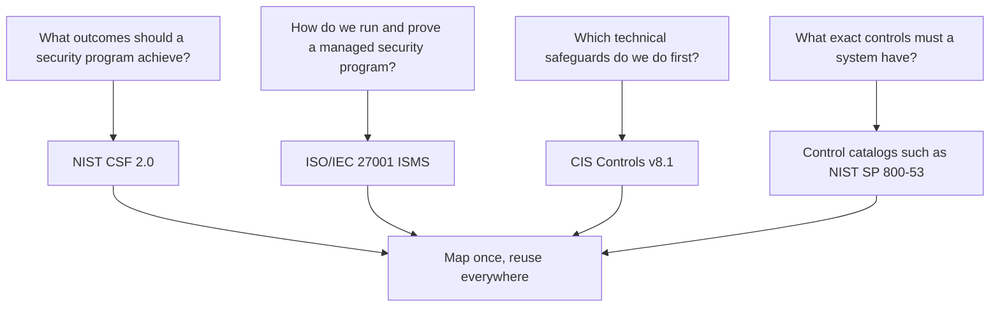
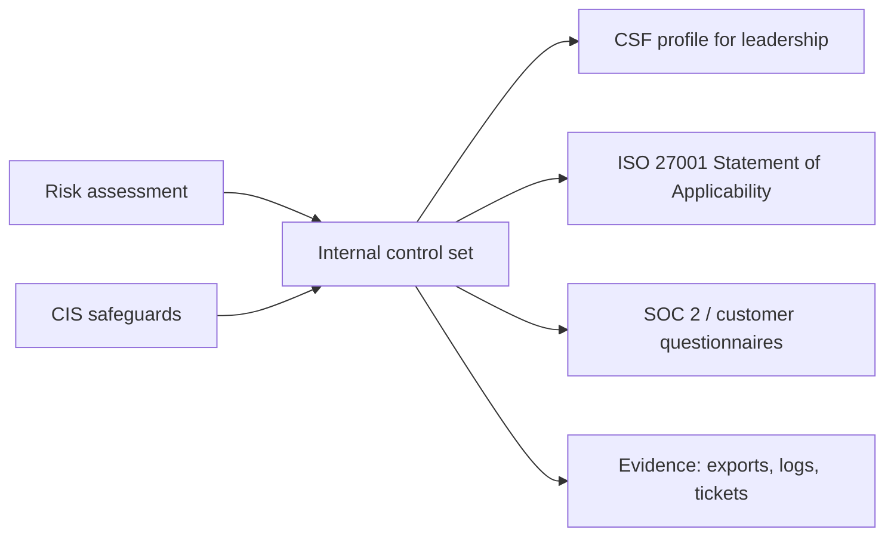

# Security Frameworks: NIST CSF, ISO 27001 and CIS Controls

## Introduction

Sooner or later someone asks your team: "Which security framework do we follow?" It might be a customer's security questionnaire, a new CTO, an auditor, or an investor doing due diligence. A **security framework** is a structured catalog of outcomes or controls that tells you what a reasonable security program covers, so you do not have to invent one from scratch and you do not forget whole areas, such as backups or vendor management.

Think of a framework like a building code. You can design any house you like, but the code makes sure every house has fire exits, safe wiring and a solid foundation. Different codes exist for different purposes, and many builders use more than one.

This page covers the three frameworks you will meet most often:

| Framework | Publisher | Current version | Type | Certifiable? |
| --- | --- | --- | --- | --- |
| NIST Cybersecurity Framework (CSF) | US National Institute of Standards and Technology | 2.0 (February 2024) | Outcome-based framework | No |
| ISO/IEC 27001 | ISO and IEC | 2022 (with Amendment 1:2024) | Management system standard plus control list | Yes, by accredited certification bodies |
| CIS Critical Security Controls | Center for Internet Security | v8.1 (2024) | Prioritized technical safeguards | No (but used in assessments) |

Versions change. Check [nist.gov/cyberframework](https://www.nist.gov/cyberframework), [iso.org](https://www.iso.org/standard/27001) and [cisecurity.org/controls](https://www.cisecurity.org/controls) for the latest.

Compliance regimes such as SOC 2, PCI DSS, HIPAA and GDPR are covered on the next page, [Compliance](./2-sec-compliance.mdx).

## Three Kinds of Frameworks

Frameworks answer different questions:



- **Outcome frameworks** (NIST CSF) say *what* good looks like without saying *how*.
- **Management system standards** (ISO/IEC 27001) define the process for running security: leadership, risk assessment, improvement, audits.
- **Prescriptive safeguard lists** (CIS Controls) say exactly what to do, in priority order.
- **Control catalogs** (NIST SP 800-53 Rev. 5) are large, detailed control sets, often required for US federal systems.

They are not competitors. Many organizations use CIS Controls to decide what to implement, NIST CSF to describe and report the program, and ISO/IEC 27001 to certify it.

## NIST Cybersecurity Framework 2.0

### The six functions

CSF 2.0, released in February 2024, organizes cybersecurity outcomes into **six functions**. Version 2.0 added **Govern**, which sits at the center because it informs all the others.

| Function | Question it answers | Example categories |
| --- | --- | --- |
| Govern (GV) | How do we set strategy, roles, policy and oversight? | `GV.OC` context, `GV.RM` risk strategy, `GV.RR` roles, `GV.PO` policy, `GV.OV` oversight, `GV.SC` supply chain |
| Identify (ID) | What do we have and what are our risks? | `ID.AM` asset management, `ID.RA` risk assessment, `ID.IM` improvement |
| Protect (PR) | How do we prevent or limit harm? | `PR.AA` identity and access, `PR.AT` awareness and training, `PR.DS` data security, `PR.PS` platform security, `PR.IR` infrastructure resilience |
| Detect (DE) | How do we find attacks and anomalies? | `DE.CM` continuous monitoring, `DE.AE` adverse event analysis |
| Respond (RS) | What do we do during an incident? | `RS.MA` management, `RS.AN` analysis, `RS.CO` communication, `RS.MI` mitigation |
| Recover (RC) | How do we restore operations? | `RC.RP` recovery plan execution, `RC.CO` communication |

Each category breaks down into **subcategories** with IDs like `PR.AA-03` ("Users, services, and hardware are authenticated"). CSF 2.0 has 22 categories and 106 subcategories in total.

### Profiles and tiers

CSF is used through two tools:

- **Profiles.** A **Current Profile** describes the outcomes you achieve today. A **Target Profile** describes the outcomes you want. The difference is your **gap**, which becomes your roadmap.
- **Tiers.** Four tiers describe how rigorous your risk governance and management practices are: **Partial (1), Risk Informed (2), Repeatable (3), Adaptive (4)**. Tiers are not maturity levels for each control, and Tier 4 is not the goal for everyone.

NIST also publishes **Quick-Start Guides**, **Implementation Examples** for each subcategory, and **Informative References** that map CSF subcategories to other frameworks such as SP 800-53 and CIS Controls. These live on the CSF 2.0 website and are updated more often than the core document.

### A profile and gap analysis in code

You can keep a CSF profile as data and compute gaps automatically. Here each subcategory gets a current and target score from 0 to 4 (your own scale, not the CSF tiers):

```yaml
# csf_profile.yaml
organization: Acme Helpdesk SaaS
scale: "0 none, 1 ad hoc, 2 partial, 3 implemented, 4 measured"
subcategories:
  GV.RM-01: {current: 1, target: 3, note: "Risk objectives agreed with leadership"}
  GV.SC-01: {current: 0, target: 2, note: "Supplier risk program exists"}
  ID.AM-01: {current: 2, target: 3, note: "Hardware inventory"}
  ID.AM-02: {current: 1, target: 3, note: "Software and services inventory"}
  PR.AA-03: {current: 2, target: 4, note: "Users, services and hardware authenticated"}
  PR.DS-11: {current: 3, target: 3, note: "Backups created, protected, tested"}
  DE.CM-01: {current: 1, target: 3, note: "Networks monitored"}
  RS.MA-01: {current: 2, target: 3, note: "Incident response plan executed with third parties"}
  RC.RP-01: {current: 1, target: 3, note: "Recovery portion of IR plan executed"}
```

```python
# csf_gap.py
from collections import defaultdict
import yaml  # pip install pyyaml

FUNCTIONS = {"GV": "Govern", "ID": "Identify", "PR": "Protect",
             "DE": "Detect", "RS": "Respond", "RC": "Recover"}

with open("csf_profile.yaml") as f:
    profile = yaml.safe_load(f)

gaps = []
by_function = defaultdict(lambda: [0, 0])  # [sum current, sum target]
for sub_id, s in profile["subcategories"].items():
    fn = sub_id.split(".")[0]
    by_function[fn][0] += s["current"]
    by_function[fn][1] += s["target"]
    if s["target"] > s["current"]:
        gaps.append((s["target"] - s["current"], sub_id, s["note"]))

print(f"Profile: {profile['organization']}\n")
print("Function   current/target")
for fn, name in FUNCTIONS.items():
    cur, tgt = by_function[fn]
    bar = "#" * cur + "." * (tgt - cur)
    print(f"{name:9}  {cur:>2}/{tgt:<2}  {bar}")

print("\nLargest gaps first:")
for size, sub_id, note in sorted(gaps, reverse=True)[:5]:
    print(f"  +{size}  {sub_id:9} {note}")
```

Output:

```text
Profile: Acme Helpdesk SaaS

Function   current/target
Govern      1/5   #....
Identify    3/6   ###...
Protect     5/7   #####..
Detect      1/3   #..
Respond     2/3   ##.
Recover     1/3   #..

Largest gaps first:
  +2  RC.RP-01  Recovery portion of IR plan executed
  +2  PR.AA-03  Users, services and hardware authenticated
  +2  ID.AM-02  Software and services inventory
  +2  GV.SC-01  Supplier risk program exists
  +2  GV.RM-01  Risk objectives agreed with leadership
```

The biggest gap is not automatically the first priority. Combine gaps with your [risk register](./0-sec-risk-management.mdx): a gap that reduces a top risk wins.

:::note
Subcategory wording is paraphrased here to keep the example short. Use the official CSF 2.0 core (available as a spreadsheet and through NIST's online reference tool) for the exact text.
:::

## ISO/IEC 27001:2022

### A management system, not a checklist

ISO/IEC 27001 specifies an **Information Security Management System (ISMS)**: a set of policies, processes and responsibilities for managing security risk and continually improving. The main body, **clauses 4 to 10**, contains the mandatory requirements:

| Clause | Topic | What it means in practice |
| --- | --- | --- |
| 4 | Context of the organization | Scope of the ISMS, interested parties and their requirements |
| 5 | Leadership | Top management commitment, security policy, roles |
| 6 | Planning | Risk assessment, risk treatment, security objectives |
| 7 | Support | Resources, competence, awareness, documented information |
| 8 | Operation | Running the risk assessment and treatment plan |
| 9 | Performance evaluation | Monitoring, internal audit, management review |
| 10 | Improvement | Nonconformities, corrective action, continual improvement |

These clauses follow a **Plan-Do-Check-Act** cycle. Amendment 1 (2024) added a small change asking organizations to consider whether climate change is a relevant issue for their ISMS.

### Annex A controls

**Annex A** lists 93 controls in four themes. Organizations choose the controls that their risk assessment requires:

| Theme | Number of controls | Examples |
| --- | --- | --- |
| Organizational (5.x) | 37 | 5.7 Threat intelligence, 5.23 Information security for use of cloud services |
| People (6.x) | 8 | 6.3 Awareness, education and training |
| Physical (7.x) | 14 | 7.4 Physical security monitoring |
| Technological (8.x) | 34 | 8.5 Secure authentication, 8.28 Secure coding |

The companion standard **ISO/IEC 27002:2022** explains each control in detail. The 2022 edition introduced 11 new controls, including threat intelligence, cloud services, data masking, data leakage prevention, web filtering and secure coding. The transition period from the 2013 edition has ended, so certificates now need to be against the 2022 version.

### The Statement of Applicability

The **Statement of Applicability (SoA)** is a key ISMS document. For every Annex A control it records whether the control is included, why (or why not), and whether it is implemented. Auditors start from the SoA.

### Certification

Certification is done by an **accredited certification body**. A typical cycle is a two-stage initial audit (documentation review, then implementation review), annual **surveillance audits**, and a **recertification audit** every three years. A certificate covers a defined **scope**. Always check the scope on a vendor's certificate: "ISO 27001 certified" may only cover one office or one product.

## CIS Critical Security Controls v8.1

### Eighteen controls in priority order

The CIS Controls are a prioritized list of practical safeguards drawn from real attack data and community experience. Version 8.1 (2024) has **18 controls** with **153 safeguards**. It also aligned with NIST CSF 2.0 by adding **Govern** as a security function label for safeguards.

| # | Control | # | Control |
| --- | --- | --- | --- |
| 1 | Inventory and Control of Enterprise Assets | 10 | Malware Defenses |
| 2 | Inventory and Control of Software Assets | 11 | Data Recovery |
| 3 | Data Protection | 12 | Network Infrastructure Management |
| 4 | Secure Configuration of Enterprise Assets and Software | 13 | Network Monitoring and Defense |
| 5 | Account Management | 14 | Security Awareness and Skills Training |
| 6 | Access Control Management | 15 | Service Provider Management |
| 7 | Continuous Vulnerability Management | 16 | Application Software Security |
| 8 | Audit Log Management | 17 | Incident Response Management |
| 9 | Email and Web Browser Protections | 18 | Penetration Testing |

The order is intentional: you cannot protect assets you do not know about, so inventory comes first.

### Implementation Groups

Safeguards are assigned to three **Implementation Groups (IGs)**:

- **IG1, "essential cyber hygiene"**: 56 safeguards that every organization should implement, sized for small teams with limited security expertise.
- **IG2**: adds safeguards for organizations with more complex environments and sensitive data.
- **IG3**: all 153 safeguards, for organizations facing sophisticated attackers or strict regulation.

Each group includes the previous one. For a small company, IG1 is a concrete, achievable starting point. CIS also publishes the [CIS Benchmarks](../9-sec-system-hardening/5-sec-cis-benchmarks.mdx), which are configuration guides for specific products and support Control 4.

## Other Frameworks You Will Hear About

You do not need to learn these in depth now, but you should recognize the names when they appear in contracts or job postings:

| Name | What it is | Where you meet it |
| --- | --- | --- |
| NIST SP 800-53 Rev. 5 | Large catalog of security and privacy controls | US federal systems, FedRAMP cloud services |
| NIST SP 800-171 | Requirements for protecting controlled unclassified information | US defense and government contractors, linked to CMMC |
| CSA Cloud Controls Matrix (CCM) | Cloud-specific control framework from the Cloud Security Alliance | Cloud provider assessments, CSA STAR registry |
| COBIT | IT governance framework from ISACA | Large enterprises, IT audit teams |
| Essential Eight | Eight prioritized mitigations from the Australian Cyber Security Centre | Australian organizations and government |
| Cyber Essentials | UK government-backed certification of basic controls | UK public sector suppliers |
| NIST AI RMF | Framework for managing AI risks | AI products; see [Security for AI and LLM Applications](./5-sec-ai-security.mdx) |

Most of these publish official mappings to NIST CSF or ISO/IEC 27001, which is one more reason to keep a single internal control set.

### How the pieces fit together



## Mapping Controls Across Frameworks

If you must satisfy several frameworks, do not run separate programs. Build **one internal control set** and map each control to every framework it satisfies. Auditors call this a **common controls framework** or a crosswalk.

```python
# crosswalk.py
CONTROLS = {
    "AC-MFA": {
        "description": "Phishing-resistant MFA for all workforce and admin access",
        "csf": ["PR.AA-03"],
        "iso27001": ["A.8.5"],
        "cis": ["6.3", "6.4", "6.5"],
        "evidence": "IdP policy export + list of users without MFA (must be empty)",
    },
    "BK-TEST": {
        "description": "Daily immutable backups with quarterly restore test",
        "csf": ["PR.DS-11"],
        "iso27001": ["A.8.13"],
        "cis": ["11.2", "11.3", "11.4", "11.5"],
        "evidence": "Backup job report + signed restore test record",
    },
    "VM-PATCH": {
        "description": "Scan weekly; fix known-exploited vulns within 14 days",
        "csf": ["ID.RA-01", "PR.PS-02"],
        "iso27001": ["A.8.8"],
        "cis": ["7.1", "7.3", "7.4", "7.5"],
        "evidence": "Scanner report + ticket SLA dashboard",
    },
}

def coverage(framework: str, required: list[str]) -> None:
    covered = {ref for c in CONTROLS.values() for ref in c[framework]}
    missing = [r for r in required if r not in covered]
    print(f"{framework}: {len(required) - len(missing)}/{len(required)} covered; missing: {missing}")

coverage("cis", ["6.3", "6.4", "6.5", "7.1", "11.2", "14.1"])
coverage("csf", ["PR.AA-03", "PR.DS-11", "DE.CM-01"])
```

Output:

```text
cis: 5/6 covered; missing: ['14.1']
csf: 2/3 covered; missing: ['DE.CM-01']
```

One control, one owner, one piece of evidence, many frameworks satisfied. The specific mappings shown are illustrative. Use the official mappings that NIST and CIS publish (and your auditor's guidance) for real programs.

:::caution
A control ID mapping is a claim. Auditors will ask for **evidence** that the control works, such as exports, logs, tickets and test records. Plan evidence collection at the same time as the control.
:::

## Real-World Scenario

**Your startup** sells a helpdesk SaaS product. It has 40 employees, no dedicated security staff, and a fast-growing sales pipeline. Three things happen in the same quarter:

- A large US prospect sends a 200-question security questionnaire.
- A European enterprise prospect asks for an ISO/IEC 27001 certificate.
- The board asks: "Are we doing the basics?"

### The plan

1. **Start with CIS Controls IG1** as the "what to do" list. Its 56 safeguards cover inventory, MFA, patching, backups, logging basics and incident response, which are the controls that stop the most common attacks.
2. **Use NIST CSF 2.0 as the reporting language** for the board: a current and target profile, with a quarterly chart like the gap script above.
3. **Build the ISMS gradually** toward ISO/IEC 27001: a risk methodology, a Statement of Applicability, internal audit and management review. Many IG1 safeguards map directly to Annex A controls, so the work is reused.
4. **Answer questionnaires from the control set**, not from scratch. A crosswalk lets you answer most questions with existing evidence.
5. **Plan SOC 2** in parallel if US customers expect it (see [Compliance](./2-sec-compliance.mdx)).

### Why this approach

CIS IG1 gives a small team concrete, high-value tasks immediately. CSF gives leadership a simple picture without requiring certification. ISO/IEC 27001 is pursued because a real customer requires it, not for its own sake. One control set serves all three.

### When to use it, and when not to

This layered approach suits small and mid-sized companies selling to enterprises. A US federal contractor would instead need NIST SP 800-171 or SP 800-53 based requirements, and possibly programs such as FedRAMP or CMMC. A company that only sells to consumers in one country might never need ISO/IEC 27001 certification, and should not pay for it until a customer or regulator asks.

### Alternatives and trade-offs

| Framework | Pros | Cons | Best for |
| --- | --- | --- | --- |
| CIS Controls v8.1 | Concrete, prioritized, IG1 is achievable | Less about governance and business process | Small teams deciding what to do first |
| NIST CSF 2.0 | Free, flexible, clear for executives, maps to everything | Not certifiable, does not say how | Program structure and board reporting |
| ISO/IEC 27001:2022 | International certificate, strong management system | Cost and documentation effort, scope can be gamed | Selling to enterprises, especially outside the US |
| NIST SP 800-53 Rev. 5 | Very detailed, required in US federal space | Huge and heavy for small teams | Government systems and contractors |
| SOC 2 (attestation) | Expected by US SaaS buyers | Not a framework you implement; report scope varies | US B2B SaaS |

## Best Practices

1. **Pick frameworks for a reason**: a customer, a regulator, or a clear internal need. Do not collect certificates for show.
2. **Start small**: CIS IG1 or a handful of CSF subcategories, done well, beats a 100-page policy set nobody follows.
3. **One control set, many mappings.** Use official crosswalks from NIST and CIS.
4. **Automate evidence** where possible, such as nightly exports of MFA status, backup reports and scan results.
5. **Check the scope** of any certificate you rely on from a vendor.
6. **Revisit when versions change.** Frameworks are updated, and your mappings must follow.

## Summary

- **NIST CSF 2.0** organizes outcomes into six functions, **Govern, Identify, Protect, Detect, Respond, Recover**, and is used through current and target **profiles**.
- **ISO/IEC 27001:2022** defines an **ISMS** (clauses 4 to 10) plus **93 Annex A controls** in four themes, and is **certifiable**.
- **CIS Controls v8.1** list **18 controls and 153 safeguards**, prioritized into **Implementation Groups**. IG1 is essential cyber hygiene.
- Frameworks are complementary. Build **one control set** and map it to many frameworks.
- Choose frameworks based on customers, regulators and risk, not fashion.

## Exercises

1. Write a current and target CSF profile for a project you know, with at least one subcategory per function, and run `csf_gap.py` on it.
2. Download the CIS Controls v8.1 list and mark which IG1 safeguards your home lab or team already meets.
3. Extend `crosswalk.py` with an `evidence_last_collected` date and print controls whose evidence is older than 90 days.
4. Look up a SaaS vendor you use that claims ISO/IEC 27001 certification. Find the certificate and write down its scope.

### Related pages

- [Risk Management](./0-sec-risk-management.mdx)
- [Compliance: SOC 2, PCI DSS, HIPAA and GDPR](./2-sec-compliance.mdx)
- [CIS Benchmarks and Baselines](../9-sec-system-hardening/5-sec-cis-benchmarks.mdx)
- [Security Policies and Awareness Training](./3-sec-security-policies.mdx)
