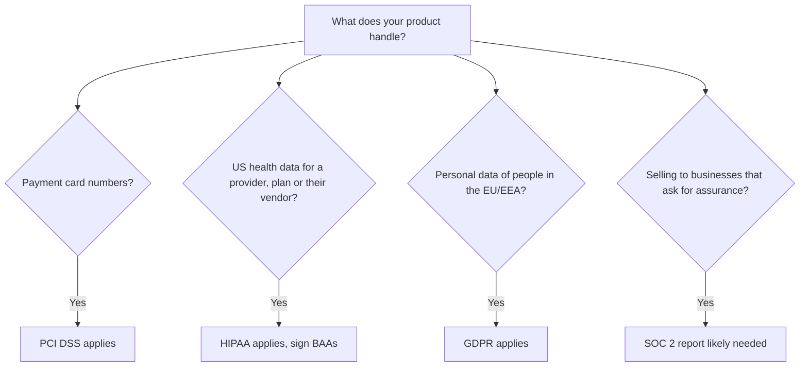
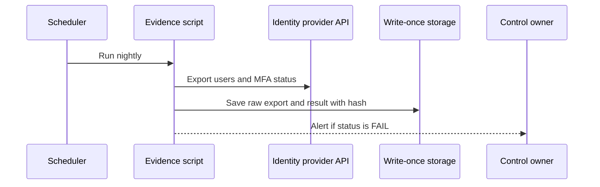

# Compliance: SOC 2, PCI DSS, HIPAA and GDPR

## Introduction

**Compliance** means showing that you meet a set of external requirements: a law, an industry standard, or a customer contract. Security is about actually being hard to attack. The two overlap a lot, but they are not the same thing. Plenty of breached companies were compliant on paper, and plenty of secure companies have never been audited.

For developers, compliance shows up as very concrete work:

- "We cannot store card numbers in that table."
- "This log line contains a patient name, so it has to go."
- "The auditor needs evidence that every production change was reviewed."
- "A customer in Germany asked us to delete all their data within a month."

Think of compliance like a restaurant health inspection. The inspector checks specific things (fridge temperature, hand-washing stations, records) on specific days. A good kitchen is clean every day anyway, and passes the inspection as a side effect. A bad kitchen cleans up only for inspection day. This page shows how to be the good kitchen.

:::warning Not legal advice
This page explains the general shape of these regimes for engineers. Laws and standards change, and whether they apply to you depends on details. Work with your legal, privacy and compliance teams, and read the official sources linked below.
:::

## The Four Regimes at a Glance

| Regime | What it is | Who it applies to | Who checks | Outcome |
| --- | --- | --- | --- | --- |
| SOC 2 | Attestation report on controls, based on AICPA Trust Services Criteria | Service organizations whose customers ask for it (common for US B2B SaaS) | Independent CPA firm | Report (Type 1 or Type 2), not a certificate |
| PCI DSS v4.0.1 | Industry standard for payment card data | Anyone that stores, processes or transmits cardholder data, or can affect its security | Qualified Security Assessor (QSA) or self-assessment, depending on volume | Report on Compliance (ROC) or Self-Assessment Questionnaire (SAQ) |
| HIPAA | US law protecting health information | Covered entities (health plans, providers, clearinghouses) and their business associates | HHS Office for Civil Rights (enforcement) | No certification; enforcement after complaints or breaches |
| GDPR | EU regulation on personal data | Organizations processing personal data of people in the EU/EEA, in certain cases even from outside the EU | National data protection authorities | Fines, orders; no official general certification |

Notice that only PCI DSS and GDPR are **mandatory by rule** in their domains (by contract with card brands and by law). HIPAA is law for covered entities and business associates. SOC 2 is voluntary, but in practice it is required by many enterprise customers.



A single product can fall under all four at once.

## SOC 2

### What it is

SOC 2 is an attestation framework from the **AICPA** (American Institute of Certified Public Accountants). A licensed CPA firm examines your controls against the **Trust Services Criteria** and writes a report you share with customers under NDA.

There are five **Trust Services Categories**:

| Category | Covers | Required? |
| --- | --- | --- |
| Security (the "common criteria") | Protection against unauthorized access | Always included |
| Availability | Systems are available as committed | Optional |
| Processing Integrity | Processing is complete, valid, accurate, timely | Optional |
| Confidentiality | Information designated confidential is protected | Optional |
| Privacy | Personal information is handled per commitments | Optional |

Most first-time SOC 2 reports cover Security, often with Availability and Confidentiality added.

### Type 1 vs Type 2

- **Type 1** evaluates whether controls are **suitably designed** at a single point in time.
- **Type 2** evaluates whether controls **operated effectively** over a period, the **observation window**, which is often between 3 and 12 months.

Customers usually want Type 2, because it proves that controls actually ran, not just that they existed on one day.

### What engineers do for SOC 2

You define your own controls (SOC 2 does not prescribe a fixed list), and the auditor tests them. Typical engineering controls and the evidence auditors sample:

| Control | Evidence an auditor samples |
| --- | --- |
| All production changes are peer-reviewed | Pull requests with approvals, branch protection settings |
| Access is removed when people leave | HR termination list matched against IdP deactivation dates |
| MFA is required for production access | IdP policy export, list of users and MFA status |
| Vulnerabilities are fixed within SLA | Scanner reports and ticket timestamps |
| Backups are tested | Restore test records |
| Incidents are tracked and reviewed | Incident tickets and postmortems |

## PCI DSS v4.0.1

### The 12 requirements

PCI DSS is maintained by the **PCI Security Standards Council**, founded by the major card brands. Version 4.0 retired at the end of 2024, and **v4.0.1** (a limited revision published in June 2024 that clarified wording without adding requirements) is the current version. The requirements that v4.0 introduced as "future-dated" best practices became **mandatory on 31 March 2025**.

| # | Requirement (summary) |
| --- | --- |
| 1 | Install and maintain network security controls |
| 2 | Apply secure configurations to all system components |
| 3 | Protect stored account data |
| 4 | Protect cardholder data with strong cryptography during transmission over open, public networks |
| 5 | Protect all systems and networks from malicious software |
| 6 | Develop and maintain secure systems and software |
| 7 | Restrict access by business need to know |
| 8 | Identify users and authenticate access |
| 9 | Restrict physical access to cardholder data |
| 10 | Log and monitor all access to system components and cardholder data |
| 11 | Test security of systems and networks regularly |
| 12 | Support information security with organizational policies and programs |

A few v4.x requirements that matter directly to web developers:

- **6.4.3**: manage and authorize every script that runs on payment pages, and keep an inventory with a justification for each.
- **11.6.1**: detect unauthorized changes to HTTP headers and payment page contents, which targets "web skimming" attacks.
- **8.4.2**: MFA for all access into the cardholder data environment (CDE).

Check the official text at [pcisecuritystandards.org](https://www.pcisecuritystandards.org/) for exact wording, because the Council also publishes FAQs and guidance that refine how these apply.

### The best PCI strategy: shrink the scope

The **cardholder data environment** is every system that stores, processes or transmits card data, plus everything connected to it. Every system in scope must meet the requirements. So the most effective move is to keep card data **out** of your systems entirely:

- Use a payment provider's **hosted payment page** or **embedded fields (iframes)** so card numbers go straight from the browser to the provider.
- Store only the provider's **token**, never the card number.
- Segment any remaining in-scope systems from the rest of the network.

Merchants who fully outsource card handling may qualify for a much shorter self-assessment questionnaire, such as **SAQ A**. Which SAQ applies, and its exact eligibility criteria, is set by the Council and your acquiring bank, and has changed in recent revisions, so confirm it with them.

**Vulnerable** (card data touches your server and your logs):

```python
# app_vulnerable.py
from flask import Flask, request

app = Flask(__name__)

@app.post("/checkout")
def checkout():
    card = request.form["card_number"]          # PAN reaches your server: in PCI scope
    app.logger.info("Charging card %s", card)   # PAN now also in logs
    # ... call payment API with raw card ...
    return "ok"
```

**Fixed** (the browser sends the card to the provider; you receive a token):

```python
# app_fixed.py
from flask import Flask, request, abort

app = Flask(__name__)

@app.post("/checkout")
def checkout():
    token = request.form.get("payment_token", "")   # created by provider's hosted field
    if not token.startswith("tok_"):                  # format check only; provider validates
        abort(400)
    if "card_number" in request.form:                 # defensive: refuse raw PANs
        abort(400)
    app.logger.info("Charging with token ending %s", token[-4:])
    # ... call provider API with the token and an amount computed server-side ...
    return "ok"
```

The token prefix `tok_` is illustrative. Every provider uses its own format.

## HIPAA

### The rules

HIPAA (the US Health Insurance Portability and Accountability Act) has several rules. Three matter most to engineers:

- **Privacy Rule**: who may use and disclose **protected health information (PHI)**.
- **Security Rule**: safeguards for **electronic PHI (ePHI)**, grouped into **administrative**, **physical** and **technical** safeguards.
- **Breach Notification Rule**: notify affected individuals without unreasonable delay and **no later than 60 days** after discovering a breach of unsecured PHI, with additional notices to HHS and sometimes the media.

### Business associates

If you build software that handles PHI **for** a covered entity, such as a hospital's scheduling app vendor, you are a **business associate**. You must sign a **Business Associate Agreement (BAA)** with your customer, and you need BAAs with your own subcontractors that touch PHI, including cloud providers. Major cloud providers offer BAAs, but only certain services are covered. Check their lists before you put PHI in a service.

### Technical safeguards in practice

| Security Rule area | What it looks like in code and infrastructure |
| --- | --- |
| Access control | Unique user IDs, role-based access, automatic logoff, emergency access procedure |
| Audit controls | Logs of who viewed or changed which record, retained and reviewed |
| Integrity | Protect ePHI from improper change, such as checksums and database constraints |
| Authentication | Verify that a person is who they claim, ideally with MFA |
| Transmission security | TLS for all data in transit |

Encryption is officially "addressable" under the current Security Rule, which means you must implement it or document why an alternative is reasonable. In practice, encrypt ePHI at rest and in transit. Data that is properly encrypted is generally not considered "unsecured PHI" for breach notification purposes.

:::note Changes in progress
HHS published a proposed update to the Security Rule in January 2025. Among other things, it would remove the "addressable" distinction and make controls such as encryption and MFA explicit requirements. As of the latest reports, it had not been finalized, and its timing and final content may change. Check [hhs.gov/hipaa](https://www.hhs.gov/hipaa/index.html) for the current status.
:::

## GDPR

### Principles and roles

The EU **General Data Protection Regulation** applies to processing of personal data of people in the EU/EEA. Article 5 sets out its principles: lawfulness, fairness and transparency; **purpose limitation**; **data minimization**; accuracy; **storage limitation**; **integrity and confidentiality**; and accountability.

Two roles matter:

- **Controller**: decides why and how personal data is processed (usually your customer, or you for your own users).
- **Processor**: processes data on behalf of a controller (often a SaaS vendor). Processors need a **Data Processing Agreement (DPA)** under Article 28.

### Articles engineers should know

| Article | Requirement | Engineering impact |
| --- | --- | --- |
| 6 | A lawful basis is needed for each processing purpose | Track purpose and basis per data field or dataset |
| 15 to 22 | Data subject rights: access, rectification, erasure, portability, objection | Build export and delete features that reach every data store |
| 25 | Data protection by design and by default | See [Privacy Engineering](./4-sec-privacy-engineering.mdx) |
| 28 | Processor contracts | Know your sub-processors, and keep a public list if you are a processor |
| 32 | Security of processing | Encryption, pseudonymization, resilience, regular testing |
| 33 and 34 | Breach notification to the authority within **72 hours** where feasible, and to individuals when the risk is high | Incident response must quickly determine whether personal data was affected |
| 35 | Data Protection Impact Assessment for high-risk processing | Run a DPIA before launching risky features |

Fines can reach up to 20 million euros or 4% of worldwide annual turnover, whichever is higher, for the most serious infringements. Cross-border data transfers out of the EU need an approved mechanism, such as an adequacy decision or Standard Contractual Clauses. The details have changed several times over the years, so check with your privacy team.

### The 72-hour clock

The 72 hours start when the controller becomes **aware** of a breach, not when the investigation ends. Incident runbooks should include the deadline:

```python
# breach_clock.py
from datetime import datetime, timedelta, timezone

def notification_deadlines(aware_at: datetime) -> dict:
    return {
        "GDPR supervisory authority (Art. 33)": aware_at + timedelta(hours=72),
        "HIPAA individuals (outer limit)": aware_at + timedelta(days=60),
    }

aware = datetime(2026, 10, 9, 16, 30, tzinfo=timezone.utc)
for who, when in notification_deadlines(aware).items():
    print(f"{who:40} {when:%Y-%m-%d %H:%M} UTC")
```

Output:

```text
GDPR supervisory authority (Art. 33)     2026-10-12 16:30 UTC
HIPAA individuals (outer limit)          2026-12-08 16:30 UTC
```

Remember that 60 days under HIPAA is a **maximum**, not a target, and contracts often require you to tell your customers much faster. Other laws, such as US state breach laws, have their own deadlines.

## Compliance as Code: Automating Evidence

Auditors sample evidence. Collecting it by hand with screenshots is slow and error-prone. Instead, run scripts on a schedule that check a control, store the raw data, and record a hash and timestamp so the evidence cannot be quietly edited later.

```python
# collect_mfa_evidence.py
import hashlib
import json
from datetime import datetime, timezone
from pathlib import Path

# In real life this comes from your identity provider's API.
# Here we use an exported file so the example runs offline.
users_export = [
    {"email": "ana@example.com", "active": True, "mfa": "webauthn"},
    {"email": "ben@example.com", "active": True, "mfa": "totp"},
    {"email": "cy@example.com", "active": True, "mfa": None},
    {"email": "old@example.com", "active": False, "mfa": None},
]

def check_mfa(users):
    active = [u for u in users if u["active"]]
    failures = [u["email"] for u in active if not u["mfa"]]
    return {
        "control": "AC-MFA: all active users have MFA",
        "checked_at": datetime(2026, 10, 11, 2, 0, tzinfo=timezone.utc).isoformat(),
        "population": len(active),
        "failures": failures,
        "status": "PASS" if not failures else "FAIL",
    }

result = check_mfa(users_export)
raw = json.dumps(users_export, sort_keys=True).encode()
result["raw_sha256"] = hashlib.sha256(raw).hexdigest()

out = Path("evidence")
out.mkdir(exist_ok=True)
(out / "AC-MFA-2026-10-11.raw.json").write_bytes(raw)
(out / "AC-MFA-2026-10-11.result.json").write_text(json.dumps(result, indent=2))
print(json.dumps(result, indent=2))
```

Output:

```text
{
  "control": "AC-MFA: all active users have MFA",
  "checked_at": "2026-10-11T02:00:00+00:00",
  "population": 3,
  "failures": [
    "cy@example.com"
  ],
  "status": "FAIL",
  "raw_sha256": "5c2ac93e35e2d09cede97fdbf35fe647c4b9f3f63aec5bb9bfc657b2d0b26905"
}
```

Good practices for evidence automation:

- Store evidence in **write-once storage** (for example, object storage with object lock) so it cannot be altered.
- Alert the **control owner** on `FAIL`, not just the compliance team. A failure is a security issue first.
- Keep the **population** (how many items were checked), because auditors test completeness as well as results.
- Commercial **compliance automation platforms** do this across many systems. They save time, but you still own the controls and must understand what they check.



## Real-World Scenario

**Your company** builds an appointment and billing platform for small clinics. Customers are US clinics and a growing number of clinics in Germany and the Netherlands. Patients pay co-pays by card through your app. A large US hospital group wants to buy and asks for a SOC 2 Type 2 report and a BAA.

### The approach

1. **Map the data**: PHI (appointments, notes) for US clinics, personal data of EU patients, card payments, and staff accounts.
2. **PCI: avoid it.** Switch to the payment provider's hosted fields so card numbers never touch your servers. You store tokens only, and your PCI work drops to a short self-assessment.
3. **HIPAA: accept and engineer it.** Sign BAAs with US clinics, use only BAA-covered cloud services for PHI, encrypt ePHI, add per-record audit logs, and set breach notification steps in your incident runbook.
4. **GDPR: you are a processor** for EU clinics. Sign DPAs, publish a sub-processor list, host EU data in the EU if customers require it, and build export and erasure tools.
5. **SOC 2: design one control set** that covers all of the above, start a Type 1 to validate the design, then a 6-month Type 2 window.
6. **Automate evidence** with scripts like the one above, so the observation window does not become a screenshot marathon.

### Why this approach

Scope reduction removed the most expensive regime (PCI) almost entirely. A single control set serves SOC 2, HIPAA and GDPR, because they ask for overlapping things: access control, encryption, logging, incident response and vendor management.

### When to use it, and when not to

Pursue a SOC 2 report when customers ask for it. It is a sales enabler, not a legal requirement. Do not start a SOC 2 before you have basic controls in place, because a Type 2 report with many exceptions can hurt more than no report. HIPAA and GDPR are not optional once they apply, so treat them as requirements from day one of design.

### Alternatives and trade-offs

| Approach | Pros | Cons | Best for |
| --- | --- | --- | --- |
| Handle card data yourself | Full control of the checkout | Large PCI scope, assessments, high breach impact | Payment companies |
| Hosted fields / tokenization | Tiny PCI scope, less risk | Provider dependency, less UI control | Almost every merchant |
| SOC 2 Type 1 first | Fast, validates design | Customers often want Type 2 | First report, early sales |
| SOC 2 Type 2 directly | What buyers want | Longer, needs controls running for months | Mature teams |
| ISO/IEC 27001 instead of SOC 2 | International recognition | Less familiar to some US buyers | EU and global customers |
| Manual evidence | No tooling cost | Slow, error-prone, painful audits | Very small scope |
| Automated evidence (scripts or platform) | Continuous, reliable, catches drift | Setup effort or subscription cost | Most teams beyond the first audit |

## Common Mistakes

1. **"Compliant" means "secure".** Compliance is a minimum bar checked on a sample. Attackers do not read audit reports.
2. **Letting regulated data spread.** Card numbers in logs, PHI in analytics exports, EU personal data in a debugging bucket. Data spreads scope.
3. **Forgetting vendors.** Your obligations flow down: BAAs, DPAs and vendor reviews are required, not nice to have.
4. **Point-in-time effort.** Scrambling before the audit fails Type 2 reports, which test the whole window.
5. **Ignoring the scope of others' reports.** A vendor's SOC 2 report may not cover the product you use. Read the system description.
6. **Building features without deletion.** GDPR erasure requests reach every copy, including backups, search indexes and caches. Design deletion early.

## Summary

- **SOC 2** is an AICPA attestation (Type 1 design, Type 2 operating effectiveness) based on the Trust Services Criteria. Security is always in scope.
- **PCI DSS v4.0.1** is current. Requirements that were future-dated became mandatory in March 2025. **Scope reduction** with hosted fields and tokens is the best strategy.
- **HIPAA** requires administrative, physical and technical safeguards for ePHI, **BAAs**, and breach notification within 60 days at the latest. A Security Rule update has been proposed.
- **GDPR** brings principles such as minimization, **data subject rights**, privacy by design, and **72-hour** breach notification to authorities.
- Build **one control set**, automate **evidence**, and remember that compliance is the floor, not the ceiling.

## Exercises

1. Draw a data flow diagram for an app you know and mark where card data, health data and EU personal data travel. Which systems are in scope for each regime?
2. Extend `collect_mfa_evidence.py` to also check that deactivated users were disabled within 24 hours of their HR termination date.
3. Write an incident runbook section titled "Is this a notifiable breach?" with the questions your team must answer in the first 24 hours.
4. Read the public sub-processor list of a SaaS product you use. What categories of vendors appear?

### Related pages

- [Security Frameworks: NIST CSF, ISO 27001 and CIS Controls](./1-sec-security-frameworks.mdx)
- [Privacy Engineering](./4-sec-privacy-engineering.mdx)
- [Incident Response Lifecycle](../12-sec-incident-response/0-sec-incident-response-lifecycle.mdx)
- [Secure Error Handling and Logging](../5-sec-secure-coding/2-sec-error-handling-and-logging.mdx)
- [Securing Cloud Storage](../8-sec-cloud-and-container/3-sec-cloud-storage-security.mdx)
