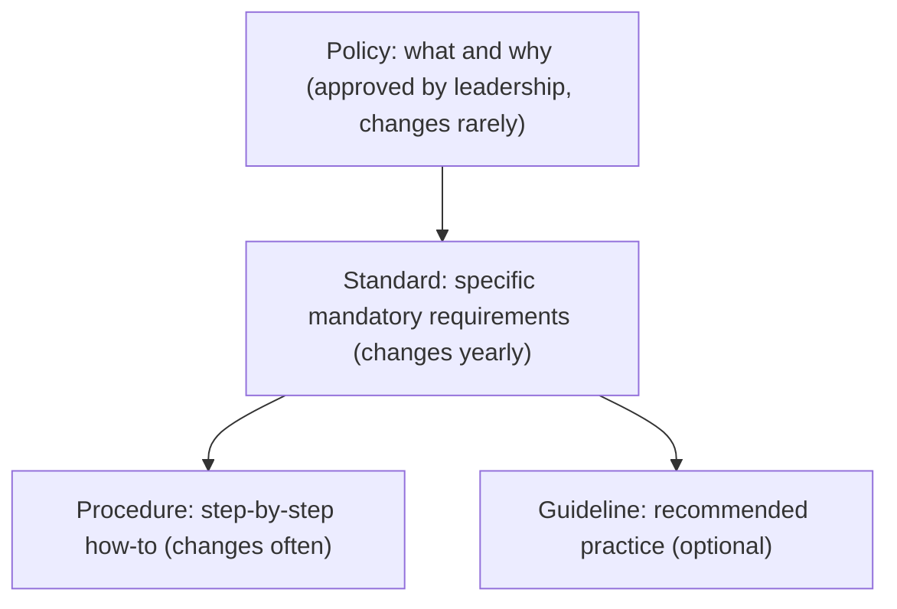
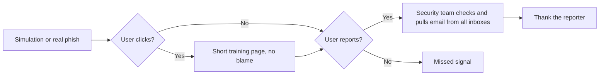

# Security Policies and Awareness Training

## Introduction

A **security policy** is a written decision by leadership about how the organization protects information. "All production access requires MFA." "Customer data must not be copied to personal devices." "Every vendor that handles customer data gets a security review." Policies turn risk decisions into rules everyone can follow and auditors can check.

**Awareness training** is how people learn those rules and the threats behind them, such as phishing, payment fraud and social engineering.

Both have a bad reputation. Policies are often 40-page documents nobody reads, and training is often a yearly video that people click through while doing something else. This page shows how to do better:

- Write short, clear policies with owners and review dates.
- Separate **policies** from **standards** and **procedures** so each can change at the right speed.
- **Enforce** rules in code and configuration wherever possible, so people do not have to remember them.
- Run training and phishing simulations that **build a reporting culture** instead of embarrassing people.

An analogy: traffic laws are policies, the speed limit signs are standards, the driving test is training, and speed bumps are technical enforcement. Good road safety uses all four. Relying only on signs, or only on training, does not work.

## The Policy Hierarchy



| Document | Example | Who approves | Mandatory? |
| --- | --- | --- | --- |
| Policy | "Access to systems is granted on least privilege and reviewed regularly." | Executive leadership | Yes |
| Standard | "Admin access requires phishing-resistant MFA. Access reviews happen every quarter." | Security leader | Yes |
| Procedure | "How to request production access in the ticketing system, step by step." | Team owning the process | Yes, for those doing the task |
| Guideline | "Prefer short-lived credentials for scripts." | Security or platform team | No, recommended |

Keeping specifics out of the policy means you do not need executive sign-off every time a technical detail changes.

## The Core Policy Set

Most organizations need a similar small set. Frameworks such as ISO/IEC 27001 (control 5.1) and NIST CSF 2.0 (`GV.PO`) expect policies to exist, be approved, communicated and reviewed.

| Policy | Covers | Typical standards under it |
| --- | --- | --- |
| Information Security Policy | Top-level commitment, roles, scope | All others |
| Acceptable Use | What staff may do with company devices, accounts and data | Personal device rules, approved software |
| Access Control | Who gets access, how it is approved, reviewed and removed | Authentication standard, access review cadence |
| Data Classification and Handling | Data levels and how each is stored, shared and deleted | Encryption standard, retention schedule |
| Secure Development | How software is designed, reviewed, tested and released | Code review rules, dependency policy |
| Vulnerability and Patch Management | How fast findings are fixed | Fix-time targets by severity |
| Incident Response | How incidents are reported and handled | Severity levels, on-call, notification |
| Vendor / Third-Party Risk | How suppliers are assessed | Review tiers, contract clauses |
| Business Continuity and Backup | Recovery objectives and testing | Backup and restore-test standard |
| Acceptable Use of AI Tools | Which AI tools may be used with which data | Approved tool list, data rules |

The last one is increasingly common: staff paste code, contracts and customer data into AI assistants, and the organization needs to say which tools are approved for which data classifications. See [Security for AI and LLM Applications](./5-sec-ai-security.mdx).

### Anatomy of a good policy

Keep each policy to one or two pages. A template:

```markdown
# Access Control Policy

Owner: Head of Security        Approved by: CTO       Version: 2.1
Effective: 2026-01-15          Next review: 2027-01-15

## Purpose
Protect company and customer data by giving people only the access they need.

## Scope
All employees, contractors and service accounts, for all company systems.

## Policy
1. Access is granted on least privilege and approved by the system owner.
2. All access uses individual accounts. Shared accounts need a documented exception.
3. Authentication follows the Authentication Standard.
4. Access is reviewed at least quarterly for production and customer data systems.
5. Access is removed within one business day of a role change or departure.

## Exceptions
Requested through the security exception process with an expiry date.

## Enforcement
Violations may lead to access removal and disciplinary action.
```

Every policy needs an **owner**, an **approver**, a **review date**, a **scope**, and an **exception process** (see [Risk Management](./0-sec-risk-management.mdx) for exceptions). Plain language beats legal language. If a new engineer cannot tell what to do after reading it, rewrite it.

## Policy as Code

A rule that a machine can check should be checked by a machine. People forget; CI does not.

### Example 1: an authentication standard aligned with NIST SP 800-63B-4

NIST's digital identity guidelines, **SP 800-63B-4** (2025), changed password guidance significantly from the old "complexity and rotation" rules. Key points for passwords:

- At least **15 characters** when the password is the only factor, and at least **8 characters** when it is used as part of multi-factor authentication.
- Allow at least **64 characters**, and accept spaces and Unicode.
- **No composition rules** (such as "one uppercase, one digit, one symbol").
- **No periodic rotation**. Require a change only when there is evidence of compromise.
- Check new passwords against a **blocklist** of common, expected or compromised values, and tell users why a password was rejected.

Many company standards still contain the old rules, which push people toward predictable passwords like `Summer2026!`. Here is the difference in code.

**Vulnerable** (old-style policy that encourages weak, predictable passwords):

```python
# password_policy_old.py
import re

def is_valid_old(pw: str) -> bool:
    return bool(8 <= len(pw) <= 16            # short max length blocks passphrases
                and re.search(r"[A-Z]", pw)    # composition rules
                and re.search(r"\d", pw)
                and re.search(r"[^\w\s]", pw))

print(is_valid_old("Summer2026!"))                            # predictable, but accepted
print(is_valid_old("correct horse battery staple orbit"))     # strong passphrase, rejected
```

Output:

```text
True
False
```

**Fixed** (length plus blocklist, following SP 800-63B-4):

```python
# password_policy.py
import unicodedata

BLOCKLIST = {"password", "123456789012345", "qwertyuiopasdfg", "summer2026!",
             "acmehelpdeskpassword"}  # in production: a large breached-password list
                                      # plus context words like the product name

def check_password(pw: str, username: str, mfa: bool) -> list[str]:
    pw = unicodedata.normalize("NFKC", pw)
    min_len = 8 if mfa else 15
    errors = []
    if len(pw) < min_len:
        errors.append(f"Use at least {min_len} characters.")
    if len(pw) > 128:  # our cap; NIST requires allowing at least 64
        errors.append("Use at most 128 characters.")
    if pw.lower() in BLOCKLIST:
        errors.append("This password is too common or has appeared in a breach.")
    if username.lower() in pw.lower():
        errors.append("Do not include your username.")
    return errors

tests = [("Summer2026!", "ana", False),
         ("correct horse battery staple orbit", "ana", False),
         ("ana-likes-tea!!", "ana", True),
         ("Kj8#mQ2z", "ben", True)]
for pw, user, mfa in tests:
    print(f"{pw!r:40} mfa={mfa!s:5} -> {check_password(pw, user, mfa) or 'OK'}")
```

Output:

```text
'Summer2026!'                            mfa=False -> ['Use at least 15 characters.', 'This password is too common or has appeared in a breach.']
'correct horse battery staple orbit'     mfa=False -> OK
'ana-likes-tea!!'                        mfa=True  -> ['Do not include your username.']
'Kj8#mQ2z'                               mfa=True  -> OK
```

For production systems, check against a large breached-password corpus. The Have I Been Pwned "Pwned Passwords" range API uses k-anonymity, so you only send the first five characters of a SHA-1 hash, never the password. See [Secure Password Authentication](../4-sec-authentication/1-sec-password-authentication.mdx) for hashing and the full login flow.

### Example 2: data classification tags in infrastructure

Your data handling standard says every storage resource must declare its classification, and "confidential" data must be encrypted and never public. A CI check can enforce that on an infrastructure inventory, for example a JSON export from your IaC plan:

```python
# check_classification.py
import json
import sys

ALLOWED = {"public", "internal", "confidential", "restricted"}

inventory = json.loads("""
[
  {"name": "marketing-assets", "tags": {"data_classification": "public"},
   "encrypted": true, "public_access": true},
  {"name": "customer-exports", "tags": {"data_classification": "confidential"},
   "encrypted": true, "public_access": true},
  {"name": "tmp-debug", "tags": {}, "encrypted": false, "public_access": false}
]
""")

violations = []
for r in inventory:
    cls = r["tags"].get("data_classification")
    if cls not in ALLOWED:
        violations.append(f"{r['name']}: missing or invalid data_classification tag")
        continue
    if cls in {"confidential", "restricted"}:
        if not r["encrypted"]:
            violations.append(f"{r['name']}: {cls} data must be encrypted")
        if r["public_access"]:
            violations.append(f"{r['name']}: {cls} data must not be public")

for v in violations:
    print("POLICY VIOLATION:", v)
sys.exit(1 if violations else 0)
```

Output:

```text
POLICY VIOLATION: customer-exports: confidential data must not be public
POLICY VIOLATION: tmp-debug: missing or invalid data_classification tag
```

The non-zero exit code fails the pipeline. Dedicated policy engines such as Open Policy Agent, Checkov or cloud provider policy services do this at scale; see [Infrastructure as Code Security](../8-sec-cloud-and-container/6-sec-infrastructure-as-code-security.mdx).

:::tip
For each line of a standard, ask: "Can a machine enforce or check this?" If yes, automate it and link the check from the standard. The written rule then explains *why*, and the tooling makes sure it happens.
:::

## Security Awareness Training

### What good training looks like

- **Role-based.** Developers need secure coding and secret handling. Finance needs payment fraud and invoice scams. Support needs account recovery social engineering. Executives need targeted phishing and approval fraud.
- **Short and frequent.** Several short sessions through the year work better than one long annual session.
- **Just in time.** Show a short tip when someone triggers a risky action, such as sharing a document publicly or approving a new OAuth app.
- **About reporting.** The single most valuable behavior is "report suspicious things quickly, without fear." Make reporting one click.
- **Tied to real incidents** (anonymized). People remember stories from their own company far better than generic examples.

### Phishing simulations, done ethically

Phishing simulations send realistic but harmless test emails to your own staff to practice spotting and reporting. They are useful when run carefully, and harmful when run as "gotcha" exercises.

:::warning Authorization and ethics
Only run simulations against your own organization, with written approval from leadership, and with HR and legal informed. Use a dedicated simulation platform or tool configured for your domain. Never collect real passwords: landing pages should show a training message instead of a login form that stores input. See [Social Engineering and Phishing](../10-sec-offensive-security/8-sec-social-engineering.mdx).
:::

Good practices:

- **Do not punish clickers.** Punishment teaches people to hide mistakes, which is the opposite of what you need during a real incident.
- **Avoid cruel lures**, such as fake bonuses, layoffs or health scares. They damage trust and have caused real backlash at organizations that used them.
- **Measure reporting, not just clicking.** A falling click rate is good. A rising **report rate** and a short **time to first report** are better, because one early report lets the security team pull a real phishing email from everyone's inbox.

### Measuring a campaign

```python
# phishing_metrics.py
import csv
import io
from statistics import median

# Exported from your simulation platform: one row per recipient.
data = """user,department,opened,clicked,reported,minutes_to_report
u1,finance,1,1,0,
u2,finance,1,0,1,4
u3,engineering,1,0,1,2
u4,engineering,0,0,0,
u5,support,1,1,1,15
u6,support,1,0,1,9
u7,sales,1,1,0,
u8,sales,1,0,0,
"""

rows = list(csv.DictReader(io.StringIO(data)))
n = len(rows)
clicked = sum(int(r["clicked"]) for r in rows)
reported = sum(int(r["reported"]) for r in rows)
times = [int(r["minutes_to_report"]) for r in rows if r["minutes_to_report"]]

print(f"Recipients:        {n}")
print(f"Click rate:        {clicked / n:.0%}")
print(f"Report rate:       {reported / n:.0%}")
print(f"First report after {min(times)} min, median {median(times)} min")

by_dept = {}
for r in rows:
    d = by_dept.setdefault(r["department"], [0, 0])
    d[0] += 1
    d[1] += int(r["reported"])
print("Report rate by department:",
      {k: f"{v[1] / v[0]:.0%}" for k, v in sorted(by_dept.items())})
```

Output:

```text
Recipients:        8
Click rate:        38%
Report rate:       50%
First report after 2 min, median 6.5 min
Report rate by department: {'engineering': '50%', 'finance': '50%', 'sales': '0%', 'support': '100%'}
```

Use these numbers to target follow-up training (sales here), not to rank or shame individuals. Real campaigns need many more recipients before the percentages mean much.



## Real-World Scenario

**Your company** has 200 employees. Last month an accounts payable clerk paid a fake invoice after an email that appeared to come from a known supplier said "our bank details have changed." This is **business email compromise (BEC)**. The CEO's first reaction: "Make everyone do phishing training again."

### Choosing controls

Training alone would not have reliably stopped this email: it came from a real supplier's compromised mailbox, so it passed every technical check and looked normal. The security lead proposes a mix:

1. **Procedure (most important):** any change to supplier bank details must be verified by phone using a number already on file, never one from the email. Payments above a threshold need two approvers.
2. **Targeted training** for finance and executive assistants, using this incident (anonymized) as the main example.
3. **Technical controls:** enforce DMARC on your own domain, flag external email clearly, and add phishing-resistant MFA (passkeys) to reduce account takeover of your own mailboxes. See [Passkeys and WebAuthn](../4-sec-authentication/3-sec-passkeys.mdx).
4. **Reporting culture:** a one-click "report phish" button and a fast thank-you from the security team.
5. **Policy update:** add a payment verification standard under the finance policy, with an owner and review date.

### Why this approach

The failure was in a **business process**, so the strongest fix is a process control that works even when the email is perfect. Training supports the process but cannot be the only layer. Technical controls cut down the volume of fake emails and protect your own accounts.

### When to use it, and when not to

Lean on procedures and technical controls for high-impact actions such as payments, access grants and data exports. Lean on training for broad, low-cost behavior change, such as reporting and password manager adoption. Do not use phishing simulations as a substitute for fixing processes, and do not run them in the week after a stressful real incident without care.

### Alternatives and trade-offs

| Control | Pros | Cons | Best for |
| --- | --- | --- | --- |
| Annual compliance training | Satisfies auditors, cheap | Little behavior change | Baseline only |
| Role-based, frequent micro-training | Relevant, remembered | Needs content and ownership | Most organizations |
| Phishing simulations | Practice, measurable reporting | Can harm trust if punitive or cruel | Building reporting habits |
| Out-of-band verification procedure | Stops BEC even with perfect emails | Adds friction to payments | Finance, high-value actions |
| Technical controls (DMARC, MFA, banners) | No reliance on memory | Do not stop compromised real senders | Everyone, always |

## Common Mistakes

1. **Policies nobody reads.** Keep them short, plain and linked from where work happens.
2. **Mixing policy and standard.** Putting "12 character passwords" in the board-approved policy means every tweak needs board approval.
3. **Outdated password rules.** Composition rules and forced rotation are not permitted under SP 800-63B-4. Update your standard.
4. **No owner or review date.** Policies rot. Every document needs both.
5. **Training as punishment.** Shaming clickers drives mistakes underground.
6. **Writing rules a machine could enforce.** If CI can check it, let CI check it.
7. **No exception process.** Without one, people bypass rules silently instead of asking.

## Summary

- Separate **policies** (what and why), **standards** (specific requirements), **procedures** (how) and **guidelines** (advice).
- Keep a small core policy set with **owners, approvers, review dates and exceptions**, including an **acceptable AI use** policy.
- Enforce rules as **code** where possible, such as password checks aligned with **NIST SP 800-63B-4** and classification checks in CI.
- Make training **role-based, short and frequent**, and focus on **reporting**.
- Run phishing simulations **ethically**: on your own organization, with approval, no credential collection, no punishment.
- For high-impact processes like payments, **procedures beat training**.

## Exercises

1. Rewrite an existing policy you know (or the template above) so it fits on one page, and move technical details into a separate standard.
2. Extend `check_password` to query a local file of breached passwords loaded into a set, and measure how long the check takes for 1 million entries.
3. Add a rule to `check_classification.py` that "restricted" data must also have an `owner` tag.
4. Design a 12-month awareness calendar with one short topic per month for developers, and one for finance.

### Related pages

- [Risk Management](./0-sec-risk-management.mdx)
- [Social Engineering and Phishing](../10-sec-offensive-security/8-sec-social-engineering.mdx)
- [Secure Password Authentication](../4-sec-authentication/1-sec-password-authentication.mdx)
- [Secure Defaults and Configuration](../5-sec-secure-coding/6-sec-secure-defaults.mdx)
- [Project: Incident Response Tabletop Exercise](../14-sec-projects/6-sec-project-incident-simulation.mdx)
