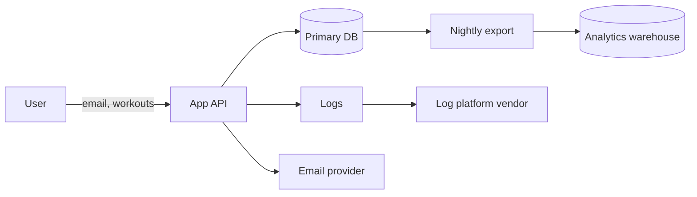
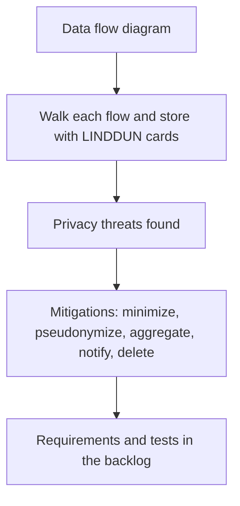

# Privacy Engineering

## Introduction

**Security** protects data from people who should not have it. **Privacy** asks a different question: should *anyone*, including your own company, collect, keep, combine or share this data at all, and does the person it describes know and agree?

A perfectly secure system can still be terrible for privacy. Imagine a fitness app that encrypts everything, has flawless access control, and also collects every user's precise location 24 hours a day "in case it is useful later," keeps it forever, and shares it with ad partners. Nothing was breached, yet users are harmed and regulators would have a lot to say.

**Privacy engineering** is the practice of turning privacy principles into concrete design decisions, code and tests. Laws such as the GDPR (Article 25, "data protection by design and by default") and many US state privacy laws expect it, and users increasingly choose products that respect it.

An analogy: security is the lock on your diary. Privacy is deciding what you write in it, who you show it to, and when you throw old pages away.

This page covers:

- The core principles and how to turn them into requirements.
- **Data mapping**, so you know what you hold.
- Techniques: **minimization**, **keyed pseudonymization**, **log redaction**, **retention**, **k-anonymity** and **differential privacy**.
- Privacy threat modeling with **LINDDUN**.
- Supporting user rights such as access and deletion.

## Principles You Can Build

| Principle | Plain meaning | Engineering requirement example |
| --- | --- | --- |
| Data minimization | Collect only what you need | Signup form asks for email only, not birth date |
| Purpose limitation | Use data only for the stated purpose | Support tickets are not used to train ad models |
| Storage limitation | Do not keep data longer than needed | Raw location deleted after 30 days |
| Transparency | People know what happens to their data | In-product explanation at the moment of collection |
| User control | People can access, correct, export, delete | Self-service export and delete in settings |
| Privacy by default | The most private option is the default | Profile visibility starts as "private" |
| Security | Protect what you keep | Encryption, access control, audit logs |

The **NIST Privacy Framework** (version 1.0, with a 1.1 update published as a draft) organizes privacy outcomes into five functions: **Identify-P, Govern-P, Control-P, Communicate-P and Protect-P**. It is designed to be used alongside the NIST Cybersecurity Framework (see [Security Frameworks](./1-sec-security-frameworks.mdx)).

## Step 1: Know Your Data

You cannot protect, minimize or delete data you do not know about. A **data map** (in GDPR terms, part of the **Record of Processing Activities**) lists, for each dataset: what personal data it contains, why you hold it, the legal basis, where it lives, who can access it, who it is shared with, and how long it is kept.

```yaml
# data_map.yaml
- dataset: users
  fields: [email, display_name, password_hash]
  purpose: account management
  lawful_basis: contract
  location: postgres/eu-west
  retention: life of account + 30 days
  shared_with: [email-delivery-provider]
- dataset: workout_locations
  fields: [user_id, lat, lon, timestamp]
  purpose: route display for the user
  lawful_basis: consent
  location: postgres/eu-west
  retention: 30 days raw, then route summary only
  shared_with: []
- dataset: app_logs
  fields: [request_path, user_id, ip_address]
  purpose: debugging and security monitoring
  lawful_basis: legitimate interest
  location: log-platform
  retention: 30 days
  shared_with: [log-platform-vendor]
```

Keep this file in version control next to the code, and require it to be updated in the same pull request that adds a new personal data field. Data discovery tools can scan databases and buckets for personal data you forgot about, which is a useful check on the map.



Every arrow is a question: does this destination really need personal data, and in what form?

## Step 2: Minimize

The cheapest privacy control is data you never collect. Common minimization moves:

- **Do not collect it**: drop optional fields that no feature uses.
- **Coarsen it**: store age range instead of birth date, city instead of GPS coordinates, month instead of exact timestamp.
- **Compute and discard**: verify age, then store only "over 18: true".
- **Process locally**: do it on the device and send only the result.

**Vulnerable** (stores everything "just in case"):

```python
# signup_vulnerable.py
def signup(form: dict) -> dict:
    return {
        "email": form["email"],
        "full_name": form["full_name"],
        "birth_date": form["birth_date"],       # only used to check age once
        "phone": form["phone"],                 # no feature uses it
        "ip_address": form["ip"],               # kept forever
    }
```

**Fixed** (stores only what features need):

```python
# signup_fixed.py
from datetime import date

def is_adult(birth_date: str, today: date) -> bool:
    b = date.fromisoformat(birth_date)
    years = today.year - b.year - ((today.month, today.day) < (b.month, b.day))
    return years >= 18

def signup(form: dict, today: date = date(2026, 10, 11)) -> dict:
    if not is_adult(form["birth_date"], today):
        raise ValueError("Users must be 18 or older")
    return {
        "email": form["email"],
        "display_name": form.get("display_name") or form["email"].split("@")[0],
        "age_verified": True,                   # the fact we need, not the date
    }

print(signup({"email": "ana@example.com", "birth_date": "1999-04-02",
              "phone": "+1 555 0100", "ip": "203.0.113.7"}))
```

Output:

```text
{'email': 'ana@example.com', 'display_name': 'ana', 'age_verified': True}
```

## Step 3: Pseudonymize Correctly

**Pseudonymization** replaces direct identifiers with a stand-in, so analysts can join and count records without seeing who they belong to. Under GDPR, pseudonymized data is still personal data, because it can be linked back with extra information. It reduces risk; it does not remove obligations. **Anonymized** data, which can no longer be linked to a person by any reasonably likely means, is much harder to achieve than most people think.

A very common mistake is to "anonymize" emails with a plain hash.

**Vulnerable** (unkeyed hash is reversible by guessing):

```python
# pseudo_vulnerable.py
import hashlib

def pseudonym(email: str) -> str:
    return hashlib.sha256(email.lower().encode()).hexdigest()

exported = pseudonym("ana@example.com")

# Anyone with a list of candidate emails (a leaked list, a CRM export) can reverse it:
candidates = ["bob@example.com", "ana@example.com", "cy@example.com"]
lookup = {pseudonym(c): c for c in candidates}
print("Re-identified:", lookup.get(exported))
```

Output:

```text
Re-identified: ana@example.com
```

Email addresses, phone numbers and IDs come from small, guessable spaces, so a dictionary attack works instantly. Adding a public salt does not help, because the attacker can apply the same salt.

**Fixed** (keyed HMAC with a secret kept outside the analytics environment):

```python
# pseudo_fixed.py
import hashlib
import hmac
import os

# In production, load this from a secrets manager, rotate it per dataset or per
# sharing partner, and never give it to the people who receive the pseudonyms.
PSEUDONYM_KEY = os.environ.get("PSEUDONYM_KEY", "dev-only-key-change-me").encode()

def pseudonym(email: str) -> str:
    mac = hmac.new(PSEUDONYM_KEY, email.strip().lower().encode(), hashlib.sha256)
    return mac.hexdigest()[:32]

print(pseudonym("ana@example.com") == pseudonym(" ANA@example.com "))  # stable for joins
print(len(pseudonym("ana@example.com")))
```

Output:

```text
True
32
```

Without the key, the attacker cannot compute pseudonyms for their guesses. Use different keys for different recipients so two partners cannot join their datasets on your pseudonyms. If you ever need to reverse a pseudonym (for example, to contact a user flagged by fraud analysis), use **tokenization** instead: a separate, tightly controlled vault that maps random tokens back to real values. See [Hash Functions](../1-sec-cryptography/1-sec-hashing.mdx) and [Key Management](../1-sec-cryptography/8-sec-key-management.mdx).

## Step 4: Keep Personal Data Out of Logs

Logs are one of the biggest privacy leaks: they are copied to many systems, kept for a long time, and read by many people. Redact at the source.

```python
# log_redaction.py
import logging
import re

EMAIL = re.compile(r"[\w.+-]+@[\w-]+\.[\w.-]+")
CARD = re.compile(r"\b(?:\d[ -]?){13,19}\b")

class RedactFilter(logging.Filter):
    def filter(self, record: logging.LogRecord) -> bool:
        msg = record.getMessage()
        msg = EMAIL.sub("[email]", msg)
        msg = CARD.sub("[number]", msg)
        record.msg, record.args = msg, None
        return True

logging.basicConfig(format="%(levelname)s %(message)s", level=logging.INFO)
log = logging.getLogger("app")
log.addFilter(RedactFilter())

log.info("Password reset requested for %s", "ana@example.com")
log.info("Payment failed for card 4111 1111 1111 1111")
```

Output:

```text
INFO Password reset requested for [email]
INFO Payment failed for card [number]
```

Regex redaction is a **safety net**, not the main control. The better habit is to log stable internal IDs (`user_id=8812`) instead of personal data in the first place, and to use structured logging with an allowlist of fields. See [Secure Error Handling and Logging](../5-sec-secure-coding/2-sec-error-handling-and-logging.mdx).

## Step 5: Enforce Retention

Storage limitation only happens if a job actually deletes data. Make retention part of the schema and run a scheduled purge:

```python
# retention_job.py
import sqlite3
from datetime import datetime, timedelta

RETENTION = {"workout_locations": timedelta(days=30), "login_events": timedelta(days=90)}
NOW = datetime(2026, 10, 11)

db = sqlite3.connect(":memory:")
db.executescript("""
CREATE TABLE workout_locations (user_id INT, lat REAL, lon REAL, created_at TEXT);
CREATE TABLE login_events (user_id INT, ip TEXT, created_at TEXT);
""")
db.executemany("INSERT INTO workout_locations VALUES (?,?,?,?)", [
    (1, 52.37, 4.89, "2026-10-01T08:00:00"),
    (1, 52.36, 4.90, "2026-08-01T08:00:00"),
])
db.executemany("INSERT INTO login_events VALUES (?,?,?)", [
    (1, "203.0.113.7", "2026-09-30T10:00:00"),
    (2, "198.51.100.4", "2026-05-01T10:00:00"),
])

for table, keep in RETENTION.items():
    cutoff = (NOW - keep).isoformat()
    cur = db.execute(f"DELETE FROM {table} WHERE created_at < ?", (cutoff,))  # table names from our own constant
    print(f"{table}: deleted {cur.rowcount} rows older than {cutoff[:10]}")
db.commit()
```

Output:

```text
workout_locations: deleted 1 rows older than 2026-09-11
login_events: deleted 1 rows older than 2026-07-13
```

Remember the copies: backups, search indexes, caches, analytics warehouses and vendor systems. Backups usually cannot be edited record by record, so a common approach is to keep backup retention short and documented, and to re-apply deletions if a backup is ever restored.

## Step 6: Share Aggregates Safely

Analysts often need statistics, not individuals. Two techniques help.

### k-anonymity

A dataset is **k-anonymous** if every combination of **quasi-identifiers** (fields such as ZIP code, age and gender that can identify people when combined) appears at least k times. Generalizing values (age 34 becomes "30-39", ZIP 10115 becomes "101**") raises k.

```python
# k_anonymity.py
from collections import Counter

rows = [
    {"zip": "10115", "age": 34, "condition": "asthma"},
    {"zip": "10117", "age": 36, "condition": "flu"},
    {"zip": "10119", "age": 31, "condition": "flu"},
    {"zip": "20095", "age": 52, "condition": "diabetes"},
    {"zip": "20097", "age": 58, "condition": "asthma"},
]

def generalize(r):
    return (r["zip"][:3] + "**", f"{r['age'] // 10 * 10}-{r['age'] // 10 * 10 + 9}")

def k_of(rows, key):
    return min(Counter(key(r) for r in rows).values())

print("k (raw zip, age):", k_of(rows, lambda r: (r["zip"], r["age"])))
print("k (generalized): ", k_of(rows, generalize))
print(Counter(generalize(r) for r in rows))
```

Output:

```text
k (raw zip, age): 1
k (generalized):  2
Counter({('101**', '30-39'): 3, ('200**', '50-59'): 2})
```

k-anonymity has known weaknesses. If everyone in a group has the same sensitive value, the group reveals it anyway (a "homogeneity" attack), and attackers with background knowledge can still narrow things down. Treat it as a basic check, not a guarantee.

### Differential privacy

**Differential privacy (DP)** adds carefully calibrated random noise to query results, so the output barely changes whether or not any single person is in the dataset. The parameter **epsilon** controls the trade-off: smaller epsilon means more noise and more privacy. A count query changes by at most 1 when one person is added or removed, so Laplace noise with scale 1/epsilon is enough:

```python
# dp_count.py
import random

random.seed(42)

def laplace(scale: float) -> float:
    # Difference of two exponentials is Laplace-distributed.
    return random.expovariate(1 / scale) - random.expovariate(1 / scale)

def dp_count(true_count: int, epsilon: float) -> int:
    return max(0, round(true_count + laplace(1 / epsilon)))

true = 128  # users who ran more than 100 km this month
for eps in (0.1, 1.0, 5.0):
    print(f"epsilon={eps:<4} released counts:", [dp_count(true, eps) for _ in range(5)])
```

Output:

```text
epsilon=0.1  released counts: [138, 129, 130, 149, 133]
epsilon=1.0  released counts: [128, 128, 128, 127, 130]
epsilon=5.0  released counts: [128, 128, 129, 128, 128]
```

Toy code like this is fine for learning. In production, use a vetted library (for example OpenDP or Google's differential privacy libraries), because real DP needs careful handling of floating point, sensitivity, and the **privacy budget** that is consumed with every query. The US Census Bureau used differential privacy for its 2020 Census data products, which shows both its power and how much expertise it takes to apply well.

## Privacy Threat Modeling with LINDDUN

[STRIDE](../6-sec-appsec-and-devsecops/1-sec-threat-modeling.mdx) finds security threats. **LINDDUN**, developed at KU Leuven, finds privacy threats with seven categories:

| Category | Question | Example |
| --- | --- | --- |
| Linking | Can data items be linked to learn more about a person? | Joining pseudonymized analytics with ad IDs |
| Identifying | Can a person be identified? | Precise home location reveals identity |
| Non-repudiation | Is a person unable to deny an action when they should be able to? | Signed logs of a whistleblower's submissions |
| Detecting | Can someone learn that a person is in a system? | "Email already registered" on a sensitive health app |
| Data Disclosure | Is personal data disclosed more than necessary? | API returns full profile when only name is needed |
| Unawareness | Are users unaware or unable to intervene? | No way to see or delete data |
| Non-compliance | Does processing break laws, policy or user expectations? | No retention, no lawful basis |

LINDDUN comes in variants: **GO** (a lightweight card game for team workshops), **PRO** (systematic, based on data flow diagrams) and **MAESTRO** (model-driven). Running LINDDUN GO on the data flow diagram above takes about an hour and usually finds several concrete issues.



## Supporting User Rights

Laws like the GDPR give people the right to access, correct, export and delete their data, and many other laws contain similar rights. Engineering needs:

- A **registry of every store** holding personal data (your data map), each with an export function and a delete function.
- **Identity verification** before acting, so an attacker cannot request someone else's data.
- An **audit trail** of requests and completion times, because laws set deadlines.
- **Propagation** to processors and vendors.

Watch out for the "Detecting" threat: the response to an access request should not reveal whether a different person has an account.

## Real-World Scenario

**Your team** runs a fitness app with 2 million users in the EU and the US. The growth team wants to "send all workout data to the analytics warehouse so analysts can find what drives retention." Today the warehouse has 40 users with access, including contractors.

### The design

1. **Data map first.** Workouts include GPS routes, which reveal home and work addresses: highly identifying.
2. **Minimize at the source.** The export drops GPS points, keeps distance, duration, and city-level region, and truncates timestamps to the day.
3. **Pseudonymize with HMAC.** User IDs become keyed pseudonyms. The key stays in the production secrets manager, not in the warehouse.
4. **Retention.** Raw event tables are deleted after 13 months; aggregated tables can be kept longer.
5. **Aggregates for wide audiences.** Dashboards for the whole company show DP-protected or minimum-group-size (k of at least 10) aggregates only.
6. **LINDDUN GO workshop** with growth, data and security, which finds one more issue: free-text workout notes can contain names and health details, so they are excluded.

### Why this approach

Analysts get what they need for retention analysis (behavior patterns), without exposing who is where. Each layer removes a class of risk: GPS removal stops identification by location, HMAC stops easy re-identification by ID, retention limits the size of any breach, and aggregates protect broad audiences.

### When to use it, and when not to

Use this layered approach whenever personal data leaves the system where it was collected. Do not apply heavy DP to small internal tables where only two engineers have access and the purpose is debugging; there, access control and short retention are simpler and enough. Do not claim data is "anonymous" just because names were removed.

### Alternatives and trade-offs

| Approach | Pros | Cons | Best for |
| --- | --- | --- | --- |
| Raw data in the warehouse | Maximum flexibility | Highest risk, purpose creep, harder compliance | Rarely justified |
| Minimized + keyed pseudonyms | Joins still work, much lower risk | Still personal data; key must be protected | Analyst access to behavior data |
| Tokenization vault | Reversible under control | Extra service to run and secure | Fraud, support workflows that must re-identify |
| k-anonymous generalized tables | Simple to explain | Weak against background knowledge | Low-risk external sharing |
| Differential privacy aggregates | Strong mathematical guarantees | Noise, budget management, expertise needed | Public stats, large audiences |
| Synthetic data | No real records shared | Can leak if poorly generated; may not reflect reality | Testing, demos |

## Common Mistakes

1. **Unkeyed hashes as "anonymization".** Emails and phone numbers are easy to brute force. Use HMAC with a secret key, or tokenization.
2. **Calling pseudonymized data anonymous.** It is still personal data under the GDPR.
3. **Personal data in logs and error trackers.** Log IDs, not emails, and redact as a safety net.
4. **Retention on paper only.** Without a deletion job, nothing is deleted.
5. **Forgetting copies.** Backups, caches, search indexes, exports and vendors all hold copies.
6. **Privacy review at the end.** Run LINDDUN or a DPIA during design, when changes are cheap.
7. **Leaky existence checks.** "Email already registered" can reveal sensitive memberships.

## Summary

- Privacy decides **whether and how** data should be used. Security protects it.
- Start with a **data map**, then **minimize**: do not collect, coarsen, compute and discard.
- **Pseudonymize with a keyed HMAC**, never a plain hash. Pseudonymized data is still personal data.
- Keep personal data **out of logs**, and **enforce retention** with scheduled deletion.
- For aggregates, **k-anonymity** is a basic check, and **differential privacy** gives strong guarantees when done with vetted libraries.
- Use **LINDDUN** for privacy threat modeling and build **user rights** features into the architecture.

## Exercises

1. Write a data map for an app you have built. Mark every field you could drop or coarsen.
2. Change `pseudo_fixed.py` so each sharing partner gets a different key derived from a master key and the partner name, and show that the same email gives different pseudonyms per partner.
3. Add a third quasi-identifier (gender) to `k_anonymity.py` and find a generalization that keeps k at least 2.
4. Run a LINDDUN GO session (the cards are free on linddun.org) on a signup flow, and list three threats with fixes.

### Related pages

- [Compliance: SOC 2, PCI DSS, HIPAA and GDPR](./2-sec-compliance.mdx)
- [Threat Modeling with STRIDE](../6-sec-appsec-and-devsecops/1-sec-threat-modeling.mdx)
- [Digital Signatures and MACs](../1-sec-cryptography/5-sec-digital-signatures.mdx)
- [Securing Cloud Storage](../8-sec-cloud-and-container/3-sec-cloud-storage-security.mdx)
- [Data Privacy and PII (AI Agents tutorial)](../../../ai/agents/12-agents-safety-and-security/5-agents-data-privacy.mdx)
