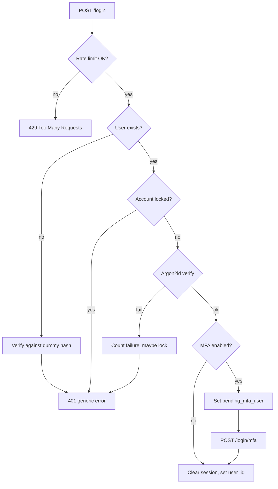

# Project: Building a Secure Login System

## Introduction

Almost every application has a login form, and almost every login form is attacked. Bots replay passwords leaked from other sites, guess common passwords, and probe error messages to learn which emails have accounts. A login system that "works" in a demo can still give all of this away.

In this project you will build a small but complete login API with Flask, one piece at a time. For each piece you will see the **Vulnerable** version a beginner might write and the **Fixed** version, and you will learn *why* each fix exists. By the end you will have:

- Registration with a modern password policy
- Password storage with **Argon2id** (`argon2-cffi`)
- A login endpoint that does not reveal which accounts exist
- **Rate limiting** per IP and **throttling** per account
- Hardened **session cookies** with session renewal on login
- **TOTP multi-factor authentication** with replay protection
- **Security event logging** you can feed into a SIEM later

Think of it like fitting out the front door of a shop. The lock (password hashing) matters, but so do the door frame (sessions), the alarm (logging), the shutter that comes down after too many attempts (throttling) and the second key held by the owner (MFA).

:::note What this project builds on
This page puts together ideas covered in depth elsewhere. Read these first if any step feels unfamiliar:
[Password Hashing](../1-sec-cryptography/2-sec-password-hashing.mdx),
[Secure Password Authentication](../4-sec-authentication/1-sec-password-authentication.mdx),
[Multi-Factor Authentication](../4-sec-authentication/2-sec-mfa.mdx) and
[Sessions and Cookies](../4-sec-authentication/4-sec-sessions-and-cookies.mdx).
:::

## What You Will Build

The app is a JSON API for a fictional note-taking service called **NoteHub**. A browser front end (not shown) calls these endpoints:

| Endpoint | Purpose |
| --- | --- |
| `POST /register` | Create an account |
| `POST /login` | Check email and password |
| `POST /login/mfa` | Second step when the user has MFA enabled |
| `POST /mfa/enroll` and `POST /mfa/confirm` | Turn on TOTP for the signed-in user |
| `GET /me` | A protected endpoint |
| `POST /logout` | End the session |

Here is the login flow you are aiming for:



Every failure path returns the **same** message, and every path writes a log line.

## Step 0: Set Up the Project

You need Python 3.10 or later. Create a virtual environment and install the libraries:

```bash
mkdir notehub && cd notehub
python3 -m venv .venv
source .venv/bin/activate
pip install flask argon2-cffi pyotp flask-limiter
```

Library versions at the time of writing were Flask 3.1, argon2-cffi 25.1, PyOTP 2.10 and Flask-Limiter 4.1. Check each project's changelog before you copy code into production, because APIs can change.

Generate a secret key and keep it out of the code:

```bash
export SECRET_KEY="$(python3 -c 'import secrets; print(secrets.token_hex(32))')"
export COOKIE_SECURE=0   # only for local HTTP testing; leave it at 1 in production
```

## Step 1: Configuration and Session Cookies

**Vulnerable:**

```python
app = Flask(__name__)
app.secret_key = "dev"          # hard-coded, guessable, and committed to git
app.run(debug=True)             # the debugger allows code execution if exposed
```

Flask's default session is a cookie signed with `SECRET_KEY`. Anyone who knows the key can forge a session for any user. The Werkzeug debugger gives an interactive Python console in the browser when an error happens, which is a remote code execution risk if it is reachable.

**Fixed:**

```python
import os
from flask import Flask

app = Flask(__name__)
app.config.update(
    SECRET_KEY=os.environ["SECRET_KEY"],          # never hard-code; fail fast if missing
    SESSION_COOKIE_HTTPONLY=True,                 # JavaScript cannot read the cookie
    SESSION_COOKIE_SECURE=os.environ.get("COOKIE_SECURE", "1") == "1",  # HTTPS only
    SESSION_COOKIE_SAMESITE="Lax",                # cookie not sent on cross-site POSTs
    PERMANENT_SESSION_LIFETIME=60 * 60 * 8,       # absolute lifetime: 8 hours
)
```

Each setting closes a specific gap:

| Setting | Attack it blocks |
| --- | --- |
| `SECRET_KEY` from the environment | Forged sessions from a leaked or guessable key |
| `HttpOnly` | Session theft through XSS reading `document.cookie` |
| `Secure` | Cookie sent over plain HTTP and sniffed on the network |
| `SameSite=Lax` | Most cross-site request forgery against POST endpoints |
| Fixed lifetime | A stolen cookie working forever |

## Step 2: Database and Registration

Use parameterized SQL from the start. A login form is one of the most common places to find [SQL injection](../3-sec-web-security/3-sec-sql-injection.mdx).

```python
import sqlite3
from flask import g

DB_PATH = os.environ.get("DB_PATH", "users.db")

def db():
    if "db" not in g:
        g.db = sqlite3.connect(DB_PATH)
        g.db.row_factory = sqlite3.Row
    return g.db

@app.teardown_appcontext
def close_db(exc):
    conn = g.pop("db", None)
    if conn is not None:
        conn.close()

def init_db():
    with app.app_context():
        db().executescript("""
        CREATE TABLE IF NOT EXISTS users (
            id INTEGER PRIMARY KEY,
            email TEXT UNIQUE NOT NULL,
            pw_hash TEXT NOT NULL,
            totp_secret TEXT,
            last_totp_step INTEGER DEFAULT 0,
            failed INTEGER DEFAULT 0,
            locked_until REAL DEFAULT 0
        );
        """)
        db().commit()
```

### Password policy

**Vulnerable:**

```python
import re

def check_password(pw):
    # 8 chars, upper, digit, symbol: pushes users toward "Summer2026!"
    return len(pw) >= 8 and re.search(r"[A-Z]", pw) and re.search(r"\d", pw) and re.search(r"\W", pw)
```

**Fixed**, following the direction of NIST SP 800-63B-4 (length over complexity, no composition rules, a blocklist of common or breached passwords):

```python
COMMON = {"password", "123456789012345", "qwertyuiopasdfg", "passwordpassword"}

def password_problems(pw: str) -> list[str]:
    problems = []
    if len(pw) < 15:
        problems.append("Use at least 15 characters.")
    if len(pw) > 128:
        problems.append("Use at most 128 characters.")
    if pw.lower() in COMMON:
        problems.append("This password is too common.")
    return problems
```

The `COMMON` set is a stand-in. In a real app, load a large list of common passwords and consider a breached-password check such as the Have I Been Pwned range API, which uses k-anonymity so you only send the first five characters of a SHA-1 hash. The [Secure Password Authentication](../4-sec-authentication/1-sec-password-authentication.mdx) page shows that check. The upper limit stops someone sending megabytes of "password" to make your hasher do expensive work.

### Hashing and the registration endpoint

**Vulnerable:**

```python
import hashlib
pw_hash = hashlib.md5(pw.encode()).hexdigest()   # fast, unsalted: cracked in seconds
```

**Fixed:**

```python
import logging
from argon2 import PasswordHasher
from flask import jsonify, request

ph = PasswordHasher()                              # Argon2id with library defaults
log = logging.getLogger("auth")
logging.basicConfig(level=logging.INFO, format="%(levelname)s %(name)s %(message)s")

@app.post("/register")
@limiter.limit("5 per hour")
def register():
    data = request.get_json(silent=True) or {}
    email = str(data.get("email", "")).strip().lower()
    pw = str(data.get("password", ""))
    problems = password_problems(pw)
    if "@" not in email or problems:
        return jsonify(error="invalid input", details=problems), 400
    try:
        db().execute("INSERT INTO users (email, pw_hash) VALUES (?, ?)",
                     (email, ph.hash(pw)))
        db().commit()
    except sqlite3.IntegrityError:
        pass  # same response either way: do not reveal that the email exists
    log.info("register email=%s", email)
    return jsonify(status="ok, check your email to confirm"), 202
```

`PasswordHasher()` uses Argon2id. The argon2-cffi documentation lists its defaults as 64 MiB of memory, 3 iterations and a parallelism of 4. That memory cost is the point: it makes offline cracking on GPUs expensive. It also means each login uses real memory, so size your containers for it.

Notice two details:

- **Duplicate emails get the same answer** as new ones. The real "you already have an account" message goes out by email. Otherwise the register form becomes an account-enumeration oracle.
- **`get_json(silent=True)`** returns `None` unless the request has a JSON content type. Requiring `application/json` means a plain HTML form on another site cannot submit to this endpoint without a CORS preflight, which adds a layer of CSRF defense. Using `force=True` would remove that layer.

The `limiter` object is created in Step 4; in the final file it sits near the top.

## Step 3: The Login Endpoint

This is where most mistakes happen.

**Vulnerable:**

```python
@app.post("/login")
def login():
    email, pw = request.form["email"], request.form["password"]
    user = db().execute(f"SELECT * FROM users WHERE email = '{email}'").fetchone()  # SQL injection
    if user is None:
        return "No account with that email", 404          # enumeration
    if hashlib.md5(pw.encode()).hexdigest() != user["pw_hash"]:
        return "Wrong password", 401                       # enumeration
    session["user_id"] = user["id"]                        # old session data kept
    return "Welcome"
```

Count the problems: SQL injection, fast hashing, two different error messages that reveal which emails exist, no limit on guessing, and the session is not renewed on login.

**Fixed:**

```python
import time
from argon2.exceptions import InvalidHashError, VerifyMismatchError
from flask import session

DUMMY_HASH = ph.hash("dummy-password-for-timing")  # used when the user does not exist
MAX_FAILURES = 10          # per account, before a temporary lock
LOCK_SECONDS = 15 * 60

@app.post("/login")
@limiter.limit("10 per minute")
def login():
    data = request.get_json(silent=True) or {}
    email = str(data.get("email", "")).strip().lower()
    pw = str(data.get("password", ""))
    user = db().execute("SELECT * FROM users WHERE email = ?", (email,)).fetchone()

    if user is None:
        try:
            ph.verify(DUMMY_HASH, pw)  # spend the same time as a real check
        except VerifyMismatchError:
            pass
        log.warning("login_failed reason=no_user email=%s ip=%s", email, request.remote_addr)
        return jsonify(error="invalid email or password"), 401

    if user["locked_until"] > time.time():
        log.warning("login_blocked reason=locked user_id=%s ip=%s", user["id"], request.remote_addr)
        return jsonify(error="invalid email or password"), 401

    try:
        ph.verify(user["pw_hash"], pw)
    except (VerifyMismatchError, InvalidHashError):
        failed = user["failed"] + 1
        locked_until = time.time() + LOCK_SECONDS if failed >= MAX_FAILURES else 0
        db().execute("UPDATE users SET failed = ?, locked_until = ? WHERE id = ?",
                     (failed if not locked_until else 0, locked_until, user["id"]))
        db().commit()
        log.warning("login_failed reason=bad_password user_id=%s ip=%s failures=%s",
                    user["id"], request.remote_addr, failed)
        return jsonify(error="invalid email or password"), 401

    if ph.check_needs_rehash(user["pw_hash"]):
        db().execute("UPDATE users SET pw_hash = ? WHERE id = ?", (ph.hash(pw), user["id"]))
    db().execute("UPDATE users SET failed = 0, locked_until = 0 WHERE id = ?", (user["id"],))
    db().commit()

    session.clear()                      # drop anything set before login
    if user["totp_secret"]:
        session["pending_mfa_user"] = user["id"]
        session["pending_since"] = time.time()
        return jsonify(status="mfa_required"), 200

    session["user_id"] = user["id"]
    session.permanent = True
    log.info("login_success user_id=%s ip=%s mfa=false", user["id"], request.remote_addr)
    return jsonify(status="ok"), 200
```

What each part does:

- **Dummy hash for unknown users.** Without it, "no such user" returns in a millisecond and "wrong password" takes tens of milliseconds, and an attacker can tell them apart by timing.
- **Generic error everywhere**, including for locked accounts.
- **Per-account throttling.** After 10 failures the account is locked for 15 minutes. NIST SP 800-63B-4 requires a limit of no more than 100 consecutive failures, so 10 is well within it.
- **`check_needs_rehash`** upgrades old hashes when you raise the Argon2 parameters, without forcing password resets.
- **`session.clear()` before setting the user** avoids carrying any pre-login data into the authenticated session.
- **Structured log lines** with an event name, user id and IP. These feed the detection project in [Detecting Attacks from Logs](./4-sec-project-log-monitoring.mdx).

:::caution Lockouts can be abused
A hard lockout lets an attacker lock out a victim on purpose by sending bad passwords. Short, temporary locks, a CAPTCHA or proof-of-work challenge after a few failures, and alerting are gentler than permanent locks. Also never log the submitted password, even a failed one, because users often type a password for a different site.
:::

## Step 4: Rate Limiting per IP

Per-account throttling stops guessing *one* account. Credential stuffing spreads guesses across *many* accounts, one or two tries each, so you also need limits per client. Flask-Limiter adds that with a decorator:

```python
from flask_limiter import Limiter
from flask_limiter.util import get_remote_address

limiter = Limiter(get_remote_address, app=app, storage_uri="memory://")
```

The decorators `@limiter.limit("10 per minute")` on `/login` and `"5 per minute"` on `/login/mfa` return HTTP 429 when exceeded.

Two production notes:

- `memory://` storage is per process. With several workers or servers, use shared storage such as Redis (`storage_uri="redis://..."`), or each worker keeps its own count.
- Behind a reverse proxy, `request.remote_addr` is the proxy's address. Use Werkzeug's `ProxyFix` middleware configured for the exact number of proxies you trust, otherwise every user shares one limit, or attackers can spoof `X-Forwarded-For`.

Large credential-stuffing botnets rotate through thousands of IPs, so per-IP limits are only one layer. Bot detection at the edge, breached-password checks and MFA cover the rest. See [Rate Limiting and Abuse Prevention](../7-sec-api-security/3-sec-rate-limiting.mdx).

## Step 5: TOTP Multi-Factor Authentication

A second factor means a stolen password alone is not enough. TOTP (time-based one-time passwords, RFC 6238) is what authenticator apps implement.

### Enrollment

```python
import pyotp
from functools import wraps
from flask import abort

def login_required(view):
    @wraps(view)
    def wrapper(*args, **kwargs):
        if "user_id" not in session:
            abort(401)
        return view(*args, **kwargs)
    return wrapper

@app.post("/mfa/enroll")
@login_required
def mfa_enroll():
    secret = pyotp.random_base32()
    session["enroll_secret"] = secret
    user = db().execute("SELECT email FROM users WHERE id = ?", (session["user_id"],)).fetchone()
    uri = pyotp.TOTP(secret).provisioning_uri(name=user["email"], issuer_name="NoteHub")
    return jsonify(otpauth_uri=uri)

@app.post("/mfa/confirm")
@login_required
def mfa_confirm():
    secret = session.get("enroll_secret")
    code = str((request.get_json(silent=True) or {}).get("code", ""))
    if not secret or not pyotp.TOTP(secret).verify(code, valid_window=1):
        return jsonify(error="invalid code"), 400
    db().execute("UPDATE users SET totp_secret = ? WHERE id = ?", (secret, session["user_id"]))
    db().commit()
    session.pop("enroll_secret")
    log.info("mfa_enabled user_id=%s", session["user_id"])
    return jsonify(status="mfa enabled")
```

The front end turns `otpauth_uri` into a QR code. MFA is only saved after the user proves their app produces the right code, so a typo during setup cannot lock them out.

:::warning Keep the enrollment secret off the client in production
Flask's default session is a *signed*, not *encrypted*, cookie. Anyone holding the cookie can base64-decode it and read `enroll_secret`. That is acceptable here only because the cookie belongs to the user who is enrolling. A server-side session store is cleaner, and it also lets you revoke sessions (see the trade-offs below).
:::

### The second login step

**Vulnerable:**

```python
if pyotp.TOTP(secret).verify(code, valid_window=10):   # 10 steps = about 5 minutes either way
    session["user_id"] = uid                              # and the same code can be reused
```

**Fixed:**

```python
@app.post("/login/mfa")
@limiter.limit("5 per minute")
def login_mfa():
    uid = session.get("pending_mfa_user")
    if uid is None or time.time() - session.get("pending_since", 0) > 300:
        session.clear()
        return jsonify(error="start login again"), 401
    code = str((request.get_json(silent=True) or {}).get("code", ""))
    user = db().execute("SELECT * FROM users WHERE id = ?", (uid,)).fetchone()
    totp = pyotp.TOTP(user["totp_secret"])
    step = int(time.time()) // 30
    if not totp.verify(code, valid_window=1) or step <= user["last_totp_step"]:
        log.warning("mfa_failed user_id=%s ip=%s", uid, request.remote_addr)
        return jsonify(error="invalid code"), 401
    db().execute("UPDATE users SET last_totp_step = ? WHERE id = ?", (step, uid))
    db().commit()
    session.clear()
    session["user_id"] = uid
    session.permanent = True
    log.info("login_success user_id=%s ip=%s mfa=true", uid, request.remote_addr)
    return jsonify(status="ok"), 200
```

Key points:

- A **pending** state (`pending_mfa_user`) is not the same as logged in. Protected endpoints check only `user_id`.
- The pending state **expires** after five minutes.
- `valid_window=1` accepts one 30-second step either side to allow for clock drift, no more.
- **Replay protection**: the last accepted time step is stored, and a code from the same or an older step is rejected. The PyOTP docs recommend this.
- A strict rate limit stops brute-forcing the 1,000,000 possible six-digit codes.

## Step 6: Test It

Put the pieces in one `app.py` (configuration, `limiter`, `ph` and helpers at the top, then routes, then `logout` and `/me`). Add the remaining two endpoints:

```python
@app.get("/me")
@login_required
def me():
    return jsonify(user_id=session["user_id"])

@app.post("/logout")
def logout():
    session.clear()
    return jsonify(status="logged out")

if __name__ == "__main__":
    init_db()
    app.run(port=5000)
```

Then test the security behavior with Flask's test client, not just the happy path:

```python
import os
import tempfile

os.environ["SECRET_KEY"] = "test-only-secret"
os.environ["COOKIE_SECURE"] = "0"
os.environ["DB_PATH"] = os.path.join(tempfile.mkdtemp(), "test.db")

import pyotp
import app as appmod

appmod.init_db()
client = appmod.app.test_client()

r = client.post("/register", json={"email": "alice@example.com", "password": "short"})
print("weak password:", r.status_code, r.get_json()["details"])
r = client.post("/register", json={"email": "alice@example.com",
                                   "password": "correct horse battery staple"})
print("register:", r.status_code)

r = client.post("/login", json={"email": "alice@example.com", "password": "wrong"})
print("bad password:", r.status_code, r.get_json())
r = client.post("/login", json={"email": "nobody@example.com", "password": "wrong"})
print("unknown user:", r.status_code, r.get_json())

r = client.post("/login", json={"email": "alice@example.com",
                                "password": "correct horse battery staple"})
print("good login:", r.status_code, r.get_json())
print("cookie:", r.headers.get("Set-Cookie"))

uri = client.post("/mfa/enroll").get_json()["otpauth_uri"]
secret = pyotp.parse_uri(uri).secret
print("mfa confirm:", client.post("/mfa/confirm", json={"code": pyotp.TOTP(secret).now()}).get_json())

client.post("/logout")
r = client.post("/login", json={"email": "alice@example.com",
                                "password": "correct horse battery staple"})
print("login with mfa:", r.get_json())
print("me before mfa:", client.get("/me").status_code)
code = pyotp.TOTP(secret).now()
print("mfa step:", client.post("/login/mfa", json={"code": code}).get_json())
print("me after mfa:", client.get("/me").get_json())

client.post("/logout")
client.post("/login", json={"email": "alice@example.com",
                            "password": "correct horse battery staple"})
r = client.post("/login/mfa", json={"code": code})
print("replayed code:", r.status_code, r.get_json())
```

Example output (log lines removed, cookie value shortened):

```text
weak password: 400 ['Use at least 15 characters.']
register: 202
bad password: 401 {'error': 'invalid email or password'}
unknown user: 401 {'error': 'invalid email or password'}
good login: 200 {'status': 'ok'}
cookie: session=eyJfcGVybWFuZW50Ijp0cnVl...; Expires=...; HttpOnly; Path=/; SameSite=Lax
mfa confirm: {'status': 'mfa enabled'}
login with mfa: {'status': 'mfa_required'}
me before mfa: 401
mfa step: {'status': 'ok'}
me after mfa: {'user_id': 1}
replayed code: 401 {'error': 'invalid code'}
```

The cookie has no `Secure` flag here only because the test sets `COOKIE_SECURE=0`. In production it must show `Secure`. The logs from the same run look like this:

```text
INFO auth register email=alice@example.com
WARNING auth login_failed reason=bad_password user_id=1 ip=127.0.0.1 failures=1
WARNING auth login_failed reason=no_user email=nobody@example.com ip=127.0.0.1
INFO auth login_success user_id=1 ip=127.0.0.1 mfa=false
INFO auth mfa_enabled user_id=1
INFO auth login_success user_id=1 ip=127.0.0.1 mfa=true
WARNING auth mfa_failed user_id=1 ip=127.0.0.1
```

Turn these checks into real `pytest` tests so they run in CI. A security property that is not tested will eventually regress.

## Real-World Scenario

NoteHub is a small SaaS with 20,000 users. Support sees a spike of "someone logged into my account" tickets, and the logs show thousands of failed logins per hour from many IPs, each trying a different email once or twice. That is credential stuffing with passwords leaked from other sites. The team has one sprint.

**What they ship, in order:**

1. The generic-error and dummy-hash fixes, so the attackers stop learning which emails are valid.
2. Per-IP rate limiting backed by Redis, plus an alert when the `login_failed` rate jumps.
3. A breached-password check at registration and password change, and forced resets for accounts that logged in successfully from flagged IPs.
4. Optional TOTP, with a banner encouraging it, and mandatory MFA for staff and admin accounts.
5. A roadmap item for [passkeys](../4-sec-authentication/3-sec-passkeys.mdx), which are phishing-resistant where TOTP is not.

**Why this approach:** each step is cheap and targets something in the logs. Enumeration fixes and rate limits reduce the attack's efficiency at once. MFA makes stolen passwords far less useful. Nothing requires a rewrite.

**When not to build it yourself:** if you are starting fresh, a managed identity provider (Auth0, Amazon Cognito, Microsoft Entra ID, Keycloak if self-hosted, and similar) gives you MFA, passkeys, breached-password detection and bot protection without maintaining them. Building your own is reasonable when you need full control, have unusual requirements, or are learning, as here.

### Session design trade-offs

The project uses Flask's signed-cookie sessions because they need no extra infrastructure. That choice has a cost: **logout cannot revoke a stolen cookie**, because the server keeps no record of it. It stays valid until it expires.

| Approach | Pros | Cons | Best for |
| --- | --- | --- | --- |
| Signed cookie session (Flask default) | No server storage, simple | No server-side revocation, contents readable | Small apps, prototypes |
| Server-side session (Redis or database, opaque ID in cookie) | Instant revocation, "log out all devices", contents private | Needs a shared store | Most production web apps |
| JWT access token plus refresh token | Stateless checks across many services | Hard to revoke, easy to misconfigure | APIs consumed by many services or mobile clients |
| Managed identity provider | MFA, passkeys and bot defense included | Cost, vendor lock-in, less control | Teams without dedicated auth expertise |

For a browser app like NoteHub, server-side sessions are the usual next step. See [JSON Web Tokens](../4-sec-authentication/5-sec-jwt.mdx) for why JWTs are not a drop-in replacement for sessions.

### MFA options

| Factor | Phishing-resistant | User friction | Notes |
| --- | --- | --- | --- |
| SMS code | No | Low | Vulnerable to SIM swap; better than nothing |
| TOTP app | No | Medium | Works offline; codes can be phished in real time |
| Push approval | No | Low | Watch for "MFA fatigue" spam; use number matching |
| Passkeys / FIDO2 security keys | Yes | Low once set up | Strongest option; needs WebAuthn support |

## Common Mistakes

- **Different messages for "no user" and "wrong password".** Also check the timing, the registration form and the password reset form, which leak the same information.
- **Only rate limiting by IP.** Add per-account throttling, and the reverse.
- **Logging passwords or TOTP codes.** Log event names and IDs, never secrets.
- **Treating "password correct" as "logged in" when MFA is on.** Keep a separate pending state.
- **Wide TOTP windows and no replay check.** One step either side is enough.
- **Storing TOTP secrets in plain text forever.** Encrypt them at rest with a key from a secrets manager (for example with Fernet, see [Symmetric Encryption](../1-sec-cryptography/3-sec-symmetric-encryption.mdx)), and offer recovery codes, hashed like passwords.
- **No HTTPS.** Every other control is weakened if credentials and cookies cross the network in clear text.

## Summary

- Hash passwords with **Argon2id** and rehash when parameters change.
- Return **one generic error** and keep timing similar for every failure.
- Combine **per-IP rate limits** and **per-account throttling**, and be aware lockouts can be abused.
- Harden cookies with **HttpOnly, Secure, SameSite** and a fixed lifetime, and clear the session at login.
- Treat MFA as a **separate step** with expiry, a narrow window and replay protection.
- **Log** every authentication event in a structured way and **test** the failure paths.

## Exercises

1. Replace Flask's cookie session with a server-side session stored in SQLite or Redis, and add a "log out all devices" endpoint.
2. Encrypt `totp_secret` at rest with Fernet and generate ten single-use recovery codes, stored as Argon2id hashes.
3. Add a password reset flow with a random token from `secrets.token_urlsafe`, a 30-minute expiry and single use. Write tests that prove an expired or reused token fails.
4. Run the app behind nginx with HTTPS on your machine, configure `ProxyFix` correctly, and confirm the per-IP limit uses the real client address.

**Related pages:** [Passkeys and WebAuthn](../4-sec-authentication/3-sec-passkeys.mdx), [Password Attacks and Defenses](../10-sec-offensive-security/7-sec-password-attacks.mdx), and the next project, [Auditing and Fixing a Vulnerable Web App](./1-sec-project-vulnerable-app-audit.mdx).
