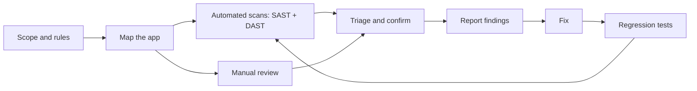

# Project: Auditing and Fixing a Vulnerable Web App

## Introduction

Knowing the names of vulnerabilities is not the same as finding them in real code. In this project you play the role of an application security engineer who has been handed a small Flask app and asked: "Is this safe to launch? If not, fix it."

You will work through a full audit, the same way a professional review runs, just smaller:

1. Agree the **scope and rules** of the test.
2. **Map** the application: routes, inputs, data and trust boundaries.
3. Run **automated scanners** (SAST with Bandit and Semgrep, DAST with ZAP).
4. Do a **manual code review** to find what the tools miss.
5. **Confirm** each finding with a safe proof against your local copy.
6. **Write up** findings with severity and a recommended fix.
7. **Fix** the code and add **regression tests** so the bugs stay fixed.

The app is intentionally small (about 60 lines) and contains eight planted flaws. One of the most useful lessons comes in Step 3: the scanners find only some of them.

:::warning Ethics and scope
Only test applications you own or have **written permission** to test. Everything in this project runs on `127.0.0.1` against code you create yourself. Never point scanners or payloads at a site you do not control, even "just to check". For more practice targets, use deliberately vulnerable apps such as OWASP Juice Shop, DVWA or WebGoat in a [local lab](../10-sec-offensive-security/1-sec-lab-setup.mdx), and read [Ethics, Law and Responsible Disclosure](../0-sec-fundamentals/8-sec-ethics-and-law.mdx).
:::

## The Audit Workflow



The loop at the end matters. After fixing, you rescan and rerun the tests to prove the fix worked and nothing new broke.

## Step 1: Scope and Setup

Write the scope down, even for a practice project. A one-paragraph version is enough:

```text
Target:       NoteHub prototype, commit abc123, running at http://127.0.0.1:5001
Owner:        You (the code is yours)
In scope:     All routes in vuln_app.py, the SQLite database, the uploads folder
Out of scope: Anything not on 127.0.0.1, denial-of-service testing
Methods:      Source review, Bandit, Semgrep, ZAP baseline scan, manual requests
```

Create a scratch folder and a virtual environment:

```bash
mkdir notehub-audit && cd notehub-audit
python3 -m venv .venv
source .venv/bin/activate
pip install flask argon2-cffi bandit semgrep
```

### The application under audit

Save this as `vuln_app.py`. The `F1` to `F8` comments are there so you can follow along. In a real audit, nobody labels the bugs for you.

```python
# vuln_app.py - DELIBERATELY VULNERABLE. Run only on 127.0.0.1 for practice.
import hashlib
import os
import sqlite3

from flask import Flask, request, session, render_template_string, send_file, abort

app = Flask(__name__)
app.secret_key = "notehub-dev-key"                 # F1: hard-coded secret
DB = "notes.db"
UPLOADS = os.path.abspath("uploads")


def db():
    conn = sqlite3.connect(DB)
    conn.row_factory = sqlite3.Row
    return conn


@app.post("/login")
def login():
    email = request.form["email"]
    pw_hash = hashlib.md5(request.form["password"].encode()).hexdigest()  # F2: MD5
    row = db().execute(
        f"SELECT id FROM users WHERE email = '{email}' AND pw_hash = '{pw_hash}'"  # F3: SQLi
    ).fetchone()
    if row:
        session["user_id"] = row["id"]
        return "ok"
    return "bad login", 401


@app.get("/notes/<int:note_id>")
def get_note(note_id):
    row = db().execute("SELECT * FROM notes WHERE id = ?", (note_id,)).fetchone()
    if row is None:                                   # F4: no ownership check (IDOR)
        abort(404)
    return render_template_string(
        "<h1>{{ title }}</h1><div>" + row["body"] + "</div>",  # F5: stored XSS
        title=row["title"],
    )


@app.get("/search")
def search():
    q = request.args.get("q", "")
    return render_template_string("<p>Results for {{ q|safe }}</p>", q=q)  # F6: reflected XSS


@app.get("/download")
def download():
    name = request.args.get("file", "")
    return send_file(os.path.join(UPLOADS, name))     # F7: path traversal


if __name__ == "__main__":
    app.run(host="127.0.0.1", port=5001, debug=True)  # F8: debug mode
```

And a small seeding script, `setup_db.py`, that creates two users and three notes:

```python
import hashlib, os, sqlite3, sys
from argon2 import PasswordHasher

path = sys.argv[1] if len(sys.argv) > 1 else "notes.db"
use_md5 = "--md5" in sys.argv          # the vulnerable app expects MD5 hashes
ph = PasswordHasher()

def h(pw):
    return hashlib.md5(pw.encode()).hexdigest() if use_md5 else ph.hash(pw)

conn = sqlite3.connect(path)
conn.executescript("""
DROP TABLE IF EXISTS users; DROP TABLE IF EXISTS notes;
CREATE TABLE users (id INTEGER PRIMARY KEY, email TEXT UNIQUE, pw_hash TEXT);
CREATE TABLE notes (id INTEGER PRIMARY KEY, owner_id INTEGER, title TEXT, body TEXT);
""")
conn.execute("INSERT INTO users VALUES (1, 'alice@example.com', ?)", (h("alice-long-passphrase"),))
conn.execute("INSERT INTO users VALUES (2, 'bob@example.com', ?)", (h("bob-long-passphrase-1"),))
conn.execute("INSERT INTO notes VALUES (1, 1, 'Alice todo', 'Buy milk')")
conn.execute("INSERT INTO notes VALUES (2, 2, 'Bob secret', 'Salary review notes')")
conn.execute("INSERT INTO notes VALUES (3, 1, 'XSS test', '')")
conn.commit()
os.makedirs("uploads", exist_ok=True)
open("uploads/report.txt", "w").write("quarterly report\n")
print("seeded", path)
```

```bash
python setup_db.py notes.db --md5
python vuln_app.py
```

## Step 2: Map the Application

Before running any tool, list every way data gets in and what each route touches. This "attack surface map" drives the rest of the audit (see [Attack Surface](../0-sec-fundamentals/3-sec-attack-surface.mdx)).

| Route | Input | Auth required? | Touches | Questions to ask |
| --- | --- | --- | --- | --- |
| `POST /login` | `email`, `password` form fields | No | `users` table | How is SQL built? How are passwords stored? |
| `GET /notes/<id>` | `id` in the path | Should be | `notes` table, HTML output | Who may read which note? Is the body escaped? |
| `GET /search` | `q` query parameter | No | HTML output | Is `q` escaped? |
| `GET /download` | `file` query parameter | Should be | File system | Can `file` escape the uploads folder? |
| App config | Secret key, debug flag | n/a | Sessions, error pages | Where do secrets come from? |

Just writing the "Auth required?" column exposes two problems: neither `/notes` nor `/download` checks whether anyone is logged in.

## Step 3: Automated Static Analysis

### Bandit

[Bandit](https://bandit.readthedocs.io/) is a Python security linter. Run it quietly so you only see findings:

```bash
bandit -q vuln_app.py
```

Example output (trimmed to the issue lines):

```text
>> Issue: [B105:hardcoded_password_string] Possible hardcoded password: 'notehub-dev-key'
   Severity: Low   Confidence: Medium
   Location: ./vuln_app.py:9:17
>> Issue: [B324:hashlib] Use of weak MD5 hash for security. Consider usedforsecurity=False
   Severity: High   Confidence: High
   Location: ./vuln_app.py:23:14
>> Issue: [B608:hardcoded_sql_expressions] Possible SQL injection vector through string-based query construction.
   Severity: Medium   Confidence: Medium
   Location: ./vuln_app.py:25:10
>> Issue: [B201:flask_debug_true] A Flask app appears to be run with debug=True, which exposes the Werkzeug debugger and allows the execution of arbitrary code.
   Severity: High   Confidence: Medium
   Location: ./vuln_app.py:57:4
```

### Semgrep

[Semgrep](https://semgrep.dev/) matches code patterns and can track data from a request to a dangerous function (taint analysis). The open-source engine runs without an account when you pass rule packs explicitly:

```bash
semgrep scan --config p/python --config p/flask --metrics=off vuln_app.py
```

Example output (shortened):

```text
python.django.security.injection.sql.sql-injection-using-db-cursor-execute  (line 24)
python.lang.security.insecure-hash-algorithms-md5.insecure-hash-algorithm-md5  (line 23)
python.lang.security.audit.md5-used-as-password.md5-used-as-password  (line 23)
python.flask.security.injection.tainted-sql-string.tainted-sql-string  (line 25)
python.flask.security.audit.debug-enabled.debug-enabled  (line 57)
Ran 151 rules on 1 file: 5 findings.
```

Rule names and counts depend on the Semgrep version and the current rule packs, so your output may differ.

### What the tools found, and what they missed

| Flaw | Bandit | Semgrep | Found by |
| --- | --- | --- | --- |
| F1 hard-coded secret | Yes (low) | No | Bandit |
| F2 MD5 password hash | Yes | Yes | Both |
| F3 SQL injection | Yes | Yes | Both |
| F4 IDOR on `/notes` | No | No | **Manual review only** |
| F5 stored XSS | No | No | **Manual review only** |
| F6 reflected XSS (`safe` filter) | No | No | **Manual review only** |
| F7 path traversal | No | No | **Manual review only** |
| F8 debug mode | Yes | Yes | Both |

The scanners found half of the flaws, and missed the most damaging one. **Broken access control (F4) is invisible to pattern-matching tools** because the code is not "wrong" in any syntactic way. It simply forgets a business rule: users may only read their own notes. That is why Broken Access Control sits at A01 in the OWASP Top 10:2025, and why [SAST](../6-sec-appsec-and-devsecops/2-sec-sast.mdx) never replaces review.

## Step 4: Dynamic Scan with ZAP

[ZAP](https://www.zaproxy.org/) is an open-source DAST tool. Its **baseline scan** spiders the app and reports passive findings without attacking it, which makes it safe for a first pass. With Docker installed, and the app running on port 5001:

```bash
docker run --rm --network host -t ghcr.io/zaproxy/zaproxy:stable \
  zap-baseline.py -t http://127.0.0.1:5001/search?q=test
```

`--network host` lets the container reach your localhost on Linux. On Docker Desktop for macOS or Windows, use `http://host.docker.internal:5001` as the target instead.

Expect warnings about missing security headers, such as "Content Security Policy (CSP) Header Not Set" and "X-Content-Type-Options Header Missing". The exact list depends on the ZAP version. The baseline scan does not prove the XSS or IDOR exist. Its active scan (`zap-full-scan.py`) tries injection payloads, and should only ever run against targets you own. See [Dynamic Analysis (DAST)](../6-sec-appsec-and-devsecops/3-sec-dast.mdx).

## Step 5: Manual Review and Safe Confirmation

Read each route with the map from Step 2 in hand. For every finding, confirm it with the smallest harmless proof. Here, a Flask test client does that without even starting a server:

```python
"""confirm.py: prove each finding against the local vulnerable app."""
import os
os.environ["SECRET_KEY"] = "test-only"
import vuln_app

c = vuln_app.app.test_client()

r = c.post("/login", data={"email": "alice@example.com' --", "password": "x"})
print("F3 SQLi login bypass :", r.status_code)        # comment out the password check

c.post("/login", data={"email": "alice@example.com", "password": "alice-long-passphrase"})
print("F4 read Bob's note   :", c.get("/notes/2").status_code)
print("F5 stored XSS raw    :", b"" in c.get("/search?q=<script>alert(1)</script>").data)
print("F7 path traversal    :", c.get("/download?file=../setup_db.py").status_code)
```

Output:

```text
F3 SQLi login bypass : 200
F4 read Bob's note   : 200
F5 stored XSS raw    : True
F6 reflected XSS raw : True
F7 path traversal    : 200
```

Each proof is minimal. The SQL injection proof logs in as Alice without her password; it does not dump the database. The traversal proof reads a harmless file from the parent folder. In a client engagement you would stop at proof, too, and never pull real customer data.

## Step 6: Write Up the Findings

A finding nobody can act on is wasted. Use a consistent format. Severity here uses a simple likelihood-and-impact judgment; many teams score with [CVSS v4.0](../11-sec-defensive-operations/6-sec-vulnerability-management.mdx) and adjust for context.

| ID | Title | Severity | OWASP 2025 | Evidence | Fix |
| --- | --- | --- | --- | --- | --- |
| F4 | Any user can read any note | High | A01 Broken Access Control | `/notes/2` returns Bob's note to Alice | Filter by `owner_id` |
| F3 | SQL injection in login | Critical | A05 Injection | `' --` in email bypasses password | Parameterized query |
| F5 | Stored XSS in note body | High | A05 Injection | `` rendered raw | Use autoescaped template variable |
| F6 | Reflected XSS in search | Medium | A05 Injection | `<script>` echoed raw | Remove `safe` filter |
| F7 | Path traversal in download | High | A01 Broken Access Control | `../setup_db.py` returned | `send_from_directory`, auth check |
| F2 | Passwords hashed with MD5 | High | A04 Cryptographic Failures | Code line 23 | Argon2id, rehash on login |
| F8 | Debug mode enabled | High | A02 Security Misconfiguration | `debug=True` | Off by default, from env |
| F1 | Hard-coded secret key | Medium | A02 Security Misconfiguration | Code line 9 | Load from environment, rotate |
| F9 | Missing security headers | Low | A02 Security Misconfiguration | ZAP baseline | Add CSP and related headers |

Some reviewers put path traversal under Injection instead. What matters is a clear description and a clear fix. A short paragraph per finding should cover: what is wrong, how you confirmed it, the impact in business terms ("any customer can read any other customer's notes"), and the fix.

## Step 7: Fix the Code

Here are the fixes side by side.

**Vulnerable (F3, F2):**

```python
pw_hash = hashlib.md5(request.form["password"].encode()).hexdigest()
row = db().execute(f"SELECT id FROM users WHERE email = '{email}' AND pw_hash = '{pw_hash}'").fetchone()
```

**Fixed:** look up by email with a placeholder, then verify the hash in Python.

```python
row = db().execute("SELECT id, pw_hash FROM users WHERE email = ?", (email,)).fetchone()
try:
    if row is None:
        raise VerifyMismatchError
    ph.verify(row["pw_hash"], request.form.get("password", ""))
except VerifyMismatchError:
    return "bad login", 401
```

Existing MD5 hashes need a migration. A common approach is to wrap them (store `argon2(md5)` for every old hash right away) and replace them with plain Argon2id the next time each user logs in. See [Password Hashing](../1-sec-cryptography/2-sec-password-hashing.mdx).

**Vulnerable (F4, F5):**

```python
row = db().execute("SELECT * FROM notes WHERE id = ?", (note_id,)).fetchone()
return render_template_string("<h1>{{ title }}</h1><div>" + row["body"] + "</div>", title=row["title"])
```

**Fixed:** scope the query to the logged-in owner, and pass the body as a variable so Jinja escapes it.

```python
if "user_id" not in session:
    abort(401)
row = db().execute("SELECT * FROM notes WHERE id = ? AND owner_id = ?",
                   (note_id, session["user_id"])).fetchone()
if row is None:
    abort(404)            # same answer for "not yours" and "does not exist"
return render_template_string(NOTE_TEMPLATE, title=row["title"], body=row["body"])
```

Concatenating user data into a template string is worse than plain XSS: it can also become server-side template injection if the data contains `{{ }}` expressions. Keep templates constant and pass data as variables.

**Vulnerable (F7):** `send_file(os.path.join(UPLOADS, name))`

**Fixed:** `send_from_directory(UPLOADS, name)`, which refuses paths that resolve outside the folder, plus a login check. If files belong to users, store an owner per file and check it, just like notes.

**Vulnerable (F1, F8):** `app.secret_key = "notehub-dev-key"` and `debug=True`.

**Fixed:** `app.config["SECRET_KEY"] = os.environ["SECRET_KEY"]` and `debug=os.environ.get("FLASK_DEBUG") == "1"`. Because the old key was in source control, also **rotate** it: every session signed with it should be considered forgeable.

**F9, security headers:**

```python
@app.after_request
def security_headers(resp):
    resp.headers["Content-Security-Policy"] = "default-src 'self'; object-src 'none'; frame-ancestors 'none'"
    resp.headers["X-Content-Type-Options"] = "nosniff"
    resp.headers["Referrer-Policy"] = "strict-origin-when-cross-origin"
    return resp
```

CSP is defense in depth for XSS, not a replacement for escaping. See [Security Headers, CORS and CSP](../3-sec-web-security/9-sec-security-headers.mdx).

Save the fixed version as `fixed_app.py`.

## Step 8: Regression Tests

Turn the confirmation script into a test that runs against both versions. It should "fail" on the vulnerable app and pass on the fixed one:

```python
"""test_audit.py: run the same checks against the vulnerable and the fixed app."""
import importlib, os, subprocess, sys
os.environ["SECRET_KEY"] = "test-only"

for name, flag in [("vuln_app", "--md5"), ("fixed_app", "")]:
    dbp = f"{name}.db"
    subprocess.run([sys.executable, "setup_db.py", dbp] + ([flag] if flag else []),
                   check=True, capture_output=True)
    os.environ["DB_PATH"] = dbp
    mod = importlib.import_module(name)
    mod.DB = dbp
    c = mod.app.test_client()
    print(f"== {name}")
    r = c.post("/login", data={"email": "alice@example.com' --", "password": "x"})
    print("  SQLi login bypass       :", r.status_code)
    c.post("/login", data={"email": "alice@example.com", "password": "alice-long-passphrase"})
    print("  read Bob's note (IDOR)  :", c.get("/notes/2").status_code)
    print("  stored XSS payload raw  :", b"" in c.get("/search?q=<script>alert(1)</script>").data)
    print("  path traversal          :", c.get("/download?file=../setup_db.py").status_code)
    r = c.get("/download?file=report.txt")
    print("  normal download         :", r.status_code)
    print("  CSP header present      :", "Content-Security-Policy" in r.headers)
```

Output:

```text
== vuln_app
  SQLi login bypass       : 200
  read Bob's note (IDOR)  : 200
  stored XSS payload raw  : True
  reflected XSS raw       : True
  path traversal          : 200
  normal download         : 200
  CSP header present      : False
== fixed_app
  SQLi login bypass       : 401
  read Bob's note (IDOR)  : 404
  stored XSS payload raw  : False
  reflected XSS raw       : False
  path traversal          : 404
  normal download         : 200
  CSP header present      : True
```

The "normal download" line matters as much as the security lines. A fix that breaks the feature will get reverted. Rerunning Bandit and Semgrep on `fixed_app.py` with the same commands reports no findings. In a real project, convert these prints into `pytest` assertions and run them in CI (the [DevSecOps Pipeline](./3-sec-project-devsecops-pipeline.mdx) project does this).

## Real-World Scenario

Your team inherits an internal notes tool written by a contractor. Marketing wants to open it to customers in three weeks. You have the time for one focused audit.

**What you do:** a two-day review following this page. Day one: scope, map, scanners, and manual review of every route that reads or writes customer data. Day two: confirm findings in a local copy, write the report, and pair with the developers on the critical fixes. Before launch, the critical and high items must be fixed and covered by tests. Medium and low items go into the backlog with owners and dates.

**Why this approach:** the scanners give quick, cheap coverage of known patterns, and the manual pass covers authorization and logic, which is where the worst bugs in this app were. Regression tests make sure the next contractor does not undo the fixes.

**When not to rely on it alone:** for a large or high-risk application (payments, health data), add an external penetration test, and do a [threat model](./2-sec-project-threat-model.mdx) before building the next feature.

### Code fix vs WAF vs both

The product manager asks whether a web application firewall could block these attacks instead, so the launch is not delayed.

| Approach | Pros | Cons | Best for |
| --- | --- | --- | --- |
| Fix the code | Removes the root cause, works everywhere the code runs | Takes developer time, needs testing | Every confirmed vulnerability, eventually |
| WAF rule only | Fast to deploy, no code change | Bypassable with encoding tricks, cannot see IDOR or logic flaws, false positives | Short-term "virtual patching" while a fix ships |
| Both | Fast protection now, real fix later, defense in depth | Two things to maintain | Internet-facing apps with known critical bugs |

A WAF could reduce the SQL injection and XSS risk for a few days, but it **cannot fix F4**. `GET /notes/2` from a logged-in user is a perfectly normal-looking request. Only the code knows that note 2 belongs to Bob. See [API Gateways and WAFs](../7-sec-api-security/7-sec-api-gateway-security.mdx).

## Common Mistakes

- **Trusting a clean scanner report.** Clean means "no known patterns matched", not "secure". Authorization bugs need human eyes or authorization tests.
- **Proof that goes too far.** Confirm with minimal, harmless evidence. Do not dump data, even on a test system, unless the rules of engagement say so.
- **Reports without fixes.** Every finding should say what to change and how to verify it.
- **Fixing the symptom.** Stripping `<script>` from input instead of escaping output, or blocking `../` with a regex instead of resolving paths safely.
- **No regression test.** Without one, the same bug returns in the next refactor.
- **Forgetting to rotate leaked secrets.** Removing a hard-coded key from the code does not un-leak it from git history.

## Summary

- An audit is a process: scope, map, scan, review, confirm, report, fix and retest.
- Bandit and Semgrep caught the pattern bugs (SQL injection, MD5, debug mode) but **missed IDOR, XSS via template concatenation and path traversal**.
- Confirm each finding with the smallest safe proof, on systems you own.
- Fix root causes in code, use a WAF only as a temporary or extra layer, and lock fixes in with regression tests.

## Exercises

1. Add a ninth flaw of your choice (for example, [SSRF](../3-sec-web-security/6-sec-ssrf.mdx) in a "fetch link preview" route), then have a friend audit the app without the `F` comments.
2. Write a custom Semgrep rule that flags `render_template_string` called with a concatenated string, and test it on `vuln_app.py`.
3. Run OWASP Juice Shop locally (`docker run --rm -p 127.0.0.1:3000:3000 bkimminich/juice-shop`), solve three challenges, and for each one write a finding in the table format above, including the fix.
4. Convert `test_audit.py` into `pytest` tests with one assertion per finding.

**Related pages:** [OWASP Top 10](../3-sec-web-security/1-sec-owasp-top-10.mdx), [Broken Access Control](../3-sec-web-security/2-sec-broken-access-control.mdx), [Security Code Review](../5-sec-secure-coding/7-sec-code-review-for-security.mdx) and [Web Testing with Burp Suite](../10-sec-offensive-security/4-sec-burp-suite.mdx).
