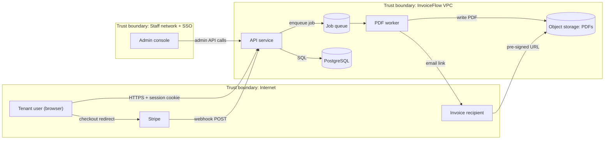
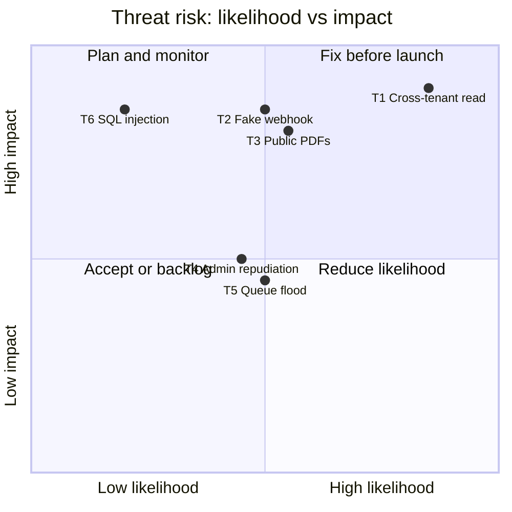

# Project: Threat Modeling a SaaS Application

## Introduction

The bugs in the previous project were found *after* the code was written. Threat modeling finds design problems *before* anyone writes the code, when fixing them costs a whiteboard eraser instead of a rewrite.

In this project you will threat model **InvoiceFlow**, a fictional multi-tenant SaaS product that lets small businesses create invoices, store PDF copies and get paid by card. You will produce the same artifacts a real team would:

1. A **data flow diagram** (DFD) with trust boundaries.
2. A list of threats found with **STRIDE**, element by element.
3. A **risk rating** and a **mitigation** for each threat.
4. A **threat register** kept as YAML in the repository, with a small script that validates it and can fail a CI build.
5. A short review checklist so the model stays alive as the product changes.

The method follows the four questions popularized by Adam Shostack and the [Threat Modeling Manifesto](https://www.threatmodelingmanifesto.org/):

1. What are we working on?
2. What can go wrong?
3. What are we going to do about it?
4. Did we do a good job?

Think of it like planning security for a new office before moving in. You walk the floor plan, mark which doors face the street, decide where the safe goes and who gets which key. Doing it after moving in works too, but you end up drilling through finished walls.

:::note Background
This page applies the method. For the concepts, including STRIDE in detail and other methods such as PASTA and LINDDUN, read [Threat Modeling with STRIDE](../6-sec-appsec-and-devsecops/1-sec-threat-modeling.mdx) first.
:::

## Question 1: What Are We Working On?

### The product in one paragraph

InvoiceFlow customers (tenants) sign up their company and invite staff. Staff create invoices in a single-page web app. The API stores invoices in PostgreSQL. A background worker renders invoice PDFs and stores them in an object storage bucket, then emails customers a link. Customers pay through Stripe's hosted checkout, and Stripe calls an InvoiceFlow webhook when a payment succeeds. InvoiceFlow staff use an internal admin console for support.

### Assets: what are we protecting?

Write the assets down first. Threats only matter in relation to something worth protecting.

| Asset | Why it matters |
| --- | --- |
| Tenant invoice data (amounts, customer names, addresses) | Confidential business data; a cross-tenant leak is a headline incident |
| Invoice PDFs | Same data, in files that are easy to share by accident |
| Payment status | Marking an unpaid invoice "paid" is direct fraud |
| User accounts and sessions | Takeover gives access to everything above |
| Admin console | One admin account can see every tenant |
| Stripe API keys and webhook secret | Allow forging payments or reading payment data |

### The data flow diagram

A DFD shows **external entities** (people and systems you do not control), **processes** (your code), **data stores** and **data flows**, plus **trust boundaries**, the lines where the level of trust changes. Threats cluster at trust boundaries.



Keep the first diagram at this level. Ten to fifteen elements is plenty. You can zoom into one part later, for example the payment flow, with its own diagram.

## Question 2: What Can Go Wrong?

### STRIDE per element

STRIDE gives six prompts. Each type of DFD element is typically exposed to some of them:

| Category | Violates | Typical question |
| --- | --- | --- |
| **S**poofing | Authentication | Can someone pretend to be another user or system? |
| **T**ampering | Integrity | Can someone change data in transit or at rest? |
| **R**epudiation | Non-repudiation | Can someone deny an action because there is no record? |
| **I**nformation disclosure | Confidentiality | Can data leak to someone who should not see it? |
| **D**enial of service | Availability | Can someone make it unavailable for others? |
| **E**levation of privilege | Authorization | Can someone do more than they are allowed to? |

Walk through each element and each flow crossing a boundary. Here is a condensed version of the session the InvoiceFlow team ran.

**Webhook from Stripe to the API (crosses the Internet boundary)**

- *Spoofing:* anyone can POST to the webhook URL. If the API trusts the body, an attacker sends a fake `payment_intent.succeeded` and marks an invoice as paid without paying.
- *Tampering:* a valid event could be replayed later.
- Mitigation: verify Stripe's signature header with the webhook secret, reject old timestamps, process each event ID once, and for high-value actions re-fetch the event from the Stripe API. See [Webhook Security](../7-sec-api-security/6-sec-webhook-security.mdx).

**API service (process)**

- *Elevation of privilege:* a user in tenant A changes `/invoices/1042` to `/invoices/1043` and sees tenant B's invoice. This is the classic multi-tenant failure, also called BOLA or IDOR. See [Broken Object Level Authorization](../7-sec-api-security/2-sec-bola.mdx).
- *Spoofing:* session theft or credential stuffing against the login.
- *Repudiation:* an admin edits invoice totals and there is no record of who did it.

**PostgreSQL (data store)**

- *Tampering / Information disclosure:* SQL injection in invoice search.
- *Information disclosure:* backups copied to a less protected location.

**Object storage with PDFs (data store)**

- *Information disclosure:* a bucket made public "to fix the email links", or object names that are guessable (`invoices/tenant-12/1042.pdf`).
- Pre-signed URLs forwarded by a recipient to others. Their lifetime limits the damage.

**PDF worker and job queue (process)**

- *Denial of service:* one tenant uploads a 5,000-line invoice or triggers thousands of jobs and starves everyone else.
- *Elevation of privilege:* if the PDF renderer fetches remote images from invoice content, it may be tricked into fetching internal URLs, a [server-side request forgery](../3-sec-web-security/6-sec-ssrf.mdx).

**Admin console (process, staff boundary)**

- *Spoofing:* a phished support agent's password gives access to every tenant.
- *Elevation of privilege:* every support agent can do everything, including refunds.

:::tip Ask "what about the tenants?" on every element
In a multi-tenant system, the most important threat to check on every element is **cross-tenant access**. Ask it about queries, caches, file paths, queue messages, search indexes and logs. A shared cache key without the tenant ID leaks data just as well as a missing `WHERE` clause.
:::

## Question 3: What Are We Going to Do About It?

### Rate the risk

Use a simple scale so the session does not stall on arguments about decimals. Here, likelihood and impact are each 1 (low) to 3 (high), and risk is their product. For more formal approaches, see [Risk Management](../13-sec-governance/0-sec-risk-management.mdx).



### Choose a response for each threat

For every threat, pick one of four responses:

- **Mitigate:** add a control (most threats).
- **Eliminate:** remove the feature or data (for example, do not store card numbers at all; let Stripe hold them).
- **Transfer:** move the risk to someone better placed (Stripe handles card data and its PCI DSS scope).
- **Accept:** document it with a named owner and a review date.

Notice that the *design* already eliminated the biggest risk of all: InvoiceFlow never sees card numbers because checkout is hosted by Stripe. That is a threat modeling win that happened before any code.

### Mitigations for the top threats

**T1: cross-tenant access.** The most dangerous threat, because one missing filter in one endpoint is enough.

**Vulnerable pattern:**

```python
def get_invoice(invoice_id: int, user):
    return db.execute("SELECT * FROM invoices WHERE id = %s", (invoice_id,)).fetchone()
```

**Fixed pattern:** a repository layer that always scopes by tenant, so a developer cannot forget it:

```python
class InvoiceRepository:
    def __init__(self, conn, tenant_id: int):
        self.conn = conn
        self.tenant_id = tenant_id   # taken from the authenticated session, never from the request

    def get(self, invoice_id: int):
        return self.conn.execute(
            "SELECT * FROM invoices WHERE id = %s AND tenant_id = %s",
            (invoice_id, self.tenant_id),
        ).fetchone()
```

As a second layer, PostgreSQL [row-level security](https://www.postgresql.org/docs/current/ddl-rowsecurity.html) can enforce the tenant filter inside the database:

```sql
ALTER TABLE invoices ENABLE ROW LEVEL SECURITY;

CREATE POLICY tenant_isolation ON invoices
    USING (tenant_id = current_setting('app.tenant_id')::int);

-- In each request, inside a transaction, after authenticating the user:
-- SET LOCAL app.tenant_id = '42';
```

Row-level security does not apply to table owners or superusers by default, so the application must connect as a separate, non-owner role. Test it: write an automated test that logs in as tenant A and requests every tenant B object type, expecting 404 each time.

**T2: fake webhooks.** Verify the signature with the official Stripe library before trusting the event, and record processed event IDs so each is handled once.

**T3: PDF exposure.** Keep the bucket private with public access blocked at the account level, use random object keys, and hand out short-lived pre-signed URLs only after an authorization check. See [Securing Cloud Storage](../8-sec-cloud-and-container/3-sec-cloud-storage-security.mdx).

**Admin console.** Require SSO with phishing-resistant MFA, split support roles (read-only by default, refunds need a second approver), and log every admin action with the tenant affected.

## The Threat Register as Code

A threat model that lives in a slide deck is forgotten within a month. Keep it in the repository next to the code, review changes to it in pull requests, and let CI check it.

Save this as `threats.yaml`:

```yaml
system: InvoiceFlow
version: 2026-10
elements:
  - id: api
    type: process
  - id: db
    type: datastore
  - id: files
    type: datastore
  - id: worker
    type: process
  - id: stripe_webhook
    type: dataflow
threats:
  - id: T1
    element: api
    stride: Elevation of privilege
    title: Tenant A reads Tenant B invoices by changing invoice ID
    likelihood: 3
    impact: 3
    mitigation: Enforce tenant_id in every query via a repository layer; Postgres row-level security as backstop
    status: planned
    owner: backend
  - id: T2
    element: stripe_webhook
    stride: Spoofing
    title: Attacker posts fake payment_succeeded webhook
    likelihood: 2
    impact: 3
    mitigation: Verify Stripe signature and timestamp; re-fetch event from Stripe API
    status: done
    owner: payments
  - id: T3
    element: files
    stride: Information disclosure
    title: Invoice PDFs exposed through public bucket or guessable URLs
    likelihood: 2
    impact: 3
    mitigation: Private bucket, block public access, short-lived pre-signed URLs after authz check
    status: planned
    owner: platform
  - id: T4
    element: api
    stride: Repudiation
    title: Admin changes invoice totals and denies it
    likelihood: 2
    impact: 2
    mitigation: Append-only audit log with actor, tenant, before/after values
    status: open
    owner: backend
  - id: T5
    element: worker
    stride: Denial of service
    title: One tenant floods PDF generation queue and starves others
    likelihood: 2
    impact: 2
    mitigation: Per-tenant queue quotas and rate limits
    status: open
    owner: platform
  - id: T6
    element: db
    stride: Tampering
    title: SQL injection in invoice search modifies records
    likelihood: 1
    impact: 3
    mitigation: Parameterized queries via ORM; Semgrep rule in CI
    status: done
    owner: backend
```

Then a small script, `threat_report.py`, that validates the register, prints it sorted by risk, and can fail a build when a high-risk threat is still unmitigated:

```python
"""threat_report.py: validate a threat register and print it by risk."""
import sys
import yaml  # pip install pyyaml

STRIDE = {"Spoofing", "Tampering", "Repudiation", "Information disclosure",
          "Denial of service", "Elevation of privilege"}
STATUSES = {"open", "planned", "done", "accepted"}


def load(path):
    with open(path) as f:
        return yaml.safe_load(f)


def validate(model):
    errors = []
    element_ids = {e["id"] for e in model["elements"]}
    for t in model["threats"]:
        if t["element"] not in element_ids:
            errors.append(f"{t['id']}: unknown element {t['element']!r}")
        if t["stride"] not in STRIDE:
            errors.append(f"{t['id']}: unknown STRIDE category {t['stride']!r}")
        if t["status"] not in STATUSES:
            errors.append(f"{t['id']}: bad status {t['status']!r}")
        if not (1 <= t["likelihood"] <= 3 and 1 <= t["impact"] <= 3):
            errors.append(f"{t['id']}: likelihood and impact must be 1-3")
        if t["status"] != "accepted" and not t.get("mitigation"):
            errors.append(f"{t['id']}: needs a mitigation or status 'accepted'")
    return errors


def report(model):
    rows = sorted(model["threats"], key=lambda t: -(t["likelihood"] * t["impact"]))
    print(f"Threat register: {model['system']} ({model['version']})")
    print(f"{'ID':<4}{'Risk':<6}{'STRIDE':<24}{'Status':<9}Title")
    for t in rows:
        risk = t["likelihood"] * t["impact"]
        print(f"{t['id']:<4}{risk:<6}{t['stride']:<24}{t['status']:<9}{t['title']}")
    unresolved = [t for t in rows
                  if t["status"] in ("open", "planned") and t["likelihood"] * t["impact"] >= 6]
    print(f"\nHigh-risk threats not yet mitigated: {', '.join(t['id'] for t in unresolved) or 'none'}")
    missing = sorted(STRIDE - {t["stride"] for t in rows})
    print(f"STRIDE categories with no threats: {', '.join(missing) or 'none'}")
    return unresolved


if __name__ == "__main__":
    model = load(sys.argv[1] if len(sys.argv) > 1 else "threats.yaml")
    errors = validate(model)
    if errors:
        print("\n".join(errors))
        sys.exit(2)
    unresolved = report(model)
    sys.exit(1 if "--strict" in sys.argv and unresolved else 0)
```

```bash
pip install pyyaml
python threat_report.py threats.yaml
```

Output:

```text
Threat register: InvoiceFlow (2026-10)
ID  Risk  STRIDE                  Status   Title
T1  9     Elevation of privilege  planned  Tenant A reads Tenant B invoices by changing invoice ID
T2  6     Spoofing                done     Attacker posts fake payment_succeeded webhook
T3  6     Information disclosure  planned  Invoice PDFs exposed through public bucket or guessable URLs
T4  4     Repudiation             open     Admin changes invoice totals and denies it
T5  4     Denial of service       open     One tenant floods PDF generation queue and starves others
T6  3     Tampering               done     SQL injection in invoice search modifies records

High-risk threats not yet mitigated: T1, T3
STRIDE categories with no threats: none
```

If someone adds a sloppy entry, validation catches it. For example, a threat pointing at an element `cache` that is not in the model, with status `todo` and likelihood 4:

```text
T7: unknown element 'cache'
T7: bad status 'todo'
T7: likelihood and impact must be 1-3
T7: needs a mitigation or status 'accepted'
```

Run `python threat_report.py threats.yaml --strict` in CI before a release. It exits with code 1 while T1 and T3 are unresolved, which turns "we should fix that before launch" into a gate. Link each threat ID to a ticket in your tracker so the work is visible.

:::info Tools
You do not need special software to threat model; a whiteboard and this YAML file are enough. If you want a diagramming tool, [OWASP Threat Dragon](https://owasp.org/www-project-threat-dragon/) is free, runs as a desktop or web app, and supports STRIDE, LINDDUN and other methods. Check its site for the current version.
:::

## Question 4: Did We Do a Good Job?

Use a short checklist at the end of the session:

- Does every **trust boundary crossing** on the diagram have at least one threat considered?
- Does every **asset** appear in at least one threat?
- Has every high-risk threat got an **owner**, a **ticket** and a **test** that proves the mitigation works?
- Were the **right people** in the room: someone who knows the code, someone who knows the infrastructure, and someone who knows the business?
- When will we **revisit** it? Good triggers: a new external integration, a new data type (for example, health data), a new trust boundary, or an incident.

## Real-World Scenario

InvoiceFlow plans to add a "public payment page" feature: a link the tenant can share so anyone can view and pay an invoice without logging in. The tech lead asks for a threat modeling session before development starts. You have one hour with three engineers and the product manager.

**How you run it:**

1. (10 minutes) Update the DFD: a new unauthenticated flow from "anyone with the link" to the API and to the PDF.
2. (30 minutes) STRIDE on the new flow only. The team finds: guessable links (*information disclosure*), links that never expire, search engines indexing payment pages, and tenants' customers changing the amount in the request (*tampering*).
3. (15 minutes) Decide mitigations: links contain a 128-bit random token from `secrets.token_urlsafe`, expire after 30 days, can be revoked by the tenant, pages send `X-Robots-Tag: noindex`, and the amount always comes from the server, never the client.
4. (5 minutes) Add T7 to T10 to `threats.yaml`, create tickets, and schedule a follow-up review after the first beta.

**Why this approach:** a focused, time-boxed session on the change is far more likely to happen than a full re-model of the system. The output is concrete tickets, not a document.

**When not to use full STRIDE:** for a tiny change, such as a new read-only field, a two-question check ("does this cross a trust boundary? does it touch a sensitive asset?") is enough. For privacy-heavy features, add LINDDUN, which focuses on privacy threats such as linkability and identifiability (see [Privacy Engineering](../13-sec-governance/4-sec-privacy-engineering.mdx)).

### Choosing a threat modeling approach

| Approach | Pros | Cons | Best for |
| --- | --- | --- | --- |
| Whiteboard + STRIDE + YAML register | Cheap, fast, lives in the repo | Depends on facilitator skill | Most product teams |
| Diagramming tool (Threat Dragon and similar) | Nice diagrams, rule-based threat suggestions | Another tool to maintain; diagrams drift from reality | Teams that want visual models |
| Threat modeling as code libraries | Model generated from code, can run in CI | Learning curve, still needs human judgment | Platform teams with many services |
| Attack trees for one goal | Deep analysis of one critical scenario | Slow, narrow | Payment fraud, safety-critical features |
| No model, rely on testing | No up-front time | Design flaws found late and expensively | Throwaway prototypes only |

## Common Mistakes

- **Boiling the ocean.** A 200-threat spreadsheet nobody reads is worse than ten threats with owners. Start with trust boundaries and the most valuable assets.
- **Only thinking about outsiders.** Insiders, compromised staff accounts and third-party integrations are on the diagram too.
- **No follow-through.** A threat without a ticket and a test is a wish.
- **Modeling once.** The diagram must change when the system changes. Tie reviews to design changes.
- **Forgetting the "boring" threats.** Repudiation and denial of service rarely make headlines but cause real support and legal pain.
- **Letting security run it alone.** The developers who build the feature know where the shortcuts are.

## Summary

- Threat modeling answers four questions: what are we building, what can go wrong, what will we do, and did we do a good job.
- Draw a **DFD with trust boundaries**, list **assets**, and walk **STRIDE** per element and per boundary crossing.
- In multi-tenant SaaS, **cross-tenant access** is the threat to check everywhere; enforce tenant scoping in code and, ideally, in the database.
- Rate risk simply, pick a response (mitigate, eliminate, transfer, accept), and track threats as **code with owners and tests**.
- Revisit the model when the design changes.

## Exercises

1. Draw a DFD for an app you work on (or a to-do app with a mobile client and a REST API). Mark the trust boundaries and list at least one threat per STRIDE category.
2. Extend `threat_report.py` to read a `ticket` field and fail validation if any threat with risk 6 or higher has no ticket.
3. Write a test for the InvoiceFlow repository pattern that creates two tenants and asserts that tenant A cannot fetch, update or delete tenant B's invoice.
4. Threat model the "public payment page" scenario above in more depth with an attack tree whose root goal is "get goods without paying".

**Related pages:** [Secure Design Principles](../0-sec-fundamentals/6-sec-security-principles.mdx), [Business Logic Vulnerabilities](../3-sec-web-security/11-sec-business-logic-flaws.mdx), and the next project, [DevSecOps Pipeline](./3-sec-project-devsecops-pipeline.mdx).
