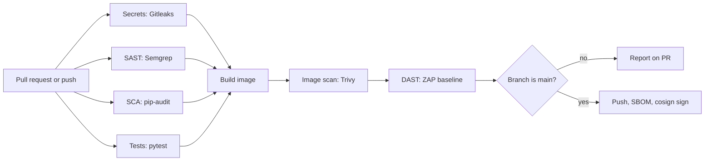
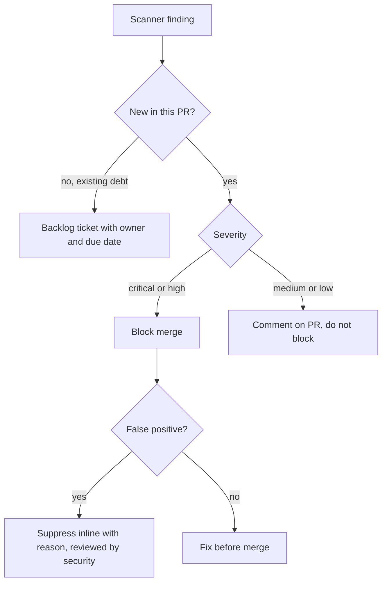

# Project: DevSecOps Pipeline

## Introduction

In the [audit project](./1-sec-project-vulnerable-app-audit.mdx) you ran scanners by hand. That works once. But a team merges dozens of changes a week, and nobody remembers to rerun Bandit before every merge. **DevSecOps** means making those checks automatic, so every pull request gets the same security review at machine speed, and humans spend their time on what machines cannot judge.

In this project you will build a GitHub Actions pipeline for a small Flask service that:

1. **Scans for leaked secrets** in the full git history (Gitleaks).
2. Runs **static analysis** on the code (Semgrep).
3. **Audits dependencies** for known vulnerabilities (pip-audit).
4. Runs **unit and security tests** (pytest).
5. Builds a container image and **scans it** (Trivy).
6. Starts the container and runs a **DAST baseline scan** (ZAP).
7. On `main`, pushes the image, generates an **SBOM**, and **signs** it keylessly with Sigstore cosign.

It also hardens the pipeline itself, because a CI system holds deploy keys and cloud credentials and is a prime target. The March 2026 compromise of the popular `aquasecurity/trivy-action`, covered below, shows why.

Think of the pipeline as airport security for code. Every bag (commit) goes through the same scanners. Most pass in seconds. Suspicious ones get pulled aside for a human. And the security staff themselves get background checks, which in CI terms means least-privilege tokens and pinned dependencies.

:::note Background reading
Each scanner has its own page: [SAST](../6-sec-appsec-and-devsecops/2-sec-sast.mdx), [DAST](../6-sec-appsec-and-devsecops/3-sec-dast.mdx), [Dependency Scanning](../6-sec-appsec-and-devsecops/4-sec-dependency-scanning.mdx), [Secret Scanning](../6-sec-appsec-and-devsecops/7-sec-secret-scanning.mdx), [SBOMs, Signing and SLSA](../6-sec-appsec-and-devsecops/6-sec-sbom-and-signing.mdx) and [Securing CI/CD Pipelines](../6-sec-appsec-and-devsecops/8-sec-pipeline-security.mdx). For CI/CD in general, see the [CI/CD tutorial](/docs/devops/cicd).
:::

## Pipeline Design



Design choices:

- **Fast checks run in parallel** and first. A developer learns about a leaked key in about a minute, not after a ten-minute build.
- **The image is built only if the cheap checks pass**, saving runner time.
- **Publishing and signing happen only on `main`**, and only that job gets write permissions.

## Step 1: The Application

A tiny Flask service is enough. The pipeline is the point.

`app.py`:

```python
import os
from flask import Flask, jsonify

app = Flask(__name__)
app.config["SECRET_KEY"] = os.environ["SECRET_KEY"]


@app.after_request
def security_headers(resp):
    resp.headers["Content-Security-Policy"] = "default-src 'self'; frame-ancestors 'none'"
    resp.headers["X-Content-Type-Options"] = "nosniff"
    resp.headers["Referrer-Policy"] = "strict-origin-when-cross-origin"
    return resp


@app.get("/")
def index():
    return "<h1>NoteHub</h1>"


@app.get("/health")
def health():
    return jsonify(status="ok")
```

`requirements.txt` (pin exact versions; Dependabot or Renovate can propose upgrades):

```text
flask==3.1.3
gunicorn==26.2.0
```

The versions above were current when this page was written. Run `pip index versions flask` or check PyPI for the latest.

`test_app.py`, with a test for a *security property*, not just a feature:

```python
import os
os.environ.setdefault("SECRET_KEY", "test-only")
from app import app


def test_health():
    assert app.test_client().get("/health").get_json() == {"status": "ok"}


def test_security_headers_present():
    r = app.test_client().get("/")
    assert "default-src 'self'" in r.headers["Content-Security-Policy"]
    assert r.headers["X-Content-Type-Options"] == "nosniff"
```

```bash
pip install -r requirements.txt pytest
pytest -q
```

Output:

```text
..                                                                       [100%]
2 passed in 0.05s
```

`Dockerfile`, following [container image security](../8-sec-cloud-and-container/4-sec-container-security.mdx) basics: slim base, no build caches, non-root user.

```dockerfile
FROM python:3.13-slim

ENV PYTHONDONTWRITEBYTECODE=1 PYTHONUNBUFFERED=1
WORKDIR /app

COPY requirements.txt .
RUN pip install --no-cache-dir -r requirements.txt

COPY app.py .
RUN useradd --create-home --uid 10001 appuser
USER appuser

EXPOSE 8000
CMD ["gunicorn", "--bind", "0.0.0.0:8000", "--workers", "2", "app:app"]
```

## Step 2: Try Each Scanner Locally First

Never put a tool in CI that you have not run by hand. You need to know its output, its exit codes and its false positives.

**Dependency audit.** To see a failure, temporarily pin an old Flask:

```bash
pip install pip-audit
echo "flask==2.2.0" > /tmp/old-requirements.txt
pip-audit -r /tmp/old-requirements.txt --desc off
echo "exit code: $?"
```

Example output (duplicate rows removed; IDs and counts change as new advisories are published):

```text
Found 4 known vulnerabilities in 1 package
Name  Version ID              Fix Versions
----- ------- --------------- ------------
flask 2.2.0   PYSEC-2023-62   2.2.5,2.3.2
flask 2.2.0   PYSEC-2026-2151 3.1.3
exit code: 1
```

The non-zero exit code is what makes a CI job fail.

**Secrets.** Gitleaks scans git history with `gitleaks git` (the older `detect` command was deprecated in 8.19):

```bash
docker run --rm -v "$PWD:/repo" ghcr.io/gitleaks/gitleaks:latest git --redact --verbose /repo
```

It exits with `1` when it finds a leak. `--redact` keeps the secret itself out of the CI log, which matters because logs are often readable by many people. Note that the Gitleaks README now describes the project as feature complete with security fixes only, so check the project page for its current status and recommended successor before standardizing on it.

**SAST.** Semgrep's open-source engine needs no account when you name rule packs explicitly:

```bash
pip install semgrep
semgrep scan --config p/python --config p/flask --error --metrics=off
```

`--error` makes it exit non-zero when there are findings.

## Step 3: The Workflow

Save this as `.github/workflows/security.yml`. Action versions shown were current at the time of writing; read the hardening section before using it.

```yaml
name: security-pipeline

on:
  pull_request:
  push:
    branches: [main]

permissions:
  contents: read            # least privilege by default for every job

concurrency:
  group: security-${{ github.ref }}
  cancel-in-progress: true

jobs:
  secrets:
    name: Secret scan (Gitleaks)
    runs-on: ubuntu-24.04
    steps:
      - uses: actions/checkout@v7
        with:
          fetch-depth: 0              # scan full history, not just the last commit
          persist-credentials: false
      - name: Gitleaks
        run: |
          docker run --rm -v "$PWD:/repo" ghcr.io/gitleaks/gitleaks:latest \
            git --redact --verbose /repo

  sast:
    name: SAST (Semgrep)
    runs-on: ubuntu-24.04
    container: semgrep/semgrep
    steps:
      - uses: actions/checkout@v7
        with:
          persist-credentials: false
      - name: Semgrep
        run: semgrep scan --config p/python --config p/flask --error --metrics=off

  sca:
    name: Dependency audit (pip-audit)
    runs-on: ubuntu-24.04
    steps:
      - uses: actions/checkout@v7
        with:
          persist-credentials: false
      - uses: actions/setup-python@v7
        with:
          python-version: "3.13"
      - run: pip install pip-audit
      - run: pip-audit -r requirements.txt --strict

  test:
    name: Unit and security tests
    runs-on: ubuntu-24.04
    steps:
      - uses: actions/checkout@v7
        with:
          persist-credentials: false
      - uses: actions/setup-python@v7
        with:
          python-version: "3.13"
      - run: pip install -r requirements.txt pytest
      - run: pytest -q

  image:
    name: Build, scan image, DAST
    needs: [secrets, sast, sca, test]
    runs-on: ubuntu-24.04
    steps:
      - uses: actions/checkout@v7
        with:
          persist-credentials: false
      - name: Build image
        run: docker build -t notehub:${{ github.sha }} .
      - name: Scan image (Trivy)
        uses: aquasecurity/trivy-action@v0.36.0   # pin to a full commit SHA, see below
        with:
          scan-type: image
          image-ref: notehub:${{ github.sha }}
          severity: CRITICAL,HIGH
          ignore-unfixed: true
          exit-code: "1"
      - name: Start app for DAST
        run: |
          docker run -d --name notehub -p 127.0.0.1:8000:8000 \
            -e SECRET_KEY=ci-only-not-secret notehub:${{ github.sha }}
          for i in $(seq 1 30); do curl -fs http://127.0.0.1:8000/health && break; sleep 1; done
      - name: ZAP baseline scan
        run: |
          docker run --rm --network host -v "$PWD:/zap/wrk:rw" \
            ghcr.io/zaproxy/zaproxy:stable \
            zap-baseline.py -t http://127.0.0.1:8000 -c zap-rules.tsv -r zap-report.html
      - name: Upload ZAP report
        if: always()
        uses: actions/upload-artifact@v7
        with:
          name: zap-report
          path: zap-report.html

  publish:
    name: Push, SBOM and sign
    if: github.ref == 'refs/heads/main' && github.event_name == 'push'
    needs: [image]
    runs-on: ubuntu-24.04
    permissions:
      contents: read
      packages: write          # push to GitHub Container Registry
      id-token: write          # keyless signing with the GitHub OIDC token
    env:
      IMAGE: ghcr.io/${{ github.repository }}
    steps:
      - uses: actions/checkout@v7
        with:
          persist-credentials: false
      - name: Build and push
        run: |
          echo "${{ secrets.GITHUB_TOKEN }}" | docker login ghcr.io -u "${{ github.actor }}" --password-stdin
          docker build -t "$IMAGE:${{ github.sha }}" .
          docker push "$IMAGE:${{ github.sha }}"
          echo "DIGEST_REF=$(docker inspect --format='{{index .RepoDigests 0}}' "$IMAGE:${{ github.sha }}")" >> "$GITHUB_ENV"
      - name: Generate SBOM
        uses: anchore/sbom-action@v0
        with:
          image: ${{ env.DIGEST_REF }}
          format: spdx-json
          output-file: sbom.spdx.json
      - uses: sigstore/cosign-installer@v4.1.0
      - name: Sign image and attach SBOM attestation
        run: |
          cosign sign --yes "$DIGEST_REF"
          cosign attest --yes --type spdxjson --predicate sbom.spdx.json "$DIGEST_REF"
```

A few details worth calling out:

- **`permissions: contents: read`** at the top means every job's `GITHUB_TOKEN` can only read the repository. Only `publish` gets `packages: write` and `id-token: write`.
- **`persist-credentials: false`** stops checkout from leaving the token where later steps (including third-party actions) could read it.
- **The DAST target is bound to `127.0.0.1`** on the runner, never exposed.
- **Signing uses the image digest** (`name@sha256:...`), not a tag. Tags can be moved; digests cannot.
- **Image names on GHCR must be lowercase.** If your repository name has capitals, convert it in the `IMAGE` variable.

### Tuning ZAP

The baseline scan returns exit code 0 for pass, 1 for failures and 2 for warnings. Without tuning, any warning fails the job. Generate a rules file once, then decide per rule whether it should `IGNORE`, `WARN` or `FAIL`:

```bash
docker run --rm --network host -v "$PWD:/zap/wrk:rw" ghcr.io/zaproxy/zaproxy:stable \
  zap-baseline.py -t http://127.0.0.1:8000 -g zap-rules.tsv
```

Each line of `zap-rules.tsv` holds a rule ID, an action and the rule name, separated by tabs. For example, set the CSP rule (10038) to `FAIL` so nobody can remove the header without breaking the build. Commit the file so changes to it are reviewed. See the [ZAP baseline documentation](https://www.zaproxy.org/docs/docker/baseline-scan/) for all options.

## Step 4: Harden the Pipeline Itself

A security pipeline that can be hijacked is a liability. Your CI runners hold secrets, and every third-party action you `uses:` runs code with access to them.

### Case study: the trivy-action compromise (March 2026)

According to reports from The Hacker News, Wiz, Socket and Aqua's own advisory:

- Attackers first stole a token through a misconfigured `pull_request_target` workflow in Trivy's own repository.
- On March 19, 2026, they used credentials with tag-rewrite rights to **force-push most of `aquasecurity/trivy-action`'s version tags** (75 of 76 by one count) to malicious commits, and did the same to the `setup-trivy` action. No new release was created.
- Any workflow that referenced the action by tag, such as `@v0.34.0`, silently ran an infostealer that harvested secrets from the runner during the roughly 12-hour exposure window.
- Advice included treating all secrets in affected pipelines as compromised, rotating them, and **pinning actions to full commit SHAs**.

The lesson is general: a **tag is a movable pointer**, and a security scanner is as much a dependency as any library. Check the official advisories for the full timeline and the list of safe versions.

### Pin actions to commit SHAs

A pinned reference looks like this, with the version kept as a comment for humans:

```yaml
- uses: actions/checkout@<40-character-commit-sha> # v7.x.y
```

Do not copy SHAs from blog posts. Use a tool that resolves them for you, such as [pinact](https://github.com/suzuki-shunsuke/pinact):

```bash
pinact run            # rewrites tags in .github/workflows/*.yml to SHAs with version comments
```

Then let Dependabot or Renovate propose SHA updates as pull requests, which a human reviews. GitHub also offers repository and organization settings that require actions to be pinned to full SHAs; check the GitHub Actions documentation for the current options.

Do the same for container images used in CI: `ghcr.io/zaproxy/zaproxy:stable` and `gitleaks:latest` are convenient for learning, but for production pipelines pin them to a digest.

### Other pipeline hardening

| Risk | Control |
| --- | --- |
| Fork pull requests reading secrets | Use `pull_request`, not `pull_request_target`, for untrusted code. Recent `actions/checkout` versions refuse fork code under `pull_request_target` unless you opt in |
| Over-privileged `GITHUB_TOKEN` | Default `contents: read`; grant write per job |
| Long-lived cloud keys in secrets | Use OIDC federation to get short-lived cloud credentials |
| Anyone can change the pipeline | Protect `.github/workflows` with CODEOWNERS and required reviews |
| Unreviewed deploys | Use GitHub environments with required reviewers for production |
| Script injection | Never put `${{ github.event.pull_request.title }}` and similar untrusted values directly into `run:`; pass them through `env:` |

## Step 5: Verify Signatures Before Deploying

Signing is only useful if something checks the signature. Before deploying, or in a Kubernetes admission controller, verify that the image was signed by *your* workflow on *your* repository:

```bash
cosign verify ghcr.io/your-org/notehub@sha256:<digest> \
  --certificate-identity-regexp '^https://github.com/your-org/notehub/\.github/workflows/security\.yml@refs/heads/main$' \
  --certificate-oidc-issuer https://token.actions.githubusercontent.com
```

The identity is the workflow that ran, and the issuer is GitHub's OIDC provider. A signature made by any other repository or branch fails. Check the [Sigstore cosign verification docs](https://docs.sigstore.dev/cosign/verifying/verify/) for current flags, because cosign's bundle format has been evolving.

## Step 6: Handling Findings Without Burning Out the Team

A pipeline that fails on every warning gets disabled. Plan the policy:



Practical rules:

- **Start in report-only mode** for a week, measure the noise, then turn on blocking for high-confidence rules.
- **Block on new issues**, not on old debt. Semgrep and many SCA tools can compare against a baseline branch.
- **Every suppression has a reason** (`# nosemgrep: rule-id -- reason`, a `.trivyignore` entry with a comment and an expiry date).
- **Track time to fix**, not number of findings.

## Real-World Scenario

A 12-developer team runs a Python SaaS on Kubernetes. They have had two incidents in a year: an AWS key pushed to a public fork, and a production outage when a vulnerable dependency had to be patched in a rush. The CTO asks for "security in the pipeline" within a month, without slowing developers down.

**Rollout plan:**

1. **Week 1:** secret scanning on every push, blocking, plus a pre-commit hook so most leaks never leave laptops. Rotate any key it finds in history.
2. **Week 2:** pip-audit and Trivy in report-only mode; Dependabot enabled for Python, Docker and GitHub Actions.
3. **Week 3:** Semgrep with a small, high-confidence rule set, blocking only on new findings. Workflow permissions locked down and actions pinned to SHAs.
4. **Week 4:** ZAP baseline against a preview environment; image signing on `main` and signature verification in the cluster's admission policy.

**Why this approach:** it starts with the controls that address their actual incidents (secrets and dependencies), and it builds trust by keeping noise low before blocking.

**When not to do all of this:** a weekend side project does not need signing and admission control. Secret scanning and dependency updates are cheap enough for everyone.

### Which checks, where?

| Approach | Pros | Cons | Best for |
| --- | --- | --- | --- |
| Pre-commit hooks only | Instant feedback, catches secrets before push | Easy to skip, depends on each laptop | Secrets, formatting, quick lint |
| CI on every PR (this project) | Consistent, cannot be skipped, visible | Adds minutes to each PR, needs tuning | SAST, SCA, tests, image scan |
| Scheduled scans (nightly) | Finds new CVEs in code that has not changed | Findings arrive late, no PR to attach them to | Dependency and image rescans, full DAST |
| Commercial platform (all-in-one) | Dashboards, deduplication, triage workflow | Cost, vendor lock-in | Larger orgs with many repos |
| Runtime monitoring | Catches what testing missed | Reactive | Production, alongside all of the above |

Most mature teams use all five layers. The CI layer is the backbone.

## Common Mistakes

- **Referencing third-party actions by mutable tags.** Pin to SHAs and update through reviewed PRs.
- **Giving every job write permissions.** Start from `contents: read`.
- **Running untrusted fork code with secrets** via `pull_request_target`.
- **Blocking on everything on day one.** The team will find a way around the pipeline.
- **Scanning only the code, not the image.** The base image usually has more CVEs than your dependencies.
- **Signing without verifying.** A signature nobody checks protects nothing.
- **Printing secrets in logs.** Use redaction flags and never `echo` secrets.

## Summary

- A DevSecOps pipeline runs **secret scanning, SAST, SCA, tests, image scanning and DAST** on every change, then **SBOM generation and signing** for releases.
- Run each tool **locally first** to learn its output and exit codes.
- **Harden the pipeline**: least-privilege tokens, SHA-pinned actions, no untrusted code with secrets. The 2026 trivy-action compromise showed what happens otherwise.
- **Verify signatures** at deploy time.
- Roll out **gradually**, block on high-confidence new findings, and give every suppression a reason.

## Exercises

1. Add a `.pre-commit-config.yaml` that runs Gitleaks and Bandit before each commit, and document how developers install it.
2. Introduce a deliberate vulnerable dependency on a branch and confirm the `sca` job blocks the PR. Then add a time-limited ignore with a reason and see how your tooling records it.
3. Pin every action in the workflow to a commit SHA with pinact, and configure Dependabot for the `github-actions` ecosystem.
4. Write a Kubernetes admission policy (for example with Sigstore's policy-controller or Kyverno) that only admits images signed by this workflow. See [Kubernetes Security](../8-sec-cloud-and-container/5-sec-kubernetes-security.mdx).

**Related pages:** [Software Supply Chain Security](../6-sec-appsec-and-devsecops/5-sec-supply-chain.mdx), [Building a Security Testing Strategy](../6-sec-appsec-and-devsecops/9-sec-security-testing-strategy.mdx), and the next project, [Detecting Attacks from Logs](./4-sec-project-log-monitoring.mdx).
