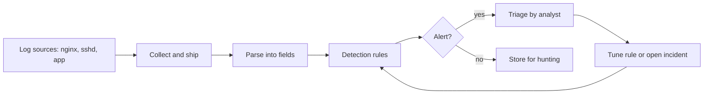

# Project: Detecting Attacks from Logs

## Introduction

Prevention fails sometimes. A password gets reused, a new bug ships, a scanner finds an old admin page. When that happens, the question is whether you **notice**. The OWASP Top 10:2025 lists "Security Logging and Alerting Failures" as A09 for exactly this reason: many breaches are discovered months later, often by someone outside the company.

In this project you will build a small detection pipeline the way a security operations team would, just at a smaller scale:

1. Generate a realistic **nginx access log** containing normal traffic and four hidden attacks.
2. Write a Python **parser** and four **detections**: brute-force logins, a successful login after brute force, path scanning, and injection attempts.
3. Hunt through **SSH authentication logs** with bash one-liners.
4. Map each detection to **MITRE ATT&CK**.
5. Express one detection as a portable **Sigma rule**.
6. Tune thresholds and decide what should wake someone up.

Think of logs as security camera footage. Cameras are useless if nobody watches them, and watching 24 hours of footage by eye is impossible. Detections are the motion sensors that say "look at camera 3, 09:22".

:::note Background
This project applies ideas from [Security Logging and SIEM](../11-sec-defensive-operations/1-sec-logging-and-siem.mdx), [Detection Engineering](../11-sec-defensive-operations/2-sec-detection-engineering.mdx), [MITRE ATT&CK](../11-sec-defensive-operations/3-sec-mitre-attack.mdx) and [Investigating with Logs](../12-sec-incident-response/3-sec-log-analysis.mdx). All logs here are **synthetic**, generated on your machine, using documentation-only IP ranges (192.0.2.0/24, 198.51.100.0/24, 203.0.113.0/24).
:::

## The Detection Pipeline



In production, collection and storage are handled by a SIEM or log platform (Elastic, Splunk, Microsoft Sentinel, Grafana Loki, OpenSearch and others). The detection logic you write here is the same idea those tools run at scale.

## Step 1: Generate a Practice Log

This script writes `access.log` in nginx's default "combined" format. It mixes 20 normal users (with an occasional mistyped password) with four attacks.

```python
"""make_logs.py: generate a small, synthetic nginx access log for practice."""
import random
from datetime import datetime, timedelta, timezone

random.seed(7)
start = datetime(2026, 10, 5, 9, 0, 0, tzinfo=timezone.utc)
lines = []

def line(ts, ip, method, path, status, size=512, ua="Mozilla/5.0"):
    t = ts.strftime("%d/%b/%Y:%H:%M:%S %z")
    return f'{ip} - - [{t}] "{method} {path} HTTP/1.1" {status} {size} "-" "{ua}"'

# 1. normal traffic from 20 users
for i in range(300):
    ts = start + timedelta(seconds=random.randint(0, 3600))
    ip = f"198.51.100.{random.randint(1, 20)}"
    path = random.choice(["/", "/notes", "/notes/12", "/static/app.js", "/me"])
    lines.append((ts, line(ts, ip, "GET", path, 200)))
    if random.random() < 0.05:
        lines.append((ts, line(ts, ip, "POST", "/login", 401)))   # normal typos
    if random.random() < 0.3:
        lines.append((ts, line(ts, ip, "POST", "/login", 200)))

# 2. brute force against one account from one IP, then success
t0 = start + timedelta(minutes=20)
for i in range(40):
    ts = t0 + timedelta(seconds=i * 3)
    lines.append((ts, line(ts, "203.0.113.50", "POST", "/login", 401, ua="python-requests/2.32.3")))
ts = t0 + timedelta(seconds=125)
lines.append((ts, line(ts, "203.0.113.50", "POST", "/login", 200, ua="python-requests/2.32.3")))

# 3. directory and vulnerability scanning
t1 = start + timedelta(minutes=35)
probes = ["/.env", "/.git/config", "/wp-login.php", "/admin", "/phpmyadmin/", "/backup.zip",
          "/server-status", "/config.php", "/api/v1/debug", "/actuator/env"] * 3
for i, p in enumerate(probes):
    ts = t1 + timedelta(seconds=i)
    lines.append((ts, line(ts, "192.0.2.77", "GET", p, 404, ua="Mozilla/5.0 (scanner)")))

# 4. injection attempts
t2 = start + timedelta(minutes=50)
attacks = ["/search?q=%27%20OR%201%3D1--", "/search?q=%3Cscript%3Ealert(1)%3C%2Fscript%3E",
           "/download?file=..%2F..%2F..%2Fetc%2Fpasswd",
           "/search?q=1%20UNION%20SELECT%20password%20FROM%20users"]
for i, p in enumerate(attacks):
    ts = t2 + timedelta(seconds=i * 5)
    lines.append((ts, line(ts, "192.0.2.77", "GET", p, 400)))

lines.sort(key=lambda x: x[0])
with open("access.log", "w") as f:
    f.write("\n".join(l for _, l in lines) + "\n")
print(f"wrote {len(lines)} lines to access.log")
```

```bash
python3 make_logs.py
head -3 access.log
```

Example output:

```text
wrote 485 lines to access.log
198.51.100.19 - - [05/Oct/2026:09:00:00 +0000] "GET /notes HTTP/1.1" 200 512 "-" "Mozilla/5.0"
198.51.100.1 - - [05/Oct/2026:09:00:04 +0000] "GET /me HTTP/1.1" 200 512 "-" "Mozilla/5.0"
198.51.100.17 - - [05/Oct/2026:09:00:05 +0000] "GET /notes HTTP/1.1" 200 512 "-" "Mozilla/5.0"
```

Before writing code, try finding the attacks with your eyes in 485 lines. That frustration is why detections exist.

## Step 2: Quick Triage with Bash

Experienced analysts start with the shell. These commands answer "who is noisy?" in seconds.

Top IPs by failed logins:

```bash
grep '"POST /login' access.log | awk '$9 == 401 {print $1}' | sort | uniq -c | sort -rn | head -5
```

Example output:

```text
     40 203.0.113.50
      3 198.51.100.2
      2 198.51.100.6
```

Top IPs by 404 responses:

```bash
awk '$9 == 404 {print $1}' access.log | sort | uniq -c | sort -rn | head -5
```

Example output:

```text
     30 192.0.2.77
```

In the combined format, field 9 is the status code. These counts point straight at `203.0.113.50` and `192.0.2.77`. But one-liners have limits: they ignore time (40 failures in two minutes is very different from 40 in a month) and they cannot express "success *after* failures". For that you need code.

## Step 3: Detections in Python

```python
"""detect.py: simple detections over an nginx combined access log."""
import re
import sys
from collections import defaultdict, deque
from datetime import datetime, timedelta
from urllib.parse import unquote_plus

LOG_RE = re.compile(
    r'(?P<ip>\S+) \S+ \S+ \[(?P<ts>[^\]]+)\] "(?P<method>\S+) (?P<path>\S+) [^"]*" '
    r'(?P<status>\d{3}) (?P<size>\S+) "[^"]*" "(?P<ua>[^"]*)"'
)
INJECTION_RE = re.compile(
    r"(union\s+select|'\s*or\s+1=1|<script|\.\./|/etc/passwd|sleep\(\d+\))", re.IGNORECASE
)

FAILED_LOGIN_THRESHOLD = 10           # failures per IP ...
FAILED_LOGIN_WINDOW = timedelta(minutes=5)   # ... within this window
SCAN_404_THRESHOLD = 10               # distinct 404 paths per IP
SCAN_WINDOW = timedelta(minutes=5)


def parse(lines):
    for n, raw in enumerate(lines, 1):
        m = LOG_RE.match(raw)
        if not m:
            print(f"warning: could not parse line {n}", file=sys.stderr)
            continue
        e = m.groupdict()
        e["ts"] = datetime.strptime(e["ts"], "%d/%b/%Y:%H:%M:%S %z")
        e["status"] = int(e["status"])
        yield e


def detect(events):
    alerts = []
    failures = defaultdict(deque)        # ip -> timestamps of failed logins
    not_found = defaultdict(deque)       # ip -> (timestamp, path) of 404s
    fired = set()                        # avoid repeating the same alert

    for e in events:
        ip, ts = e["ip"], e["ts"]

        # D1 + D2: brute force, and success after brute force
        if e["method"] == "POST" and e["path"] == "/login":
            q = failures[ip]
            while q and ts - q[0] > FAILED_LOGIN_WINDOW * 3:
                q.popleft()
            if e["status"] == 401:
                q.append(ts)
                recent = [t for t in q if ts - t <= FAILED_LOGIN_WINDOW]
                if len(recent) >= FAILED_LOGIN_THRESHOLD and ("D1", ip) not in fired:
                    fired.add(("D1", ip))
                    alerts.append((ts, "medium", "D1 brute-force login", ip,
                                   f"{len(recent)} failed logins in 5 min, UA={e['ua']}"))
            elif e["status"] == 200 and len(q) >= FAILED_LOGIN_THRESHOLD:
                alerts.append((ts, "high", "D2 login success after brute force", ip,
                               f"success after {len(q)} recent failures"))

        # D3: content discovery / vulnerability scanning
        if e["status"] == 404:
            q = not_found[ip]
            q.append((ts, e["path"]))
            while q and ts - q[0][0] > SCAN_WINDOW:
                q.popleft()
            distinct = {p for _, p in q}
            if len(distinct) >= SCAN_404_THRESHOLD and ("D3", ip) not in fired:
                fired.add(("D3", ip))
                alerts.append((ts, "low", "D3 path scanning", ip,
                               f"{len(distinct)} distinct 404 paths, e.g. {sorted(distinct)[:3]}"))

        # D4: injection patterns in the decoded URL
        decoded = unquote_plus(e["path"])
        m = INJECTION_RE.search(decoded)
        if m:
            alerts.append((ts, "medium", "D4 injection attempt", ip,
                           f"pattern {m.group(0)!r} in {decoded[:60]!r} -> {e['status']}"))
    return alerts


if __name__ == "__main__":
    path = sys.argv[1] if len(sys.argv) > 1 else "access.log"
    with open(path) as f:
        alerts = detect(parse(f))
    for ts, sev, name, ip, detail in sorted(alerts):
        print(f"{ts:%H:%M:%S} {sev:<6} {name:<36} {ip:<14} {detail}")
    print(f"\n{len(alerts)} alerts")
```

```bash
python3 detect.py access.log
```

Output:

```text
09:20:27 medium D1 brute-force login                 203.0.113.50   10 failed logins in 5 min, UA=python-requests/2.32.3
09:22:05 high   D2 login success after brute force   203.0.113.50   success after 40 recent failures
09:35:09 low    D3 path scanning                     192.0.2.77     10 distinct 404 paths, e.g. ['/.env', '/.git/config', '/actuator/env']
09:50:00 medium D4 injection attempt                 192.0.2.77     pattern "' OR 1=1" in "/search?q=' OR 1=1--" -> 400
09:50:05 medium D4 injection attempt                 192.0.2.77     pattern '<script' in '/search?q=<script>alert(1)</script>' -> 400
09:50:10 medium D4 injection attempt                 192.0.2.77     pattern '../' in '/download?file=../../../etc/passwd' -> 400
09:50:15 medium D4 injection attempt                 192.0.2.77     pattern 'UNION SELECT' in '/search?q=1 UNION SELECT password FROM users' -> 400

7 alerts
```

All four attacks were found, and the 20 normal users with occasional typos produced **no** alerts. That second fact matters as much as the first.

### What each detection teaches

- **D1 uses a time window.** A sliding window per IP turns "40 failures" into "10 failures in 5 minutes", which separates an attack from a forgetful user.
- **D2 is a correlation.** On its own, a successful login is normal and a burst of failures is noise. Together they say "an attacker probably got in". This is the alert that should page someone.
- **D3 counts distinct paths.** A real user hitting one broken link ten times is not scanning. Ten different well-known sensitive paths (`/.env`, `/.git/config`) is.
- **D4 decodes before matching.** Attackers URL-encode payloads. Matching `%27%20OR` would miss variations, so decode first. Even then, regex signatures are easy to evade with other encodings and SQL syntax. Treat D4 as a signal about *who is probing*, not as protection.

Notice also that D4 attempts all got `400`. The response code tells you whether the attack *worked*. A `200` on a request containing `UNION SELECT` deserves far more attention than a `400`.

## Step 4: Map Detections to MITRE ATT&CK

Mapping each rule to an ATT&CK technique gives everyone a shared vocabulary and shows coverage gaps.

| Detection | ATT&CK technique | Tactic |
| --- | --- | --- |
| D1 brute-force login | T1110.001 Brute Force: Password Guessing | Credential Access |
| D2 success after brute force | T1110 Brute Force, leading to T1078 Valid Accounts | Credential Access, Initial Access |
| D3 path scanning | T1595.003 Active Scanning: Wordlist Scanning | Reconnaissance |
| D4 injection attempt | T1190 Exploit Public-Facing Application | Initial Access |

Gaps jump out: nothing here detects **password spraying** (T1110.003, one password tried against many accounts, often from many IPs) or **credential stuffing** (T1110.004). Spraying beats D1, because each IP stays under the threshold. Detecting it needs a different angle, such as "number of distinct usernames failing per minute across the whole site", which requires the application log from the [secure login project](./0-sec-project-secure-login.mdx) because nginx does not see usernames.

## Step 5: SSH Logs

Any server with SSH open to the internet sees constant guessing. On Ubuntu, sshd logs to the systemd journal (and usually to `/var/log/auth.log` too). Here is a short synthetic sample in the same shape:

```text
2026-10-05T09:01:12.442Z web1 sshd[2211]: Failed password for invalid user admin from 203.0.113.9 port 51022 ssh2
2026-10-05T09:01:14.118Z web1 sshd[2211]: Failed password for invalid user oracle from 203.0.113.9 port 51040 ssh2
2026-10-05T09:01:15.902Z web1 sshd[2213]: Failed password for root from 203.0.113.9 port 51058 ssh2
2026-10-05T09:01:17.551Z web1 sshd[2215]: Failed password for invalid user test from 203.0.113.9 port 51066 ssh2
2026-10-05T09:02:03.010Z web1 sshd[2230]: Accepted publickey for deploy from 198.51.100.4 port 40110 ssh2: ED25519 SHA256:abc123
2026-10-05T09:03:44.771Z web1 sshd[2240]: Failed password for invalid user ubuntu from 192.0.2.200 port 60001 ssh2
2026-10-05T09:03:46.120Z web1 sshd[2240]: Failed password for invalid user pi from 192.0.2.200 port 60002 ssh2
```

Failed attempts by source IP (the field after the word `from`):

```bash
grep "Failed password" auth.log \
  | awk '{for (i=1;i<=NF;i++) if ($i=="from") print $(i+1)}' \
  | sort | uniq -c | sort -rn
```

Output:

```text
      4 203.0.113.9
      2 192.0.2.200
```

Which usernames attackers try:

```bash
grep -oP "Failed password for (invalid user )?\K\S+" auth.log | sort | uniq -c | sort -rn
```

Output:

```text
      1 ubuntu
      1 test
      1 root
      1 pi
      1 oracle
      1 admin
```

On a live Ubuntu server, read the journal directly with `journalctl -u ssh --since "1 hour ago"`. Note the unit name: it is `ssh` on Ubuntu and Debian but `sshd` on many other distributions.

The most important SSH detection is not the failures. It is an **`Accepted password`** line at all, if your policy is key-only login, or an `Accepted` line from an unexpected IP or for an unexpected user. The failures are background radiation; the [hardening project](./5-sec-project-hardened-server.mdx) makes them harmless by disabling password logins.

## Step 6: A Portable Rule with Sigma

Your Python script only runs in your Python script. [Sigma](https://sigmahq.io/) is an open YAML format for detection rules that converters translate into the query languages of many SIEMs. Here is D4 as a Sigma rule for web server logs:

```yaml
title: SQL Injection or Path Traversal Strings in Web Request
id: 5b7f0e5e-3a1c-4d36-9a57-2a7e3d1c9b11
status: experimental
description: Detects common SQL injection and path traversal strings in web request URLs. Signals probing, not success.
author: Compile N Run tutorial
date: 2026-10-05
logsource:
    category: webserver
detection:
    selection_sqli:
        cs-uri-query|contains:
            - 'union select'
            - "' or 1=1"
            - 'sleep('
    selection_traversal:
        cs-uri-query|contains:
            - '../'
            - '/etc/passwd'
    condition: selection_sqli or selection_traversal
falsepositives:
    - Security scanners run by your own team
    - Search pages where users legitimately type SQL keywords
level: medium
tags:
    - attack.initial-access
    - attack.t1190
```

The `id` should be a fresh random UUID for each rule you write (`python3 -c "import uuid; print(uuid.uuid4())"`). Field names such as `cs-uri-query` follow Sigma's web server conventions, and your SIEM's field mapping decides what they map to. The [pySigma / sigma-cli](https://github.com/SigmaHQ/sigma-cli) tooling converts rules into specific backends. Look at the [SigmaHQ rule repository](https://github.com/SigmaHQ/sigma) for thousands of community rules, including ones for web servers and Linux authentication.

## Step 7: Tuning and Alert Routing

A detection that fires 200 times a day is ignored by the third day. Before turning any rule on, decide what happens when it fires.

| Detection | Expected volume | Action | Why |
| --- | --- | --- | --- |
| D2 success after brute force | Rare | Page on-call, force logout and password reset | Probable account takeover |
| D1 brute-force login | Several per day on a public site | Ticket or dashboard, auto-block via rate limiting | Common, usually unsuccessful |
| D4 injection attempt with 2xx response | Rare | Page security, check application logs | Possible successful exploit |
| D4 with 4xx response | Constant on public sites | Dashboard only | Background noise from bots |
| D3 path scanning | Constant | Dashboard, feed IPs to block lists if desired | Reconnaissance, low value alone |

Tuning tips:

- **Allowlist your own scanners** (for example, the ZAP job from the [DevSecOps project](./3-sec-project-devsecops-pipeline.mdx)) by IP or user agent, and document it.
- **Test every rule with known-bad and known-good data**, like this project does. Store those samples next to the rule.
- **Review alert outcomes monthly**: what fraction were true positives? Rules that are almost never useful get rewritten or removed.

## Real-World Scenario

You are the only security-minded engineer at a 30-person startup. There is no SOC and no SIEM budget yet. Logs from three nginx servers and the app go to a hosted log platform, and nobody looks at them. Last month a customer reported their account had been accessed, and it took two days to confirm it from the logs.

**What you build:**

1. Structured application auth logs (`login_failed`, `login_success`, `mfa_failed`) with user ID and IP, from the [secure login project](./0-sec-project-secure-login.mdx).
2. Three alerts in the log platform: D2 (success after failures, per IP *and* per account), a site-wide failure-rate spike for spraying and stuffing, and any 2xx response to a request matching injection patterns.
3. Alerts go to a dedicated chat channel; D2 also pages the on-call engineer.
4. A one-page runbook for each alert: what to check, how to lock the account, who to tell. See [Incident Response Playbooks](../12-sec-incident-response/1-sec-incident-playbooks.mdx).

**Why this approach:** a few high-signal alerts tied to real incidents beat a hundred generic rules that nobody tunes. The application log provides usernames, which web server logs lack.

**When to move on:** once you have multiple products, compliance requirements, or more alerts than one person can triage, invest in a proper SIEM or a managed detection and response (MDR) service.

### Where should detection logic live?

| Approach | Pros | Cons | Best for |
| --- | --- | --- | --- |
| Scripts like `detect.py` on log files | Free, transparent, great for learning and ad-hoc hunts | No real-time alerting, does not scale | Investigations, small teams, prototypes |
| Log platform saved searches and alerts | Real-time, easy to set up | Vendor-specific query language | Startups with an existing log service |
| SIEM with Sigma-based rules | Portable rules, correlation, case management | Cost and tuning effort | Organizations with a security team |
| fail2ban or WAF auto-blocking | Acts immediately, no analyst needed | Blocks only by IP, can block legitimate users | Noisy, low-risk attacks such as SSH guessing |
| Managed detection and response | 24/7 analysts | Expensive, less context about your app | Teams without in-house SOC capacity |

## Common Mistakes

- **Logging too little.** If the app does not log failed logins with a username and IP, no detection can see credential stuffing.
- **Logging secrets.** Passwords, session tokens and full card numbers must never appear in logs.
- **Alerting on everything.** Alert fatigue makes people miss the one alert that matters.
- **Ignoring time zones and clock skew.** Correlating events across servers needs synchronized clocks (NTP) and UTC timestamps.
- **No protection for the logs.** Attackers delete logs. Ship them off the host quickly to storage the server cannot modify.
- **Treating signature matches as proof of attack success.** Check the response code and the application's behavior.
- **Untested rules.** A rule with a typo in a field name silently never fires.

## Summary

- Detection turns raw logs into a few actionable alerts. Time windows, distinct counts and correlations make rules accurate.
- The highest-value alert in this project is **D2: success after brute force**, a likely account takeover.
- Bash one-liners are perfect for quick triage; code or a SIEM is needed for time-based and correlated detections.
- Map detections to **MITRE ATT&CK** to find coverage gaps such as password spraying.
- Write portable rules in **Sigma**, test each rule with good and bad samples, and route alerts by severity.

## Exercises

1. Add a password-spraying generator to `make_logs.py` (50 IPs, each trying two logins) and confirm D1 misses it. Then write a site-wide detection that catches it.
2. Extend `detect.py` to output JSON lines (`json.dumps` per alert) so a log platform could ingest the alerts.
3. Modify D4 to raise severity to `high` when the response status is 2xx, and add a test log line that triggers it.
4. Install `sigma-cli` and convert the Sigma rule above into a query for a backend you have access to. Note how field mappings change the result.

**Related pages:** [Threat Hunting](../11-sec-defensive-operations/5-sec-threat-hunting.mdx), [Intrusion Detection and Prevention](../2-sec-network-security/5-sec-ids-ips.mdx), [Secure Error Handling and Logging](../5-sec-secure-coding/2-sec-error-handling-and-logging.mdx), and the next project, [Hardening a Linux Server](./5-sec-project-hardened-server.mdx).
