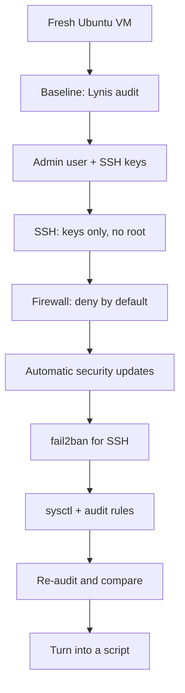

# Project: Hardening a Linux Server

## Introduction

A new cloud server is on the internet minutes after it boots, and automated scanners find it soon after. If SSH accepts passwords, the guessing starts right away. **Hardening** means reducing what an attacker can reach and making what remains harder to abuse: fewer open ports, fewer ways to log in, fewer privileges, faster patches, and a record of what changed.

In this project you will take a fresh Ubuntu Server VM and:

1. **Measure** the starting point with Lynis.
2. Set up an **admin user with SSH keys** and turn off password and root login.
3. Turn on a **host firewall** (ufw) that allows only what the server needs.
4. Enable **automatic security updates**.
5. Add **fail2ban** to block repeated SSH failures.
6. Apply safer **kernel and network settings** with sysctl.
7. Add **audit rules** that record changes to accounts, sudo and SSH configuration.
8. **Measure again**, and package everything as a repeatable script.

Think of the server as a new house. Hardening is changing the locks from the builder's master key, bricking up doors you will never use, fitting a burglar alarm and setting the boiler to service itself. None of it makes the house impossible to break into, but each step removes an easy option.

:::warning Your own machine only
Do this on a VM you own: a local VM (for example `multipass launch 24.04 --name harden-lab`, VirtualBox or UTM) or a cloud instance in your own account. Never run audits or hardening scripts on systems you are not responsible for.
:::

:::caution Do not lock yourself out
Several steps change how you log in. **Keep one SSH session open the whole time** and test every change in a *second* session before closing the first. If you use a cloud VM, know how to reach its serial or web console in case SSH breaks.
:::

:::note Background
This project applies [Linux Hardening](../9-sec-system-hardening/0-sec-linux-hardening.mdx), [SSH Security](../9-sec-system-hardening/2-sec-ssh-security.mdx), [Patch Management](../9-sec-system-hardening/3-sec-patch-management.mdx) and [CIS Benchmarks and Baselines](../9-sec-system-hardening/5-sec-cis-benchmarks.mdx). For general Ubuntu administration, see the [Ubuntu tutorial](/docs/os/ubuntu).
:::

## The Plan



The order matters. You set up key-based login **before** disabling passwords, and allow SSH in the firewall **before** enabling it.

This page uses **Ubuntu Server 24.04 LTS**. Most commands also work on newer Ubuntu LTS releases and on Debian, but check your release notes, because defaults change between versions.

## Step 1: Measure the Baseline

You cannot show improvement without a "before". [Lynis](https://cisofy.com/lynis/) is an open-source auditing tool that checks hundreds of settings and prints suggestions.

```bash
sudo apt update
sudo apt install -y lynis
sudo lynis audit system --quick
```

At the end, Lynis prints a **hardening index** (0 to 100) and a list of warnings and suggestions, and saves details in `/var/log/lynis-report.dat`. Save the number and the suggestion list:

```bash
sudo grep -E '^(hardening_index|suggestion)' /var/log/lynis-report.dat > ~/lynis-before.txt
wc -l ~/lynis-before.txt
```

The Lynis package in Ubuntu's archive can lag behind upstream. CISOfy publishes its own package repository if you want the newest checks.

Also take an inventory of what is listening on the network:

```bash
sudo ss -tulpn
```

Example output on a minimal server:

```text
Netid State  Recv-Q Send-Q Local Address:Port  Peer Address:Port Process
udp   UNCONN 0      0      127.0.0.53%lo:53         0.0.0.0:*     users:(("systemd-resolve",pid=612,fd=13))
tcp   LISTEN 0      4096   127.0.0.53%lo:53         0.0.0.0:*     users:(("systemd-resolve",pid=612,fd=14))
tcp   LISTEN 0      4096         0.0.0.0:22         0.0.0.0:*     users:(("sshd",pid=1,fd=3),("systemd",pid=1,fd=103))
```

Everything bound to `0.0.0.0` or `[::]` is reachable from outside unless a firewall says otherwise. Here, only SSH is. On a server you inherit, this list is often surprising: databases, admin panels and debug ports bound to all interfaces. Anything you do not need, stop and disable with `sudo systemctl disable --now <service>`.

## Step 2: An Admin User with SSH Keys

Do not work as `root`, and do not share one account between people. Each admin gets their own account, so logs show who did what.

On **your laptop**, create a key if you do not have one. Ed25519 is the modern default:

```bash
ssh-keygen -t ed25519 -C "alice@laptop"
```

On the **server**, create the user and give it sudo:

```bash
sudo adduser alice
sudo usermod -aG sudo alice
```

From your laptop, copy the public key and test it:

```bash
ssh-copy-id alice@SERVER_IP
ssh alice@SERVER_IP 'whoami; sudo -n true 2>/dev/null && echo "sudo ok (cached)" || echo "sudo needs password"'
```

Example output:

```text
alice
sudo needs password
```

Requiring the user's password for `sudo` is a useful second check: a stolen SSH key alone does not give root.

## Step 3: Harden SSH

Ubuntu's main config, `/etc/ssh/sshd_config`, starts with `Include /etc/ssh/sshd_config.d/*.conf`. For most options **the first value sshd reads wins**, so put your settings in a drop-in file that sorts first. This also matters because some cloud images ship a drop-in (for example `50-cloud-init.conf`) that turns password login back **on**.

**Vulnerable (common defaults on many images):**

```text
PermitRootLogin prohibit-password
PasswordAuthentication yes
X11Forwarding yes
```

**Fixed**, in `/etc/ssh/sshd_config.d/00-hardening.conf`:

```text
# Loaded first; for most options the first value sshd sees wins.
PermitRootLogin no
PasswordAuthentication no
KbdInteractiveAuthentication no
PubkeyAuthentication yes
AuthenticationMethods publickey
AllowGroups sshusers
MaxAuthTries 3
LoginGraceTime 30
X11Forwarding no
AllowAgentForwarding no
AllowTcpForwarding no
ClientAliveInterval 300
ClientAliveCountMax 2
```

What each line buys you:

| Setting | Effect |
| --- | --- |
| `PermitRootLogin no` | Attackers must guess a username as well, and admin actions are attributable |
| `PasswordAuthentication no`, `KbdInteractiveAuthentication no` | Password guessing becomes pointless |
| `AllowGroups sshusers` | Only accounts you explicitly add can use SSH, even if another account gets a key |
| `MaxAuthTries 3`, `LoginGraceTime 30` | Fewer attempts per connection, shorter half-open connections |
| `X11Forwarding`, `AllowAgentForwarding`, `AllowTcpForwarding` off | Removes tunneling features most servers never use |
| `ClientAliveInterval` / `CountMax` | Drops dead sessions after about 10 minutes |

Turn off `AllowTcpForwarding` only if you do not use SSH tunnels (for example, to reach a database). Create the group and add yourself **before** restarting:

```bash
sudo groupadd -f sshusers
sudo usermod -aG sshusers alice
sudo sshd -t && echo "config OK"
sudo systemctl restart ssh
```

`sshd -t` validates the configuration. If it prints errors, fix them before restarting. Now check the **effective** settings, which show what sshd will actually do after merging all files:

```bash
sudo sshd -T | grep -Ei '^(permitrootlogin|passwordauthentication|kbdinteractiveauthentication|allowgroups|maxauthtries)'
```

Expected output:

```text
permitrootlogin no
passwordauthentication no
kbdinteractiveauthentication no
maxauthtries 3
allowgroups sshusers
```

**Test from a second terminal** before closing your current session:

```bash
ssh alice@SERVER_IP 'echo key login works'
ssh -o PubkeyAuthentication=no -o PreferredAuthentications=password alice@SERVER_IP
```

The first command should succeed. The second should fail with `Permission denied (publickey).`, proving passwords are refused.

:::note Socket activation on recent Ubuntu
Since Ubuntu 22.10, the SSH server is started through systemd socket activation (`ssh.socket`). Ordinary option changes apply after `sudo systemctl restart ssh`. If you change `Port` or `ListenAddress`, Ubuntu's documentation says to also run `sudo systemctl daemon-reload` and `sudo systemctl restart ssh.socket`. Check the docs for your release.
:::

## Step 4: Host Firewall with ufw

A host firewall is a second line behind your cloud security group (see [Firewalls and Security Groups](../2-sec-network-security/1-sec-firewalls.mdx)). Deny everything inbound, then allow only what this server serves.

```bash
sudo ufw default deny incoming
sudo ufw default allow outgoing
sudo ufw limit 22/tcp comment 'SSH with rate limit'
sudo ufw allow 80/tcp comment 'HTTP'
sudo ufw allow 443/tcp comment 'HTTPS'
sudo ufw enable
sudo ufw status verbose
```

Example output:

```text
Status: active
Logging: on (low)
Default: deny (incoming), allow (outgoing), disabled (routed)
New profiles: skip

To                         Action      From
--                         ------      ----
22/tcp                     LIMIT IN    Anywhere                   # SSH with rate limit
80/tcp                     ALLOW IN    Anywhere                   # HTTP
443/tcp                    ALLOW IN    Anywhere                   # HTTPS
22/tcp (v6)                LIMIT IN    Anywhere (v6)              # SSH with rate limit
80/tcp (v6)                ALLOW IN    Anywhere (v6)              # HTTP
443/tcp (v6)               ALLOW IN    Anywhere (v6)              # HTTPS
```

`limit` blocks an IP that opens too many connections in a short time (ufw's documentation describes it as six or more within 30 seconds). Better still, if admins connect from a known network or VPN, allow SSH only from there:

```bash
sudo ufw delete limit 22/tcp
sudo ufw allow from 203.0.113.0/24 to any port 22 proto tcp comment 'SSH from office VPN'
```

:::caution Docker and ufw
Docker writes its own iptables rules for published container ports, and these can bypass ufw. A container started with `-p 5432:5432` may be reachable from the internet even though ufw "denies" port 5432. Bind container ports to `127.0.0.1` (`-p 127.0.0.1:5432:5432`) or use the cloud firewall as the authoritative control. See the [Docker tutorial](/docs/devops/docker) for networking details.
:::

## Step 5: Automatic Security Updates

Most real compromises use known vulnerabilities with patches already available. On Ubuntu, `unattended-upgrades` installs security updates daily.

```bash
sudo apt install -y unattended-upgrades
sudo dpkg-reconfigure -plow unattended-upgrades
cat /etc/apt/apt.conf.d/20auto-upgrades
```

Expected content:

```text
APT::Periodic::Update-Package-Lists "1";
APT::Periodic::Unattended-Upgrade "1";
```

Do a dry run to see what it would do:

```bash
sudo unattended-upgrade --dry-run --debug 2>&1 | tail -5
```

Some updates, including kernel updates, need a reboot. Check for `/var/run/reboot-required` and plan reboots, or enable automatic reboots at a quiet hour in `/etc/apt/apt.conf.d/50unattended-upgrades` (`Unattended-Upgrade::Automatic-Reboot "true";` and `Unattended-Upgrade::Automatic-Reboot-Time "03:30";`). Ubuntu Pro's Livepatch can apply some kernel fixes without reboots. Check Canonical's site for current terms.

## Step 6: fail2ban

With password login off, SSH guessing cannot succeed, but it still fills logs and wastes resources. fail2ban watches logs and temporarily bans IPs that fail too often. Create `/etc/fail2ban/jail.local` (never edit `jail.conf`, which package updates overwrite):

```ini
[DEFAULT]
bantime = 1h
findtime = 10m
maxretry = 5
bantime.increment = true

[sshd]
enabled = true
backend = systemd
```

`backend = systemd` reads sshd's messages from the journal, which is reliable on current Ubuntu. `bantime.increment` makes repeat offenders' bans grow longer.

```bash
sudo apt install -y fail2ban python3-systemd
sudo systemctl enable --now fail2ban
sudo systemctl restart fail2ban
sudo fail2ban-client status sshd
```

Example output (counts will differ):

```text
Status for the jail: sshd
|- Filter
|  |- Currently failed: 0
|  `- Total failed:     12
`- Actions
   |- Currently banned: 1
   |- Total banned:     1
   `- Banned IP list:   203.0.113.9
```

If you ban yourself while testing, unban with `sudo fail2ban-client set sshd unbanip YOUR_IP`. To never ban your office or VPN range, set `ignoreip` in `[DEFAULT]`.

## Step 7: Kernel and Network Settings

The kernel exposes many security-relevant settings through `sysctl`. Ubuntu's defaults are already reasonable; these tighten a few more. Put them in `/etc/sysctl.d/60-hardening.conf`:

```ini
net.ipv4.conf.all.rp_filter = 1
net.ipv4.conf.default.rp_filter = 1
net.ipv4.conf.all.accept_redirects = 0
net.ipv4.conf.default.accept_redirects = 0
net.ipv6.conf.all.accept_redirects = 0
net.ipv4.conf.all.send_redirects = 0
net.ipv4.conf.all.accept_source_route = 0
net.ipv4.tcp_syncookies = 1
kernel.kptr_restrict = 2
kernel.dmesg_restrict = 1
fs.protected_hardlinks = 1
fs.protected_symlinks = 1
```

```bash
sudo sysctl --system
sysctl net.ipv4.conf.all.accept_redirects kernel.dmesg_restrict
```

Output:

```text
net.ipv4.conf.all.accept_redirects = 0
kernel.dmesg_restrict = 1
```

| Setting | Why |
| --- | --- |
| `rp_filter = 1` | Drops packets with spoofed source addresses arriving on the wrong interface |
| `accept_redirects = 0`, `send_redirects = 0` | A server is not a router; ICMP redirects can be used to reroute traffic |
| `accept_source_route = 0` | Ignores packets that try to dictate their own route |
| `tcp_syncookies = 1` | Helps survive SYN flood attacks |
| `kptr_restrict = 2`, `dmesg_restrict = 1` | Hides kernel addresses and logs that help exploit development |
| `protected_hardlinks`, `protected_symlinks` | Blocks classic link-based privilege escalation tricks in shared directories |

Do **not** disable forwarding settings on a host that runs Docker or Kubernetes, which rely on IP forwarding.

## Step 8: Audit Rules

When something changes on the server, you want to know who changed it. `auditd` records file changes the kernel sees. Watch the files that control access:

```bash
sudo apt install -y auditd
sudo tee /etc/audit/rules.d/50-hardening.rules > /dev/null <<'EOF'
-w /etc/passwd -p wa -k identity
-w /etc/shadow -p wa -k identity
-w /etc/group -p wa -k identity
-w /etc/sudoers -p wa -k sudoers
-w /etc/sudoers.d/ -p wa -k sudoers
-w /etc/ssh/sshd_config -p wa -k sshd
-w /etc/ssh/sshd_config.d/ -p wa -k sshd
EOF
sudo augenrules --load
```

`-w` watches a path, `-p wa` records writes and attribute changes, and `-k` tags events with a key you can search for. Test it:

```bash
sudo touch /etc/ssh/sshd_config.d/00-hardening.conf
sudo ausearch -k sshd -i | tail -4
```

The output shows the time, the file, the command (`touch`) and both the login user (`auid=alice`) and the effective user (`uid=root`). That `auid` is why personal admin accounts matter: even after `sudo`, the audit trail remembers who logged in. Ship these logs off the server (see [Detecting Attacks from Logs](./4-sec-project-log-monitoring.mdx)), because an attacker with root can delete local logs.

## Step 9: Re-audit and Script It

Run Lynis again and compare:

```bash
sudo lynis audit system --quick
sudo grep -E '^(hardening_index|suggestion)' /var/log/lynis-report.dat > ~/lynis-after.txt
grep hardening_index ~/lynis-before.txt ~/lynis-after.txt
```

The index should rise and the suggestion list should shrink. Do not chase 100: some suggestions do not fit every server, and each remaining one should be either fixed or consciously accepted.

Hand-hardening one server is a learning exercise. For real fleets, the same steps must be **repeatable**. Here they are as one idempotent script:

```bash
#!/usr/bin/env bash
# harden.sh - baseline hardening for a fresh Ubuntu Server LTS VM you own.
# Run as root (sudo). Safe to run more than once.
set -euo pipefail

ADMIN_USER="${ADMIN_USER:?set ADMIN_USER to your admin account name}"
SSH_ALLOW_FROM="${SSH_ALLOW_FROM:-any}"   # e.g. 203.0.113.0/24 for your office or VPN

log() { printf '[harden] %s\n' "$*"; }

[[ $EUID -eq 0 ]] || { echo "run with sudo" >&2; exit 1; }
id "$ADMIN_USER" >/dev/null 2>&1 || { echo "user $ADMIN_USER does not exist" >&2; exit 1; }
[[ -s "/home/$ADMIN_USER/.ssh/authorized_keys" ]] || {
  echo "no SSH key for $ADMIN_USER: refusing to disable password login" >&2; exit 1; }

log "1/7 updating packages"
apt-get update -q
DEBIAN_FRONTEND=noninteractive apt-get -y -q upgrade
DEBIAN_FRONTEND=noninteractive apt-get -y -q install \
  ufw fail2ban python3-systemd unattended-upgrades auditd lynis

log "2/7 automatic security updates"
cat > /etc/apt/apt.conf.d/20auto-upgrades <<'CONF'
APT::Periodic::Update-Package-Lists "1";
APT::Periodic::Unattended-Upgrade "1";
CONF

log "3/7 SSH hardening"
groupadd -f sshusers
usermod -aG sshusers "$ADMIN_USER"
cat > /etc/ssh/sshd_config.d/00-hardening.conf <<'CONF'
PermitRootLogin no
PasswordAuthentication no
KbdInteractiveAuthentication no
PubkeyAuthentication yes
AuthenticationMethods publickey
AllowGroups sshusers
MaxAuthTries 3
LoginGraceTime 30
X11Forwarding no
AllowAgentForwarding no
AllowTcpForwarding no
ClientAliveInterval 300
ClientAliveCountMax 2
CONF
sshd -t                       # abort (set -e) if the config is invalid
systemctl restart ssh

log "4/7 firewall"
ufw default deny incoming
ufw default allow outgoing
if [[ "$SSH_ALLOW_FROM" == "any" ]]; then
  ufw limit 22/tcp comment 'SSH with rate limit'
else
  ufw allow from "$SSH_ALLOW_FROM" to any port 22 proto tcp comment 'SSH from admin network'
fi
ufw allow 80/tcp comment 'HTTP'
ufw allow 443/tcp comment 'HTTPS'
ufw --force enable

log "5/7 fail2ban for sshd"
cat > /etc/fail2ban/jail.local <<'CONF'
[DEFAULT]
bantime = 1h
findtime = 10m
maxretry = 5
bantime.increment = true

[sshd]
enabled = true
backend = systemd
CONF
systemctl enable --now fail2ban
systemctl restart fail2ban

log "6/7 kernel and network settings"
cat > /etc/sysctl.d/60-hardening.conf <<'CONF'
net.ipv4.conf.all.rp_filter = 1
net.ipv4.conf.default.rp_filter = 1
net.ipv4.conf.all.accept_redirects = 0
net.ipv4.conf.default.accept_redirects = 0
net.ipv6.conf.all.accept_redirects = 0
net.ipv4.conf.all.send_redirects = 0
net.ipv4.conf.all.accept_source_route = 0
net.ipv4.tcp_syncookies = 1
kernel.kptr_restrict = 2
kernel.dmesg_restrict = 1
fs.protected_hardlinks = 1
fs.protected_symlinks = 1
CONF
sysctl --system >/dev/null

log "7/7 audit rules for sensitive files"
cat > /etc/audit/rules.d/50-hardening.rules <<'CONF'
-w /etc/passwd -p wa -k identity
-w /etc/shadow -p wa -k identity
-w /etc/group -p wa -k identity
-w /etc/sudoers -p wa -k sudoers
-w /etc/sudoers.d/ -p wa -k sudoers
-w /etc/ssh/sshd_config -p wa -k sshd
-w /etc/ssh/sshd_config.d/ -p wa -k sshd
CONF
augenrules --load >/dev/null
systemctl enable --now auditd

log "done. Keep your current SSH session open and test a NEW login before logging out."
```

Run it with:

```bash
sudo ADMIN_USER=alice SSH_ALLOW_FROM=203.0.113.0/24 bash harden.sh
```

Note the safety checks at the top: the script refuses to disable password login if the admin user has no SSH key, which prevents the most common lockout. At larger scale, the same logic belongs in a configuration management tool such as Ansible, or baked into a hardened machine image, so every new server starts hardened.

## Real-World Scenario

Your team runs a dozen Ubuntu VMs for a web app: three web servers, two workers, a bastion host and several internal tools. They were set up by hand over three years. An external audit for a customer contract asks for "evidence of a hardening standard".

**What you do:**

1. **Pick a baseline.** The CIS Benchmark for your Ubuntu release, Level 1 Server profile, is the common reference. Read [CIS Benchmarks and Baselines](../9-sec-system-hardening/5-sec-cis-benchmarks.mdx).
2. **Measure.** Run Lynis (or a CIS-specific tool such as Ubuntu's Security Guide, `usg`, available with Ubuntu Pro) on every host, and record the results.
3. **Encode.** Turn this page's steps into an Ansible role, test it on a staging VM, then roll it out a few hosts at a time.
4. **Rebuild instead of patch where possible.** New servers come from a hardened image built in CI; old snowflake servers are replaced one by one.
5. **Keep evidence.** Store before and after reports and the role's git history. That is what the auditor wants.

**Why this approach:** a written baseline plus automation gives consistent servers and repeatable evidence. Hand-hardening twelve servers produces twelve slightly different servers.

**When not to do this yourself:** if the app can run on a managed platform (containers on a managed service, serverless), the provider hardens and patches the hosts, and your hardening effort moves to images, IAM and configuration (see [The Shared Responsibility Model](../8-sec-cloud-and-container/0-sec-cloud-shared-responsibility.mdx)).

### Choosing a hardening approach

| Approach | Pros | Cons | Best for |
| --- | --- | --- | --- |
| Manual steps (this page) | Learn what each control does | Inconsistent, undocumented, slow | Learning, a single personal server |
| Bash script | Quick, repeatable | Hard to maintain, weak drift detection | Small number of similar servers |
| Ansible or similar | Idempotent, reviewable, reports drift | Learning curve | Fleets of long-lived servers |
| Hardened golden image | Every server starts compliant, fast scaling | Needs an image pipeline, still needs patching | Cloud autoscaling groups |
| CIS-hardened marketplace images or vendor tools | Prebuilt and mapped to benchmarks | Cost, may break apps, less understanding | Compliance-driven environments |

## Common Mistakes

- **Locking yourself out.** Always test a new session before closing the old one, and have console access.
- **Putting settings at the end of `sshd_config`.** An earlier `Include` with `PasswordAuthentication yes` wins. Use a `00-` drop-in and check with `sshd -T`.
- **Relying only on ufw with Docker.** Published container ports can bypass it.
- **Hardening once, never again.** New packages and admins cause drift. Re-audit on a schedule.
- **Enabling automatic updates but never rebooting.** Kernel fixes do not apply until a reboot or a live patch.
- **Copying hardening lists blindly.** Some settings break specific workloads; test, and document exceptions.
- **Keeping logs only on the server.** An attacker with root can erase them.

## Summary

- Measure first (Lynis, `ss -tulpn`), then reduce the attack surface.
- Use **personal admin accounts with SSH keys**, disable root and password login with a **first-loaded drop-in**, and verify with `sshd -T`.
- **Deny inbound by default** with ufw, and watch out for Docker's own firewall rules.
- Turn on **automatic security updates** and plan reboots.
- Add **fail2ban**, **sysctl** tightening and **auditd** rules for accountability.
- Re-measure, then make it **repeatable** with a script, Ansible or a hardened image.

## Exercises

1. Convert `harden.sh` into an Ansible playbook with one task per step, and run it twice to confirm the second run changes nothing.
2. Add TOTP or FIDO2 security key authentication for SSH on your lab VM, and document how you would recover if the key is lost.
3. Install a small nginx site and harden it: `server_tokens off;`, TLS only, and the security headers from [Security Headers, CORS and CSP](../3-sec-web-security/9-sec-security-headers.mdx). Re-run Lynis.
4. From another VM in your lab, run `nmap -sV` against the hardened server (see [Network Scanning with Nmap](../2-sec-network-security/10-sec-network-scanning.mdx)) and confirm only the ports you expect are open.

**Related pages:** [Backups and Ransomware Resilience](../9-sec-system-hardening/6-sec-backups-and-ransomware.mdx), [Least Privilege and Zero Trust](../0-sec-fundamentals/5-sec-least-privilege.mdx), and the next project, [Incident Response Tabletop Exercise](./6-sec-project-incident-simulation.mdx).
