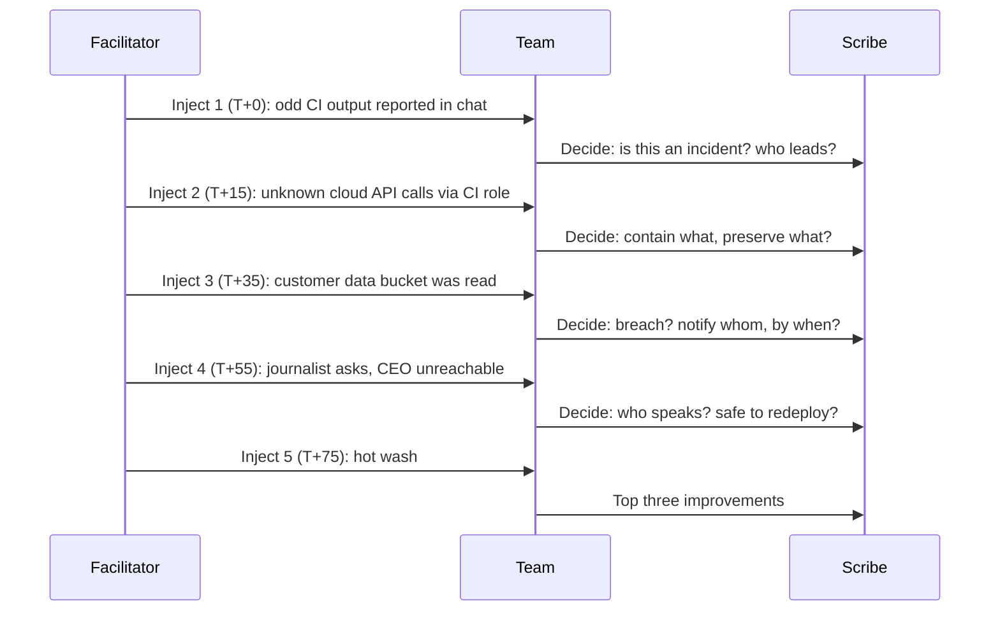

# Project: Incident Response Tabletop Exercise

## Introduction

Most teams find out how they respond to an incident during their first real one, at 2 a.m., with customers waiting. A **tabletop exercise** lets you find out on a Tuesday afternoon instead. A facilitator walks a group through a realistic scenario, one development ("inject") at a time, and the group talks through what they would do. Nobody touches a real system. The output is a list of gaps: missing contacts, unclear authority, logs you do not have, steps nobody owns.

In this project you will design and run a 90-minute tabletop for a small SaaS team. You will:

1. Set **objectives** and pick **participants and roles**.
2. Write a **scenario** with timed injects and discussion questions.
3. Use a small **facilitator script** that presents injects and records decisions.
4. Run the session, including the **hot wash** at the end.
5. Produce an **after-action report** with an improvement plan that has owners and dates.

Think of it like a fire drill, but one where you also ask "who calls the fire brigade, who tells the customers, and where are the fire extinguishers?" and discover that two of the extinguishers are missing.

:::note Background
The exercise follows the incident lifecycle in [Incident Response Lifecycle](../12-sec-incident-response/0-sec-incident-response-lifecycle.mdx) and tests the runbooks from [Incident Response Playbooks](../12-sec-incident-response/1-sec-incident-playbooks.mdx). NIST's current incident response guidance, **SP 800-61 Revision 3** (April 2025), is written as a CSF 2.0 Community Profile and replaces Revision 2 from 2012. If you want ready-made material, CISA publishes free **Tabletop Exercise Packages (CTEPs)** with scenarios, facilitator guides and after-action report templates.
:::

## Types of Exercises

A tabletop is one of several exercise types. They differ in realism, cost and risk:

| Exercise | What happens | Cost and risk | Best for |
| --- | --- | --- | --- |
| Tabletop (this project) | Discussion of a scenario around a table or video call | Low cost, no risk to systems | Roles, decisions, communication, plans |
| Walkthrough or drill | Team performs one procedure, such as restoring a backup | Low to medium | Proving a specific runbook works |
| Functional exercise | Teams act in a simulated environment with real tools | Medium | Testing tooling and handoffs |
| Red team or purple team | Authorized attackers emulate a real adversary | High cost, needs strict rules of engagement | Testing detection and response end to end |
| Full-scale exercise | Many teams and external parties, live | Highest | Large organizations, regulated sectors |

Start with tabletops. They are cheap, and they find the organizational gaps that break real responses far more often than tooling does.

## Step 1: Objectives and Participants

An exercise without objectives turns into a war story session. Write two to four objectives that you can check at the end. For the NoteHub team (the SaaS from earlier projects):

- Test how quickly we can **revoke and rotate** CI and cloud credentials.
- Clarify **who decides** on customer and regulator notification.
- Find **gaps in logging** needed to scope the incident.

### Roles

| Role | Who | Job during the exercise |
| --- | --- | --- |
| Facilitator | Someone who knows the scenario, ideally not the incident lead | Presents injects, asks questions, keeps time, stays neutral |
| Participants | Engineering lead, on-call engineers, support lead, someone from legal or privacy, a decision-maker for communications | Discuss and decide as they would in a real incident |
| Scribe | One person who only takes notes | Records decisions, open questions, gaps |
| Observers (optional) | New hires, other teams | Watch and learn; no talking until the hot wash |

Include non-engineers. The hardest questions in real incidents are often "do we have to tell customers?" and "who is allowed to talk to the press?", and engineers cannot answer those alone.

### Ground rules

Read these out at the start:

- This is a **no-fault** exercise. We are testing plans and processes, not people.
- Answer with what you **would actually do today**, with today's tools and access, not what you wish you had.
- "I don't know" is a valuable answer. It becomes an action item.
- The scenario is fictional. Do not touch production systems during the session.

## Step 2: Design the Scenario

Good scenarios are **plausible for your organization**, **escalate** over time, and **force decisions** with trade-offs. Base them on real incidents in your industry. This one is inspired by the 2026 compromise of a popular security scanner's GitHub Action (see the [DevSecOps Pipeline](./3-sec-project-devsecops-pipeline.mdx) project), where tampered action versions stole secrets from CI runners.



Write the scenario as data, so it can be reviewed, reused and versioned. Save as `scenario.yaml`:

```yaml
title: Leaked CI token leads to customer data exposure
company: NoteHub (SaaS, 20,000 customers, EU and US)
duration_minutes: 90
objectives:
  - Test how quickly we can revoke and rotate CI and cloud credentials
  - Clarify who decides on customer and regulator notification
  - Find gaps in logging needed to scope the incident
injects:
  - id: 1
    at_minute: 0
    phase: Detect
    text: >
      Monday 09:10. A developer reports in chat that a GitHub Actions run on a
      fork pull request printed strange base64 output. Nobody owns this alert.
    questions:
      - Who is told first, and how? Is this an incident yet?
      - Who has authority to declare an incident?
  - id: 2
    at_minute: 15
    phase: Analyze
    text: >
      10:00. The cloud provider's billing alert shows new compute instances in a
      region you never use. CloudTrail-style logs show API calls from an unknown IP
      using the CI deploy role.
    questions:
      - What do you contain first, and what evidence must you preserve before you do?
      - Which credentials does the CI deploy role have, and where else are they used?
  - id: 3
    at_minute: 35
    phase: Contain
    text: >
      11:30. Logs show the same role listed and downloaded objects from the
      invoice-exports bucket yesterday evening. The bucket holds customer names,
      emails and invoice totals.
    questions:
      - Is this a personal data breach? Who decides, and by when?
      - What do you tell customers now, if anything? Who writes it?
  - id: 4
    at_minute: 55
    phase: Recover
    text: >
      14:00. A journalist emails support asking about "a NoteHub data leak" posted
      on a forum. The CEO is on a plane until 18:00.
    questions:
      - Who may speak publicly? Is there a holding statement?
      - What must be true before you redeploy from CI?
  - id: 5
    at_minute: 75
    phase: Lessons learned
    text: Hot wash. The incident is contained. What would have made today easier?
    questions:
      - Which three changes would most reduce the impact next time?
```

### What each inject is designed to test

| Inject | Hidden test |
| --- | --- |
| 1: odd CI output | Is there a clear path from "someone noticed something" to "incident declared"? Who owns CI security alerts? |
| 2: unknown API calls | Do people preserve evidence (logs, the runner's workflow logs) before revoking credentials? Can anyone list everywhere the deploy role is used? |
| 3: bucket read | Is there a data inventory that says what is in the bucket? Does the team know regulatory timelines, such as the GDPR's requirement to notify the supervisory authority within 72 hours of becoming aware of a reportable personal data breach? |
| 4: journalist, CEO away | Is there a deputy with authority? A holding statement template? A rule that support does not comment? |
| 5: hot wash | Can the group prioritize, instead of listing 40 wishes? |

:::tip Keep a few "contingency injects" in your pocket
If the group solves things too easily ("we'd just revoke the token"), add a complication: "The person with admin access to the cloud account is on holiday and their MFA device is with them." If they get stuck, offer a hint: "Your logging platform does keep 30 days of CI logs."
:::

## Step 3: A Facilitator Script

A script is not required, but it keeps the facilitator on schedule and makes the scribe's notes structured. This one prints each inject with its questions, prompts for the decision and any gap, and writes an after-action report skeleton in Markdown.

```python
"""run_tabletop.py: present injects in order and record notes for the after-action report."""
import argparse
import datetime as dt

import yaml  # pip install pyyaml


def run(scenario, auto=False):
    notes = []
    print(f"=== {scenario['title']} ===")
    print(f"Company: {scenario['company']}")
    print("Objectives:")
    for o in scenario["objectives"]:
        print(f"  - {o}")
    for inj in scenario["injects"]:
        print(f"\n--- Inject {inj['id']} | T+{inj['at_minute']} min | {inj['phase']} ---")
        print(inj["text"].strip())
        for q in inj["questions"]:
            print(f"  ? {q}")
        if auto:
            decision, gap = "(not recorded)", ""
        else:
            decision = input("Decision / summary of discussion: ").strip()
            gap = input("Gap or action item (blank if none): ").strip()
        notes.append({"inject": inj["id"], "phase": inj["phase"],
                      "decision": decision, "gap": gap})
    return notes


def write_report(scenario, notes, path):
    today = dt.date.today().isoformat()
    lines = [f"# After-Action Report: {scenario['title']}", "",
             f"Date: {today}", "", "## Objectives", ""]
    lines += [f"- {o}" for o in scenario["objectives"]]
    lines += ["", "## Decisions by inject", "", "| Inject | Phase | Decision |", "| --- | --- | --- |"]
    lines += [f"| {n['inject']} | {n['phase']} | {n['decision']} |" for n in notes]
    lines += ["", "## Improvement plan", "", "| # | Gap | Owner | Due |", "| --- | --- | --- | --- |"]
    gaps = [n["gap"] for n in notes if n["gap"]]
    lines += [f"| {i} | {g} | TBD | TBD |" for i, g in enumerate(gaps, 1)] or ["| - | none recorded | | |"]
    with open(path, "w") as f:
        f.write("\n".join(lines) + "\n")
    return len(gaps)


if __name__ == "__main__":
    ap = argparse.ArgumentParser()
    ap.add_argument("scenario")
    ap.add_argument("--out", default="after_action_report.md")
    ap.add_argument("--auto", action="store_true", help="print injects without prompting")
    args = ap.parse_args()
    with open(args.scenario) as f:
        scenario = yaml.safe_load(f)
    notes = run(scenario, auto=args.auto)
    n = write_report(scenario, notes, args.out)
    print(f"\nWrote {args.out} with {len(notes)} decisions and {n} action items.")
```

Preview the scenario without prompts, which is useful when the facilitator rehearses:

```bash
pip install pyyaml
python run_tabletop.py scenario.yaml --auto
```

Example output (first two injects):

```text
=== Leaked CI token leads to customer data exposure ===
Company: NoteHub (SaaS, 20,000 customers, EU and US)
Objectives:
  - Test how quickly we can revoke and rotate CI and cloud credentials
  - Clarify who decides on customer and regulator notification
  - Find gaps in logging needed to scope the incident

--- Inject 1 | T+0 min | Detect ---
Monday 09:10. A developer reports in chat that a GitHub Actions run on a fork pull request printed strange base64 output. Nobody owns this alert.
  ? Who is told first, and how? Is this an incident yet?
  ? Who has authority to declare an incident?

--- Inject 2 | T+15 min | Analyze ---
10:00. The cloud provider's billing alert shows new compute instances in a region you never use. CloudTrail-style logs show API calls from an unknown IP using the CI deploy role.
  ? What do you contain first, and what evidence must you preserve before you do?
  ? Which credentials does the CI deploy role have, and where else are they used?
```

During the real session, run it without `--auto`; the scribe types a one-line decision and any gap after each inject. Show the inject text on a shared screen, but keep the questions for the facilitator to ask aloud, so the group is not just answering a list.

## Step 4: Run the Session

A 90-minute agenda:

| Time | Activity |
| --- | --- |
| 0:00 to 0:10 | Welcome, objectives, ground rules, roles |
| 0:10 to 1:15 | Injects 1 to 4, roughly 15 minutes each |
| 1:15 to 1:30 | Hot wash: what went well, what was hard, top three improvements |

Facilitation tips:

- **Ask open questions.** "Walk me through what you'd do next" rather than "Would you revoke the token?"
- **Push for specifics.** "Where is the list of people with cloud admin rights? Can you open it now?" Asking participants to actually find a document or a contact number reveals more than any discussion.
- **Bring in quiet voices.** "Support lead, what are customers asking you right now?"
- **Keep the clock moving.** Park long debates with "Scribe, note that as an open question", then move on.
- **Do not fight the scenario.** If someone says "that could never happen here", ask what control prevents it, and whether anyone has tested it.

What the NoteHub group discovered in this example run:

- Nobody owned CI security alerts; the developer's message sat in a general channel for an hour.
- The team wanted to revoke the deploy role immediately, but nobody knew how long cloud audit logs were kept, so they nearly destroyed the evidence they needed to scope the breach.
- There was no list of where the deploy credentials were used, so rotation could break production in unknown places.
- No one knew who could approve a public statement while the CEO was unreachable.

## Step 5: The After-Action Report

The script writes a skeleton from the scribe's notes. Here is the result of the example run:

```text
# After-Action Report: Leaked CI token leads to customer data exposure

Date: 2026-10-11

## Objectives

- Test how quickly we can revoke and rotate CI and cloud credentials
- Clarify who decides on customer and regulator notification
- Find gaps in logging needed to scope the incident

## Decisions by inject

| Inject | Phase | Decision |
| --- | --- | --- |
| 1 | Detect | Declare SEV2, page on-call lead |
| 2 | Analyze | Revoke role sessions, snapshot logs first |
| 3 | Contain | DPO decides within 24h |
| 4 | Recover | CEO deputy approves holding statement |
| 5 | Lessons learned | Add SHA pinning and OIDC |

## Improvement plan

| # | Gap | Owner | Due |
| --- | --- | --- | --- |
| 1 | No owner for CI alerts | TBD | TBD |
| 2 | No list of where CI role is used | TBD | TBD |
| 3 | No holding statement template | TBD | TBD |
```

Finish the report by hand within a few days:

1. **Assess each objective**: met, partly met, or not met, with one sentence of evidence.
2. **Fill in owners and due dates.** A gap without an owner will be found again at the next exercise, or the next real incident.
3. **Turn each gap into a ticket** and link it from the report.
4. **Update the playbooks** with the decisions the group agreed, such as "snapshot logs before revoking credentials".
5. **Schedule the next exercise**, ideally testing the fixes.

Keep the report blameless, in the same spirit as [Security Postmortems](../12-sec-incident-response/4-sec-postmortems.mdx). It describes what the *organization* lacked, not who "failed".

## Real-World Scenario

A 40-person B2B SaaS company is preparing for a SOC 2 audit. The auditor asks for evidence that the incident response plan is tested at least once a year. The plan exists, written by a consultant, and nobody has read it since.

**What the security lead does:**

1. Picks the scenario most likely to hurt the business: compromised credentials leading to customer data exposure, since the company stores customer data and relies heavily on CI/CD.
2. Runs this 90-minute tabletop with engineering, support, the head of customer success, the CFO (who holds the cyber insurance policy) and outside counsel on the phone for 20 minutes during inject 3.
3. Writes the after-action report, files the improvements as tickets, and updates the plan.
4. Repeats with a different scenario (ransomware on the office network, or a major cloud region outage) six months later.

**Why this approach:** it produces audit evidence and real improvements at the same time, for the cost of a few hours. Including the CFO surfaced that the cyber insurance policy requires notifying the insurer within a set time and using their approved incident response firm, which nobody in engineering knew.

**When a tabletop is not enough:** it tests decisions, not execution. If the plan says "restore from backup in 4 hours", run an actual restore drill (see [Business Continuity and Disaster Recovery](../12-sec-incident-response/5-sec-business-continuity.mdx)). If you want to know whether you would *detect* an attack, you need a purple team exercise with authorized attack simulation.

### Choosing scenario sources

| Source | Pros | Cons | Best for |
| --- | --- | --- | --- |
| Your own past incidents and near misses | Highly relevant, people remember context | Can reopen sore points; needs a blameless tone | Teams with some incident history |
| Public incidents in your industry | Realistic, shows "it happens to others" | Details may not fit your systems | Making the case to leadership |
| CISA CTEPs and similar packages | Ready-made, includes facilitator material | Generic, needs tailoring | First exercises, small teams |
| Threat model output | Targets your highest-risk threats | Requires an up-to-date threat model | Product security teams (see [Threat Modeling a SaaS Application](./2-sec-project-threat-model.mdx)) |
| Commercial facilitated exercises | Experienced facilitator, polished injects | Cost | Executive-level and regulated organizations |

## Common Mistakes

- **No objectives.** The session becomes an interesting chat with no output.
- **Too technical, too early.** Debating the exact command to rotate a key while nobody has declared an incident.
- **Leaving out legal, communications and leadership.** Their decisions are often the bottleneck.
- **A scenario that is impossible to "win".** The point is to learn, not to humiliate the team. Make it hard, not hopeless.
- **Blame.** As soon as people feel judged, they stop saying "I don't know", and you lose the gaps.
- **No follow-up.** An after-action report with no owners and no due dates is a diary entry.
- **Same scenario every year.** Rotate scenarios and participants so different weaknesses surface.

## Summary

- A **tabletop exercise** tests plans, roles and decisions with a scenario, without touching systems.
- Set **objectives**, assign a **facilitator** and a **scribe**, and invite the people who make non-technical decisions.
- Build scenarios that are **plausible, escalating and decision-forcing**, with injects that hide specific tests.
- Use a simple script or template to keep time and **capture decisions and gaps**.
- Finish with a **blameless after-action report**: owners, due dates, tickets, playbook updates and the next exercise date.

## Exercises

1. Write a second scenario file for a ransomware incident on an office file server, with four injects that test backups, communication and the decision of whether to pay (see [Backups and Ransomware Resilience](../9-sec-system-hardening/6-sec-backups-and-ransomware.mdx)).
2. Extend `run_tabletop.py` to record the actual elapsed time per inject and flag injects that ran more than five minutes over.
3. Download a CISA Tabletop Exercise Package for a scenario relevant to you, and adapt it to your organization's systems and roles.
4. Run a 30-minute "mini tabletop" with two friends or classmates using inject 2 only, and write a one-page after-action report.

**Related pages:** [Digital Forensics Basics](../12-sec-incident-response/2-sec-digital-forensics.mdx), [The Security Operations Center](../11-sec-defensive-operations/0-sec-soc.mdx), [Compliance: SOC 2, PCI DSS, HIPAA and GDPR](../13-sec-governance/2-sec-compliance.mdx), and the final project, [Capstone: Securing a Production Web Application](./7-sec-capstone.mdx).
