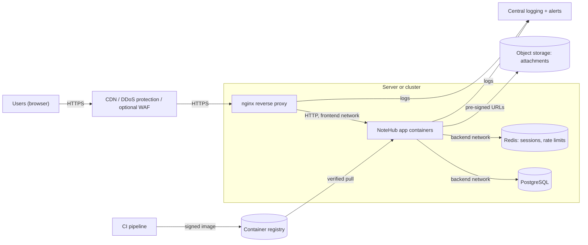
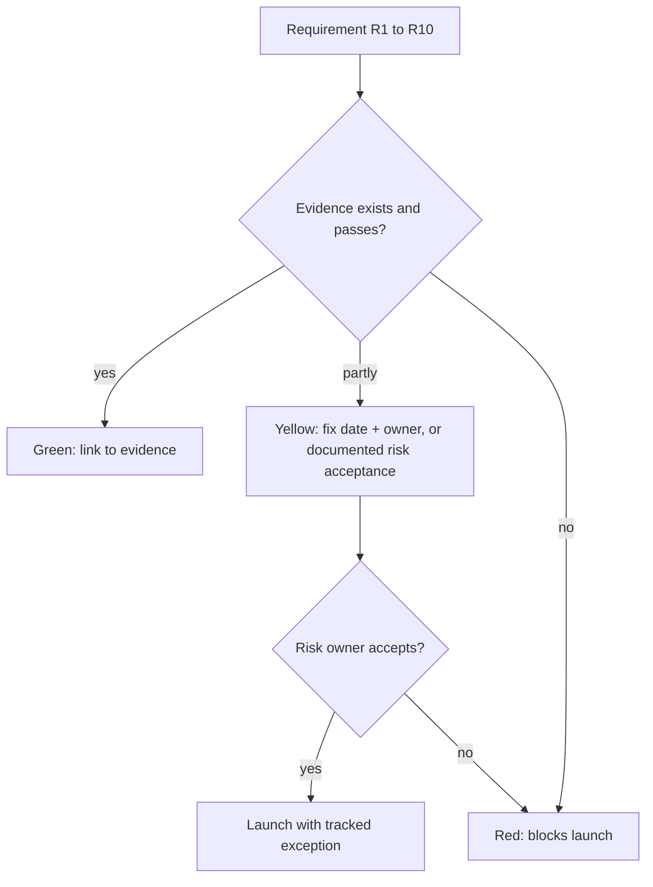

# Capstone: Securing a Production Web Application

## Introduction

Each earlier project secured one layer: login, code, design, pipeline, logs, server and people. Real applications need all of them at once, and the hard part is deciding **what to do first**, **what is good enough**, and **how to prove it**.

In this capstone you take **NoteHub**, the note-taking SaaS used throughout this section, from "works on my laptop" to "ready for paying customers". You will:

1. Write **security requirements** based on OWASP ASVS and the OWASP Top 10:2025.
2. Design a **production architecture** with trust boundaries.
3. Build the **edge**: nginx with TLS, security headers, rate limits and hidden internals.
4. Run the app in **hardened containers** with secrets kept out of images and environment variables.
5. Wire in the **application controls** from the earlier projects.
6. Add a **CI security gate**, **monitoring and alerting**, **backups** and an **incident plan**.
7. Write an external **security smoke test** and a launch **readiness review**.

At the end there is a **deliverables checklist and rubric**, so you can use this page as a self-assessed project or a course assignment.

Think of it as opening a restaurant. The kitchen (code), the building (servers), the suppliers (dependencies), the staff rules (access control), the fire alarm (monitoring) and the evacuation plan (incident response) are each inspected separately, but the restaurant only opens when all of them pass together.

:::warning Scope and ethics
Build and test everything on infrastructure you own: your laptop, a local VM, or your own cloud account. The smoke test and any scanner in this project must only point at your own deployment. If you deploy publicly, use a domain you control, and remember that a public test app is a real target the moment it is online.
:::

## Step 1: Requirements First

"Make it secure" is not a requirement. Testable statements are. The [OWASP Application Security Verification Standard (ASVS)](https://owasp.org/www-project-application-security-verification-standard/) is a catalog of such statements, grouped into three levels: Level 1 is a baseline for all applications, Level 2 is the recommended target for most applications handling sensitive data, and Level 3 is for the most critical systems. Version 5.0.0 was released in 2025. Cite requirements with the version included (for example `v5.0.0-1.2.5`) because numbering changes between versions.

NoteHub stores private notes for paying customers, so it targets **ASVS Level 2** for its core features. Here is a condensed requirement set, mapped to the OWASP Top 10:2025, with how each will be verified:

| ID | Requirement | Top 10:2025 | Verified by |
| --- | --- | --- | --- |
| R1 | Every note, file and API object is checked for ownership on the server | A01 Broken Access Control | Cross-tenant authorization tests in CI |
| R2 | Production has no debug mode, default credentials or verbose errors; security headers set | A02 Security Misconfiguration | Smoke test, config review |
| R3 | Dependencies and images scanned; actions pinned; releases signed | A03 Software Supply Chain Failures | CI pipeline gates, signature verification at deploy |
| R4 | TLS 1.2+ only; passwords hashed with Argon2id; secrets in a secret store | A04 Cryptographic Failures | TLS scan, code review, smoke test |
| R5 | All database access parameterized; output autoescaped | A05 Injection | SAST, DAST baseline, tests |
| R6 | Threat model maintained; abuse cases have tests | A06 Insecure Design | Threat register check in CI |
| R7 | MFA available, throttled login, safe sessions | A07 Authentication Failures | Login tests from the secure login project |
| R8 | Only signed images deployed; no unsafe deserialization | A08 Software or Data Integrity Failures | Admission or deploy-time verification |
| R9 | Auth and admin events logged centrally; key alerts routed to on-call | A09 Security Logging and Alerting Failures | Alert test with synthetic events |
| R10 | Errors fail closed; unexpected exceptions return generic messages and are logged | A10 Mishandling of Exceptional Conditions | Tests for error paths, code review |

This table is the spine of the whole capstone. Every later step implements or verifies a row.

## Step 2: Production Architecture



Key decisions and their reasons:

- **Only the proxy is reachable from outside.** The database and Redis live on an internal network with no published ports.
- **Server-side sessions in Redis**, not signed cookies, so sessions can be revoked (the trade-off discussed in the [secure login project](./0-sec-project-secure-login.mdx)).
- **Attachments in private object storage**, handed out through short-lived pre-signed URLs after an authorization check (threat T3 in the [threat model](./2-sec-project-threat-model.mdx)).
- **A CDN with DDoS protection in front.** Volumetric attacks are cheaper to absorb at a provider's edge than on your server (see [DDoS Attacks and Mitigation](../2-sec-network-security/7-sec-ddos.mdx)).
- **Images come only from CI**, signed, and are pulled by digest.

## Step 3: The Edge: nginx

The reverse proxy terminates TLS, adds security headers, rate-limits sensitive routes and hides internals. Save as `nginx/notehub.conf`:

```nginx
# Rate-limit zones (per client IP)
limit_req_zone $binary_remote_addr zone=login:10m rate=10r/m;
limit_req_zone $binary_remote_addr zone=general:10m rate=20r/s;

server_tokens off;                       # no nginx version in headers or error pages

server {
    listen 80;
    server_name notehub.example.com;
    return 301 https://$host$request_uri;
}

server {
    listen 443 ssl;
    http2 on;
    server_name notehub.example.com;

    ssl_certificate     /etc/nginx/certs/fullchain.pem;
    ssl_certificate_key /etc/nginx/certs/privkey.pem;
    ssl_protocols TLSv1.2 TLSv1.3;
    ssl_prefer_server_ciphers off;
    ssl_session_tickets off;

    client_max_body_size 5m;

    add_header Strict-Transport-Security "max-age=31536000; includeSubDomains" always;
    add_header Content-Security-Policy "default-src 'self'; object-src 'none'; base-uri 'self'; frame-ancestors 'none'" always;
    add_header X-Content-Type-Options "nosniff" always;
    add_header Referrer-Policy "strict-origin-when-cross-origin" always;
    add_header Permissions-Policy "camera=(), microphone=(), geolocation=()" always;

    # Never serve dotfiles such as .git or .env
    location ~ /\. {
        return 404;
    }

    location = /login {
        limit_req zone=login burst=5 nodelay;
        limit_req_status 429;
        proxy_pass http://app:8000;
        include /etc/nginx/proxy_params.conf;
    }

    location / {
        limit_req zone=general burst=40 nodelay;
        proxy_pass http://app:8000;
        include /etc/nginx/proxy_params.conf;
    }
}
```

And `nginx/proxy_params.conf`:

```nginx
proxy_set_header Host $host;
proxy_set_header X-Real-IP $remote_addr;
proxy_set_header X-Forwarded-For $remote_addr;
proxy_set_header X-Forwarded-Proto $scheme;
proxy_hide_header X-Powered-By;
proxy_hide_header Server;
```

Validate before deploying. With Docker you can test the syntax without installing nginx (a self-signed certificate is enough for the check):

```bash
mkdir -p certs
openssl req -x509 -newkey rsa:2048 -nodes -days 1 -subj /CN=localhost \
  -keyout certs/privkey.pem -out certs/fullchain.pem
docker run --rm --add-host app:127.0.0.1 \
  -v "$PWD/nginx/notehub.conf:/etc/nginx/conf.d/default.conf:ro" \
  -v "$PWD/nginx/proxy_params.conf:/etc/nginx/proxy_params.conf:ro" \
  -v "$PWD/certs:/etc/nginx/certs:ro" \
  nginx:1.28 nginx -t
```

Output (last lines):

```text
nginx: the configuration file /etc/nginx/nginx.conf syntax is ok
nginx: configuration file /etc/nginx/nginx.conf test is successful
```

Notes on the choices:

- **`X-Forwarded-For $remote_addr`** *replaces* any value the client sent, rather than appending to it. The app then trusts exactly one proxy hop (Werkzeug's `ProxyFix(app.wsgi_app, x_for=1, x_proto=1)`), so clients cannot spoof their IP to dodge rate limits. If a CDN sits in front, use nginx's `real_ip` module with the CDN's published IP ranges instead.
- **`always`** on `add_header` sets headers on error responses too.
- In nginx, `add_header` directives in a `location` block **replace** the server-level ones rather than adding to them. Keep headers in one place, as here, or repeat them.
- **HSTS with `includeSubDomains`** affects every subdomain. Confirm they all serve HTTPS before enabling it; do not add `preload` until you are sure.
- For production certificates, use an ACME client such as Certbot with Let's Encrypt, or your cloud's certificate manager. See [TLS and HTTPS](../1-sec-cryptography/7-sec-tls.mdx).

A WAF in front of nginx (at the CDN or as a module) is optional. It helps with virtual patching and bot traffic, but does not replace R1 or R5. The trade-offs are in [API Gateways and WAFs](../7-sec-api-security/7-sec-api-gateway-security.mdx).

## Step 4: Hardened Containers and Secrets

`compose.yaml` for a single-host deployment. The same principles map to Kubernetes `securityContext` settings (see [Kubernetes Security](../8-sec-cloud-and-container/5-sec-kubernetes-security.mdx)).

```yaml
services:
  proxy:
    image: nginx:1.28
    ports:
      - "80:80"
      - "443:443"
    volumes:
      - ./nginx/notehub.conf:/etc/nginx/conf.d/default.conf:ro
      - ./nginx/proxy_params.conf:/etc/nginx/proxy_params.conf:ro
      - ./certs:/etc/nginx/certs:ro
    depends_on: [app]
    networks: [frontend]
    restart: unless-stopped

  app:
    image: ghcr.io/your-org/notehub@sha256:REPLACE_WITH_SIGNED_DIGEST
    environment:
      SECRET_KEY_FILE: /run/secrets/flask_secret_key
      DATABASE_URL: postgresql://notehub@db:5432/notehub
      REDIS_URL: redis://cache:6379/0
    secrets: [flask_secret_key, db_password]
    read_only: true                 # container filesystem is immutable
    tmpfs: [/tmp]
    user: "10001:10001"             # non-root
    cap_drop: [ALL]                 # no Linux capabilities needed
    security_opt:
      - no-new-privileges:true      # block setuid privilege escalation
    deploy:
      resources:
        limits: {cpus: "1.0", memory: 512M}
    networks: [frontend, backend]
    restart: unless-stopped

  db:
    image: postgres:17
    environment:
      POSTGRES_USER: notehub
      POSTGRES_DB: notehub
      POSTGRES_PASSWORD_FILE: /run/secrets/db_password
    secrets: [db_password]
    volumes:
      - dbdata:/var/lib/postgresql/data
    networks: [backend]             # not reachable from the proxy or the host
    restart: unless-stopped

  cache:
    image: redis:8
    command: ["redis-server", "--save", "", "--appendonly", "no"]
    networks: [backend]
    restart: unless-stopped

networks:
  frontend: {}
  backend:
    internal: true                  # no outbound internet from the data tier

volumes:
  dbdata: {}

secrets:
  flask_secret_key:
    file: ./secrets/flask_secret_key
  db_password:
    file: ./secrets/db_password
```

Check it parses before you run it:

```bash
docker compose config -q && echo "compose file OK"
```

What each hardening setting does:

| Setting | Protects against |
| --- | --- |
| Image pinned by **digest** from your signed CI build | A tag being moved to a different image (R3, R8) |
| `read_only: true` + `tmpfs` | An attacker writing tools or web shells into the container |
| Non-root `user` | Many container escape and privilege escalation paths |
| `cap_drop: [ALL]`, `no-new-privileges` | Use of kernel capabilities and setuid binaries |
| Memory and CPU limits | One container starving the host |
| `backend` network `internal: true` | Database and cache reachable from the internet, or exfiltrating directly |
| Docker secrets as files | Secrets leaking through `docker inspect`, crash dumps or child processes that inherit environment variables |

The app reads the secret from the file path:

```python
import os
from pathlib import Path

def read_secret(name: str) -> str:
    """Read NAME_FILE if set (Docker/Kubernetes secrets), else NAME. Fail closed if neither."""
    path = os.environ.get(f"{name}_FILE")
    if path:
        return Path(path).read_text().strip()
    value = os.environ.get(name)
    if not value:
        raise RuntimeError(f"missing required secret {name}")
    return value

app.config["SECRET_KEY"] = read_secret("SECRET_KEY")
```

Failing to start when a secret is missing is an example of **R10, fail closed**: an app that falls back to a default key would be worse than one that does not start. Redis here has no password because it is only on the internal network; for defense in depth, enable Redis ACLs as well. In the cloud, prefer a managed secret store (AWS Secrets Manager, Google Secret Manager, Azure Key Vault, HashiCorp Vault) over files on disk. See [Secrets Management in Code](../5-sec-secure-coding/3-sec-secrets-in-code.mdx) and [Key Management](../1-sec-cryptography/8-sec-key-management.mdx).

The host underneath still needs the treatment from [Hardening a Linux Server](./5-sec-project-hardened-server.mdx). Remember the warning there: Docker's published ports bypass ufw, so the only published ports here are 80 and 443 on the proxy.

## Step 5: Application Controls

Bring in what the earlier projects built, mapped to the requirements:

| Control | Source project | Requirement |
| --- | --- | --- |
| Argon2id hashing, generic errors, throttling, TOTP MFA | [Secure Login](./0-sec-project-secure-login.mdx) | R4, R7 |
| Parameterized queries, autoescaping, ownership checks, safe file serving | [Vulnerable App Audit](./1-sec-project-vulnerable-app-audit.mdx) | R1, R5 |
| Tenant-scoped repository layer, threat register | [Threat Model](./2-sec-project-threat-model.mdx) | R1, R6 |
| Structured auth event logs | [Secure Login](./0-sec-project-secure-login.mdx) and [Log Monitoring](./4-sec-project-log-monitoring.mdx) | R9 |

Add one more piece for **R10**, a global error handler that never leaks details:

**Vulnerable:**

```python
@app.errorhandler(Exception)
def handle(e):
    return f"Error: {e!r}", 500    # leaks SQL, file paths, sometimes secrets
```

**Fixed:**

```python
import logging
import uuid
from flask import jsonify
from werkzeug.exceptions import HTTPException

log = logging.getLogger("app")

@app.errorhandler(Exception)
def handle_unexpected(e):
    if isinstance(e, HTTPException):
        return jsonify(error=e.name), e.code          # 404, 405, 429 and friends
    incident_id = uuid.uuid4().hex[:12]
    log.exception("unhandled_error incident_id=%s", incident_id)  # full detail in logs only
    return jsonify(error="internal error", incident_id=incident_id), 500
```

The user gets an ID they can quote to support; the stack trace goes only to the logs. Also make sure authorization checks **deny by default** when something unexpected happens, for example a missing tenant ID, rather than skipping the filter.

## Step 6: CI Gate, Monitoring, Backups and Response

**CI gate (R3, R5, R6).** Reuse the workflow from the [DevSecOps Pipeline](./3-sec-project-devsecops-pipeline.mdx) project and add two jobs: the threat register check (`python threat_report.py threats.yaml --strict`) and your authorization test suite. Deploy only images whose signatures verify with `cosign verify` against your workflow's identity.

**Monitoring (R9).** Ship nginx access logs, app auth logs and host audit logs to a central platform. Turn on at least these alerts from the [log monitoring project](./4-sec-project-log-monitoring.mdx):

| Alert | Route |
| --- | --- |
| Login success after many failures (per IP and per account) | Page on-call |
| Site-wide spike in failed logins (spraying or stuffing) | Chat channel, then page if sustained |
| 2xx response to a request matching injection patterns | Page security |
| Any admin role change or MFA disabled for an admin | Chat channel and daily review |
| Error rate spike (500s) | Page on-call (may be an attack or a bug) |

Test alerts by sending synthetic events, then check they arrive. An untested alert is a hope, not a control.

**Backups.** Take automated PostgreSQL backups, keep at least one copy in a separate account or with immutability enabled so an attacker with production access cannot delete them, encrypt them, and **test a restore** on a schedule. See [Backups and Ransomware Resilience](../9-sec-system-hardening/6-sec-backups-and-ransomware.mdx).

**Incident response.** Write short playbooks for the three most likely incidents (account takeover, leaked secret, data exposure), name an incident lead and a deputy, and run the [tabletop exercise](./6-sec-project-incident-simulation.mdx) before launch.

## Step 7: External Smoke Test

Some properties can be checked from the outside on every deploy: headers, redirects, cookie flags, exposed files. This script uses only the Python standard library:

```python
"""smoke_check.py: quick external security checks against a site you own."""
import re
import sys
import urllib.error
import urllib.request

REQUIRED_HEADERS = {
    "Content-Security-Policy": None,
    "X-Content-Type-Options": "nosniff",
    "Referrer-Policy": None,
}
SENSITIVE_PATHS = ["/.git/config", "/.env", "/console", "/server-status", "/backup.sql"]


class NoRedirect(urllib.request.HTTPRedirectHandler):
    def redirect_request(self, *args, **kwargs):
        return None   # we want to see redirects, not follow them


opener = urllib.request.build_opener(NoRedirect)


def fetch(url):
    try:
        resp = opener.open(urllib.request.Request(url, headers={"User-Agent": "smoke-check"}), timeout=10)
    except urllib.error.HTTPError as e:      # 3xx/4xx/5xx arrive here
        resp = e
    return resp.status, resp.headers


def check(base):
    results = []
    status, headers = fetch(base + "/")
    for name, expected in REQUIRED_HEADERS.items():
        value = headers.get(name)
        ok = value is not None and (expected is None or value.lower() == expected)
        results.append((ok, f"header {name}", value or "missing"))
    if base.startswith("https://"):
        hsts = headers.get("Strict-Transport-Security", "")
        m = re.search(r"max-age=(\d+)", hsts)
        results.append((bool(m) and int(m.group(1)) >= 15552000, "HSTS max-age >= 180 days", hsts or "missing"))
        http_status, http_headers = fetch("http://" + base[len("https://"):] + "/")
        loc = http_headers.get("Location", "")
        results.append((http_status in (301, 308) and loc.startswith("https://"),
                        "HTTP redirects to HTTPS", f"{http_status} {loc}"))
    server = headers.get("Server", "")
    results.append((not re.search(r"\d", server), "Server header hides version", server or "(none)"))
    for cookie in headers.get_all("Set-Cookie") or []:
        flags = cookie.lower()
        ok = "httponly" in flags and "samesite" in flags and (base.startswith("http://") or "secure" in flags)
        results.append((ok, "cookie flags", cookie.split(";")[0].split("=")[0]))
    for path in SENSITIVE_PATHS:
        s, _ = fetch(base + path)
        results.append((s in (401, 403, 404), f"blocked {path}", str(s)))
    return results


if __name__ == "__main__":
    base = sys.argv[1].rstrip("/") if len(sys.argv) > 1 else "http://127.0.0.1:8000"
    results = check(base)
    for ok, name, detail in results:
        print(f"{'PASS' if ok else 'FAIL'}  {name:<32} {detail}")
    failed = sum(1 for ok, _, _ in results if not ok)
    print(f"\n{len(results) - failed} passed, {failed} failed")
    sys.exit(1 if failed else 0)
```

To see it catch problems, run it against a deliberately careless local Flask app (Flask's development server, no headers, a plain cookie, and a route that serves `/.env`):

```bash
python smoke_check.py http://127.0.0.1:8101
```

Output:

```text
FAIL  header Content-Security-Policy   missing
FAIL  header X-Content-Type-Options    missing
FAIL  header Referrer-Policy           missing
FAIL  Server header hides version      Werkzeug/3.1.9 Python/3.14.4
FAIL  cookie flags                     session
PASS  blocked /.git/config             404
FAIL  blocked /.env                    200
PASS  blocked /console                 404
PASS  blocked /server-status           404
PASS  blocked /backup.sql              404

4 passed, 6 failed
```

Against the real deployment, use the HTTPS URL (for example `python smoke_check.py https://notehub.example.com`) so the HSTS and redirect checks run too. Behind the nginx config above, the headers come from nginx, the `Server` header shows only `nginx`, and dotfiles return 404. Run it as the last step of every deployment, and fail the deploy on any `FAIL`.

The script checks configuration, not logic. It cannot see broken access control; that is what the authorization tests are for. For TLS details (protocols, certificate chain), add a dedicated TLS scanner such as `testssl.sh` against your own domain.

## Step 8: Launch Readiness Review

Before launch, hold a one-hour review with engineering, product and whoever owns the risk. Walk the requirement table from Step 1 and record evidence for each row:



Rules that keep the review honest:

- **Evidence, not opinions.** "R1: green, see CI job `authz-tests`, 46 tests including cross-tenant cases" beats "we're pretty careful about that".
- **Risk acceptance is written and owned** by someone with authority, with an expiry date. See [Risk Management](../13-sec-governance/0-sec-risk-management.mdx).
- **Red items block launch.** If everything can be waved through, the review is theater.

## Real-World Scenario

NoteHub has a launch date in six weeks and a first enterprise customer whose security questionnaire asks about encryption, access control, vulnerability management, logging and incident response. The team is four engineers, with no dedicated security person.

**Plan:**

| Week | Focus | Requirements |
| --- | --- | --- |
| 1 | Threat model, requirement table, CI pipeline in report-only mode | R3, R6 |
| 2 | Authorization tests for every endpoint, fix findings | R1, R5 |
| 3 | Login hardening, MFA, server-side sessions, error handler | R4, R7, R10 |
| 4 | nginx, container hardening, secrets, host hardening, CI gates set to block | R2, R3, R8 |
| 5 | Central logging, five alerts tested, backups and a restore test | R9 |
| 6 | Tabletop, smoke test in deploy, readiness review, questionnaire answers with evidence | All |

**Why this order:** access control first, because it is the most likely and most damaging bug in a multi-tenant app and cannot be fixed by infrastructure. Infrastructure hardening is largely configuration and moves quickly once requirements are clear. Detection and response come before launch, not after, because the first weeks after launch are when nobody knows what normal traffic looks like.

**When to bring in outside help:** for the first enterprise customer, a short external penetration test after week 5 is worth the cost. It gives independent evidence and catches what the team cannot see in its own code. A bug bounty program comes later, once the basics hold (see [Bug Bounty Programs](../10-sec-offensive-security/10-sec-bug-bounty.mdx)).

### Build vs buy for production security

| Approach | Pros | Cons | Best for |
| --- | --- | --- | --- |
| Self-managed (this capstone) | Full control, low cash cost, deep understanding | Engineering time, you own every patch | Small teams that want to learn, cost-sensitive products |
| Managed platform (PaaS, managed DB, managed identity) | Provider patches hosts, handles TLS, offers MFA and backups | Less control, vendor limits, shared-responsibility gaps | Most startups shipping fast |
| Security vendors (WAF, SIEM, CSPM, MDR) | Expertise and 24/7 coverage | Cost, integration effort, alert noise | Growing companies with compliance needs |
| Hybrid | Managed infrastructure plus your own app controls and detections | Must be clear who owns what | The common end state |

Whichever you choose, **R1 (access control) and R6 (design) stay with you**. No vendor can know that note 2 belongs to Bob.

## Common Mistakes

- **Starting with tools instead of requirements.** You end up with scanners nobody tuned and gaps nobody noticed.
- **Hardening the edge and forgetting authorization.** Perfect TLS does not stop a logged-in user reading someone else's data.
- **Secrets in environment variables, images or git.** Use secret files or a secret manager, and scan for leaks.
- **Deploying by tag.** Deploy signed images by digest.
- **No alert testing.** Many teams discover during an incident that their alert never worked.
- **Untested backups.** A backup you have never restored is a hypothesis.
- **Treating launch as the end.** New features, dependencies and staff change your risk every week. Keep the pipeline, threat model and exercises running.

## Summary

- Start with **testable requirements** (ASVS Level 2 mapped to the OWASP Top 10:2025) and use them as the backbone of the work and the launch review.
- Expose only a **hardened reverse proxy**; keep data stores on internal networks.
- Run containers **read-only, non-root, without capabilities**, from **signed images by digest**, with secrets as files.
- Combine **application controls** from the earlier projects with a **fail-closed error handler**.
- Gate releases in **CI**, centralize **logs and tested alerts**, keep **immutable, tested backups**, and **rehearse incidents**.
- Verify from the outside with a **smoke test** on every deploy, and launch only when red items are resolved.

## Deliverables and Rubric

Use this to assess your own capstone, or as a course assignment.

| Deliverable | Meets expectations | Excellent |
| --- | --- | --- |
| Requirements table | R1 to R10 with verification method | Cites specific ASVS 5.0 requirement IDs and links evidence |
| Threat model | DFD with trust boundaries, YAML register with 8+ threats | Register checked in CI; abuse-case tests for top threats |
| Application | Secure login, ownership checks, safe errors | Server-side sessions, MFA recovery codes, authorization test suite |
| Edge and containers | nginx config and compose file as above, validated | Deployed with real certificates; Kubernetes manifests with equivalent hardening |
| CI pipeline | Secrets, SAST, SCA, image scan, tests | SHA-pinned actions, DAST, signing and verified deploys |
| Monitoring | Logs centralized, three alerts | Five tested alerts with runbooks |
| Resilience | Automated backups | Immutable copy and a timed restore test |
| Response | Incident contacts and one playbook | Tabletop run, after-action report with closed items |
| Verification | Smoke test passing | Smoke test in the deploy pipeline plus an external TLS scan |

## Exercises

1. Deploy the full stack on a local VM with a self-signed certificate, run `smoke_check.py` against `https://` and fix every failure.
2. Pick five requirements from ASVS 5.0 Level 2 that are not covered by R1 to R10, add them to your table, and implement one.
3. Translate `compose.yaml` into Kubernetes manifests with an equivalent `securityContext`, `NetworkPolicy` and secrets, and check them with a policy tool of your choice.
4. Ask a friend to act as an authorized tester against your local deployment, using a written scope like the one in the [audit project](./1-sec-project-vulnerable-app-audit.mdx). Turn their findings into tickets and regression tests.

**Where to go next:** revisit the [OWASP Top 10](../3-sec-web-security/1-sec-owasp-top-10.mdx) with your capstone in mind, explore [Security Frameworks: NIST CSF, ISO 27001 and CIS Controls](../13-sec-governance/1-sec-security-frameworks.mdx) to see how this work maps to organizational programs, and look at [Cybersecurity Careers and Roles](../0-sec-fundamentals/9-sec-careers.mdx) to decide which part of this capstone you enjoyed most.
