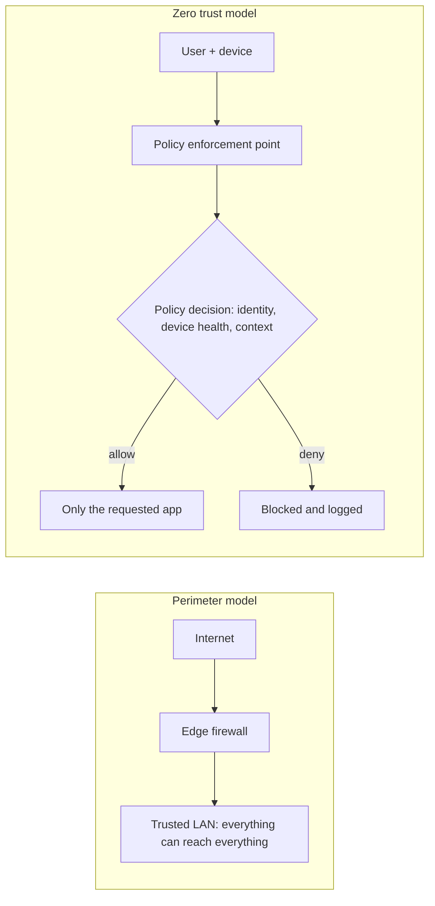
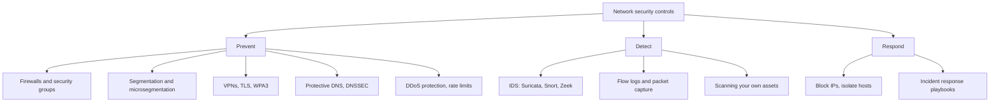
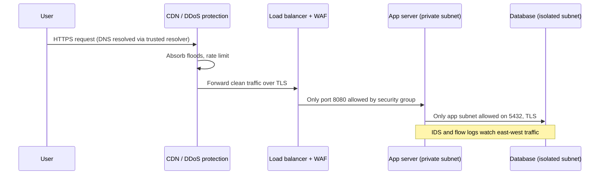

# Network Security Introduction

## Introduction

Every request your application makes, every database query, every SSH session and every DNS lookup travels across a network. **Network security** is the set of controls that decide who can talk to whom, protect traffic while it moves, and let you notice when something unusual is happening on the wire.

Think of an office building. The front door has a lock (a firewall). Badges only open the floors you work on (segmentation). Sensitive documents travel in sealed envelopes (encryption and VPNs). Cameras record the hallways (logging and intrusion detection). And the receptionist checks that visitors really are who they say they are (authentication). No single control keeps the building safe, but together they make an intruder's job slow, noisy and expensive.

This section teaches network security from a **builder and defender** perspective. You will learn how common network attacks work so that you can design, configure and monitor systems that resist them.

:::warning Ethics and the law
Several pages in this section use tools such as Nmap, Wireshark and tcpdump. Only scan, capture or test networks and systems **you own or have explicit written permission to test**. Unauthorized scanning or interception can be illegal in many countries, even if you "did not break anything." Practice in a local lab; see [Building a Safe Practice Lab](../10-sec-offensive-security/1-sec-lab-setup.mdx) and [Ethics, Law and Responsible Disclosure](../0-sec-fundamentals/8-sec-ethics-and-law.mdx).
:::

If you need a refresher on IP addresses, ports, TCP and routing first, the site's [Computer Networks tutorial](/docs/fundamental/network) covers those foundations.

## What Network Security Protects

The [CIA triad](../0-sec-fundamentals/1-sec-cia-triad.mdx) maps neatly onto network threats:

| Goal | Network threat | Example | Typical control |
| --- | --- | --- | --- |
| Confidentiality | Eavesdropping (sniffing) | Reading plaintext HTTP or database traffic on shared Wi-Fi | TLS, VPNs, WPA3 |
| Integrity | Tampering, man-in-the-middle | ARP spoofing to alter traffic between two hosts | TLS with certificate validation, switch protections |
| Availability | Denial of service | A flood of traffic that saturates your uplink | Rate limiting, CDN, DDoS scrubbing |
| Authenticity | Spoofing | A fake DNS answer sends users to a look-alike server | DNSSEC, TLS, HSTS |
| Accountability | Hidden activity | Attacker moves laterally without leaving traces | Flow logs, IDS, centralized logging |

### Threats at each layer

Attacks target different layers of the network stack, so defenses do too.

| Layer | What lives here | Example attacks | Controls covered in this section |
| --- | --- | --- | --- |
| Physical / Data link (L1-L2) | Cables, Wi-Fi radio, Ethernet frames, MAC addresses | ARP spoofing, rogue access points, MAC flooding | [Wireless Security](./8-sec-wireless-security.mdx), [Common Network Attacks](./6-sec-network-attacks.mdx) |
| Network (L3) | IP addresses, routing | IP spoofing, route hijacking, ICMP floods | [Firewalls](./1-sec-firewalls.mdx), [Segmentation](./2-sec-network-segmentation.mdx) |
| Transport (L4) | TCP/UDP ports, connections | SYN floods, port scanning | [DDoS](./7-sec-ddos.mdx), [Nmap](./10-sec-network-scanning.mdx) |
| Application (L7) | HTTP, DNS, SMTP, SSH | DNS spoofing, HTTP floods, credential stuffing | [DNS Security](./4-sec-dns-security.mdx), [IDS/IPS](./5-sec-ids-ips.mdx) |

Network controls are strongest at layers 2 to 4. Application-layer attacks such as SQL injection look like perfectly normal HTTPS to a firewall, which is why the [Web Application Security](../3-sec-web-security/0-sec-web-security-introduction.mdx) section exists.

## From Perimeter Security to Zero Trust

For decades, networks were built like castles: a strong wall (the perimeter firewall) and a trusted interior. Anything inside the office LAN or data center was assumed to be friendly.

That model breaks down for three reasons:

1. **The perimeter dissolved.** Employees work from home, apps run in several clouds, and SaaS tools hold critical data.
2. **Attackers get inside.** A single phished laptop or vulnerable web server puts the attacker behind the wall.
3. **Flat interiors help attackers.** Once inside, they can reach every database and admin panel. Security teams call this *lateral movement*.

**Zero trust**, described in [NIST SP 800-207](https://csrc.nist.gov/pubs/sp/800/207/final), replaces "trust the network location" with "verify every request": authenticate the user and device, authorize the specific resource, and encrypt everything, no matter where the request comes from. See [Least Privilege and Zero Trust](../0-sec-fundamentals/5-sec-least-privilege.mdx) for the principles.



In practice, zero trust does **not** mean throwing away firewalls. Network controls become one layer of [defense in depth](../0-sec-fundamentals/4-sec-defense-in-depth.mdx): they shrink the attack surface and contain damage, while identity-aware checks decide who may use each service.

## The Network Security Toolbox

Here is a map of the controls you will meet in this section, grouped by what they do.



| Control | Question it answers | Page |
| --- | --- | --- |
| Firewall / security group | Which connections are allowed at all? | [Firewalls and Security Groups](./1-sec-firewalls.mdx) |
| Segmentation | If one system falls, what else can the attacker reach? | [Network Segmentation](./2-sec-network-segmentation.mdx) |
| VPN / secure tunnel | How do remote people and sites connect safely? | [VPNs and Secure Tunnels](./3-sec-vpn.mdx) |
| DNS security | Can users trust the answers that turn names into IPs? | [DNS Security](./4-sec-dns-security.mdx) |
| IDS / IPS | Is suspicious traffic crossing my network right now? | [Intrusion Detection and Prevention](./5-sec-ids-ips.mdx) |
| Attack awareness | What do spoofing, MITM and sniffing look like? | [Common Network Attacks](./6-sec-network-attacks.mdx) |
| DDoS mitigation | Can I stay online under a traffic flood? | [DDoS Attacks and Mitigation](./7-sec-ddos.mdx) |
| Wireless security | Is my Wi-Fi a back door? | [Wireless Security](./8-sec-wireless-security.mdx) |
| Packet analysis | What exactly happened on the wire? | [Packet Analysis](./9-sec-packet-analysis.mdx) |
| Network scanning | What is actually exposed? | [Network Scanning with Nmap](./10-sec-network-scanning.mdx) |

### Vocabulary you will see often

| Term | Meaning | Why it matters |
| --- | --- | --- |
| **North-south traffic** | Traffic entering or leaving your environment (users to your site, servers to the internet) | Classic perimeter controls focus here |
| **East-west traffic** | Traffic between systems inside your environment (app server to database) | Where lateral movement happens; often unmonitored |
| **Ingress / egress** | Inbound / outbound traffic relative to a host or network | Most teams filter ingress but leave egress wide open |
| **Attack surface** | Everything an attacker can reach and interact with | Every open port adds to it ([Attack Surface](../0-sec-fundamentals/3-sec-attack-surface.mdx)) |
| **Default deny** | Block everything, then allow only what is needed | The safest starting point for any rule set |
| **Stateful inspection** | The filter remembers connections, so replies are allowed automatically | Simpler and safer rules than stateless filters |

### Why egress filtering matters

Most people think of firewalls as keeping attackers *out*. Controlling what goes *out* is just as valuable. Malware usually needs to "phone home" to a command-and-control server, and data theft needs a path to the internet. A database server that can only talk to the app subnet and the package mirror gives an attacker far fewer options than one that can open connections anywhere.

```text
Server role       Needs outbound access to
----------------  -------------------------------------------
Web/app server    Database subnet, payment API, package mirror
Database server   Backup storage endpoint only
Build runner      Source host, package registries, artifact store
```

Writing a table like this for each server role is the first step toward an egress policy. You will turn it into real rules on the [Firewalls](./1-sec-firewalls.mdx) page.

## Hands-On: Audit Your Own Exposure

The fastest network security win is often knowing what you are exposing. A service listening on `0.0.0.0` accepts connections on every interface, including a public one. A service listening on `127.0.0.1` is reachable only from the same machine.

### Step 1: List listening sockets

On Linux, `ss` (from iproute2) shows sockets. The flags mean: `-t` TCP, `-u` UDP, `-l` listening only, `-n` numeric ports, `-p` show the owning process (needs `sudo` to see other users' processes).

```bash
sudo ss -tulnp
```

Example output (trimmed):

```text
Netid State  Recv-Q Send-Q Local Address:Port  Peer Address:Port Process
udp   UNCONN 0      0      127.0.0.53%lo:53         0.0.0.0:*     users:(("systemd-resolve",pid=612,fd=13))
tcp   LISTEN 0      4096         0.0.0.0:22         0.0.0.0:*     users:(("sshd",pid=901,fd=3))
tcp   LISTEN 0      511          0.0.0.0:80         0.0.0.0:*     users:(("nginx",pid=1180,fd=6))
tcp   LISTEN 0      244        127.0.0.1:5432       0.0.0.0:*     users:(("postgres",pid=1022,fd=7))
tcp   LISTEN 0      511          0.0.0.0:6379       0.0.0.0:*     users:(("redis-server",pid=1301,fd=6))
```

Reading this output: SSH and nginx are meant to be reachable. PostgreSQL is correctly bound to loopback only. **Redis on `0.0.0.0:6379` is a red flag**: unless a firewall blocks it, anyone who can reach this host can talk to Redis.

### Step 2: Classify exposure with Python

A small script turns that list into a report you could run on every server, for example from a cron job or configuration-management tool.

```python
import subprocess

def listening_sockets():
    """Return (proto, local_address, port, process) for every listening socket."""
    out = subprocess.run(
        ["ss", "-H", "-tulnp"], capture_output=True, text=True, check=True
    ).stdout
    rows = []
    for line in out.splitlines():
        parts = line.split()
        proto, local = parts[0], parts[4]
        process = parts[6] if len(parts) > 6 else "?"
        addr, _, port = local.rpartition(":")
        addr = addr.strip("[]").split("%")[0]   # drop IPv6 brackets and "%lo" suffix
        rows.append((proto, addr, int(port), process))
    return rows

def exposure(addr: str) -> str:
    if addr.startswith("127.") or addr == "::1":
        return "local only"
    if addr in ("0.0.0.0", "*", "::"):
        return "ALL interfaces"
    return "one interface"

EXPECTED_PUBLIC = {22, 80, 443}

for proto, addr, port, proc in sorted(listening_sockets(), key=lambda r: r[2]):
    level = exposure(addr)
    flag = "  <-- review" if level == "ALL interfaces" and port not in EXPECTED_PUBLIC else ""
    print(f"{proto:4} {port:>5}  {level:15} {addr:16}{flag}")
```

Example output:

```text
udp     53  local only      127.0.0.53
tcp     22  ALL interfaces  0.0.0.0
tcp     80  ALL interfaces  0.0.0.0
tcp   5432  local only      127.0.0.1
tcp   6379  ALL interfaces  0.0.0.0         <-- review
```

### Step 3: Fix at the source, then add a network layer

The best fix is usually in the service's own configuration, so it never listens publicly in the first place:

```bash
# /etc/redis/redis.conf (Debian/Ubuntu path)
# Vulnerable: bind 0.0.0.0
# Fixed: listen on loopback only and require authentication
bind 127.0.0.1 ::1
protected-mode yes
requirepass use-a-long-random-secret-from-your-secret-manager
```

Then add a host firewall as a second layer, so a future config mistake does not re-expose the port. On Ubuntu, `ufw` is the simplest option:

```bash
sudo ufw default deny incoming
sudo ufw default allow outgoing
sudo ufw allow 22/tcp
sudo ufw allow 80/tcp
sudo ufw allow 443/tcp
sudo ufw enable
sudo ufw status verbose
```

Example output:

```text
Status: active
Logging: on (low)
Default: deny (incoming), allow (outgoing), disabled (routed)
New profiles: skip

To                         Action      From
--                         ------      ----
22/tcp                     ALLOW IN    Anywhere
80/tcp                     ALLOW IN    Anywhere
443/tcp                    ALLOW IN    Anywhere
```

:::caution Docker and host firewalls
Docker publishes container ports by writing its own iptables rules, which can bypass `ufw`. A container started with `-p 6379:6379` may be reachable from the internet even though `ufw` says the port is closed. Publish to loopback (`-p 127.0.0.1:6379:6379`) or use the `DOCKER-USER` chain. The [Firewalls](./1-sec-firewalls.mdx) page covers this in more detail, and the [Docker tutorial](/docs/devops/docker) covers container networking.
:::

### Step 4: Verify from the outside

What the server *thinks* it exposes and what the internet *can actually reach* can differ (cloud security groups, NAT, Docker rules). Always verify from a second machine you control, for example with Nmap, as shown in [Network Scanning with Nmap](./10-sec-network-scanning.mdx):

```bash
# From another machine you own, against your own server only
nmap -Pn -p 22,80,443,5432,6379 203.0.113.10
```

Example output:

```text
PORT     STATE    SERVICE
22/tcp   open     ssh
80/tcp   open     http
443/tcp  open     https
5432/tcp filtered postgresql
6379/tcp filtered redis
```

`filtered` means a firewall dropped the probes. That is what you want for internal services. (`203.0.113.10` is a documentation-only address from RFC 5737; use your own server's IP.)

## How the Layers Work Together

Here is what a well-defended request path looks like for a typical web application:



Each hop adds a control, and each control assumes the previous one might fail. If the WAF misses an attack and the app server is compromised, segmentation still stops the attacker from reaching the database directly from the internet, and flow logs show the unusual connection.

## Real-World Scenario

**Situation:** You are the first DevOps engineer at a five-person startup. The product runs on a single cloud VM: nginx, a Python API, PostgreSQL and Redis. During onboarding you run the listener audit above and an Nmap scan from your laptop, and discover that PostgreSQL (5432) and Redis (6379) are reachable from the internet. SSH accepts passwords. There are no logs beyond nginx access logs. You have about a week to improve things before a customer security review.

**Walkthrough:**

1. **Close the doors that should never be open (day 1).** Bind PostgreSQL and Redis to `127.0.0.1`. Add a cloud security group that allows only 22, 80 and 443 inbound, and restrict 22 to the company VPN or office IP range. Add `ufw` with the same rules as a second layer.
2. **Harden remote access (day 2).** Switch SSH to key-only authentication, or put SSH behind a WireGuard tunnel or the cloud provider's managed access service (see [VPNs and Secure Tunnels](./3-sec-vpn.mdx) and [SSH Security](../9-sec-system-hardening/2-sec-ssh-security.mdx)).
3. **Encrypt in transit (day 3).** Make sure nginx serves only HTTPS with modern TLS ([TLS and HTTPS](../1-sec-cryptography/7-sec-tls.mdx)).
4. **Plan the next architecture step (days 4-5).** Move the database to a private subnet or managed database service with no public IP. This is [segmentation](./2-sec-network-segmentation.mdx).
5. **Turn on visibility (days 6-7).** Enable cloud VPC flow logs and ship them with the nginx and auth logs to a central place ([Security Logging and SIEM](../11-sec-defensive-operations/1-sec-logging-and-siem.mdx)).

**Why this approach:** It fixes the highest-risk exposure first, and the fixes are cheap and reversible. Binding services to loopback is a code-level fix; the security group and `ufw` are independent layers, so one misconfiguration does not undo everything.

**When to use it / when not to:** This "inventory, close, harden, segment, monitor" order fits any small environment. It is *not* enough for regulated workloads (payments, health data), which need documented segmentation, IDS and formal reviews (see [Compliance](../13-sec-governance/2-sec-compliance.mdx)).

**Alternatives and trade-offs:**

| Approach | Pros | Cons | Best for |
| --- | --- | --- | --- |
| Fix service bind addresses only | Free, removes exposure at the source | One config change can re-expose it | Always, as the first step |
| Host firewall (`ufw`/nftables) | Simple, works anywhere | Per-host config drift; Docker can bypass it | Single servers, defense in depth |
| Cloud security groups | Enforced outside the VM, versioned with IaC | Cloud-specific; easy to over-open with `0.0.0.0/0` | Any cloud workload |
| Private subnets + managed DB | Strong isolation, no public IP at all | More networking complexity and cost | Production systems with growth ahead |
| Zero trust access proxy | Identity-based, no open admin ports | Vendor dependency, setup effort | Teams with remote staff and many internal tools |

## Common Mistakes

- **Trusting "it's only on the internal network."** Internal networks get breached. Require authentication and TLS for internal services too.
- **Binding to `0.0.0.0` by default.** Many tutorials do this for convenience. Bind to loopback or a private interface unless public access is the point.
- **Relying on one layer.** A security group alone fails the day someone adds `0.0.0.0/0` "temporarily." Combine service config, host firewall and network controls.
- **Forgetting IPv6.** A firewall that only filters IPv4 leaves IPv6 wide open if the host has a global IPv6 address.
- **Never verifying from the outside.** Scan your own public IPs regularly (with permission) and compare against what you expect.
- **No logging.** Without flow logs or connection logs, you cannot tell whether an exposed port was abused before you closed it.
- **Leaving default credentials on network gear.** Routers, switches, Wi-Fi controllers and IoT devices often ship with known admin passwords and web panels. Change them, and keep management interfaces off user and guest networks.
- **Treating network security as a substitute for patching.** A firewall that allows port 443 does nothing against an exploit for your web framework. Keep software patched ([Patch Management](../9-sec-system-hardening/3-sec-patch-management.mdx)).

## Summary

Network security is a set of layers, not a product you buy once. The key points:


- Network security controls **who can talk to whom**, **protects traffic in transit**, and **detects suspicious activity** on the wire.
- Threats map onto the CIA triad: sniffing (confidentiality), MITM and spoofing (integrity), floods (availability).
- The castle-and-moat perimeter model is not enough; modern designs add **segmentation** and **zero trust** identity checks on top of firewalls.
- Start with an **inventory**: `ss -tulnp` on the host, and a permitted external scan to confirm what is actually reachable.
- Fix exposures **at the source** (bind addresses, authentication), then add **independent layers** (host firewall, security groups, private subnets).
- Only test systems you own or are authorized to test.

## Exercises

1. Run `ss -tulnp` on a Linux machine or VM you own. For each listener on all interfaces, write down whether it needs to be public and how you would restrict it.
2. Extend the Python script to read an allowlist of expected public ports from a JSON file and exit with a non-zero status when it finds an unexpected one, so it can fail a CI or monitoring check.
3. In a local VM, start Redis with `bind 0.0.0.0`, confirm with `ss` that it listens on all interfaces, then fix it with both the Redis config and `ufw`. Verify the change from a second VM.
4. Draw the request path of an application you work on (like the sequence diagram above) and mark where each network control sits. Where is the biggest gap?

**Next steps in this section:**

- [Firewalls and Security Groups](./1-sec-firewalls.mdx): write real firewall rules for hosts and clouds.
- [Network Segmentation](./2-sec-network-segmentation.mdx): limit lateral movement.
- [Network Scanning with Nmap](./10-sec-network-scanning.mdx): verify your exposure from the outside.
