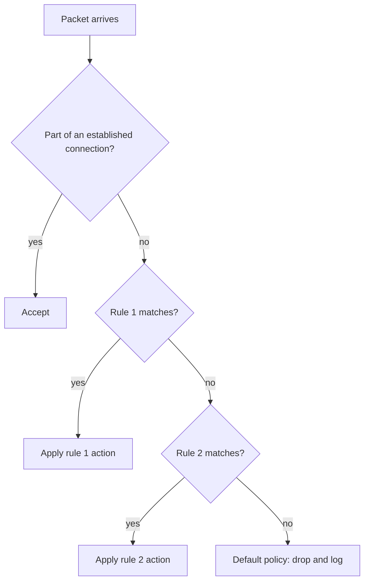
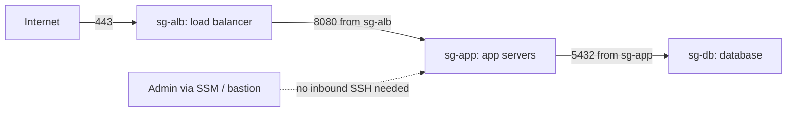

# Firewalls and Security Groups

## Introduction

A **firewall** decides which network connections are allowed and which are dropped. It is the bouncer at the door with a guest list: it checks each arrival against a set of rules and turns away anyone who is not on the list.

Firewalls appear in many forms: a rule set in the Linux kernel, a dedicated appliance at the edge of a data center, or a **security group** in a cloud provider. The ideas are the same everywhere:

- **Rules** match traffic by source, destination, protocol and port.
- Each rule has an **action**: allow, drop, or reject.
- A **default policy** handles everything that no rule matched.

On this page you will write a host firewall with nftables, see how `ufw` simplifies it, build cloud security groups that reference each other, and learn when a firewall is the right tool and when it is not.

:::note Prerequisites
You should know what IP addresses, CIDR ranges and TCP/UDP ports are. The [Computer Networks tutorial](/docs/fundamental/network) covers these, and its Network Layer section explains the networking background. This page focuses on configuring firewalls securely.
:::

## Types of Firewalls

| Type | Inspects | Example | Strengths | Limits |
| --- | --- | --- | --- | --- |
| Stateless packet filter | Each packet alone: IPs, ports, flags | AWS network ACLs, router ACLs | Very fast, simple | Must write rules for both directions; easy to get wrong |
| Stateful firewall | Packets in the context of a connection | nftables/iptables with conntrack, AWS security groups | Replies allowed automatically; fewer rules | Connection table can be exhausted by floods |
| Next-generation firewall (NGFW) | Application protocols, users, sometimes TLS content | Palo Alto, Fortinet, cloud network firewalls | App-aware rules, built-in IPS | Cost, complexity, TLS inspection privacy concerns |
| Web application firewall (WAF) | HTTP requests and responses | Cloud WAFs, ModSecurity / Coraza | Blocks known web attack patterns | Not a substitute for fixing code ([API Gateways and WAFs](../7-sec-api-security/7-sec-api-gateway-security.mdx)) |
| Host firewall | Traffic to and from one machine | nftables, ufw, firewalld, Windows Defender Firewall | Protects the host even inside a "trusted" network | Must be managed on every host |

### Stateful vs stateless in one example

Your web server accepts a connection on port 443. The client uses a random source port, say 51514.

- A **stateful** firewall sees the inbound SYN, records the connection, and automatically allows the reply packets from port 443 back to 51514.
- A **stateless** filter has no memory. You must add an outbound rule allowing traffic from port 443 to the whole ephemeral port range (often 1024-65535) back to clients. That is easy to get wrong in both directions: too narrow breaks traffic, too wide opens holes.

## How Rules Are Evaluated

Most firewalls walk through rules in order and stop at the first match. If nothing matches, the default policy applies.



Two consequences:

1. **Order matters.** A broad "allow" early in the list can shadow a specific "deny" later.
2. **Default deny is the safe baseline.** Start by dropping everything, then allow only what you need. If you forget a rule, something breaks loudly instead of silently exposing a service.

### Drop vs reject

- **Drop** silently discards the packet. Scanners see the port as `filtered` and must wait for timeouts.
- **Reject** sends back an error (TCP RST or ICMP unreachable). Legitimate clients fail fast.

A common pattern is to drop at the internet edge and reject on internal networks, where quick failures help debugging.

## Host Firewalls on Linux

Linux filters packets in the kernel with **netfilter**. You configure it with one of several front ends:

| Tool | Notes |
| --- | --- |
| `nftables` (`nft`) | The modern framework that replaced iptables; one syntax for IPv4 and IPv6 |
| `iptables` | Legacy syntax; on most current distros it is a compatibility layer (`iptables-nft`) on top of nftables |
| `ufw` | "Uncomplicated Firewall", the simple front end used on Ubuntu |
| `firewalld` | Zone-based front end used on Fedora and RHEL family |

### A complete nftables rule set for a web server

This rule set uses the `inet` family, so the same rules cover IPv4 and IPv6. Save it as `/etc/nftables.conf` on a test VM.

```bash
#!/usr/sbin/nft -f
flush ruleset

define ADMIN_NET = 198.51.100.0/24

table inet filter {
    set blocklist_v4 {
        type ipv4_addr
        flags interval
        elements = { 192.0.2.0/24 }
    }

    chain input {
        type filter hook input priority filter; policy drop;

        ct state established,related accept
        ct state invalid drop
        iifname "lo" accept

        ip saddr @blocklist_v4 drop

        # ICMP essentials: path MTU discovery and IPv6 neighbor discovery need these
        ip protocol icmp icmp type { echo-request, destination-unreachable, time-exceeded } limit rate 10/second accept
        ip6 nexthdr icmpv6 icmpv6 type { echo-request, destination-unreachable, packet-too-big, time-exceeded, parameter-problem, nd-router-advert, nd-neighbor-solicit, nd-neighbor-advert } accept

        # SSH only from the admin network, with a new-connection rate limit
        tcp dport 22 ip saddr $ADMIN_NET ct state new limit rate 10/minute accept

        # Public web traffic
        tcp dport { 80, 443 } accept

        # Log what we drop, rate limited so an attacker cannot flood the logs
        limit rate 5/minute log prefix "nft-input-drop: " level info
    }

    chain forward {
        type filter hook forward priority filter; policy drop;
    }

    chain output {
        type filter hook output priority filter; policy accept;
    }
}
```

What each part does:

- `policy drop` on `input` makes this a **default deny** firewall.
- `ct state established,related accept` is the stateful rule: replies to connections you allowed are accepted.
- `ct state invalid drop` discards malformed packets that do not belong to any valid connection.
- The `blocklist_v4` **set** lets you add or remove blocked ranges at runtime without reloading the whole rule set.
- ICMP is *not* blocked wholesale. Blocking all ICMP breaks path MTU discovery, and blocking ICMPv6 breaks IPv6 entirely.
- `198.51.100.0/24` and `192.0.2.0/24` are documentation ranges (RFC 5737). Replace them with your real admin network and blocklist.

Apply and inspect it:

```bash
# Check syntax without applying (needs root)
sudo nft -c -f /etc/nftables.conf

# Apply, then make it persistent across reboots
sudo nft -f /etc/nftables.conf
sudo systemctl enable --now nftables

# Add an address to the blocklist at runtime
sudo nft add element inet filter blocklist_v4 '{ 203.0.113.50 }'
sudo nft list set inet filter blocklist_v4
```

Example output:

```text
table inet filter {
	set blocklist_v4 {
		type ipv4_addr
		flags interval
		elements = { 192.0.2.0/24, 203.0.113.50 }
	}
}
```

:::warning Do not lock yourself out
When you change firewall rules on a remote server over SSH, a mistake can cut your own session. Keep a console session open (cloud providers offer a serial or web console), or schedule an automatic rollback before applying: `sudo bash -c 'sleep 120 && nft flush ruleset' &`, then cancel the job once you confirm you still have access. Note that flushing leaves the host with no filtering, so treat that as a lab technique and use a console in production.
:::

### The same policy with ufw

`ufw` generates netfilter rules from short commands. It is a good choice for single Ubuntu servers.

```bash
sudo ufw default deny incoming
sudo ufw default allow outgoing
sudo ufw limit from 198.51.100.0/24 to any port 22 proto tcp
sudo ufw allow 80,443/tcp
sudo ufw logging on
sudo ufw enable
sudo ufw status numbered
```

Example output:

```text
Status: active

     To                         Action      From
     --                         ------      ----
[ 1] 22/tcp                     LIMIT IN    198.51.100.0/24
[ 2] 80,443/tcp                 ALLOW IN    Anywhere
[ 3] 80,443/tcp (v6)            ALLOW IN    Anywhere (v6)
```

`ufw limit` denies a source address that opens too many connections in a short time (by default, six or more within 30 seconds), which slows down SSH password guessing. It is not a replacement for key-only SSH ([SSH Security](../9-sec-system-hardening/2-sec-ssh-security.mdx)).

### Docker bypasses ufw

When you publish a container port with `docker run -p 8080:80`, Docker writes NAT rules that route the traffic **before** it reaches the `INPUT` chain that `ufw` uses. The [Docker documentation](https://docs.docker.com/engine/network/packet-filtering-firewalls/) states that Docker and ufw use firewall rules in ways that make them incompatible. The result is a classic surprise: `ufw status` says the port is closed, but the container is reachable from the internet.

Fixes, in order of preference:

```bash
# 1. Publish only on loopback, and put a reverse proxy in front
docker run -d -p 127.0.0.1:8080:80 nginx

# 2. Do not publish internal services at all; use a user-defined network
docker network create backend
docker run -d --network backend --name redis redis:7
```

For advanced cases, Docker provides a `DOCKER-USER` iptables chain whose rules are evaluated before Docker's own rules. The [Docker tutorial](/docs/devops/docker) covers container networking in depth.

## Cloud Security Groups and Network ACLs

In the cloud you usually cannot (and should not) rely only on the VM's own firewall. Cloud providers enforce filtering **outside** the VM, so even a compromised or misconfigured guest cannot change it.

Using AWS as the example (Azure Network Security Groups and Google Cloud VPC firewall rules are similar in spirit):

| Feature | Security group | Network ACL |
| --- | --- | --- |
| Attached to | Network interfaces (instances, load balancers, databases) | Subnets |
| State | Stateful | Stateless |
| Rules | Allow only | Allow and deny, evaluated in rule-number order |
| Default | Deny all inbound; new groups allow all outbound | Default NACL allows all; custom NACLs deny all until you add rules |
| Can reference | Other security groups | CIDR ranges only |

The killer feature of security groups is **referencing other groups**. Instead of "allow 10.0.2.0/24 to port 5432," you say "allow members of the `app` group to port 5432." When autoscaling adds new app servers, they get access automatically, and nothing else does.



### Security groups as code with Terraform

The AWS provider's documentation recommends the standalone `aws_vpc_security_group_ingress_rule` and `aws_vpc_security_group_egress_rule` resources over inline `ingress` blocks, because each rule gets its own ID, tags and description.

```hcl
resource "aws_security_group" "alb" {
  name        = "alb"
  description = "Public load balancer"
  vpc_id      = var.vpc_id
}

resource "aws_security_group" "app" {
  name        = "app"
  description = "Application servers"
  vpc_id      = var.vpc_id
}

resource "aws_security_group" "db" {
  name        = "db"
  description = "PostgreSQL"
  vpc_id      = var.vpc_id
}

# Internet -> ALB on 443 only
resource "aws_vpc_security_group_ingress_rule" "alb_https" {
  security_group_id = aws_security_group.alb.id
  cidr_ipv4         = "0.0.0.0/0"
  ip_protocol       = "tcp"
  from_port         = 443
  to_port           = 443
  description       = "Public HTTPS"
}

# ALB -> app on 8080, by group reference instead of CIDR
resource "aws_vpc_security_group_ingress_rule" "app_from_alb" {
  security_group_id            = aws_security_group.app.id
  referenced_security_group_id = aws_security_group.alb.id
  ip_protocol                  = "tcp"
  from_port                    = 8080
  to_port                      = 8080
}

# App -> DB on 5432 only
resource "aws_vpc_security_group_ingress_rule" "db_from_app" {
  security_group_id            = aws_security_group.db.id
  referenced_security_group_id = aws_security_group.app.id
  ip_protocol                  = "tcp"
  from_port                    = 5432
  to_port                      = 5432
}

# Egress: app may reach the DB and HTTPS endpoints, nothing else
resource "aws_vpc_security_group_egress_rule" "app_to_db" {
  security_group_id            = aws_security_group.app.id
  referenced_security_group_id = aws_security_group.db.id
  ip_protocol                  = "tcp"
  from_port                    = 5432
  to_port                      = 5432
}

resource "aws_vpc_security_group_egress_rule" "app_https_out" {
  security_group_id = aws_security_group.app.id
  cidr_ipv4         = "0.0.0.0/0"
  ip_protocol       = "tcp"
  from_port         = 443
  to_port           = 443
  description       = "Package mirrors and external APIs; tighten with VPC endpoints or a proxy"
}
```

When a security group is managed by Terraform, its default "allow all outbound" rule is removed, so the two egress rules above are the *only* outbound traffic allowed. Resource names and quotas change over time; check the [Terraform AWS provider docs](https://registry.terraform.io/providers/hashicorp/aws/latest/docs/resources/vpc_security_group_ingress_rule) and [AWS VPC quotas](https://docs.aws.amazon.com/vpc/latest/userguide/amazon-vpc-limits.html). See the [Terraform tutorial](/docs/devops/terraform) for Terraform basics and [Infrastructure as Code Security](../8-sec-cloud-and-container/6-sec-infrastructure-as-code-security.mdx) for scanning IaC.

### Auditing security groups with Python

Open-to-the-world rules on database or admin ports are among the most common cloud findings. You can export your groups with `aws ec2 describe-security-groups --output json > sg.json` and audit the file offline. Here is a small sample export:

```json
{
  "SecurityGroups": [
    {
      "GroupId": "sg-0a1b2c3d4e5f60001",
      "GroupName": "web-alb",
      "IpPermissions": [
        {"IpProtocol": "tcp", "FromPort": 443, "ToPort": 443,
         "IpRanges": [{"CidrIp": "0.0.0.0/0"}], "Ipv6Ranges": [{"CidrIpv6": "::/0"}],
         "UserIdGroupPairs": []}
      ]
    },
    {
      "GroupId": "sg-0a1b2c3d4e5f60002",
      "GroupName": "db",
      "IpPermissions": [
        {"IpProtocol": "tcp", "FromPort": 5432, "ToPort": 5432,
         "IpRanges": [{"CidrIp": "0.0.0.0/0", "Description": "temp debug"}], "Ipv6Ranges": [],
         "UserIdGroupPairs": [{"GroupId": "sg-0a1b2c3d4e5f60003"}]}
      ]
    },
    {
      "GroupId": "sg-0a1b2c3d4e5f60004",
      "GroupName": "legacy-admin",
      "IpPermissions": [
        {"IpProtocol": "-1", "IpRanges": [{"CidrIp": "0.0.0.0/0"}], "Ipv6Ranges": [],
         "UserIdGroupPairs": []}
      ]
    }
  ]
}
```

```python
import json
import sys

SENSITIVE_PORTS = {22: "SSH", 3389: "RDP", 3306: "MySQL", 5432: "PostgreSQL",
                   6379: "Redis", 9200: "Elasticsearch", 27017: "MongoDB"}
OPEN_TO_WORLD = {"0.0.0.0/0", "::/0"}

def world_cidrs(perm):
    v4 = [r["CidrIp"] for r in perm.get("IpRanges", [])]
    v6 = [r["CidrIpv6"] for r in perm.get("Ipv6Ranges", [])]
    return [c for c in v4 + v6 if c in OPEN_TO_WORLD]

def audit(groups):
    findings = []
    for sg in groups:
        for perm in sg["IpPermissions"]:
            cidrs = world_cidrs(perm)
            if not cidrs:
                continue
            name = f'{sg["GroupName"]} ({sg["GroupId"]})'
            if perm["IpProtocol"] == "-1":          # -1 means all protocols, all ports
                findings.append(("CRITICAL", name, "ALL traffic open to " + ", ".join(cidrs)))
                continue
            lo, hi = perm.get("FromPort", 0), perm.get("ToPort", 65535)
            for port, svc in SENSITIVE_PORTS.items():
                if lo <= port <= hi:
                    findings.append(("HIGH", name, f"{svc} port {port} open to " + ", ".join(cidrs)))
    return findings

if __name__ == "__main__":
    with open(sys.argv[1]) as f:
        data = json.load(f)
    results = audit(data["SecurityGroups"])
    for severity, group, message in results:
        print(f"[{severity:8}] {group}: {message}")
    sys.exit(1 if results else 0)   # non-zero exit fails a CI job
```

Run it with `python3 sg_audit.py sg.json`.

Output:

```text
[HIGH    ] db (sg-0a1b2c3d4e5f60002): PostgreSQL port 5432 open to 0.0.0.0/0
[CRITICAL] legacy-admin (sg-0a1b2c3d4e5f60004): ALL traffic open to 0.0.0.0/0
```

Note the `"temp debug"` description: "temporary" openings that never get closed are a classic root cause. In production you would use a dedicated tool such as a [CSPM](../8-sec-cloud-and-container/7-sec-cspm.mdx) or an IaC scanner, but the logic is the same.

## Real-World Scenario

**Situation:** Your team runs a B2B invoicing SaaS on AWS: an Application Load Balancer, an autoscaling group of API servers, a PostgreSQL database and a Redis cache. A penetration test report flags three issues: the database security group allows `0.0.0.0/0` on 5432 (added during a migration), SSH is open to the world on all API servers, and outbound traffic is unrestricted. You need to decide which controls to use.

**Walkthrough:**

1. **Replace CIDR rules with group references.** The DB group allows 5432 only from `sg-app`. Redis allows 6379 only from `sg-app`. The app group allows 8080 only from `sg-alb`.
2. **Remove inbound SSH completely.** Use AWS Systems Manager Session Manager (or a VPN, see [VPNs and Secure Tunnels](./3-sec-vpn.mdx)) for shell access. No port 22 in any security group.
3. **Restrict egress.** API servers may reach the DB, Redis and HTTPS. Use VPC endpoints for AWS services so that traffic stays on the AWS network. If you need domain-level egress control (for example "only `api.stripe.com`"), add an egress proxy or a managed network firewall, because security groups only understand IPs and ports.
4. **Keep host firewalls as a backstop.** A baseline `nftables` policy in the server image catches mistakes in the cloud layer.
5. **Prevent regressions.** Put all rules in Terraform, and run an IaC scanner plus a scheduled audit like the script above. Alert on any `0.0.0.0/0` rule for non-web ports.

**Why this approach:** Group references follow the architecture rather than IP addresses, so they survive autoscaling and are easy to review. Removing SSH ingress entirely removes a whole attack class instead of guarding it.

**When to use it / when not to:** Security groups are the right primary control for almost any AWS workload. Network ACLs add value as a coarse subnet-level guardrail (for example "the data subnet never talks to the internet"), but they are stateless and easy to break, so do not use them for fine-grained rules. Domain-based egress filtering needs a proxy or NGFW.

**Alternatives and trade-offs:**

| Approach | Pros | Cons | Best for |
| --- | --- | --- | --- |
| Security groups with group references | Stateful, follow the architecture, free | IP/port only; no domain or app awareness | Primary control for every AWS workload |
| Network ACLs | Explicit deny, subnet-wide guardrail | Stateless, ordered rules, easy to misconfigure | Coarse isolation and emergency blocks |
| Host firewall (nftables/ufw) | Works on any platform, survives cloud misconfig | Per-host drift; can be changed by an attacker with root | Defense in depth, on-prem servers |
| Managed network firewall / NGFW | Domain filtering, IPS signatures, central logging | Extra cost and latency; needs routing changes | Regulated environments, strict egress control |
| Egress HTTP proxy | Domain allowlists, logging of outbound calls | Apps must be proxy-aware; another service to run | Controlling which external APIs servers can call |

## Common Mistakes

- **`0.0.0.0/0` "just for now".** Temporary rules become permanent. Use descriptions with ticket numbers and expiry dates, and audit regularly.
- **Allowing all outbound traffic.** Unrestricted egress makes data exfiltration and command-and-control easy. Start with "deny, then allow known destinations" for sensitive tiers.
- **Blocking all ICMP.** It breaks path MTU discovery (mysterious hanging connections) and IPv6 neighbor discovery. Allow the essential types.
- **Forgetting IPv6.** iptables rules do not cover IPv6; you need `ip6tables` or an `inet` table in nftables. Cloud groups need `::/0` rules considered too.
- **Trusting `ufw status` on Docker hosts.** Published container ports bypass it. Verify from outside with a scan.
- **Rule sprawl.** Hundreds of rules nobody understands. Keep rules in version control, add descriptions, and remove unused ones.
- **Thinking a firewall stops application attacks.** Port 443 must be open for your website, so SQL injection over HTTPS passes straight through. That is a job for secure code and possibly a WAF ([Web Application Security](../3-sec-web-security/0-sec-web-security-introduction.mdx)).

## Summary

- Firewalls match traffic against ordered rules and fall back to a **default policy**. Use **default deny**.
- **Stateful** firewalls (nftables with conntrack, security groups) track connections and are simpler and safer than stateless filters (network ACLs).
- On Linux, **nftables** is the modern framework; `ufw` and `firewalld` are friendly front ends. Use an `inet` table to cover IPv4 and IPv6 together.
- **Docker** published ports bypass ufw. Bind to `127.0.0.1` or avoid publishing internal services.
- In the cloud, **security groups that reference other groups** model your architecture cleanly. Manage them as code and audit for open-to-the-world rules.
- Control **egress** too, and remember that firewalls do not fix application vulnerabilities.

## Exercises

1. On a test VM, load the nftables rule set above, replacing `ADMIN_NET` with your own address. Confirm with `nft list ruleset`, then test from a second VM that ports other than 22, 80 and 443 show as `filtered` with Nmap.
2. Run a container with `-p 6379:6379` on a VM where `ufw` denies 6379. Verify from another VM that the port is still reachable, then fix it two different ways.
3. Extend the Python audit script to flag egress rules that allow all protocols to `0.0.0.0/0`, and to print a warning for any rule whose description contains "temp" or "test".
4. Write Terraform for a three-tier security group layout (ALB, app, DB) with explicit egress rules, then run `terraform plan` against a free LocalStack or a sandbox account.

**Related pages:**

- [Network Segmentation](./2-sec-network-segmentation.mdx): group systems into zones and limit lateral movement.
- [DDoS Attacks and Mitigation](./7-sec-ddos.mdx): why firewalls alone cannot absorb floods.
- [Common Cloud Misconfigurations](../8-sec-cloud-and-container/2-sec-cloud-misconfigurations.mdx): more cloud findings beyond security groups.
- [Linux Hardening](../9-sec-system-hardening/0-sec-linux-hardening.mdx): the rest of the host baseline.
