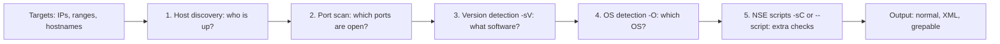
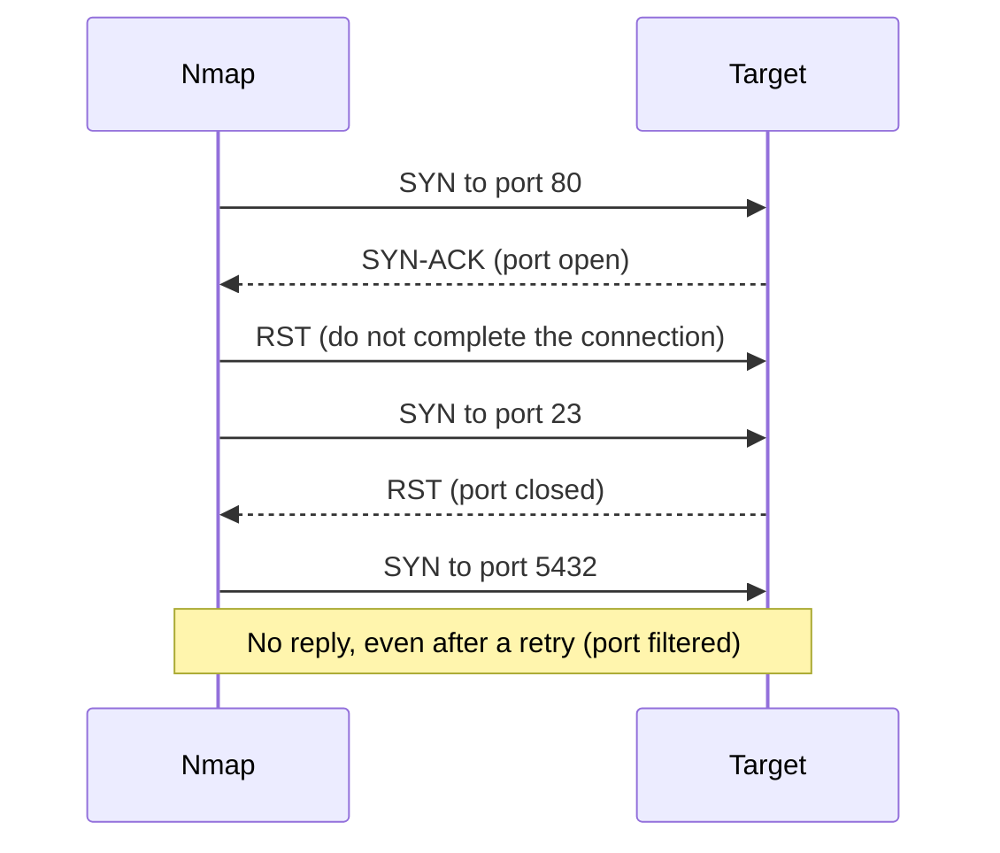

# Network Scanning with Nmap

## Introduction

Before you can protect a network, you need to know what is on it. **Network scanning** answers three questions: which hosts are alive, which ports are open on them, and which software is listening on those ports. Attackers scan as one of the first steps of an intrusion ([The Attacker Mindset and Kill Chains](../0-sec-fundamentals/7-sec-attacker-mindset.mdx)). Defenders scan their own networks to find what attackers would find, **first**.

[Nmap](https://nmap.org/) ("Network Mapper") is the standard open-source scanner, first released in 1997 and still actively maintained. Version 7.99 was released in March 2026; check the [Nmap changelog](https://nmap.org/changelog) for the latest. Think of Nmap as walking around a building and checking every door and window: which ones exist, which are locked, which are open, and what is behind the open ones.

:::warning Scan only what you are authorized to scan
Scanning systems without permission can violate laws, contracts and acceptable-use policies, and it can disrupt fragile devices. Nmap's own documentation warns that scans can occasionally crash poorly written services and advises asking permission before scanning even lightly.

- Scan **your own lab** (the Docker lab below), systems **you own**, or systems where you have **written permission** that defines scope and timing.
- The Nmap project provides `scanme.nmap.org` for testing. Its [man page examples](https://nmap.org/book/man-examples.html) grant permission to scan it **with Nmap only**, not to test exploits or denial of service, and ask you to keep it to about a dozen scans per day.
- Cloud providers have their own penetration testing policies; read them before scanning even your own cloud resources.

See [Ethics, Law and Responsible Disclosure](../0-sec-fundamentals/8-sec-ethics-and-law.mdx) and [Penetration Testing Introduction](../10-sec-offensive-security/0-sec-pentest-introduction.mdx).
:::

## How Nmap Works

A typical Nmap run goes through these phases, each of which you can enable, disable or tune:



### Port states

Nmap reports each port in one of six states. The first three are by far the most common.

| State | Meaning | Typical cause |
| --- | --- | --- |
| `open` | An application accepts connections | A running service |
| `closed` | The port is reachable but nothing listens (TCP RST) | No service; no firewall in the way |
| `filtered` | No response, or an ICMP "prohibited" error | A firewall drops the probes |
| `unfiltered` | Reachable, but open/closed unknown | Only from ACK scans (`-sA`) |
| `open\|filtered` | Cannot tell open from filtered | Common for UDP and some stealth scans |
| `closed\|filtered` | Cannot tell closed from filtered | Rare (IP ID idle scan) |

For defenders, `filtered` on internal service ports is good news: the firewall is doing its job ([Firewalls and Security Groups](./1-sec-firewalls.mdx)).

### The SYN scan

The default scan type when Nmap runs with root privileges is the **SYN scan** (`-sS`). It sends a SYN and reads the reply, but never completes the handshake:



Without root, Nmap uses a **connect scan** (`-sT`), which completes the handshake through the operating system. It is slower and more likely to appear in application logs.

## A Safe Scanning Lab with Docker

This lab gives you three targets on an **internal Docker network with no internet route** and no ports published to your host. You scan it from a fourth container. Save as `compose.yaml`:

```yaml
# compose.yaml: an isolated scanning lab. Nothing here is published to the host or internet.
services:
  web:
    image: nginx:1.27
    networks:
      lab:
        ipv4_address: 10.99.0.10
  db:
    image: postgres:16
    environment:
      POSTGRES_PASSWORD: lab-only-password
    networks:
      lab:
        ipv4_address: 10.99.0.20
  cache:
    image: redis:7
    networks:
      lab:
        ipv4_address: 10.99.0.30
  scanner:
    image: instrumentisto/nmap:latest
    profiles: ["tools"]
    networks:
      lab:
        ipv4_address: 10.99.0.100

networks:
  lab:
    internal: true          # no route to the internet
    ipam:
      config:
        - subnet: 10.99.0.0/24
```

```bash
docker compose -p seclab up -d
# Every scan below runs inside the scanner container:
docker compose -p seclab run --rm scanner --version
```

Example output:

```text
Nmap version 7.98 ( https://nmap.org )
Platform: x86_64-unknown-linux-gnu
```

`instrumentisto/nmap` is a community-maintained image; its Nmap version may lag the official release. If `10.99.0.0/24` overlaps a network you already use, Docker refuses to create the network; pick another private range. Run `docker compose -p seclab down` when you are done. New to Compose? See the [Docker tutorial](/docs/devops/docker).

For brevity, the commands below are shown as plain `nmap ...`; in the lab, run them as `docker compose -p seclab run --rm scanner ...` with the same arguments.

## Step 1: Host Discovery

`-sn` ("no port scan") only finds live hosts. On a local network Nmap uses ARP, which is fast and reliable.

```bash
nmap -sn 10.99.0.0/24
```

Output:

```text
Nmap scan report for 10.99.0.1
Host is up (0.000047s latency).
Nmap scan report for seclab-web-1.seclab_lab (10.99.0.10)
Host is up (0.000011s latency).
Nmap scan report for seclab-db-1.seclab_lab (10.99.0.20)
Host is up (0.000015s latency).
Nmap scan report for seclab-cache-1.seclab_lab (10.99.0.30)
Host is up (0.000023s latency).
Nmap scan report for d950e328f99e (10.99.0.100)
Host is up.
Nmap done: 256 IP addresses (5 hosts up) scanned in 2.53 seconds
```

`10.99.0.1` is the Docker bridge gateway and `10.99.0.100` is the scanner itself. On remote networks, firewalls often block discovery probes; `-Pn` skips discovery and treats every target as up (slower, but it finds hosts that ignore pings).

## Step 2: Port Scanning

By default Nmap scans the **1,000 most common TCP ports** for each protocol.

```bash
nmap -sS 10.99.0.10,20,30
```

Output:

```text
Nmap scan report for seclab-web-1.seclab_lab (10.99.0.10)
Host is up (0.0000030s latency).
Not shown: 999 closed tcp ports (reset)
PORT   STATE SERVICE
80/tcp open  http

Nmap scan report for seclab-db-1.seclab_lab (10.99.0.20)
Host is up (0.0000030s latency).
Not shown: 999 closed tcp ports (reset)
PORT     STATE SERVICE
5432/tcp open  postgresql

Nmap scan report for seclab-cache-1.seclab_lab (10.99.0.30)
Host is up (0.0000030s latency).
All 1000 scanned ports on seclab-cache-1.seclab_lab (10.99.0.30) are in ignored states.
Not shown: 1000 closed tcp ports (reset)

Nmap done: 3 IP addresses (3 hosts up) scanned in 0.29 seconds
```

Notice the cache host: **no open ports found**, yet Redis is running. Redis's port 6379 is not in Nmap's top 1,000 list. This is the single most important lesson in scanning: **a default scan is not a complete scan.** Scan all 65,535 ports when you need certainty:

```bash
nmap -p- --min-rate 1000 10.99.0.30
```

Output:

```text
Not shown: 65534 closed tcp ports (reset)
PORT     STATE SERVICE
6379/tcp open  redis
```

Port selection options:

| Option | Scans |
| --- | --- |
| (default) | Top 1,000 TCP ports |
| `-F` | Top 100 ports (fast) |
| `--top-ports N` | Top N ports |
| `-p 22,80,443` | Specific ports |
| `-p 1-1024` | A range |
| `-p-` | All 65,535 ports |
| `-sU -p 53,123,161` | UDP ports (slow; often `open\|filtered`) |

## Step 3: Version Detection

Knowing that port 5432 is open is useful; knowing *which software and version* tells you whether it is vulnerable. `-sV` probes each open port and matches responses against Nmap's service database. `--reason` explains each state.

```bash
nmap -sV --reason -p 80,5432,6379 10.99.0.20,30
```

Output (trimmed):

```text
Nmap scan report for seclab-db-1.seclab_lab (10.99.0.20)
Host is up, received arp-response (0.000040s latency).

PORT     STATE  SERVICE    REASON         VERSION
80/tcp   closed http       reset ttl 64
5432/tcp open   postgresql syn-ack ttl 64 PostgreSQL DB 9.6.0 or later
6379/tcp closed redis      reset ttl 64

Nmap scan report for seclab-cache-1.seclab_lab (10.99.0.30)
Host is up, received arp-response (0.0000080s latency).

PORT     STATE  SERVICE    REASON         VERSION
80/tcp   closed http       reset ttl 64
5432/tcp closed postgresql reset ttl 64
6379/tcp open   redis      syn-ack ttl 64 Redis key-value store 7.4.9
```

Version strings feed directly into [vulnerability management](../11-sec-defensive-operations/6-sec-vulnerability-management.mdx): compare them against advisories for the software you run. Version detection can be imprecise ("9.6.0 or later"), and administrators sometimes hide banners, so treat results as evidence, not proof.

`-O` adds OS detection, and `-A` is shorthand for `-O -sV -sC --traceroute`. Both need root and send more unusual probes.

## Step 4: The Nmap Scripting Engine (NSE)

NSE scripts, written in Lua, extend Nmap with protocol checks. `-sC` runs the `default` category, which is chosen to be useful and reasonably safe.

```bash
nmap -sV -sC -p 80 10.99.0.10
```

Output:

```text
PORT   STATE SERVICE VERSION
80/tcp open  http    nginx 1.27.5
|_http-server-header: nginx/1.27.5
|_http-title: Welcome to nginx!
```

Scripts can reveal real misconfigurations. The `redis-info` script asks Redis for its status, which only works because this Redis instance has **no authentication**:

```bash
nmap -p 6379 --script redis-info 10.99.0.30
```

Output (trimmed):

```text
PORT     STATE SERVICE
6379/tcp open  redis
| redis-info:
|   Version: 7.4.9
|   Architecture: 64 bits
|   Role: master
|   Bind addresses:
|     *
|     -::*
|   Client connections:
|_    10.99.0.100
```

Anyone who can reach this port can read and write the cache. The finding maps directly to a fix: require authentication (`requirepass` or Redis ACLs), bind to the needed interface only, and restrict the port with network rules ([Network Segmentation](./2-sec-network-segmentation.mdx)).

### Script categories and safety

Every script belongs to one or more categories. Choose categories deliberately:

| Category | Purpose | Use on systems you are authorized to test |
| --- | --- | --- |
| `default`, `safe`, `discovery`, `version` | Information gathering with low risk | Generally fine |
| `vuln` | Check for specific known vulnerabilities | With care; some checks are intrusive |
| `auth`, `brute` | Test authentication, guess credentials | Only with explicit permission; can lock accounts |
| `intrusive` | May crash services or consume resources | Only in labs or agreed test windows |
| `exploit`, `dos` | Actively exploit or disrupt | Not for routine scanning; lab only |

You can combine categories with boolean expressions, for example `--script "default and safe"`. The full list is in the [NSE documentation](https://nmap.org/book/nse-usage.html).

## Timing, Output and Being a Good Citizen

| Option | Effect |
| --- | --- |
| `-T0` to `-T5` | Timing templates from paranoid to insane; `-T3` is the default, `-T4` is common on fast reliable networks |
| `--min-rate N` / `--max-rate N` | Packets per second floor and ceiling |
| `--max-retries N` | Fewer retries is faster but may miss ports |
| `-oN`, `-oX`, `-oG`, `-oA name` | Normal, XML, grepable, or all three |
| `--open` | Show only open ports |
| `-6` | Scan IPv6 targets |

Fast scans can overload old devices, consumer routers and industrial equipment. On production networks, scan during agreed windows, use `--max-rate`, and tell the operations and security teams first so your scan is not mistaken for an attack (it will trigger IDS alerts; see [Intrusion Detection and Prevention](./5-sec-ids-ips.mdx)).

Save everything with `-oA`. XML output is ideal for automation:

```xml
<ports><port protocol="tcp" portid="22"><state state="closed" reason="reset" reason_ttl="64"/><service name="ssh" method="table" conf="3"/></port>
<port protocol="tcp" portid="80"><state state="open" reason="syn-ack" reason_ttl="64"/><service name="http" method="table" conf="3"/></port>
<port protocol="tcp" portid="443"><state state="closed" reason="reset" reason_ttl="64"/><service name="https" method="table" conf="3"/></port>
</ports>
```

## Continuous Exposure Monitoring

A single scan is a snapshot. The real value comes from **scanning regularly and alerting on changes**: a new open port usually means a new service, a firewall change or a mistake. Nmap ships with `ndiff` for comparing two XML results, and a short Python script does the same with exactly the output you want:

```python
import sys
import xml.etree.ElementTree as ET

def open_ports(path: str) -> dict:
    """Return {(ip, proto, port): 'service product version'} for every open port in an Nmap XML file."""
    result = {}
    for host in ET.parse(path).getroot().iter("host"):
        ip = host.find("address").get("addr")
        for port in host.iter("port"):
            if port.find("state").get("state") != "open":
                continue
            svc = port.find("service")
            desc = " ".join(filter(None, [svc.get("name"), svc.get("product"), svc.get("version")])) if svc is not None else "?"
            result[(ip, port.get("protocol"), int(port.get("portid")))] = desc
    return result

baseline, current = open_ports(sys.argv[1]), open_ports(sys.argv[2])

for key in sorted(current.keys() - baseline.keys()):
    print(f"NEW     {key[0]}:{key[2]}/{key[1]}  {current[key]}")
for key in sorted(baseline.keys() - current.keys()):
    print(f"CLOSED  {key[0]}:{key[2]}/{key[1]}  {baseline[key]}")
for key in sorted(baseline.keys() & current.keys()):
    if baseline[key] != current[key]:
        print(f"CHANGED {key[0]}:{key[2]}/{key[1]}  {baseline[key]} -> {current[key]}")

sys.exit(1 if current.keys() - baseline.keys() else 0)
```

Workflow:

```bash
# Week 1: record the approved baseline
nmap -sV -p- --open -oX baseline.xml 10.99.0.0/24

# Every week after: scan again and compare
nmap -sV -p- --open -oX current.xml 10.99.0.0/24
python3 scan_diff.py baseline.xml current.xml
```

Example output after someone started Redis on the web server:

```text
NEW     10.99.0.10:6379/tcp  redis Redis key-value store 7.4.9
```

The non-zero exit code lets a CI job or cron wrapper raise an alert. Keep the baseline in version control, and update it only through review, just like firewall rules. **Unparsed XML from untrusted sources** should be handled with a hardened parser such as `defusedxml`; your own Nmap output is trusted input.

## Real-World Scenario

**Situation:** A SaaS company has about 120 public IP addresses across two cloud providers and a small office. After a cloud bill showed an unexpected database instance, leadership asks: "What do we actually expose to the internet, and how would we know if it changed?" You have one week and a modest budget.

**Walkthrough:**

1. **Define scope and authorization.** Pull the list of public IPs and DNS names from the cloud provider APIs and DNS zones (not from memory). Get written approval for weekly scans, confirm the providers' testing policies, and notify the security team so IDS alerts are expected.
2. **Baseline scan from outside.** From a small VM outside your networks, run a full TCP scan (`-p- -sV --open`) at a moderate rate, plus a UDP scan of key ports (53, 123, 161, 500). Save XML.
3. **Triage findings.** Every open port needs an owner and a reason. The unexpected database showed `5432/tcp open`: it was a test restored from a snapshot with a public IP. Close it with security groups, then fix the process that allowed it.
4. **Automate.** A scheduled job rescans weekly, diffs against the approved baseline with the script above, and opens a ticket for any `NEW` entry.
5. **Close the loop.** Feed version information into vulnerability management, and add cloud-native checks that flag public IPs and `0.0.0.0/0` rules at creation time ([Cloud Security Posture Management](../8-sec-cloud-and-container/7-sec-cspm.mdx)).

**Why this approach:** An external scan shows what an attacker sees, regardless of what documentation says. Diffing turns a one-off audit into a control that catches drift within a week. Using cloud APIs for the target list avoids the biggest blind spot: assets nobody remembers.

**When to use it / when not to:** Self-run Nmap monitoring fits small and medium environments with a known IP inventory. For large or fast-changing estates, a commercial attack surface management service that discovers assets from DNS, certificates and cloud APIs may be worth the cost. Nmap does not test web application logic; use a [DAST tool](../6-sec-appsec-and-devsecops/3-sec-dast.mdx) for that.

**Alternatives and trade-offs:**

| Approach | Pros | Cons | Best for |
| --- | --- | --- | --- |
| Scheduled Nmap with diffing | Free, precise, scriptable, shows the attacker's view | You maintain scope, scheduling and alerting | Known IP ranges, small to medium estates |
| Fast mass scanners (masscan, ZMap, RustScan) | Very fast for huge ranges | Less accurate; easy to overload networks; need Nmap for details | Very large address spaces |
| Vulnerability scanners (Greenbone/OpenVAS, commercial) | Port scan plus vulnerability checks and reports | Heavier, noisier, licensing for commercial tools | Compliance scanning, patch verification ([Vulnerability Scanning](../10-sec-offensive-security/3-sec-vulnerability-scanning.mdx)) |
| Cloud-native config checks (CSPM) | Catches exposure at creation time, no scanning traffic | Cloud-only; config view, not actual reachability | Cloud environments |
| Commercial attack surface management | Discovers unknown assets from DNS, certificates and the internet | Subscription cost; external data quality varies | Large or acquisitive organizations |

## Common Mistakes

- **Scanning without permission,** including "just a quick scan" of a client's, employer's or school's network.
- **Trusting the default top-1,000 scan** as complete. Services on uncommon ports (like Redis on 6379 in the lab) are missed. Use `-p-` for audits.
- **Forgetting UDP and IPv6.** DNS, SNMP, NTP and VPN services live on UDP; hosts may have open IPv6 ports that IPv4 scans never see.
- **Scanning only from inside.** Internal scans show what an insider sees; external scans show what the internet sees. You need both.
- **Running intrusive or brute-force scripts** on production systems without agreement. They can lock accounts and crash services.
- **Overly aggressive timing** on fragile networks (printers, industrial devices, consumer routers).
- **Not saving results.** Without XML baselines, you cannot tell what changed.
- **Treating version detection as definitive.** Backported patches and hidden banners make version strings imperfect evidence.

## Summary

- Nmap discovers **hosts**, **open ports**, **service versions**, **operating systems** and more via **NSE scripts**.
- Port states **open**, **closed** and **filtered** tell you about services and firewalls; `filtered` on internal ports is usually good.
- **SYN scans** (`-sS`) are the default with root; **connect scans** (`-sT`) without it. `-sV`, `-sC` and `-O` add detail.
- **Default scans cover only the top 1,000 ports**; use `-p-` when completeness matters.
- Choose NSE categories carefully; avoid `brute`, `intrusive`, `exploit` and `dos` outside agreed tests.
- Turn scanning into a control: **scan regularly, save XML, diff against a baseline, alert on changes**.
- Only scan what you own or are authorized to scan; use the Docker lab or `scanme.nmap.org` (Nmap only, lightly) to practice.

## Exercises

1. Build the Docker lab and reproduce each scan on this page. Then add a fourth service (for example `mongo` or `memcached`) and find it with the default scan and with `-p-`. Which one finds it?
2. Add a firewall to the lab: add an `alpine` service with `cap_add: [NET_ADMIN]`, install `iptables` in it, start two listeners (`nc -lk -p 8080` and `nc -lk -p 8081`), and drop 8081 with `iptables -A INPUT -p tcp --dport 8081 -j DROP`. Scan ports 8080-8082 and explain the `open`, `filtered` and `closed` results.
3. Extend `scan_diff.py` to read an allowlist file (`ip:port` per line) and report only new ports that are not on it. Run it from a cron job or CI pipeline against your lab.
4. Run `nmap -sV -p- --open` from **outside** your home network against your own public IP (you can find it with your router or a "what is my IP" service, and confirm your ISP permits scanning your own connection). Compare the result with the port forwards configured on your router.

**Related pages:**

- [Packet Analysis with Wireshark and tcpdump](./9-sec-packet-analysis.mdx): watch what Nmap's probes look like on the wire.
- [Intrusion Detection and Prevention](./5-sec-ids-ips.mdx): detect scans against your own networks.
- [Reconnaissance and OSINT](../10-sec-offensive-security/2-sec-reconnaissance.mdx): where scanning fits in a penetration test.
- [Building a Safe Practice Lab](../10-sec-offensive-security/1-sec-lab-setup.mdx): extend this lab with deliberately vulnerable targets.
