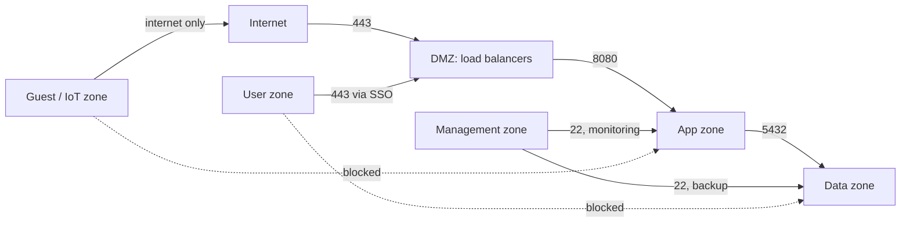

# Network Segmentation

## Introduction

Ships are divided into watertight compartments. If the hull is breached, water fills one compartment and the ship stays afloat. **Network segmentation** applies the same idea: split your network into zones and control the traffic between them, so a breach in one zone does not flood the rest.

Without segmentation you have a **flat network**, where every device can reach every other device. Flat networks are convenient and dangerous. When an attacker compromises one laptop through phishing, or one web server through a vulnerability, a flat network lets them scan for and connect to databases, backup servers and domain controllers. This "spreading out" is called **lateral movement**, and it is how a small foothold becomes a company-wide incident.

Segmentation gives you three things:

1. **Smaller blast radius.** A compromised system can only reach what its zone is allowed to reach.
2. **Better detection.** Traffic that crosses zone boundaries passes through choke points where you can log and inspect it. An app server suddenly talking SSH to the HR file server stands out.
3. **Smaller compliance scope.** Standards such as PCI DSS apply to the systems that handle card data *and* everything that can connect to them. Isolating that environment can shrink the audit scope dramatically ([Compliance](../13-sec-governance/2-sec-compliance.mdx)).

Segmentation is a direct application of [least privilege](../0-sec-fundamentals/5-sec-least-privilege.mdx) and [defense in depth](../0-sec-fundamentals/4-sec-defense-in-depth.mdx) to the network.

## Designing Security Zones

Start on paper, not in the router. Group systems by **trust level** and **function**, then decide which flows between groups are needed.

A typical small-to-medium design:

| Zone | Contains | Trust | Typical inbound | Typical outbound |
| --- | --- | --- | --- | --- |
| Internet | Everyone | None | n/a | n/a |
| DMZ / edge | Load balancers, reverse proxies, mail gateways | Low | 80/443 from internet | App zone on specific ports |
| App | API servers, workers | Medium | From DMZ only | Data zone, approved external APIs |
| Data | Databases, caches, object storage | High | From app zone on DB ports | Backups only |
| Management | Bastion, monitoring, patching, backup servers | Highest | From admin devices via VPN | Everything it manages, on admin ports |
| Users | Employee laptops and desktops | Medium-low | Nothing unsolicited | Internet via proxy, internal apps |
| Guest / IoT | Visitor Wi-Fi, printers, cameras, badge readers | Untrusted | Nothing | Internet only, or a single controller |



Guidelines that hold up in practice:

- **Data flows downhill to more trusted zones only through defined paths.** Users never talk to databases directly; they go through apps.
- **The management zone is the crown jewels.** It can reach everything, so very few devices may reach *it*, and only with strong authentication.
- **IoT and guest devices are untrusted.** Printers and cameras rarely get patched. Put them where they can do the least harm.
- **Write the allowed flows down.** A flow matrix ("app to data on TCP 5432") is the specification that firewalls, security groups and policies implement.

## Segmentation Techniques

You can enforce zones at several layers. Most real networks combine them.

| Technique | Layer | How it separates | Where you see it |
| --- | --- | --- | --- |
| Physical separation | L1 | Separate switches and cables | Industrial control systems, high-security networks |
| VLANs | L2 | Tags frames so one switch carries several isolated networks | Offices, campuses, data centers |
| Subnets + routing ACLs / firewalls | L3-L4 | Traffic between subnets must pass a filtering router or firewall | Every enterprise network |
| Cloud VPCs and subnets | L3-L4 | Separate virtual networks, security groups, route tables | AWS, Azure, Google Cloud |
| Microsegmentation | L3-L7 | Per-workload policy based on labels or identity, not IP ranges | Kubernetes, modern data centers |
| Service mesh with mTLS | L7 | Each service has a cryptographic identity; policy says which identities may call which | Large microservice platforms |

### VLANs: separation on a shared switch

A VLAN (IEEE 802.1Q) adds a tag to Ethernet frames so one physical switch can carry several isolated Layer 2 networks. Hosts in VLAN 20 cannot see broadcast traffic from VLAN 30, and traffic between them must be **routed**, which is where you apply firewall rules.

On a Linux router or lab VM you can create VLAN interfaces with `ip`:

```bash
# Create VLAN 20 (servers) and VLAN 30 (IoT) on top of eth0
sudo ip link add link eth0 name eth0.20 type vlan id 20
sudo ip link add link eth0 name eth0.30 type vlan id 30
sudo ip addr add 10.0.20.1/24 dev eth0.20
sudo ip addr add 10.0.30.1/24 dev eth0.30
sudo ip link set eth0.20 up
sudo ip link set eth0.30 up
ip -d link show eth0.30
```

Example output (trimmed):

```text
5: eth0.30@eth0: <BROADCAST,MULTICAST,UP,LOWER_UP> mtu 1500 qdisc noqueue state UP
    link/ether 52:54:00:12:34:56 brd ff:ff:ff:ff:ff:ff
    vlan protocol 802.1Q id 30 <REORDER_HDR>
```

Then the router's forward chain decides what may cross between VLANs. With nftables (see [Firewalls and Security Groups](./1-sec-firewalls.mdx)):

```bash
table inet segfw {
    chain forward {
        type filter hook forward priority filter; policy drop;

        ct state established,related accept

        # IoT devices may reach the internet (uplink eth1) but no internal VLAN
        iifname "eth0.30" oifname "eth1" accept

        # Servers VLAN may receive monitoring from the management VLAN only
        iifname "eth0.90" oifname "eth0.20" tcp dport { 22, 9100 } accept

        log prefix "inter-vlan-drop: " drop
    }
}
```

:::caution VLANs are not a security boundary on their own
VLANs separate traffic, but switch misconfigurations can leak it. **VLAN hopping** attacks (switch spoofing via auto-negotiated trunks, or double tagging using the native VLAN) are covered on [Common Network Attacks](./6-sec-network-attacks.mdx). Disable trunk auto-negotiation (DTP) on access ports, do not use VLAN 1 or the native VLAN for user traffic, and always filter traffic *between* VLANs with a firewall.
:::

### Cloud segmentation

In the cloud, the same design maps onto:

- **VPCs / VNets** as the outermost boundary, often one per environment (production, staging) or per account.
- **Subnets** for tiers: public subnets for load balancers only, private subnets for apps, isolated subnets with no internet route for databases.
- **Route tables** to decide which subnets have a path to the internet or NAT gateway at all.
- **Security groups** for per-workload rules that reference each other (covered on the [firewalls page](./1-sec-firewalls.mdx)).
- **Separate accounts or projects** for strong isolation between environments and teams. Account boundaries are one of the strongest controls the cloud gives you, because IAM and networking both start fresh ([Cloud IAM Security](../8-sec-cloud-and-container/1-sec-cloud-iam.mdx)).

A database in a subnet with **no route to the internet** cannot exfiltrate data directly to an attacker's server, even if someone gets code execution on it. That is a property of the network design, not of any single rule.

### Microsegmentation in Kubernetes

Inside a Kubernetes cluster, every pod can talk to every other pod by default. That is a flat network. **NetworkPolicy** objects let you microsegment by labels instead of IP addresses, which matters because pod IPs change constantly.

A common pattern is "default deny, then allow specific flows":

```yaml
apiVersion: networking.k8s.io/v1
kind: NetworkPolicy
metadata:
  name: default-deny-all
  namespace: shop
spec:
  podSelector: {}          # empty selector = every pod in the namespace
  policyTypes:
    - Ingress
    - Egress
---
apiVersion: networking.k8s.io/v1
kind: NetworkPolicy
metadata:
  name: allow-dns-egress
  namespace: shop
spec:
  podSelector: {}
  policyTypes:
    - Egress
  egress:
    - to:
        - namespaceSelector:
            matchLabels:
              kubernetes.io/metadata.name: kube-system
          podSelector:
            matchLabels:
              k8s-app: kube-dns
      ports:
        - protocol: UDP
          port: 53
        - protocol: TCP
          port: 53
---
apiVersion: networking.k8s.io/v1
kind: NetworkPolicy
metadata:
  name: api-from-frontend
  namespace: shop
spec:
  podSelector:
    matchLabels:
      app: api
  policyTypes:
    - Ingress
  ingress:
    - from:
        - podSelector:
            matchLabels:
              app: frontend
      ports:
        - protocol: TCP
          port: 8080
---
apiVersion: networking.k8s.io/v1
kind: NetworkPolicy
metadata:
  name: frontend-to-api-egress
  namespace: shop
spec:
  podSelector:
    matchLabels:
      app: frontend
  policyTypes:
    - Egress
  egress:
    - to:
        - podSelector:
            matchLabels:
              app: api
      ports:
        - protocol: TCP
          port: 8080
```

Things to know:

- **Policies are additive allow lists.** Once any policy selects a pod for a direction, only traffic matching some policy is allowed in that direction.
- **Both sides need permission.** With default-deny egress, the frontend needs an egress rule to the API *and* the API needs an ingress rule from the frontend.
- **DNS breaks first.** Default-deny egress blocks DNS lookups unless you allow traffic to the cluster DNS pods, as the second policy does. The `k8s-app: kube-dns` label is the common default; check the labels in your cluster.
- **Enforcement depends on the CNI plugin.** The API server accepts NetworkPolicy objects even when nothing enforces them. Use a CNI that supports them (for example Calico or Cilium), and test.

See the [official NetworkPolicy documentation](https://kubernetes.io/docs/concepts/services-networking/network-policies/), the [Kubernetes tutorial](/docs/devops/kubernetes), and [Kubernetes Security](../8-sec-cloud-and-container/5-sec-kubernetes-security.mdx).

### Identity-based segmentation

IP-based rules assume that an address tells you *who* is talking. In dynamic environments that assumption weakens: containers reuse IPs, and an attacker on an allowed host inherits all its network access. Modern approaches attach policy to **workload identity**:

- **Service meshes** (such as Istio or Linkerd) give every service an mTLS certificate and authorize calls by service identity.
- **Zero trust access proxies** put internal web apps behind an identity-aware gateway rather than a network path ([Least Privilege and Zero Trust](../0-sec-fundamentals/5-sec-least-privilege.mdx)).

These complement network segmentation rather than replace it. Network rules are cheap, fast and hard to bypass from a compromised app; identity rules are precise and portable.

## Segmentation Policy as Code

A segmentation design is only as good as its enforcement, and enforcement drifts. A practical habit is to keep the **flow matrix as data** and check real traffic against it. Cloud VPC flow logs, firewall logs or Zeek connection logs ([Intrusion Detection and Prevention](./5-sec-ids-ips.mdx)) can all be exported to a simple CSV.

Sample flows exported from logs (`flows.csv`):

```text
src,dst,dport,proto
10.0.1.15,10.0.2.21,8080,tcp
10.0.2.21,10.0.3.10,5432,tcp
10.0.4.50,10.0.3.10,5432,tcp
10.0.2.21,10.0.9.5,22,tcp
10.0.9.5,10.0.2.21,22,tcp
10.0.5.77,10.0.2.21,8080,tcp
```

The checker maps each IP to a zone and compares the flow with the allowed list:

```python
import csv
import ipaddress
import sys

# Zones: name -> list of CIDR ranges
ZONES = {
    "dmz":   ["10.0.1.0/24"],    # load balancers, reverse proxies
    "app":   ["10.0.2.0/24"],    # API servers
    "data":  ["10.0.3.0/24"],    # databases
    "users": ["10.0.4.0/24"],    # employee laptops
    "iot":   ["10.0.5.0/24"],    # cameras, printers, badge readers
    "mgmt":  ["10.0.9.0/24"],    # bastion, monitoring, backup
}

# Allowed flows: (source zone, destination zone, protocol, port)
ALLOWED = {
    ("dmz", "app", "tcp", 8080),
    ("app", "data", "tcp", 5432),
    ("mgmt", "app", "tcp", 22),
    ("mgmt", "data", "tcp", 22),
}

NETWORKS = {zone: [ipaddress.ip_network(c) for c in cidrs] for zone, cidrs in ZONES.items()}

def zone_of(ip: str) -> str:
    addr = ipaddress.ip_address(ip)
    for zone, nets in NETWORKS.items():
        if any(addr in net for net in nets):
            return zone
    return "unknown"

def check(path: str) -> int:
    violations = 0
    with open(path, newline="") as f:
        for row in csv.DictReader(f):
            src, dst = zone_of(row["src"]), zone_of(row["dst"])
            key = (src, dst, row["proto"], int(row["dport"]))
            status = "ok  " if key in ALLOWED else "DENY"
            violations += status == "DENY"
            print(f'{status} {row["src"]:>10} ({src:5}) -> {row["dst"]:>10} ({dst:5}) {row["proto"]}/{row["dport"]}')
    return violations

if __name__ == "__main__":
    bad = check(sys.argv[1])
    print(f"\n{bad} flow(s) violate the segmentation policy")
    sys.exit(1 if bad else 0)
```

Output:

```text
ok    10.0.1.15 (dmz  ) ->  10.0.2.21 (app  ) tcp/8080
ok    10.0.2.21 (app  ) ->  10.0.3.10 (data ) tcp/5432
DENY  10.0.4.50 (users) ->  10.0.3.10 (data ) tcp/5432
DENY  10.0.2.21 (app  ) ->   10.0.9.5 (mgmt ) tcp/22
ok     10.0.9.5 (mgmt ) ->  10.0.2.21 (app  ) tcp/22
DENY  10.0.5.77 (iot  ) ->  10.0.2.21 (app  ) tcp/8080

3 flow(s) violate the segmentation policy
```

Each `DENY` is worth investigating:

- **A laptop talking directly to the database** may be a developer shortcut, or an attacker using stolen credentials.
- **An app server opening SSH to the management zone** is backwards; management connects to apps, never the reverse. This pattern is a classic lateral-movement signal.
- **A camera calling the API** suggests a compromised IoT device or a misconfigured integration.

If these flows appear in logs, the enforcement layer is also not blocking them, so you have both a detection and a configuration finding. The same `ZONES` and `ALLOWED` data can generate firewall rules or security group definitions, so the documentation and the enforcement never disagree.

## Testing Segmentation

Do not assume segmentation works. Test it from inside each zone, on networks you own:

```bash
# From a host in the user zone: these should FAIL
nc -zv -w 3 10.0.3.10 5432
nc -zv -w 3 10.0.9.5 22

# From a host in the app zone: this should SUCCEED
nc -zv -w 3 10.0.3.10 5432
```

Example output from the user zone:

```text
nc: connect to 10.0.3.10 port 5432 (tcp) timed out: Operation now in progress
nc: connect to 10.0.9.5 port 22 (tcp) timed out: Operation now in progress
```

For larger networks, run a scheduled [Nmap scan](./10-sec-network-scanning.mdx) from a test host in each zone and compare the results with the flow matrix. Penetration testers will do this too; it is better if you find the gaps first.

## Real-World Scenario

**Situation:** A regional retailer with 40 stores runs a single flat office network at headquarters: employee laptops, the point-of-sale (POS) back-office servers that process card payments, a file server, printers, security cameras and guest Wi-Fi all share one `/16`. Their PCI DSS assessor says the entire network is in scope because everything can reach the cardholder data environment. Last year, ransomware on a single laptop encrypted the file server. You are asked to propose a segmentation plan.

**Walkthrough:**

1. **Inventory and classify.** Use switch MAC tables, DHCP leases and a permitted Nmap discovery scan to list every device, then assign each to a zone: POS/cardholder data, servers, users, management, IoT and guest.
2. **Write the flow matrix.** For example: POS terminals in stores to the POS servers on 443 only; users to the file server on SMB only; nothing from IoT or guest to any internal zone.
3. **Implement in phases.** Create VLANs per zone on the existing switches, move the default gateway for each VLAN to an internal firewall, and start with **allow-all plus logging** between zones for two weeks. Feed those logs into a checker like the one above to find flows you forgot.
4. **Switch to default deny.** Once the logs only show expected flows, change inter-zone policy to deny by default. Do the POS zone first, because it has the biggest compliance and risk impact.
5. **Isolate management.** Admin access to servers comes only from a management VLAN reachable through a VPN with MFA.
6. **Monitor the boundaries.** Send firewall deny logs to the SIEM and alert on new cross-zone flows.

**Why this approach:** VLANs plus an internal firewall reuse the existing switches, reduce the PCI scope to the POS zone and the systems that connect to it, and would have stopped last year's ransomware from reaching the file server over arbitrary ports. The "log first, then deny" rollout avoids breaking the business on day one.

**When to use it / when not to:** VLAN-plus-firewall segmentation fits offices, stores and on-prem data centers. For cloud-native workloads, use VPC subnets and security groups instead of VLANs. For large Kubernetes or microservice estates, label-based microsegmentation scales better than IP-based zones. Very small offices with a handful of devices may get more value from simply separating guest Wi-Fi and keeping endpoints patched.

**Alternatives and trade-offs:**

| Approach | Pros | Cons | Best for |
| --- | --- | --- | --- |
| VLANs + internal firewall | Uses existing hardware, clear zones, compliance-friendly | Coarse-grained; inter-VLAN firewall can become a bottleneck | Offices, stores, on-prem data centers |
| Cloud VPCs, subnets and security groups | Software-defined, versioned as code, cheap | Provider-specific; easy to over-open | Cloud workloads |
| Host-based microsegmentation (agents) | Per-workload policy that follows the server anywhere | Agent licensing and management; can be complex | Large hybrid data centers |
| Kubernetes NetworkPolicy | Label-based, native to the platform, free | Needs a supporting CNI; L3-L4 only | Container platforms |
| Service mesh / identity-aware proxy | Cryptographic identity, L7-aware policy | Operational complexity, performance overhead | Large microservice and zero trust programs |
| Physical air gap | Strongest isolation | Expensive, inconvenient, still bypassable via USB and people | Industrial control and safety systems |

## Common Mistakes

- **Segmenting without filtering.** Creating VLANs but routing between them with no firewall rules gives you tidy diagrams and no security.
- **"Any-any" rules between zones.** One overly broad rule for a migration undoes the design. Review inter-zone rules regularly.
- **Forgetting the management plane.** Monitoring, backup and patching servers often have access to everything. If they are in a flat zone, an attacker who reaches them reaches everything.
- **Shared services bridging zones.** A file server or jump host reachable from every zone becomes the attacker's highway. Give shared services their own zone with narrow inbound rules.
- **Not handling egress.** A segmented internal network where every zone has open internet access still lets malware call home.
- **Never testing.** Rules drift. Re-test boundaries after every network change and at least quarterly.
- **Breaking DNS and time sync.** Default-deny policies often block DNS, NTP or certificate revocation checks. Allow those infrastructure flows explicitly.

## Summary

- Segmentation splits a network into **zones** with controlled flows between them, limiting **lateral movement** and blast radius.
- Design on paper first: classify systems by trust and function, then write an explicit **flow matrix**.
- Enforce with **VLANs and internal firewalls** on-prem, **VPCs, subnets and security groups** in the cloud, and **NetworkPolicies** or identity-based controls for containers and microservices.
- VLANs alone are not a security boundary; always filter **between** zones.
- Treat the flow matrix as **code**: check real traffic logs against it and generate rules from it.
- Roll out gradually (log, then deny), and test boundaries from inside each zone.

## Exercises

1. Draw the zones and flow matrix for a system you know (a home lab, a school network, or your company's main application). Which zone is the riskiest, and why?
2. In a local `kind` or `minikube` cluster with a NetworkPolicy-capable CNI, deploy two pods labelled `frontend` and `api`. Apply the policies above and verify with `kubectl exec ... -- wget -qO- --timeout=3 http://api:8080` that only the allowed flow works. Then remove the DNS policy and observe what breaks.
3. Extend the Python checker to support port ranges and to output nftables `forward` rules from the `ZONES` and `ALLOWED` data.
4. Build two Linux VMs on separate VLANs (or separate libvirt networks) with a third VM routing between them. Write nftables forward rules so only TCP 443 crosses, and test with `nc`.

**Related pages:**

- [Firewalls and Security Groups](./1-sec-firewalls.mdx): the enforcement layer behind each zone boundary.
- [VPNs and Secure Tunnels](./3-sec-vpn.mdx): how admins reach the management zone safely.
- [Common Network Attacks](./6-sec-network-attacks.mdx): VLAN hopping, ARP spoofing and other ways attackers cross weak boundaries.
- [Threat Modeling with STRIDE](../6-sec-appsec-and-devsecops/1-sec-threat-modeling.mdx): use data-flow diagrams to decide where trust boundaries should be.
