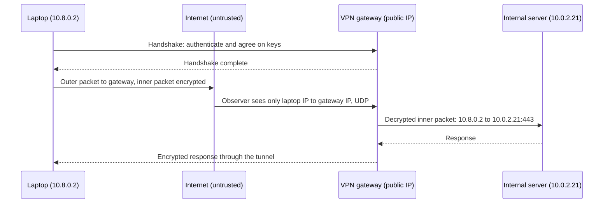
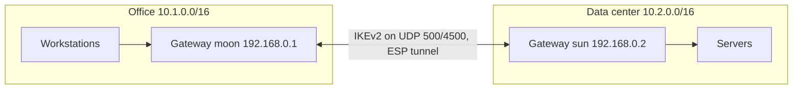
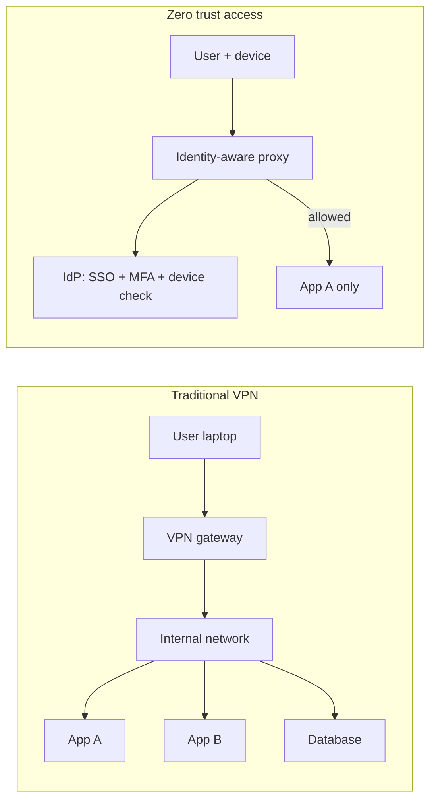

# VPNs and Secure Tunnels

## Introduction

A **Virtual Private Network (VPN)** creates an encrypted tunnel across an untrusted network, usually the internet, so that two endpoints can talk as if they were on the same private network. Think of an armored van driving on public roads: everyone can see the van, but nobody can see or tamper with what is inside, and only vehicles with the right keys can join the convoy.

Developers and IT teams use tunnels for:

- **Remote access:** an engineer at home reaches internal dashboards, staging servers or a database admin port.
- **Site-to-site links:** an office network connects to a data center or cloud VPC.
- **Cloud interconnects:** two VPCs or two cloud providers exchange private traffic.
- **Ad-hoc tunnels:** an SSH port forward to reach one service for a few minutes.

A tunnel protects **confidentiality and integrity in transit** and **authenticates the endpoints**. It does *not* make the endpoints trustworthy. A malware-infected laptop on the VPN is still infected, and now it is "inside." That limitation is why many organizations are moving from broad network VPNs toward **zero trust network access (ZTNA)**, which this page compares at the end.

:::note Background
The [Computer Networks tutorial](/docs/fundamental/network) has a networking-focused introduction to VPNs. This page focuses on choosing, configuring and securing them. Encryption basics are in [Symmetric Encryption](../1-sec-cryptography/3-sec-symmetric-encryption.mdx) and [TLS and HTTPS](../1-sec-cryptography/7-sec-tls.mdx).
:::

## How a Tunnel Works

Every VPN does the same three jobs:

1. **Authenticate** both ends (certificates, pre-shared keys, public keys, or user credentials plus MFA).
2. **Agree on session keys** using a key exchange, so traffic is encrypted with fresh keys.
3. **Encapsulate** packets: wrap each original IP packet, encrypted and authenticated, inside a new outer packet addressed to the other tunnel endpoint.



An observer on the coffee-shop Wi-Fi sees that you are talking to the VPN gateway, how much data you send and when. They cannot read the contents or see which internal server you reach.

## Common Tunnel Technologies

| Technology | Layer / transport | Authentication | Strengths | Weaknesses |
| --- | --- | --- | --- | --- |
| **IPsec (IKEv2)** | L3, ESP over UDP 500/4500 | Certificates, PSK, EAP | Standard everywhere: firewalls, routers, cloud VPN gateways, OS built-in clients | Complex configuration, many cipher options to get wrong |
| **OpenVPN** | TLS-based, UDP or TCP (commonly 1194) | Certificates, plus user auth | Mature, flexible, works through restrictive firewalls over TCP 443 | Slower, larger code base, more configuration |
| **WireGuard** | L3, UDP (commonly 51820) | Static public keys per peer | Very small code base, modern fixed crypto, fast, in the Linux kernel | No built-in user login or MFA, static IP per peer; needs tooling for large fleets |
| **SSH tunnels** | TCP port forwarding over SSH | SSH keys or certificates | Already available wherever SSH is, great for ad-hoc access | Per-port, per-user; easy to leave holes open |
| **TLS tunnels / proxies** | TLS over TCP | Certificates (often mTLS) | Wraps a single service in TLS | One service at a time |
| **Mesh overlays** (Tailscale, Headscale, NetBird and similar) | Usually WireGuard underneath | SSO identity + device keys | Automatic key management, NAT traversal, ACLs per user | Control plane is a vendor service unless self-hosted |

Two notes on what to avoid:

- **PPTP** and **L2TP with weak pre-shared keys** are legacy. PPTP's authentication is broken; do not deploy it.
- **IPsec with IKEv1 aggressive mode and short PSKs** allows offline guessing of the key. Use IKEv2 with certificates.

### WireGuard's design in one paragraph

WireGuard deliberately has **no cipher negotiation**: it uses one fixed modern suite (Curve25519 for key exchange, ChaCha20-Poly1305 for encryption, BLAKE2s for hashing). There is nothing to misconfigure and no downgrade attack. Each peer is identified by its public key, and a setting called **AllowedIPs** ties that key to the IP addresses it may use. This "cryptokey routing" acts as both a routing table and an access list. The trade-off is that WireGuard does not handle user logins, MFA or key distribution; you add those with tooling or a mesh product. See the [WireGuard website](https://www.wireguard.com/) and its [protocol page](https://www.wireguard.com/protocol/).

## Hands-On: A WireGuard Remote-Access VPN

This lab connects a laptop to a small internal network through a Linux gateway. Use two VMs or a VM plus your own laptop. Packages: `wireguard-tools` on Debian/Ubuntu (`sudo apt install wireguard`), and the official apps on macOS, Windows, iOS and Android.

### Step 1: Generate key pairs

Each side generates its own key pair. Private keys never leave the machine that created them.

```bash
umask 077                                   # make the key files readable only by you
wg genkey | tee server.key | wg pubkey > server.pub
wg genkey | tee alice.key  | wg pubkey > alice.pub
cat server.pub
```

Example output:

```text
rc2O8dwEnKhyntM8eUjq47H2X9SZbOHnV15yT1QijHs=
```

Keys are 32-byte Curve25519 values, base64-encoded. Treat the `.key` files like SSH private keys.

### Step 2: Configure the gateway

`/etc/wireguard/wg0.conf` on the gateway (public IP `203.0.113.10`, internal network `10.0.2.0/24`):

```ini
[Interface]
Address = 10.8.0.1/24
ListenPort = 51820
PrivateKey = SERVER_PRIVATE_KEY_FROM_server.key

[Peer]
# alice-laptop (owner: alice@example.com, issued 2026-10-01)
PublicKey = ALICE_PUBLIC_KEY_FROM_alice.pub
AllowedIPs = 10.8.0.2/32
```

On the gateway, `AllowedIPs = 10.8.0.2/32` means: "packets arriving from Alice's key are accepted only if their inner source IP is `10.8.0.2`." Alice cannot spoof another VPN user's address.

Allow the tunnel port and forwarding between the tunnel and the internal network. With nftables (see [Firewalls and Security Groups](./1-sec-firewalls.mdx)):

```bash
table inet vpn {
    chain input {
        type filter hook input priority filter; policy accept;
        udp dport 51820 accept
    }
    chain forward {
        type filter hook forward priority filter; policy drop;
        ct state established,related accept
        # VPN users may reach only the internal web apps, not the whole network
        iifname "wg0" ip daddr 10.0.2.0/24 tcp dport { 443, 3000 } accept
        log prefix "vpn-forward-drop: " drop
    }
}
```

This `input` chain only adds the WireGuard port; keep your normal default-deny host rules too. The `forward` chain is where VPN access control lives: Alice gets ports 443 and 3000 on the app subnet, not every port on every internal host. Then enable IP forwarding and bring the interface up:

```bash
sudo sysctl -w net.ipv4.ip_forward=1        # persist it in /etc/sysctl.d/ as well
sudo systemctl enable --now wg-quick@wg0
```

Internal servers need a route back to `10.8.0.0/24` via the gateway, or the gateway must NAT VPN traffic. Routing is cleaner because internal logs then show which VPN user connected.

### Step 3: Configure the client

Alice's `wg0.conf`:

```ini
[Interface]
Address = 10.8.0.2/32
PrivateKey = ALICE_PRIVATE_KEY_FROM_alice.key
DNS = 10.0.2.53

[Peer]
PublicKey = SERVER_PUBLIC_KEY_FROM_server.pub
Endpoint = 203.0.113.10:51820
AllowedIPs = 10.8.0.0/24, 10.0.2.0/24
PersistentKeepalive = 25
```

On the client, **AllowedIPs works like a routing table**: traffic to `10.8.0.0/24` and `10.0.2.0/24` goes through the tunnel; everything else uses the normal internet connection. This is a **split tunnel**. Setting `AllowedIPs = 0.0.0.0/0, ::/0` makes it a **full tunnel**, sending all traffic through the gateway.

`PersistentKeepalive = 25` sends a small packet every 25 seconds so NAT routers keep the mapping open; it is only needed when the client is behind NAT.

### Step 4: Verify

```bash
sudo wg-quick up wg0
sudo wg show
```

Example output:

```text
interface: wg0
  public key: Xb1n1WqC0Q2X5Vx4s8m8w3o9sVQy5mJ7rE2t6uYkC2E=
  private key: (hidden)
  listening port: 43122

peer: rc2O8dwEnKhyntM8eUjq47H2X9SZbOHnV15yT1QijHs=
  endpoint: 203.0.113.10:51820
  allowed ips: 10.8.0.0/24, 10.0.2.0/24
  latest handshake: 4 seconds ago
  transfer: 1.24 KiB received, 2.10 KiB sent
  persistent keepalive: every 25 seconds
```

`latest handshake` tells you the tunnel is alive. If it never appears, check that UDP 51820 is open on the gateway's firewall and cloud security group, and that the public keys are not swapped.

### Step 5: Revoke access

When Alice leaves or loses her laptop, remove her peer on the gateway:

```bash
sudo wg set wg0 peer ALICE_PUBLIC_KEY_FROM_alice.pub remove
# then delete the [Peer] block from /etc/wireguard/wg0.conf so it does not return on restart
```

Plain WireGuard has no expiry dates and no link to your identity provider. That is fine for a handful of servers and admins. For a growing team, manual key management becomes the weak spot, which is the main reason to adopt a management layer (see the scenario below).

## Site-to-Site IPsec with strongSwan

For connecting an office network to a data center or cloud VPC, **IPsec with IKEv2** is still the default, because every firewall vendor and every major cloud VPN gateway speaks it. [strongSwan](https://docs.strongswan.org/) is the common open-source implementation on Linux.



A minimal `swanctl.conf` on the office gateway, adapted from the strongSwan quickstart, with certificate authentication and explicit modern algorithms:

```text
# /etc/swanctl/swanctl.conf on gateway "moon"
connections {
  net-net {
    version = 2
    remote_addrs = 192.168.0.2
    proposals = aes256gcm16-prfsha384-x25519
    local {
      auth = pubkey
      certs = moonCert.pem
    }
    remote {
      auth = pubkey
      id = "C=CH, O=strongSwan, CN=sun.strongswan.org"
    }
    children {
      net-net {
        local_ts  = 10.1.0.0/16
        remote_ts = 10.2.0.0/16
        esp_proposals = aes256gcm16-x25519
        start_action = trap
      }
    }
  }
}
```

Key points:

- `version = 2` forces IKEv2. Avoid IKEv1, especially aggressive mode with pre-shared keys.
- **Certificates** (`auth = pubkey`) scale better and are safer than a shared PSK. If you must use a PSK, make it long and random, and unique per tunnel.
- **Explicit proposals** stop the peers from negotiating down to legacy algorithms. Check the algorithm names against the strongSwan documentation for your version.
- `local_ts` / `remote_ts` (traffic selectors) define which subnets go through the tunnel. Keep them as narrow as the business needs.
- `start_action = trap` brings the tunnel up automatically when matching traffic appears.

Load the configuration and check the security associations:

```bash
sudo swanctl --load-all
sudo swanctl --list-sas
```

Cloud providers' managed VPN gateways generate equivalent configuration for common devices. Whatever you use, filter the traffic arriving from the tunnel with firewall rules, because the other site is a separate trust zone ([Network Segmentation](./2-sec-network-segmentation.mdx)).

## VPN Hardening Checklist

| Area | Check |
| --- | --- |
| Authentication | Per-user or per-device credentials; MFA for remote access; certificates for site-to-site |
| Cryptography | Modern fixed or explicitly configured suites; no PPTP, no IKEv1 aggressive mode |
| Authorization | Forward rules or ACLs limit each user group to the subnets and ports it needs |
| Exposure | Only the VPN port is open on the gateway; management UI not on the internet |
| Patching | Vendor advisories monitored; critical fixes applied within days |
| Logging | Connections, user identity, assigned IP and source IP sent to the SIEM |
| Lifecycle | Keys and certificates have owners and expiry; offboarding revokes access |
| DNS | Tunnel clients use the company resolver for internal names |

## SSH Tunnels for Quick, Narrow Access

When you need one port on one server, an SSH tunnel is often simpler and narrower than a VPN.

```bash
# Local port forward: reach PostgreSQL on db.internal via the bastion
# localhost:15432 on your laptop -> bastion -> db.internal:5432
ssh -N -L 15432:db.internal:5432 alice@bastion.example.com

# In another terminal
psql -h 127.0.0.1 -p 15432 -U app_readonly appdb
```

```bash
# Jump through a bastion to an internal host (OpenSSH ProxyJump)
ssh -J alice@bastion.example.com alice@10.0.2.21
```

Security considerations:

- On the bastion, restrict forwarding to what is needed. In `sshd_config`, `AllowTcpForwarding no` by default with a `Match` block that enables it for a specific group, and `PermitOpen` to limit allowed destinations.
- Use key-based or certificate-based SSH authentication and MFA on the bastion ([SSH Security](../9-sec-system-hardening/2-sec-ssh-security.mdx)).
- Remote forwards (`ssh -R`) can expose an internal service to the outside world. Attackers use them for persistence too; monitor and restrict them.

## VPN vs Zero Trust Network Access

A classic VPN gives an authenticated device **a place on the network**. From there, network rules decide what it can reach, and too often the answer is "a lot." **ZTNA** (also called an identity-aware proxy or software-defined perimeter) gives an authenticated user **access to specific applications**, checking identity, device posture and context on every request, as described in [NIST SP 800-207](https://csrc.nist.gov/pubs/sp/800/207/final).



Edge VPN appliances are also high-value targets. They sit on the internet, run complex code and grant network access on success. Several commercial SSL-VPN products have had critical vulnerabilities exploited at scale (for example Ivanti Connect Secure in early 2024, CVE-2023-46805 and CVE-2024-21887). Whichever product you choose, patch it fast, and check [CISA's Known Exploited Vulnerabilities catalog](https://www.cisa.gov/known-exploited-vulnerabilities-catalog) for your vendor ([Patch Management](../9-sec-system-hardening/3-sec-patch-management.mdx)).

## Real-World Scenario

**Situation:** A fully remote, 30-person software company has internal Grafana, a staging Kubernetes cluster, an admin panel for customer support, and production databases in a cloud VPC. Today, engineers SSH to a bastion with a shared key and use port forwards. Support staff reach the admin panel because it is on the public internet behind a password. The CTO wants one secure access approach and asks you to compare options.

**Walkthrough:**

1. **Separate the audiences.** Support staff need *one web app*. Engineers need several web apps, `kubectl` and occasional database access. Only two people need production shell access.
2. **Web apps go behind an identity-aware proxy.** The admin panel and Grafana move off the public internet and behind a ZTNA proxy tied to the company's SSO with phishing-resistant MFA ([Passkeys and WebAuthn](../4-sec-authentication/3-sec-passkeys.mdx)). Support staff never get network access at all.
3. **Engineers get a WireGuard-based mesh with ACLs.** A managed or self-hosted coordination server issues per-device keys tied to SSO identities, so leaving the company in the identity provider revokes VPN access. ACLs allow engineers to reach staging and the Kubernetes API, but not production databases.
4. **Production access is just-in-time.** The two on-call engineers request time-limited access to the production database through the cloud provider's session manager or a privileged access tool, with sessions logged.
5. **Retire the shared bastion key** and close inbound SSH in the security groups.

**Why this approach:** It matches access to need. The highest-risk population (support staff on personal networks) only ever touches one app through an authenticated proxy. Engineers get convenient network access, but scoped by ACLs and tied to identity, so offboarding works. Production is protected by short-lived, audited access instead of standing network reachability.

**When to use it / when not to:** Self-hosted WireGuard alone suits small teams and server-to-server links. Site-to-site connections between an office router and a cloud VPC still usually use IPsec, because every vendor and cloud VPN gateway supports it. ZTNA is the strongest fit for web apps and SaaS-style access; it fits less well for protocols that need full network reachability (some legacy thick clients, VoIP, or network scanning tools).

**Alternatives and trade-offs:**

| Approach | Pros | Cons | Best for |
| --- | --- | --- | --- |
| Self-hosted WireGuard | Fast, simple, tiny attack surface, free | Manual key management, no SSO/MFA built in | Small teams, server-to-server links, labs |
| WireGuard mesh with SSO (managed or self-hosted control plane) | Identity-tied keys, ACLs, NAT traversal, easy offboarding | Vendor dependency or extra service to run | Growing remote teams |
| IPsec site-to-site (IKEv2) | Universal support on routers, firewalls and cloud gateways | Complex to configure; interoperability quirks | Office-to-cloud and cloud-to-cloud links |
| OpenVPN / commercial SSL-VPN | Mature, works through restrictive networks | Larger attack surface; appliances are frequent targets | Organizations with existing investment |
| ZTNA / identity-aware proxy | Per-app access, strong identity and device checks, no network foothold | Mainly suited to web/HTTP apps; subscription cost | Web apps, contractors, support staff |
| SSH bastion with port forwarding | Uses existing tools, narrow by default | Per-user sprawl, hard to audit, shared keys tempt teams | Occasional admin access with strict controls |

## Common Mistakes

- **Treating "on the VPN" as "trusted."** Apply segmentation and authentication behind the VPN too ([Network Segmentation](./2-sec-network-segmentation.mdx)). A VPN user should reach the apps they need, not every port on every host.
- **Shared credentials or keys.** One key or account for a whole team makes revocation and auditing impossible. Issue one identity per person and per device.
- **No MFA on remote access.** Stolen VPN passwords are a common initial access route. Require MFA, ideally phishing-resistant.
- **Slow patching of VPN appliances.** Edge devices with public exploits are scanned for within days of disclosure. Subscribe to vendor advisories.
- **DNS leaks in split tunnels.** If internal names resolve through the public resolver, you leak internal hostnames and may resolve to the wrong place. Configure the tunnel's DNS settings explicitly.
- **Forgetting to revoke.** Offboarding checklists must include VPN keys, certificates and SSH keys, or better, tie access to the identity provider.
- **Weak legacy protocols.** PPTP, IKEv1 aggressive mode with PSKs, and outdated OpenVPN ciphers should be retired.
- **Confusing consumer "privacy VPNs" with corporate security.** A commercial VPN app hides your traffic from the local network and shifts trust to the VPN provider. It does not protect your company's internal services.

## Summary

- A VPN **authenticates endpoints, negotiates keys and encapsulates encrypted packets**, protecting traffic across untrusted networks.
- **IPsec (IKEv2)** is the interoperable standard for site-to-site links; **OpenVPN** is flexible and mature; **WireGuard** is small, fast and opinionated; **SSH tunnels** give narrow ad-hoc access.
- In WireGuard, **AllowedIPs** is both the routing table and the access list. Split vs full tunnel is decided there.
- Filter what VPN users can reach in the **forward** path, and tie access to identity with MFA and easy revocation.
- A VPN does not make devices trustworthy. **ZTNA** gives per-app access based on identity and device health, and is often the better choice for web applications.
- Patch VPN appliances quickly; they are prime targets.

## Exercises

1. Build the WireGuard lab above with two VMs. Prove that the client can reach port 443 on the internal network but not port 22, then check the gateway's `vpn-forward-drop` log entries.
2. Switch the client from split tunnel to full tunnel and compare what `curl https://ifconfig.me` returns in each mode (or use any "what is my IP" service you trust). Explain the privacy and security trade-offs.
3. Write a shell or Python script that reads `wg show wg0 latest-handshakes` and lists peers that have not connected in 30 days, as candidates for revocation.
4. Configure an SSH bastion in a lab where `AllowTcpForwarding` is disabled for everyone except members of an `ops` group, and only to `db.internal:5432` using `PermitOpen`. Test with an allowed and a disallowed user.

**Related pages:**

- [Network Segmentation](./2-sec-network-segmentation.mdx): decide what VPN users should reach.
- [DNS Security](./4-sec-dns-security.mdx): avoid DNS leaks and spoofed answers.
- [Least Privilege and Zero Trust](../0-sec-fundamentals/5-sec-least-privilege.mdx): the principles behind ZTNA.
- [Multi-Factor Authentication](../4-sec-authentication/2-sec-mfa.mdx): protecting remote access logins.
