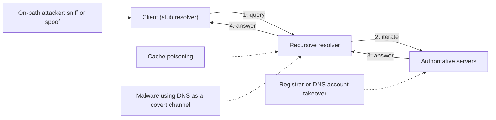
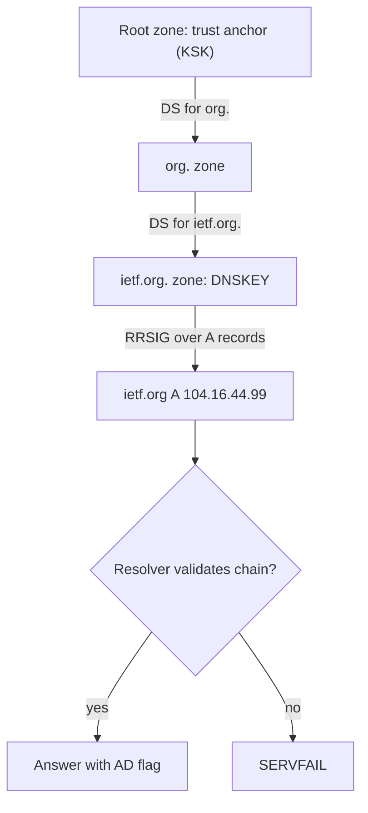

# DNS Security

## Introduction

The **Domain Name System (DNS)** turns names like `api.example.com` into IP addresses. Almost every connection your users and servers make starts with a DNS lookup, which makes DNS both a critical dependency and an attractive target:

- If an attacker can **forge DNS answers**, they can send users to a fake login page or intercept API calls.
- If an attacker can **take over your domain or a DNS record**, they can host content under your name, receive your email or obtain TLS certificates for your domain.
- If malware can **talk over DNS**, it can sneak data out of networks that block everything else, because almost every network lets DNS through.
- If your DNS **goes down**, your whole service looks down, even when every server is healthy.

DNS is like a phone book that everyone trusts without checking. DNS security is about making sure the phone book has not been tampered with, that nobody can read over your shoulder while you look up numbers, and that the entries for *your* business are locked down.

:::note Background
For how DNS resolution works (stub resolver, recursive resolver, root, TLD and authoritative servers, record types), see the DNS material in the [Computer Networks tutorial](/docs/fundamental/network). This page assumes you know what A, AAAA, CNAME, MX and TXT records are.
:::

:::warning Ethics
DNS attacks on this page are explained so you can recognize and prevent them. Only query, test or capture DNS traffic on networks and domains you own or are authorized to test.
:::

## The DNS Threat Landscape



| Threat | What happens | Main defenses |
| --- | --- | --- |
| Spoofing on the local network | An attacker on the same Wi-Fi answers DNS queries faster than the real resolver | Encrypted DNS (DoT/DoH), DNSSEC validation, TLS on the application |
| Cache poisoning | Forged answers are inserted into a recursive resolver's cache, affecting all its users | Source-port randomization, DNSSEC validation, patched resolvers |
| Domain or account hijacking | Attacker gains access to the registrar or DNS provider account and changes records | MFA, registrar lock, change monitoring |
| Subdomain takeover | A CNAME points to a deleted cloud resource that an attacker can re-register | Remove dangling records, inventory DNS |
| DNS tunneling / exfiltration | Data hidden in query names and answers to an attacker-controlled domain | Force internal resolvers, monitor query patterns |
| Malicious domains | Users or malware resolve phishing and command-and-control domains | Protective DNS / response policy zones |
| DDoS against DNS | Authoritative or recursive servers are overwhelmed | Anycast DNS providers, rate limiting ([DDoS](./7-sec-ddos.mdx)) |
| Privacy leakage | Plaintext DNS reveals every site you visit to the network | DoT/DoH to a trusted resolver |

## Spoofing and Cache Poisoning

Classic DNS runs over UDP port 53 with no encryption and no authentication. A resolver accepts an answer if it matches the question, the 16-bit transaction ID and the source port. In 2008, Dan Kaminsky showed that attackers could flood a resolver with forged answers and poison the cache for an entire domain. The industry response was **source-port randomization**, which makes guessing far harder, but it is a mitigation, not a cryptographic fix. Later research (for example the SAD DNS attacks published in 2020) found side channels that reduce that randomness again.

The real fixes are cryptographic:

- **DNSSEC** proves that an answer came from the domain owner and was not modified.
- **Encrypted transports** (DNS over TLS, DNS over HTTPS) protect the link between client and resolver from snooping and tampering.

They solve different problems, and you often want both.

## DNSSEC: Authenticated Answers

DNSSEC adds digital signatures to DNS data ([Digital Signatures and MACs](../1-sec-cryptography/5-sec-digital-signatures.mdx)). Each signed zone publishes:

- **DNSKEY** records with its public keys,
- **RRSIG** records containing signatures over each record set,
- a **DS** record in the *parent* zone, which is a hash of the child's key. This links the zones into a **chain of trust** from the root zone down.

A **validating resolver** checks the chain from the root's trust anchor down to the answer. If a signature is wrong, it returns `SERVFAIL` instead of a forged answer.



### Checking DNSSEC with dig

The `ad` (authenticated data) flag means the resolver validated the answer. `+dnssec` asks for the signatures too.

```bash
dig +dnssec +multi ietf.org A @1.1.1.1
```

Example output (trimmed):

```text
;; ->>HEADER<<- opcode: QUERY, status: NOERROR, id: 38979
;; flags: qr rd ra ad; QUERY: 1, ANSWER: 3, AUTHORITY: 0, ADDITIONAL: 1

;; ANSWER SECTION:
ietf.org.		300 IN A 104.16.44.99
ietf.org.		300 IN A 104.16.45.99
ietf.org.		300 IN RRSIG A 13 2 300 (
				20261012115208 20261010095208 34505 ietf.org.
				EDy0HzWEIYaHKXHfOwLsovzJe1+S1FMtMdTUnfegfwl3
				Ns1b7b5PQ37rKmiZkDXf1sws5AEVtRG9vitfKoKAcA== )
```

The `13` in the RRSIG is the algorithm number for ECDSA P-256 with SHA-256. Now query a domain that is *deliberately* misconfigured for testing:

```bash
dig dnssec-failed.org A @1.1.1.1 | grep -E "status|flags"
dig +cd dnssec-failed.org A @1.1.1.1 | grep -E "status"
```

Example output:

```text
;; ->>HEADER<<- opcode: QUERY, status: SERVFAIL, id: 62022
;; flags: qr rd ra; QUERY: 1, ANSWER: 0, AUTHORITY: 0, ADDITIONAL: 1
;; ->>HEADER<<- opcode: QUERY, status: NOERROR, id: 28435
```

The validating resolver refuses the bad answer (`SERVFAIL`). With `+cd` ("checking disabled") you tell the resolver to skip validation, and the bogus answer comes back. That is exactly what DNSSEC is protecting you from.

### DNSSEC trade-offs

- **It authenticates, it does not encrypt.** Anyone on the path can still see your queries.
- **The last mile is often unprotected.** Most laptops do not validate themselves; they trust the `ad` flag from the resolver. If the path to the resolver is not protected, that flag can be forged. Use a trusted resolver over an encrypted or local link.
- **Operational risk.** Expired signatures or a broken key rollover make your domain fail to resolve for validating resolvers. Use a DNS provider that automates signing and rollovers, and monitor them. Key rollovers happen even at the root: ICANN scheduled the root zone's key signing key to switch from KSK-2017 to KSK-2024 on 11 October 2026, and resolvers with manually configured trust anchors must include the new key. See [ICANN's root KSK rollover pages](https://www.icann.org/resources/pages/ksk-rollover) for current status.
- **Adoption is uneven.** Many popular domains are still unsigned, so DNSSEC protects you only for zones that use it.

## Encrypted DNS: DoT and DoH

| Protocol | Transport | Port | Notes |
| --- | --- | --- | --- |
| Plain DNS | UDP/TCP | 53 | Visible and modifiable by anyone on the path |
| DNS over TLS (DoT, RFC 7858) | TLS over TCP | 853 | Easy for networks to identify and allow or block |
| DNS over HTTPS (DoH, RFC 8484) | HTTPS | 443 | Blends in with web traffic; supported by browsers |
| DNS over QUIC (DoQ, RFC 9250) | QUIC over UDP | 853 | Newer; lower latency |

A quick way to see DoH in action is Cloudflare's JSON API (a convenience format alongside the standard RFC 8484 wire format):

```bash
curl -s -H 'accept: application/dns-json' \
  'https://cloudflare-dns.com/dns-query?name=example.com&type=A'
```

Example output:

```text
{"Status":0,"TC":false,"RD":true,"RA":true,"AD":true,"CD":false,"Question":[{"name":"example.com","type":1}],"Answer":[{"name":"example.com","type":1,"TTL":69,"data":"104.20.23.154"},{"name":"example.com","type":1,"TTL":69,"data":"172.66.147.243"}]}
```

`"AD":true` shows the resolver validated DNSSEC, and the whole exchange travelled inside HTTPS.

### The enterprise tension with DoH

Encrypted DNS protects users on hostile networks, but it can also **bypass corporate DNS controls**: a browser using its own DoH provider skips your protective DNS filtering and logging. The U.S. NSA's 2021 guidance on [adopting encrypted DNS in enterprise environments](https://www.cisa.gov/news-events/alerts/2021/01/15/nsa-releases-guidance-encrypted-dns-enterprise-environments) recommends that enterprises send all DNS through a designated enterprise resolver (which can itself use encrypted DNS) and block other DoH/DoT resolvers. In practice:

- Configure browsers and OSes via policy to use the company resolver.
- Block outbound port 53 and 853 to anything except your resolvers.
- Block known public DoH endpoints at the proxy or firewall where policy requires it.

## Running a Secure Recursive Resolver

[Unbound](https://unbound.docs.nlnetlabs.nl/) is a popular open-source validating resolver. The configuration below validates DNSSEC, forwards upstream over TLS, blocks a malicious domain via a **response policy zone (RPZ)** and logs what it blocks.

```text
# /etc/unbound/unbound.conf.d/secure.conf
server:
    interface: 10.0.2.53
    access-control: 10.0.0.0/8 allow          # only internal clients may use this resolver
    access-control: 0.0.0.0/0 refuse          # never run an open resolver
    module-config: "respip validator iterator"
    auto-trust-anchor-file: "/var/lib/unbound/root.key"
    tls-cert-bundle: "/etc/ssl/certs/ca-certificates.crt"
    hide-identity: yes
    hide-version: yes
    qname-minimisation: yes                   # send upstream only the labels it needs
    harden-dnssec-stripped: yes
    log-queries: no                           # enable carefully: query logs are sensitive data

rpz:
    name: rpz.local
    zonefile: /etc/unbound/rpz.local.zone
    rpz-log: yes
    rpz-log-name: blocklist

forward-zone:
    name: "."
    forward-tls-upstream: yes
    forward-addr: 1.1.1.1@853#cloudflare-dns.com
    forward-addr: 9.9.9.9@853#dns.quad9.net
```

The RPZ zone file blocks a domain and all its subdomains by answering NXDOMAIN (`CNAME .`):

```text
$TTL 300
$ORIGIN rpz.local.
@                         SOA localhost. admin.localhost. 1 3600 600 86400 300
                          NS  localhost.
; block known-bad domains (and every subdomain)
bad-login-example.net     CNAME .
*.bad-login-example.net   CNAME .
```

Check the config, then test:

```bash
sudo unbound-checkconf
dig @10.0.2.53 www.bad-login-example.net A | grep status
```

Example output:

```text
unbound-checkconf: no errors in /etc/unbound/unbound.conf
;; ->>HEADER<<- opcode: QUERY, status: NXDOMAIN, id: 4410
```

Commercial and government **protective DNS** services do the same thing at scale with threat-intelligence feeds. For example, CISA has operated a Protective DNS service for U.S. federal agencies since 2022. Feeds and services change often, so evaluate current offerings rather than relying on a fixed list.

:::caution Never run an open resolver
A recursive resolver that answers anyone on the internet can be abused for DNS amplification DDoS attacks ([DDoS Attacks and Mitigation](./7-sec-ddos.mdx)). Restrict it with `access-control` and your firewall.
:::

## Detecting DNS Tunneling and Exfiltration

Because DNS is allowed almost everywhere, attackers encode data into query names, for example `<encoded-chunk>.attacker-domain.example`, and receive commands in TXT answers. Signs to look for:

- Many queries to **one parent domain** from one client.
- **Long, random-looking labels** (high entropy), often hex or base32.
- Unusual record types like **TXT** or **NULL** from workstations.
- High query volume with few repeated names (little caching).

A tiny detection script over resolver logs (one line per query: timestamp, client, name, type):

```text
2026-10-11T09:00:01 10.0.4.21 www.github.com A
2026-10-11T09:00:02 10.0.4.21 api.stripe.com A
2026-10-11T09:00:03 10.0.4.33 mail.google.com AAAA
2026-10-11T09:00:04 10.0.4.50 a9f3c1e07b2d4e6f8a1c3e5b7d9f0a2c.x7k2.example-cdn.net TXT
2026-10-11T09:00:05 10.0.4.50 0e4b8d2f6a1c9e3b7f5d0a8c2e6b4f1d.x7k2.example-cdn.net TXT
2026-10-11T09:00:06 10.0.4.50 c7a2e9f4b1d8c3a6e0f5b2d7a4c9e1f3.x7k2.example-cdn.net TXT
2026-10-11T09:00:07 10.0.4.33 login.microsoftonline.com A
2026-10-11T09:00:08 10.0.4.50 f1d3b5a7c9e2f4a6b8d0c1e3a5b7d9f2.x7k2.example-cdn.net TXT
2026-10-11T09:00:09 10.0.4.21 dl-cdn.alpinelinux.org A
```

```python
import math
import sys
from collections import Counter, defaultdict

def entropy(s: str) -> float:
    """Shannon entropy in bits per character."""
    counts = Counter(s)
    return -sum(c / len(s) * math.log2(c / len(s)) for c in counts.values())

def parent_domain(name: str) -> str:
    # Naive: last two labels. Use the Public Suffix List (e.g. tldextract) in production.
    return ".".join(name.rstrip(".").split(".")[-2:])

suspicious = defaultdict(lambda: {"count": 0, "max_entropy": 0.0, "clients": set(), "types": Counter()})

with open(sys.argv[1]) as f:
    for line in f:
        ts, client, qname, qtype = line.split()
        first_label = qname.split(".")[0]
        h = entropy(first_label)
        if len(first_label) >= 24 and h >= 3.5:
            s = suspicious[parent_domain(qname)]
            s["count"] += 1
            s["max_entropy"] = max(s["max_entropy"], h)
            s["clients"].add(client)
            s["types"][qtype] += 1

for domain, s in sorted(suspicious.items(), key=lambda kv: -kv[1]["count"]):
    print(f"{domain}: {s['count']} long random-looking queries, "
          f"max entropy {s['max_entropy']:.2f}, clients={sorted(s['clients'])}, types={dict(s['types'])}")
```

Output:

```text
example-cdn.net: 4 long random-looking queries, max entropy 3.91, clients=['10.0.4.50'], types={'TXT': 4}
```

Real environments are noisier: CDNs, anti-virus cloud lookups and tracking domains also use long random labels. Treat this as a **hunting lead**, then baseline and allowlist known-good domains. Network IDS tools such as Suricata and Zeek can log every DNS query for this kind of analysis ([Intrusion Detection and Prevention](./5-sec-ids-ips.mdx)), and [Threat Hunting](../11-sec-defensive-operations/5-sec-threat-hunting.mdx) covers the process. The most effective control is architectural: **only your resolvers may send DNS to the internet**, so tunneling must pass through a place you log and filter.

## Protecting Your Own Domains

Attackers do not always attack the protocol. Often they attack your **DNS management**.

- **Registrar and DNS provider accounts:** require MFA (preferably phishing-resistant) for everyone, limit who has access, and enable **registrar lock** (and registry lock for critical domains if your registrar offers it). Many high-profile hijacks started with a compromised registrar login.
- **Dangling records and subdomain takeover:** `shop.example.com CNAME old-shop.some-cloud-host.example` keeps pointing at a deleted resource. If an attacker can claim that name on the cloud provider, they serve content on *your* subdomain, can set cookies for it and may obtain certificates. Remove DNS records in the same change that deletes the resource, and scan your zones for CNAMEs to unclaimed targets.
- **CAA records:** state which certificate authorities may issue certificates for your domain.

```bash
dig CAA google.com +short
```

Output:

```text
0 issue "pki.goog"
```

- **Email authentication records:** SPF, DKIM and DMARC TXT records stop others from sending email that passes as your domain. A strict DMARC policy looks like `v=DMARC1; p=reject; rua=mailto:...`.
- **Monitor changes:** alert on any change to NS, MX, CAA and apex records, and watch [Certificate Transparency](../1-sec-cryptography/6-sec-pki-and-certificates.mdx) logs for unexpected certificates issued for your domains.
- **DNS rebinding:** a malicious site's domain first resolves to the attacker's server, then to `127.0.0.1` or a private IP, letting browser JavaScript reach internal services. Defend by validating the `Host` header in internal apps, requiring authentication on local services, and filtering private IPs from public DNS answers at your resolver.

## Real-World Scenario

**Situation:** A 200-person company with remote and office staff wants to cut phishing and malware infections. Today laptops use whatever DNS the local network hands out, and Chrome and Firefox sometimes use their own DoH. Last quarter, the security team found a workstation beaconing over DNS TXT queries for weeks before anyone noticed. They also discover a forgotten CNAME for `promo.example.com` pointing at a deleted cloud storage bucket.

**Walkthrough:**

1. **Fix the dangling record today.** Delete the `promo` CNAME, then inventory all zones for CNAMEs pointing to deprovisioned cloud resources.
2. **Lock the domain.** Enforce MFA on the registrar and DNS provider, enable registrar lock, and add CAA and a DMARC policy.
3. **Centralize resolution.** Deploy a protective DNS service (or Unbound with RPZ feeds) as the only allowed resolver. Office firewalls block outbound 53/853 except from the resolvers. Remote laptops use the company resolver over DoH/DoT, configured by device management, and browsers are set by policy to use it.
4. **Log and hunt.** Send resolver logs to the SIEM. Add detections for long high-entropy labels, high TXT volume and newly registered domains.
5. **Validate DNSSEC** on the resolver, and sign the company's own zones through the DNS provider's managed signing.

**Why this approach:** Centralized protective DNS blocks a large share of phishing and command-and-control lookups before a connection is even made, and gives one place to log every lookup, which would have exposed the tunneling workstation in hours rather than weeks. Locking down the domain prevents the far more damaging outcome of the attacker controlling the company's own name.

**When to use it / when not to:** Forcing a single resolver fits managed devices. For BYOD and guest networks, use protective DNS on the network but do not try to control personal devices. Strict DoH blocking can break some apps; roll it out with monitoring.

**Alternatives and trade-offs:**

| Approach | Pros | Cons | Best for |
| --- | --- | --- | --- |
| Commercial protective DNS service | Large threat feeds, roaming clients, little ops work | Subscription cost; query data goes to the vendor | Most organizations |
| Self-hosted Unbound/BIND with RPZ | Full control, data stays in-house | You maintain feeds, uptime and updates | Teams with network ops capacity |
| Browser/OS default DoH | Strong privacy for users on hostile networks | Bypasses corporate filtering and logging | Personal devices |
| DNSSEC signing of own zones | Protects your users' resolvers from forged answers about you | Operational risk if keys or signatures expire | Domains with high-value users (banking, login) |
| Firewall-level blocking of external DNS | Forces all lookups through controlled resolvers | Can break apps with hardcoded resolvers | Managed corporate networks |

## Common Mistakes

- **Running an open recursive resolver.** It will be abused for amplification attacks.
- **Assuming DNSSEC encrypts.** It only authenticates. Use DoT/DoH for privacy.
- **Leaving registrar accounts without MFA.** A single phished password can redirect your entire domain.
- **Forgetting dangling DNS records** when decommissioning cloud resources.
- **Logging nothing,** or logging everything with no retention policy. DNS logs are both essential evidence and sensitive personal data. Set retention and access controls ([Privacy Engineering](../13-sec-governance/4-sec-privacy-engineering.mdx)).
- **Letting every host query the internet directly.** Tunneling and malware bypass your controls if port 53 is open outbound from every machine.
- **Long TTLs during migrations.** High TTLs slow down your response when you need to change a record fast during an incident. Lower TTLs before planned changes.

## Summary

- DNS is unauthenticated and unencrypted by default, making it vulnerable to **spoofing, cache poisoning, hijacking, tunneling** and **privacy leaks**.
- **DNSSEC** signs records so validating resolvers can reject forgeries; check for the `ad` flag and test with a known-bad domain.
- **DoT, DoH and DoQ** encrypt the client-to-resolver link; in enterprises, route encrypted DNS through **your** resolver.
- **Protective DNS / RPZ** blocks malicious domains and gives a single place to log lookups.
- Hunt for **tunneling** with query length, entropy, TXT volume and per-domain counts, and allow DNS out only from your resolvers.
- Protect your own domains with **MFA, registrar lock, CAA, SPF/DKIM/DMARC** and removal of **dangling records**.

## Exercises

1. Use `dig` to compare the flags and status for a signed domain, an unsigned domain and `dnssec-failed.org` against a validating public resolver. Explain each result.
2. Install Unbound in a VM, apply the configuration above (adjusting addresses), and block a test domain via RPZ. Confirm with `dig` and find the RPZ log entry.
3. Improve the tunneling detector: use `tldextract` for correct parent domains, add a per-client queries-per-minute threshold, and allowlist known CDN domains. Test it on DNS logs from your own lab.
4. Audit a domain you control: list all CNAME records and check whether each target still exists. Add CAA and DMARC records if they are missing.

**Related pages:**

- [Intrusion Detection and Prevention](./5-sec-ids-ips.mdx): DNS logging and signatures in Suricata and Zeek.
- [Common Network Attacks](./6-sec-network-attacks.mdx): local spoofing and man-in-the-middle attacks.
- [PKI and Certificates](../1-sec-cryptography/6-sec-pki-and-certificates.mdx): CAA and Certificate Transparency.
- [Social Engineering and Phishing](../10-sec-offensive-security/8-sec-social-engineering.mdx): why look-alike domains work.
