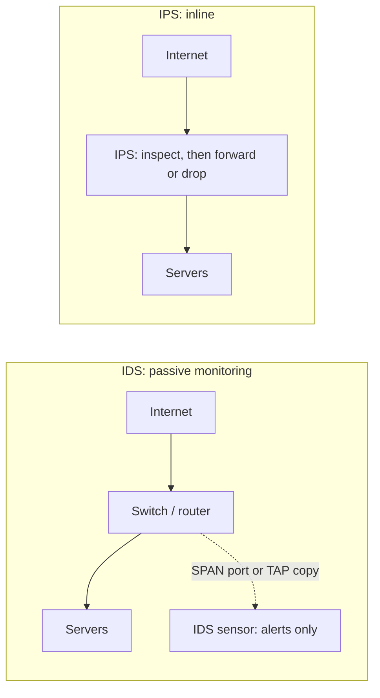

# Intrusion Detection and Prevention

## Introduction

A firewall decides whether a connection is *allowed*. It does not tell you whether an allowed connection is *malicious*. Port 443 must stay open for your website, and an attacker sending SQL injection payloads uses port 443 too.

An **Intrusion Detection System (IDS)** watches traffic (or host activity) and raises an alert when it sees something that looks like an attack. An **Intrusion Prevention System (IPS)** sits inline and can also **block** the traffic. If a firewall is the door lock, an IDS is the security camera with a guard watching the monitors, and an IPS is a guard who can step in and stop someone at the door.

This page focuses on **network** IDS/IPS (NIDS/NIPS), using two widely used open-source tools:

- **Suricata**, a signature-based IDS/IPS maintained by the Open Information Security Foundation (OISF). The 8.0 branch is current at the time of writing; check [suricata.io](https://suricata.io/) for the latest release.
- **Zeek**, a network security monitor that turns traffic into rich, structured logs (connections, DNS, HTTP, TLS, files) rather than focusing on alerts.

Snort, the original open-source NIDS now maintained by Cisco Talos, is a close alternative to Suricata; Snort 3 uses a similar rule language.

:::warning Lab only
Generate test attack traffic only against systems you own, such as a local [OWASP Juice Shop](https://owasp.org/www-project-juice-shop/) or DVWA container, inside an isolated lab. See [Building a Safe Practice Lab](../10-sec-offensive-security/1-sec-lab-setup.mdx).
:::

## IDS vs IPS and Where They Sit



| Aspect | IDS (passive) | IPS (inline) |
| --- | --- | --- |
| Traffic path | Receives a copy (SPAN/mirror port, network TAP, cloud traffic mirroring) | Traffic flows through it |
| Can block | No (can trigger other systems) | Yes, drops or resets |
| Failure impact | Sensor down = blind spot | Sensor down = outage, unless it fails open |
| False positive impact | Noise for analysts | Legitimate users blocked |
| Latency | None added | Some added |
| Typical start | Day one | After rules are tuned in IDS mode |

Most teams **start in IDS mode**, tune the rules until alerts are trustworthy, and only then enable blocking for high-confidence signatures.

### Host-based vs network-based

A **host-based IDS (HIDS)**, such as Wazuh or OSSEC, monitors one machine: log files, file integrity, processes. A **network IDS** sees traffic between machines. They complement each other: encrypted traffic is opaque to a NIDS, but the host sees the decrypted request. EDR tools ([Endpoint Protection and EDR](../9-sec-system-hardening/4-sec-endpoint-protection.mdx)) are the modern evolution of HIDS.

## Detection Methods

| Method | How it works | Strengths | Weaknesses |
| --- | --- | --- | --- |
| Signature-based | Match known patterns (bytes, protocol fields) | Precise, explainable, low false positives for good rules | Misses new attacks; needs constant rule updates |
| Anomaly-based | Learn "normal," alert on deviations | Can catch new or insider activity | Many false positives; "normal" drifts |
| Protocol analysis | Parse protocols and flag violations or suspicious fields | Catches evasion and malformed traffic | Needs deep protocol support |
| Behavioral / threat intel | Match IPs, domains, JA3/JA4 TLS fingerprints, certificates | Fast to deploy from intel feeds | Indicators go stale quickly |

Real deployments combine them: Suricata signatures for known attacks, Zeek logs plus a SIEM for behavioral analytics, and threat-intelligence lists for known-bad infrastructure ([Threat Intelligence](../11-sec-defensive-operations/4-sec-threat-intelligence.mdx)).

## Suricata Rules

A Suricata rule has three parts: an **action**, a **header** and **options** in parentheses.

```text
alert http $EXTERNAL_NET any -> $HOME_NET any (msg:"LAB Admin panel requested from outside"; flow:established,to_server; http.uri; content:"/admin"; startswith; classtype:policy-violation; sid:1000001; rev:1;)
```

| Part | Value | Meaning |
| --- | --- | --- |
| Action | `alert` | Log an alert. Others include `pass`, `drop` (IPS mode) and `reject` |
| Protocol | `http` | Use Suricata's HTTP parser, not raw TCP bytes |
| Source / destination | `$EXTERNAL_NET any -> $HOME_NET any` | Variables defined in `suricata.yaml` |
| `flow` | `established,to_server` | Only client-to-server traffic in a completed TCP session |
| `http.uri; content:"/admin"; startswith;` | Sticky buffer + match | The URI must start with `/admin` |
| `classtype` | `policy-violation` | Category and default priority |
| `sid` / `rev` | `1000001` / `1` | Unique rule ID and revision. Use 1000000+ for local rules |

`http.uri` is a **sticky buffer**: every match keyword after it applies to the HTTP URI until another buffer is named. Matching on parsed protocol fields is more accurate and harder to evade than searching raw packet bytes.

### A small local rule set

Save this as `local.rules`. Each rule detects something relevant to a small web application lab.

```text
# 1. Admin panel reached from outside
alert http $EXTERNAL_NET any -> $HOME_NET any (msg:"LAB Admin panel requested from outside"; flow:established,to_server; http.uri; content:"/admin"; startswith; classtype:policy-violation; sid:1000001; rev:1;)

# 2. Lookup of a known-bad domain (matches the DNS Security page's RPZ example)
alert dns $HOME_NET any -> any any (msg:"LAB DNS lookup for blocked phishing domain"; dns.query; content:"bad-login-example.net"; nocase; endswith; classtype:bad-unknown; sid:1000002; rev:1;)

# 3. Many new SSH connections from one source: brute force or scanning
alert tcp $EXTERNAL_NET any -> $HOME_NET 22 (msg:"LAB Possible SSH brute force"; flow:to_server; flags:S; detection_filter:track by_src, count 10, seconds 60; classtype:attempted-admin; sid:1000003; rev:1;)

# 4. Classic SQL injection keywords in the query string
alert http $EXTERNAL_NET any -> $HOME_NET any (msg:"LAB Possible SQL injection in URI"; flow:established,to_server; http.uri; content:"union"; nocase; content:"select"; nocase; distance:0; classtype:web-application-attack; sid:1000004; rev:1;)
```

Notes on these rules:

- Rule 3 uses `detection_filter`, which only alerts after **10 SYNs from the same source within 60 seconds**. Without it, every SSH connection would alert.
- Rule 4 matches `union` followed by `select` (`distance:0` means "after the previous match"). Real SQL injection detection needs normalization (URL decoding, comments, case), which Suricata's HTTP buffers partly handle, and is still easy to evade. Treat it as a tripwire, not protection; the real fix is parameterized queries ([SQL Injection](../3-sec-web-security/3-sec-sql-injection.mdx)).
- In production you mostly use **curated rule sets** such as the free ET Open rules, updated daily, and add a small number of local rules for your environment.

### Testing rules offline against a capture

You can run Suricata against a pcap file instead of a live interface. This is the safest way to develop rules: capture traffic in your lab ([Packet Analysis](./9-sec-packet-analysis.mdx)), then replay it through Suricata as many times as you like.

```bash
# Install (Ubuntu, via the OISF stable PPA)
sudo add-apt-repository ppa:oisf/suricata-stable
sudo apt install suricata

# Run only our rules (-S) against a lab capture (-r), writing logs to ./logs (-l)
mkdir -p logs
suricata -r lab-capture.pcap -S local.rules -l ./logs -k none
cat logs/fast.log
```

Example output:

```text
10/11/2026-09:15:02.123456  [**] [1:1000001:1] LAB Admin panel requested from outside [**] [Classification: Potential Corporate Privacy Violation] [Priority: 1] {TCP} 203.0.113.50:51514 -> 10.0.2.21:80
10/11/2026-09:15:09.554120  [**] [1:1000004:1] LAB Possible SQL injection in URI [**] [Classification: Web Application Attack] [Priority: 1] {TCP} 203.0.113.50:51530 -> 10.0.2.21:80
10/11/2026-09:16:40.001200  [**] [1:1000003:1] LAB Possible SSH brute force [**] [Classification: Attempted Administrator Privilege Gain] [Priority: 1] {TCP} 198.51.100.23:40022 -> 10.0.2.21:22
```

`-k none` disables checksum validation, which is useful for captures taken on hosts with checksum offloading. Make sure `HOME_NET` in `suricata.yaml` matches your lab subnet, or the `$EXTERNAL_NET -> $HOME_NET` rules will not fire.

### Working with EVE JSON

`fast.log` is handy for humans. For automation, Suricata writes **EVE JSON** (`eve.json`): one JSON object per line, including alerts *and* protocol metadata (DNS, HTTP, TLS, flows). A sample:

```json
{"timestamp":"2026-10-11T09:15:09.554120+0000","flow_id":1182736455990,"event_type":"alert","src_ip":"203.0.113.50","src_port":51530,"dest_ip":"10.0.2.21","dest_port":80,"proto":"TCP","alert":{"action":"allowed","gid":1,"signature_id":1000004,"rev":1,"signature":"LAB Possible SQL injection in URI","category":"Web Application Attack","severity":1},"http":{"hostname":"shop.lab","url":"/products?id=1%20UNION%20SELECT%20password%20FROM%20users","http_method":"GET","status":500}}
```

The HTTP status `500` is interesting: the server errored on the injection attempt, which may mean the input reached the database. That is a lead for the application team. A short script summarizes alerts from an EVE file:

```python
import json
import sys
from collections import Counter

alerts = Counter()
sources = Counter()

with open(sys.argv[1]) as f:
    for line in f:
        event = json.loads(line)
        if event.get("event_type") != "alert":
            continue                      # EVE also contains dns, http, flow, tls events
        a = event["alert"]
        alerts[(a["severity"], a["signature_id"], a["signature"])] += 1
        sources[event["src_ip"]] += 1

print("Alerts by signature:")
for (sev, sid, sig), n in sorted(alerts.items()):
    print(f"  sev={sev} sid={sid:<8} {n:>3}x  {sig}")

print("Top sources:")
for ip, n in sources.most_common(3):
    print(f"  {ip:<15} {n} alerts")
```

Output:

```text
Alerts by signature:
  sev=1 sid=1000001    1x  LAB Admin panel requested from outside
  sev=1 sid=1000003    2x  LAB Possible SSH brute force
  sev=1 sid=1000004    1x  LAB Possible SQL injection in URI
Top sources:
  203.0.113.50    2 alerts
  198.51.100.23   2 alerts
```

In production, EVE is shipped to a SIEM (Elastic, Splunk, OpenSearch and others) rather than parsed by hand ([Security Logging and SIEM](../11-sec-defensive-operations/1-sec-logging-and-siem.mdx)).

### Keeping rules updated

```bash
# Download and merge the enabled rule sources (ET Open by default)
sudo suricata-update
sudo suricata-update list-sources          # see available free and commercial sources
sudo systemctl reload suricata             # or: suricatasc -c reload-rules
```

### Tuning: fewer, better alerts

An untuned IDS produces thousands of alerts a day, and analysts quickly learn to ignore them. Tuning is the ongoing work that makes the IDS useful. The usual tools:

| Technique | Use it when | Example |
| --- | --- | --- |
| Disable a rule | It never applies to your environment | Rules for software you do not run, via `disable.conf` for `suricata-update` |
| Suppress for specific hosts | A known-good system triggers it | Your vulnerability scanner sets off scan rules |
| Threshold | The rule is useful but noisy | Alert at most once per minute per source |
| Rewrite as a local rule | The idea is good but the match is too broad | Narrow the destination to `$HTTP_SERVERS` |

Suppressions and rate limits go in Suricata's `threshold.config`:

```text
# Our internal vulnerability scanner triggers scan signatures: suppress for that source only
suppress gen_id 1, sig_id 1000003, track by_src, ip 10.0.9.20

# Keep the admin-panel alert, but at most one per source per 10 minutes
rate_filter gen_id 1, sig_id 1000001, track by_src, count 1, seconds 600, new_action alert, timeout 600
```

To disable rules from downloaded sets, list their IDs or patterns in `/etc/suricata/disable.conf`, then run `suricata-update` again:

```text
# Software we do not run
re:Joomla
re:WordPress
2013504
```

A practical tuning loop: every week, list the ten noisiest signatures (the EVE summary script above does that), decide for each whether it is a real issue, a false positive to suppress, or a rule to rewrite, and record the decision. Treat the rule set like code, in version control with reviews ([Detection Engineering](../11-sec-defensive-operations/2-sec-detection-engineering.mdx)).

## Zeek: Logs Instead of Alerts

Zeek takes a different approach. Instead of asking "does this packet match a signature?", it records **what happened**: every connection, DNS query, HTTP request, TLS handshake and file transfer, as structured logs. Those logs are invaluable for investigations and threat hunting, even for encrypted traffic (you still see who talked to whom, when, for how long and with which TLS server name).

```bash
# Process a capture; Zeek writes conn.log, dns.log, http.log, ssl.log, etc.
zeek -C -r lab-capture.pcap
zeek-cut id.orig_h id.resp_h id.resp_p service conn_state < conn.log | head
```

Example output:

```text
203.0.113.50	10.0.2.21	80	http	SF
203.0.113.50	10.0.2.21	80	http	SF
198.51.100.23	10.0.2.21	22	ssh	SF
198.51.100.23	10.0.2.21	22	-	S0
198.51.100.23	10.0.2.21	22	-	S0
10.0.4.50	10.0.2.53	53	dns	SF
10.0.2.21	192.0.2.200	4444	-	S0
```

The `conn_state` field summarizes how each connection went: `SF` is a normal open and close, `S0` means a SYN with no reply, `REJ` means rejected. Many `S0` entries from one source suggest scanning. The last line is worth a look: an internal **server initiating** a connection to an unusual external port. Servers usually receive connections; outbound connections to odd ports can indicate a reverse shell or malware. This is exactly the east-west and egress visibility that [segmentation](./2-sec-network-segmentation.mdx) and [egress filtering](./1-sec-firewalls.mdx) aim to provide.

### A no-install lab with Docker

If you do not want to install the tools on your machine, both projects have container images. The `zeek/zeek` image is published by the Zeek project, and `jasonish/suricata` is maintained by a Suricata core developer; check each image's page for current tags.

```bash
# Run from a directory containing lab-capture.pcap and local.rules
docker run --rm -v "$PWD:/work" -w /work jasonish/suricata:latest \
  -r lab-capture.pcap -S local.rules -l /work/logs -k none

docker run --rm -v "$PWD:/work" -w /work zeek/zeek:latest \
  zeek -C -r lab-capture.pcap
```

Both commands only read a capture file; they do not touch any network. See the [Docker tutorial](/docs/devops/docker) if you are new to containers.

## Where to Put Sensors

| Location | Sees | Misses |
| --- | --- | --- |
| Internet edge, outside the firewall | Every scan and attack attempt (very noisy) | Internal activity; much of it already blocked |
| Internet edge, inside the firewall | Traffic that actually got through | East-west traffic |
| Core switch / between zones | Lateral movement between segments | Traffic within one segment |
| Cloud VPC via traffic mirroring | Workload traffic in the VPC | Managed services that do not support mirroring; cost grows with volume |
| Kubernetes nodes (host network sensors or CNI observability) | Pod-to-pod traffic | Encrypted mesh traffic payloads |

Start with the location closest to your most valuable assets, usually the boundary in front of the data zone, rather than the noisy internet edge.

## Running an Inline IPS

To block, Suricata must sit in the traffic path. On a Linux gateway the simplest way is **NFQUEUE**: the kernel firewall hands packets to Suricata, which returns a verdict.

```bash
# Send forwarded traffic to queue 0. --queue-bypass lets traffic through if Suricata is not running (fail open)
sudo iptables -I FORWARD -j NFQUEUE --queue-bypass

# Run Suricata reading from queue 0
sudo suricata -c /etc/suricata/suricata.yaml -q 0
```

Then change high-confidence rules from `alert` to `drop`:

```text
drop dns $HOME_NET any -> any any (msg:"LAB Block lookup of phishing domain"; dns.query; content:"bad-login-example.net"; nocase; endswith; classtype:bad-unknown; sid:1000102; rev:1;)
```

**Fail-open vs fail-closed** is a business decision. Fail-open (`--queue-bypass`) keeps the business running if the IPS crashes but lets attacks through during the outage. Fail-closed blocks everything when the IPS is down. Most internet-facing deployments choose fail-open with monitoring. See the [Suricata IPS documentation](https://docs.suricata.io/en/latest/) for AF_PACKET inline mode and other options.

## The Encryption Problem

Most traffic today is TLS-encrypted. A network IDS cannot see the URL or body of an HTTPS request unless it terminates or decrypts TLS. Options:

1. **Inspect where TLS terminates.** Put detection at the load balancer, reverse proxy or WAF, which already sees plaintext ([API Gateways and WAFs](../7-sec-api-security/7-sec-api-gateway-security.mdx)).
2. **Use metadata.** Zeek and Suricata still log TLS server names (SNI), certificates, JA3/JA4 fingerprints, timing and volumes. Encrypted Client Hello (ECH, now RFC 9849) increasingly hides the server name too.
3. **TLS interception** on corporate egress proxies. It works but breaks certificate pinning, adds privacy and legal obligations, and creates a juicy target that holds decrypted traffic.
4. **Host telemetry.** EDR and application logs see requests after decryption.

## Real-World Scenario

**Situation:** A small fintech runs its customer API behind a cloud load balancer and has an office network with 60 staff. An auditor asks how they "detect intrusions." Today they have firewall logs and nothing else. The team has two engineers who can spend part of their time on security and no 24/7 SOC.

**Walkthrough:**

1. **Start where the plaintext is.** Enable the managed WAF on the load balancer in **detection (count) mode** with the provider's managed rule groups, and log all requests. This covers the encrypted API traffic.
2. **Add a network sensor for the office and VPC.** Deploy Suricata in IDS mode with ET Open rules plus Zeek on one sensor, fed by a SPAN port in the office and cloud traffic mirroring for the VPC. Ship EVE and Zeek logs to the SIEM.
3. **Tune for two weeks.** Disable rules that fire on known-good traffic (for example internal vulnerability scanners), add local rules for crown-jewel assets (any connection to the database subnet from outside the app subnet), and set severity-based routing: only severity 1 alerts page someone.
4. **Promote a few rules to blocking.** Move the WAF to block mode for well-tested rule groups, and switch a handful of high-confidence Suricata rules (known-bad domains, specific exploit signatures for software they run) to `drop` on the office gateway.
5. **Write runbooks** for the top alert types so whoever is on call knows what to do ([Incident Response Playbooks](../12-sec-incident-response/1-sec-incident-playbooks.mdx)).

**Why this approach:** Detection effort goes where it can see something: the WAF at the TLS termination point, Zeek for metadata and investigations, Suricata for known-bad patterns. Starting in detect mode avoids blocking customers on day one, and tight alert routing keeps a two-person team from drowning in noise.

**When to use it / when not to:** A self-managed sensor makes sense when you control the network path (offices, VPCs with traffic mirroring). For a purely serverless or SaaS-heavy company, there is little network to monitor; invest in cloud provider threat detection services, identity logs and application logging instead.

**Alternatives and trade-offs:**

| Approach | Pros | Cons | Best for |
| --- | --- | --- | --- |
| Suricata IDS (passive) | Free, fast, huge rule ecosystem, EVE JSON | Needs tuning; blind to encrypted payloads | Offices, data centers, VPC mirroring |
| Suricata/Snort inline IPS | Blocks known attacks in real time | False positives block users; adds a failure point | Gateways after rules are tuned |
| Zeek | Rich logs for hunting and forensics, even on encrypted traffic metadata | Not an alerting engine out of the box; storage heavy | Investigations, threat hunting |
| Managed WAF at the load balancer | Sees decrypted HTTP; managed rules | HTTP only; tuning still needed; cost per request | Public web apps and APIs |
| Cloud-native threat detection services | No sensors to run; uses flow, DNS and API logs | Provider-specific; less control over detection logic | Cloud-first teams |
| Commercial NDR platforms | ML analytics, polished UI, support | Expensive; black-box detections | Larger security teams |

## Common Mistakes

- **Deploying every rule and never tuning.** Thousands of low-value alerts teach analysts to ignore the IDS. Tune, suppress known-good, and route by severity.
- **Wrong `HOME_NET`.** If the network variables do not match reality, directional rules silently never fire.
- **Blind spots.** A sensor that only sees the internet edge misses east-west traffic between servers, where lateral movement happens.
- **Jumping straight to IPS.** A single bad rule in blocking mode can take down a business application.
- **Packet loss on the sensor.** An overloaded sensor drops packets and misses attacks. Watch Suricata's `capture.kernel_drops` stats.
- **Ignoring encryption.** A NIDS on HTTPS traffic sees metadata only. Put content inspection where TLS terminates.
- **Alerts with no owner.** Detection without response is just expensive logging. Every alert type needs a runbook and an owner.

## Summary

- **IDS** detects and alerts; **IPS** sits inline and blocks. Start in IDS mode and promote tuned rules to blocking.
- Detection methods include **signatures, anomalies, protocol analysis and threat intel**; real deployments combine them.
- **Suricata rules** have an action, a header and options; use protocol-aware **sticky buffers** like `http.uri` and `dns.query`, and `detection_filter` for rate-based rules.
- Develop and test rules **offline against pcaps** with `suricata -r`, and consume **EVE JSON** in your SIEM.
- **Zeek** produces structured logs of all network activity, ideal for hunting and investigations.
- Encryption limits payload inspection; inspect at **TLS termination points** and rely on metadata elsewhere.

## Exercises

1. In a lab with a deliberately vulnerable app (for example OWASP Juice Shop in Docker), capture traffic while you browse and submit a test SQL injection string, then run the `local.rules` above against the capture with `suricata -r`. Which rules fire? Which attempts did they miss?
2. Write a Suricata rule that alerts when any host in `HOME_NET` makes a TLS connection with SNI ending in `.zip` or `.mov` (use the `tls.sni` buffer). Test it against a capture from your lab.
3. Run Zeek on the same capture and use `zeek-cut` to list all connections with `conn_state` of `S0`. Write a short Python script that reports sources with more than 20 such connections.
4. Extend the EVE summary script to output alerts as CSV with timestamp, source, destination, signature and HTTP URL, ready for a spreadsheet or SIEM import.

**Related pages:**

- [Packet Analysis with Wireshark and tcpdump](./9-sec-packet-analysis.mdx): create the captures you test rules against.
- [Detection Engineering](../11-sec-defensive-operations/2-sec-detection-engineering.mdx): manage detections as code with testing and review.
- [MITRE ATT&CK](../11-sec-defensive-operations/3-sec-mitre-attack.mdx): map your rules to adversary techniques.
- [Common Network Attacks](./6-sec-network-attacks.mdx): the attacks these rules look for.
