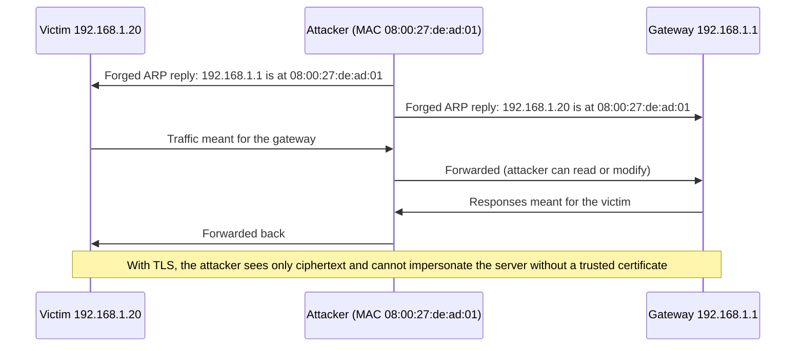

# Common Network Attacks

## Introduction

Most network attacks exploit the same weakness: many core protocols were designed for friendly, closed networks. ARP, DHCP, classic DNS, NetBIOS and early IPv6 neighbor discovery all believe whatever they hear. An attacker who gets onto a network segment, whether by plugging into a meeting-room port, joining guest Wi-Fi or compromising one laptop, can abuse that trust to **watch, redirect or tamper with** other people's traffic.

Think of an office where internal mail is delivered by whoever shouts "I'm the mailroom!" first. Nobody checks badges. A dishonest employee can shout first, read every letter, and pass it on so nobody notices. That is essentially ARP spoofing.

This page explains how the most common network attacks work **so you can recognize, detect and prevent them**. It deliberately stays at the level of standard training material: concepts, indicators and defenses.

:::warning Ethics and the law
Intercepting other people's traffic without authorization is illegal in most countries, and often a serious offense. Only reproduce these attacks in an **isolated lab** of virtual machines you own (for example two VMs and a gateway on a host-only network), or on platforms built for it such as TryHackMe or Hack The Box. Never test on shared, public, work or school networks without written permission. See [Ethics, Law and Responsible Disclosure](../0-sec-fundamentals/8-sec-ethics-and-law.mdx).
:::

## Attack Map

| Attack | Layer | What the attacker gains | Primary defenses |
| --- | --- | --- | --- |
| Sniffing | L1-L2 | Read unencrypted traffic | Encryption everywhere (TLS, SSH, WPA3), switched networks |
| ARP spoofing / poisoning | L2 | Man-in-the-middle on the local segment | Dynamic ARP Inspection, TLS, static entries for critical hosts |
| MAC flooding | L2 | Switch falls back to hub-like flooding | Port security, MAC limits per port |
| DHCP spoofing / starvation | L2-L3 | Rogue gateway or DNS server for victims; or address exhaustion | DHCP snooping, port security |
| VLAN hopping | L2 | Reach VLANs you should not | Disable trunk negotiation, unused native VLAN |
| IPv6 rogue router advertisements | L2-L3 | Become the IPv6 gateway or DNS for victims | RA Guard, managed IPv6, filtering |
| LLMNR / NBT-NS poisoning | L7 (local) | Capture Windows credential hashes | Disable LLMNR and NetBIOS name service, SMB signing |
| DNS spoofing | L7 | Redirect victims to fake servers | DNSSEC validation, encrypted DNS, TLS ([DNS Security](./4-sec-dns-security.mdx)) |
| SSL stripping | L7 | Downgrade HTTPS to HTTP and read traffic | HSTS and HSTS preload, HTTPS-only |
| IP spoofing | L3 | Hide source; enable reflection DDoS | Ingress/egress filtering (BCP 38) |
| Session hijacking / replay | L4-L7 | Take over an authenticated session | TLS, secure cookies, nonces and timestamps |
| Reconnaissance scanning | L3-L4 | Map hosts and services | Minimize exposure, detect scans ([Nmap](./10-sec-network-scanning.mdx)) |

Two lessons stand out from this table. First, **encryption with proper authentication (TLS, SSH) defeats most of these attacks' impact**, because even a successful man-in-the-middle sees only ciphertext and cannot forge the server's certificate. Second, **switch features** (DHCP snooping, Dynamic ARP Inspection, port security, RA Guard) stop the attacks at the source on wired networks you control.

## Sniffing

On a switched network, a host normally receives only traffic addressed to it. Sniffing becomes possible when:

- the attacker is on a shared medium, such as open Wi-Fi or a hub,
- the attacker controls a device in the path (a router, a compromised proxy),
- the attacker redirects traffic to themselves (ARP spoofing, rogue DHCP), or
- a switch fails open (MAC flooding).

What sniffing reveals depends on encryption. Plain HTTP, FTP, Telnet, SMTP without TLS, SNMPv1/v2c community strings and unencrypted database protocols expose credentials and data. With TLS, an observer still sees IPs, ports, timing, sizes and often the server name, but not content. You will capture and inspect traffic yourself in [Packet Analysis with Wireshark and tcpdump](./9-sec-packet-analysis.mdx).

## ARP Spoofing and Man-in-the-Middle

**ARP** (Address Resolution Protocol) maps IPv4 addresses to MAC addresses on a local segment. When your laptop wants to reach the gateway `192.168.1.1`, it broadcasts "who has 192.168.1.1?" and caches the reply. ARP has **no authentication**, and hosts even accept unsolicited replies ("gratuitous ARP").

An attacker on the same segment repeatedly tells the victim "192.168.1.1 is at *my* MAC" and tells the gateway "the victim's IP is at *my* MAC." Both sides now send traffic to the attacker, who forwards it so that nothing appears broken.



### What a man-in-the-middle can and cannot do

| Traffic | Attacker can... |
| --- | --- |
| Plain HTTP, FTP, Telnet | Read and modify everything, including passwords |
| HTTPS with valid certificate checks | See destinations and volumes only; impersonation causes a certificate error |
| HTTPS where the user clicks through a certificate warning | Read and modify everything |
| Apps that disable certificate validation | Read and modify everything, silently |
| SSH with a known host key | Nothing useful; changed host key triggers a loud warning |

That last row of the first table matters for developers: **code that disables TLS verification** (for example `verify=False` in Python `requests`, or a custom trust-all `TrustManager` in Java) turns every ARP spoof or rogue Wi-Fi hotspot into a full compromise. See [Common Cryptography Mistakes](../1-sec-cryptography/10-sec-crypto-mistakes.mdx).

Vulnerable:

```python
import requests

# Disables certificate validation: any man-in-the-middle can impersonate the API
resp = requests.get("https://api.internal.example/v1/accounts", verify=False, timeout=10)
```

Fixed:

```python
import requests

# Default verify=True uses the system/certifi CA bundle.
# For a private CA, point verify at your CA bundle instead of disabling checks.
resp = requests.get(
    "https://api.internal.example/v1/accounts",
    verify="/etc/ssl/certs/internal-ca.pem",
    timeout=10,
)
resp.raise_for_status()
```

### Detecting ARP spoofing

Signs of ARP spoofing on a host:

- The gateway's MAC address **changes** without a hardware change.
- **One MAC address claims several IPs**, especially including the gateway.
- Bursts of gratuitous ARP replies (visible in a capture with the Wireshark display filter `arp.duplicate-address-detected` or `arp.opcode == 2`).

Here is a small checker that compares the neighbor table against a known-good gateway MAC. Record the gateway's MAC when you know the network is healthy.

```python
import subprocess
import sys
from collections import defaultdict

KNOWN_GATEWAY = {"192.168.1.1": "3c:84:6a:11:22:33"}   # record this when the network is known-good

def read_neighbors(text: str):
    """Parse `ip neigh show` lines into (ip, mac) pairs."""
    for line in text.splitlines():
        parts = line.split()
        if "lladdr" in parts:
            yield parts[0], parts[parts.index("lladdr") + 1].lower()

def check(text: str) -> list[str]:
    problems = []
    ips_by_mac = defaultdict(list)
    for ip, mac in read_neighbors(text):
        ips_by_mac[mac].append(ip)
        expected = KNOWN_GATEWAY.get(ip)
        if expected and mac != expected:
            problems.append(f"Gateway {ip} now has MAC {mac}, expected {expected}")
    for mac, ips in ips_by_mac.items():
        if len(ips) > 1:
            problems.append(f"MAC {mac} claims several IPs: {', '.join(ips)}")
    return problems

if __name__ == "__main__":
    if len(sys.argv) > 1:
        with open(sys.argv[1]) as f:
            text = f.read()                   # saved output, for testing
    else:
        text = subprocess.run(["ip", "neigh", "show"], capture_output=True, text=True).stdout
    issues = check(text)
    print("\n".join(issues) if issues else "No ARP anomalies found")
    sys.exit(1 if issues else 0)
```

Test input from a lab VM during a spoofing exercise (`neigh.txt`):

```text
192.168.1.1 dev wlan0 lladdr 08:00:27:de:ad:01 REACHABLE
192.168.1.20 dev wlan0 lladdr a4:5e:60:aa:bb:cc STALE
192.168.1.35 dev wlan0 lladdr 08:00:27:de:ad:01 REACHABLE
192.168.1.40 dev wlan0 lladdr 08:00:27:de:ad:01 STALE
192.168.1.77 dev wlan0 FAILED
```

Output of `python3 arpcheck.py neigh.txt`:

```text
Gateway 192.168.1.1 now has MAC 08:00:27:de:ad:01, expected 3c:84:6a:11:22:33
MAC 08:00:27:de:ad:01 claims several IPs: 192.168.1.1, 192.168.1.35, 192.168.1.40
```

One MAC with several IPs is not always malicious (a router with several addresses, or a host with IP aliases), so treat it as a signal to investigate. Tools such as `arpwatch` do this continuously, and IDS sensors can alert on it too ([Intrusion Detection and Prevention](./5-sec-ids-ips.mdx)). On endpoints, the real protection is TLS; on switches, it is Dynamic ARP Inspection (below).

## DHCP, MAC Flooding and VLAN Attacks

These attacks target the switching infrastructure itself.

- **Rogue DHCP:** an attacker runs a DHCP server and answers faster than the real one, handing victims a malicious gateway or DNS server. A **starvation** attack first exhausts the real server's address pool with fake requests.
- **MAC flooding:** the attacker sends frames from thousands of fake MAC addresses. When the switch's MAC table overflows, some switches flood traffic out of all ports, enabling sniffing.
- **VLAN hopping:** with **switch spoofing**, the attacker's port negotiates a trunk (via Cisco DTP) and receives traffic for all VLANs. With **double tagging**, a frame carries two 802.1Q tags; the first switch strips the outer (native VLAN) tag and forwards the frame into the inner tag's VLAN. Double tagging is one-way and only works when the attacker's access port is in the trunk's native VLAN.
- **IPv6 rogue router advertisements:** many networks "don't use IPv6," but hosts have it enabled. A rogue RA makes the attacker the IPv6 default gateway, and modern OSes prefer IPv6.

### Switch hardening

Managed switches have features built for these attacks. The example below uses Cisco IOS syntax because it is common in training material; other vendors have equivalent features with different commands, so check your vendor documentation.

```text
! Enable DHCP snooping on user VLAN 10: only trusted ports may send DHCP offers
ip dhcp snooping
ip dhcp snooping vlan 10
! Dynamic ARP Inspection: drop ARP replies that do not match the DHCP snooping binding table
ip arp inspection vlan 10
!
interface GigabitEthernet1/0/48
 description Uplink trunk to distribution switch / DHCP server side
 switchport mode trunk
 switchport nonegotiate
 ! Do not use VLAN 1 or the native VLAN for user traffic
 switchport trunk native vlan 999
 ip dhcp snooping trust
 ip arp inspection trust
!
interface range GigabitEthernet1/0/1 - 40
 description User access ports
 switchport mode access
 switchport access vlan 10
 switchport nonegotiate
 switchport port-security
 switchport port-security maximum 2
 switchport port-security violation restrict
 ip dhcp snooping limit rate 15
 spanning-tree bpduguard enable
```

What each control stops:

| Control | Stops |
| --- | --- |
| DHCP snooping | Rogue DHCP servers on untrusted ports; builds the IP-to-MAC binding table |
| Dynamic ARP Inspection | ARP spoofing, using the DHCP snooping bindings |
| Port security | MAC flooding and unauthorized devices |
| `switchport nonegotiate` + `mode access` | Switch-spoofing VLAN hopping |
| Unused native VLAN | Double-tagging VLAN hopping |
| BPDU guard | Rogue switches manipulating spanning tree |
| IPv6 RA Guard (vendor-specific commands) | Rogue IPv6 router advertisements |
| 802.1X port authentication | Unknown devices getting network access at all |

## Windows Name Resolution Poisoning

When DNS cannot resolve a name, Windows hosts may fall back to **LLMNR** and **NetBIOS Name Service (NBT-NS)**, which ask the whole local network "does anyone know `fileserv`?" (a typo of `fileserver`, for instance). Any host can answer "that's me." The victim then tries to authenticate to the attacker, sending an NTLM challenge-response that can be cracked offline or relayed to another server.

This is one of the most common findings in internal penetration tests. Defenses:

- **Disable LLMNR** via Group Policy: *Computer Configuration, Administrative Templates, Network, DNS Client, Turn off multicast name resolution* = Enabled.
- **Disable NetBIOS over TCP/IP** on network adapters (via DHCP options or configuration management).
- **Require SMB signing** and reduce or eliminate NTLM, which blocks relay attacks.
- **Use strong passwords** for accounts, so captured hashes do not crack ([Password Attacks and Defenses](../10-sec-offensive-security/7-sec-password-attacks.mdx)).

See [Windows Hardening Basics](../9-sec-system-hardening/1-sec-windows-hardening.mdx) for more.

## SSL Stripping and HSTS

A user types `example.com` into the browser. The first request goes over plain HTTP and the server redirects to HTTPS. A man-in-the-middle can intercept that first HTTP request, talk HTTPS to the real server, and keep serving plain HTTP to the victim. The padlock never appears, and most users never notice.

**HTTP Strict Transport Security (HSTS)** tells browsers to use HTTPS only for your domain for a period of time. With the domain on the browser **preload list**, even the very first visit uses HTTPS.

Vulnerable (nginx redirects, but nothing stops a downgrade on the first request):

```nginx
server {
    listen 80;
    server_name example.com;
    return 301 https://$host$request_uri;
}
```

Fixed (add HSTS on the HTTPS server; consider preloading after testing):

```nginx
server {
    listen 443 ssl;
    http2 on;
    server_name example.com;

    ssl_certificate     /etc/letsencrypt/live/example.com/fullchain.pem;
    ssl_certificate_key /etc/letsencrypt/live/example.com/privkey.pem;

    # Two years, all subdomains, eligible for the browser preload list
    add_header Strict-Transport-Security "max-age=63072000; includeSubDomains; preload" always;

    location / {
        proxy_pass http://127.0.0.1:8080;
    }
}
```

Start with a short `max-age` and without `preload` while you confirm every subdomain supports HTTPS; preloading is hard to undo. See [Security Headers, CORS and CSP](../3-sec-web-security/9-sec-security-headers.mdx) and [TLS and HTTPS](../1-sec-cryptography/7-sec-tls.mdx).

## IP Spoofing and Session Attacks

- **IP spoofing:** forging the source address of packets. It does not work for normal TCP conversations (the attacker never sees the replies), but it powers **reflection and amplification DDoS**, where the victim's address is used as the source of small requests that trigger large replies ([DDoS Attacks and Mitigation](./7-sec-ddos.mdx)). Networks should drop outbound packets with source addresses that do not belong to them, as described in BCP 38 (RFC 2827).
- **Session hijacking:** stealing a session token from unencrypted traffic, logs or a compromised device and reusing it. TLS everywhere, `Secure` and `HttpOnly` cookies, short session lifetimes and binding sessions to context help ([Sessions and Cookies](../4-sec-authentication/4-sec-sessions-and-cookies.mdx)).
- **Replay attacks:** recording a valid message and sending it again, for example a payment webhook. Defend with nonces, timestamps and signatures ([Webhook Security](../7-sec-api-security/6-sec-webhook-security.mdx)).

## Detecting Local Network Attacks

Prevention on switches and endpoints should come first, but you also want to know when someone tries. Useful signals and where to find them:

| Attack | Signal | Where to look |
| --- | --- | --- |
| ARP spoofing | Gateway MAC changes; one MAC for many IPs; gratuitous ARP bursts | `arpwatch`, switch DAI drop logs, Zeek or Suricata on a SPAN port |
| Rogue DHCP | DHCP offers from a server that is not yours | DHCP snooping violation logs; IDS rule on DHCP offers from unknown sources |
| MAC flooding | Port-security violations; MAC table near capacity | Switch syslog and SNMP traps |
| Rogue IPv6 RA | Router advertisements from unexpected hosts | RA Guard logs; `ndpmon`-style monitoring; IDS |
| LLMNR/NBT-NS poisoning | Responses to LLMNR/NBT-NS queries from non-server hosts; NTLM auth to workstations | Network IDS; Windows event logs |
| Scanning | Many connection attempts to many ports or hosts from one source | Zeek `conn.log` with many `S0`/`REJ` states; firewall deny logs |

Switch logs are an underrated source here: DHCP snooping and Dynamic ARP Inspection log every packet they drop, which tells you exactly which port the attack came from. Send them to your SIEM along with IDS alerts ([Security Logging and SIEM](../11-sec-defensive-operations/1-sec-logging-and-siem.mdx)).

## Real-World Scenario

**Situation:** Your company moved into a coworking space. Engineers connect laptops to the building's shared wired network and Wi-Fi, which you do not control. A security-minded engineer runs the ARP checker above on a lunch break and sees the gateway's MAC change for a few minutes. Your team also runs an internal admin tool that, for convenience, uses an internal CA and has `verify=False` in some scripts. Leadership asks what to do.

**Walkthrough:**

1. **Assume the local network is hostile.** You cannot enable DHCP snooping or DAI on switches you do not own, so controls must live on your devices and services.
2. **Fix certificate validation in code first.** Replace every `verify=False` with the internal CA bundle, add a linter or SAST rule to block it in CI ([Static Analysis](../6-sec-appsec-and-devsecops/2-sec-sast.mdx)), and pin the internal CA in configuration management.
3. **Tunnel company traffic.** Laptops connect to company resources through the VPN or ZTNA client ([VPNs and Secure Tunnels](./3-sec-vpn.mdx)), with encrypted DNS to the company resolver.
4. **Enforce HTTPS and HSTS** on every internal web app, and make sure SSH host keys are verified, not blindly accepted.
5. **Harden endpoints:** host firewall on, LLMNR and NetBIOS disabled, and EDR alerts for ARP anomalies where supported.
6. **Report the incident** to the coworking operator, and keep evidence (timestamps, MAC addresses) in case it was an attack rather than a misconfigured device.

**Why this approach:** On networks you do not control, the only reliable controls are end-to-end ones. Proper TLS and SSH verification make ARP spoofing pointless, a VPN removes local exposure for internal traffic, and endpoint hardening closes local protocols that leak credentials.

**When to use it / when not to:** In your own office, you should *also* harden the switches (DHCP snooping, DAI, port security, 802.1X), because that stops the attack for every device, including printers and phones that cannot run a VPN. On home networks, switch features are rarely available; rely on end-to-end encryption and keep the router patched.

**Alternatives and trade-offs:**

| Approach | Pros | Cons | Best for |
| --- | --- | --- | --- |
| End-to-end TLS/SSH with strict verification | Works on any network; defeats MITM impact | Needs certificate management; legacy protocols left exposed | Always, as the baseline |
| VPN / ZTNA client on laptops | Protects all company traffic on hostile networks | Client to deploy; does not protect personal traffic | Remote and coworking staff |
| Switch hardening (DHCP snooping, DAI, port security) | Stops L2 attacks at the source for every device | Only on switches you manage; configuration effort | Your own offices and data centers |
| 802.1X network access control | Only authenticated devices join the network | Certificate and RADIUS infrastructure; IoT exceptions | Medium and large organizations |
| Detection (arpwatch, IDS, EDR) | Visibility and evidence | Does not prevent; needs someone to respond | Complement to prevention |

## Common Mistakes

- **Disabling certificate verification** "temporarily" in code or tools. It turns any network attacker into a full man-in-the-middle.
- **Trusting the internal network.** Unencrypted internal protocols (HTTP, LDAP without TLS, database traffic) are exposed to any compromised host on the segment.
- **Ignoring IPv6** because "we don't use it." Hosts do, and rogue RAs exploit that.
- **Leaving LLMNR and NetBIOS on** in Windows environments.
- **Unused switch ports left active** in the default VLAN with trunk negotiation enabled.
- **HSTS without testing subdomains,** then preloading and breaking an HTTP-only subdomain for months.
- **Training users to click through certificate warnings** because an internal app has a self-signed certificate. Fix the certificate instead.

## Summary

- Many LAN protocols (ARP, DHCP, LLMNR, IPv6 RA) **trust whatever they hear**, enabling spoofing and man-in-the-middle attacks from anyone on the segment.
- **ARP spoofing** redirects traffic through the attacker; detect it by watching for gateway MAC changes and one MAC claiming many IPs.
- **Switch features** (DHCP snooping, Dynamic ARP Inspection, port security, disabled trunk negotiation, RA Guard, 802.1X) stop layer 2 attacks at the source.
- **TLS and SSH with strict verification** make most interception attacks useless; never disable certificate checks.
- **HSTS** (with preload) defeats SSL stripping; **disabling LLMNR/NBT-NS** and requiring SMB signing stop common Windows credential attacks.
- Practice these attacks only in an isolated lab you own.

## Exercises

1. Build a lab with three VMs on an isolated host-only network (victim, gateway, observer). Record the victim's `ip neigh` output, then run the ARP checker in a loop. In the lab only, use a standard training tool to perform ARP spoofing from the observer and confirm the checker detects it.
2. In the same lab, serve a page over HTTP and over HTTPS with HSTS. Capture traffic with tcpdump while the victim browses, and compare what the observer can see in each case.
3. Search a codebase you own for disabled TLS verification (`verify=False`, `rejectUnauthorized: false`, `InsecureSkipVerify: true`). Write a short script or SAST rule that flags them in CI.
4. Write a Suricata or Zeek detection idea (in plain language first, then as a rule) for "a host other than the DHCP server sends DHCP offers."

**Related pages:**

- [Wireless Security](./8-sec-wireless-security.mdx): evil twin access points, the Wi-Fi version of these attacks.
- [Packet Analysis with Wireshark and tcpdump](./9-sec-packet-analysis.mdx): see these attacks on the wire.
- [Network Segmentation](./2-sec-network-segmentation.mdx): limit how far an attacker on one segment can reach.
- [The Attacker Mindset and Kill Chains](../0-sec-fundamentals/7-sec-attacker-mindset.mdx): where these attacks fit in an intrusion.
