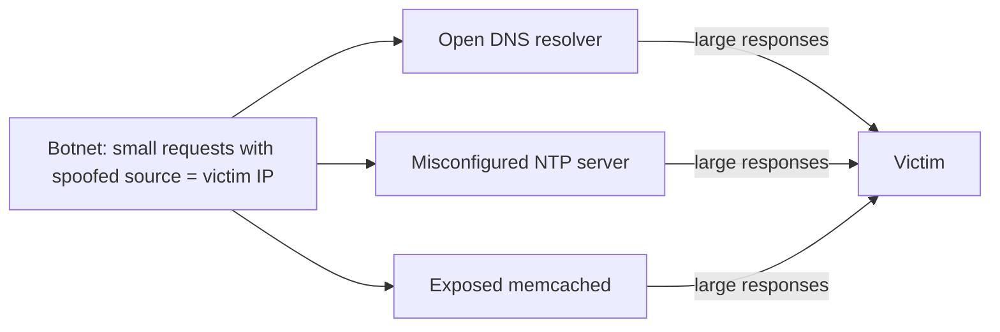
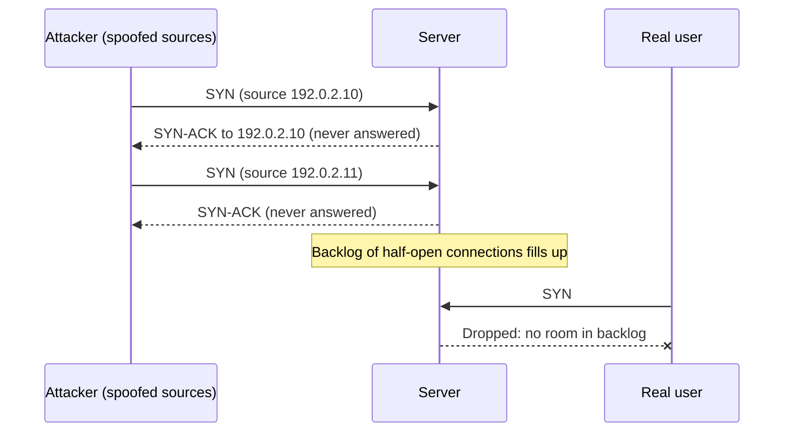
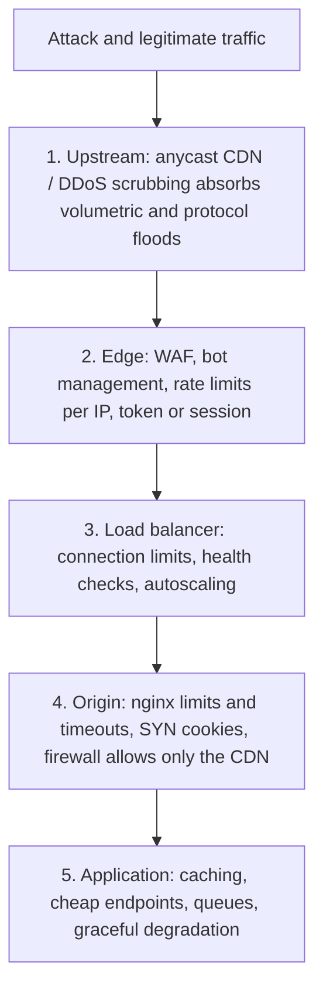

# DDoS Attacks and Mitigation

## Introduction

A **denial-of-service (DoS)** attack tries to make a service unavailable to its legitimate users. A **distributed** denial-of-service (DDoS) attack does it from many sources at once, usually thousands of compromised devices (a **botnet**) or abused servers on the internet.

Picture a small shop. A DDoS attack is like hiring a crowd to stand in the doorway, clog the aisles and keep asking the cashier pointless questions. The shop is open and nothing is stolen, yet real customers cannot get in. DDoS attacks target the **availability** part of the [CIA triad](../0-sec-fundamentals/1-sec-cia-triad.mdx).

Why developers should care:

- Attacks are cheap to launch: "booter" or "stresser" services rent out DDoS capacity, and botnets of insecure IoT devices and cloud servers supply the bandwidth.
- Records keep climbing. Cloudflare reported mitigating an 11.5 Tbps attack in September 2025 and has reported larger ones since; see its [quarterly DDoS threat reports](https://blog.cloudflare.com/tag/ddos-reports/) for current figures.
- Application-layer attacks need very little bandwidth. A few thousand expensive requests per second to a search endpoint can take down an unprepared app.
- DDoS is sometimes a **smokescreen** for another intrusion, or a lever for **extortion** ("pay or we keep you offline").

You cannot out-provision a large DDoS from a single server. The defense is architectural: absorb at the edge, filter what is obviously bad, rate-limit what is suspicious, and make your application cheap to serve.

:::warning Ethics and the law
Launching a DDoS attack, or paying a "stresser" service to do it, is a crime in most countries, including against a target you think "deserves it." Load-test only systems you own, and follow your hosting provider's rules: for example, AWS only allows [DDoS simulation testing](https://aws.amazon.com/security/ddos-simulation-testing/) through pre-approved partners. This page explains attacks so you can defend against them; it contains no attack tooling.
:::

## Types of DDoS Attacks

DDoS attacks are grouped by which resource they exhaust.

| Category | Exhausts | Measured in | Examples |
| --- | --- | --- | --- |
| Volumetric | Network bandwidth | Bits per second (bps) | UDP floods, DNS/NTP/memcached/CLDAP amplification |
| Protocol / state exhaustion | Connection tables, CPU on firewalls and load balancers | Packets per second (pps) | SYN floods, ACK floods, fragmented packet floods |
| Application layer (L7) | Application threads, database, CPU, memory | Requests per second (rps) | HTTP GET/POST floods, expensive search queries, Slowloris, HTTP/2 Rapid Reset |

### Volumetric and amplification attacks

The attacker sends small requests to public servers (open DNS resolvers, NTP servers, memcached instances) with the **source IP spoofed** to be the victim's address. Each server sends a much larger reply to the victim. The ratio between reply and request size is the **amplification factor**.



This works only because:

1. Some networks still allow packets with **spoofed source addresses** to leave them (BCP 38 / RFC 2827 ingress filtering prevents this).
2. Some UDP services answer **anyone on the internet** with large replies.

As a builder, you help the whole internet by **never running open resolvers, open memcached, or other reflectors**, and by filtering spoofed traffic leaving your networks. See [DNS Security](./4-sec-dns-security.mdx) for resolver access control.

### Protocol attacks: the SYN flood

A TCP connection starts with a three-way handshake. In a **SYN flood**, the attacker sends huge numbers of SYN packets (often with spoofed sources) and never completes the handshake. The server keeps a half-open entry for each until its backlog is full, and then real clients cannot connect.



**SYN cookies** solve this on Linux: when the backlog is full, the kernel encodes the connection state into the SYN-ACK's sequence number instead of storing it, and only allocates memory when a valid ACK returns.

```bash
# Check and enable SYN cookies (enabled by default on most modern distributions)
sysctl net.ipv4.tcp_syncookies
sudo sysctl -w net.ipv4.tcp_syncookies=1

# Persist across reboots
echo "net.ipv4.tcp_syncookies = 1" | sudo tee /etc/sysctl.d/60-syncookies.conf
```

Example output:

```text
net.ipv4.tcp_syncookies = 1
```

Protocol attacks also target **stateful devices in front of your servers**: firewalls and load balancers have finite connection tables. Cloud load balancers and DDoS services absorb this at a scale you cannot match on a single host.

### Application-layer attacks

Layer 7 attacks look like normal traffic: valid TLS, valid HTTP, requests to real URLs. They are harder to filter and need far less bandwidth.

- **HTTP floods:** many requests, often to expensive endpoints (search, login, report generation, cart operations) or with random query strings to bypass caches.
- **Slow attacks (Slowloris, slow POST):** open many connections and send data very slowly, tying up server workers that wait for complete requests.
- **HTTP/2 abuse:** HTTP/2 multiplexes many streams over one connection. The **Rapid Reset** attack (CVE-2023-44487, disclosed October 2023) opened and immediately cancelled streams in a loop, generating record request rates from relatively few machines. In August 2025, researchers disclosed **MadeYouReset** (CVE-2025-8671), a variant that tricks the *server* into resetting streams, bypassing some Rapid Reset mitigations. The fix for both is patching your web servers, proxies and load balancers ([Patch Management](../9-sec-system-hardening/3-sec-patch-management.mdx)).

## Defense in Layers

No single control stops all DDoS types. Each layer handles what it is best at.



| Layer | Handles | Examples |
| --- | --- | --- |
| Upstream network / CDN | Volumetric and protocol floods (Tbps scale) | Anycast CDNs, cloud DDoS services (AWS Shield, Google Cloud Armor, Azure DDoS Protection), ISP scrubbing centers |
| Edge (WAF, bot management) | L7 floods, bots, abusive clients | Managed WAF rate-based rules, challenges, bot scores |
| Load balancer | Connection floods, unhealthy backends | Cloud load balancers, connection draining |
| Origin server | Leftover abuse, slow attacks | nginx `limit_req`, timeouts, SYN cookies |
| Application | Expensive operations | Caching, pagination limits, async jobs, feature flags to switch off heavy features |

Product names, tiers and pricing change; check each provider's current documentation. As an example, AWS Shield Standard is included automatically for AWS customers, while Shield Advanced is a paid tier with extra protections and a response team.

### Hide and protect the origin

A CDN only protects you if attackers cannot go **around** it. If your origin server's IP is discoverable (old DNS records, email headers, certificate transparency logs, a forgotten `origin.example.com` record), attackers can hit it directly.

- Allow inbound 80/443 on the origin **only from the CDN's published IP ranges** or through a private connection ([Firewalls and Security Groups](./1-sec-firewalls.mdx)).
- Optionally require a secret header or mutual TLS between CDN and origin.
- Change the origin IP after moving behind a CDN if the old one was public.

## Origin Hardening with nginx

The configuration below rate-limits per client IP, protects the login endpoint more strictly, limits concurrent connections and shortens timeouts against slow attacks. It uses the `ngx_http_limit_req_module` and `ngx_http_limit_conn_module` modules that ship with nginx.

```nginx
events {}
http {
    # Track clients by IP; 10 MB of shared memory holds state for many thousands of addresses
    limit_req_zone  $binary_remote_addr zone=per_ip:10m rate=10r/s;
    limit_req_zone  $binary_remote_addr zone=login:10m  rate=5r/m;
    limit_conn_zone $binary_remote_addr zone=conn_per_ip:10m;

    # Return 429 Too Many Requests instead of the default 503
    limit_req_status  429;
    limit_conn_status 429;

    # Slowloris-style defenses: do not wait forever for slow clients
    client_header_timeout 10s;
    client_body_timeout   10s;
    send_timeout          10s;
    keepalive_timeout     15s;
    client_max_body_size  2m;

    server {
        listen 8080;
        server_name shop.example.com;

        limit_conn conn_per_ip 20;

        location / {
            # Allow short bursts of 20 extra requests, served immediately
            limit_req zone=per_ip burst=20 nodelay;
            proxy_pass http://127.0.0.1:9000;
        }

        location = /login {
            # Strict: about 5 attempts per minute per IP, small queue
            limit_req zone=login burst=5;
            proxy_pass http://127.0.0.1:9000;
        }

        location /static/ {
            expires 1h;
            add_header Cache-Control "public";
            root /var/www;
        }
    }
}
```

Validate before reloading:

```bash
sudo nginx -t && sudo systemctl reload nginx
```

Output:

```text
nginx: the configuration file /etc/nginx/nginx.conf syntax is ok
nginx: configuration file /etc/nginx/nginx.conf test is successful
```

How the limits behave:

- `rate=10r/s` with `burst=20 nodelay`: a client may send a quick burst of up to 20 extra requests (a page loading its assets), then is held to 10 per second. Excess requests get `429`.
- Without `nodelay` (the `/login` location), burst requests are **queued** and released at the configured rate, which slows down password guessing without rejecting a user who double-clicks.
- **Behind a CDN or load balancer**, `$binary_remote_addr` is the proxy's address, not the client's. Configure `ngx_http_realip_module` (`set_real_ip_from` with the proxy ranges, `real_ip_header`) so limits apply per real client, and trust that header **only** from your proxies.

:::caution Per-IP limits have limits
Large botnets spread requests over thousands of IPs, each staying under your threshold. Many legitimate users can also share one IP (corporate NAT, mobile carriers). Per-IP limits are a useful origin backstop; edge services that score bots and rate-limit by session, token or fingerprint are more effective against distributed floods. For per-user and per-API-key limits in application code, see [Rate Limiting and Abuse Prevention](../7-sec-api-security/3-sec-rate-limiting.mdx).
:::

## Triage: Is This an Attack?

When traffic spikes, first decide whether it is an attack, a bot, a product launch or a bug (a mobile app retrying in a tight loop looks a lot like a DDoS). Access logs answer most of that quickly. Here is a triage script for nginx's default combined log format:

```python
import re
import sys
from collections import Counter

LINE = re.compile(r'(?P<ip>\S+) \S+ \S+ \[(?P<ts>[^\]]+)\] "(?P<method>\S+) (?P<path>\S+) [^"]*" '
                  r'(?P<status>\d{3}) \S+ "[^"]*" "(?P<ua>[^"]*)"')

per_second, ips, paths, agents, statuses = Counter(), Counter(), Counter(), Counter(), Counter()

with open(sys.argv[1]) as f:
    for line in f:
        m = LINE.match(line)
        if not m:
            continue
        per_second[m["ts"].split()[0]] += 1          # e.g. 11/Oct/2026:14:02:31
        ips[m["ip"]] += 1
        paths[m["path"].split("?")[0]] += 1         # group /search?q=... as /search
        agents[m["ua"]] += 1
        statuses[m["status"]] += 1

rates = sorted(per_second.values())
print(f"Requests: {sum(rates)}  quietest second: {rates[0]}/s  peak: {rates[-1]}/s")
print(f"Distinct client IPs: {len(ips)}")
print("Top paths:     ", paths.most_common(3))
print("Top agents:    ", agents.most_common(2))
print("Status codes:  ", dict(statuses))
top_share = sum(n for _, n in ips.most_common(40)) / sum(ips.values())
print(f"Top 40 IPs send {top_share:.0%} of traffic")
```

Run against one minute of logs from a lab incident:

```text
Requests: 4080  quietest second: 8/s  peak: 128/s
Distinct client IPs: 251
Top paths:      [('/search', 3600), ('/products/42', 136), ('/', 123)]
Top agents:     [('python-requests/2.32.3', 3600), ('Mozilla/5.0 (Windows NT 10.0; Win64; x64)', 480)]
Status codes:   {'200': 2280, '429': 1800}
Top 40 IPs send 88% of traffic
```

Reading the result: traffic jumped 16-fold, almost all of it to `/search` with random query strings (a cache-busting pattern), from a script user agent and a small set of IPs. The rate limiter is already returning `429` for part of it. Good next steps: block or challenge that user agent and those IPs at the edge, cache or rate-limit `/search` specifically, and watch whether the attacker adapts. User agents are trivially faked, so treat them as a quick filter, not a defense.

## Testing Your Limits Safely

Rate limits that were never tested often fail when needed: the zone key is wrong, a proxy hides the client IP, or a location block is missing the directive. Test them in a lab or staging environment **you own**, at a modest rate. [k6](https://grafana.com/docs/k6/latest/) is a popular open-source load-testing tool that uses JavaScript test scripts:

```javascript
import http from "k6/http";
import { check } from "k6";

export const options = {
  scenarios: {
    burst: {
      executor: "constant-arrival-rate",
      rate: 50,              // 50 requests per second...
      timeUnit: "1s",
      duration: "30s",       // ...for 30 seconds
      preAllocatedVUs: 20,
    },
  },
  thresholds: {
    // We EXPECT throttling: at least 50% of requests should be rate limited
    "checks{type:throttled}": ["rate>0.5"],
  },
};

export default function () {
  const res = http.get("http://localhost:8080/");
  check(res, { "throttled (429)": (r) => r.status === 429 }, { type: "throttled" });
}
```

```bash
k6 run ratelimit-test.mjs
```

With the nginx limit of 10 requests per second per IP, roughly four out of five requests at 50 per second should receive `429`, and the threshold passes. If almost nothing is throttled, the limit is not applied where you think it is. Turn this into a regression test in your staging pipeline so a configuration change cannot silently remove the limit.

Keep in mind what such a test does **not** prove: one machine cannot simulate a distributed attack, and it does not test your upstream provider. Large-scale DDoS simulations must go through your provider's approved process.

### Signals worth alerting on

| Signal | Why it matters |
| --- | --- |
| Requests per second vs baseline | First sign of an L7 flood |
| Share of `429` and `503` responses | Rate limits engaging, or the origin failing |
| Origin CPU, worker saturation, DB connections | Shows which resource is exhausted |
| Inbound bandwidth and packets per second | Volumetric and protocol attacks |
| Cache hit ratio at the CDN | Cache-busting attacks drive it down |
| Latency percentiles (p95, p99) | Users feel degradation before outright failure |

## A DDoS Response Runbook

Prepare before the attack, because during one you will be under time pressure and possibly unable to reach your own dashboards.

1. **Detect:** alerts on request rate, error rate, latency, bandwidth and origin CPU, compared with a normal baseline.
2. **Confirm and classify:** volumetric, protocol or application? Which endpoints, regions, user agents?
3. **Engage:** contact your CDN or DDoS provider's emergency line, and your ISP for volumetric floods. Know these contacts in advance.
4. **Mitigate:** enable stricter edge modes (challenges, geo or ASN rules if business allows), add targeted rate limits, turn off expensive features with feature flags, scale out where it helps.
5. **Communicate:** status page and customer messaging. Do not pay extortion demands; involve law enforcement.
6. **Review:** after the attack, run a [postmortem](../12-sec-incident-response/4-sec-postmortems.mdx), and tune thresholds and architecture.

See [Incident Response Playbooks](../12-sec-incident-response/1-sec-incident-playbooks.mdx) for turning these steps into a playbook, and [Business Continuity and Disaster Recovery](../12-sec-incident-response/5-sec-business-continuity.mdx) for availability planning.

## Real-World Scenario

**Situation:** A mid-sized online retailer runs its storefront on a few cloud VMs behind a cloud load balancer, with the origin IP also reachable directly. During a holiday sale, the site slows to a crawl. Logs show a flood of requests to `/search` and `/cart/add` with random parameters from thousands of IPs, while total bandwidth is only moderately higher than normal. An email arrives demanding payment to stop the attack.

**Walkthrough:**

1. **Recognize the type.** High request rate, modest bandwidth, expensive endpoints: an application-layer HTTP flood. Bandwidth-oriented defenses alone will not help.
2. **Put a CDN with WAF in front immediately** (most providers can onboard a domain within an hour by changing DNS), lock the origin firewall to accept only the CDN's ranges, and rotate the origin IP, since the old one is known.
3. **Apply targeted edge rules:** rate-based rules on `/search` and `/cart/add` per IP and per session, a JavaScript or managed challenge for clients without a valid session cookie on those paths, and blocking of obviously automated user agents.
4. **Make the app cheaper:** cache search results for common queries, cap page sizes, require a session for `/cart/add`, and temporarily disable an expensive "recommendations" widget with a feature flag.
5. **Keep origin backstops:** the nginx limits above, plus autoscaling with a maximum, so the attack does not turn into a huge cloud bill.
6. **Do not pay;** report the extortion attempt to law enforcement and keep evidence.

**Why this approach:** L7 floods are best stopped where you can tell bots from people: at an edge service with bot detection and challenges, and in the application by making abused endpoints cheap. Locking the origin to the CDN closes the bypass. Origin rate limits catch whatever leaks through.

**When to use it / when not to:** A CDN-plus-WAF front door suits almost every public web app and is affordable at small scale. For non-HTTP services (game servers, VoIP, custom UDP protocols), you need network-level DDoS protection from your cloud provider or a scrubbing service instead of an HTTP CDN. Internal-only services do not need internet DDoS protection at all; keep them off the internet.

**Alternatives and trade-offs:**

| Approach | Pros | Cons | Best for |
| --- | --- | --- | --- |
| CDN with WAF and bot management | Absorbs huge floods; L7 filtering; caching reduces origin load | Monthly cost; TLS terminates at the provider | Public websites and APIs |
| Cloud provider DDoS protection (basic tier) | Automatic, no setup for network-layer attacks | Limited L7 protection on its own | Everything hosted in that cloud |
| Cloud provider DDoS protection (advanced/paid tier) | Response team access, cost protection, L7 features | Significant cost; provider-specific | High-value targets with cloud-hosted origins |
| ISP or on-demand scrubbing center | Protects whole networks and non-HTTP protocols | Route changes (BGP) add latency; contract needed | Data centers, game and VoIP services |
| On-prem DDoS appliance | Full control, low latency | Cannot absorb floods larger than your uplink | Complement to upstream protection |
| Origin rate limits and tuning only | Free, simple | Useless against floods that saturate your bandwidth | Backstop layer, small internal tools |

## Common Mistakes

- **No plan until the attack starts.** Onboarding a provider, finding contacts and writing rules under fire is slow. Prepare in advance.
- **Leaving the origin exposed** behind a CDN. Attackers find it and bypass all edge protection.
- **Running open reflectors** (DNS resolvers, memcached, NTP, SSDP) that attackers use against others.
- **Per-IP limits only.** Distributed floods and shared NAT addresses make them both weak and prone to blocking real users.
- **Uncapped autoscaling.** Scaling to absorb a flood can produce an enormous bill (sometimes called "economic denial of service"). Set maximums and alerts.
- **Rate limiting with the proxy's IP** because the real client IP was not configured, which throttles everyone at once.
- **Unpatched HTTP/2 stacks.** Rapid Reset and MadeYouReset showed that protocol implementation bugs can amplify L7 attacks; keep proxies and servers updated.
- **Expensive endpoints without limits** such as unbounded search, exports or report generation.

## Summary

- DDoS attacks exhaust **bandwidth** (volumetric), **connection state** (protocol) or **application resources** (L7).
- **Amplification** relies on spoofed sources and open UDP services; do not run reflectors, and filter spoofed traffic.
- **SYN cookies** handle SYN floods on Linux; stateful devices still need upstream protection.
- Defend in layers: **upstream CDN/scrubbing**, **edge WAF and bot management**, **origin limits and timeouts**, and **cheap, cache-friendly application endpoints**.
- Lock the **origin** so it accepts traffic only from your CDN, and configure **real client IPs** for rate limiting.
- Prepare a **runbook** and provider contacts before you need them; never pay extortion.

## Exercises

1. In a local Docker lab, run nginx with the configuration above in front of a small Flask app. Use a load-testing tool such as `hey` or `k6` **against your own lab only** to send 50 requests per second, and observe the `429` responses in the access log.
2. Add `ngx_http_realip_module` settings so the rate limit uses the `X-Forwarded-For` client IP when requests come from a trusted proxy subnet, and explain why you must not trust that header from arbitrary clients.
3. Extend the triage script to print the top 10 IPs with their request counts and the share of `429` responses per IP, and to output a blocklist file of IPs above a threshold.
4. Write a one-page DDoS runbook for an application you know: alerts, provider contacts, mitigation switches and communication steps.

**Related pages:**

- [Firewalls and Security Groups](./1-sec-firewalls.mdx): lock your origin to the CDN.
- [DNS Security](./4-sec-dns-security.mdx): DNS as both a DDoS target and an amplification tool.
- [Rate Limiting and Abuse Prevention](../7-sec-api-security/3-sec-rate-limiting.mdx): application-level limits per user and API key.
- [API Gateways and WAFs](../7-sec-api-security/7-sec-api-gateway-security.mdx): edge controls in more detail.
