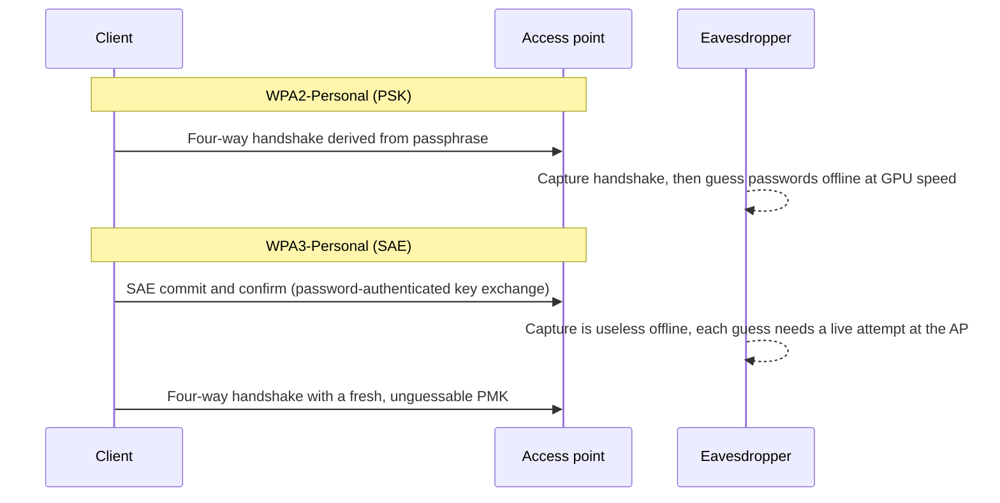
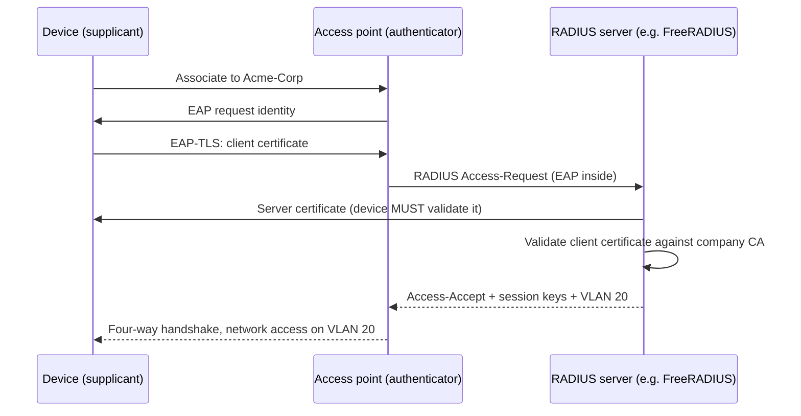

# Wireless Security

## Introduction

A wired network has a physical boundary: to plug in, you need to be inside the building. Wi-Fi does not. Radio waves pass through walls into the parking lot, the café downstairs and the apartment next door. Anyone within range can **listen** to every frame, **try to join** your network, or **pretend to be** your network.

Wireless security is about three questions:

1. **Who may join?** (authentication: a shared passphrase, per-user credentials or certificates)
2. **Can outsiders read or alter the traffic?** (encryption and integrity)
3. **Can clients tell the real network from a fake one?** (mutual authentication and protected management frames)

The answers have changed a lot over 25 years, from the badly broken WEP to today's WPA3. This page explains the standards, the main attacks, and how to configure Wi-Fi securely for a home lab, an office and a guest network.

:::warning Ethics and the law
Accessing a Wi-Fi network without permission, cracking its passphrase, or deauthenticating other people's devices is illegal in most countries, and jamming radio frequencies is illegal almost everywhere. Practice only on access points and devices **you own**, in a lab, ideally shielded or away from other networks. See [Building a Safe Practice Lab](../10-sec-offensive-security/1-sec-lab-setup.mdx).
:::

## The Evolution of Wi-Fi Security

| Standard | Year | Authentication | Encryption | Status |
| --- | --- | --- | --- | --- |
| Open | n/a | None | None | Traffic readable by anyone in range |
| WEP | 1997 | Shared key | RC4 with short IVs | **Broken**: key recoverable in minutes |
| WPA (TKIP) | 2003 | PSK or 802.1X | RC4-based TKIP | Deprecated; do not use |
| WPA2-Personal | 2004 | Pre-shared key (PSK) | AES-CCMP | Acceptable with a long random passphrase; offline guessing possible |
| WPA2-Enterprise | 2004 | 802.1X / EAP per user or device | AES-CCMP | Strong when server certificates are validated |
| WPA3-Personal | 2018 | SAE (Simultaneous Authentication of Equals) | AES-CCMP / GCMP | Recommended for passphrase networks |
| WPA3-Enterprise | 2018 | 802.1X / EAP, PMF required; optional 192-bit mode | AES-CCMP / GCMP-256 | Recommended for organizations |
| Enhanced Open (OWE) | 2018 | None (no password) | Per-client encryption from a key exchange | Recommended for open guest networks |

### Why WPA3 matters

With **WPA2-Personal**, the four-way handshake lets anyone who captures it (or, for many access points, a single PMKID value from the AP, an attack published in 2018) **guess passphrases offline** at the speed of their GPUs. A weak passphrase falls quickly; a long random one does not.

**WPA3-Personal** replaces the PSK handshake with **SAE**, a password-authenticated key exchange (the "Dragonfly" handshake). Each guess requires a live interaction with the access point, so offline dictionary attacks against a captured handshake no longer work. SAE also provides **forward secrecy**: recording traffic today and learning the passphrase later does not decrypt it.



WPA3 also requires **Protected Management Frames (PMF, 802.11w)**, which stop attackers from forging "deauthentication" frames to kick clients off the network.

WPA3 is not perfect. The 2019 **Dragonblood** research found side-channel and downgrade issues in early SAE implementations. Patches and a newer method for deriving the password element (**hash-to-element**, `sae_pwe` in hostapd) address the side channels. The downgrade issue remains a property of **transition mode**, discussed below.

### Wi-Fi 6E and Wi-Fi 7

The 6 GHz band (used by Wi-Fi 6E and Wi-Fi 7) is a clean break: according to vendor guidance based on the Wi-Fi Alliance WPA3 specification, **only WPA3 and Enhanced Open are allowed on 6 GHz**, not WPA2 or open networks, and **PMF is mandatory**. Cisco's and Meraki's Wi-Fi 7 guides also list **beacon protection** as required for Wi-Fi 7. If your hardware supports 6 GHz, this is a good forcing function to finish the WPA3 migration. Requirements are maintained by the Wi-Fi Alliance and vendors; check your vendor's current documentation.

## Wireless Attacks to Know

| Attack | How it works | Defense |
| --- | --- | --- |
| Passive eavesdropping | Capture frames from an open or weakly protected network | WPA2/WPA3 or OWE; TLS for applications |
| Offline passphrase cracking | Capture a WPA2 handshake or PMKID, guess offline | WPA3-SAE; long random passphrases; 802.1X |
| Deauthentication | Forge management frames to disconnect clients (to force re-handshakes or push them to a fake AP) | PMF required (802.11w), standard in WPA3 |
| Evil twin | A fake AP with the same SSID lures clients; often with a phishing captive portal | 802.1X with server certificate validation; WPA3; user training; wireless IDS |
| Rogue AP | An unauthorized AP plugged into the wired network creates a back door | 802.1X on switch ports; wireless intrusion detection; NAC |
| Downgrade in transition mode | Fake WPA2-only AP makes WPA3-capable clients use WPA2 | WPA3-only SSIDs where possible; transition disable |
| WPS PIN brute force | The 8-digit WPS PIN is validated in two halves, making it guessable | Disable WPS |
| KRACK (2017) | Key reinstallation in the WPA2 handshake allowed decryption in some cases | Patched clients and APs |
| FragAttacks (2021) | Design and implementation flaws in frame fragmentation and aggregation | Firmware updates; TLS on top |
| Client probing / auto-join | Devices broadcast remembered SSIDs and join look-alike networks | Forget unused networks; avoid auto-join for open SSIDs |

Two patterns stand out. **Patching** wireless devices (APs, laptops, phones, IoT) matters as much as configuration, because many attacks were implementation flaws. And **authentication of the network to the client** is what really defeats evil twins, which is why 802.1X with proper certificate validation is the gold standard.

## Configuring a Secure Access Point with hostapd

`hostapd` is the open-source access point daemon used inside many routers and Linux-based APs. Its sample configuration file documents every option. Even if you use commercial equipment, the settings below map directly to options in their dashboards.

### WPA3-Personal only

```ini
# /etc/hostapd/hostapd.conf  (lab AP with a supported Wi-Fi adapter)
interface=wlan0
driver=nl80211
ssid=Acme-Lab
country_code=US
hw_mode=a
channel=36
ieee80211n=1
ieee80211ac=1

wpa=2
wpa_key_mgmt=SAE
rsn_pairwise=CCMP
sae_password=use-a-long-random-passphrase-here
ieee80211w=2          # PMF required
sae_pwe=2             # allow hash-to-element (side-channel resistant) and legacy derivation
beacon_prot=1
wps_state=0           # WPS disabled
```

### WPA2/WPA3 transition mode

If some clients do not support WPA3, transition mode accepts both on one SSID:

```ini
wpa=2
wpa_key_mgmt=WPA-PSK SAE
rsn_pairwise=CCMP
wpa_passphrase=use-a-long-random-passphrase-here
sae_password=use-a-long-random-passphrase-here
ieee80211w=1          # PMF optional, so WPA2 clients can still connect
```

Transition mode is a migration tool, not an end state. Because the same passphrase works over WPA2, an attacker can lure clients to a WPA2-only fake AP and attack the handshake offline. Two mitigations:

- Once enough clients support WPA3, move to WPA3-only, or create a separate WPA2-only SSID for legacy devices with a different passphrase and limited network access.
- Use **transition disable** (`transition_disable=0x01` in hostapd): after a client successfully connects with WPA3, it remembers to never use WPA2 for that network again.

### Generating a strong passphrase

For any PSK or SAE network, the passphrase is the whole security story. Generate it rather than inventing it:

```python
import secrets
from string import ascii_letters, digits

alphabet = ascii_letters + digits
passphrase = "".join(secrets.choice(alphabet) for _ in range(24))
print(passphrase)
```

Example output:

```text
14iBGXweEUtCl1ZC6ksyW5Eo
```

24 characters from 62 symbols is about 143 bits of entropy, far beyond any offline guessing. Use the [`secrets` module](../1-sec-cryptography/9-sec-randomness.mdx), never `random`. If people must type it often, a long passphrase of five or six random words (diceware) is a friendlier option.

## Enterprise Wi-Fi: 802.1X and EAP-TLS

A shared passphrase has two problems in an organization: everyone who ever knew it can still use it, and it does not tell you *who* connected. **802.1X** solves both: each user or device authenticates individually to a **RADIUS** server, and the RADIUS server tells the AP to allow them (optionally onto a specific VLAN).



EAP methods compared:

| Method | Client credential | Notes |
| --- | --- | --- |
| **EAP-TLS** | Client certificate | Strongest; no passwords to phish; needs a PKI and device management |
| PEAP-MSCHAPv2 | Username and password | Common, but MSCHAPv2 is weak; credentials leak if clients do not validate the server certificate |
| EAP-TTLS | Usually username and password | Similar trade-offs to PEAP |

The critical setting is on the **client**: it must validate the RADIUS server's certificate (correct CA and server name). If it does not, an evil twin with its own RADIUS server can collect credentials. A secure `wpa_supplicant` profile for EAP-TLS:

```ini
network={
    ssid="Acme-Corp"
    key_mgmt=WPA-EAP-SHA256
    ieee80211w=2
    eap=TLS
    identity="laptop-0042@acme.example"
    ca_cert="/etc/ssl/acme/wifi-ca.pem"
    domain_match="radius.acme.example"
    client_cert="/etc/ssl/acme/laptop-0042.crt"
    private_key="/etc/ssl/acme/laptop-0042.key"
}
```

`ca_cert` pins the issuing CA and `domain_match` pins the server's name. In practice, managed devices receive these profiles from MDM, which avoids users clicking "trust this certificate" on a fake network. See [PKI and Certificates](../1-sec-cryptography/6-sec-pki-and-certificates.mdx).

## Guest and IoT Wireless

- **Guest networks** should be on their own VLAN with internet-only access ([Network Segmentation](./2-sec-network-segmentation.mdx)), with **client isolation** so guests cannot reach each other (`ap_isolate=1` in hostapd). Use **Enhanced Open (OWE)** instead of an open SSID, so guests' traffic is encrypted against passive eavesdropping even without a password. OWE does not authenticate the network, so it does not stop evil twins.
- **IoT devices** often support only WPA2-Personal. Put them on a dedicated SSID and VLAN with a unique passphrase, and allow only the flows they need (for example cameras to the video recorder only). Some enterprise platforms offer **per-device PSKs**, which give each device its own key on one SSID.

## Monitoring the Airspace

You should know which access points broadcast your SSIDs. Enterprise controllers include **wireless intrusion detection (WIDS)** that flags rogue and impersonating APs. For a small office, a periodic scan helps. This script audits the output of NetworkManager's `nmcli` on a Linux laptop:

```python
import re
import subprocess
import sys
from collections import defaultdict

def parse(text: str):
    """Parse `nmcli -t -f SSID,BSSID,CHAN,SECURITY dev wifi list` (colons inside fields are escaped as \\:)."""
    for line in text.splitlines():
        fields = [f.replace("\\:", ":") for f in re.split(r"(?<!\\):", line)]
        if len(fields) == 4:
            yield dict(zip(["ssid", "bssid", "chan", "security"], fields))

def grade(security: str) -> str:
    s = security.upper()
    if not s or s == "--":
        return "OPEN (no encryption)"
    if "WEP" in s:
        return "BROKEN (WEP)"
    if "WPA3" in s or "OWE" in s:
        return "good"
    if "WPA2" in s:
        return "ok (prefer WPA3)"
    return "WEAK (" + security + ")"

def audit(text: str):
    seen = defaultdict(set)
    for ap in parse(text):
        seen[ap["ssid"]].add(ap["security"] or "open")
        print(f'{ap["ssid"]:<14} {ap["bssid"]}  ch {ap["chan"]:>3}  {grade(ap["security"])}')
    for ssid, modes in seen.items():
        if len(modes) > 1:
            print(f"WARNING: '{ssid}' is advertised with different security settings {sorted(modes)}: possible evil twin or misconfigured AP")

if __name__ == "__main__":
    if len(sys.argv) > 1:
        with open(sys.argv[1]) as f:
            audit(f.read())
    else:
        out = subprocess.run(["nmcli", "-t", "-f", "SSID,BSSID,CHAN,SECURITY", "dev", "wifi", "list"],
                             capture_output=True, text=True, check=True).stdout
        audit(out)
```

Example output in an office:

```text
Acme-Corp      3C:84:6A:11:22:30  ch  36  good
Acme-Corp      3C:84:6A:11:22:31  ch 149  good
Acme-Guest     3C:84:6A:11:22:32  ch  36  good
Acme-Corp      DE:AD:BE:EF:00:01  ch   6  OPEN (no encryption)
Acme-IoT       3C:84:6A:11:22:33  ch   1  ok (prefer WPA3)
Printer-Setup  F4:81:39:00:AA:01  ch  11  BROKEN (WEP)
```

```text
WARNING: 'Acme-Corp' is advertised with different security settings ['WPA3 802.1X', 'open']: possible evil twin or misconfigured AP
```

An open network named `Acme-Corp` from an unknown BSSID is a strong evil-twin indicator. The WEP "Printer-Setup" network is a printer's setup mode left on, which should be disabled. Passive scanning like this only lists networks broadcasting nearby; it does not connect to or interfere with anything.

## Hardening Checklist for Access Points and Routers

Whether you manage a home router or an office controller, the same baseline applies:

| Setting | Recommended | Why |
| --- | --- | --- |
| Security mode | WPA3-Personal or WPA3-Enterprise; transition mode only while migrating | Resists offline guessing; PMF included |
| PMF (802.11w) | Required (or at least optional in transition mode) | Blocks forged deauthentication frames |
| WPS | Disabled | PIN brute force; push-button abuse |
| Admin interface | Not reachable from Wi-Fi guest networks or the internet; strong unique password; MFA if offered | Router admin panels are frequent targets |
| Firmware | Automatic updates on, or a monthly check | Many Wi-Fi attacks are implementation bugs |
| Remote management / UPnP | Off unless needed | Exposes the router or opens ports automatically |
| Guest network | Separate SSID and VLAN, client isolation, OWE | Keeps visitors away from your devices |
| Default credentials | Changed on day one | Default passwords are public |
| Unused radios and SSIDs | Disabled | Smaller attack surface |
| End-of-life hardware | Replaced | No more security patches |

## Testing Your Own Wireless Network

Security teams test Wi-Fi in a few ways, all of which require that you own the network or have written authorization:

- **Configuration review:** check the settings above in the AP or controller. This finds most problems with no radio work at all.
- **Passive survey:** list which networks and security modes are visible from different spots (the audit script above), to find rogue APs, misconfigured SSIDs and coverage that leaks far outside the building.
- **Client configuration review:** confirm managed devices have the right Wi-Fi profiles, with server certificate validation for 802.1X and no auto-join for open networks.
- **Authorized penetration testing:** a professional tester, under a written scope, may test passphrase strength, evil-twin resistance and segmentation from the guest network. Training platforms such as TryHackMe and Hack The Box offer wireless rooms where you can learn these techniques legally.

Avoid "testing" by deauthenticating clients, even on your own network, if neighbors' devices are in range: radio frames do not respect property lines, and you may disrupt networks you have no right to touch.

## Real-World Scenario

**Situation:** A 50-person design agency has one Wi-Fi network, `Agency`, using WPA2-Personal. The passphrase has not changed in four years and is written on the whiteboard in the meeting room. Former employees and freelancers still know it, and the network is flat: laptops, the file server, printers and the smart TV share one subnet. A client asks for evidence of reasonable security before signing a contract.

**Walkthrough:**

1. **Split by audience.** Create three SSIDs on separate VLANs: `Agency` (staff), `Agency-Guest` (visitors and freelancers) and `Agency-Devices` (printers, TVs). Each VLAN gets firewall rules: guests reach only the internet; devices reach only what they need.
2. **Staff: WPA3-Enterprise with EAP-TLS.** The company already uses an MDM for laptops and phones, so it can push device certificates and Wi-Fi profiles with CA pinning. Leaving the company means revoking the device certificate; there is no shared secret to rotate.
3. **Guests: Enhanced Open (OWE) with client isolation,** or WPA3-Personal with a weekly rotated passphrase displayed on a screen at reception if a password is preferred.
4. **Devices: WPA2/WPA3 transition or per-device keys,** with a unique passphrase that is not shared with people.
5. **Turn off WPS, enable PMF,** update AP firmware, and enable the controller's rogue-AP detection.
6. **Change or retire the old passphrase** once all staff devices have moved to EAP-TLS.

**Why this approach:** It removes the shared, never-rotated secret that ex-staff still know, ties staff access to managed devices, and isolates the weakest devices and outside visitors from company data. The client gets a clear story: individual authentication, encryption, segmentation and monitoring.

**When to use it / when not to:** 802.1X needs a RADIUS server (often included with cloud-managed Wi-Fi platforms) and device management to deploy certificates. Without MDM, PEAP with strict server certificate validation, or WPA3-Personal with per-group passphrases, may be the practical middle ground. A home network does not need 802.1X; WPA3-Personal with a strong passphrase, WPS off and current firmware is enough.

**Alternatives and trade-offs:**

| Approach | Pros | Cons | Best for |
| --- | --- | --- | --- |
| WPA3-Personal (SAE) | Simple, resists offline cracking, PMF built in | Shared secret; no per-user identity or revocation | Homes, small offices, labs |
| WPA2/WPA3 transition mode | Supports legacy clients during migration | Downgrade risk; WPA2 offline guessing still possible | Temporary migrations |
| WPA3-Enterprise with EAP-TLS | Per-device identity, no passwords to phish, easy revocation | Needs PKI, RADIUS and MDM | Organizations with managed devices |
| WPA2/3-Enterprise with PEAP | Uses existing directory passwords | Credential theft if server validation is weak; password-based | Organizations without device certificates |
| Per-device PSK (vendor feature) | Unique key per device on one SSID; works for IoT | Vendor-specific; management overhead | IoT and headless devices |
| Enhanced Open (OWE) | Encrypted guest access with no password | No network authentication; evil twins still possible | Guest and public Wi-Fi |

## Common Mistakes

- **A shared passphrase that never changes** and is known by former staff. Rotate it or move to per-user authentication.
- **Weak or guessable WPA2 passphrases.** A captured handshake can be attacked offline indefinitely.
- **Leaving WPS enabled.** Disable it on every AP and home router.
- **Not validating the RADIUS server certificate** on clients, which lets evil twins harvest credentials.
- **Treating transition mode as finished.** Plan the move to WPA3-only.
- **Flat wireless networks** where guests and IoT devices share a subnet with company servers.
- **Forgotten firmware updates** on APs and IoT devices; many Wi-Fi attacks are implementation bugs fixed by patches.
- **Relying on hidden SSIDs or MAC filtering.** Hidden SSIDs are revealed when clients connect, and MAC addresses are trivially spoofed. Neither is a security control.

## Summary

- Wi-Fi extends your network beyond walls: assume anyone nearby can **listen, try to join or impersonate** your network.
- **WEP and WPA-TKIP are broken.** WPA2-Personal is acceptable only with a long random passphrase; **WPA3-Personal (SAE)** resists offline guessing and adds forward secrecy and PMF.
- **6 GHz (Wi-Fi 6E/7) requires WPA3 or Enhanced Open**, with PMF mandatory.
- **802.1X with EAP-TLS** gives per-device identity and revocation; clients must **validate the server certificate** to stop evil twins.
- Use **Enhanced Open** and client isolation for guests, separate SSIDs and VLANs for IoT, and **disable WPS**.
- Patch APs and clients, monitor for **rogue and look-alike APs**, and test only equipment you own.

## Exercises

1. Check the security settings of your own home router: encryption mode, WPS state, PMF, firmware version. Move to WPA3-Personal (or transition mode) if it is supported, and replace the passphrase with a generated one.
2. With two spare Wi-Fi adapters in a lab, set up hostapd with the WPA3-only configuration above and connect a client. Then try the transition-mode configuration and compare which modes your devices negotiate (`iw dev wlan0 link` or the OS network details show it).
3. Run the audit script on your own laptop at home or in your own office. Add a check that flags any SSID from a list of "company SSIDs" seen with an unknown BSSID prefix (OUI).
4. Write a short proposal (one page) for moving a small office from a shared WPA2 passphrase to 802.1X. List what infrastructure you need (RADIUS, CA, MDM) and how you would handle printers and guests.

**Related pages:**

- [Common Network Attacks](./6-sec-network-attacks.mdx): the wired versions of spoofing and man-in-the-middle attacks.
- [Network Segmentation](./2-sec-network-segmentation.mdx): put guests and IoT on their own zones.
- [Packet Analysis with Wireshark and tcpdump](./9-sec-packet-analysis.mdx): inspect wireless and wired captures from your lab.
- [Multi-Factor Authentication](../4-sec-authentication/2-sec-mfa.mdx): device certificates as one of the strongest authentication factors.
