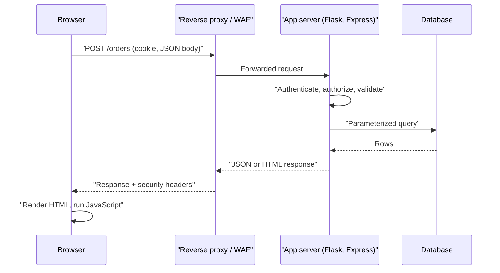
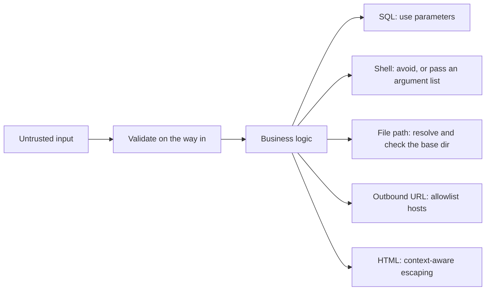
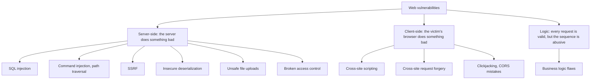

# Web Security Introduction

## Introduction

Almost every modern product is a web application or talks to one. Your online bank, your team's issue tracker and the admin panel behind a mobile app all use the same parts: a browser, HTTP, a server-side application and a database. Attackers like web apps because they are reachable from anywhere, they change every week, and a single mistake in one route can expose every customer's data.

Web application security is the practice of building those apps so they keep working correctly **even when the person on the other end is hostile**. A useful analogy is a bank branch. The lobby is public: anyone can walk in, fill out forms and talk to a teller. The vault is not. Security is not about locking the front door. It is about making sure every request crossing the counter is checked by someone who knows the rules, no matter how official the form looks.

This section teaches the most important web vulnerability classes from a **builder and defender** perspective. Each page explains how the attack works, shows a small vulnerable example running against a local lab, and spends most of its time on the fix and on choosing the right control.

:::warning Only test what you own
Everything in this section is for learning to build and defend applications. Only test applications you own or have **written permission** to test. Use deliberately vulnerable practice targets on your own machine, such as OWASP Juice Shop, DVWA or WebGoat, or hosted training platforms such as PortSwigger Web Security Academy, TryHackMe and HackTheBox. Probing a real website without permission is illegal in most countries, even if you "only looked". See [Ethics, Law and Responsible Disclosure](../0-sec-fundamentals/8-sec-ethics-and-law.mdx).
:::

## How a Web Request Really Flows

Before you can defend a web app, you need a clear picture of what happens when a user clicks a button.



Every arrow in this diagram is a place where something can go wrong:

- The **browser** is fully controlled by the user. Anything it sends, including hidden form fields, cookies, headers and JSON, can be changed with developer tools or a proxy such as Burp Suite.
- The **app server** must decide who the user is (authentication), what they may do (authorization), and whether the input makes sense (validation).
- The **database, shell, file system and other services** interpret strings as commands. When untrusted text reaches them as code, you get injection.
- The **response** is interpreted again by the browser. If untrusted text reaches the page as HTML or JavaScript, you get cross-site scripting (XSS).

## The Core Rule: Never Trust the Client

The single most important idea in web security is the **trust boundary**: the line between data you control and data an attacker can influence. In a web app, everything that arrives in an HTTP request is on the untrusted side.

| Data source | Who controls it | Can an attacker change it? |
| --- | --- | --- |
| URL path and query string | Browser | Yes |
| Form fields, including hidden ones | Browser | Yes |
| JSON request body | Browser or API client | Yes |
| Cookies | Browser | Yes (unless signed or encrypted by the server) |
| Headers such as `User-Agent`, `Referer`, `X-Forwarded-For` | Browser or proxy | Yes |
| JavaScript validation results | Browser | Yes, it can be skipped entirely |
| Server-side session data | Server | No (if the session store is secure) |
| Database rows written by other users | Other users | Indirectly, yes |

That last row surprises many beginners. Data that came out of your own database is not automatically safe. If another user wrote it, it is still attacker-controlled. Stored XSS works exactly this way.

Here is a tiny example of why client-side checks are not security. The page below disables the "Delete" button for non-admins:

```html
<button id="delete" disabled>Delete project</button>
<script>
  // UI hint only. This is not a security control.
  if (window.currentUser.role === "admin") {
    document.getElementById("delete").disabled = false;
  }
</script>
```

Anyone can send the request directly:

```bash
curl -X POST http://localhost:5000/projects/42/delete \
  -H "Cookie: session=..."
```

If the server does not check the role itself, the button's state does not matter. Client-side validation is for user experience. Server-side checks are for security.

## Thinking in Contexts: Where Strings Become Code

Most web vulnerabilities share one root cause: **untrusted data is interpreted as code by some interpreter**. The fix is always to keep data and code separate for that specific interpreter.



| Interpreter | Vulnerability if mixed | Primary fix | Page |
| --- | --- | --- | --- |
| SQL engine | SQL injection | Parameterized queries | [SQL Injection](./3-sec-sql-injection.mdx) |
| Browser HTML/JS | Cross-site scripting | Auto-escaping templates, CSP | [XSS](./4-sec-xss.mdx) |
| Operating system shell | Command injection | No shell, argument lists | [Command Injection](./7-sec-command-injection.mdx) |
| File system | Path traversal | Resolve and confine paths | [Command Injection and Path Traversal](./7-sec-command-injection.mdx) |
| Object deserializer | Insecure deserialization | Data-only formats like JSON | [Insecure Deserialization](./8-sec-insecure-deserialization.mdx) |
| Your own server as an HTTP client | SSRF | Destination allowlists | [SSRF](./6-sec-ssrf.mdx) |

Validation on the way in reduces risk, but it is not enough by itself. A name like `O'Brien` is valid input and still breaks a string-built SQL query. The real fix happens **at the point of use**, where you know which interpreter the data is going to.

## The Browser's Security Model

Many web attacks are about the browser, not the server. Three ideas matter most.

### The same-origin policy

An **origin** is the combination of scheme, host and port: `https://app.example.com:443`. The browser's **same-origin policy** stops a script on one origin from reading responses from another origin. A page on `https://evil.example` can make your browser *send* a request to `https://bank.example`, but it cannot *read* the answer.

| URL A | URL B | Same origin? | Why |
| --- | --- | --- | --- |
| `https://app.example.com/a` | `https://app.example.com/b` | Yes | Only the path differs |
| `https://app.example.com` | `http://app.example.com` | No | Scheme differs |
| `https://app.example.com` | `https://api.example.com` | No | Host differs |
| `https://app.example.com` | `https://app.example.com:8443` | No | Port differs |

Note the gap: browsers block *reading* cross-origin responses, but they still *send* many cross-origin requests with cookies attached. That gap is what [CSRF](./5-sec-csrf.mdx) exploits. [CORS](./9-sec-security-headers.mdx) is the controlled way to relax the same-origin policy, and misconfigured CORS reopens what the policy closed.

### Cookies and ambient authority

Browsers attach cookies automatically to requests for the cookie's site. This "ambient authority" is convenient, because users stay logged in, but it means the browser can be tricked into sending authenticated requests. Cookie attributes control this:

```text
Set-Cookie: session=abc123; Secure; HttpOnly; SameSite=Lax; Path=/
```

- `Secure`: only sent over HTTPS.
- `HttpOnly`: JavaScript cannot read it, which limits what XSS can steal.
- `SameSite=Lax`: not sent on most cross-site subrequests, which blunts CSRF.

Sessions get a full treatment in [Sessions and Cookies](../4-sec-authentication/4-sec-sessions-and-cookies.mdx).

### Security headers

The server can tell the browser to enforce extra rules, such as "only run scripts with this nonce" (Content-Security-Policy) or "always use HTTPS" (Strict-Transport-Security). These are covered in [Security Headers, CORS and CSP](./9-sec-security-headers.mdx).

## A Map of Web Vulnerability Classes

It helps to sort attacks by *who* ends up running the malicious action.



The [OWASP Top 10](./1-sec-owasp-top-10.mdx) groups these into ten risk categories and is the most common shared vocabulary for web risks.

## A Small App with Several Problems

To see how the classes show up in real code, here is a deliberately weak Flask app. **Run it only on your own machine.** It binds to `127.0.0.1` so it is not reachable from the network.

```python
# weak_app.py  (Vulnerable: for local learning only)
import sqlite3
from flask import Flask, request

app = Flask(__name__)

def db():
    conn = sqlite3.connect("shop.db")
    conn.row_factory = sqlite3.Row
    return conn

@app.get("/search")
def search():
    q = request.args.get("q", "")
    # Problem 1: SQL built by string formatting (SQL injection)
    rows = db().execute(f"SELECT name FROM products WHERE name LIKE '%{q}%'").fetchall()
    # Problem 2: user input echoed into HTML without escaping (reflected XSS)
    items = "".join(f"<li>{r['name']}</li>" for r in rows)
    return f"<h1>Results for {q}</h1><ul>{items}</ul>"

@app.get("/orders/<int:order_id>")
def get_order(order_id):
    # Problem 3: no check that this order belongs to the logged-in user (IDOR)
    row = db().execute("SELECT * FROM orders WHERE id = ?", (order_id,)).fetchone()
    return dict(row) if row else ({"error": "not found"}, 404)

if __name__ == "__main__":
    app.run(host="127.0.0.1", port=5000, debug=False)
```

And the same routes written defensively:

```python
# safer_app.py  (Fixed)
import sqlite3
from flask import Flask, request, render_template_string, session, abort

app = Flask(__name__)
app.secret_key = "load-from-environment-in-real-apps"

PAGE = """
<h1>Results for {{ q }}</h1>
<ul><li>{{ r['name'] }}</li></ul>
"""

def db():
    conn = sqlite3.connect("shop.db")
    conn.row_factory = sqlite3.Row
    return conn

@app.get("/search")
def search():
    q = request.args.get("q", "")[:100]           # validate: cap the length
    rows = db().execute(
        "SELECT name FROM products WHERE name LIKE ?",  # Fix 1: parameterized query
        (f"%{q}%",),
    ).fetchall()
    return render_template_string(PAGE, q=q, rows=rows)  # Fix 2: Jinja auto-escapes

@app.get("/orders/<int:order_id>")
def get_order(order_id):
    user_id = session.get("user_id")
    if user_id is None:
        abort(401)
    row = db().execute(
        "SELECT * FROM orders WHERE id = ? AND user_id = ?",  # Fix 3: scope to owner
        (order_id, user_id),
    ).fetchone()
    if row is None:
        abort(404)   # same answer for "missing" and "not yours"
    return dict(row)
```

Each fix is small, but each one depends on knowing which interpreter or rule is in play. The rest of this section takes each problem in turn.

## Where Defenses Live

No single layer stops everything. A well-defended web app has controls at several points, and each catches what the others miss.

| Layer | Example controls | What it stops well | What it misses |
| --- | --- | --- | --- |
| Browser | CSP, `SameSite` cookies, HSTS | Limits the damage of XSS and CSRF | Anything server-side |
| Edge (CDN, WAF, nginx) | Rate limits, TLS, request size limits, WAF rules | Floods, noisy scanners, known payloads | Logic and authorization flaws |
| Application | Authorization checks, parameterized queries, escaping, validation | Root causes of most bugs | Misconfigured infrastructure |
| Data | Least-privilege DB users, encryption, backups | Limits blast radius after a breach | Bad queries the app is allowed to run |
| Monitoring | Security logs, alerts, anomaly detection | Lets you notice and respond | Prevention: it only detects |

A practical way to read this table: the **application** layer is where you fix bugs, and every other layer exists to reduce the damage when a bug slips through. For example, a least-privilege database user that cannot `DROP TABLE` turns a catastrophic SQL injection into a serious but recoverable one.

## Setting Up a Safe Practice Lab

You learn web security fastest by watching attacks succeed against code you control, then fixing it. Run deliberately vulnerable apps **locally**, bound to `127.0.0.1` so nobody else on your network can reach them.

```bash
# OWASP Juice Shop: a modern intentionally insecure shop (Node/Angular)
docker run --rm -p 127.0.0.1:3000:3000 bkimminich/juice-shop
# then open http://localhost:3000
```

Example output:

```text
info: All dependencies in ./package.json are satisfied (OK)
info: Detected Node.js version v22.x (OK)
...
info: Server listening on port 3000
```

Other good targets:

| Target | What it is | Good for |
| --- | --- | --- |
| OWASP Juice Shop | Modern single-page shop with 100+ challenges | Broad OWASP Top 10 practice |
| DVWA | Classic PHP/MySQL app with low/medium/high difficulty | Seeing the same bug with weaker and stronger fixes |
| OWASP WebGoat | Lessons with built-in explanations (Java) | Guided learning |
| PortSwigger Web Security Academy | Free hosted labs from the makers of Burp Suite | Deep dives per vulnerability class |
| TryHackMe, HackTheBox | Hosted rooms and machines | Structured paths and CTF-style practice |

Image names and setup steps change over time, so check each project's official docs. [Building a Safe Practice Lab](../10-sec-offensive-security/1-sec-lab-setup.mdx) covers isolation in more depth, and [Web Testing with Burp Suite](../10-sec-offensive-security/4-sec-burp-suite.mdx) shows how to intercept and replay requests.

:::tip Keep the lab isolated
Never expose a vulnerable lab app on a public IP or a shared office network. Bind ports to `127.0.0.1`, stop containers when you are done, and do not reuse real passwords in lab accounts.
:::

## Real-World Scenario

Your team of four is launching a B2B invoicing SaaS in eight weeks. It is a Flask API with a React frontend on one cloud VM behind nginx. Customers will store invoices and client contact data. Nobody on the team is a security specialist, and the budget for security tooling is close to zero. Where should you spend your limited time?

**Step 1: Lean on the framework.** Use the ORM or parameterized queries everywhere, keep Jinja/React auto-escaping on, and enable CSRF protection (Flask-WTF) for any cookie-authenticated form. Framework defaults remove whole bug classes for free.

**Step 2: Centralize authorization.** Write one helper, such as `get_invoice_for_user(invoice_id, user)`, and never fetch tenant data any other way. Broken access control is the most common serious web flaw, and it is the one frameworks cannot fix for you.

**Step 3: Set safe headers and cookies once.** Add HSTS, a starter CSP, `X-Content-Type-Options: nosniff`, and `Secure; HttpOnly; SameSite=Lax` cookies in nginx or app middleware.

**Step 4: Automate the cheap checks.** Add a dependency scanner and a SAST tool to CI (see [Dependency Scanning and SCA](../6-sec-appsec-and-devsecops/4-sec-dependency-scanning.mdx) and [Static Analysis](../6-sec-appsec-and-devsecops/2-sec-sast.mdx)), and run a DAST baseline scan against staging.

**Step 5: Review the risky features by hand.** File uploads, "fetch this URL" features, password reset, payments and anything multi-tenant deserve a short threat-modeling session (see [Threat Modeling with STRIDE](../6-sec-appsec-and-devsecops/1-sec-threat-modeling.mdx)).

**Why this approach:** It puts effort where small teams get the most risk reduction per hour. Framework defaults and one authorization helper prevent most of the issues attackers actually find, and automation catches regressions without a dedicated security engineer.

**When to use it:** Early-stage products, small teams, and any app built on a mainstream framework. **When not to:** If you handle payment card data, health records or similar regulated data, you will also need formal requirements (for example PCI DSS) and an independent penetration test before launch.

| Approach | Pros | Cons | Best for |
| --- | --- | --- | --- |
| Secure framework defaults + code fixes | Fixes root causes; cheap | Needs developer discipline | Every app |
| Web Application Firewall (WAF) | Fast to deploy; blocks noisy attacks | Bypassable; false positives; does not fix logic or access control bugs | Extra layer, emergency virtual patching |
| Automated scanners (SAST, DAST, SCA) | Continuous; catches regressions | Noise; misses business logic | Teams with CI/CD |
| Manual pentest | Finds logic and chained bugs | Costly; a point-in-time snapshot | Before major launches, compliance |
| Bug bounty | Many testers, pay per finding | Needs triage capacity; not a first step | Mature apps with a security owner |

## Common Mistakes

- **Trusting client-side validation.** JavaScript checks improve UX. They never replace server-side checks.
- **Escaping on input instead of output.** HTML-escaping data before storing it breaks other outputs (CSV, JSON, SQL) and still misses contexts like URLs and JavaScript. Store raw data and encode it for the context where it is used.
- **Thinking HTTPS means secure.** TLS protects data in transit. It does nothing about SQL injection, XSS or missing authorization checks.
- **Relying only on a WAF.** A WAF is a useful extra layer, but attackers routinely find encodings it does not recognize, and it cannot know who owns invoice 1042.
- **Leaving debug mode on.** Framework debug pages can leak source code, configuration and sometimes give an interactive console. Turn them off in production.
- **Testing against real sites.** Even "harmless" probing without permission can be a crime. Use local labs.

## Summary

- Web apps are attractive targets because they are reachable, change often and hold valuable data.
- Everything in an HTTP request is attacker-controlled. Enforce rules on the server.
- Most vulnerabilities happen when untrusted data reaches an interpreter (SQL, HTML, shell, file system) as code. Fix them at the point of use.
- The same-origin policy blocks cross-origin *reads*, but browsers still *send* cross-origin requests with cookies, which is why CSRF and cookie attributes matter.
- Start with framework defaults, centralized authorization and safe headers, then add automation and manual review for risky features.
- Practice only on local labs and platforms built for training.

## Further Learning

**Exercises**

1. Run OWASP Juice Shop locally (bound to `127.0.0.1`). Open the browser developer tools, watch the requests made when you log in and add an item to the basket, and list every piece of data the client sends that the server must not trust.
2. Copy `weak_app.py` into a scratch folder, create a small `shop.db`, and confirm that the `/search` page renders `<b>bold</b>` as bold text. Then switch to the fixed version and confirm it shows the literal tags.
3. For an app you work on, draw the request flow diagram from this page and mark every interpreter that user input can reach.

**Next pages in this section**

- [OWASP Top 10](./1-sec-owasp-top-10.mdx): the shared vocabulary for web risks.
- [Broken Access Control](./2-sec-broken-access-control.mdx): the most common serious flaw.
- [SQL Injection](./3-sec-sql-injection.mdx) and [Cross-Site Scripting (XSS)](./4-sec-xss.mdx): the classic injection pair.

Related: [Attack Surface](../0-sec-fundamentals/3-sec-attack-surface.mdx), [Defense in Depth](../0-sec-fundamentals/4-sec-defense-in-depth.mdx), and the site's [networking tutorial](/docs/fundamental/network) for HTTP and DNS basics.
