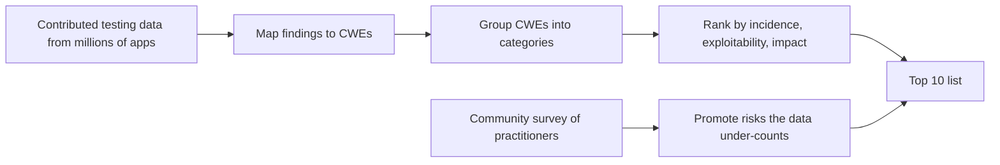
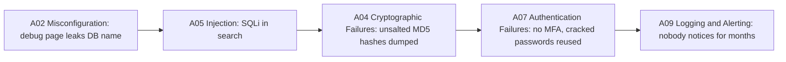

# OWASP Top 10

## Introduction

When a security engineer says "that's an A01" or a compliance questionnaire asks "how do you address the OWASP Top 10?", they are using a shared vocabulary. The **OWASP Top 10** is an awareness document published by the Open Worldwide Application Security Project (OWASP), a nonprofit community. It lists the ten most critical categories of web application security risk, based on data from real application testing plus a community survey.

Think of it like the "top ten causes of kitchen fires" leaflet from a fire department. It does not teach you to cook, and a kitchen without those ten hazards can still burn down. But if you fix the top ten, you have removed the problems that cause most fires, and everyone on the team now uses the same words.

The current edition is **OWASP Top 10:2025**, the eighth installment of the project. This page walks through every category with a short code example, explains what changed since 2021, and shows how to use the list well, and how teams misuse it.

:::note Check the source
OWASP publishes the list at [owasp.org/Top10](https://owasp.org/Top10/) (now served from `top10.owasp.org`). Category details, mapped CWEs and examples live there. This page summarizes the 2025 edition. A future edition may change the order or names.
:::

## How the List Is Built

The ranking is not a popularity poll, and it is not purely data either.



According to the 2025 introduction, eight categories come from the data and two are promoted by the community survey, because testing data lags behind emerging risks. Each category groups many **CWEs** (Common Weakness Enumeration entries, MITRE's catalog of weakness types). For example, "Injection" includes SQL injection (CWE-89), OS command injection (CWE-78) and cross-site scripting (CWE-79).

## The 2025 List at a Glance

| ID | Category | Change from 2021 |
| --- | --- | --- |
| A01:2025 | Broken Access Control | Still #1; now includes SSRF |
| A02:2025 | Security Misconfiguration | Up from #5 |
| A03:2025 | Software Supply Chain Failures | New; expands "Vulnerable and Outdated Components" |
| A04:2025 | Cryptographic Failures | Down from #2 |
| A05:2025 | Injection | Down from #3 |
| A06:2025 | Insecure Design | Down from #4 |
| A07:2025 | Authentication Failures | Renamed from "Identification and Authentication Failures" |
| A08:2025 | Software or Data Integrity Failures | Same position |
| A09:2025 | Security Logging and Alerting Failures | Renamed from "...Monitoring Failures" |
| A10:2025 | Mishandling of Exceptional Conditions | New |

Two changes are worth remembering:

- **SSRF was merged into Broken Access Control.** In 2021, Server-Side Request Forgery was its own category (A10:2021). In 2025 it is treated as an access control failure: the server is tricked into reaching places the user should not be able to reach. This tutorial still gives SSRF [its own page](./6-sec-ssrf.mdx) because the fix is quite different.
- **Two new categories reflect how attacks have shifted.** Supply chain attacks (compromised packages, build systems and update channels) and failures to handle errors safely ("fail open") now have their own entries.

## The Categories, One by One

Each section below gives a one-line definition, a tiny example, and where to learn more.

### A01: Broken Access Control

Users can act outside their intended permissions: reading another customer's invoice, calling an admin endpoint, or making the server fetch an internal URL.

```python
# Vulnerable: any logged-in user can read any invoice by changing the ID
@app.get("/invoices/<int:invoice_id>")
def invoice(invoice_id):
    return Invoice.query.get_or_404(invoice_id).to_dict()

# Fixed: scope the lookup to the current user's tenant
@app.get("/invoices/<int:invoice_id>")
def invoice(invoice_id):
    inv = Invoice.query.filter_by(id=invoice_id, tenant_id=current_user.tenant_id).first_or_404()
    return inv.to_dict()
```

Deep dives: [Broken Access Control](./2-sec-broken-access-control.mdx), [SSRF](./6-sec-ssrf.mdx), [Broken Object Level Authorization](../7-sec-api-security/2-sec-bola.mdx).

### A02: Security Misconfiguration

The code may be fine, but the deployment is not: debug mode in production, default credentials, verbose error pages, open cloud storage, missing security headers or unnecessary features enabled. OWASP notes misconfigurations were more prevalent in the data for this cycle, which pushed the category to #2.

```python
# Vulnerable: debug mode exposes stack traces and an interactive debugger
app.run(host="0.0.0.0", debug=True)

# Fixed: debug off, configuration from the environment
import os
app.run(host="127.0.0.1", debug=os.environ.get("FLASK_DEBUG") == "1")
```

Deep dives: [Security Headers, CORS and CSP](./9-sec-security-headers.mdx), [Secure Defaults and Configuration](../5-sec-secure-coding/6-sec-secure-defaults.mdx), [Common Cloud Misconfigurations](../8-sec-cloud-and-container/2-sec-cloud-misconfigurations.mdx).

### A03: Software Supply Chain Failures

Your app is only as trustworthy as everything that goes into it: open-source packages, base images, CI/CD runners, build scripts and update servers. This category grew out of "Vulnerable and Outdated Components" and was voted a top concern in the community survey.

```text
# Vulnerable: unpinned dependencies; any new release (or a hijacked one) gets installed
requests
flask

# Fixed: pinned versions with hashes (generated by pip-tools or uv)
requests==2.32.5 --hash=sha256:...
flask==3.1.2 --hash=sha256:...
```

Deep dives: [Software Supply Chain Security](../6-sec-appsec-and-devsecops/5-sec-supply-chain.mdx), [SBOMs, Signing and SLSA](../6-sec-appsec-and-devsecops/6-sec-sbom-and-signing.mdx), [Dependency Scanning and SCA](../6-sec-appsec-and-devsecops/4-sec-dependency-scanning.mdx).

### A04: Cryptographic Failures

Sensitive data is exposed because crypto is missing, weak or misused: passwords hashed with MD5, data sent over plain HTTP, hard-coded keys, or predictable "random" tokens.

```python
# Vulnerable: fast, unsalted hash for passwords
import hashlib
stored = hashlib.md5(password.encode()).hexdigest()

# Fixed: a slow, salted password hash (pip install argon2-cffi)
from argon2 import PasswordHasher
ph = PasswordHasher()
stored = ph.hash(password)
```

Deep dives: the whole [Cryptography](../1-sec-cryptography/0-sec-crypto-introduction.mdx) section, especially [Password Hashing](../1-sec-cryptography/2-sec-password-hashing.mdx).

### A05: Injection

Untrusted data is sent to an interpreter as part of a command or query: SQL, OS commands, LDAP, template engines, and HTML/JavaScript (XSS).

```python
# Vulnerable
cur.execute(f"SELECT * FROM users WHERE email = '{email}'")

# Fixed
cur.execute("SELECT * FROM users WHERE email = ?", (email,))
```

Deep dives: [SQL Injection](./3-sec-sql-injection.mdx), [Cross-Site Scripting](./4-sec-xss.mdx), [Command Injection and Path Traversal](./7-sec-command-injection.mdx).

### A06: Insecure Design

The flaw is in the design, not the code: a password reset that relies on guessable security questions, a checkout that trusts the price sent by the browser, or no rate limit on a gift-card balance check. A perfect implementation of an insecure design is still insecure.

```text
Insecure design:  "Users can apply any number of discount codes per order."
Secure design:    "At most one code per order, validated and priced server-side,
                   with redemption recorded atomically."
```

Deep dives: [Business Logic Vulnerabilities](./11-sec-business-logic-flaws.mdx), [Threat Modeling with STRIDE](../6-sec-appsec-and-devsecops/1-sec-threat-modeling.mdx), [Secure Design Principles](../0-sec-fundamentals/6-sec-security-principles.mdx).

### A07: Authentication Failures

Attackers can pretend to be someone else: credential stuffing with no rate limiting, weak password rules, missing MFA, session IDs that never expire, or session fixation.

```python
# Vulnerable: no limit on attempts, so credential stuffing is free
@app.post("/login")
def login(): ...

# Fixed: rate limit per account and per IP (pip install Flask-Limiter)
@app.post("/login")
@limiter.limit("5 per minute")
def login(): ...
```

Deep dives: the [Authentication and Authorization](../4-sec-authentication/0-sec-authn-vs-authz.mdx) section.

### A08: Software or Data Integrity Failures

Code or data is trusted without checking its integrity: unsigned updates, deserializing untrusted objects, or CI pipelines that pull scripts from the internet and run them.

```python
# Vulnerable: unpickling a cookie lets the client run code on your server
data = pickle.loads(base64.b64decode(request.cookies["prefs"]))

# Fixed: a data-only format, validated against expected fields
data = json.loads(request.cookies.get("prefs", "{}"))
theme = data.get("theme") if data.get("theme") in {"light", "dark"} else "light"
```

Deep dives: [Insecure Deserialization](./8-sec-insecure-deserialization.mdx), [Securing CI/CD Pipelines](../6-sec-appsec-and-devsecops/8-sec-pipeline-security.mdx).

### A09: Security Logging and Alerting Failures

Attacks happen and nobody notices: logins are not logged, logs are not centralized, or, as the renamed category stresses, logs exist but nothing **alerts** on them. OWASP puts it plainly: great logging with no alerting is of minimal value.

```python
# Fixed: log security events in a structured, alertable way (no secrets in logs)
import logging, json
security_log = logging.getLogger("security")

def log_failed_login(username, ip):
    security_log.warning(json.dumps({"event": "login_failed", "user": username, "ip": ip}))
```

Deep dives: [Secure Error Handling and Logging](../5-sec-secure-coding/2-sec-error-handling-and-logging.mdx), [Security Logging and SIEM](../11-sec-defensive-operations/1-sec-logging-and-siem.mdx).

### A10: Mishandling of Exceptional Conditions

New in 2025. The app fails to prevent, detect or respond to unusual conditions: errors that leak internals, missing parameters that crash a handler, or, worst of all, code that **fails open** and grants access when something unexpected happens.

```python
# Vulnerable: if the permission service times out, everyone is allowed in
def can_edit(user, doc):
    try:
        return permission_service.check(user.id, doc.id)
    except Exception:
        return True          # fail open

# Fixed: fail closed, log, and let the caller show a friendly error
def can_edit(user, doc):
    try:
        return permission_service.check(user.id, doc.id)
    except Exception:
        security_log.exception("permission check failed for user=%s doc=%s", user.id, doc.id)
        return False         # fail closed
```

Here is a runnable demonstration of why the difference matters:

```python
# fail_open_demo.py
def flaky_check(user):
    raise TimeoutError("permission service timed out")

def can_edit_open(user):
    try:
        return flaky_check(user)
    except Exception:
        return True

def can_edit_closed(user):
    try:
        return flaky_check(user)
    except Exception:
        return False

print("fail-open allows:", can_edit_open("mallory"))
print("fail-closed allows:", can_edit_closed("mallory"))
```

Output:

```text
fail-open allows: True
fail-closed allows: False
```

OWASP's guidance for this category includes catching errors where they happen, using a global exception handler as a backstop, rolling back incomplete transactions completely, and applying rate limits and quotas so unusual conditions are less likely in the first place.

## How the Categories Relate

The categories overlap, and real incidents usually chain several of them.



This is why "we fixed the top one" is never the end of the story. Defense in depth means each layer limits the damage of the others' failures. See [Defense in Depth](../0-sec-fundamentals/4-sec-defense-in-depth.mdx).

## Using the Top 10 Well

The Top 10 is an **awareness** document, not a complete testing standard; for verifiable requirements OWASP points to ASVS. Here is how it fits with related OWASP projects:

| Resource | What it is | Use it for |
| --- | --- | --- |
| OWASP Top 10:2025 | Ten broad risk categories | Training, prioritization, shared vocabulary |
| OWASP API Security Top 10 (2023) | Ten API-specific risks | API design and review; see [OWASP API Security Top 10](../7-sec-api-security/1-sec-owasp-api-top-10.mdx) |
| OWASP ASVS 5.0 | A detailed list of verifiable requirements, in three levels | Requirements, test plans, vendor assessments |
| OWASP Cheat Sheet Series | Practical how-to guides per topic | Implementing specific defenses |
| OWASP Top 10 for LLM Applications | Risks specific to LLM apps | AI features; see [Security for AI and LLM Applications](../13-sec-governance/5-sec-ai-security.mdx) |

A simple, practical way to use the list in a team is a **pull request checklist** that maps risky changes to categories:

```yaml
# checklist.yaml: a security section for your pull request template
security_checklist:
  - id: A01
    question: "Does every new endpoint check that the caller may access this specific object?"
  - id: A02
    question: "Did any config, header, CORS or debug setting change?"
  - id: A03
    question: "Did dependencies change? Are they pinned and scanned?"
  - id: A05
    question: "Does user input reach SQL, a shell, a template, or HTML without parameters or escaping?"
  - id: A07
    question: "Does this touch login, sessions, password reset or MFA?"
  - id: A09
    question: "Are security-relevant events logged, and would anyone be alerted?"
  - id: A10
    question: "What happens if a dependency times out or returns an error? Does it fail closed?"
```

You can load and print it to check it parses:

```python
import yaml

with open("checklist.yaml") as f:
    items = yaml.safe_load(f)["security_checklist"]
for item in items:
    print(f"[{item['id']}] {item['question']}")
```

Output:

```text
[A01] Does every new endpoint check that the caller may access this specific object?
[A02] Did any config, header, CORS or debug setting change?
[A03] Did dependencies change? Are they pinned and scanned?
[A05] Does user input reach SQL, a shell, a template, or HTML without parameters or escaping?
[A07] Does this touch login, sessions, password reset or MFA?
[A09] Are security-relevant events logged, and would anyone be alerted?
[A10] What happens if a dependency times out or returns an error? Does it fail closed?
```

## Real-World Scenario

You are the tech lead of a 12-person team running an e-commerce platform. A large enterprise customer sends a security questionnaire: "Describe how your application addresses the OWASP Top 10." Leadership also wants to know where to spend next quarter's security budget. You have three options on the table: buy a WAF with an "OWASP Top 10 ruleset", buy a scanner that produces an "OWASP Top 10 report", or invest engineering time in fixes and process.

**The walkthrough:**

1. **Map, don't guess.** For each category, write down which controls you already have and how you know they work. For A01 that might be "a central authorization helper, plus integration tests that try cross-tenant access". For A09 it might honestly be "we log logins but nothing alerts".
2. **Find the gaps that matter for your app.** An e-commerce site is exposed to A06 (price and coupon logic), A07 (credential stuffing against customer accounts) and A03 (a large JavaScript dependency tree). A08's deserialization risk may be low if you only accept JSON.
3. **Pick controls per gap**, using the table below.
4. **Answer the questionnaire with evidence**: the controls, the tests that prove them, and the residual risks you accept.

**Why this approach:** The Top 10 is a map of risk areas, not a product feature. Mapping each category to specific controls and evidence produces a credible answer and a prioritized backlog at the same time.

**When to use it:** Annual planning, customer questionnaires, onboarding new engineers, and choosing what to automate. **When not to:** As a complete test plan or a certification. For that, use ASVS requirements at the level that fits your risk.

| Approach | Pros | Cons | Best for |
| --- | --- | --- | --- |
| WAF with Top 10 rules | Quick; blocks common injection payloads | Cannot see A01/A06 logic flaws; bypasses exist; tuning needed | Extra layer, virtual patching |
| Scanner with Top 10 report | Repeatable; good for A02, A03, A05 | Misses access control and logic bugs; false positives | CI regression checks |
| Engineering fixes + tests | Fixes root causes; covers logic | Needs time and skills | Core of any program |
| ASVS-based assessment | Detailed, verifiable requirements | More effort than the Top 10 | Regulated or high-risk apps |

In practice the team chooses engineering fixes for A01, A06 and A07, adds SCA and SAST to CI for A03 and A05, and keeps a managed WAF as a secondary layer.

## Common Mistakes

- **Treating the Top 10 as a checklist that proves security.** "We have no Top 10 issues" does not mean "we are secure". The list is the floor, not the ceiling.
- **Buying a tool to "cover" the Top 10.** No tool can tell whether user 17 should see order 42. Access control and business logic need human design and tests.
- **Using outdated category names.** Many blog posts and tools still use the 2021 list. If a report says "A10 SSRF" or "A06 Vulnerable Components", it is using 2021 numbering.
- **Ignoring the new categories.** Supply chain and exceptional-condition handling are easy to miss because they are not "classic" web bugs.
- **Only training developers on injection.** Injection dropped to #5. Access control and misconfiguration deserve at least as much attention.

## Summary

- The OWASP Top 10:2025 is the current awareness list of the most critical web application risk categories.
- Broken Access Control stays #1 and now includes SSRF. Security Misconfiguration rose to #2.
- Software Supply Chain Failures (A03) and Mishandling of Exceptional Conditions (A10) are new.
- Categories overlap and chain together in real incidents, so layered defenses matter.
- Use the Top 10 for awareness and prioritization; use ASVS for detailed, testable requirements.

## Further Learning

**Exercises**

1. Take an app you know and fill in a table with one row per 2025 category: "existing control", "evidence it works", "gap". Pick the top two gaps.
2. Write a fail-closed wrapper for a function that calls an external permission service, and a unit test that proves it returns `False` when the service raises an exception.
3. Find a security tool or report that still uses 2021 numbering and map each finding to its 2025 category.

**Next steps**

- [Broken Access Control](./2-sec-broken-access-control.mdx): A01 in depth.
- [SQL Injection](./3-sec-sql-injection.mdx): the best-known member of A05.
- [OWASP API Security Top 10](../7-sec-api-security/1-sec-owasp-api-top-10.mdx): the API-focused companion list.
