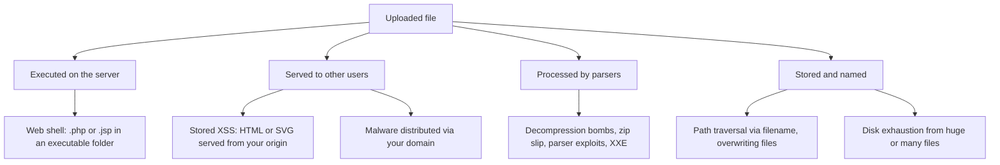
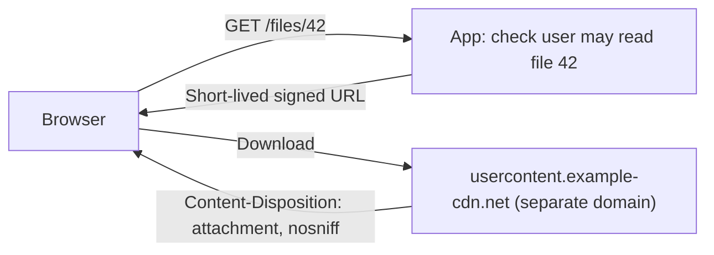
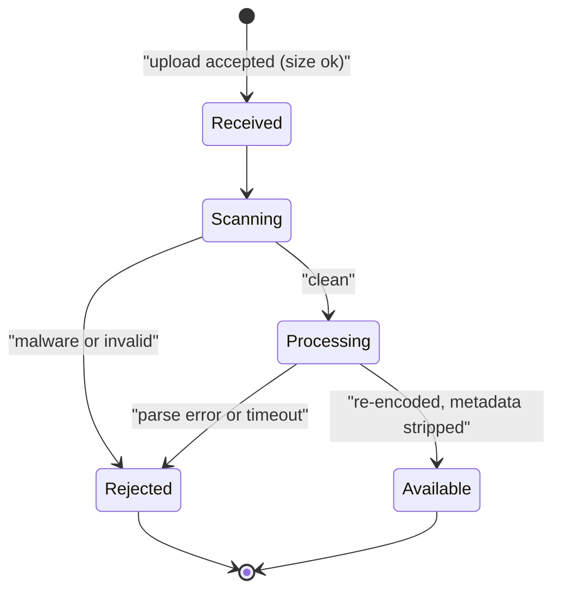

# Secure File Uploads

## Introduction

Almost every app accepts files: profile pictures, invoices, CSV imports, support attachments, resumes. Each upload is a chunk of attacker-controlled bytes, with an attacker-controlled name and an attacker-controlled content type, that your server stores and later serves to other people. That makes upload features one of the richest attack surfaces in a web app.

An analogy: a file upload is a mailroom. Most packages are fine, but a careless mailroom accepts a package labelled "documents" without looking inside, stores it in the server room, and hands it to anyone who asks for it by name. A careful mailroom checks the size, scans what is really inside, repackages it in a standard box, stores it in a locked back room under a tracking number, and only gives it to people on the recipient list.

Upload bugs map to several OWASP Top 10:2025 categories at once: **A05 Injection** (stored XSS through HTML or SVG files), **A01 Broken Access Control** (reading other users' files, path traversal), **A02 Security Misconfiguration** (executable upload folders) and **A10 Mishandling of Exceptional Conditions** (resource exhaustion).

:::warning Only test what you own
Test upload handling on your own code or in DVWA's "File Upload" module, OWASP Juice Shop, or PortSwigger Web Security Academy's file upload labs. Uploading test payloads to real services you do not own is unauthorized testing, even if the payload is harmless.
:::

## What Can Go Wrong



| Risk | Example | Main control |
| --- | --- | --- |
| Remote code execution | `avatar.php` saved under a folder the web server executes | Store outside web root; never execute uploads |
| Stored XSS | `invoice.html` or an SVG with script served from `app.example.com` | Serve as attachment, from a separate domain, with `nosniff` and a sandbox CSP |
| Path traversal | Filename `../../app/config.py` | Server-generated names |
| Content-type spoofing | HTML sent with `Content-Type: image/png` | Detect type from content; re-encode |
| Resource exhaustion | 10 GB upload, or a small image that decompresses to gigapixels | Size limits, pixel limits, timeouts |
| Parser vulnerabilities | Malformed image or PDF exploits a library bug | Patched libraries, sandboxed processing |
| Malware hosting | Your domain distributes malicious files | Antivirus scanning, access control |
| Privacy leaks | Photo EXIF data with GPS coordinates | Strip metadata by re-encoding |

## A Vulnerable Upload Handler

```python
# Vulnerable: local lab only
import os
from flask import Flask, request

app = Flask(__name__)
UPLOAD_DIR = "static/uploads"            # inside the web root, served directly

@app.post("/avatar")
def upload_avatar():
    f = request.files["file"]
    if not f.mimetype.startswith("image/"):   # trusts the client's Content-Type
        return {"error": "images only"}, 400
    path = os.path.join(UPLOAD_DIR, f.filename)  # trusts the client's filename
    f.save(path)                               # no size limit, no content check
    return {"url": "/" + path}
```

Every line after the decorator has a problem:

- `f.mimetype` comes from the client and can say anything.
- `f.filename` can contain `../` or an executable extension.
- Files land in `static/`, served from your main origin, so an HTML file becomes stored XSS. If the server ran PHP or similar for that folder, it could become code execution.
- There is no size limit, so one request can fill the disk.

## Building It Safely

The [OWASP File Upload Cheat Sheet](https://cheatsheetseries.owasp.org/cheatsheets/File_Upload_Cheat_Sheet.html) lists the core controls. Applied to an avatar upload:

1. **Limit size** before reading the body.
2. **Allowlist types**, detected from the **content**, not the extension or `Content-Type` header alone.
3. **Rewrite the content** where possible: decode and re-encode images, which also strips metadata.
4. **Generate the filename** on the server.
5. **Store outside the web root**, ideally in object storage or on a different host.
6. **Serve safely**: correct content type, `nosniff`, `Content-Disposition` for downloads, and a separate domain for user content.
7. **Authorize** both upload and download.

```python
# upload_fixed.py  (Fixed)  pip install flask pillow
import io
import uuid
from pathlib import Path

from flask import Flask, request, abort, send_from_directory
from PIL import Image, UnidentifiedImageError

app = Flask(__name__)
app.config["MAX_CONTENT_LENGTH"] = 5 * 1024 * 1024        # 5 MB: larger bodies get 413

STORAGE = Path("/tmp/avatar-store")                     # outside the web root
STORAGE.mkdir(parents=True, exist_ok=True)
ALLOWED_FORMATS = {"PNG", "JPEG", "WEBP"}
Image.MAX_IMAGE_PIXELS = 25_000_000                     # guard against decompression bombs

def reencode_image(data: bytes) -> tuple[bytes, str]:
    try:
        with Image.open(io.BytesIO(data)) as img:
            fmt = img.format                            # detected from content, not filename
            if fmt not in ALLOWED_FORMATS:
                raise ValueError(f"format {fmt} not allowed")
            img.thumbnail((512, 512))                   # resize also bounds memory use
            out = io.BytesIO()
            # Re-encoding writes fresh pixels and drops metadata (EXIF GPS, comments)
            img.convert("RGB").save(out, format="PNG")
            return out.getvalue(), "png"
    except (UnidentifiedImageError, Image.DecompressionBombError, OSError) as e:
        raise ValueError("not a valid image") from e

@app.post("/avatar")
def upload_avatar():
    file = request.files.get("file")
    if file is None:
        abort(400, description="no file")
    try:
        clean, ext = reencode_image(file.read())
    except ValueError as e:
        abort(400, description=str(e))
    name = f"{uuid.uuid4().hex}.{ext}"                  # server-chosen name
    (STORAGE / name).write_bytes(clean)
    return {"id": name}, 201

@app.get("/avatar/<name>")
def get_avatar(name):
    resp = send_from_directory(STORAGE, name, mimetype="image/png")
    resp.headers["X-Content-Type-Options"] = "nosniff"
    resp.headers["Content-Security-Policy"] = "default-src 'none'; sandbox"
    return resp

if __name__ == "__main__":
    c = app.test_client()
    png = io.BytesIO()
    Image.new("RGB", (800, 600), "teal").save(png, format="PNG")
    tests = {
        "real PNG": (png.getvalue(), "me.png"),
        "HTML renamed .png": (b"<html><script>alert(1)</script></html>", "me.png"),
        "PHP script as .php.jpg": (b"<?php echo 'server-side code'; ?>", "x.php.jpg"),
        "huge body": (b"0" * (6 * 1024 * 1024), "big.png"),
    }
    for label, (data, filename) in tests.items():
        r = c.post("/avatar", data={"file": (io.BytesIO(data), filename)},
                   content_type="multipart/form-data")
        print(f"{label:24} -> {r.status_code}")
```

Output:

```text
real PNG                 -> 201
HTML renamed .png        -> 400
PHP script as .php.jpg   -> 400
huge body                -> 413
```

How each control helped:

- `MAX_CONTENT_LENGTH` makes Flask reject oversized bodies with `413 Request Entity Too Large` before your code reads them. Set a limit at the reverse proxy too (`client_max_body_size` in nginx).
- `Image.open(...).format` identifies the real format from the file's bytes. The HTML and PHP files are not images, whatever their names say.
- Re-encoding with Pillow produces a brand-new file containing only pixels. Hidden payloads appended to an image, EXIF metadata and odd chunks are gone.
- `Image.MAX_IMAGE_PIXELS` turns a decompression bomb (a tiny file declaring enormous dimensions) into an error instead of an out-of-memory crash.
- The stored name is a random UUID, so filenames cannot traverse paths or collide.
- The download route adds `nosniff` and a `sandbox` CSP, so even if something unexpected is served, the browser will not run it as a page.

:::note Extension checks still have a place
For formats you cannot easily re-encode (PDF, DOCX, CSV), use an **extension allowlist** plus content checks (file signature, or parsing with the real library), and treat the result as untrusted. Werkzeug's `secure_filename()` is useful if you must keep part of a user's filename for display, but store under a generated name regardless.
:::

## Be Careful with Specific File Types

| Type | Hidden risk | Advice |
| --- | --- | --- |
| SVG | It is XML and can contain `<script>` and event handlers | Avoid accepting SVG from users, or rasterize to PNG, or serve only as attachment from a sandboxed domain |
| HTML, XHTML | Runs script if served inline from your origin | Do not accept, or force download from a separate domain |
| PDF | Can contain JavaScript and links; viewer exploits | Serve as attachment; consider Content Disarm and Reconstruct (CDR) |
| Office documents | Macros, external links, embedded objects | Scan; consider CDR; convert to PDF for previews in a sandbox |
| ZIP, TAR | Zip slip (`../` entries), zip bombs | Validate member paths, cap total extracted size and file count |
| XML (and DOCX/XLSX inside) | XXE: external entities read files or make requests | Use hardened parsers such as `defusedxml` |
| CSV | "CSV injection": cells starting with `=`, `+`, `-`, `@` run as formulas in spreadsheets | Prefix such cells with `'` when exporting |
| Images | Parser bugs, decompression bombs, EXIF GPS data | Re-encode with a patched library and pixel limits |

### Archives: limit paths, counts and sizes

ZIP imports combine two classic problems: entries whose names climb out of the target folder ("zip slip") and archives that expand to enormous sizes ("zip bombs"). Check both before and while extracting:

```python
# safe_zip.py: extract an uploaded ZIP with limits
import io
import zipfile
from pathlib import Path

MAX_FILES = 200
MAX_TOTAL_BYTES = 50 * 1024 * 1024        # uncompressed
MAX_RATIO = 100                           # compressed:uncompressed ratio per member

def safe_extract(data: bytes, dest: Path) -> list[str]:
    dest = dest.resolve()
    extracted, total = [], 0
    with zipfile.ZipFile(io.BytesIO(data)) as zf:
        members = zf.infolist()
        if len(members) > MAX_FILES:
            raise ValueError("too many files")
        for m in members:
            if m.is_dir():
                continue
            target = (dest / m.filename).resolve()
            if not target.is_relative_to(dest):
                raise ValueError(f"unsafe path: {m.filename}")
            if m.compress_size and m.file_size / m.compress_size > MAX_RATIO:
                raise ValueError(f"suspicious compression ratio: {m.filename}")
            total += m.file_size
            if total > MAX_TOTAL_BYTES:
                raise ValueError("archive too large when extracted")
            target.parent.mkdir(parents=True, exist_ok=True)
            with zf.open(m) as src, open(target, "wb") as out:
                # read in chunks and enforce the size even if the header lied
                written = 0
                while chunk := src.read(65536):
                    written += len(chunk)
                    if written > m.file_size:
                        raise ValueError("member larger than declared")
                    out.write(chunk)
            extracted.append(m.filename)
    return extracted

def make_zip(entries: dict[str, bytes]) -> bytes:
    buf = io.BytesIO()
    with zipfile.ZipFile(buf, "w", zipfile.ZIP_DEFLATED) as zf:
        for name, content in entries.items():
            zf.writestr(name, content)
    return buf.getvalue()

if __name__ == "__main__":
    import tempfile
    dest = Path(tempfile.mkdtemp())
    print(safe_extract(make_zip({"data/a.csv": b"id,name\n1,x\n"}), dest))
    for label, entries in {
        "traversal": {"../../evil.txt": b"x"},
        "bomb-like": {"zeros.bin": b"\0" * 20_000_000},
    }.items():
        try:
            safe_extract(make_zip(entries), dest)
        except ValueError as e:
            print(f"{label}: rejected ({e})")
```

Output:

```text
['data/a.csv']
traversal: rejected (unsafe path: ../../evil.txt)
bomb-like: rejected (suspicious compression ratio: zeros.bin)
```

The function checks declared sizes up front *and* counts bytes while writing, because the sizes in a ZIP header are just more attacker-supplied data. Tune the limits to your feature.

### CSV: neutralize formulas on export

If users can enter text that you later export to CSV, a cell starting with `=` may run as a formula when a colleague opens the file in a spreadsheet. OWASP's CSV injection guidance is to prefix such cells so they are treated as text:

```python
# csv_safe.py: neutralize spreadsheet formulas when exporting user data
import csv
import io

FORMULA_PREFIXES = ("=", "+", "-", "@", "\t", "\r")

def neutralize(value: str) -> str:
    return "'" + value if value.startswith(FORMULA_PREFIXES) else value

rows = [["name", "comment"], ["Alice", "Great service"], ["Mallory", '=HYPERLINK("http://evil.example","Click")']]
out = io.StringIO()
writer = csv.writer(out)
for row in rows:
    writer.writerow([neutralize(cell) for cell in row])
print(out.getvalue())
```

Output:

```text
name,comment
Alice,Great service
Mallory,"'=HYPERLINK(""http://evil.example"",""Click"")"
```

## Serving User Files

How you serve files matters as much as how you accept them.



- **Separate domain.** Serving user files from a different registrable domain (for example `example-usercontent.com`, not a subdomain of your app) means that even if a file runs script, it runs on an origin with no access to your app's cookies or pages. Large platforms do this for exactly this reason.
- **Force download** for anything that is not a known-safe inline type:

```text
Content-Type: application/octet-stream
Content-Disposition: attachment; filename="report.pdf"
X-Content-Type-Options: nosniff
```

- **Access control on every download.** Random file names are not authorization. Check that the requesting user may read the file, then stream it or redirect to a short-lived signed URL. See [Broken Access Control](./2-sec-broken-access-control.mdx) and [Securing Cloud Storage](../8-sec-cloud-and-container/3-sec-cloud-storage-security.mdx).

### Direct-to-cloud uploads

With object storage (S3, GCS, Azure Blob), a common pattern is to have the browser upload directly using a **pre-signed URL** your server issues. This keeps large files off your app servers. Restrict the URL tightly: one object key generated by you, a short expiry, a content-length range and content type where the provider supports it. Then process the file asynchronously (scan, re-encode) before marking it available. Never make the bucket public.

## Scanning and Sandboxing

For documents and arbitrary attachments, add:

- **Antivirus scanning**, for example ClamAV (open source) or a cloud provider's malware-scanning service, run asynchronously before files become downloadable. Scanners miss new malware, so this reduces risk rather than eliminating it.
- **Sandboxed processing.** Thumbnailing, PDF rendering and document conversion run in a separate container or function with no network access, a non-root user, CPU/memory/time limits, and no credentials. Parser bugs then have nothing to reach. See [Container Image Security](../8-sec-cloud-and-container/4-sec-container-security.mdx).
- **Content Disarm and Reconstruct (CDR)** for high-risk environments: rebuild documents keeping only known-safe elements.



A file should not be downloadable by anyone until it reaches `Available`.

## Real-World Scenario

You build an HR applicant-tracking system. Candidates upload resumes (PDF, DOCX) and an optional photo. Recruiters open resumes in the browser. Uploads go straight into an S3 bucket via the app server, and recruiters view them through `app.example.com/files/<name>`. A security review flags this as high risk: recruiters are privileged users, and anyone on the internet can upload.

**The walkthrough:**

1. **Accept only what you need:** PDF and DOCX for resumes (extension allowlist plus signature check), JPEG/PNG for photos, with size limits of a few megabytes.
2. **Isolate processing:** an S3 event triggers a sandboxed worker that scans each file and generates a PDF preview and a re-encoded photo, with no network access except to storage.
3. **Serve from a separate domain** with short-lived signed URLs, `Content-Disposition: attachment` for originals and inline display only for generated previews.
4. **Authorize:** only recruiters assigned to that job opening may fetch a candidate's files; every access is logged.
5. **Retention:** delete files when a candidate's data retention period ends. Resumes are personal data. See [Privacy Engineering](../13-sec-governance/4-sec-privacy-engineering.mdx).

**Why this approach:** the riskiest moment is a privileged recruiter opening attacker-supplied content. Generated previews, a separate origin and sandboxed processing make that moment much safer, while scanning catches known-bad files.

**When to use it:** any app where untrusted users upload documents that trusted users open. **When not to go this far:** a simple avatar feature needs only the re-encode-and-store pattern from the code above.

| Approach | Pros | Cons | Best for |
| --- | --- | --- | --- |
| Re-encode (images) | Removes hidden payloads and metadata | Only for formats you can rebuild; costs CPU | Avatars, photos |
| Extension + signature allowlist | Simple; blocks obvious abuse | Polyglot files can pass both | Documents you cannot rebuild |
| Antivirus scanning | Catches known malware | Misses new threats; adds latency | Attachments shared with others |
| CDR | Strips active content from documents | Cost; may alter documents | High-risk orgs, email-like flows |
| Separate user-content domain | Contains XSS from served files | DNS, TLS and CDN setup | Any app serving user files inline |
| Pre-signed direct uploads | Offloads bandwidth; scalable | Must restrict keys, size, expiry; process async | Large files |
| Sandboxed processing workers | Contains parser exploits | Operational complexity | Thumbnailing, document conversion |

## Common Mistakes

- **Trusting `Content-Type` or the extension alone.** Both are chosen by the client.
- **Blocklisting extensions.** `.php` blocked? Try `.phtml`, `.php5`, `.PhP`, or `shell.php.jpg` on a misconfigured server. Allowlist instead.
- **Keeping the user's filename on disk.** Generate names; store the original only as display metadata.
- **Storing uploads inside the web root** or in folders the web server can execute.
- **Serving uploads inline from your main origin.** HTML and SVG then become stored XSS.
- **No size, count or pixel limits.** Disk, memory and CPU exhaustion are easy to trigger.
- **Making buckets public** because "the file names are random".
- **Processing files synchronously in the web worker** with outdated parser libraries. Keep image and document libraries patched and isolated.

## Summary

- Uploads give attackers control of bytes, names and types, and those files are later stored, processed and served.
- Limit size early, detect type from content, and re-encode images to strip hidden content and metadata.
- Generate filenames on the server, store outside the web root, and never execute uploads.
- Serve files with correct types, `nosniff`, `Content-Disposition`, a sandbox CSP and ideally from a separate domain.
- Authorize every download; random names are not access control.
- Scan and process risky files asynchronously in a sandbox before making them available.

## Further Learning

**Exercises**

1. Run `upload_fixed.py` and add a test case for a 1x1 PNG with a very large declared size (hint: generate a big image, then lower `MAX_IMAGE_PIXELS` to simulate). Confirm it returns 400, not a crash.
2. Add an authorization check to `get_avatar` so only the owner and admins can fetch an avatar, storing ownership in a dictionary.
3. Write a function that safely accepts a CSV import: limit size and row count, parse with the `csv` module, and neutralize formula-leading cells on export.
4. In DVWA (local), complete "File Upload" at low and medium, then explain which control in this page's fixed code stops each attempt.

**Related pages**

- [Command Injection and Path Traversal](./7-sec-command-injection.mdx)
- [Security Headers, CORS and CSP](./9-sec-security-headers.mdx)
- [Securing Cloud Storage](../8-sec-cloud-and-container/3-sec-cloud-storage-security.mdx)
- [Malware Analysis Basics](../11-sec-defensive-operations/7-sec-malware-basics.mdx)
