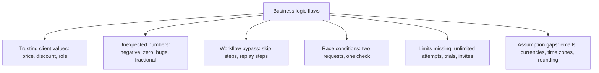
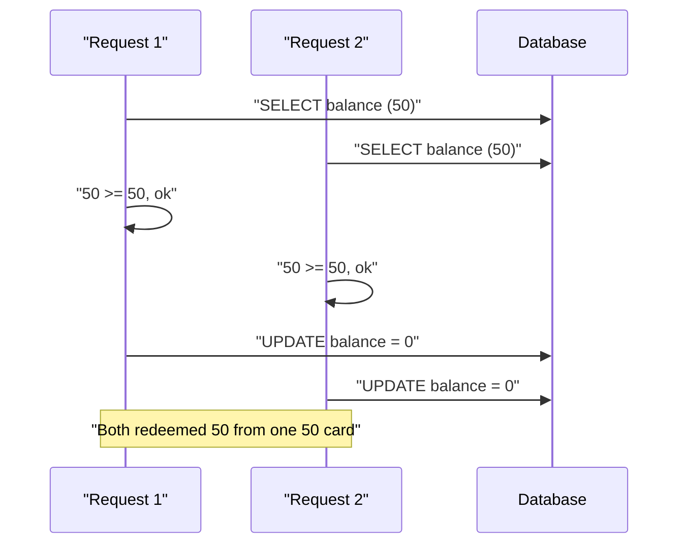
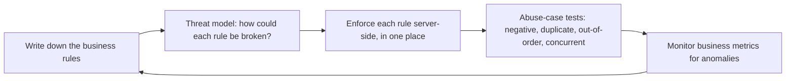

# Business Logic Vulnerabilities

## Introduction

Most vulnerabilities in this section involve malformed input: a stray quote breaks a SQL query, a `<script>` tag lands in HTML. **Business logic vulnerabilities** are different. Every request is well-formed and passes validation. The attacker simply uses your features in an order, quantity, timing or combination you never expected, and the result breaks a business rule: free products, negative balances, skipped payments, unlimited trials.

An analogy: a supermarket's self-checkout scans barcodes perfectly. Nobody hacks the scanner. Instead, someone scans the cheap carrot barcode while bagging steak, or uses the "one coupon per customer" voucher at five different tills at once. The machine works as built; the *rules around it* have gaps.

These flaws are hard for tools to find, because scanners do not know your rules. They sit under **A06 Insecure Design** in the OWASP Top 10:2025, and often overlap with [Broken Access Control](./2-sec-broken-access-control.mdx) and **A10 Mishandling of Exceptional Conditions**.

:::warning Only test what you own
Test business logic only on your own systems, in staging with test payment credentials, or in labs such as PortSwigger Web Security Academy's business logic labs and OWASP Juice Shop. Abusing pricing, coupons or payment flows on real services is fraud, regardless of intent.
:::

## Common Patterns



| Pattern | Example | Typical root cause |
| --- | --- | --- |
| Client-trusted values | Checkout request includes `"price": 0.01` | Server uses the client's number |
| Negative or extreme quantities | `qty: -2` reduces the total | No range checks |
| Coupon or discount stacking | Same code applied five times | Rule exists only in the UI |
| Workflow skipping | Calling `/order/confirm` without paying | Each endpoint assumes earlier steps ran |
| Race conditions | Redeeming a gift card in 5 parallel requests | Check-then-act without atomicity |
| Missing limits | Unlimited password reset emails, free trials with new emails | No rate limits or identity binding |
| Rounding and currency | Many tiny transfers that each round in the attacker's favor | Floats for money, inconsistent rounding |
| Feature interaction | Refund an item bought with a discount at full price | Each feature correct in isolation |

## Example 1: Trusting the Client's Cart

Many shops send the whole cart to the server at checkout, including prices, because the front end already had them. That is convenient and wrong.

```python
# cart.py: pricing on the server (Vulnerable vs Fixed)
from decimal import Decimal

CATALOG = {"mug": Decimal("12.00"), "teapot": Decimal("35.00")}
COUPONS = {"WELCOME10": Decimal("0.10")}

def total_vulnerable(items: list[dict], coupons: list[str]) -> Decimal:
    total = sum(Decimal(str(i["price"])) * i["qty"] for i in items)   # trusts client price and qty
    for code in coupons:                                               # stacks any number of coupons
        total -= total * COUPONS.get(code, Decimal(0))
    return total

def total_fixed(items: list[dict], coupons: list[str]) -> Decimal:
    if len(coupons) > 1:
        raise ValueError("only one coupon per order")
    total = Decimal(0)
    for i in items:
        sku, qty = i["sku"], i["qty"]
        if sku not in CATALOG:
            raise ValueError(f"unknown item {sku}")
        if not isinstance(qty, int) or not 1 <= qty <= 20:
            raise ValueError("quantity must be 1-20")
        total += CATALOG[sku] * qty                                    # price from the server
    for code in coupons:
        if code not in COUPONS:
            raise ValueError("invalid coupon")
        total -= (total * COUPONS[code]).quantize(Decimal("0.01"))
    return total

attack_items = [{"sku": "teapot", "price": 0.01, "qty": 3}, {"sku": "mug", "price": 12.00, "qty": -2}]
print("Vulnerable, tampered price + negative qty:", total_vulnerable(attack_items, []))
print("Vulnerable, coupon x 5:", total_vulnerable([{"sku": "teapot", "price": 35.00, "qty": 1}], ["WELCOME10"] * 5))
for items, coupons in [(attack_items, []), ([{"sku": "teapot", "qty": 1}], ["WELCOME10"] * 5),
                       ([{"sku": "teapot", "qty": 1}], ["WELCOME10"])]:
    try:
        print("Fixed:", total_fixed(items, coupons))
    except ValueError as e:
        print("Fixed: rejected -", e)
```

Output:

```text
Vulnerable, tampered price + negative qty: -23.97
Vulnerable, coupon x 5: 20.66715000000
Fixed: rejected - quantity must be 1-20
Fixed: rejected - only one coupon per order
Fixed: 31.50
```

The vulnerable version produced a **negative** total (a payment provider might even issue a credit) and accepted five copies of the same coupon. The fixed version applies three principles:

1. **The server owns every number that matters**: prices come from the catalog, never the request.
2. **Validate ranges and types**, not just presence: quantities are integers within business limits.
3. **Encode the business rule in code**: "one coupon per order" lives on the server, not just in the UI.

It also uses `Decimal` with explicit rounding for money. Floats introduce rounding errors that attackers can sometimes accumulate in their favor.

## Example 2: Race Conditions (Check-Then-Act)

A gift card has a balance of 50. The redeem endpoint reads the balance, checks it, does some work, and writes the new balance. If five requests arrive at the same moment, they can all read "50" before any of them writes.



A runnable local demonstration with SQLite and threads:

```python
# race.py: redeeming a gift card twice at the same time
import sqlite3
import threading
import time
import tempfile
import os

DB = os.path.join(tempfile.mkdtemp(), "giftcards.db")

def setup():
    conn = sqlite3.connect(DB, timeout=5)
    conn.executescript("""
        DROP TABLE IF EXISTS cards;
        CREATE TABLE cards (code TEXT PRIMARY KEY, balance INTEGER);
        INSERT INTO cards VALUES ('GIFT-50', 50);
    """)
    conn.commit()
    return conn

def redeem_vulnerable(amount, results):
    conn = sqlite3.connect(DB, timeout=5)
    (balance,) = conn.execute("SELECT balance FROM cards WHERE code='GIFT-50'").fetchone()
    if balance >= amount:                       # check...
        time.sleep(0.05)                        # (simulated work: payment call, logging)
        conn.execute("UPDATE cards SET balance = ? WHERE code='GIFT-50'", (balance - amount,))
        conn.commit()                           # ...then act, based on a stale read
        results.append("redeemed")
    else:
        results.append("insufficient")

def redeem_fixed(amount, results):
    conn = sqlite3.connect(DB, timeout=5)
    # Check and act in ONE atomic statement: only succeeds if the balance is still enough
    cur = conn.execute(
        "UPDATE cards SET balance = balance - ? WHERE code='GIFT-50' AND balance >= ?",
        (amount, amount),
    )
    conn.commit()
    results.append("redeemed" if cur.rowcount == 1 else "insufficient")

for fn in (redeem_vulnerable, redeem_fixed):
    keeper = setup()
    results = []
    threads = [threading.Thread(target=fn, args=(50, results)) for _ in range(5)]
    for t in threads: t.start()
    for t in threads: t.join()
    balance = keeper.execute("SELECT balance FROM cards").fetchone()[0]
    print(f"{fn.__name__:18} results={sorted(results)} final_balance={balance}")
```

Example output (timing-dependent; the vulnerable count can vary between runs):

```text
redeem_vulnerable  results=['redeemed', 'redeemed', 'redeemed', 'redeemed', 'redeemed'] final_balance=0
redeem_fixed       results=['insufficient', 'insufficient', 'insufficient', 'insufficient', 'redeemed'] final_balance=0
```

The vulnerable version gave away 250 from a 50 card. The final balance looks perfectly normal, which is why these bugs can go unnoticed until finance reconciles the books.

The fix makes the check and the update a **single atomic operation**: `UPDATE ... WHERE balance >= ?` only changes the row if the condition still holds at the moment of writing, and `rowcount` tells you whether it did. Other options:

- **Row locks**: `SELECT ... FOR UPDATE` inside a transaction (PostgreSQL, MySQL) so concurrent requests wait their turn.
- **Unique constraints**: a `UNIQUE(user_id, coupon_code)` index on a redemptions table makes "use once per user" impossible to violate, even under races.
- **Idempotency keys**: clients send a unique key with each payment or redemption request; the server stores it and returns the original result for repeats, so retries and duplicates cannot double-charge or double-credit.

Race conditions in general, including TOCTOU file-system races, are covered in [Race Conditions and TOCTOU](../5-sec-secure-coding/5-sec-race-conditions.mdx).

## Example 3: Skipping Workflow Steps

Multi-step flows (checkout, onboarding, password reset, KYC verification) often assume users go through the steps in order. Attackers call the final step directly.

The fix is an explicit **state machine** on the server: each object has a status, and only specific transitions are allowed, with preconditions checked server-side.

```python
# workflow.py: enforce allowed state transitions on the server
ALLOWED = {
    "cart":      {"checkout"},
    "checkout":  {"paid", "cart"},
    "paid":      {"shipped", "refunded"},
    "shipped":   {"delivered"},
    "delivered": {"refunded"},
    "refunded":  set(),
}

class Order:
    def __init__(self):
        self.status = "cart"
        self.payment_confirmed = False

    def transition(self, new_status: str):
        if new_status not in ALLOWED[self.status]:
            raise ValueError(f"cannot go from {self.status} to {new_status}")
        if new_status == "paid" and not self.payment_confirmed:
            raise ValueError("payment not confirmed by the payment provider")
        self.status = new_status

order = Order()
order.transition("checkout")
for attempt in ["shipped", "paid"]:
    try:
        order.transition(attempt)
        print("moved to", order.status)
    except ValueError as e:
        print("rejected:", e)
order.payment_confirmed = True      # set only by the verified payment webhook
order.transition("paid")
print("moved to", order.status)
```

Output:

```text
rejected: cannot go from checkout to shipped
rejected: payment not confirmed by the payment provider
moved to paid
```

Note that `payment_confirmed` is set by the verified payment provider webhook, not by the browser's "payment succeeded" redirect, which a user can simply visit. See [Webhook Security](../7-sec-api-security/6-sec-webhook-security.mdx).

## Example 4: Missing Limits and Abuse

Some logic flaws are about **how often** or **how much**:

- Password reset or OTP endpoints that can be called thousands of times (SMS cost abuse, brute forcing short codes).
- Free trials that can be restarted with a new email address forever.
- Referral bonuses claimed by creating fake accounts that refer each other.
- Search or export endpoints that let one user download the entire customer list, one page at a time.
- Inventory hoarding: adding all stock of a limited item to carts that are never paid for.

Controls include rate limits per account, IP and device; caps per time window; binding trials to verified payment methods or phone numbers; anomaly detection on referral graphs; and cart reservations that expire. Rate limiting is covered in [Rate Limiting and Abuse Prevention](../7-sec-api-security/3-sec-rate-limiting.mdx).

## How to Find Logic Flaws Before Attackers Do

Because tools struggle here, finding logic bugs is a design and testing discipline.



1. **Write the rules down.** "One coupon per order", "refund at most the amount paid", "trial once per payment method". Rules that only live in people's heads are not enforced.
2. **Ask "what if" for each rule**: what if the number is negative, zero, enormous or fractional? What if this step is skipped, repeated, or done twice at once? What if two features combine? This is threat modeling for business logic. See [Threat Modeling with STRIDE](../6-sec-appsec-and-devsecops/1-sec-threat-modeling.mdx).
3. **Write abuse-case tests** alongside normal tests:

```python
# test_checkout_abuse.py  (pytest; uses total_fixed from cart.py)
import pytest
from cart import total_fixed

@pytest.mark.parametrize("qty", [0, -1, 21, 1.5, "3"])
def test_rejects_bad_quantities(qty):
    with pytest.raises(ValueError):
        total_fixed([{"sku": "mug", "qty": qty}], [])

def test_ignores_client_price():
    assert total_fixed([{"sku": "mug", "qty": 1, "price": 0.01}], []) == total_fixed([{"sku": "mug", "qty": 1}], [])

def test_one_coupon_only():
    with pytest.raises(ValueError):
        total_fixed([{"sku": "mug", "qty": 1}], ["WELCOME10", "WELCOME10"])
```

Output:

```text
.......                                                                  [100%]
7 passed in 0.02s
```

4. **Monitor business signals**, not just errors: refunds above purchases, gift card balances redeemed more than once, coupon redemptions per account, orders with zero or negative totals. Logic attacks rarely trigger technical alerts, but they do show up in the numbers. See [Detection Engineering](../11-sec-defensive-operations/2-sec-detection-engineering.mdx).

## Real-World Scenario

You run a food-delivery app. Finance notices that promotional credits paid out last month were three times the marketing budget. Investigation shows three issues: users stack a "first order" promo with a referral credit; a group of accounts redeemed the same single-use promo code dozens of times by sending parallel requests; and refunds on discounted orders were issued at the undiscounted price.

**The walkthrough:**

1. **Stop the bleeding:** pause the affected promo codes and add a manual review for refunds over a threshold.
2. **Write the rules explicitly:** at most one promotion per order; each single-use code once per account and once per payment method; refunds never exceed the amount actually charged per line item.
3. **Enforce atomically:** a `promo_redemptions` table with `UNIQUE(code, account_id)` and `UNIQUE(code, payment_fingerprint)`; redemption happens in the same transaction as order creation.
4. **Centralize pricing:** one pricing service computes totals, discounts and refundable amounts; the refund endpoint asks it for the refundable amount instead of reading the menu price.
5. **Add abuse tests and monitoring:** concurrent-redemption tests in CI, and dashboards and alerts for redemptions per account, per device and per payment method.

**Why this approach:** these were not input-validation bugs; each feature worked "correctly" in isolation. The fix is making the rules explicit and enforcing them in one atomic, server-side place, with monitoring because some abuse (fake accounts) can only be limited, not prevented.

**When to use it:** any feature that moves money, credits, inventory, or access: checkout, refunds, promotions, referrals, trials, rewards. **When not to over-engineer:** for internal tools without financial impact, simple validation and access control may be enough.

| Approach | Pros | Cons | Best for |
| --- | --- | --- | --- |
| Server-side recomputation of all values | Removes client tampering | Requires a single source of truth | Prices, totals, permissions |
| Database constraints (UNIQUE, CHECK) | Holds even under races and bugs | Schema changes; less flexible | "Once per user" rules, non-negative balances |
| Atomic conditional updates / row locks | Prevents double-spend | Contention under heavy load | Balances, inventory, quotas |
| Idempotency keys | Safe retries; stops duplicates | Must store keys and results | Payments, order creation |
| Explicit state machines | Blocks skipped or repeated steps | Upfront modeling effort | Checkout, onboarding, approvals |
| Rate limits and quotas | Limits abuse at scale | Tuning; attackers spread across accounts | Resets, OTPs, trials, exports |
| Business-metric monitoring | Catches what code misses | Detects after the fact | Promotions, refunds, referrals |
| WAF / scanners | Find technical bugs | Blind to business rules | Not a control for this class |

## Common Mistakes

- **Enforcing rules only in the UI.** Disabled buttons and hidden fields are suggestions; the API is what attackers use.
- **Using client-supplied prices, totals or discounts.** Recompute everything on the server.
- **Validating presence but not range.** `qty` exists, but is it a positive integer within limits?
- **Check-then-act without atomicity.** Any "if balance is enough, then deduct" logic is a race unless done in one statement or under a lock.
- **Trusting redirects as proof of payment.** Confirm payment server-to-server or via signed webhooks.
- **Using floats for money.** Use `Decimal` or integer cents, with consistent rounding rules.
- **Testing only the happy path.** Add negative, duplicate, out-of-order and concurrent test cases.
- **No business monitoring.** Logic abuse often shows up first as strange numbers, not errors.

## Summary

- Business logic flaws abuse valid features through unexpected values, orders, timing and combinations.
- They fall under Insecure Design and are largely invisible to scanners and WAFs.
- Keep every security-relevant value (prices, roles, status) computed and enforced on the server.
- Use atomic updates, database constraints and idempotency keys to defeat race conditions and duplicates.
- Model workflows as server-side state machines with checked transitions.
- Write the rules down, threat-model them, test abuse cases, and monitor business metrics.

## Further Learning

**Exercises**

1. Run `race.py` several times and record how many "redeemed" results the vulnerable version produces. Then add a `redemptions` table with a `UNIQUE(code, user_id)` constraint and show that even the vulnerable read-then-write version cannot redeem twice for the same user.
2. Extend `workflow.py` with a `cancel` transition that is allowed from `cart` and `checkout`, but not after `shipped`. Write tests for every invalid transition.
3. List five business rules for a feature you work on, and for each one write an abuse-case test idea (negative, duplicate, out-of-order or concurrent).
4. In PortSwigger Web Security Academy, complete "Excessive trust in client-side controls" and "Limit overrun race conditions", then describe the server-side fix for each.

**Related pages**

- [Broken Access Control](./2-sec-broken-access-control.mdx)
- [Race Conditions and TOCTOU](../5-sec-secure-coding/5-sec-race-conditions.mdx)
- [Threat Modeling with STRIDE](../6-sec-appsec-and-devsecops/1-sec-threat-modeling.mdx)
- [Rate Limiting and Abuse Prevention](../7-sec-api-security/3-sec-rate-limiting.mdx)
