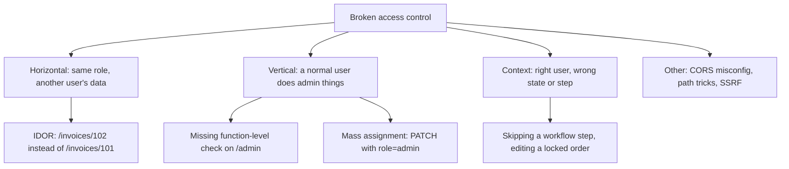
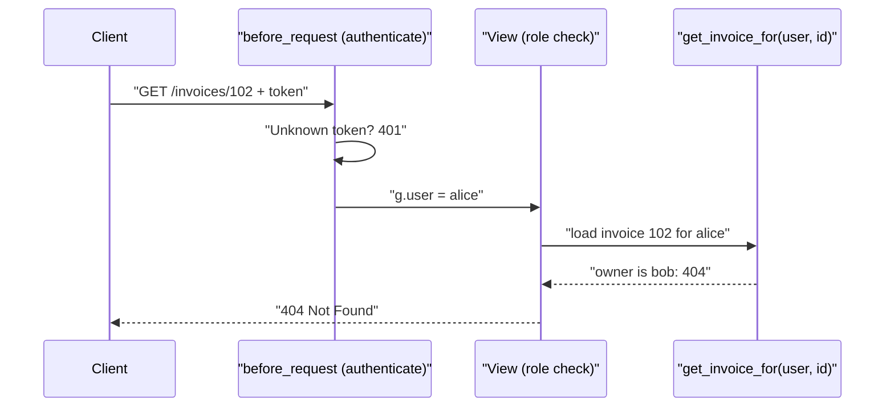

# Broken Access Control

## Introduction

**Authentication** answers "who are you?". **Authorization**, also called access control, answers "are you allowed to do *this*, to *this specific thing*?". Broken access control means the second question is answered wrongly or not at all. It has been #1 in the OWASP Top 10 since 2021 and stays there in the [2025 edition](./1-sec-owasp-top-10.mdx), where it also absorbs Server-Side Request Forgery.

Picture a hotel. The front desk checks your ID and gives you a key card. That is authentication. Broken access control is a key card that opens *every* room on your floor, or a staff-only door that only has a "Staff Only" sign on it and no lock. You got in legitimately; the building just never checked whether you belonged in that room.

These bugs are common for a simple reason: frameworks can authenticate users for you, but only *your* code knows that invoice 102 belongs to Bob. No scanner or WAF knows that either, so these flaws survive automated testing and show up in real breaches.

:::warning Only test what you own
Try these techniques only against your own code or deliberately vulnerable labs such as OWASP Juice Shop, or PortSwigger Web Security Academy's access control labs. Changing IDs in URLs on a real site you do not own is unauthorized access in many jurisdictions.
:::

## The Main Forms of Broken Access Control



| Type | Example | Root cause |
| --- | --- | --- |
| IDOR (Insecure Direct Object Reference) | Changing `/invoices/101` to `/invoices/102` | Lookup by ID without an ownership check |
| Missing function-level access control | A normal user calls `GET /admin/users` | Endpoint checks login but not role |
| Mass assignment | `PATCH /me` with `"role": "admin"` | Copying all request fields onto the model |
| Forced browsing | Visiting `/reports/export` that is "hidden" from the menu | Security through obscurity |
| Metadata or token tampering | Editing a role claim in an unsigned cookie or JWT | Trusting client-held authorization data |
| Context-dependent | Changing the shipping address after an order is shipped | State not checked on the server |

API-focused variants such as BOLA (Broken Object Level Authorization) are covered in the [API Security](../7-sec-api-security/2-sec-bola.mdx) section.

## A Vulnerable Example

This small Flask API has three classic flaws. It uses hard-coded tokens so it runs without a database. **Run it only locally.**

```python
# bac_vuln.py  (Vulnerable: local lab only)
from flask import Flask, request, jsonify, abort

app = Flask(__name__)

USERS = {
    "alice-token": {"id": 1, "name": "alice", "role": "user"},
    "bob-token":   {"id": 2, "name": "bob",   "role": "user"},
    "admin-token": {"id": 3, "name": "root",  "role": "admin"},
}
INVOICES = {
    101: {"id": 101, "owner_id": 1, "total": 120},
    102: {"id": 102, "owner_id": 2, "total": 9800},
}

def current_user():
    user = USERS.get(request.headers.get("Authorization", "").removeprefix("Bearer "))
    if user is None:
        abort(401)
    return user

@app.get("/invoices/<int:invoice_id>")
def get_invoice(invoice_id):
    current_user()                      # authenticated... but not authorized
    invoice = INVOICES.get(invoice_id)
    if invoice is None:
        abort(404)
    return jsonify(invoice)

@app.get("/admin/users")
def list_users():
    current_user()                      # any logged-in user can reach the admin API
    return jsonify(list(USERS.values()))

@app.patch("/me")
def update_me():
    user = current_user()
    user.update(request.get_json())     # mass assignment: client can set "role"
    return jsonify(user)
```

Now a short script plays the attacker, using Flask's built-in test client so no network is involved:

```python
from bac_vuln import app

client = app.test_client()
alice = {"Authorization": "Bearer alice-token"}

r = client.get("/invoices/102", headers=alice)          # Bob's invoice
print("IDOR:", r.status_code, r.get_json())

r = client.get("/admin/users", headers=alice)
print("Admin API:", r.status_code, len(r.get_json()), "users")

r = client.patch("/me", headers=alice, json={"role": "admin"})
print("Mass assignment:", r.status_code, r.get_json())
```

Output:

```text
IDOR: 200 {'id': 102, 'owner_id': 2, 'total': 9800}
Admin API: 200 3 users
Mass assignment: 200 {'id': 1, 'name': 'alice', 'role': 'admin'}
```

Alice, a normal user, read Bob's invoice, listed every account, and promoted herself to admin. Every request was *authenticated*. None was *authorized*.

## Fixing It: Four Principles

### 1. Deny by default

Instead of remembering to add a check to every route, make "no access" the default and open up specific endpoints on purpose. In Flask, `before_request` runs for every route, including ones added next year by someone who never read this page.

### 2. Check ownership at the data layer

Never fetch a tenant-owned object by ID alone. Write one helper that always takes the current user, and make it the only way to load the object.

### 3. Check roles for privileged functions

Admin endpoints need an explicit role or permission check. Hiding the admin link in the UI is not a check.

### 4. Allowlist writable fields

Bind only the fields a user may change. Reject or ignore everything else, especially `role`, `is_admin`, `owner_id`, `tenant_id`, `price` and `status`.

Here is the same API with all four applied:

```python
# bac_fixed.py  (Fixed)
from functools import wraps
from flask import Flask, request, jsonify, abort, g

app = Flask(__name__)

USERS = {
    "alice-token": {"id": 1, "name": "alice", "role": "user"},
    "bob-token":   {"id": 2, "name": "bob",   "role": "user"},
    "admin-token": {"id": 3, "name": "root",  "role": "admin"},
}
INVOICES = {
    101: {"id": 101, "owner_id": 1, "total": 120},
    102: {"id": 102, "owner_id": 2, "total": 9800},
}
PUBLIC_ENDPOINTS = {"health"}

@app.before_request
def authenticate():
    # Deny by default: every endpoint requires a user unless explicitly public
    if request.endpoint in PUBLIC_ENDPOINTS:
        return
    token = request.headers.get("Authorization", "").removeprefix("Bearer ")
    g.user = USERS.get(token)
    if g.user is None:
        abort(401)

def require_role(role):
    def decorator(view):
        @wraps(view)
        def wrapper(*args, **kwargs):
            if g.user["role"] != role:
                abort(403)
            return view(*args, **kwargs)
        return wrapper
    return decorator

def get_invoice_for(user, invoice_id):
    """The ONLY way to load an invoice: always scoped to the caller."""
    invoice = INVOICES.get(invoice_id)
    if invoice is None or (invoice["owner_id"] != user["id"] and user["role"] != "admin"):
        abort(404)   # do not reveal whether the ID exists
    return invoice

@app.get("/health")
def health():
    return {"ok": True}

@app.get("/invoices/<int:invoice_id>")
def get_invoice(invoice_id):
    return jsonify(get_invoice_for(g.user, invoice_id))

@app.get("/admin/users")
@require_role("admin")
def list_users():
    return jsonify([{"id": u["id"], "name": u["name"]} for u in USERS.values()])

EDITABLE_FIELDS = {"name"}

@app.patch("/me")
def update_me():
    changes = request.get_json() or {}
    unknown = set(changes) - EDITABLE_FIELDS
    if unknown:
        abort(400, description=f"Fields not editable: {sorted(unknown)}")
    g.user.update({k: str(v)[:50] for k, v in changes.items()})
    return jsonify(g.user)
```

Check it with the same requests:

```python
from bac_fixed import app

client = app.test_client()
alice = {"Authorization": "Bearer alice-token"}
admin = {"Authorization": "Bearer admin-token"}

print("Own invoice:", client.get("/invoices/101", headers=alice).status_code)
print("Bob's invoice:", client.get("/invoices/102", headers=alice).status_code)
print("Admin API as alice:", client.get("/admin/users", headers=alice).status_code)
print("Admin API as admin:", client.get("/admin/users", headers=admin).status_code)
print("Set role:", client.patch("/me", headers=alice, json={"role": "admin"}).status_code)
print("Set name:", client.patch("/me", headers=alice, json={"name": "Alice A."}).get_json())
print("No token:", client.get("/invoices/101").status_code)
print("Health:", client.get("/health").status_code)
```

Output:

```text
Own invoice: 200
Bob's invoice: 404
Admin API as alice: 403
Admin API as admin: 200
Set role: 400
Set name: {'id': 1, 'name': 'Alice A.', 'role': 'user'}
No token: 401
Health: 200
```

:::tip 404 or 403?
For objects that belong to someone else, returning `404 Not Found` avoids confirming that the ID exists, which makes enumeration less useful. For functions the user knows exist but may not use, like an admin page, `403 Forbidden` is clearer. Pick one convention and apply it consistently.
:::

### How the request flows now



## Don't Rely on Unguessable IDs

A common "fix" is switching from sequential IDs (`/invoices/102`) to random UUIDs. That makes guessing harder, and it is a reasonable extra layer. It is **not** access control:

- IDs leak through shared links, browser history, logs, referrer headers, emails and API responses that list related objects.
- Once an attacker sees one UUID, nothing stops them using it.

Use UUIDs if you like, *and* keep the ownership check.

## Don't Put Authorization Only in Middleware at the Edge

Edge or framework middleware is a good place for *authentication* and coarse rules, but it is risky as your *only* authorization layer. In March 2025, Next.js disclosed [CVE-2025-29927](https://nvd.nist.gov/vuln/detail/CVE-2025-29927): a crafted internal header (`x-middleware-subrequest`) could make self-hosted apps skip middleware entirely. Apps that did all their authorization checks in middleware were exposed; apps that also checked access next to the data were not. The fix was to upgrade (patched versions include 14.2.25 and 15.2.3), and the lesson is to keep object-level checks close to the data.

## Defense in Depth: Row-Level Security

For multi-tenant SaaS, you can add a second layer inside the database. PostgreSQL's **row-level security (RLS)** filters rows automatically based on a session setting, so even a query that forgets the `WHERE tenant_id = ...` clause cannot see another tenant's rows.

```sql
-- Run once as the table owner
ALTER TABLE invoices ENABLE ROW LEVEL SECURITY;
ALTER TABLE invoices FORCE ROW LEVEL SECURITY;   -- apply to the owner too

CREATE POLICY tenant_isolation ON invoices
    USING (tenant_id = current_setting('app.tenant_id')::int)
    WITH CHECK (tenant_id = current_setting('app.tenant_id')::int);
```

The application sets the tenant at the start of each transaction:

```python
# psycopg 3
with conn.transaction():
    conn.execute("SELECT set_config('app.tenant_id', %s, true)", (str(user.tenant_id),))
    rows = conn.execute("SELECT id, total FROM invoices").fetchall()  # only this tenant's rows
```

The third argument `true` makes the setting local to the transaction, which matters with connection pools. Note that superusers and roles with `BYPASSRLS` ignore policies, so the app must connect as an ordinary role. See the [PostgreSQL row security docs](https://www.postgresql.org/docs/current/ddl-rowsecurity.html) for details.

## Test Access Control Like a Feature

Access control bugs are regressions waiting to happen. Write tests that encode the **access matrix**, plus a test that walks every route to make sure nothing is accidentally public.

```python
import pytest
from bac_fixed import app

@pytest.fixture
def client():
    return app.test_client()

def auth(token):
    return {"Authorization": f"Bearer {token}"}

@pytest.mark.parametrize("token,invoice_id,expected", [
    ("alice-token", 101, 200),   # owner
    ("alice-token", 102, 404),   # another user's invoice
    ("bob-token",   101, 404),
    ("admin-token", 101, 200),   # admin may read all
])
def test_invoice_access_matrix(client, token, invoice_id, expected):
    assert client.get(f"/invoices/{invoice_id}", headers=auth(token)).status_code == expected

def test_every_route_requires_auth_unless_public(client):
    for rule in app.url_map.iter_rules():
        if rule.endpoint in {"static", "health"}:
            continue
        url = rule.rule.replace("<int:invoice_id>", "101")
        method = sorted(rule.methods - {"HEAD", "OPTIONS"})[0]
        resp = client.open(url, method=method)
        assert resp.status_code == 401, f"{method} {url} is reachable without auth"
```

Run it:

```bash
pip install flask pytest
pytest -q test_access.py
```

Output:

```text
.....                                                                    [100%]
5 passed in 0.05s
```

The second test is the valuable one. When a teammate adds `DELETE /invoices/<id>` without auth, CI fails before the code ships.

## Real-World Scenario

You run a project-management SaaS with 2,000 customer organizations. A customer reports that by changing the `project_id` in a URL, they briefly saw another company's project name. Your Flask code has about 140 routes, and authorization checks are sprinkled through views in different styles. You need a fix this week and a durable solution this quarter.

**This week:**

1. Patch the reported route with a scoped query.
2. Grep for every `.get(`, `get_or_404(` and raw `SELECT ... WHERE id =` that loads tenant data, and list routes without a scoping helper.
3. Add a `before_request` deny-by-default hook and the "every route requires auth" test.
4. Check logs for requests where the tenant of the object differed from the tenant of the user, to see whether anyone abused it.

**This quarter:**

1. Introduce `get_project_for(user, project_id)` style helpers (or a repository layer) and migrate routes to them.
2. Add PostgreSQL RLS on the most sensitive tables as a safety net.
3. Add access-matrix tests for each role, and a cross-tenant test fixture that tries to read tenant B's objects as tenant A.

**Why this approach:** The immediate fix closes the reported hole; the deny-by-default hook and route-walking test stop the most dangerous class of mistakes; centralized helpers and RLS make correct behavior the easy path instead of something each developer must remember.

**When to use it:** Any multi-user or multi-tenant app. **When not to:** RLS adds operational complexity (migrations, connection pooling, debugging "missing" rows). For a small single-tenant internal tool, scoped helpers and tests may be enough.

| Approach | Pros | Cons | Best for |
| --- | --- | --- | --- |
| Per-route checks in each view | Simple to start | Easy to forget; inconsistent | Tiny apps |
| Central helpers / repository layer | One place to review; consistent | Requires discipline to use only the helper | Most apps |
| Policy engine (OPA, Cedar, Oso, OpenFGA) | Policies as code; works for complex rules | Extra service or library to learn | Complex roles, relationships, many services |
| Database RLS | Safety net even for buggy queries | Ops complexity; pool configuration matters | Multi-tenant SaaS on PostgreSQL |
| UUIDs instead of integer IDs | Harder enumeration | Not authorization; IDs leak | Extra layer only |
| WAF rules | None useful for IDOR | Cannot know ownership | Not a fix for this class |

For role and relationship models (RBAC, ABAC and ReBAC), see [RBAC, ABAC and ReBAC](../4-sec-authentication/9-sec-rbac-abac.mdx).

## Common Mistakes

- **Checking authentication and calling it authorization.** `@login_required` proves who the user is, not what they may touch.
- **Trusting IDs from the client for ownership.** If the request body contains `"user_id": 7`, ignore it and use the session's user.
- **Hiding instead of protecting.** Removing a button or menu item is not a control.
- **Binding request JSON straight onto models.** ORMs and frameworks that support "update from dict" make mass assignment easy. Use explicit schemas with allowed fields.
- **Forgetting non-GET methods.** Teams often protect `GET /items/<id>` and forget `PUT`, `PATCH` and `DELETE` on the same path.
- **Leaking through related endpoints.** Exports, search results, autocomplete, file downloads and websocket channels need the same checks as the main page.
- **Failing open.** If the permission service errors, deny. See A10 in the [OWASP Top 10](./1-sec-owasp-top-10.mdx).
- **Not logging denials.** A burst of 403s and 404s from one user is a strong signal of probing. Log them and alert on spikes.

## Summary

- Broken access control is the #1 web risk: authenticated users doing things or seeing data they should not.
- The main forms are IDOR (horizontal), missing function-level checks and mass assignment (vertical), and state or workflow bypasses.
- Fix it with deny by default, scoped data access helpers, explicit role checks and allowlisted writable fields.
- Random IDs and hidden UI help a little but are not access control.
- Keep object checks close to the data, add RLS as a safety net for multi-tenant data, and test the access matrix in CI.

## Further Learning

**Exercises**

1. Add a `DELETE /invoices/<int:invoice_id>` route to `bac_fixed.py`. Write the access-matrix test first, watch it fail, then implement the route using `get_invoice_for`.
2. Extend the route-walking test so it also checks that non-admin users get 403 on every route under `/admin/`.
3. In OWASP Juice Shop (local), find a challenge where you view another user's basket, then describe the one-line server-side fix.
4. Design an RLS policy for a `documents` table where users can read documents in their tenant but only update documents they created.

**Related pages**

- [Authentication vs Authorization](../4-sec-authentication/0-sec-authn-vs-authz.mdx)
- [Broken Object Level Authorization](../7-sec-api-security/2-sec-bola.mdx)
- [Least Privilege and Zero Trust](../0-sec-fundamentals/5-sec-least-privilege.mdx)
- [Business Logic Vulnerabilities](./11-sec-business-logic-flaws.mdx)
