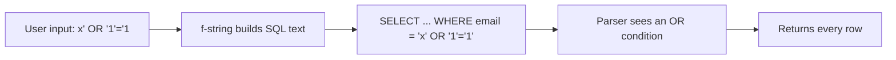
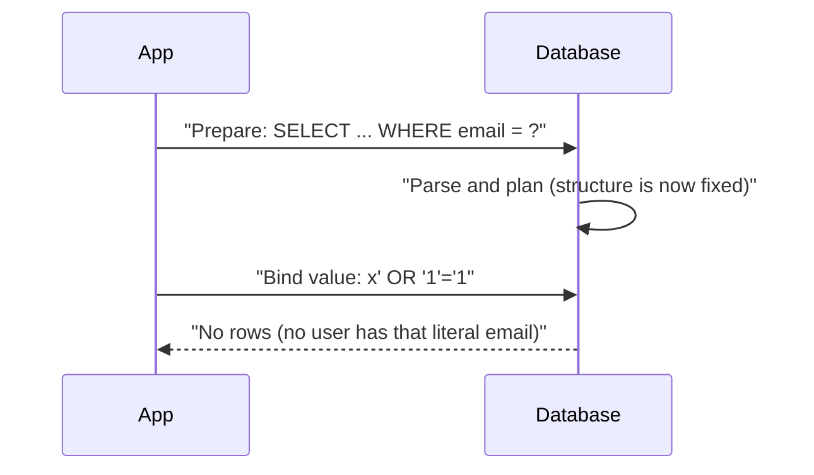
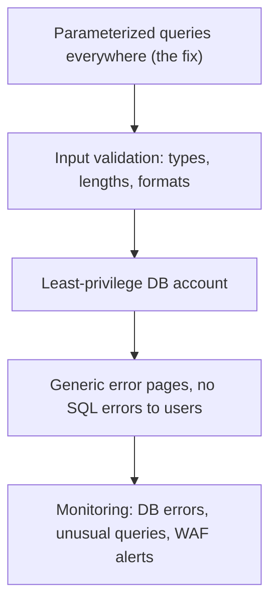

# SQL Injection

## Introduction

SQL injection (SQLi) happens when text from a user becomes part of the **code** of a SQL statement instead of staying a **value**. The database cannot tell which parts you meant and which parts the attacker added, so it runs all of it.

An analogy: you ask a new assistant to read out a form letter, "Dear ___, your balance is ___." Someone fills in the first blank with "Bob. Also, transfer all funds to account 9999." If the assistant treats the whole thing as instructions, you have an injection. The fix is not a smarter assistant who spots suspicious names. It is a form where the blanks can *only* hold names, never instructions.

SQL injection is one of the oldest web vulnerabilities, and it still causes major breaches. In 2023 the Cl0p group exploited a SQL injection flaw in Progress MOVEit Transfer (CVE-2023-34362) to steal data from many organizations, as described in a [joint CISA and FBI advisory](https://www.cisa.gov/news-events/cybersecurity-advisories/aa23-158a). In the OWASP Top 10:2025 it falls under **A05 Injection**.

:::warning Only test what you own
The examples below run against an in-memory SQLite database on your own machine. Practice further in DVWA, OWASP Juice Shop or the PortSwigger Web Security Academy SQL injection labs. Never test login forms or search boxes on sites you do not own or have written permission to test.
:::

## How SQL Injection Works

The problem is building the SQL **text** with string concatenation or formatting:



The quote in the input closes the string literal early, and everything after it is parsed as SQL. Compare that with a **parameterized query**, where the SQL text is fixed and the value is sent separately:



Because the statement's structure is decided before the value arrives, the value can never change it. That is why parameterization is a real fix and not a filter.

## Seeing It Happen (Vulnerable)

```python
# sqli_demo.py  (Vulnerable: local, in-memory database only)
import sqlite3

conn = sqlite3.connect(":memory:")
conn.executescript("""
CREATE TABLE users (id INTEGER PRIMARY KEY, email TEXT, password_hash TEXT, is_admin INTEGER);
INSERT INTO users VALUES (1, 'alice@example.com', 'argon2-hash-a', 0);
INSERT INTO users VALUES (2, 'admin@example.com', 'argon2-hash-b', 1);
CREATE TABLE products (id INTEGER PRIMARY KEY, name TEXT, price REAL);
INSERT INTO products VALUES (1, 'Coffee mug', 9.5), (2, 'Tea pot', 24.0);
""")

def find_user_vulnerable(email):
    # Vulnerable: the input becomes part of the SQL text
    sql = f"SELECT id, email FROM users WHERE email = '{email}'"
    print("SQL sent:", sql)
    return conn.execute(sql).fetchall()

def search_products_vulnerable(term):
    sql = f"SELECT name, price FROM products WHERE name LIKE '%{term}%'"
    return conn.execute(sql).fetchall()

print(find_user_vulnerable("alice@example.com"))
print(find_user_vulnerable("x' OR '1'='1"))
print(search_products_vulnerable("zzz' UNION SELECT email, password_hash FROM users --"))
```

Output:

```text
SQL sent: SELECT id, email FROM users WHERE email = 'alice@example.com'
[(1, 'alice@example.com')]
SQL sent: SELECT id, email FROM users WHERE email = 'x' OR '1'='1'
[(1, 'alice@example.com'), (2, 'admin@example.com')]
[('admin@example.com', 'argon2-hash-b'), ('alice@example.com', 'argon2-hash-a')]
```

Two classic outcomes appear:

1. **Condition bypass.** `OR '1'='1'` makes the `WHERE` clause always true. In a login query this can return the first user in the table, often an admin.
2. **UNION-based data extraction.** `UNION SELECT` appends rows from a different table to the product search. The attacker reads password hashes through a feature meant to list products. The trailing `--` comments out the rest of the original query.

### Variants you will hear about

| Variant | What the attacker observes | Notes |
| --- | --- | --- |
| In-band (error or UNION) | Data or database errors in the response | Easiest to find; verbose errors make it worse |
| Blind boolean | Page differs slightly for true vs false conditions | Data leaks one bit at a time |
| Blind time-based | Response delay when a condition is true | Works even when the page never changes |
| Out-of-band | Database makes a DNS or HTTP request | Depends on database features and network egress |
| Second-order | Payload is stored first, used later in another query | Input looked harmless when it was saved |

Blind and second-order variants are why "we don't show database errors" is not a defense. The fix is the same for all of them.

## The Fix: Parameterized Queries (Fixed)

```python
# sqli_fixed.py  (Fixed)
import sqlite3

conn = sqlite3.connect(":memory:")
conn.executescript("""
CREATE TABLE users (id INTEGER PRIMARY KEY, email TEXT, password_hash TEXT, is_admin INTEGER);
INSERT INTO users VALUES (1, 'alice@example.com', 'argon2-hash-a', 0);
INSERT INTO users VALUES (2, 'admin@example.com', 'argon2-hash-b', 1);
CREATE TABLE products (id INTEGER PRIMARY KEY, name TEXT, price REAL);
INSERT INTO products VALUES (1, 'Coffee mug', 9.5), (2, 'Tea pot', 24.0);
""")

def find_user(email):
    # Fixed: the SQL text is constant; the value travels separately
    return conn.execute("SELECT id, email FROM users WHERE email = ?", (email,)).fetchall()

def search_products(term):
    # Escape LIKE wildcards so '%' and '_' are literal, then bind as a parameter
    escaped = term.replace("\\", "\\\\").replace("%", "\\%").replace("_", "\\_")
    return conn.execute(
        "SELECT name, price FROM products WHERE name LIKE ? ESCAPE '\\'",
        (f"%{escaped}%",),
    ).fetchall()

print(find_user("alice@example.com"))
print(find_user("x' OR '1'='1"))
print(search_products("zzz' UNION SELECT email, password_hash FROM users --"))
print(search_products("mug"))
```

Output:

```text
[(1, 'alice@example.com')]
[]
[]
[('Coffee mug', 9.5)]
```

The attack strings are now ordinary values. No user has the literal email `x' OR '1'='1`, so the result is empty.

The `LIKE` escaping is not about injection (the parameter already prevents that). It stops a user typing `%` from turning a "contains" search into "match everything", which can be slow on large tables.

:::note Placeholder styles differ by driver
Python's `sqlite3` uses `?` or `:name`. `psycopg` (PostgreSQL) uses `%s` or `%(name)s`. Many MySQL drivers use `%s`. These look like Python string formatting but are **not**: you pass the values as a separate argument and the driver handles them. Never write `cursor.execute("... %s" % value)` or `cursor.execute(f"...")`.
:::

The same rule in Node.js with `node-postgres`:

```javascript
// Vulnerable: template literal builds SQL text
const bad = await pool.query(`SELECT id FROM users WHERE email = '${email}'`);

// Fixed: $1 is a placeholder; the value is sent separately
const good = await pool.query("SELECT id FROM users WHERE email = $1", [email]);
```

## ORMs Help, Until You Write Raw SQL

ORMs such as SQLAlchemy, the Django ORM and Prisma parameterize values for you. The danger comes back the moment you build SQL strings yourself, even inside an ORM helper.

```python
# orm_demo.py  (pip install sqlalchemy)
from sqlalchemy import create_engine, text, select, String, Integer
from sqlalchemy.orm import DeclarativeBase, Mapped, mapped_column, Session

class Base(DeclarativeBase):
    pass

class User(Base):
    __tablename__ = "users"
    id: Mapped[int] = mapped_column(Integer, primary_key=True)
    email: Mapped[str] = mapped_column(String(255))

engine = create_engine("sqlite:///:memory:")
Base.metadata.create_all(engine)

with Session(engine) as session:
    session.add_all([User(email="alice@example.com"), User(email="admin@example.com")])
    session.commit()

    attack = "x' OR '1'='1"

    # Safe: the query builder binds values as parameters
    print(session.scalars(select(User.email).where(User.email == attack)).all())

    # Safe: raw SQL with a named bind parameter
    print(session.execute(text("SELECT email FROM users WHERE email = :email"),
                          {"email": attack}).all())

    # Vulnerable: an f-string inside text() is still string concatenation
    print(session.execute(text(f"SELECT email FROM users WHERE email = '{attack}'")).all())
```

Output:

```text
[]
[]
[('alice@example.com',), ('admin@example.com',)]
```

Other ORM escape hatches to watch in code review: Django's `.raw()` and `.extra()`, `cursor.execute` with formatting, Prisma's `$queryRawUnsafe`, and any helper whose name contains "raw" or "unsafe".

## When You Cannot Use a Parameter: Identifiers

Parameters can hold **values**, not **identifiers** such as table names, column names or the `ASC`/`DESC` keyword. A sortable table is the classic case: `ORDER BY ?` does not work the way you want. The fix is an **allowlist** that maps user choices to strings you wrote yourself.

```python
# order_by.py
import sqlite3

conn = sqlite3.connect(":memory:")
conn.executescript("""
CREATE TABLE products (id INTEGER PRIMARY KEY, name TEXT, price REAL);
INSERT INTO products VALUES (1, 'Coffee mug', 9.5), (2, 'Tea pot', 24.0), (3, 'Spoon', 2.0);
""")

SORTABLE = {"name": "name", "price": "price", "newest": "id"}   # user value -> real column
DIRECTIONS = {"asc": "ASC", "desc": "DESC"}

def list_products(sort="name", direction="asc"):
    column = SORTABLE.get(sort)
    order = DIRECTIONS.get(direction.lower())
    if column is None or order is None:
        raise ValueError("invalid sort option")
    # Safe: only strings from our own dictionaries reach the SQL text
    return conn.execute(f"SELECT name, price FROM products ORDER BY {column} {order}").fetchall()

print(list_products("price", "desc"))
try:
    list_products("price; DROP TABLE products", "asc")
except ValueError as e:
    print("Rejected:", e)
```

Output:

```text
[('Tea pot', 24.0), ('Coffee mug', 9.5), ('Spoon', 2.0)]
Rejected: invalid sort option
```

The f-string here is safe only because every piece inserted comes from a fixed dictionary, never from the request.

## Defense in Depth Around the Fix

Parameterized queries are the fix. These layers limit damage if one query slips through:



- **Validate input types.** If an ID must be an integer, parse it as one (`<int:order_id>` in a Flask route). Validation is not a replacement for parameters, but it shrinks what can reach the query.
- **Least privilege.** The web app's database user should not own the schema. A role that can only `SELECT`, `INSERT` and `UPDATE` specific tables cannot `DROP TABLE`, create functions or change the schema.

```sql
-- PostgreSQL: an app role that can use tables but not change the schema
CREATE ROLE shop_app LOGIN PASSWORD 'from-a-secret-manager';
GRANT CONNECT ON DATABASE shop TO shop_app;
GRANT USAGE ON SCHEMA public TO shop_app;
GRANT SELECT, INSERT, UPDATE ON products, orders TO shop_app;
GRANT SELECT ON users TO shop_app;
REVOKE CREATE ON SCHEMA public FROM PUBLIC;
```

- **Hide database errors.** Log full errors server-side and show users a generic message. Detailed errors make in-band extraction much faster (OWASP A10:2025 lists this as a typical scenario).
- **Detect.** Spikes of SQL syntax errors in application logs are a strong signal that someone is probing. Alert on them.
- **Scan in CI.** SAST tools such as Semgrep and Bandit flag string-built queries. See [Static Analysis (SAST)](../6-sec-appsec-and-devsecops/2-sec-sast.mdx).

## Real-World Scenario

You maintain a 10-year-old internal reporting app written in Python. A penetration test found SQL injection in the "custom report" page, which builds `WHERE` clauses from dropdowns and free-text filters. The codebase has about 300 raw SQL queries, many built with `%` formatting. The app is internet-facing for remote staff. The security team proposes putting a WAF in front of it immediately; the developers want to rewrite the query layer.

**The walkthrough:**

1. **Today:** enable WAF SQLi rules (for example a managed ruleset or OWASP Core Rule Set with ModSecurity or Coraza) in blocking mode for the report endpoints. This is **virtual patching**: it buys time.
2. **This week:** fix the reported page by building the `WHERE` clause from an allowlist of filter fields and binding every value.
3. **This month:** run a SAST rule that flags `execute(` calls with formatted strings, and fix them in priority order (internet-facing, then authenticated, then admin-only).
4. **Ongoing:** switch the app's database login to a least-privilege role, hide SQL errors, and add a CI rule that blocks new string-built queries.

Here is a pattern for the dynamic filter builder:

```python
ALLOWED_FILTERS = {
    "region": "region = ?",
    "status": "status = ?",
    "min_total": "total >= ?",
}

def build_report_query(filters: dict):
    clauses, params = [], []
    for key, value in filters.items():
        if key not in ALLOWED_FILTERS:
            raise ValueError(f"unknown filter: {key}")
        clauses.append(ALLOWED_FILTERS[key])
        params.append(value)
    where = " AND ".join(clauses) or "1=1"
    return f"SELECT id, region, status, total FROM orders WHERE {where}", params

sql, params = build_report_query({"region": "EU", "min_total": 100})
print(sql)
print(params)
```

Output:

```text
SELECT id, region, status, total FROM orders WHERE region = ? AND total >= ?
['EU', 100]
```

**Why this approach:** The WAF reduces exposure while the real fix is written; the code fix removes the root cause; least privilege and error hiding reduce the impact of anything missed; CI rules stop regressions.

**When to use it:** Legacy apps with many raw queries and real exposure. **When not to rely on the WAF alone:** always. WAFs match patterns, and attackers routinely find encodings and syntax variations that slip through, especially for blind injection.

| Approach | Pros | Cons | Best for |
| --- | --- | --- | --- |
| Parameterized queries | Eliminates the root cause | Needs code changes everywhere | Every query, always |
| ORM / query builder | Parameterizes by default | Raw-SQL escape hatches remain | New code |
| Allowlisted identifiers | Safe dynamic sorting and filtering | Must maintain the list | Sort, filter, report builders |
| Escaping input manually | No refactor | Error-prone; database-specific; easy to miss a context | Avoid |
| WAF / virtual patch | Fast; no code change | Bypassable; false positives | Temporary cover, extra layer |
| Least-privilege DB role | Limits blast radius | Does not stop data reads the role allows | Every app |
| Stored procedures | Can enforce structure | Vulnerable too if they build dynamic SQL inside | Teams already using them |

## Common Mistakes

- **Escaping quotes by hand.** Writing `email.replace("'", "''")` misses edge cases (encodings, numeric contexts, backslashes in some databases). Use parameters.
- **Parameterizing values but formatting identifiers from input.** `ORDER BY {request.args['sort']}` is still injectable. Use an allowlist.
- **Trusting data from your own database.** Second-order injection stores a payload in one place and triggers it when another query uses it. Parameterize every query, no matter where the value came from.
- **Showing raw database errors.** They speed up attacks and leak schema details.
- **Running the app as a database superuser.** One injectable query then means full control of the database.
- **Thinking NoSQL is immune.** MongoDB queries built from raw JSON input can be manipulated with operators such as `$ne` and `$gt`. Validate types and use the driver's query builders.

## Summary

- SQL injection happens when user input changes the structure of a SQL statement.
- It allows authentication bypass, data theft (including via blind techniques) and sometimes data modification.
- The fix is parameterized queries; ORMs do this by default until you write raw SQL.
- Identifiers like column names cannot be parameters, so map user choices through an allowlist.
- Add least-privilege database roles, generic error pages, monitoring and SAST rules as extra layers.
- A WAF is useful for virtual patching but never replaces the code fix.

## Further Learning

**Exercises**

1. Run `sqli_demo.py`, then add a `login(email, password_hash)` function that is vulnerable to the `OR '1'='1'` bypass. Fix it with parameters and show the bypass no longer works.
2. Extend `order_by.py` so users can also choose a page size between 1 and 100. Which part needs a parameter and which part needs validation?
3. In DVWA (local), complete the SQL injection module at "low", then read the "impossible" level source and identify the line that prevents injection.
4. Write a Semgrep or grep rule that finds `execute(f"` and `execute("..." %` patterns in your codebase.

**Related pages**

- [Input Validation and Output Encoding](../5-sec-secure-coding/1-sec-input-validation.mdx)
- [Command Injection and Path Traversal](./7-sec-command-injection.mdx): the same idea with a shell instead of a database.
- [Cross-Site Scripting (XSS)](./4-sec-xss.mdx): injection into the browser.
- [Static Analysis (SAST)](../6-sec-appsec-and-devsecops/2-sec-sast.mdx)
