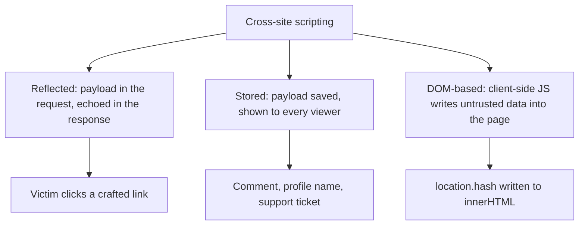
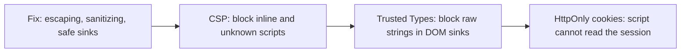

# Cross-Site Scripting (XSS)

## Introduction

Cross-site scripting (XSS) happens when an attacker gets their JavaScript to run in **another user's browser, on your site's origin**. Once that happens, the script can do almost anything the user can: read the page, make requests with the user's session, change their email address, or show a fake login form. The browser cannot tell your scripts from the attacker's, because both came from your domain.

An analogy: your site is a newspaper, and readers trust everything printed in it. XSS is a reader-submitted letter that the editor prints without reading, and the letter contains instructions like "readers should now send their house keys to this address". Readers follow them because the newspaper printed them.

XSS is part of **A05 Injection** in the OWASP Top 10:2025. Modern frameworks prevent most XSS by default, so today it mostly appears where developers step outside those defaults: raw HTML rendering, `innerHTML`, user-controlled URLs and third-party widgets.

:::warning Only test what you own
Practice XSS in local labs such as OWASP Juice Shop, DVWA or WebGoat, or in PortSwigger Web Security Academy's XSS labs. Submitting script payloads to real websites you do not own is unauthorized testing, and stored payloads can affect real users.
:::

## The Three Types of XSS



| Type | Where the bug is | Who is affected | Typical source |
| --- | --- | --- | --- |
| Reflected | Server template | Users who open a crafted link | Search terms, error messages, query parameters |
| Stored | Server template | Everyone who views the stored content | Comments, names, file names, chat messages |
| DOM-based | Client-side JavaScript | Users who open a crafted URL or view crafted data | `location`, `postMessage`, API data written with `innerHTML` |

Stored XSS is the most dangerous, because it needs no click: an admin opening a support ticket in a dashboard may be enough.

## What an Attacker Can Do

Beginners often think XSS is "just an alert box". The `alert(1)` payload is only a harmless proof. Real impact includes:

- Performing actions as the victim (change email, create API keys, transfer funds) by calling your own APIs from the page.
- Reading anything on the page, including personal data and CSRF tokens. XSS defeats [CSRF protection](./5-sec-csrf.mdx).
- Stealing session cookies, **unless** they are `HttpOnly`.
- Showing a convincing fake login prompt on your real domain.

## Reflected and Stored XSS on the Server

The root cause is building HTML with string concatenation. This Flask route is vulnerable:

```python
# Vulnerable: user input concatenated into HTML
from flask import Flask, request

app = Flask(__name__)

@app.get("/search")
def search():
    q = request.args.get("q", "")
    return f"<h1>Results for {q}</h1>"
```

A link like `/search?q=<script>...</script>` makes the server send a page containing the script.

### The fix: auto-escaping templates (Fixed)

Template engines such as Jinja2 (Flask), Django templates, React JSX, Angular and Vue **escape output by default**. Escaping turns `<` into `&lt;` and `"` into `&#34;`, so the browser displays the characters instead of parsing them as markup.

```python
# Fixed: let the template engine escape
from flask import Flask, request, render_template_string

app = Flask(__name__)

@app.get("/search")
def search():
    q = request.args.get("q", "")
    return render_template_string("<h1>Results for {{ q }}</h1>", q=q)
```

You can see exactly what escaping does, and how easy it is to switch off, with Jinja2 directly:

```python
# escaping_demo.py  (pip install jinja2)
from jinja2 import Environment
from markupsafe import Markup

env = Environment(autoescape=True)
payload = ''

print("1:", env.from_string("<p>Hello {{ name }}</p>").render(name=payload))
print("2:", env.from_string("<p>Hello {{ name|safe }}</p>").render(name=payload))
print("3:", env.from_string("<p>Hello {{ name }}</p>").render(name=Markup(payload)))
print("4:", env.from_string('<a href="{{ url }}">site</a>').render(url="javascript:alert(1)"))
```

Output:

```text
1: <p>Hello &lt;img src=x onerror=&#34;alert(document.cookie)&#34;&gt;</p>
2: <p>Hello </p>
3: <p>Hello </p>
4: <a href="javascript:alert(1)">site</a>
```

Lines 2, 3 and 4 are the lessons:

- `|safe` and `Markup()` tell Jinja "this is already safe HTML". Use them only for HTML you generated or sanitized yourself.
- **Escaping is context-specific.** HTML escaping does nothing to stop a `javascript:` URL in an `href`. The browser runs it when the link is clicked.

:::caution Don't build templates from user input
`render_template_string(f"<h1>{q}</h1>")` is worse than XSS: the user input becomes part of the *template source*, which can lead to server-side template injection (SSTI) and code execution. Always pass user data as template **variables**, never into the template text.
:::

### Output contexts

| Context | Example | Correct handling |
| --- | --- | --- |
| HTML body | `<p>{{ name }}</p>` | HTML-escape (template default) |
| Quoted HTML attribute | `<input value="{{ name }}">` | HTML-escape, always quote attributes |
| URL in `href`/`src` | `<a href="{{ url }}">` | Allow only `http`/`https` schemes, then escape |
| Inside `<script>` | `var user = ...` | Avoid; use `tojson` filter or a `data-` attribute |
| CSS | `style="color: ..."` | Avoid user input; allowlist values |
| Event handler | `onclick="..."` | Never put user input here |

To pass data to JavaScript, Jinja's `tojson` filter produces JSON that is safe inside a script block:

```html
<script>
  const currentUser = {{ user_profile | tojson }};
</script>
```

For URL attributes, validate the scheme on the server:

```python
# url_check.py
from urllib.parse import urlsplit

def safe_link(url: str) -> str:
    parts = urlsplit(url.strip())
    if parts.scheme.lower() in {"http", "https"} and parts.netloc:
        return url
    return "#"

for u in ["https://example.com/profile", "javascript:alert(1)", " JaVaScRiPt:alert(1)", "data:text/html,hi"]:
    print(repr(u), "->", safe_link(u))
```

Output:

```text
'https://example.com/profile' -> https://example.com/profile
'javascript:alert(1)' -> #
' JaVaScRiPt:alert(1)' -> #
'data:text/html,hi' -> #
```

## When Users Need Rich HTML: Sanitize

Comment boxes, wikis and CMS editors often must allow *some* HTML, like bold text and links. Escaping would show the tags literally. Here you need an **HTML sanitizer**: a parser that keeps an allowlist of tags and attributes and drops everything else.

In Python, `nh3` (bindings to the Rust `ammonia` sanitizer) is a current, maintained choice. The older `bleach` library is deprecated.

```python
# sanitize.py  (pip install nh3)
import nh3

comment = ('<p>Nice post! <b>Really</b></p><script>steal()</script>'
           '<a href="javascript:alert(1)">click</a>'
           '<a href="https://example.com">ok</a>')
clean = nh3.clean(
    comment,
    tags={"p", "b", "i", "em", "strong", "a", "ul", "ol", "li", "code", "pre"},
    attributes={"a": {"href"}},
    url_schemes={"http", "https", "mailto"},
)
print(clean)
```

Output:

```text
<p>Nice post! <b>Really</b></p><a rel="noopener noreferrer">click</a><a href="https://example.com" rel="noopener noreferrer">ok</a>
```

The script and image are gone, the `javascript:` link lost its `href`, and links got `rel="noopener noreferrer"`. Once sanitized, it is reasonable to render the result with `|safe`.

Sanitize on output or on save? Sanitizing **when you render** is safest, because you can tighten the policy later and old content is re-cleaned. If you sanitize on save for performance, store the raw input too, so you can re-sanitize after a sanitizer update.

## DOM-Based XSS in the Browser

DOM XSS never touches your server templates. The bug is in front-end code that writes untrusted data into a dangerous **sink**.

```javascript
// Vulnerable: URL fragment written as HTML
// e.g. https://app.example/#
const name = decodeURIComponent(location.hash.slice(1));
document.getElementById("greeting").innerHTML = "Hello " + name;
```

```javascript
// Fixed: textContent treats the value as text, never markup
const name = decodeURIComponent(location.hash.slice(1));
document.getElementById("greeting").textContent = "Hello " + name;
```

| Dangerous sinks | Safer alternatives |
| --- | --- |
| `element.innerHTML`, `outerHTML`, `insertAdjacentHTML` | `textContent`, `createElement` + `append` |
| `document.write` | DOM APIs |
| `eval`, `new Function`, `setTimeout("string")` | Pass functions, not strings |
| `element.setAttribute("href", userUrl)` | Validate scheme first |
| jQuery `$(userString)`, `.html()` | `.text()` |

If you truly need to insert user-supplied HTML in the browser, sanitize it with **DOMPurify**:

```javascript
// npm install dompurify
import DOMPurify from "dompurify";

const dirty = '<b>hello</b>';
document.getElementById("preview").innerHTML = DOMPurify.sanitize(dirty);
// result: <b>hello</b>
```

### React, Vue and Angular

Frameworks escape by default, so the risky spots are the explicit escape hatches:

```jsx
// Vulnerable: React's opt-out of escaping
function Bio({ html }) {
  return <div dangerouslySetInnerHTML={{ __html: html }} />;
}

// Fixed: sanitize first, or better, render as text
import DOMPurify from "dompurify";
function Bio({ html }) {
  return <div dangerouslySetInnerHTML={{ __html: DOMPurify.sanitize(html) }} />;
}
```

React also does not validate `href` values: `<a href={user.website}>` with a `javascript:` URL is still a risk. Vue's `v-html` and Angular's `bypassSecurityTrustHtml` are the equivalent escape hatches. Search for them in code review.

## Defense in Depth: CSP, HttpOnly and Trusted Types

Escaping and sanitizing are the fix. These layers limit the damage when one output slips through.



**Content Security Policy.** A strict, nonce-based CSP tells the browser to run only scripts carrying a random per-response nonce. An injected `<script>` or `onerror=` handler has no nonce, so it does not run.

```text
Content-Security-Policy: script-src 'nonce-R4nd0mPerResp0nse' 'strict-dynamic'; object-src 'none'; base-uri 'none'
```

Setting up CSP is covered in [Security Headers, CORS and CSP](./9-sec-security-headers.mdx).

**HttpOnly cookies.** `Set-Cookie: session=...; HttpOnly` prevents `document.cookie` from reading the session. The attacker's script can still act *as* the user while the page is open, so this limits damage but does not prevent XSS.

**Trusted Types.** This CSP feature makes DOM sinks like `innerHTML` reject plain strings, so only values produced by an approved policy (for example, one that calls DOMPurify) can be written. It has long been supported in Chromium browsers, and according to MDN it became Baseline across major browsers in early 2026, after Safari and Firefox shipped support. Check current browser support before relying on it.

```text
Content-Security-Policy: require-trusted-types-for 'script'; trusted-types dompurify
```

## Testing Your Defenses

XSS fixes regress easily: a teammate adds `|safe` to fix a formatting bug, and the hole is back. Write a test that sends known payloads through the real rendering path and checks that nothing dangerous survives. The payloads here are standard test strings, safe to keep in your test suite.

```python
# test_xss.py  (pip install flask nh3 pytest)
import nh3
import pytest
from flask import Flask, render_template_string, request
from markupsafe import Markup

app = Flask(__name__)
ALLOWED_TAGS = {"p", "b", "i", "a", "ul", "li", "code"}

def clean_html(html: str) -> Markup:
    return Markup(nh3.clean(html, tags=ALLOWED_TAGS, attributes={"a": {"href"}},
                            url_schemes={"http", "https"}))

@app.post("/preview")
def preview():
    body = request.form.get("body", "")
    return render_template_string("<div class='ticket'>{{ body }}</div>", body=clean_html(body))

PAYLOADS = [
    "<script>alert(1)</script>",
    "",
    "<svg onload=alert(1)>",
    '<a href="javascript:alert(1)">x</a>',
    '<iframe srcdoc="<script>alert(1)</script>"></iframe>',
]

@pytest.mark.parametrize("payload", PAYLOADS)
def test_payloads_are_neutralized(payload):
    html = app.test_client().post("/preview", data={"body": payload}).get_data(as_text=True)
    lowered = html.lower()
    for bad in ("<script", "onerror", "onload", "javascript:", "<iframe", "<svg"):
        assert bad not in lowered, f"{bad!r} survived: {html}"

def test_allowed_formatting_survives():
    html = app.test_client().post("/preview", data={"body": "<b>urgent</b>"}).get_data(as_text=True)
    assert "<b>urgent</b>" in html
```

Run it:

```bash
pytest -q test_xss.py
```

Output:

```text
......                                                                   [100%]
6 passed in 0.05s
```

String checks like these are a cheap regression net, not proof of safety. For deeper coverage, run a DAST scanner against staging (see [Dynamic Analysis (DAST)](../6-sec-appsec-and-devsecops/3-sec-dast.mdx)).

## Real-World Scenario

You run a customer-support platform. Customers submit tickets with a rich-text editor, and support agents view tickets in an internal dashboard with admin powers (refunds, account changes). A security researcher reports that a ticket containing `` runs script in the agent dashboard. That is stored XSS aimed at your most privileged users.

**The walkthrough:**

1. **Contain:** find tickets containing `onerror=`, `<script` or `javascript:` and quarantine them. Check audit logs for unusual agent actions.
2. **Fix the root cause:** the dashboard rendered ticket HTML with `|safe`. Sanitize with `nh3` and an allowlist suited to support tickets (paragraphs, lists, bold, links, code) at render time.
3. **Add a strict CSP** to the agent dashboard first. It is internal, has fewer third-party scripts, and has the highest-value users. Start in report-only mode, fix violations, then enforce.
4. **Harden sessions:** `HttpOnly`, `Secure`, `SameSite=Lax` cookies and re-authentication for refunds over a threshold.
5. **Prevent regressions:** add a SAST rule flagging `|safe`, `Markup(`, `innerHTML` and `dangerouslySetInnerHTML`, and a test that renders a ticket with known payloads and asserts they are neutralized.

**Why this approach:** Sanitizing fixes the actual bug while still allowing the rich text customers need. CSP on the dashboard protects against the next mistake. Step-up authentication limits what a successful script can do.

**When to use it:** Any feature that shows one user's content to another, especially to privileged staff. **When not to:** If the content does not need formatting, do not sanitize: escape it and render plain text. It is simpler and has no allowlist to get wrong.

| Approach | Pros | Cons | Best for |
| --- | --- | --- | --- |
| Auto-escaping templates | Default, cheap, reliable | Does not handle URL or JS contexts by itself | All plain-text output |
| HTML sanitizer (nh3, DOMPurify) | Allows safe rich text | Allowlist must be maintained; library updates matter | Comments, CMS, tickets |
| Markdown instead of HTML | Simpler input language | Markdown renderers can emit raw HTML unless disabled; still sanitize | Developer-facing content |
| Strict CSP | Blocks most injected scripts | Effort to adopt; inline handlers must be refactored | Defense in depth, high-value pages |
| Trusted Types | Stops DOM XSS at the sink | Requires refactoring and recent browsers | Large front-end codebases |
| WAF XSS rules | Quick | Many bypasses; cannot see DOM XSS | Temporary cover only |
| Input filtering (strip `<script>`) | Easy to write | Trivially bypassed with other tags and events | Avoid as a primary control |

## Common Mistakes

- **Blocklisting `<script>`.** There are many other ways to run script: event handlers, `svg`, `iframe srcdoc`, `javascript:` URLs.
- **Escaping on input.** Store raw data; encode for the specific output context when rendering.
- **Using `|safe`, `Markup`, `v-html` or `dangerouslySetInnerHTML` on user data.** These are the top places XSS hides in modern apps.
- **Forgetting non-HTML outputs.** User data in emails, PDFs, admin dashboards, log viewers and error pages needs the same care.
- **Trusting data from your own API in the front end.** If another user wrote it, it is untrusted when you render it.
- **Thinking HttpOnly fixes XSS.** It only stops cookie theft. The script can still act as the user.
- **Unsafe CSP.** A policy with `'unsafe-inline'` (and no nonce or hash) or a broad host allowlist offers little protection.

## Summary

- XSS lets attacker script run in a victim's browser on your origin, with the victim's privileges.
- The three types are reflected, stored and DOM-based; stored XSS against admins is especially dangerous.
- Keep auto-escaping on, pass data as template variables, and treat `|safe`/`innerHTML`-style escape hatches as red flags.
- Validate URL schemes, and use a maintained sanitizer (nh3, DOMPurify) when users need rich HTML.
- Use `textContent` and other safe DOM APIs in front-end code.
- Add a strict CSP, HttpOnly cookies and, where feasible, Trusted Types as defense in depth.

## Further Learning

**Exercises**

1. Run `escaping_demo.py`, then modify the template so the `href` value is passed through `safe_link()` first. Confirm the `javascript:` URL becomes `#`.
2. Write a tiny HTML page with the vulnerable `location.hash` example, open it locally, and confirm the payload runs. Switch to `textContent` and confirm it no longer does.
3. In OWASP Juice Shop (local), solve the "DOM XSS" challenge, then find the Angular code that caused it and describe the fix.
4. Extend the `nh3` allowlist to support images, but only from your own CDN domain. Which `nh3.clean` options do you need?

**Related pages**

- [Input Validation and Output Encoding](../5-sec-secure-coding/1-sec-input-validation.mdx)
- [Security Headers, CORS and CSP](./9-sec-security-headers.mdx)
- [Cross-Site Request Forgery (CSRF)](./5-sec-csrf.mdx)
- [Sessions and Cookies](../4-sec-authentication/4-sec-sessions-and-cookies.mdx)
