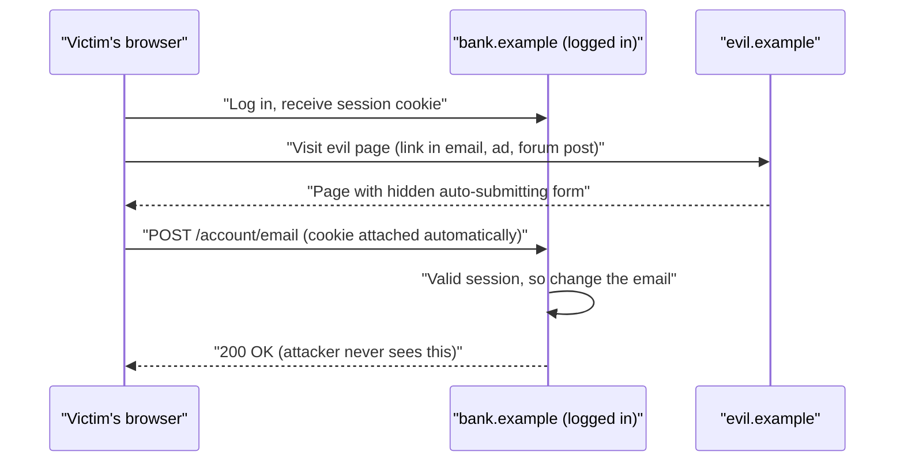
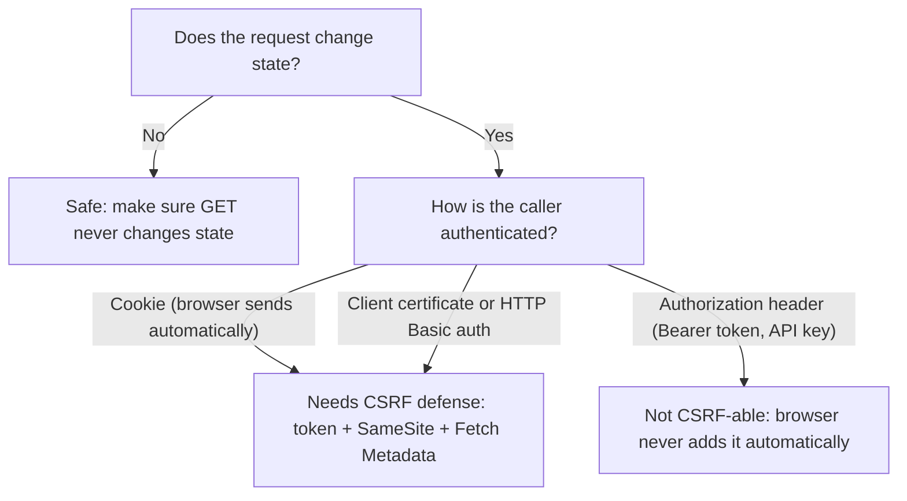

# Cross-Site Request Forgery (CSRF)

## Introduction

Cross-site request forgery (CSRF, sometimes pronounced "sea-surf") tricks a victim's browser into sending a request to a site where the victim is already logged in. The browser helpfully attaches the session cookie, so the target site sees a perfectly authenticated request and carries it out: change the email address, transfer money, add an SSH key.

An analogy: you have a standing arrangement with your bank that any signed note from you is honored. CSRF is someone slipping a pre-written note in front of you while you are signing a stack of birthday cards. Your signature is real; you just did not mean to sign *that*.

The key insight is that CSRF does not steal anything. The attacker never sees the victim's cookie or the response. They only need the victim's browser to **send** one request. That is why the [same-origin policy](./0-sec-web-security-introduction.mdx), which blocks *reading* cross-origin responses, does not stop it.

:::warning Only test what you own
Build the attacker page below on `localhost` against your own lab app, or use DVWA's CSRF module or PortSwigger Web Security Academy's CSRF labs. Never host forged forms that target real sites.
:::

## How a CSRF Attack Works



Three conditions make a request CSRF-able:

1. **A state-changing action** the attacker wants (change email, transfer funds, delete data).
2. **Cookie-based authentication only**: the browser attaches credentials automatically.
3. **No unpredictable parameters**: the attacker can write the whole request in advance.

Remove any one of these and the attack fails. Every CSRF defense targets condition 2 or 3.

## A Vulnerable Endpoint

```python
# csrf_vuln.py  (Vulnerable: local lab only)
from flask import Flask, request, session

app = Flask(__name__)
app.secret_key = "dev-only"

@app.post("/account/email")
def change_email():
    if "user_id" not in session:
        return {"error": "login required"}, 401
    # Authenticated, but nothing proves the user meant to send this request
    return {"updated_to": request.form["email"]}
```

A page on another origin can submit a form to it. This is the textbook proof of concept, for your local lab only:

```html
<!-- attacker.html, served from http://127.0.0.1:8000 in your lab -->
<form id="f" action="http://127.0.0.1:5000/account/email" method="POST">
  <input type="hidden" name="email" value="attacker@evil.example">
</form>
<script>document.getElementById("f").submit();</script>
```

The victim sees a blank page for a moment. Their account email is now the attacker's, and the attacker can use "forgot password" to take over the account.

:::note Why "it's a POST" doesn't help
HTML forms can send `POST` requests cross-site with `application/x-www-form-urlencoded`, `multipart/form-data` or `text/plain` bodies, without any CORS preflight. Changing GET to POST is not a CSRF defense.
:::

## Defense 1: CSRF Tokens (the Primary Fix)

A **synchronizer token** is a random value tied to the user's session. The server puts it in every form, and rejects state-changing requests that do not send it back. The attacker's page cannot read your page (same-origin policy), so it cannot learn the token, so it cannot forge the request.

The [OWASP CSRF Prevention Cheat Sheet](https://cheatsheetseries.owasp.org/cheatsheets/Cross-Site_Request_Forgery_Prevention_Cheat_Sheet.html) recommends: first check whether your framework has built-in CSRF protection, and use it. Django, Rails, Laravel, Spring Security and ASP.NET Core all do. In Flask, use the **Flask-WTF** extension.

```python
# csrf_fixed.py  (Fixed)  pip install flask flask-wtf
from flask import Flask, request, session, render_template_string
from flask_wtf.csrf import CSRFProtect

app = Flask(__name__)
app.config.update(
    SECRET_KEY="change-me-load-from-env",
    SESSION_COOKIE_SECURE=True,
    SESSION_COOKIE_HTTPONLY=True,
    SESSION_COOKIE_SAMESITE="Lax",
)
csrf = CSRFProtect(app)          # every POST/PUT/PATCH/DELETE now needs a valid token

FORM = """
<form method="post" action="/account/email">
  <input type="hidden" name="csrf_token" value="{{ csrf_token() }}">
  <input name="email" type="email">
  <button>Update email</button>
</form>
"""

@app.get("/account")
def account():
    session["user_id"] = 1       # pretend the user is logged in
    return render_template_string(FORM)

@app.post("/account/email")
def change_email():
    return {"updated_to": request.form["email"]}
```

Check it with Flask's test client:

```python
# csrf_check.py
import re
from csrf_fixed import app

app.config["SESSION_COOKIE_SECURE"] = False   # the test client uses http://
client = app.test_client()

page = client.get("/account").get_data(as_text=True)
token = re.search(r'name="csrf_token" value="([^"]+)"', page).group(1)

forged = client.post("/account/email", data={"email": "attacker@evil.example"})
print("Forged request:", forged.status_code)

legit = client.post("/account/email", data={"email": "alice@new.example", "csrf_token": token})
print("Legitimate request:", legit.status_code, legit.get_json())
```

Output:

```text
Forged request: 400
Legitimate request: 200 {'updated_to': 'alice@new.example'}
```

### Tokens with JavaScript (fetch / AJAX)

For single-page apps that still use cookie sessions, put the token in a meta tag and send it in a header. Flask-WTF accepts `X-CSRFToken` by default.

```html
<meta name="csrf-token" content="{{ csrf_token() }}">
<script>
  async function updateEmail(email) {
    const token = document.querySelector('meta[name="csrf-token"]').content;
    const res = await fetch("/account/email", {
      method: "POST",
      headers: { "X-CSRFToken": token, "Content-Type": "application/x-www-form-urlencoded" },
      body: new URLSearchParams({ email }),
    });
    return res.json();
  }
</script>
```

A custom header also adds protection by itself: browsers will not send a custom header cross-origin without a CORS preflight, which your server can refuse.

### Stateless apps: signed double-submit cookies

If the server keeps no session state, OWASP recommends the **signed double-submit cookie**: the server sets a cookie containing a random value plus an HMAC bound to the user's session identifier, and the client echoes it in a header. The naive version (an unsigned random value in a cookie, compared to a header) is discouraged, because an attacker who can write cookies for your domain (for example from a compromised subdomain) can set both. In Node/Express, the `csrf-csrf` package implements the signed pattern; the older `csurf` package is deprecated.

Here is a complete Express 5 example that protects a JSON endpoint and then tests itself with Node's built-in `fetch` (Node 18 or later):

```javascript
// server.js  (npm install express express-session cookie-parser csrf-csrf)
const express = require("express");
const session = require("express-session");
const cookieParser = require("cookie-parser");
const { doubleCsrf } = require("csrf-csrf");

const app = express();
app.use(express.json());
app.use(cookieParser());
app.use(session({
  secret: process.env.SESSION_SECRET || "dev-only-secret",
  resave: false,
  saveUninitialized: true,
  cookie: { httpOnly: true, sameSite: "lax", secure: process.env.NODE_ENV === "production" },
}));

const { generateCsrfToken, doubleCsrfProtection } = doubleCsrf({
  getSecret: () => process.env.CSRF_SECRET || "dev-only-csrf-secret",
  getSessionIdentifier: (req) => req.session.id,      // binds the token to this session
  cookieName: process.env.NODE_ENV === "production" ? "__Host-csrf" : "csrf",
  cookieOptions: { sameSite: "strict", secure: process.env.NODE_ENV === "production" },
  getCsrfTokenFromRequest: (req) => req.headers["x-csrf-token"],
});

app.get("/csrf-token", (req, res) => res.json({ csrfToken: generateCsrfToken(req, res) }));
app.use(doubleCsrfProtection);   // every non-GET route registered after this is protected

app.post("/account/email", (req, res) => res.json({ updatedTo: req.body.email }));
app.use((err, req, res, next) => res.status(403).json({ error: "invalid CSRF token" }));

const server = app.listen(3000, "127.0.0.1", async () => {
  const base = "http://127.0.0.1:3000";
  const forged = await fetch(`${base}/account/email`, {
    method: "POST", headers: { "Content-Type": "application/json" },
    body: JSON.stringify({ email: "attacker@evil.example" }),
  });
  console.log("Forged:", forged.status);

  const t = await fetch(`${base}/csrf-token`);
  const cookies = t.headers.getSetCookie().map((c) => c.split(";")[0]).join("; ");
  const { csrfToken } = await t.json();
  const legit = await fetch(`${base}/account/email`, {
    method: "POST",
    headers: { "Content-Type": "application/json", "x-csrf-token": csrfToken, Cookie: cookies },
    body: JSON.stringify({ email: "alice@new.example" }),
  });
  console.log("Legitimate:", legit.status, await legit.json());
  server.close();
});
```

Run it:

```bash
node server.js
```

Output:

```text
Forged: 403
Legitimate: 200 { updatedTo: 'alice@new.example' }
```

The token cookie uses the `__Host-` prefix in production. Browsers only accept a `__Host-` cookie if it is `Secure`, has `Path=/` and has no `Domain` attribute, which stops a sibling subdomain from planting its own value. The prefix is disabled in development here only because `__Host-` cookies require HTTPS.

## Defense 2: SameSite Cookies

The `SameSite` cookie attribute tells the browser when to attach a cookie to cross-site requests.

| Value | Sent on cross-site subrequests (forms, fetch, images) | Sent on top-level cross-site navigation (link click) | Notes |
| --- | --- | --- | --- |
| `Strict` | No | No | Strongest; users arriving from another site appear logged out |
| `Lax` | No | Yes, for safe methods like GET | Good default for session cookies |
| `None` | Yes | Yes | Requires `Secure`; needed for third-party embeds |

```text
Set-Cookie: session=abc123; Secure; HttpOnly; SameSite=Lax; Path=/
```

With `Lax`, the auto-submitting POST form above no longer carries the session cookie. Chromium-based browsers treat cookies without a `SameSite` attribute as `Lax` by default, but other browsers have not all adopted that default, so **always set it explicitly**.

Why isn't SameSite enough on its own? OWASP describes it as defense in depth, not a replacement for tokens, because:

- `Lax` still sends cookies on top-level GET navigations, so any GET endpoint that changes state is still exposed.
- "Same-site" is broader than "same-origin": `blog.example.com` and `app.example.com` are the same site. A compromised or user-controlled subdomain can send requests with your cookies.
- Some apps need `SameSite=None` for legitimate embedding or cross-site flows.

## Defense 3: Fetch Metadata and Origin Checks

Modern browsers send **Fetch Metadata** request headers. `Sec-Fetch-Site` says where the request came from: `same-origin`, `same-site`, `cross-site` or `none` (typed URL or bookmark). Browsers set it themselves, and page JavaScript cannot forge it. A few lines of middleware can reject cross-site writes:

```python
# fetch_metadata.py: reject cross-site state-changing requests
from flask import Flask, request, abort

app = Flask(__name__)
TRUSTED_ORIGINS = {"https://app.example.com"}
SAFE_METHODS = {"GET", "HEAD", "OPTIONS"}

@app.before_request
def block_cross_site_writes():
    if request.method in SAFE_METHODS:
        return
    site = request.headers.get("Sec-Fetch-Site")
    if site is not None:
        # same-origin, and none (typed URL, bookmark), are fine
        if site not in {"same-origin", "none"}:
            abort(403, description="cross-site request blocked")
        return
    # Fallback for clients that don't send Fetch Metadata: check Origin
    origin = request.headers.get("Origin")
    if origin is None or origin == "null" or origin not in TRUSTED_ORIGINS:
        abort(403, description="origin not allowed")

@app.post("/transfer")
def transfer():
    return {"ok": True}

if __name__ == "__main__":
    c = app.test_client()
    print("same-origin:", c.post("/transfer", headers={"Sec-Fetch-Site": "same-origin"}).status_code)
    print("cross-site:", c.post("/transfer", headers={"Sec-Fetch-Site": "cross-site"}).status_code)
    print("old client, good Origin:", c.post("/transfer", headers={"Origin": "https://app.example.com"}).status_code)
    print("old client, no Origin:", c.post("/transfer").status_code)
```

Output:

```text
same-origin: 200
cross-site: 403
old client, good Origin: 200
old client, no Origin: 403
```

This version is strict: it rejects writes with neither header. That blocks non-browser clients such as `curl` and server-to-server calls, so in a real app you would exempt API routes that use token authentication (see below). Go 1.25 added a similar standard-library middleware, `http.CrossOriginProtection`, which takes the opposite choice and allows requests with neither header, on the basis that they are not from a browser. The OWASP cheat sheet treats Fetch Metadata as a primary defense only for apps that target modern browsers, and requires an Origin-based fallback.

## Which Requests Need Protection?



- **Bearer tokens in an `Authorization` header** are not sent automatically, so pure token-based APIs are not vulnerable to CSRF. If you store that token in a cookie and read it on the server, you are back to cookie auth.
- **Login forms** need protection too. "Login CSRF" logs the victim into the *attacker's* account, so anything they then enter (card numbers, search history) goes to the attacker.
- **GET must be safe.** `GET /logout` or `GET /delete?id=5` can be triggered with a plain `` tag.

## Real-World Scenario

Your company runs a server-rendered Django-style monolith for account management, plus a new React SPA on `app.example.com` calling a JSON API on the same origin. Both use the same session cookie. A pentest found that the new API endpoints, written by a team that "didn't need CSRF because it's JSON", accept `text/plain` POSTs with a JSON-looking body, which a cross-site form can send. You need to choose a consistent defense.

**Options the team debated:**

1. Switch the SPA to JWTs in `localStorage` with an `Authorization` header (no cookies, so no CSRF).
2. Keep cookies and add CSRF tokens to the API.
3. Keep cookies, rely on `SameSite=Lax` plus Fetch Metadata.

**Decision:** keep the `HttpOnly` session cookie (option 1 would expose tokens to any XSS, and session revocation is simpler with server sessions), and layer: framework CSRF tokens sent via an `X-CSRFToken` header, strict `Content-Type: application/json` enforcement on API routes, `SameSite=Lax` on the session cookie, and a Fetch Metadata check as a global safety net. Token-authenticated machine endpoints under `/api/integrations/` are exempted from CSRF checks because they never use cookies.

**Why this approach:** tokens are the documented primary defense and are already built into the framework; SameSite and Fetch Metadata catch any route someone forgets to protect; requiring JSON content type closes the `text/plain` trick.

**When to use it:** Any app with cookie-authenticated, state-changing endpoints. **When not to:** pure API backends used only with bearer tokens or API keys don't need CSRF tokens; spend the effort on token security instead.

| Approach | Pros | Cons | Best for |
| --- | --- | --- | --- |
| Synchronizer token (framework built-in) | Strong, well understood | Needs server state; must include in every form/request | Server-rendered apps with sessions |
| Signed double-submit cookie | Stateless | Must be HMAC-bound to session; more moving parts | Stateless or horizontally scaled apps |
| SameSite=Lax/Strict | One attribute; protects forgotten routes | Not same-origin; GET still sent with Lax | Always, as an extra layer |
| Fetch Metadata + Origin check | Simple middleware; no tokens | Needs fallback for old clients; blocks some non-browser calls | Modern-browser apps; global safety net |
| Custom header requirement | Forces CORS preflight | Only for JS clients | SPAs calling same-origin APIs |
| Bearer tokens instead of cookies | No CSRF | Token storage in JS is exposed to XSS; harder revocation | Mobile apps, third-party API clients |
| Re-authentication for critical actions | Stops CSRF and session hijack | Friction for users | Password/email change, payments |

For the cookies-vs-JWT trade-off in depth, see [Sessions and Cookies](../4-sec-authentication/4-sec-sessions-and-cookies.mdx) and [JSON Web Tokens](../4-sec-authentication/5-sec-jwt.mdx).

## Common Mistakes

- **State-changing GET requests.** Logout, delete and "approve" links are all CSRF targets, even with `SameSite=Lax`.
- **Disabling CSRF protection to fix a bug.** `@csrf.exempt` on a cookie-authenticated route reopens the hole. Exempt only token-authenticated machine endpoints.
- **Checking the token only if present.** "If a token is sent, validate it" means attackers just omit it. Require it.
- **Using a static or global token.** Tokens must be unpredictable and tied to the user's session.
- **Putting tokens in URLs.** They leak through logs, browser history and `Referer` headers. Use hidden fields or headers.
- **Allowing `Origin: null`.** Sandboxed iframes and some redirects send `null`. Never treat it as trusted.
- **Ignoring XSS.** Any XSS on your origin can read tokens and send same-origin requests. CSRF defenses assume you have no XSS. See [Cross-Site Scripting](./4-sec-xss.mdx).
- **Permissive CORS with credentials.** Reflecting any `Origin` with `Access-Control-Allow-Credentials: true` lets other sites read your responses, including tokens. See [Security Headers, CORS and CSP](./9-sec-security-headers.mdx).

## Summary

- CSRF makes a logged-in browser send a request the user did not intend; cookies are attached automatically.
- The attacker cannot read responses, but one forged state change (email, password, payment) can be enough.
- The primary fix is your framework's CSRF token protection (Flask-WTF, Django, Rails, Spring, ASP.NET Core).
- Set `SameSite=Lax` (or `Strict`) explicitly and add a Fetch Metadata / Origin check as defense in depth.
- Keep GET requests free of side effects, and protect login forms too.
- APIs that authenticate only with an `Authorization` header are not CSRF-able, but have their own token-storage trade-offs.

## Further Learning

**Exercises**

1. Run `csrf_vuln.py` on port 5000 and `attacker.html` with `python3 -m http.server 8000` (both on `127.0.0.1`). Log in, open the attacker page, and watch the request in your browser's network tab. Then add Flask-WTF and repeat.
2. Set the session cookie to `SameSite=Lax` and test the attacker page again without CSRF tokens. Then add a `GET /account/delete` route and show that Lax does not protect it.
3. Write a pytest test that walks every `POST` route in a Flask app and asserts it returns 400 or 403 without a CSRF token.
4. Complete PortSwigger Web Security Academy's "CSRF vulnerability with no defenses" lab, then explain which single change on the server would have stopped it.

**Related pages**

- [Sessions and Cookies](../4-sec-authentication/4-sec-sessions-and-cookies.mdx)
- [Security Headers, CORS and CSP](./9-sec-security-headers.mdx)
- [Cross-Site Scripting (XSS)](./4-sec-xss.mdx)
- [Webhook Security](../7-sec-api-security/6-sec-webhook-security.mdx): authenticating server-to-server requests instead.
