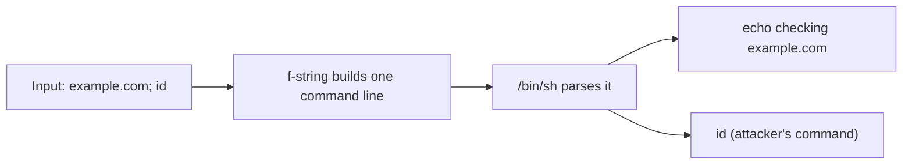

# Command Injection and Path Traversal

## Introduction

Two classic server-side bugs come from the same mistake as [SQL injection](./3-sec-sql-injection.mdx): untrusted text reaches an interpreter that treats part of it as instructions.

- **OS command injection** happens when user input ends up in a shell command. The shell understands `;`, `|`, `&&`, backticks and `$( )`, so input like `example.com; id` becomes *two* commands. The result is usually full code execution on the server as the app's user.
- **Path traversal** (also called directory traversal) happens when user input ends up in a file path. Sequences like `../` let the attacker walk out of the intended folder and read or overwrite files such as configuration, keys or source code.

An analogy for both: you hand a courier a slip that says "Deliver to: Room 12". Command injection is a slip that says "Room 12; also unlock the safe", and the courier does both. Path traversal is a slip that says "Room 12/../../Manager's Office", and the courier follows the directions literally.

Both fall under **A05 Injection** in the OWASP Top 10:2025, with path traversal also closely tied to **A01 Broken Access Control** (reaching files you should not).

:::warning Only test what you own
Run these examples only on your own machine or in labs such as DVWA's "Command Injection" module, OWASP WebGoat, or PortSwigger Web Security Academy's OS command injection and path traversal labs. Sending shell metacharacters or `../` sequences to real sites without permission is unauthorized testing.
:::

## Part 1: OS Command Injection

### How it happens

Developers reach for the shell because it is convenient: "just call `ping`", "just call `convert`", "just call `git`". The danger is handing a single string to a shell.



A safe, local demonstration using only `echo` and `id`:

```python
# cmd_demo.py  (Vulnerable vs Fixed, local only)
import subprocess

def lookup_vulnerable(host: str) -> str:
    # Vulnerable: the whole string goes to /bin/sh, which understands ; | && $( )
    return subprocess.run(f"echo checking {host}", shell=True,
                          capture_output=True, text=True).stdout

def lookup_fixed(host: str) -> str:
    # Fixed: argument list, no shell; the input is one argument, whatever it contains
    return subprocess.run(["echo", "checking", host],
                          capture_output=True, text=True).stdout

user_input = "example.com; id"
print("Vulnerable:", lookup_vulnerable(user_input))
print("Fixed:     ", lookup_fixed(user_input))
```

Example output:

```text
Vulnerable: checking example.com
uid=1000(dev) gid=1000(dev) groups=1000(dev)

Fixed:      checking example.com; id
```

In the vulnerable version, the shell ran `id` as a second command. In the fixed version, `example.com; id` was passed to `echo` as a single argument, and no shell ever saw it.

### The usual vulnerable pattern in a web app

```python
# Vulnerable: a "network check" feature (local lab only)
import subprocess
from flask import Flask, request

app = Flask(__name__)

@app.get("/ping")
def ping():
    host = request.args["host"]
    out = subprocess.run(f"ping -c 1 {host}", shell=True, capture_output=True, text=True)
    return {"output": out.stdout}
```

The same mistake appears in other languages: `os.system()` and `os.popen()` in Python, `exec()` and `child_process.exec()` in Node.js, `Runtime.exec(String)` in Java with a shell wrapper, and backticks or `system()` in PHP and Ruby.

### Fix 1: Don't call a shell at all

The strongest fix is to use a library instead of an external program. Most things developers shell out for have a library equivalent:

| Instead of shelling out to | Use |
| --- | --- |
| `ping`, `nslookup`, `curl` | `socket`, `dnspython`, `requests`/`httpx` |
| `convert` (ImageMagick) for simple resizing | Pillow |
| `zip`, `tar`, `unzip` | `zipfile`, `tarfile`, `shutil.make_archive` |
| `cp`, `mv`, `rm`, `mkdir` | `shutil`, `pathlib` |
| `git` | `pygit2` or a Git hosting API |

### Fix 2: If you must run a program, use an argument list

```python
# ping_fixed.py  (Fixed)
import ipaddress
import subprocess

def ping(target: str) -> str:
    ip = ipaddress.ip_address(target)          # raises ValueError for anything else
    if not ip.is_global:
        raise ValueError("only public addresses may be checked")
    result = subprocess.run(
        ["ping", "-c", "1", "-W", "2", str(ip)],   # argument list, no shell
        capture_output=True, text=True, timeout=5,
    )
    return "up" if result.returncode == 0 else "down"

for t in ["8.8.8.8; cat /etc/passwd", "-f", "10.0.0.1"]:
    try:
        print(t, "->", ping(t))
    except ValueError as e:
        print(t, "-> rejected:", e)
```

Output:

```text
8.8.8.8; cat /etc/passwd -> rejected: '8.8.8.8; cat /etc/passwd' does not appear to be an IPv4 or IPv6 address
-f -> rejected: '-f' does not appear to be an IPv4 or IPv6 address
10.0.0.1 -> rejected: only public addresses may be checked
```

Three layers work together here:

1. **No shell**: `subprocess.run([...])` with the default `shell=False` runs the program directly, so metacharacters mean nothing.
2. **Strict validation**: the input must parse as an IP address. Validation also blocks the next problem.
3. **Limits**: a timeout stops a slow command from tying up workers. The `is_global` check stops the feature being used to probe your internal network, which would be SSRF by another name.

The Node.js equivalent swaps `exec` for `execFile` or `spawn`, which take an argument array and do not use a shell by default:

```javascript
// Vulnerable
const { exec } = require("node:child_process");
exec(`ping -c 1 ${host}`, (err, stdout) => { /* ... */ });

// Fixed
const { execFile } = require("node:child_process");
execFile("ping", ["-c", "1", host], { timeout: 5000 }, (err, stdout) => { /* ... */ });
```

### Watch out for argument injection

Even without a shell, a value that starts with `-` can be read as an **option** by the program. Many tools have options that write files or run commands. The standard defense is `--`, which tells most Unix tools "no more options after this", plus validation.

```python
# argv_demo.py
import subprocess, tempfile, pathlib

d = pathlib.Path(tempfile.mkdtemp())
(d / "notes.txt").write_text("hello\n")
name = "--help"            # a "filename" chosen by the user

r = subprocess.run(["wc", "-l", name], cwd=d, capture_output=True, text=True)
print("Without --:", r.stdout.splitlines()[0])
r = subprocess.run(["wc", "-l", "--", name], cwd=d, capture_output=True, text=True)
print("With --:   ", r.stderr.strip())
```

Example output (GNU coreutils; the exact help text varies by system):

```text
Without --: Usage: wc [OPTION]... [FILE]...
With --:    wc: --help: No such file or directory
```

Without `--`, the user's "filename" was treated as the `--help` option. Harmless here, but for tools like `tar`, `git` or `find` the available options can be dangerous.

:::tip shlex.quote is a last resort
If a shell is truly unavoidable (for example a remote command over SSH), quote every untrusted piece with `shlex.quote()`. It is correct for POSIX shells, but easy to forget once and does nothing for argument injection. Prefer argument lists.
:::

## Part 2: Path Traversal

### How it happens


A download endpoint like this is vulnerable:

```python
# Vulnerable: user controls the path (local lab only)
import os
from flask import Flask, request, send_file

app = Flask(__name__)
BASE = "/srv/app/uploads"

@app.get("/download")
def download():
    name = request.args["file"]
    return send_file(os.path.join(BASE, name))
```

Two surprises make this worse than it looks:

- `../` sequences climb out of the base directory.
- An **absolute path** discards the base entirely: `os.path.join("/srv/app/uploads", "/etc/passwd")` returns `/etc/passwd`. `pathlib` behaves the same way.

### The fix: resolve, then confine

```python
# path_demo.py
import os
from pathlib import Path

BASE = Path("/srv/app/uploads")

def open_path_vulnerable(name: str) -> str:
    # Vulnerable: joins user input straight onto the base directory
    return os.path.join(BASE, name)

def safe_path(name: str) -> Path:
    # Fixed: resolve symlinks and '..', then require the result to stay inside BASE
    candidate = (BASE / name).resolve()
    if not candidate.is_relative_to(BASE.resolve()):
        raise PermissionError(f"path escapes base directory: {name!r}")
    return candidate

for name in ["report.pdf", "../../../etc/passwd", "/etc/passwd", "sub/../report.pdf"]:
    print(f"{name!r:24} vulnerable -> {os.path.normpath(open_path_vulnerable(name))}")
    try:
        print(f"{'':24} fixed      -> {safe_path(name)}")
    except PermissionError as e:
        print(f"{'':24} fixed      -> blocked ({e})")
```

Output:

```text
'report.pdf'             vulnerable -> /srv/app/uploads/report.pdf
                         fixed      -> /srv/app/uploads/report.pdf
'../../../etc/passwd'    vulnerable -> /etc/passwd
                         fixed      -> blocked (path escapes base directory: '../../../etc/passwd')
'/etc/passwd'            vulnerable -> /etc/passwd
                         fixed      -> blocked (path escapes base directory: '/etc/passwd')
'sub/../report.pdf'      vulnerable -> /srv/app/uploads/report.pdf
                         fixed      -> /srv/app/uploads/report.pdf
```

Key details:

- **Resolve first, check second.** `resolve()` collapses `..` and follows symlinks, so the check runs on the real target. `Path.is_relative_to` is available in Python 3.9 and later.
- **Don't use `startswith` on strings.** `"/srv/app/uploads-old/x".startswith("/srv/app/uploads")` is `True`. Compare path components.
- **Don't try to strip `../`.** Removing `../` once turns `....//` into `../`. URL-encoded and double-encoded forms add more variants. Canonicalize and confine instead.

### Use the framework's helper

Flask's `send_from_directory` uses Werkzeug's `safe_join` internally and returns 404 for paths that try to escape:

```python
# Fixed: let the framework confine the path
from flask import Flask, send_from_directory

app = Flask(__name__)

@app.get("/files/<path:name>")
def files(name):
    return send_from_directory("/srv/app/uploads", name)
```

Express has the same idea in `res.sendFile(name, { root: "/srv/app/uploads" })`, which rejects paths that leave the root.

### Better still: don't use user-supplied names at all

The most robust design never puts user input in a path. Store files under random IDs and look up the ID in the database, after an [access control](./2-sec-broken-access-control.mdx) check:

```python
@app.get("/documents/<uuid:doc_id>")
def download(doc_id):
    doc = get_document_for(current_user, doc_id)          # 404 if not theirs
    return send_from_directory(STORAGE_DIR, doc.storage_key,  # e.g. "3f9c...e1.pdf"
                               download_name=doc.original_name, as_attachment=True)
```

This is the approach recommended for uploads in [Secure File Uploads](./10-sec-file-upload-security.mdx).

### Archive extraction ("Zip Slip")

Archives can contain entries named `../../home/app/.ssh/authorized_keys`. Extracting them naively writes outside the target folder. In Python, use the extraction filters added in Python 3.12 (and backported to security releases of earlier versions):

```python
import tarfile

with tarfile.open("upload.tar.gz") as tar:
    tar.extractall("/srv/app/extracted", filter="data")   # rejects ../, absolute paths, device files
```

An archive with a `../../evil.txt` entry now raises `tarfile.OutsideDestinationError`. Python 3.14 made `"data"` the default filter, but passing it explicitly documents your intent and protects older versions.

### A web server misconfiguration: nginx alias

Path traversal is not only an application bug. A common nginx mistake is a `location` without a trailing slash combined with an `alias` that has one:

```nginx
# Vulnerable: /static../app/config.py maps to /var/www/static/../app/config.py
location /static {
    alias /var/www/static/;
}

# Fixed: trailing slashes match on both sides
location /static/ {
    alias /var/www/static/;
}
```

Scanners and config linters such as Gixy can flag this pattern.

## Defense in Depth

Even with correct code, limit what a successful injection or traversal can do:

- **Run the app as an unprivileged user** that cannot read other apps' files or `/root`. Never run web apps as root.
- **Containers with a read-only root file system** and no shell in the image (distroless) make command injection much less useful. See [Container Image Security](../8-sec-cloud-and-container/4-sec-container-security.mdx).
- **Keep secrets out of files the app can read** where possible; use a secret manager.
- **Mandatory access control** (AppArmor, SELinux) and seccomp profiles can block unexpected programs and system calls. See [Linux Hardening](../9-sec-system-hardening/0-sec-linux-hardening.mdx).
- **SAST rules** for `shell=True`, `os.system`, `child_process.exec` and path joins with request data. See [Static Analysis (SAST)](../6-sec-appsec-and-devsecops/2-sec-sast.mdx).

## Real-World Scenario

Your team builds an internal "media tools" service. Users upload a video and choose an output format; the service calls `ffmpeg` to convert it, and offers a download link like `/download?file=output_123.mp4`. A code review finds `subprocess.run(f"ffmpeg -i {path} {out_name}", shell=True)` and `send_file(os.path.join(OUT_DIR, request.args["file"]))`.

**The walkthrough:**

1. **Remove the shell:** build an argument list. The input path is generated by your code (a random name in a temp directory), not taken from the user.
2. **Allowlist the user's choice:** the format comes from `{"mp4": [...], "webm": [...]}`, which maps to fixed ffmpeg arguments. The user never supplies raw options.
3. **Replace the filename parameter with an ID:** `/download/<uuid>` maps to a database row with an owner check.
4. **Contain the tool:** run conversions in a separate container as a non-root user, with CPU and time limits and no network access. Media parsers are a big attack surface, and a malicious file could exploit `ffmpeg` itself.

```python
FORMATS = {
    "mp4":  ["-c:v", "libx264", "-c:a", "aac"],
    "webm": ["-c:v", "libvpx-vp9", "-c:a", "libopus"],
}

def build_ffmpeg_command(input_path: str, output_path: str, fmt: str) -> list[str]:
    if fmt not in FORMATS:
        raise ValueError("unsupported format")
    return ["ffmpeg", "-nostdin", "-y", "-i", input_path, *FORMATS[fmt], output_path]

print(build_ffmpeg_command("/tmp/job-7f3a/in.bin", "/tmp/job-7f3a/out.webm", "webm"))
```

Output:

```text
['ffmpeg', '-nostdin', '-y', '-i', '/tmp/job-7f3a/in.bin', '-c:v', 'libvpx-vp9', '-c:a', 'libopus', '/tmp/job-7f3a/out.webm']
```

**Why this approach:** the user's influence shrinks to two choices from fixed menus (format and document ID). There is nothing left to inject, and isolation limits the damage of bugs inside `ffmpeg` itself.

**When to use it:** any feature wrapping a command-line tool. **When not to:** if a library does the job (Pillow for simple image resizing, `zipfile` for archives), skip the external process entirely.

| Approach | Pros | Cons | Best for |
| --- | --- | --- | --- |
| Use a library, no subprocess | No shell, no argv parsing | Library may be missing features | Most file, network and archive tasks |
| Argument list + allowlisted options | No shell metacharacters | Must still guard against option injection | Wrapping CLI tools |
| `shlex.quote` + shell | Works when a shell is unavoidable | Easy to miss one value; no argument-injection protection | Remote SSH commands, legacy scripts |
| Input blocklist (strip `;`, `&`, `../`) | Quick | Incomplete; encodings bypass it | Avoid |
| Opaque IDs instead of file names | Removes path input entirely | Needs a lookup table | Downloads and uploads |
| Resolve + confine paths | Works with user-chosen paths | Must handle symlinks and races carefully | File browsers, static file serving |
| Sandbox (container, non-root, seccomp) | Limits impact of any bug | Operational effort | Running risky tools on untrusted files |

## Common Mistakes

- **Using `shell=True` "just for pipes".** Do the piping in Python with two `subprocess.run` calls or a library.
- **Escaping by hand.** Hand-written escaping misses newlines, `$( )`, backticks and locale tricks. Use argument lists.
- **Validating with a blocklist of bad characters.** Allowlist the expected format instead (an IP address, a known format name, a UUID).
- **Checking paths with `startswith` before resolving.** Resolve, then compare components with `is_relative_to`.
- **Forgetting absolute paths.** `os.path.join(base, "/etc/passwd")` ignores `base`.
- **Trusting archive entry names.** Use `tarfile` filters and check every `zipfile` member path before writing.
- **Logging the attack string into a shell script or cron job.** Injection can be second-order, just like SQL.

## Summary

- Command injection happens when input reaches a shell; path traversal happens when input reaches a file path.
- Prefer libraries over external programs. If you must run a program, pass an argument list with no shell, validate inputs strictly, and use `--` against option injection.
- For paths, resolve the full path and confirm it stays inside the base directory; better, use opaque IDs instead of user-supplied names.
- Use framework helpers such as `send_from_directory` and `tarfile` extraction filters.
- Check server configuration too, such as nginx `alias` trailing slashes.
- Limit blast radius with non-root users, read-only containers and sandboxes.

## Further Learning

**Exercises**

1. Rewrite the vulnerable `/ping` route using `ping_fixed.py`, then write a pytest test that sends `8.8.8.8; id`, `$(id)` and `-c 1000` and expects a 400 response.
2. Add tests to `path_demo.py` for a symlink inside `BASE` that points to `/etc`. Does `safe_path` block it? Why?
3. In DVWA (local), complete "Command Injection" at low and medium, then read the "impossible" source and identify which control stops each of your attempts.
4. Write a safe `extract_zip(path, dest)` function using `zipfile` that rejects members whose resolved path leaves `dest`.

**Related pages**

- [SQL Injection](./3-sec-sql-injection.mdx)
- [Secure File Uploads](./10-sec-file-upload-security.mdx)
- [Input Validation and Output Encoding](../5-sec-secure-coding/1-sec-input-validation.mdx)
- [Linux Hardening](../9-sec-system-hardening/0-sec-linux-hardening.mdx)
