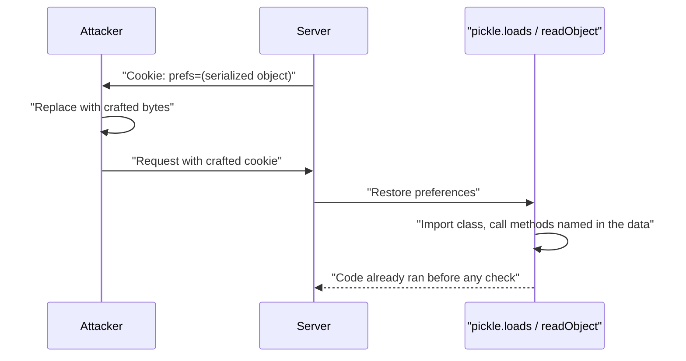

# Insecure Deserialization

## Introduction

**Serialization** turns an in-memory object into bytes so you can store it or send it somewhere: a cookie, a cache, a queue, a file. **Deserialization** turns those bytes back into an object. That sounds harmless, but many native serialization formats can describe *any* object, including which class to build and which methods to call while building it. If an attacker controls the bytes, they control what your program constructs and runs.

An analogy: JSON is like a shipping box with a packing list. You open it and get exactly the items listed: strings, numbers, lists. Python's `pickle` or Java's native serialization is more like flat-pack furniture that comes with **its own robot assembler**. You plug the robot in and it follows whatever instructions are in the box. If someone swapped the instructions, the robot builds whatever they wanted inside your house.

Insecure deserialization falls under **A08 Software or Data Integrity Failures** in the OWASP Top 10:2025. It can lead to remote code execution, which makes it one of the most severe web vulnerability classes, even though it is less common than XSS or access control bugs. A recent high-profile example was CVE-2025-55182 ("React2Shell"), disclosed in December 2025: unsafe deserialization in the React Server Components "Flight" protocol allowed unauthenticated remote code execution in affected React and Next.js versions, and it was added to CISA's Known Exploited Vulnerabilities catalog. The fix was upgrading the affected packages.

:::warning Only test what you own
The demo below only makes `print()` run during loading, on your own machine. Do not send crafted serialized payloads to systems you do not own. Practice in PortSwigger Web Security Academy's insecure deserialization labs or OWASP WebGoat.
:::

## How It Goes Wrong



The key point is the last line: the danger happens **during** deserialization. Checking the resulting object afterwards is too late.

| Format | Can create arbitrary objects? | Safe for untrusted input? |
| --- | --- | --- |
| JSON (`json`, `JSON.parse`) | No: only dicts, lists, strings, numbers, booleans, null | Yes (still validate the content) |
| YAML with `yaml.safe_load` | No: basic types only | Yes |
| YAML with `yaml.load(..., Loader=yaml.UnsafeLoader)` or `FullLoader` on old versions | Yes or partly | No |
| Python `pickle`, `shelve`, `marshal`, `joblib` | Yes | No |
| Java `ObjectInputStream` | Yes (any `Serializable` class on the classpath) | Only with strict filters, better avoided |
| .NET `BinaryFormatter` | Yes | No; Microsoft says it cannot be made secure |
| PHP `unserialize` | Yes (magic methods) | No; use `json_decode` |
| Protocol Buffers, MessagePack (plain) | No: schema or basic types | Yes (still validate) |

## Seeing It in Python (Vulnerable)

Python's own documentation is blunt: "The `pickle` module **is not secure**. Only unpickle data you trust." Here is why, with a payload that only prints a message:

```python
# pickle_demo.py  (local demonstration; the "payload" only prints a message)
import base64
import pickle

class Proof:
    def __reduce__(self):
        # pickle will call print(...) while LOADING the data
        return (print, ("code ran during unpickling!",))

cookie_value = base64.b64encode(pickle.dumps(Proof())).decode()
print("Attacker-crafted cookie:", cookie_value[:40] + "...")

# Vulnerable server code: "just restore the user's preferences"
prefs = pickle.loads(base64.b64decode(cookie_value))
print("Returned object:", prefs)
```

Output:

```text
Attacker-crafted cookie: gAWVOAAAAAAAAACMCGJ1aWx0aW5zlIwFcHJpbnSU...
code ran during unpickling!
Returned object: None
```

`__reduce__` tells pickle "to rebuild me, call this function with these arguments". Pickle trusts the data, so it calls `print`. A real attacker would name a more dangerous function instead. The server never "used" the object; loading it was enough.

Where pickle sneaks into web apps:

- Session or preference cookies (some older frameworks offered pickle-based session serializers).
- Cache entries in Redis or Memcached that another, less-trusted component can write.
- Background job arguments in queues.
- Uploaded "project files", saved state or ML model files (`.pkl`, older PyTorch checkpoints).

## The Fix: Use a Data-Only Format and Validate (Fixed)

For anything that crosses a trust boundary, use JSON (or another data-only format), then validate the structure. If the client stores it, **sign** it so it cannot be modified.

```python
# prefs_fixed.py  (pip install itsdangerous)
from dataclasses import dataclass
from itsdangerous import URLSafeSerializer, BadSignature

serializer = URLSafeSerializer("load-this-secret-from-the-environment", salt="prefs")

@dataclass(frozen=True)
class Prefs:
    theme: str = "light"
    page_size: int = 20

    @classmethod
    def from_dict(cls, data: dict) -> "Prefs":
        theme = data.get("theme", "light")
        page_size = data.get("page_size", 20)
        if theme not in {"light", "dark"}:
            raise ValueError("bad theme")
        if not isinstance(page_size, int) or not 1 <= page_size <= 100:
            raise ValueError("bad page_size")
        return cls(theme=theme, page_size=page_size)

def dump_prefs(p: Prefs) -> str:
    return serializer.dumps({"theme": p.theme, "page_size": p.page_size})

def load_prefs(cookie: str) -> Prefs:
    try:
        return Prefs.from_dict(serializer.loads(cookie))
    except (BadSignature, ValueError):
        return Prefs()                       # fail safe: fall back to defaults

cookie = dump_prefs(Prefs(theme="dark", page_size=50))
print("Cookie:", cookie)
print("Loaded:", load_prefs(cookie))
# Attacker edits the payload part but cannot produce a valid signature
import base64
payload, signature = cookie.split(".")
forged = base64.urlsafe_b64encode(b'{"theme":"dark","page_size":100000}').decode().rstrip("=")
print("Tampered:", load_prefs(forged + "." + signature))
```

Output:

```text
Cookie: eyJ0aGVtZSI6ImRhcmsiLCJwYWdlX3NpemUiOjUwfQ.mYNc-ncm0yczhnyT5b6PosC_q-s
Loaded: Prefs(theme='dark', page_size=50)
Tampered: Prefs(theme='light', page_size=20)
```

Three layers work together:

1. **Data-only format**: `json` cannot instantiate classes or call functions.
2. **Validation**: `Prefs.from_dict` accepts only known fields, types and ranges.
3. **Integrity**: the HMAC signature (via `itsdangerous`, which Flask itself uses for its session cookie) means a client cannot change the values. Signing provides integrity, not secrecy; the payload is only base64, so don't put secrets in it.

:::note Signing doesn't make pickle safe
Python's docs suggest signing pickled data with `hmac` if you must ensure it was not tampered with. That only helps if the signing key never leaks and only trusted code can produce data. If the key leaks, pickle turns a key leak into remote code execution. With JSON, a leaked key "only" lets attackers forge preference values. Prefer JSON.
:::

### If you are stuck with pickle: restrict globals

For legacy data you cannot migrate yet, Python's docs show how to override `Unpickler.find_class` so only an allowlist of classes can be loaded:

```python
import builtins, io, pickle

SAFE_BUILTINS = {"range", "complex", "set", "frozenset", "slice"}

class RestrictedUnpickler(pickle.Unpickler):
    def find_class(self, module, name):
        if module == "builtins" and name in SAFE_BUILTINS:
            return getattr(builtins, name)
        raise pickle.UnpicklingError(f"global '{module}.{name}' is forbidden")

def restricted_loads(data: bytes):
    return RestrictedUnpickler(io.BytesIO(data)).load()

class Proof:
    def __reduce__(self):
        return (print, ("code ran during unpickling!",))

print(restricted_loads(pickle.dumps({"theme": "dark", "ids": [1, 2, 3]})))
try:
    restricted_loads(pickle.dumps(Proof()))
except pickle.UnpicklingError as e:
    print("Blocked:", e)
```

Output:

```text
{'theme': 'dark', 'ids': [1, 2, 3]}
Blocked: global 'builtins.print' is forbidden
```

Treat this as a migration aid. An allowlist that grows to include application classes with side effects in their constructors or `__setstate__` can become exploitable again.

## YAML: Always safe_load

PyYAML can construct Python objects from tags like `!!python/object/apply:`. Since PyYAML 6.0, `yaml.load()` requires an explicit `Loader`, which pushes developers to choose. Choose `safe_load`:

```python
import yaml

doc = '!!python/object/apply:os.system ["echo hi"]'

try:
    yaml.safe_load(doc)
except yaml.constructor.ConstructorError as e:
    print("safe_load refused:", str(e).splitlines()[0])

print(yaml.safe_load("retries: 3\nhosts: [a, b]"))
```

Output:

```text
safe_load refused: could not determine a constructor for the tag 'tag:yaml.org,2002:python/object/apply:os.system'
{'retries': 3, 'hosts': ['a', 'b']}
```

Never use `yaml.load(data, Loader=yaml.UnsafeLoader)` or `yaml.unsafe_load` on data you did not write yourself.

## Java: Avoid Native Serialization, or Filter It

Java's `ObjectInputStream.readObject()` will instantiate any serializable class on the classpath. Attackers chain together methods from common libraries (so-called "gadget chains") to reach code execution. Tools that generate such chains exist for many popular libraries, so "we don't have any dangerous classes" is rarely true.

The best fix is not to accept Java serialization from untrusted sources at all; use JSON with a library such as Jackson **without** default polymorphic typing enabled. If you must read serialized objects, use a deserialization filter (Java 9 and later) with a strict allowlist:

```java
import java.io.*;
import java.util.ArrayList;
import java.util.List;

public class SafeRead {
    // Allow only expected classes; "!*" rejects everything else. Limits stop huge object graphs.
    private static final ObjectInputFilter FILTER = ObjectInputFilter.Config.createFilter(
        "com.example.dto.*;java.lang.*;java.util.*;maxdepth=10;maxbytes=65536;!*");

    static Object read(byte[] data) throws IOException, ClassNotFoundException {
        try (ObjectInputStream in = new ObjectInputStream(new ByteArrayInputStream(data))) {
            in.setObjectInputFilter(FILTER);
            return in.readObject();
        }
    }

    static byte[] write(Object obj) throws IOException {
        ByteArrayOutputStream bytes = new ByteArrayOutputStream();
        try (ObjectOutputStream out = new ObjectOutputStream(bytes)) {
            out.writeObject(obj);
        }
        return bytes.toByteArray();
    }

    public static void main(String[] args) throws Exception {
        System.out.println("Allowed: " + read(write(new ArrayList<>(List.of("a", "b")))));
        try {
            read(write(new File("/tmp")));          // a class outside the allowlist
        } catch (InvalidClassException e) {
            System.out.println("Blocked: " + e.getMessage());
        }
    }
}
```

Output:

```text
Allowed: [a, b]
Blocked: filter status: REJECTED
```

The filter pattern lists allowed packages, sets limits on graph depth and size, and ends with `!*` to reject everything else. You can also set a JVM-wide filter with the `jdk.serialFilter` system property.

### Other ecosystems

- **.NET:** stop using `BinaryFormatter`. Microsoft's guidance says it is insecure and cannot be made secure, and starting in .NET 9 the in-box implementation throws exceptions on use. Use `System.Text.Json`.
- **PHP:** `unserialize()` on user input enables "object injection" through magic methods like `__wakeup` and `__destruct`. Use `json_decode()`.
- **Node.js:** `JSON.parse` is safe for code execution, but avoid libraries that serialize functions (such as the long-abandoned `node-serialize`), and be careful merging parsed JSON into objects, because keys like `__proto__` can cause prototype pollution.
- **Machine learning models:** `.pkl` and older PyTorch checkpoints are pickle under the hood. Recent PyTorch versions default `torch.load` to `weights_only=True`, and the `safetensors` format stores only tensors. Treat downloaded model files as untrusted code.

## Even JSON Needs Validation

Data-only formats remove code execution, not logic bugs. After parsing, validate:

```python
import json

raw = '{"quantity": -5, "price": 0.01, "is_admin": true}'
data = json.loads(raw)                     # parsing is safe...
print(data)                                # ...but the content is still attacker-controlled
```

Output:

```text
{'quantity': -5, 'price': 0.01, 'is_admin': True}
```

Negative quantities, client-supplied prices and unexpected `is_admin` fields are [business logic](./11-sec-business-logic-flaws.mdx) and [mass assignment](./2-sec-broken-access-control.mdx) problems. Use a schema (Pydantic, Marshmallow, JSON Schema) that rejects unknown fields and enforces types and ranges. See [Schema Validation for APIs](../7-sec-api-security/4-sec-api-input-validation.mdx).

## Real-World Scenario

Your Python platform uses Celery with a Redis broker for background jobs. An audit finds two things: Celery is configured with `accept_content = ["pickle", "json"]`, and the same Redis instance is reachable from a less-trusted analytics service. Separately, a legacy Flask app stores a pickled "shopping cart" in a signed cookie. Leadership asks: how urgent is this, and what is the fix?

**The walkthrough:**

1. **Understand exposure.** Anyone who can write to the Redis queue can enqueue a pickle payload that runs code on every worker. The analytics service, or anyone who compromises it, can do exactly that. That is a lateral-movement path straight into your workers.
2. **Switch the serializer.** Configure Celery to accept only JSON (`task_serializer = "json"`, `accept_content = ["json"]`). Job arguments become plain IDs and strings, which is better design anyway.
3. **Isolate the broker.** Put Redis on a private network reachable only by the producer and workers, with authentication and TLS. See [Network Segmentation](../2-sec-network-security/2-sec-network-segmentation.mdx).
4. **Migrate the cart cookie.** Replace the pickled cart with a server-side cart keyed by session ID, or a signed JSON cookie with strict validation. During migration, read old cookies with a restricted unpickler, re-issue them as JSON, and remove the pickle path after the cookie lifetime has passed.
5. **Prevent regressions.** Add SAST rules (for example Bandit's checks for `pickle` and `yaml.load`) to CI.

**Why this approach:** removing pickle removes the code-execution primitive entirely; network isolation reduces who can reach the queue at all; migration with a time limit avoids breaking active users.

**When to use it:** any time native serialization crosses a trust boundary: networks, queues, caches shared between services, cookies, uploaded files. **When not to worry as much:** pickle files your own process writes and reads locally, where an attacker who can modify them already has code execution. Even then, JSON is usually the simpler long-term choice.

| Approach | Pros | Cons | Best for |
| --- | --- | --- | --- |
| JSON + schema validation | No code execution; portable | Must map objects to plain data | Default for all untrusted data |
| Signed JSON (itsdangerous, JWS) | Tamper-evident client storage | Key management; not encrypted | Cookies, links, client-held state |
| Server-side state, client holds an ID | Nothing for the client to tamper with | Needs storage | Carts, sessions, workflows |
| Protobuf / Avro with schema | Compact, typed, no arbitrary objects | Schema tooling | Service-to-service messages |
| Native serialization + allowlist filter | Keeps legacy code working | Allowlists drift; gadget risk remains | Temporary migration |
| HMAC-signed pickle | Blocks tampering if key is safe | Key leak means RCE | Avoid; only for trusted internal data |
| WAF signatures for serialized payloads | Catches some known patterns | Easy to evade; not a fix | Emergency cover only |

## Common Mistakes

- **Validating after deserializing.** With pickle or Java serialization, code runs during loading, before your checks.
- **Assuming internal data is trusted.** Caches, queues and shared storage are often writable by more components than you think.
- **Using `yaml.load` with an unsafe loader** because "`safe_load` didn't handle my custom type". Convert custom types explicitly instead.
- **Enabling polymorphic typing in JSON libraries.** Jackson's default typing, or similar "type hints in JSON" features, can recreate deserialization gadgets.
- **Leaving abandoned serializer options on.** Accepting multiple content types "for compatibility" keeps the dangerous one reachable.
- **Loading untrusted ML models.** Model hubs and shared checkpoints can contain pickle payloads.
- **Not patching frameworks.** Many deserialization bugs live in frameworks and libraries, as React2Shell showed. Dependency scanning and fast patching matter. See [Dependency Scanning and SCA](../6-sec-appsec-and-devsecops/4-sec-dependency-scanning.mdx).

## Summary

- Native serialization formats can encode which classes to build and which methods to call, so loading untrusted data can run code.
- Python `pickle`, unsafe YAML loaders, Java `ObjectInputStream`, .NET `BinaryFormatter` and PHP `unserialize` are the usual suspects.
- Use data-only formats such as JSON, then validate with a schema; sign client-held data so it cannot be changed.
- If you are stuck with native serialization, restrict classes with allowlists (`find_class`, `ObjectInputFilter`) while you migrate.
- Isolate queues and caches, scan code for dangerous loaders, and patch frameworks quickly.

## Further Learning

**Exercises**

1. Run `pickle_demo.py`, then change the "server" line to use `restricted_loads`. Confirm the payload is blocked and normal dicts still load.
2. Replace `Prefs.from_dict` with a Pydantic model that forbids extra fields. Show that a cookie with `"is_admin": true` is rejected.
3. Search a project you work on for `pickle.loads`, `yaml.load(`, `ObjectInputStream` or `unserialize(`. For each hit, write down where the bytes come from and who can write them.
4. Complete PortSwigger Web Security Academy's "Modifying serialized objects" lab and describe how a signed, validated JSON format would have prevented it.

**Related pages**

- [Software Supply Chain Security](../6-sec-appsec-and-devsecops/5-sec-supply-chain.mdx)
- [Digital Signatures and MACs](../1-sec-cryptography/5-sec-digital-signatures.mdx)
- [Language-Specific Security Pitfalls](../5-sec-secure-coding/8-sec-language-specific-pitfalls.mdx)
- [Security for AI and LLM Applications](../13-sec-governance/5-sec-ai-security.mdx)
