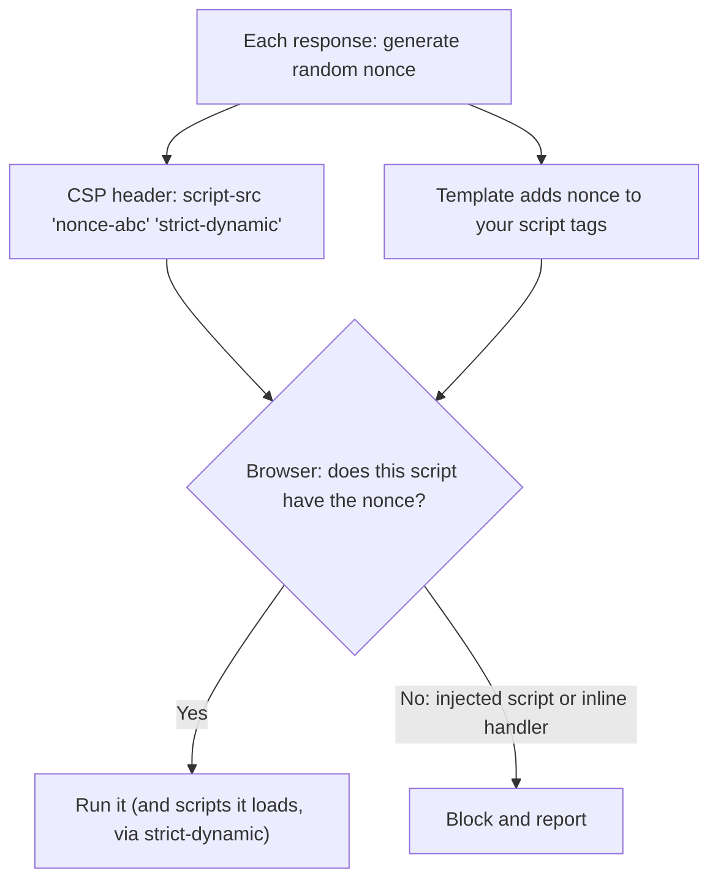
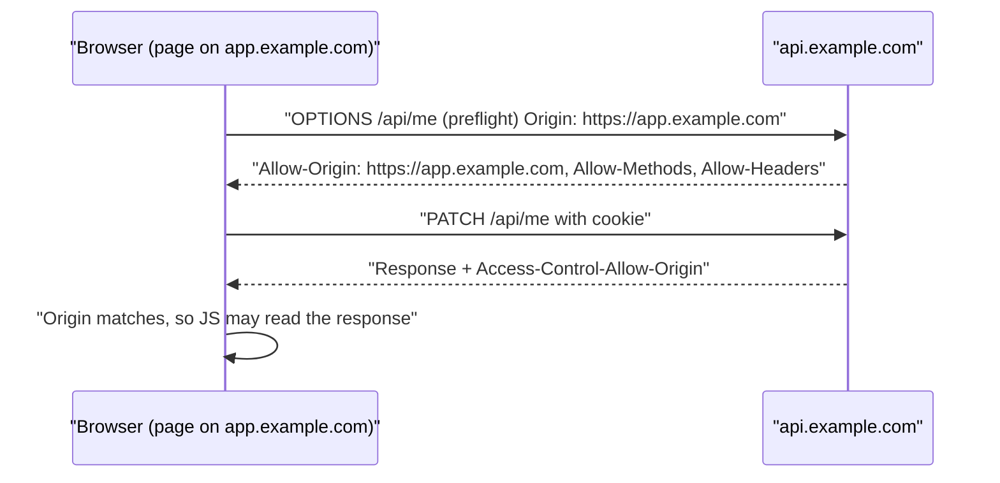

# Security Headers, CORS and CSP

## Introduction

Browsers enforce a lot of security on your behalf, and HTTP response headers are how you tell them what to enforce. A few lines of configuration can make XSS much harder to exploit, stop your pages being framed for clickjacking, force HTTPS, and control which other websites may read your API responses.

Think of security headers as the instructions you leave with a building's doorman: "only let in visitors with today's code" (CSP), "never let anyone use the side entrance" (HSTS forcing HTTPS), "don't let other buildings display our lobby on their screens" (frame-ancestors). The doorman, the browser, is strict and reliable, but only follows instructions you actually leave.

Two things to keep in mind from the start:

- Headers are **defense in depth**. They limit the damage of bugs like [XSS](./4-sec-xss.mdx); they do not fix them.
- **CORS is not a security header in the same sense.** It *relaxes* the browser's same-origin policy. Most CORS problems are caused by relaxing it too much.

Missing or wrong headers fall under **A02 Security Misconfiguration** in the OWASP Top 10:2025.

## The Essential Headers

Values below follow the [OWASP HTTP Headers Cheat Sheet](https://cheatsheetseries.owasp.org/cheatsheets/HTTP_Headers_Cheat_Sheet.html) and the [web.dev strict CSP guide](https://web.dev/articles/strict-csp). Recommendations change as browsers evolve, so recheck them periodically.

| Header | Recommended value | What it does |
| --- | --- | --- |
| `Content-Security-Policy` | Strict nonce- or hash-based policy (below) | Controls which scripts and other resources may load; main XSS mitigation |
| `Strict-Transport-Security` | `max-age=63072000; includeSubDomains` (add `preload` deliberately) | Browser always uses HTTPS for your domain |
| `X-Content-Type-Options` | `nosniff` | Stops the browser guessing content types (e.g., treating an upload as script) |
| `Referrer-Policy` | `strict-origin-when-cross-origin` | Limits URL leakage to other sites |
| `Permissions-Policy` | `geolocation=(), camera=(), microphone=()` | Disables powerful browser features you don't use |
| `Cross-Origin-Opener-Policy` | `same-origin` | Isolates your window from cross-origin popups |
| CSP `frame-ancestors` | `'none'` or `'self'` | Prevents clickjacking (replaces `X-Frame-Options`) |
| `X-Frame-Options` | `DENY` | Legacy clickjacking defense for old browsers |
| `X-XSS-Protection` | `0` or omit | The old XSS filter is obsolete and could itself cause issues |
| `Server`, `X-Powered-By` | Remove or make generic | Avoids advertising versions |

Cookie attributes (`Secure`, `HttpOnly`, `SameSite`, the `__Host-` prefix) matter just as much. They are covered in [CSRF](./5-sec-csrf.mdx) and [Sessions and Cookies](../4-sec-authentication/4-sec-sessions-and-cookies.mdx).

## Content Security Policy (CSP)

CSP is the most powerful header and the most effort to adopt. Older "allowlist" policies like `script-src 'self' https://cdn.example.com` turned out to be easy to bypass, because allowed domains often host scripts or JSONP endpoints an attacker can reuse. Current guidance favors a **strict CSP** based on nonces or hashes.



The recommended nonce-based policy from web.dev:

```text
Content-Security-Policy:
  script-src 'nonce-{RANDOM}' 'strict-dynamic';
  object-src 'none';
  base-uri 'none';
```

- `'nonce-...'`: only scripts with this per-response random value run. An attacker injecting HTML cannot guess it.
- `'strict-dynamic'`: scripts loaded by a trusted script are trusted too, so bundlers and tag managers keep working.
- `object-src 'none'`: blocks plugins.
- `base-uri 'none'`: stops an injected `<base>` tag redirecting your relative script URLs.

For static pages that can't generate a nonce per response, use hashes of each inline script instead (`'sha256-...'`).

### A complete Flask example

```python
# headers_app.py  (pip install flask)
import secrets
from flask import Flask, g, render_template_string

app = Flask(__name__)

@app.before_request
def make_nonce():
    g.csp_nonce = secrets.token_urlsafe(16)          # new random nonce per response

@app.after_request
def set_security_headers(resp):
    csp = (
        f"script-src 'nonce-{g.csp_nonce}' 'strict-dynamic'; "
        "object-src 'none'; base-uri 'none'; frame-ancestors 'none'; "
        "form-action 'self'"
    )
    resp.headers["Content-Security-Policy"] = csp
    resp.headers["Strict-Transport-Security"] = "max-age=63072000; includeSubDomains"
    resp.headers["X-Content-Type-Options"] = "nosniff"
    resp.headers["Referrer-Policy"] = "strict-origin-when-cross-origin"
    resp.headers["Permissions-Policy"] = "geolocation=(), camera=(), microphone=()"
    resp.headers["Cross-Origin-Opener-Policy"] = "same-origin"
    return resp

PAGE = """<!doctype html>
<h1>Dashboard</h1>
<script nonce="{{ g.csp_nonce }}">console.log("allowed: has the nonce");</script>
<script>console.log("blocked: no nonce");</script>
"""

@app.get("/")
def index():
    return render_template_string(PAGE)

if __name__ == "__main__":
    resp = app.test_client().get("/")
    for name in ["Content-Security-Policy", "Strict-Transport-Security", "X-Content-Type-Options",
                 "Referrer-Policy", "Permissions-Policy", "Cross-Origin-Opener-Policy"]:
        print(f"{name}: {resp.headers[name]}")
```

Example output (the nonce changes on every request):

```text
Content-Security-Policy: script-src 'nonce-CjEXLcgVtGW0Kz2DrrjSNw' 'strict-dynamic'; object-src 'none'; base-uri 'none'; frame-ancestors 'none'; form-action 'self'
Strict-Transport-Security: max-age=63072000; includeSubDomains
X-Content-Type-Options: nosniff
Referrer-Policy: strict-origin-when-cross-origin
Permissions-Policy: geolocation=(), camera=(), microphone=()
Cross-Origin-Opener-Policy: same-origin
```

If you open the page in a browser, the console shows the first script's message and a CSP violation for the second script, which has no nonce.

`frame-ancestors 'none'` blocks framing (clickjacking), and `form-action 'self'` stops injected forms from posting to other sites.

### What strict CSP requires from your code

- **No inline event handlers.** `onclick="..."` attributes are blocked. Use `addEventListener` in a nonced script.
- **No `javascript:` URLs.**
- **Every `<script>` tag gets the nonce**, including those rendered by templates and third-party snippets.
- **Avoid `eval`** and string-based `setTimeout`; they need `'unsafe-eval'`, which weakens the policy.

### Roll out with Report-Only

Never ship a new CSP straight to enforcement. Send it as `Content-Security-Policy-Report-Only` first: the browser reports violations but blocks nothing.

```text
Content-Security-Policy-Report-Only: script-src 'nonce-abc123' 'strict-dynamic'; object-src 'none'; base-uri 'none'; report-to csp-endpoint
Reporting-Endpoints: csp-endpoint="https://app.example.com/csp-reports"
```

Watch the reports in staging and then production, fix legitimate violations, then switch to the enforcing header. Expect noise from browser extensions. Note that CSP in a `<meta>` tag does not support report-only mode or `frame-ancestors`, so prefer the HTTP header. Tools like Google's CSP Evaluator can flag weak policies.

## Setting Headers in nginx

Many teams set headers at the reverse proxy so every app behind it gets them.

```nginx
server {
    listen 443 ssl;
    server_name app.example.com;

    # "always" adds headers to error responses (4xx/5xx) too
    add_header Strict-Transport-Security "max-age=63072000; includeSubDomains" always;
    add_header X-Content-Type-Options "nosniff" always;
    add_header Referrer-Policy "strict-origin-when-cross-origin" always;
    add_header Permissions-Policy "geolocation=(), camera=(), microphone=()" always;
    add_header Cross-Origin-Opener-Policy "same-origin" always;
    add_header Content-Security-Policy "frame-ancestors 'none'; object-src 'none'; base-uri 'none'" always;

    server_tokens off;                # hide the nginx version

    location / {
        proxy_pass http://127.0.0.1:8000;
        proxy_hide_header X-Powered-By;
    }
}
```

:::caution nginx add_header inheritance
If a `location` block contains **any** `add_header` directive, it does not inherit the `add_header` directives from the `server` block. Adding one header to a location can silently drop all your security headers there. Repeat them in the location (for example via an `include` file) and test every route.
:::

A nonce-based CSP must come from the application, because each response needs a fresh nonce that matches the HTML. A common split: nginx sets the static headers, the app sets `script-src`.

Check what you actually send:

```bash
curl -sI https://app.example.com/ | grep -iE "strict-transport|content-security|x-content-type|referrer-policy"
```

Example output:

```text
strict-transport-security: max-age=63072000; includeSubDomains
content-security-policy: frame-ancestors 'none'; object-src 'none'; base-uri 'none'
x-content-type-options: nosniff
referrer-policy: strict-origin-when-cross-origin
```

### Test your headers in CI

Headers disappear quietly: someone adds an nginx `location`, changes a middleware order, or a framework upgrade alters defaults. A small test catches that, including on error pages:

```python
# test_headers.py  (pip install pytest)
import pytest
from headers_app import app

REQUIRED = {
    "Strict-Transport-Security": "max-age=",
    "X-Content-Type-Options": "nosniff",
    "Referrer-Policy": "strict-origin-when-cross-origin",
    "Content-Security-Policy": "'strict-dynamic'",
}

@pytest.mark.parametrize("path", ["/", "/does-not-exist"])   # include an error page
def test_security_headers(path):
    resp = app.test_client().get(path)
    for name, expected in REQUIRED.items():
        assert expected in resp.headers.get(name, ""), f"{name} missing on {path}"

def test_nonce_changes_per_response():
    c = app.test_client()
    first = c.get("/").headers["Content-Security-Policy"]
    second = c.get("/").headers["Content-Security-Policy"]
    assert first != second
```

Output:

```text
...                                                                      [100%]
3 passed in 0.04s
```

For deployed environments, run the same assertions with `requests` against staging after each deploy, or use a DAST baseline scan, which reports missing headers. See [Dynamic Analysis (DAST)](../6-sec-appsec-and-devsecops/3-sec-dast.mdx).

## HSTS: Read Before You Preload

`Strict-Transport-Security` tells browsers to use HTTPS for your domain for `max-age` seconds. `includeSubDomains` extends that to every subdomain, and `preload` asks to be built into browsers' preload lists, so even the very first visit uses HTTPS.

Roll it out in steps: a short `max-age` (for example 300 seconds), then a week, then two years. Only add `includeSubDomains` once **every** subdomain serves valid HTTPS, and only submit for preload once you are sure, because removal from preload lists is slow. See [TLS and HTTPS](../1-sec-cryptography/7-sec-tls.mdx).

## CORS: Relaxing the Same-Origin Policy Safely

By default, JavaScript on `https://app.example.com` cannot read responses from `https://api.example.com`, because they are different origins. **Cross-Origin Resource Sharing (CORS)** lets the API opt in: "responses may be read by these origins."



Simple requests (GET, or POST with form-style content types) are sent without a preflight; the CORS headers only decide whether the page can **read** the response. That is why CORS is not a CSRF defense. Requests with custom headers, JSON content type or methods like `PUT` and `DELETE` trigger a **preflight** `OPTIONS` request first.

### The dangerous misconfiguration

```python
# Vulnerable: reflects any Origin and allows credentials
@app.after_request
def cors(resp):
    resp.headers["Access-Control-Allow-Origin"] = request.headers.get("Origin", "*")
    resp.headers["Access-Control-Allow-Credentials"] = "true"
    return resp
```

With this, any website a logged-in user visits can call your API **with the user's cookies** and read the response: profile data, API keys, CSRF tokens. Browsers refuse the literal combination of `*` with credentials, which is exactly why developers "fix" the error by reflecting the Origin, and create the vulnerability.

### The fix: exact-match allowlist (Fixed)

```python
# cors_app.py
from flask import Flask, request

app = Flask(__name__)
ALLOWED_ORIGINS = {"https://app.example.com", "https://admin.example.com"}

@app.after_request
def cors(resp):
    origin = request.headers.get("Origin")
    if origin in ALLOWED_ORIGINS:                       # exact match against an allowlist
        resp.headers["Access-Control-Allow-Origin"] = origin
        resp.headers["Access-Control-Allow-Credentials"] = "true"
        resp.headers["Vary"] = "Origin"                 # caches must key on Origin
        if request.method == "OPTIONS":                 # preflight
            resp.headers["Access-Control-Allow-Methods"] = "GET, POST, PATCH"
            resp.headers["Access-Control-Allow-Headers"] = "Content-Type, X-CSRFToken"
            resp.headers["Access-Control-Max-Age"] = "600"
    return resp

@app.route("/api/me", methods=["GET", "OPTIONS"])
def me():
    return {"email": "alice@example.com"}

if __name__ == "__main__":
    c = app.test_client()
    for origin in ["https://app.example.com", "https://evil.example", "https://app.example.com.evil.example"]:
        r = c.get("/api/me", headers={"Origin": origin})
        print(f"{origin:40} -> ACAO={r.headers.get('Access-Control-Allow-Origin')}")
```

Output:

```text
https://app.example.com                  -> ACAO=https://app.example.com
https://evil.example                     -> ACAO=None
https://app.example.com.evil.example     -> ACAO=None
```

Notice the third origin. Checks like `origin.startswith("https://app.example.com")` or `"example.com" in origin` would have allowed it. Use **exact matches** from a set. In production you can use `flask-cors` or your framework's CORS middleware, configured with an explicit list of origins.

| CORS setting | Safe? | Notes |
| --- | --- | --- |
| No CORS headers | Yes | Default: only same-origin pages can read responses |
| `Access-Control-Allow-Origin: *` without credentials | Usually | Fine for truly public, unauthenticated data |
| Exact allowlist + credentials | Yes | Remember `Vary: Origin` |
| Reflect any Origin + credentials | No | Any site can read user data |
| Allow `null` origin | No | Sandboxed iframes and local files send `null` |
| Regex or substring origin checks | Risky | Easy to get wrong, as shown above |

## Real-World Scenario

You run a fintech dashboard. A pentest report lists: no CSP, CORS reflecting arbitrary origins on the API, missing HSTS, and the app can be framed. Your front end is a React SPA served by nginx; the API is Flask on `api.example.com`. The team has two weeks. Should you just turn on a managed "security headers" feature at the CDN?

**The walkthrough:**

1. **CORS first (highest risk, smallest change):** replace origin reflection with an exact allowlist of your front-end origins. This closes a direct data-theft path.
2. **Static headers at the edge:** HSTS (starting with a short max-age), `nosniff`, `Referrer-Policy`, `Permissions-Policy` and `frame-ancestors 'none'`, set in nginx or the CDN with `always`.
3. **CSP in report-only:** the SPA's HTML is served by nginx, so use a hash-based policy for the bootstrap inline script, or have the build tool emit nonces via server-side rendering. Deploy as `Report-Only`, collect a week of reports, remove inline handlers, then enforce.
4. **Automated checks:** add a CI test that requests key routes and asserts each header is present, so a future nginx `location` block cannot silently drop them.

**Why this approach:** it orders work by risk and effort. CORS reflection is an exploitable bug; HSTS and framing are cheap; CSP needs measurement before enforcement to avoid breaking the app.

**When to use it:** any production web app. **When not to over-invest:** a pure JSON API that never serves HTML gains little from a complex CSP; a minimal `default-src 'none'; frame-ancestors 'none'` plus `nosniff` and correct CORS is enough.

| Approach | Pros | Cons | Best for |
| --- | --- | --- | --- |
| Headers in app middleware | Per-response nonces; versioned with code | Each app must do it | CSP with nonces |
| Headers in nginx / CDN | One place for all apps; covers error pages | No per-response nonce; inheritance gotchas | Static headers (HSTS, nosniff, framing) |
| Strict nonce/hash CSP | Strong XSS mitigation | Refactoring inline scripts; rollout effort | HTML apps with user content |
| Allowlist CSP (domains) | Easy to write | Often bypassable via allowed domains | Legacy; transition step only |
| CORS exact allowlist | Precise | Must maintain origin list | Credentialed cross-origin APIs |
| CORS `*` without credentials | Simple | Only for public data | Public read-only APIs |

## Common Mistakes

- **Reflecting the `Origin` header with credentials.** The most damaging CORS bug.
- **Thinking CORS protects the server.** CORS controls what browsers let pages *read*. It does not stop requests from being sent, and non-browser clients ignore it entirely.
- **Using `'unsafe-inline'` in `script-src`.** It defeats the main purpose of CSP (unless a nonce or hash is present, in which case modern browsers ignore it).
- **Shipping CSP straight to enforcement.** Use `Report-Only` first.
- **Enabling HSTS `includeSubDomains` or `preload` too early.** An internal HTTP-only subdomain becomes unreachable.
- **Relying on `X-XSS-Protection`.** It is obsolete; set it to `0` or remove it.
- **Forgetting error pages.** Without nginx's `always`, 404 and 500 responses go out without your headers.
- **Missing `Vary: Origin`.** A cache may serve one origin's CORS response to another.

## Summary

- Security headers tell the browser to enforce extra rules; they are defense in depth, not a fix for bugs.
- Use a strict nonce- or hash-based CSP with `'strict-dynamic'`, `object-src 'none'` and `base-uri 'none'`, rolled out via `Report-Only`.
- Set HSTS, `nosniff`, `Referrer-Policy`, `Permissions-Policy` and `frame-ancestors`; drop `X-XSS-Protection` and version headers.
- In nginx, use `always` and beware `add_header` inheritance.
- CORS relaxes the same-origin policy. Use an exact origin allowlist, never reflect arbitrary origins with credentials, and send `Vary: Origin`.

## Further Learning

**Exercises**

1. Run `headers_app.py` with `app.run()` on `127.0.0.1`, open it in a browser, and find the CSP violation in the developer console. Then add an inline `onclick` handler and watch it get blocked.
2. Write a pytest test that requests `/` and asserts all six headers are present and that `Content-Security-Policy` contains `'strict-dynamic'`.
3. Change `cors_app.py` to use `origin.endswith("example.com")`. Find an origin that bypasses it, then revert to the exact allowlist.
4. Write an nginx config with security headers at the `server` level and a `location /downloads/` that adds `Content-Disposition`. Use `curl -I` to show which headers are lost, then fix it.

**Related pages**

- [Cross-Site Scripting (XSS)](./4-sec-xss.mdx)
- [Cross-Site Request Forgery (CSRF)](./5-sec-csrf.mdx)
- [TLS and HTTPS](../1-sec-cryptography/7-sec-tls.mdx)
- [Secure Defaults and Configuration](../5-sec-secure-coding/6-sec-secure-defaults.mdx)
