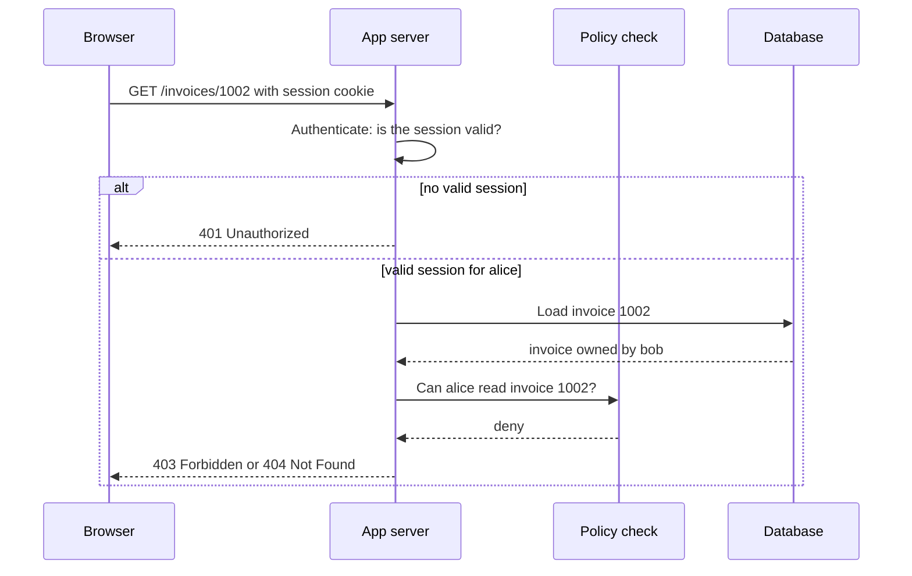

# Authentication vs Authorization

## Introduction

Two questions sit in front of almost every request your application handles:

1. **Who are you?** That is **authentication** (often shortened to *authn*).
2. **Are you allowed to do this?** That is **authorization** (often shortened to *authz*).

Think of an office building. At the front desk you show an ID badge and the guard checks that the face matches the photo. That is authentication. Later you swipe the badge at the server room door and the door stays shut, because your badge is not on the list for that room. That is authorization. The guard knowing who you are does not mean every door opens for you.

Mixing the two up causes some of the most common and most damaging bugs on the web. **Broken Access Control is A01 in the OWASP Top 10:2025**, and **Authentication Failures is A07**. Many real breaches are not clever crypto attacks. They are a logged-in user changing `/invoices/1001` to `/invoices/1002` and reading someone else's invoice, because the app checked *who* they were but never checked *whether that invoice was theirs*.

This page is the map for the whole Authentication and Authorization section. You will learn:

- The vocabulary: identification, authentication, authorization and accounting.
- The authentication factors and assurance levels.
- Where each check belongs in a request, and what HTTP status to return.
- How to write authentication and authorization checks in Flask that fail closed.
- How to choose where to enforce authorization in a multi-tenant app.

## The Vocabulary: AAA and Friends

Security people often talk about **AAA**: Authentication, Authorization and Accounting. A fourth step, identification, comes first.

| Step | Question | Example |
| --- | --- | --- |
| Identification | Who do you claim to be? | Typing the username `alice` |
| Authentication | Can you prove it? | Correct password plus a passkey prompt |
| Authorization | What may you do? | Alice may read and edit her own invoices only |
| Accounting (auditing) | What did you do? | Log line: `alice updated invoice 1001 at 10:42` |

Identification is just a claim. Anyone can type `alice`. Authentication turns the claim into something the system trusts. Authorization uses that trusted identity, plus other facts, to make a decision. Accounting writes down what happened so you can investigate later. You will see accounting again in [Security Logging and SIEM](../11-sec-defensive-operations/1-sec-logging-and-siem.mdx).

### Principals, subjects and identities

You will meet several words for "the thing being authenticated":

- **Principal** or **subject**: any entity that can be authenticated. It might be a human, a service, a device or a CI job.
- **Identity**: the set of attributes the system knows about a principal, such as user ID, email, roles, tenant and department.
- **Credential**: the proof a principal presents, such as a password, a private key, a token or a certificate.

A lot of modern security work is about non-human principals: microservices, scheduled jobs and AI agents. They need authentication and authorization too, which is covered in [API Keys and Service Authentication](./10-sec-api-authentication.mdx).

## Authentication Factors

Authentication proofs fall into categories called **factors**:

| Factor | Meaning | Examples |
| --- | --- | --- |
| Something you know | A secret in your head | Password, PIN, security question |
| Something you have | A physical or digital object | Phone with an authenticator app, hardware security key, passkey on a device |
| Something you are | A biometric | Fingerprint, face |

**Multi-factor authentication (MFA)** combines factors from *different* categories. A password plus a security question is still one factor (two things you know). A password plus a code from your phone is two factors.

Biometrics usually do not travel over the network. On a modern phone or laptop, your fingerprint only *unlocks a private key* stored on the device, and the key does the actual proving. That is how [passkeys](./3-sec-passkeys.mdx) work.

### Assurance levels

Not every app needs the same strength. NIST SP 800-63B (revision 4, finalized in 2025) defines **Authenticator Assurance Levels**:

- **AAL1**: some confidence. Single-factor authentication is allowed.
- **AAL2**: high confidence. Two distinct factors are required, and verifiers must offer a phishing-resistant option.
- **AAL3**: very high confidence. Requires a phishing-resistant authenticator with a non-exportable key, such as a hardware security key.

You do not need to be a US agency to use these levels. They are a handy way to say "our admin console needs AAL2 or better" in a design review. Details and the current text are on the [NIST SP 800-63-4 site](https://pages.nist.gov/800-63-4/), and requirements may change between revisions.

## Where the Checks Happen in a Request

Every protected request goes through the same pipeline. Authentication happens once per request (usually by validating a session cookie or token), and authorization happens for every action on every resource.



Notice that authorization needs the **resource** in hand. "Can alice read invoices?" is not enough. The real question is "can alice read *this* invoice?". That is why authorization checks often live next to the data-loading code, not only at the edge.

### 401 vs 403 vs 404

The HTTP status codes encode the difference, despite a confusing name:

| Status | Real meaning | When to return it |
| --- | --- | --- |
| `401 Unauthorized` | Not authenticated | No credentials, or credentials invalid or expired |
| `403 Forbidden` | Authenticated, but not allowed | Alice is logged in but is not an admin |
| `404 Not Found` | Resource does not exist, or you choose to hide it | Alice asks for Bob's private invoice and you do not want to confirm it exists |

Returning `404` instead of `403` for objects the user cannot see avoids leaking which IDs exist. Pick one convention and use it consistently.

## Building It in Flask

Let's build a tiny invoice API. Install Flask first:

```bash
pip install flask
```

The examples use a fake in-memory user store and a header-based session to keep the focus on the checks themselves. Real session handling is covered in [Sessions and Cookies](./4-sec-sessions-and-cookies.mdx), and real password checking in [Secure Password Authentication](./1-sec-password-authentication.mdx).

### Step 1: An authentication layer

Authentication runs before the view function. It turns a credential into a trusted identity and stores it on Flask's per-request `g` object.

```python
# app_authn.py
from functools import wraps
from flask import Flask, g, jsonify, request, abort

app = Flask(__name__)

# Pretend these session IDs were issued at login. Never use guessable IDs in real life.
SESSIONS = {
    "sess-alice": {"user_id": 1, "name": "alice", "roles": {"user"}},
    "sess-bob": {"user_id": 2, "name": "bob", "roles": {"user"}},
    "sess-admin": {"user_id": 3, "name": "carol", "roles": {"user", "admin"}},
}

@app.before_request
def authenticate():
    """Authentication: map the presented credential to an identity, or nobody."""
    session_id = request.headers.get("X-Session-Id", "")
    g.user = SESSIONS.get(session_id)  # None when missing or invalid

def login_required(view):
    @wraps(view)
    def wrapper(*args, **kwargs):
        if g.user is None:
            abort(401)
        return view(*args, **kwargs)
    return wrapper

@app.get("/me")
@login_required
def me():
    return jsonify(name=g.user["name"], roles=sorted(g.user["roles"]))

if __name__ == "__main__":
    client = app.test_client()
    print(client.get("/me").status_code)
    print(client.get("/me", headers={"X-Session-Id": "sess-alice"}).get_json())
```

Output:

```text
401
{'name': 'alice', 'roles': ['user']}
```

The key design choice: when authentication fails, `g.user` is `None` and every protected view refuses. Nothing defaults to "logged in".

### Step 2: A vulnerable authorization check

Now add invoices. This first version is a classic bug.

**Vulnerable:**

```python
INVOICES = {
    1001: {"id": 1001, "owner_id": 1, "amount": 120},
    1002: {"id": 1002, "owner_id": 2, "amount": 9800},
}

@app.get("/invoices/<int:invoice_id>")
@login_required
def get_invoice(invoice_id):
    invoice = INVOICES.get(invoice_id)
    if invoice is None:
        abort(404)
    return jsonify(invoice)  # Any logged-in user can read any invoice!
```

The developer assumed that because the user is logged in and the UI only shows *their* invoice links, everything is fine. But anybody can type a different number. This is called an **Insecure Direct Object Reference (IDOR)**, or in API terms **Broken Object Level Authorization (BOLA)**, which is number one in the OWASP API Security Top 10 (2023). See [Broken Object Level Authorization](../7-sec-api-security/2-sec-bola.mdx).

### Step 3: The fixed version

**Fixed:**

```python
def can_read_invoice(user: dict, invoice: dict) -> bool:
    """Authorization policy in one place. Deny unless a rule allows."""
    if "admin" in user["roles"]:
        return True
    return invoice["owner_id"] == user["user_id"]

@app.get("/invoices/<int:invoice_id>")
@login_required
def get_invoice(invoice_id):
    invoice = INVOICES.get(invoice_id)
    if invoice is None or not can_read_invoice(g.user, invoice):
        abort(404)  # Same answer for "missing" and "not yours": no ID enumeration
    return jsonify(invoice)
```

Testing it with Flask's test client:

```python
client = app.test_client()
alice = {"X-Session-Id": "sess-alice"}
admin = {"X-Session-Id": "sess-admin"}
print(client.get("/invoices/1001", headers=alice).status_code)  # her own
print(client.get("/invoices/1002", headers=alice).status_code)  # bob's
print(client.get("/invoices/1002", headers=admin).status_code)  # admin
print(client.get("/invoices/1002").status_code)                 # anonymous
```

Output:

```text
200
404
200
401
```

Three things make this version safer:

1. **The policy is a named function.** You can unit-test `can_read_invoice` on its own and reuse it in list views, exports and background jobs.
2. **It denies by default.** The function returns `True` only when a rule matches.
3. **The response does not leak existence.** Alice cannot tell if invoice 1002 exists.

### Step 4: Do not forget list endpoints

Fixing the single-object endpoint is not enough. List and search endpoints leak data just as easily. Filter in the query, not after rendering:

```python
@app.get("/invoices")
@login_required
def list_invoices():
    visible = [inv for inv in INVOICES.values() if can_read_invoice(g.user, inv)]
    return jsonify(visible)
```

With a real database you would push the filter into SQL (`WHERE owner_id = ?`) so you never load other users' rows at all.

## Common Authorization Models

Once you have identities, you need a way to express rules. The main models are covered in detail in [RBAC, ABAC and ReBAC](./9-sec-rbac-abac.mdx). As a preview:

| Model | Rule looks like | Good for |
| --- | --- | --- |
| ACL (access control list) | "Invoice 1002: bob can read and write" | Small systems, file permissions |
| RBAC (role-based) | "Admins can delete invoices" | Most business apps |
| ABAC (attribute-based) | "Managers can approve if amount is under 10,000 and same department" | Context-heavy rules |
| ReBAC (relationship-based) | "You can view a doc if you are a member of a team that owns its folder" | Sharing, Google Drive style apps |

## Where Tokens Fit

You will see both terms in OAuth and OpenID Connect, and they map neatly onto authn and authz:

- An **ID token** (OpenID Connect) says *who the user is*. It is an authentication artifact for the client app. See [OpenID Connect](./7-sec-oidc.mdx).
- An **access token** (OAuth 2.0) says *what this client may do on the user's behalf*. It is an authorization artifact for an API. See [OAuth 2.0](./6-sec-oauth2.mdx).

A very common mistake is using one as the other, such as sending an ID token to an API as if it were an access token.

## Real-World Scenario

Your team runs a multi-tenant SaaS helpdesk. Companies (tenants) sign up, and their agents handle support tickets. Requirements:

- Agents must only see tickets from their own company.
- Within a company, only supervisors may delete tickets.
- An external pen test just found that changing the `ticket_id` in a URL exposed another tenant's tickets.

### The solution

You make authentication and authorization two separate, explicit layers:

1. **Authentication at the edge.** A single middleware validates the session cookie (or OIDC login for enterprise customers with SSO) and loads `user_id`, `tenant_id` and `roles` into the request context. No view function reads cookies itself.
2. **Tenant isolation in the data layer.** Every query is scoped by `tenant_id` taken from the authenticated identity, never from the URL or request body. Many teams add PostgreSQL row-level security (RLS) as a second net, so a forgotten `WHERE tenant_id = ...` still returns nothing.
3. **Action checks in a policy module.** A function like `can(user, "delete", ticket)` holds the role rules, so "only supervisors delete" lives in one tested place.
4. **Accounting.** Each authorization denial is logged with user, tenant, action and resource, so a spike of denials (someone probing IDs) can raise an alert.

```python
def scoped_ticket_query(db, user, ticket_id):
    # tenant_id comes from the authenticated session, never from the request
    return db.execute(
        "SELECT * FROM tickets WHERE id = ? AND tenant_id = ?",
        (ticket_id, user["tenant_id"]),
    ).fetchone()
```

### Why this approach

The pen-test finding is an authorization bug, not an authentication bug. Stronger passwords or MFA would not have stopped it. The fix is to make tenant scoping impossible to forget by moving it into the query layer, and to centralize the role rules.

### When to use it, and when not to

- Use layered checks (edge authentication plus data-layer scoping plus policy functions) for any multi-user app with private data.
- For a single-user internal tool behind a VPN, a full policy engine is overkill. A simple login check may be enough, though you still want tenant scoping if data from several customers ever shares a database.

### Alternatives and trade-offs

| Approach | Pros | Cons | Best for |
| --- | --- | --- | --- |
| Checks only in API gateway | One place, language neutral | Gateway rarely knows who owns object 1002, so object-level checks are missed | Coarse checks: "is this a valid token with scope `tickets:read`" |
| Checks in each view function | Simple, close to the code | Easy to forget one endpoint | Small apps with few endpoints |
| Central policy module or engine | Testable, consistent, auditable | Extra abstraction to learn | Growing apps with many roles |
| Database row-level security | Hard to bypass from app code | Database-specific, harder to debug, can hurt performance if policies are complex | Multi-tenant data isolation as a second layer |
| WAF rule blocking ID tampering | No code change | Cannot know ownership, easy to bypass, many false positives | Not a real fix; at most a temporary signal |

The usual answer is **gateway for authentication and coarse scopes, application plus database for object-level authorization**.

## Common Mistakes

- **Treating "logged in" as "allowed".** Every resource access needs an ownership or permission check.
- **Hiding buttons instead of checking on the server.** The UI is a convenience. Attackers call your API directly.
- **Trusting identity data from the client.** Never read `user_id`, `role` or `tenant_id` from a request body, query string or unsigned cookie.
- **Checking authorization before loading the resource and then loading a different one.** Use the same object for the check and the action.
- **Forgetting secondary paths.** Exports, search, GraphQL resolvers, webhooks, background jobs and admin tools all need the same policy.
- **Inconsistent 401/403 handling.** Return `401` when authentication is missing, so clients know to log in again, and `403` or `404` for denials.
- **Fail-open error handling.** If the policy service is down, deny. A `try/except` that returns `True` on error turns an outage into a breach.

## Summary

- **Authentication** proves who a principal is. **Authorization** decides what that principal may do. **Accounting** records what happened.
- Authentication factors are something you know, have or are. MFA combines different categories.
- Authorization is per action and per resource, so it usually needs the loaded object.
- Return `401` for missing or invalid credentials and `403` or `404` for denials.
- Put policy logic in one tested place, deny by default, and scope data queries by the authenticated identity.
- Broken access control is the top risk in the OWASP Top 10:2025. Strong login alone does not prevent it.

## Exercises

1. Add a `PUT /invoices/<id>` endpoint to the Flask example that lets owners edit and admins edit any invoice, but nobody may edit an invoice with `status == "paid"`. Write unit tests for `can_edit_invoice`.
2. Change the example so that a denial is logged with the user ID, invoice ID and action. Trigger ten denials and print the log lines.
3. For an app you know, list every place data leaves the system (views, exports, emails, webhooks). Mark which ones currently run an authorization check.
4. Explain to a teammate, in two sentences, why MFA would not have prevented the helpdesk pen-test finding.

Next, see how to store and verify passwords safely in [Secure Password Authentication](./1-sec-password-authentication.mdx). Related pages: [Least Privilege and Zero Trust](../0-sec-fundamentals/5-sec-least-privilege.mdx) and [Broken Access Control](../3-sec-web-security/2-sec-broken-access-control.mdx).
