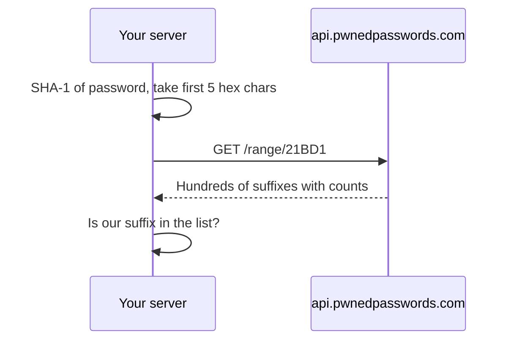
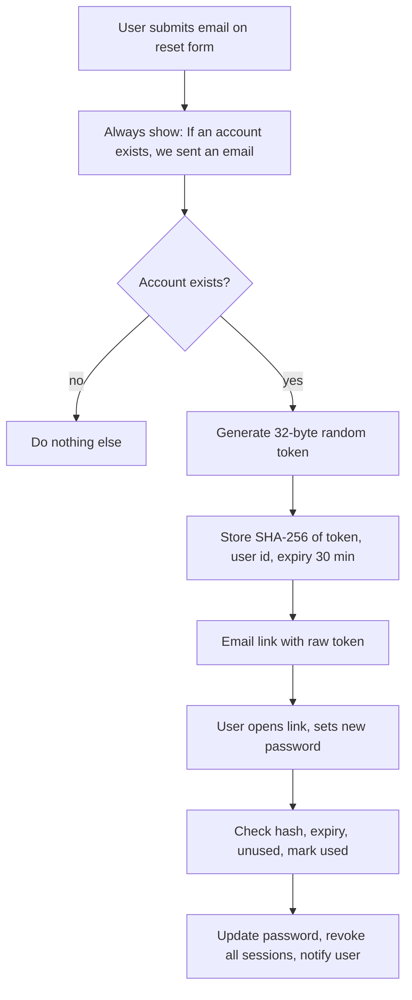

# Secure Password Authentication

## Introduction

Passwords are the oldest and still the most common way to log in. They are also the weakest link in many systems. Users reuse them across sites, attackers buy billions of leaked ones, and developers still make mistakes when storing and checking them.

You probably cannot remove passwords from your app tomorrow. But you can make password login much harder to abuse. This page walks through a full password authentication flow and shows a **vulnerable** and a **fixed** version of each piece:

- What a modern password policy looks like, based on **NIST SP 800-63B-4** (finalized in 2025).
- Storing passwords with **Argon2id** using `argon2-cffi`.
- Rejecting known-breached passwords.
- Login code that does not leak which accounts exist.
- Throttling online guessing and credential stuffing.
- A safe password reset flow.

Think of a password system like a bank vault. The password policy decides how good the combination must be. The hash is the vault door that protects stored combinations if someone breaks into the building. Throttling is the guard who notices someone trying thousands of combinations. You need all three.

:::note
This page focuses on the authentication flow. The cryptography behind password hashing (salts, work factors, why fast hashes are wrong) is covered in [Password Hashing](../1-sec-cryptography/2-sec-password-hashing.mdx). How attackers guess passwords, and how to test your own systems in a lab, is in [Password Attacks and Defenses](../10-sec-offensive-security/7-sec-password-attacks.mdx).
:::

## The Threats You Are Defending Against

| Threat | How it works | Main defenses |
| --- | --- | --- |
| Online guessing | Attacker tries common passwords against your login form | Throttling, blocklist of common passwords, MFA |
| Credential stuffing | Attacker replays username/password pairs leaked from *other* sites | Breached-password checks, MFA, bot detection, rate limits per IP and per account |
| Offline cracking | Attacker steals your database and guesses against the hashes | Slow, salted hashing (Argon2id, scrypt, bcrypt) |
| Account enumeration | Attacker learns which emails have accounts from error messages or timing | Generic errors, constant-ish timing |
| Phishing | User types their password into a fake site | MFA, and best of all phishing-resistant [passkeys](./3-sec-passkeys.mdx) |
| Reset abuse | Attacker takes over the account through "forgot password" | Random single-use tokens, short expiry, notify the user |

Notice that no single control covers everything. In particular, **no password policy stops phishing**. That is why the following pages on [MFA](./2-sec-mfa.mdx) and passkeys matter so much.

## A Modern Password Policy

Many companies still enforce rules from the early 2000s: at least eight characters, one uppercase, one number, one symbol, and change it every 90 days. Research and NIST guidance show these rules push people toward predictable patterns like `Summer2025!`.

NIST SP 800-63B-4, section 3.1.1.2, says verifiers:

- **SHALL require at least 15 characters** for passwords used as a single factor, and **at least 8** for passwords used only as part of MFA.
- **SHOULD allow at least 64 characters.**
- **SHALL NOT impose composition rules**, such as requiring a mix of character types.
- **SHALL NOT require periodic password changes**, but **SHALL force a change when there is evidence of compromise.**
- **SHALL check new passwords against a blocklist** of common, expected or compromised passwords.
- **SHALL NOT allow password hints** or knowledge-based questions such as "name of your first pet".
- **SHALL allow password managers and autofill**, and should allow paste.
- **SHALL verify the whole password** and not truncate it.
- **SHALL limit consecutive failed attempts** on one account to no more than 100.

These are requirements for US federal systems, but they are a strong baseline for any app. Always check the [current text](https://pages.nist.gov/800-63-4/sp800-63b/authenticators/) since revisions can change details.

### Vulnerable vs fixed policy

**Vulnerable:**

```python
import re

def is_valid_password_old(pw: str) -> bool:
    # Short minimum, composition rules, and a low maximum that breaks passphrases
    return (
        8 <= len(pw) <= 16
        and re.search(r"[A-Z]", pw)
        and re.search(r"[0-9]", pw)
        and re.search(r"[^A-Za-z0-9]", pw)
    ) is not None
```

**Fixed:**

```python
import unicodedata

COMMON_PASSWORDS = {"password", "123456789012345", "qwertyuiopasdfg", "passwordpassword"}

def check_new_password(pw: str, *, email: str, mfa_enabled: bool) -> list[str]:
    """Return a list of problems. Empty list means the password is acceptable."""
    pw = unicodedata.normalize("NFC", pw)
    problems = []
    min_len = 8 if mfa_enabled else 15
    if len(pw) < min_len:
        problems.append(f"Use at least {min_len} characters.")
    if len(pw) > 128:
        problems.append("Use at most 128 characters.")
    if pw.lower() in COMMON_PASSWORDS:
        problems.append("This password is too common.")
    if email.split("@")[0].lower() in pw.lower():
        problems.append("Do not include your email name in the password.")
    return problems

print(check_new_password("Summer2025!", email="alice@example.com", mfa_enabled=False))
print(check_new_password("correct horse battery staple", email="alice@example.com", mfa_enabled=False))
print(check_new_password("alice-is-great-2025", email="alice@example.com", mfa_enabled=False))
```

Output:

```text
['Use at least 15 characters.']
[]
['Do not include your email name in the password.']
```

A few details:

- The maximum (128 here) is a denial-of-service guard, not a strength rule. Hashing a 1 MB "password" with Argon2 would burn CPU and memory.
- Normalizing Unicode to NFC means `é` typed on two different keyboards hashes the same way.
- In production, the blocklist is a file of hundreds of thousands of common passwords plus a breached-password check (next section), not a four-item set.

## Storing Passwords: Argon2id

Never store passwords in plain text, encrypted, or with fast hashes like MD5, SHA-1 or plain SHA-256. Use a **password hashing function** that is deliberately slow and salted. The OWASP Password Storage Cheat Sheet recommends **Argon2id** first, then scrypt, then bcrypt, and PBKDF2 where FIPS compliance requires it.

```bash
pip install argon2-cffi
```

**Vulnerable:**

```python
import hashlib

def store_password_bad(pw: str) -> str:
    return hashlib.sha256(pw.encode()).hexdigest()  # fast, unsalted: cracked in seconds on a GPU

print(store_password_bad("correct horse battery staple"))
print(store_password_bad("correct horse battery staple"))  # identical output for identical passwords
```

**Fixed:**

```python
from argon2 import PasswordHasher
from argon2.exceptions import VerifyMismatchError

ph = PasswordHasher()  # Argon2id with the library's current recommended defaults

h1 = ph.hash("correct horse battery staple")
h2 = ph.hash("correct horse battery staple")
print(h1)
print(h1 == h2)  # different random salt each time

try:
    ph.verify(h1, "wrong password")
except VerifyMismatchError:
    print("mismatch")
print(ph.verify(h1, "correct horse battery staple"))
```

Example output:

```text
$argon2id$v=19$m=65536,t=3,p=4$oNeY5USnewSPYHX1ClE7dg$Tb1I65ZJADaFdrWlsM0DRxb/rXBfDabgYYBn8O99d5Y
False
mismatch
True
```

The encoded string stores everything needed to verify later: the algorithm (`argon2id`), version, memory cost (`m=65536` KiB, so 64 MiB), iterations (`t=3`), parallelism (`p=4`), the salt and the hash. In `argon2-cffi` 25.x, the `PasswordHasher()` defaults follow the RFC 9106 "low memory" profile. Defaults change between releases, so check the [argon2-cffi docs](https://argon2-cffi.readthedocs.io/) and benchmark on your own servers. A common target is a few hundred milliseconds or less per hash.

:::caution
`bcrypt` only uses the first 72 bytes of the password. NIST says verifiers must not truncate passwords, so if you use bcrypt, either cap the password length at 72 bytes in your policy or prefer Argon2id.
:::

### Upgrading hashes on login

Work factors should go up over time as hardware gets faster. Because you only see the plain password at login, that is when you upgrade:

```python
def verify_and_upgrade(user: dict, password: str) -> bool:
    try:
        ph.verify(user["password_hash"], password)
    except VerifyMismatchError:
        return False
    if ph.check_needs_rehash(user["password_hash"]):
        user["password_hash"] = ph.hash(password)  # save to the database here
    return True
```

The same trick migrates old hashes. If you inherited a database of SHA-256 hashes, you can wrap them (`argon2(sha256(pw))`) immediately, then replace them with plain Argon2id hashes as each user logs in.

## Checking Breached Passwords

Credential stuffing works because people reuse passwords that already leaked elsewhere. You can reject those at sign-up and password change using the free **Have I Been Pwned Pwned Passwords** range API. It uses **k-anonymity**: you send only the first 5 hex characters of the password's SHA-1 hash and compare the returned suffixes locally, so the password never leaves your server.



```python
import hashlib
import requests

def breach_count(password: str) -> int:
    sha1 = hashlib.sha1(password.encode("utf-8")).hexdigest().upper()
    prefix, suffix = sha1[:5], sha1[5:]
    resp = requests.get(
        f"https://api.pwnedpasswords.com/range/{prefix}",
        headers={"Add-Padding": "true"},  # hides the real response size
        timeout=3,
    )
    resp.raise_for_status()
    for line in resp.text.splitlines():
        candidate, _, count = line.partition(":")
        if candidate == suffix:
            return int(count)
    return 0
```

SHA-1 is fine here because it is only used as a lookup key, not to store passwords. Decide in advance what happens if the API is down: most teams **fail open for this one check** (allow the password, log a warning) because it is an extra layer, while your local blocklist still applies. You can also download the full dataset and query it offline. See the [HIBP API docs](https://haveibeenpwned.com/API/v3) for current terms.

## The Login Endpoint

Now put it together in a Flask login endpoint. First the version that ships in many tutorials.

**Vulnerable:**

```python
@app.post("/login")
def login_bad():
    email = request.form["email"]
    password = request.form["password"]
    user = USERS.get(email)
    if user is None:
        return "No account with that email", 401          # enumeration through message
    if not verify_and_upgrade(user, password):
        return "Wrong password", 401                        # confirms the account exists
    session["user_id"] = user["id"]                         # no session renewal
    return "ok"
```

Problems:

1. Different messages reveal which emails are registered.
2. Unknown emails return instantly, while real ones take ~100 ms to hash. That timing difference also reveals accounts.
3. No throttling, so an attacker can try millions of guesses.
4. The session ID is not regenerated after login, which enables session fixation (see [Sessions and Cookies](./4-sec-sessions-and-cookies.mdx)).

**Fixed:**

```python
# login_app.py
import time
from collections import defaultdict
from flask import Flask, request, session, jsonify
from argon2 import PasswordHasher
from argon2.exceptions import VerifyMismatchError

app = Flask(__name__)
app.secret_key = "dev-only-change-me"  # load from a secret manager in production
ph = PasswordHasher()

USERS = {"alice@example.com": {"id": 1, "password_hash": ph.hash("correct horse battery staple")}}
DUMMY_HASH = ph.hash("dummy-password-for-timing")  # verified when the user does not exist

FAILED = defaultdict(list)       # key -> timestamps of recent failures
WINDOW, MAX_FAILS = 15 * 60, 10  # 10 failures per 15 minutes per account

def too_many_failures(key: str) -> bool:
    now = time.time()
    FAILED[key] = [t for t in FAILED[key] if now - t < WINDOW]
    return len(FAILED[key]) >= MAX_FAILS

@app.post("/login")
def login():
    email = request.form.get("email", "").strip().lower()
    password = request.form.get("password", "")
    if too_many_failures(email) or too_many_failures(request.remote_addr or "?"):
        return jsonify(error="Too many attempts. Try again later."), 429

    user = USERS.get(email)
    try:
        ph.verify(user["password_hash"] if user else DUMMY_HASH, password)
        ok = user is not None
    except VerifyMismatchError:
        ok = False

    if not ok:
        FAILED[email].append(time.time())
        FAILED[request.remote_addr or "?"].append(time.time())
        return jsonify(error="Invalid email or password."), 401

    FAILED.pop(email, None)
    session.clear()                # drop any pre-login session data
    session["user_id"] = user["id"]
    return jsonify(ok=True)

if __name__ == "__main__":
    c = app.test_client()
    print(c.post("/login", data={"email": "nobody@example.com", "password": "x"}).get_json())
    print(c.post("/login", data={"email": "alice@example.com", "password": "x"}).get_json())
    print(c.post("/login", data={"email": "alice@example.com",
                                 "password": "correct horse battery staple"}).get_json())
```

Output:

```text
{'error': 'Invalid email or password.'}
{'error': 'Invalid email or password.'}
{'ok': True}
```

What changed:

- **One generic error** for unknown email and wrong password.
- **Dummy hash verification** keeps response time similar whether or not the account exists.
- **Throttling per account and per IP.** After 10 failures, the endpoint returns `429 Too Many Requests`.
- **`session.clear()`** before setting the user. Flask's default cookie session has no server-side ID to rotate, so clearing old data is the equivalent step. With server-side sessions you would issue a new session ID.

:::warning
The in-memory `FAILED` dictionary only works for a single process. In production, keep counters in Redis or your API gateway so all instances share them. Rate limiting is covered in depth in [Rate Limiting and Abuse Prevention](../7-sec-api-security/3-sec-rate-limiting.mdx).
:::

### Lockout vs throttling

Hard lockout ("account locked after 5 failures") sounds safe but lets anyone lock out any user by typing wrong passwords on purpose. Prefer **progressive throttling**: growing delays, CAPTCHA or a step-up challenge after several failures, and an email to the user. NIST sets a ceiling of 100 consecutive failures before disabling the authenticator. Real apps usually start slowing attackers down much earlier.

## Password Reset Done Right

"Forgot password" is a second login path, and attackers know it is often weaker than the first.



```python
import hashlib
import secrets
from datetime import datetime, timedelta, timezone

RESET_TOKENS = {}  # sha256(token) -> {"user_id": ..., "expires": ..., "used": False}

def create_reset_token(user_id: int) -> str:
    token = secrets.token_urlsafe(32)
    RESET_TOKENS[hashlib.sha256(token.encode()).hexdigest()] = {
        "user_id": user_id,
        "expires": datetime.now(timezone.utc) + timedelta(minutes=30),
        "used": False,
    }
    return token  # goes only into the emailed link

def consume_reset_token(token: str):
    record = RESET_TOKENS.get(hashlib.sha256(token.encode()).hexdigest())
    if not record or record["used"] or record["expires"] < datetime.now(timezone.utc):
        return None
    record["used"] = True
    return record["user_id"]

t = create_reset_token(1)
print(consume_reset_token(t))
print(consume_reset_token(t))  # second use fails
```

Output:

```text
1
None
```

Rules to follow:

- Tokens come from `secrets`, never `random` or a timestamp. See [Randomness and Secure Tokens](../1-sec-cryptography/9-sec-randomness.mdx).
- Store only a hash of the token, so a database leak does not hand out working reset links.
- Build the reset URL from a configured base URL, not from the request `Host` header, to avoid host header poisoning.
- After a reset, revoke existing sessions and refresh tokens, and email the user that their password changed.

## Real-World Scenario

Your team runs an online learning platform with 400,000 users and email/password login. The security team sees bursts of login attempts from thousands of IP addresses, each trying a different email with a password that looks like it came from an old breach. A few hundred accounts have been taken over. This is **credential stuffing**.

### What you do

1. **Detect.** Log every login attempt with a hashed email, IP, user agent and result. Alert when the failure rate or the number of distinct accounts per IP jumps.
2. **Slow the attack.** Add rate limits per IP, per account and globally at the gateway. Add a bot challenge after failures.
3. **Make leaked passwords useless.** Check passwords against Pwned Passwords at login (not only sign-up). If a user logs in with a breached password, let them in but force a password change.
4. **Add a second factor.** Offer MFA to everyone and require it for instructors and admins. Roll out [passkeys](./3-sec-passkeys.mdx) as the long-term fix.
5. **Recover affected accounts.** Reset passwords for accounts with suspicious logins, revoke their sessions and notify them.

### Why this approach

The hashes were never stolen, so better hashing would not help. The passwords were correct, so complexity rules would not help either. The attack exploits **reuse**, so the effective controls are breached-password checks, rate limiting and a second factor.

### When to use it, and when not to

- Breached-password checks and throttling belong in every password-based system. They are cheap.
- Forcing MFA on every learner may hurt sign-ups for a free course site. A risk-based approach (require MFA for privileged roles, prompt others, step up on suspicious logins) is often the right balance.
- For high-value accounts (banking, admin consoles), go straight to phishing-resistant MFA.

### Alternatives and trade-offs

| Approach | Pros | Cons | Best for |
| --- | --- | --- | --- |
| Complexity and rotation rules | Easy to explain to auditors | Predictable passwords, user frustration, no effect on stuffing | Nothing today; replace them |
| Breached-password checks | Directly targets reused passwords | External dependency or large local dataset | Every password system |
| Rate limiting and bot detection | Slows all online attacks | Distributed botnets dodge per-IP limits; risk of locking out real users | Every login endpoint |
| WAF or managed bot protection | Quick to deploy, no code change | Cost, false positives, can be bypassed by careful attackers | Fast mitigation during an active attack |
| MFA (TOTP, push) | Stops most stuffing | Phishable, adds friction and support load | Accounts with valuable data |
| Passkeys | Phishing-resistant, no shared secret to reuse | Requires new UX and recovery design | Long-term replacement for passwords |

## Common Mistakes

- **Storing passwords with a fast hash** (MD5, SHA-1, SHA-256) or reversible encryption.
- **Building your own password hashing** instead of using `argon2-cffi`, `bcrypt` or your framework's built-in hasher.
- **Different error messages or timings** for unknown users and wrong passwords.
- **Silent truncation** of long passwords, or low maximum lengths that block passphrases.
- **Forcing periodic rotation** without evidence of compromise.
- **Security questions** as a recovery method. Answers are often public on social media.
- **Logging passwords** by accident, for example by logging the full request body on errors.
- **Reset tokens that never expire** or can be reused.
- **Not revoking sessions** after a password change or reset.

## Summary

- Follow NIST SP 800-63B-4: length over complexity (15+ characters single-factor), no forced rotation, blocklists, and support for password managers.
- Store passwords with Argon2id (`argon2-cffi`), rehash when parameters change, and never truncate.
- Check new passwords, and ideally login passwords, against breached-password data.
- Use generic errors, dummy hashing and throttling to resist enumeration and guessing.
- Treat password reset as a login path: random hashed tokens, short expiry, single use, and session revocation.
- Passwords alone cannot stop phishing. Add MFA and move toward passkeys.

## Exercises

1. Extend `check_new_password` to load a blocklist file (one password per line) into a set at startup. Measure memory use with 100,000 entries.
2. Add a `/change-password` endpoint that requires the current password, applies the policy, rehashes, and clears all other sessions for that user.
3. Measure how long `ph.hash()` takes on your machine with the default parameters. Adjust `time_cost` and `memory_cost` to reach about 250 ms and record your choice.
4. In a local lab such as OWASP Juice Shop, review its login and reset flows against the checklist on this page. Only test systems you own or have permission to test.

Continue with [Multi-Factor Authentication](./2-sec-mfa.mdx). Related: [Password Hashing](../1-sec-cryptography/2-sec-password-hashing.mdx) and [Project: Building a Secure Login System](../14-sec-projects/0-sec-project-secure-login.mdx).
