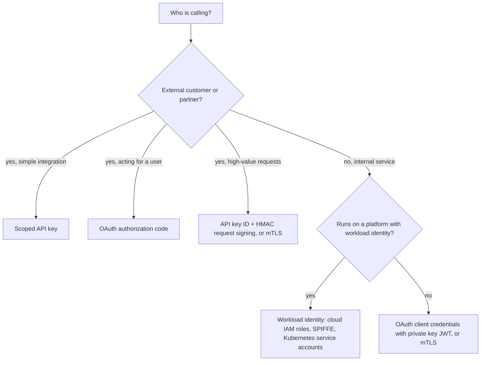
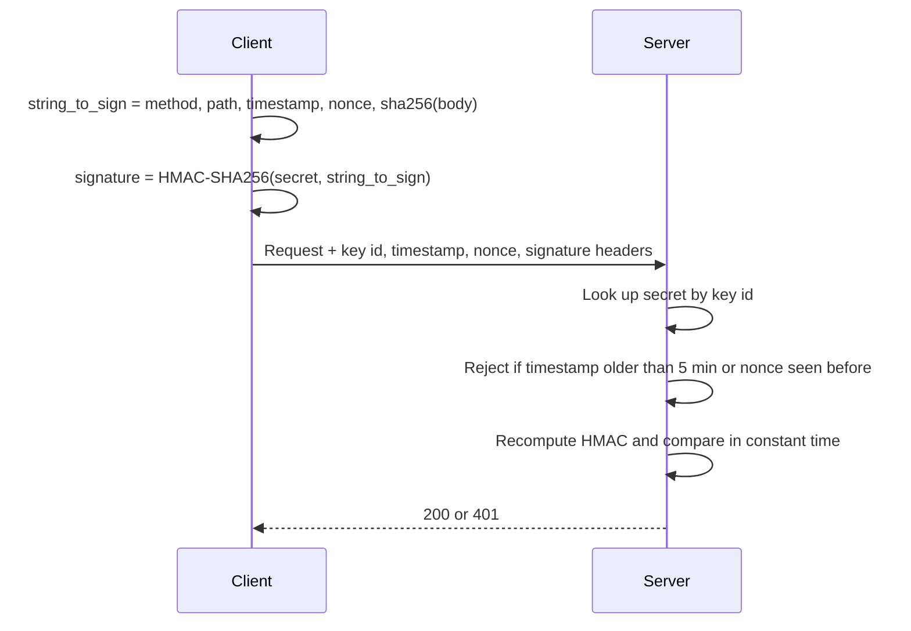

# API Keys and Service Authentication

## Introduction

Not every caller is a human with a browser. Scripts call your public API, microservices call each other, CI pipelines deploy to the cloud, and AI agents call tools. These **non-human identities** usually outnumber human users by a wide margin, and their credentials are some of the most frequently leaked secrets. They get pasted into code, committed to Git, printed in CI logs, and shared in chat.

This page covers how machines prove who they are:

- **API keys**: how to generate, store, scope, rotate and revoke them properly.
- **HMAC request signing**: proving that a request was not changed in transit, and was not replayed.
- **OAuth 2.0 client credentials** and **private key JWT** for service-to-service tokens.
- **Mutual TLS (mTLS)** and **workload identity** (SPIFFE, cloud workload identity federation) that remove long-lived secrets altogether.

An analogy: an API key is like a building access card issued to a delivery company. It is convenient, but if it is lost, whoever finds it gets in, so you want it to open only the loading dock, expire, and be easy to cancel. Workload identity is like the building checking the delivery van's registered license plate and the driver's company ID each time, instead of handing out a card at all.

## The Options at a Glance



## Designing API Keys

A well-designed API key has five properties:

1. **High entropy**: at least 128 bits, preferably 256, from a cryptographically secure random generator.
2. **Recognizable format**: a fixed prefix (like `cnr_live_`) so secret scanners can find leaked keys in code, logs and public repositories, and so humans can tell test keys from live ones.
3. **Stored hashed**: the server keeps only a hash, like a password. The plain key is shown once.
4. **Scoped and expiring**: each key has specific permissions, an owner and an expiry date.
5. **Identifiable without the secret**: a public key ID lets you show "key `cnr_live_7Hq...` last used yesterday" in the UI and logs without exposing the secret.

### Vulnerable: the typical first version

```python
# Vulnerable
import random
import string

API_KEYS = {}

def create_key_bad(account_id: int) -> str:
    key = "".join(random.choice(string.ascii_letters) for _ in range(20))  # not a CSPRNG
    API_KEYS[key] = {"account_id": account_id, "scopes": ["*"]}             # plain text, full access
    return key

def check_key_bad(request_args) -> dict | None:
    key = request_args.get("api_key")    # in the URL: ends up in logs, proxies, browser history
    return API_KEYS.get(key)             # never expires, cannot be told apart from other keys
```

Problems: `random` is predictable, keys are stored in plain text (a database leak exposes every customer), all keys have full access, keys travel in URLs, and there is no expiry, owner or audit trail.

### Fixed: prefixed, hashed, scoped keys

```python
# api_keys.py
import hashlib
import hmac
import secrets
import zlib
from datetime import datetime, timedelta, timezone

PREFIX = "cnr_live_"
PEPPER = b"load-a-32-byte-random-pepper-from-your-secret-manager"
KEYS = {}  # key_id -> record. Use a database table in production.

def _checksum(body: str) -> str:
    return format(zlib.crc32(body.encode()) & 0xFFFFFFFF, "08x")

def _digest(secret_part: str) -> str:
    # Keys have 256 bits of entropy, so a fast keyed hash is enough (no Argon2 needed)
    return hmac.new(PEPPER, secret_part.encode(), hashlib.sha256).hexdigest()

def create_key(account_id: int, scopes: set[str], days_valid: int = 90) -> str:
    key_id = secrets.token_hex(6)                   # public identifier, safe to log
    secret_part = secrets.token_urlsafe(32)         # 256 bits from the OS CSPRNG
    body = f"{key_id}_{secret_part}"
    KEYS[key_id] = {
        "account_id": account_id,
        "hash": _digest(secret_part),
        "scopes": scopes,
        "expires": datetime.now(timezone.utc) + timedelta(days=days_valid),
        "revoked": False,
        "last_used": None,
    }
    return f"{PREFIX}{body}_{_checksum(body)}"      # show to the user once, never store

def verify_key(presented: str, needed_scope: str) -> dict | None:
    if not presented.startswith(PREFIX):
        return None
    body, _, checksum = presented[len(PREFIX):].rpartition("_")
    if not body or _checksum(body) != checksum:     # cheap reject of typos and garbage
        return None
    key_id, _, secret_part = body.partition("_")
    rec = KEYS.get(key_id)
    if rec is None or rec["revoked"] or rec["expires"] < datetime.now(timezone.utc):
        return None
    if not hmac.compare_digest(rec["hash"], _digest(secret_part)):
        return None
    if needed_scope not in rec["scopes"]:
        return None
    rec["last_used"] = datetime.now(timezone.utc)
    return {"account_id": rec["account_id"], "key_id": key_id}

key = create_key(42, {"invoices:read"})
print(key[:22] + "...")
print(verify_key(key, "invoices:read"))
print(verify_key(key, "invoices:write"))           # scope not granted
corrupted = key[:-1] + ("1" if key[-1] == "0" else "0")
print(verify_key(corrupted, "invoices:read"))     # corrupted key
```

Example output:

```text
cnr_live_3f9a1c0b7e2d_...
{'account_id': 42, 'key_id': '3f9a1c0b7e2d'}
None
None
```

Design notes:

- **Hashing**: unlike passwords, random keys cannot be guessed, so a fast HMAC-SHA-256 with a server-side pepper is appropriate. It keeps verification cheap on every request.
- **Checksum**: lets you reject malformed keys without a database lookup, and helps secret scanners reduce false positives. GitHub uses a similar idea in its token format.
- **Prefix**: register your prefix pattern with secret-scanning programs (such as GitHub's secret scanning partner program) so leaked keys can be reported to you automatically. See [Secret Scanning](../6-sec-appsec-and-devsecops/7-sec-secret-scanning.mdx).
- **Transport**: accept keys only in a header such as `Authorization: Bearer ...` or `X-API-Key`, over HTTPS, and never in query strings.

### Using it in Flask

```python
from functools import wraps
from flask import Flask, abort, g, jsonify, request

app = Flask(__name__)

def api_key_required(scope: str):
    def decorator(view):
        @wraps(view)
        def wrapper(*args, **kwargs):
            auth = request.headers.get("Authorization", "")
            if not auth.startswith("Bearer "):
                abort(401)
            principal = verify_key(auth.removeprefix("Bearer "), scope)
            if principal is None:
                abort(401)
            g.principal = principal
            return view(*args, **kwargs)
        return wrapper
    return decorator

@app.get("/v1/invoices")
@api_key_required("invoices:read")
def list_invoices():
    return jsonify(account=g.principal["account_id"], invoices=[])

client = app.test_client()
print(client.get("/v1/invoices", headers={"Authorization": f"Bearer {key}"}).get_json())
print(client.get("/v1/invoices?api_key=" + key).status_code)
```

Output:

```text
{'account': 42, 'invoices': []}
401
```

Remember that a valid key only authenticates the **account**. Every endpoint still needs object-level authorization (does invoice 1002 belong to account 42?). See [Broken Object Level Authorization](../7-sec-api-security/2-sec-bola.mdx).

### Rotation without downtime

Customers cannot swap a key everywhere at the same instant. Support **at least two active keys** per integration:

1. Customer creates a new key.
2. Customer deploys it everywhere.
3. Your dashboard shows the old key's "last used" time stop moving.
4. Customer revokes the old key.

Also set expiry dates, email reminders before expiry, and an emergency "revoke all keys" button for incidents.

## HMAC Request Signing

A bearer API key proves possession, but if it leaks, it works until revoked, and it does not protect the request body from tampering by a misbehaving proxy. **HMAC request signing**, used in different forms by AWS Signature Version 4 and many payment APIs, keeps the secret on the client. Each request carries a signature over its method, path, timestamp and body hash. The secret itself never travels.



```python
# hmac_signing.py
import hashlib
import hmac
import secrets
import time

SECRETS = {"key_123": secrets.token_bytes(32)}  # shared with the client out of band
SEEN_NONCES = {}                                  # nonce -> expiry; use Redis SET NX EX in production
MAX_SKEW = 300

def string_to_sign(method: str, path: str, ts: str, nonce: str, body: bytes) -> bytes:
    return "\n".join([method.upper(), path, ts, nonce, hashlib.sha256(body).hexdigest()]).encode()

def sign(key_id: str, method: str, path: str, body: bytes) -> dict:
    ts, nonce = str(int(time.time())), secrets.token_hex(16)
    sig = hmac.new(SECRETS[key_id], string_to_sign(method, path, ts, nonce, body), hashlib.sha256).hexdigest()
    return {"X-Key-Id": key_id, "X-Timestamp": ts, "X-Nonce": nonce, "X-Signature": sig}

def verify(headers: dict, method: str, path: str, body: bytes) -> bool:
    secret = SECRETS.get(headers.get("X-Key-Id", ""))
    if secret is None:
        return False
    ts, nonce = headers.get("X-Timestamp", "0"), headers.get("X-Nonce", "")
    now = time.time()
    if not ts.isdigit() or abs(now - int(ts)) > MAX_SKEW:
        return False                                   # too old or from the future
    if SEEN_NONCES.get(nonce, 0) > now:
        return False                                   # replay
    expected = hmac.new(secret, string_to_sign(method, path, ts, nonce, body), hashlib.sha256).hexdigest()
    if not hmac.compare_digest(expected, headers.get("X-Signature", "")):
        return False
    SEEN_NONCES[nonce] = now + MAX_SKEW
    return True

body = b'{"amount": 1200, "currency": "EUR"}'
h = sign("key_123", "POST", "/v1/payouts", body)
print(verify(h, "POST", "/v1/payouts", body))                    # valid
print(verify(h, "POST", "/v1/payouts", body))                    # replayed
h2 = sign("key_123", "POST", "/v1/payouts", body)
print(verify(h2, "POST", "/v1/payouts", body.replace(b"1200", b"9900")))  # tampered body
```

Output:

```text
True
False
False
```

The same pattern protects incoming webhooks, covered in [Webhook Security](../7-sec-api-security/6-sec-webhook-security.mdx). The cost is complexity for API consumers, so provide SDKs that sign for them.

## Service-to-Service Authentication

Inside your own systems, aim to get rid of long-lived shared secrets entirely.

### OAuth client credentials with private key JWT

Services get short-lived access tokens from your authorization server using the **client credentials** grant (see [OAuth 2.0](./6-sec-oauth2.mdx)). Instead of a client secret, the service can authenticate with a signed JWT assertion (`private_key_jwt`, RFC 7523), so only a public key is registered at the authorization server:

```python
# client_assertion.py
import secrets
from datetime import datetime, timedelta, timezone
import jwt
from cryptography.hazmat.primitives.asymmetric import ec

service_key = ec.generate_private_key(ec.SECP256R1())  # in production: from a KMS or mounted secret
TOKEN_URL = "https://auth.example.com/oauth2/token"

def client_assertion(client_id: str) -> str:
    now = datetime.now(timezone.utc)
    return jwt.encode(
        {"iss": client_id, "sub": client_id, "aud": TOKEN_URL,
         "iat": now, "exp": now + timedelta(minutes=2), "jti": secrets.token_urlsafe(16)},
        service_key, algorithm="ES256", headers={"kid": "billing-2026-10"},
    )

form = {
    "grant_type": "client_credentials",
    "scope": "invoices.write",
    "client_assertion_type": "urn:ietf:params:oauth:client-assertion-type:jwt-bearer",
    "client_assertion": client_assertion("billing-service"),
}
print(sorted(form))  # POST this form to TOKEN_URL with requests.post(TOKEN_URL, data=form)
```

Output:

```text
['client_assertion', 'client_assertion_type', 'grant_type', 'scope']
```

### Mutual TLS

In normal TLS, only the server proves its identity. In **mutual TLS**, the client also presents a certificate, and the server verifies it against a trusted CA. Service meshes such as Istio and Linkerd turn on mTLS between pods automatically, issuing and rotating short-lived certificates. RFC 8705 also lets OAuth bind access tokens to a client certificate. A minimal nginx setup that requires client certificates:

```nginx
server {
    listen 443 ssl;
    server_name api.internal.example.com;

    ssl_certificate         /etc/nginx/tls/server.crt;
    ssl_certificate_key     /etc/nginx/tls/server.key;
    ssl_client_certificate  /etc/nginx/tls/internal-ca.crt;  # CA that signs service certs
    ssl_verify_client       on;

    location / {
        proxy_set_header X-Client-Cert-Subject $ssl_client_s_dn;
        proxy_pass http://127.0.0.1:8000;
    }
}
```

The backend must only trust the `X-Client-Cert-Subject` header when it comes from this proxy, never from the public internet. See [PKI and Certificates](../1-sec-cryptography/6-sec-pki-and-certificates.mdx) and [TLS and HTTPS](../1-sec-cryptography/7-sec-tls.mdx).

### Workload identity: no secrets to leak

The best service credential is one nobody has to store. **Workload identity** gives each workload an identity from the platform it runs on:

- **Cloud IAM roles** for VMs, containers and functions (AWS IAM roles, Google Cloud service accounts, Azure managed identities). The SDK fetches short-lived credentials automatically.
- **Kubernetes service account tokens**, projected and short-lived, exchanged for cloud credentials (for example EKS Pod Identity or GKE Workload Identity Federation).
- **CI/CD OIDC federation**: GitHub Actions, GitLab CI and others issue an OIDC token per job, which the cloud trusts in exchange for temporary credentials. No cloud keys are stored in CI secrets.
- **SPIFFE/SPIRE**: an open standard and CNCF project that issues cryptographic identities (`spiffe://example.org/billing`) to workloads in any environment.

A GitHub Actions example that deploys to AWS with no stored keys:

```yaml
name: deploy
on:
  push:
    branches: [main]
permissions:
  id-token: write   # allow the job to request an OIDC token
  contents: read
jobs:
  deploy:
    runs-on: ubuntu-latest
    steps:
      - uses: actions/checkout@v4
      - uses: aws-actions/configure-aws-credentials@v4
        with:
          role-to-assume: arn:aws:iam::123456789012:role/deploy-from-main
          aws-region: eu-west-1
      - run: aws sts get-caller-identity
```

The IAM role's trust policy should restrict which repository and branch may assume it (the token's `sub` claim, such as `repo:my-org/my-app:ref:refs/heads/main`). Action versions and claim formats change over time, so check the [GitHub OIDC docs](https://docs.github.com/en/actions/security-for-github-actions/security-hardening-your-deployments/about-security-hardening-with-openid-connect) and your cloud provider's documentation. More in [Securing CI/CD Pipelines](../6-sec-appsec-and-devsecops/8-sec-pipeline-security.mdx) and [Cloud IAM Security](../8-sec-cloud-and-container/1-sec-cloud-iam.mdx).

## Real-World Scenario

Your team runs a payments platform. You have a public API used by merchants, 30 internal microservices, and a CI pipeline that deploys to the cloud. An incident review found: a merchant's full-access API key was committed to a public GitHub repository and used to create refunds; internal services share one static token from a config file; and CI uses a cloud access key that has not been rotated in three years.

### The solution

1. **Merchant API keys**: switch to prefixed, hashed keys with scopes (`payments:read`, `refunds:write`), expiry and last-used tracking. Register the prefix with GitHub secret scanning so leaked keys are reported and auto-revoked.
2. **High-risk operations** (refunds, payouts): require HMAC request signing with timestamps and nonces, or mTLS for large merchants.
3. **Internal services**: issue each service its own identity through the service mesh (mTLS with SPIFFE IDs) and short-lived OAuth client-credentials tokens with per-service scopes. Each service checks the caller's identity, not just "is this a valid internal token".
4. **CI/CD**: replace the cloud access key with OIDC federation, restricted to the main branch of the deploy repository.
5. **Detection**: alert on API key use from new IP ranges, sudden scope usage changes, and any use of a revoked key.

### Why this approach

Each fix removes a long-lived, over-privileged shared secret. Scopes limit what a leaked merchant key can do, signing stops a leaked key alone from creating refunds, per-service identities limit lateral movement, and OIDC federation leaves no CI key to leak.

### When to use it, and when not to

- Simple scoped API keys are fine for read-only or low-risk public APIs, and developers expect them.
- HMAC signing adds friction. Use it where tampering or replay would cause real financial damage.
- mTLS everywhere is easiest with a service mesh. Without one, certificate operations can be a burden for small teams.
- Workload identity should be the default whenever your platform supports it.

### Alternatives and trade-offs

| Approach | Pros | Cons | Best for |
| --- | --- | --- | --- |
| Static API key (hashed, scoped) | Simple, universal | Bearer secret, leaks are common | Public developer APIs, low-risk access |
| API key + HMAC signing | Secret never sent, tamper and replay protection | Client complexity, clock sync needed | Payments, financial APIs, webhooks |
| OAuth client credentials (secret) | Short-lived tokens, central scopes | Client secret is still a static secret | Internal and partner M2M |
| OAuth with private key JWT | No shared secret, key can live in KMS/HSM | Key management on the client | Higher-assurance M2M |
| Mutual TLS | Strong identity, encrypted channel, mesh automation | Certificate lifecycle, debugging is harder | Internal service mesh, B2B links |
| Workload identity (cloud IAM, SPIFFE, CI OIDC) | No stored secrets, automatic rotation | Platform-specific setup | Anything running on a supported platform |

## Common Mistakes

- **Keys in URLs**, where they leak into logs, analytics and `Referer` headers.
- **Plain-text key storage**, or showing full keys again in the dashboard.
- **One key with full access** for every integration.
- **No expiry and no rotation path**, so keys live forever.
- **Non-constant-time comparison** of keys or signatures.
- **Signing without timestamps or nonces**, which allows replay.
- **Trusting identity headers** like `X-User-Id` or `X-Client-Cert-Subject` that external callers can set.
- **Shared credentials across services**, so one compromise exposes everything and logs cannot tell callers apart.
- **Long-lived cloud keys in CI** when OIDC federation is available.

## Summary

- Non-human identities need the same care as human ones: strong credentials, least privilege, rotation and monitoring.
- Good API keys are random, prefixed, hashed at rest, scoped, expiring, and identifiable by a public ID.
- HMAC request signing proves possession without sending the secret and blocks tampering and replay.
- For services, prefer short-lived tokens (client credentials with private key JWT), mTLS, and workload identity that removes stored secrets.
- A valid credential authenticates the caller. You still need object-level authorization on every request.

## Exercises

1. Add a `rotate_key(key_id)` function to `api_keys.py` that creates a new key with the same scopes and sets the old key to expire in 7 days.
2. Write a Flask endpoint that verifies the HMAC signature scheme above, including body hashing of the raw request bytes (`request.get_data()`).
3. Configure GitHub Actions OIDC with a sandbox cloud account and restrict the trust policy to one branch. Try running the workflow from a different branch and observe the failure.
4. Inventory the non-human credentials in a project you work on: API keys, tokens, cloud keys, database passwords. Mark which could be replaced with workload identity.

Related: [Secrets Management in Code](../5-sec-secure-coding/3-sec-secrets-in-code.mdx), [Rate Limiting and Abuse Prevention](../7-sec-api-security/3-sec-rate-limiting.mdx), [API Gateways and WAFs](../7-sec-api-security/7-sec-api-gateway-security.mdx), and for AI agents calling tools, [Agent Security](../../../ai/agents/12-agents-safety-and-security/0-agents-security-introduction.mdx).
